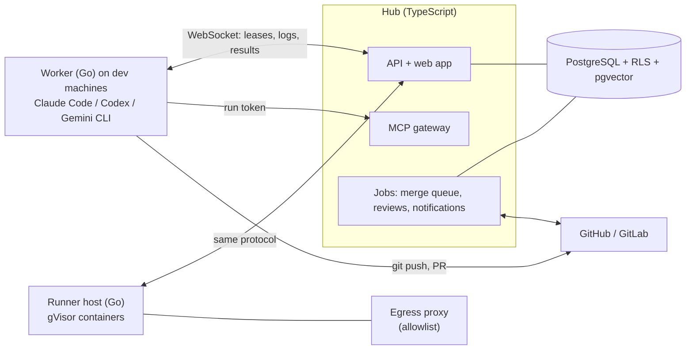

<p align="center">
  <picture>
    <source media="(prefers-color-scheme: dark)" srcset="docs/design-system/assets/logos/png/xdev-hive-dark.png">
    
  </picture>
</p>

<p align="center"><b>A self-hosted control plane for teams that run coding agents.</b></p>

<p align="center">English · <a href="README.vi.md">Tiếng Việt</a></p>

# xDev Hive

xDev Hive lets several teams in one organization hand work to coding-agent CLIs (Claude Code, Codex, Gemini CLI),
run those agents on their own machines or in sandboxes, share memory, docs and skills between runs, and review and
merge the results through a single board.

> **Status:** early and moving fast (pre-1.0). APIs, database schema and the worker protocol may still change between
> releases. The web UI is currently in Vietnamese; English UI and docs are planned.

## Why

Coding agents are good at individual tasks, but a team running many of them quickly needs answers to questions a single
CLI session cannot give: which machine runs which task, what did it cost, who reviews the PR, what did the last agent
learn about this repo, and how do we keep agents from stepping on each other's branches. xDev Hive is the hub that
answers those questions while the agents keep running where your code and credentials already live.

## Features

- **Task board and runs.** Create tasks per project, assign them to an agent CLI, follow each run live (phases, logs,
  events over SSE), cancel it, or send extra instructions to a running Claude Code session.
- **Your machines, your logins.** A small Go worker runs on macOS, Linux or Windows dev machines and drives the CLIs
  that are already logged in there. The hub never stores CLI credentials. Workers can run as a background service.
- **Outcome policies.** Each project decides what "done" means: exit codes, required checks, agent reports, CI status,
  and optional cross-review by a different agent CLI, only when the diff is large or touches sensitive paths.
- **Merge queue.** Approved PRs merge one by one on GitHub or GitLab; branches are updated against the latest base and
  CI must pass before each merge.
- **Plan mode.** For projects that want it, an agent first writes a plan in a read-only run; a human approves, edits or
  rejects it before any code is written.
- **Leader chat.** Talk to a leader agent about a project; it can only propose actions (create or assign tasks, change
  settings, …), and nothing happens until someone with the right permission approves the proposal.
- **Shared knowledge over MCP.** Agents in a run get a scoped MCP gateway with memory search, docs, skills and task
  updates, using a short-lived run token. Teams curate memory, documents and skills in the hub.
- **Costs and budgets.** Token usage and cost are recorded per run, task, CLI and machine. Projects can cap cost per
  run, per task and the number of turns; runs that exceed a budget are stopped with a reason.
- **Sandboxed runs (optional).** A runner host executes runs in single-use gVisor containers with no network
  interface; the only way out is an egress proxy with a default-deny allowlist per organization and project.
- **Notifications.** Telegram and email channels per organization, plus a personal inbox in the web app.
- **Invite-only accounts.** Email and password, GitHub, GitLab and organization SSO (OIDC). Nobody can self-register;
  people join through invitations or a verified SSO domain. Multi-tenant data isolation is enforced with PostgreSQL
  row-level security.
- **Desktop app.** A Tauri app that registers the machine, runs the worker in the background and shows notifications.

## How it works



1. A task is assigned to an agent CLI. The hub offers the run to an online machine that has that CLI and free capacity.
2. The worker prepares a git worktree, starts the CLI with the task prompt and a scoped MCP configuration, and streams
   logs, usage and results back over a durable, acknowledged WebSocket channel.
3. When the agent finishes, the hub evaluates the project's outcome policy, opens the PR, optionally starts a
   cross-review run, and moves the PR into the merge queue.

Machines connect out to the hub, so dev machines behind NAT or a firewall work without inbound ports.

## Quick start (local development)

Requirements: Docker with Compose v2, Node 24+, pnpm 12, Go 1.27. Rust is only needed for the desktop app.

```sh
pnpm install
pnpm dev                 # PostgreSQL, database setup, hub on :3000 and web on :5173
cd worker && go run ./cmd/hive-worker check --hub http://localhost:3000
```

Run the whole flow end to end (PostgreSQL, hub, sign-up, project, worker, task, run, PR, merge queue) against a local
git repository and a fake CLI, with no external network access:

```sh
pnpm e2e:smoke
```

Before opening a pull request, run `pnpm check` (lint, typecheck, module boundaries, tests). Tests that use the database
need Docker.

## Self-hosting

The hub ships as a Docker Compose stack (hub and PostgreSQL, with an optional Caddy profile for HTTPS). From a
development machine with SSH access to a server:

```sh
HIVE_PUBLIC_URL=https://hive.example.com HIVE_ORG_CREATORS=admin@example.com deploy/remote.sh user@server
```

Secrets are generated on the server and never printed. Then create a one-time token in the web app (Machines → Add
machine) and install the worker on each machine. The script downloads the prebuilt binary, checks the release signature
and checksum, registers the machine and installs a background service:

```sh
# Linux, macOS
curl -fsSL https://github.com/tdduydev/xdev-hive/releases/latest/download/install.sh | sh -s -- --hub https://hive.example.com --token <one-time token>
```

```powershell
# Windows
irm https://github.com/tdduydev/xdev-hive/releases/latest/download/install.ps1 -OutFile "$env:TEMP\hive-install.ps1"
powershell -NoProfile -ExecutionPolicy Bypass -File "$env:TEMP\hive-install.ps1" -Hub https://hive.example.com -Token <one-time token>
```

`hive-worker update` upgrades a machine to the latest release.

See [docs/self-hosting.md](docs/self-hosting.md) for configuration, the first administrator account, HTTPS, MCP over
plain HTTP on trusted networks, backups and restore, background workers and sandboxed runs.

## Repository layout

| Path | What it is |
|---|---|
| `apps/hub` | Hub: Node, Hono, oRPC, Drizzle, pg-boss, Better Auth, MCP SDK. Business logic lives in `src/modules/<name>/` |
| `apps/web` | Web app: React, Vite, TanStack Query, Tailwind |
| `apps/desktop` | Desktop app: Tauri |
| `packages/contracts` | API contracts (oRPC + zod) and the worker protocol; generates `openapi.json` |
| `worker` | Worker, runner host and egress proxy in Go (separate Go module) |
| `deploy` | Docker Compose stack, remote deploy, backup and restore scripts |
| `docs` | Architecture, decisions, design system and screen designs |

## Documentation

- [Self-hosting guide](docs/self-hosting.md)
- [Architecture](docs/architecture.md): components, modules, data model, worker protocol, security and operations
  (Vietnamese).
- [Decisions](docs/decisions.md): scope, stack and pinned versions (Vietnamese).
- [Design system](docs/design-system/README.md) and [screen designs](docs/design-system/screens/README.md).
- [Contributor and agent conventions](AGENTS.md).

## Security

Please do not report security issues in public issues. Use GitHub's private vulnerability reporting for this
repository instead.

## License

xDev Hive is licensed under the [GNU Affero General Public License v3.0](LICENSE). If you run a modified version as a
network service, the AGPL requires you to offer its source code to the users of that service.
