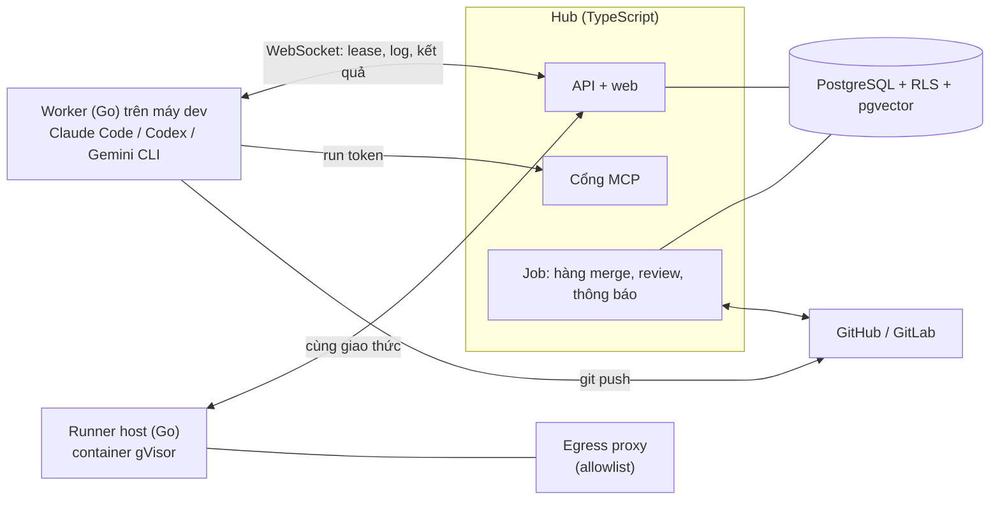
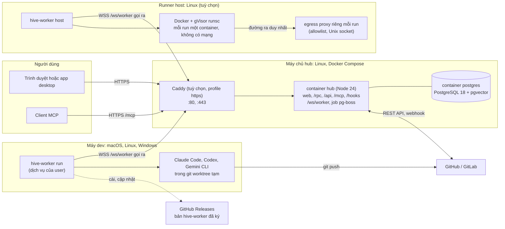

<p align="center">
  <picture>
    <source media="(prefers-color-scheme: dark)" srcset="docs/design-system/assets/logos/png/xdev-hive-dark.png">
    
  </picture>
</p>

<p align="center"><b>Trung tâm điều phối tự host cho các đội dùng coding agent.</b></p>

<p align="center"><a href="README.md">English</a> · Tiếng Việt</p>

# xDev Hive

xDev Hive giúp nhiều đội trong một tổ chức giao việc cho các coding agent CLI (Claude Code, Codex, Gemini CLI), chạy
agent ngay trên máy của mình hoặc trong sandbox, dùng chung memory, tài liệu và skill giữa các lần chạy, rồi review và
merge kết quả trên cùng một bảng việc.

> **Trạng thái:** đang ở giai đoạn đầu và thay đổi nhanh (trước 1.0). API, schema database và giao thức worker còn có
> thể đổi giữa các bản. Giao diện web hiện bằng tiếng Việt; giao diện và tài liệu tiếng Anh sẽ có sau.

## Vì sao cần

Coding agent làm tốt từng việc riêng lẻ. Nhưng khi một đội chạy nhiều agent cùng lúc, sẽ có những câu hỏi mà một phiên
CLI không trả lời được: máy nào chạy việc nào, tốn bao nhiêu tiền, ai review PR, agent trước đã biết gì về repo này, làm
sao để các agent không dẫm lên nhánh của nhau. xDev Hive là nơi trả lời các câu hỏi đó, còn agent vẫn chạy ở nơi đã có
sẵn code và thông tin đăng nhập của bạn.

## Tính năng

- **Bảng việc và run.** Tạo việc theo dự án, giao cho một agent CLI, theo dõi từng run trực tiếp (các pha, log, sự kiện
  qua SSE), huỷ run, hoặc gửi thêm chỉ dẫn vào phiên Claude Code đang chạy.
- **Máy của bạn, tài khoản của bạn.** Một worker Go nhỏ chạy trên máy dev macOS, Linux hoặc Windows và điều khiển các CLI
  đã đăng nhập sẵn trên máy đó. Hub không giữ thông tin đăng nhập của CLI. Worker chạy nền được như một dịch vụ.
- **Chính sách kết quả.** Mỗi dự án tự định nghĩa thế nào là "xong": mã thoát, các bước kiểm, báo cáo của agent, trạng
  thái CI, và review chéo bởi một agent CLI khác, chỉ khi diff lớn hoặc đụng đường dẫn quan trọng.
- **Hàng merge.** PR đã duyệt được merge lần lượt trên GitHub hoặc GitLab; nhánh được cập nhật theo nhánh chính mới
  nhất và CI phải xanh trước mỗi lần merge.
- **Plan mode.** Dự án nào cần thì agent viết kế hoạch trước trong một run chỉ đọc; người duyệt chấp nhận, sửa hoặc từ
  chối trước khi có dòng code nào được viết.
- **Leader chat.** Trao đổi với một leader agent về dự án; leader chỉ đề xuất hành động (tạo việc, giao việc, đổi cài
  đặt…), người có quyền duyệt thì hành động mới được thực hiện.
- **Tri thức dùng chung qua MCP.** Agent trong run nhận một cổng MCP giới hạn gồm tìm memory, đọc tài liệu, skill và cập
  nhật việc, dùng run token ngắn hạn. Các đội tự quản lý memory, tài liệu và skill trên hub.
- **Chi phí và ngân sách.** Token và chi phí được ghi theo run, việc, CLI và máy. Dự án đặt trần chi phí mỗi run, mỗi
  việc và số lượt; run vượt ngân sách bị dừng kèm lý do.
- **Run trong sandbox (tuỳ chọn).** Runner host chạy mỗi run trong một container gVisor dùng một lần, không có card mạng;
  đường ra duy nhất là egress proxy với allowlist mặc định chặn, theo tổ chức và dự án.
- **Thông báo.** Kênh Telegram và email theo tổ chức, cùng hộp thông báo cá nhân trên web.
- **Chỉ người được mời mới có tài khoản.** Email và mật khẩu, GitHub, GitLab và SSO (OIDC) của tổ chức. Không ai tự đăng ký
  được; người dùng vào qua lời mời hoặc qua tên miền SSO đã xác minh. Dữ liệu các tổ chức được tách bằng row-level
  security của PostgreSQL.
- **App desktop.** App Tauri đăng ký máy, chạy worker nền và hiện thông báo.

## Cách hoạt động



1. Một việc được giao cho một agent CLI. Hub đưa run cho một máy đang trực tuyến có CLI đó và còn chỗ chạy.
2. Worker chuẩn bị git worktree, chạy CLI với prompt của việc và cấu hình MCP riêng cho run, rồi gửi log, mức dùng token
   và kết quả về hub qua kênh WebSocket bền, có xác nhận từng gói.
3. Agent xong thì hub chạy chính sách kết quả của dự án, mở PR, chạy review chéo nếu cần, rồi đưa PR vào hàng merge.

Máy kết nối ra hub, nên máy dev nằm sau NAT hay tường lửa vẫn dùng được mà không cần mở cổng vào.

## Triển khai



| Máy | Chạy gì | Mở cổng | Gọi tới |
|---|---|---|---|
| Máy chủ hub | `postgres`, `hub`, thêm `caddy` nếu cần, từ `deploy/compose.yaml` | `HIVE_BIND:3000` (mặc định chỉ loopback), hoặc 80/443 qua Caddy | GitHub/GitLab, API release của GitHub, API embeddings và kênh thông báo nếu cấu hình |
| Máy dev | `hive-worker run` dạng dịch vụ systemd của user, LaunchAgent hoặc tác vụ Task Scheduler, hoặc trong app desktop | không | hub qua HTTPS và WSS, Git host |
| Runner host | `hive-worker host`, Docker có runtime gVisor `runsc` | không | hub qua WSS, Git host; mỗi run chỉ ra được allowlist qua egress proxy riêng |

Máy chỉ gọi ra, nên chạy được sau NAT hay tường lửa. Có thể tách tiến trình hub theo vai trò (`HIVE_ROLES=api` hoặc
`jobs`) khi một container không đủ. Chi tiết thiết kế ở [Architecture Design Document](docs/add.md) (tiếng Anh).

## Chạy thử tại máy (phát triển)

Cần Docker có Compose v2, Node 24+, pnpm 12, Go 1.27. Rust chỉ cần khi làm app desktop.

```sh
pnpm install
pnpm dev                 # PostgreSQL, setup database, hub ở :3000 và web ở :5173
cd worker && go run ./cmd/hive-worker check --hub http://localhost:3000
```

Chạy trọn luồng (PostgreSQL, hub, đăng ký, dự án, worker, việc, run, PR, hàng merge) với repo git cục bộ và CLI giả,
không ra mạng ngoài:

```sh
pnpm e2e:smoke
```

Trước khi mở pull request, chạy `pnpm check` (lint, typecheck, ranh giới module, test). Test có database cần Docker.

## Tự host

Hub được đóng gói thành stack Docker Compose (hub và PostgreSQL, thêm profile Caddy cho HTTPS nếu cần). Từ máy dev có
quyền SSH vào máy chủ:

```sh
HIVE_PUBLIC_URL=https://hive.example.com HIVE_ORG_CREATORS=admin@example.com deploy/remote.sh user@server
```

Secret được sinh ngay trên máy chủ và không bao giờ in ra. Sau đó tạo mã dùng một lần trên web (Máy → Thêm máy) và cài
worker trên từng máy. Script tải binary dựng sẵn, kiểm chữ ký và checksum của bản phát hành, đăng ký máy rồi cài dịch vụ
chạy nền:

```sh
# Linux, macOS
curl -fsSL https://github.com/tdduydev/xdev-hive/releases/latest/download/install.sh | sh -s -- --hub https://hive.example.com --token <mã dùng một lần>
```

```powershell
# Windows
irm https://github.com/tdduydev/xdev-hive/releases/latest/download/install.ps1 -OutFile "$env:TEMP\hive-install.ps1"
powershell -NoProfile -ExecutionPolicy Bypass -File "$env:TEMP\hive-install.ps1" -Hub https://hive.example.com -Token <mã dùng một lần>
```

`hive-worker update` nâng máy lên bản phát hành mới nhất.

Xem [docs/self-hosting.md](docs/self-hosting.md) (tiếng Anh) về cấu hình, tài khoản quản trị đầu tiên, HTTPS, MCP qua
HTTP trong mạng tin cậy, sao lưu và khôi phục, worker chạy nền và run trong sandbox.

## Cấu trúc repo

| Đường dẫn | Là gì |
|---|---|
| `apps/hub` | Hub: Node, Hono, oRPC, Drizzle, pg-boss, Better Auth, MCP SDK. Nghiệp vụ nằm trong `src/modules/<tên>/` |
| `apps/web` | Web: React, Vite, TanStack Query, Tailwind |
| `apps/desktop` | App desktop: Tauri |
| `packages/contracts` | Hợp đồng API (oRPC + zod) và giao thức worker; sinh `openapi.json` |
| `worker` | Worker, runner host và egress proxy bằng Go (module Go riêng) |
| `deploy` | Stack Docker Compose, script triển khai từ xa, sao lưu và khôi phục |
| `docs` | Kiến trúc, quyết định, design system và thiết kế màn hình |

## Tài liệu

- [Architecture Design Document](docs/add.md) (tiếng Anh): mục tiêu, bối cảnh, khối thành phần, luồng chạy, mô hình
  triển khai, bảo mật, quyết định, rủi ro. Mô tả đúng code đang có.
- [Software Requirements Specification](docs/srs.md) (tiếng Anh): yêu cầu có mã, trạng thái và test kiểm chứng.
- [Software Design Description](docs/sdd.md) (tiếng Anh): dữ liệu, giao diện, máy trạng thái, thuật toán, giới hạn.
- [Architecture decision records](docs/adr/README.md) (tiếng Anh).
- Tính năng mới đi theo [Spec Kit](https://github.com/github/spec-kit) (`/speckit-specify`, `/speckit-plan`,
  `/speckit-tasks`, `/speckit-implement`; nguyên tắc ở `.specify/memory/constitution.md`) và
  [checklist tính năng](docs/feature-checklist.md). Giao diện thiết kế bằng skill `ui-ux-pro-max`, code bằng shadcn/ui
  qua shadcn MCP (`.mcp.json`).
- [Hướng dẫn tự host](docs/self-hosting.md) (tiếng Anh) và [phát hành worker](docs/releasing.md).
- [Ghi chú kiến trúc](docs/architecture.md): bản thiết kế ban đầu, có đánh dấu phần chưa làm.
- [Quyết định](docs/decisions.md): phạm vi, stack và các phiên bản đã chốt.
- [Design system](docs/design-system/README.md) và [thiết kế màn hình](docs/design-system/screens/README.md).
- [Quy ước cho người đóng góp và agent](AGENTS.md).

## Bảo mật

Đừng báo lỗ hổng bảo mật qua issue công khai. Hãy dùng tính năng báo lỗ hổng riêng tư (private vulnerability reporting)
của GitHub cho repo này.

## Giấy phép

xDev Hive phát hành theo [GNU Affero General Public License v3.0](LICENSE). Nếu bạn chạy một bản đã sửa đổi thành dịch
vụ qua mạng, AGPL yêu cầu bạn cung cấp mã nguồn của bản đó cho người dùng dịch vụ.
