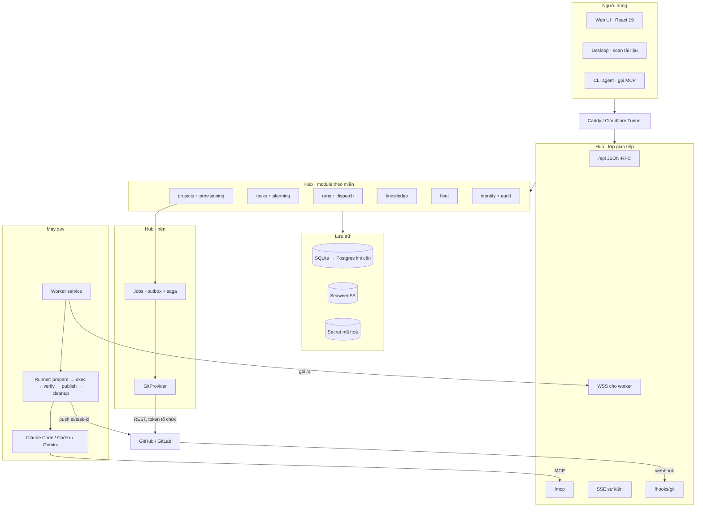
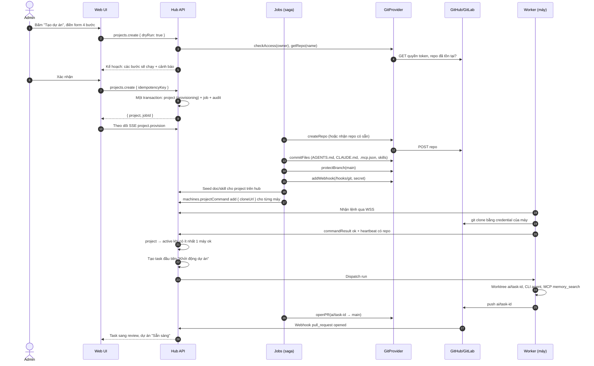
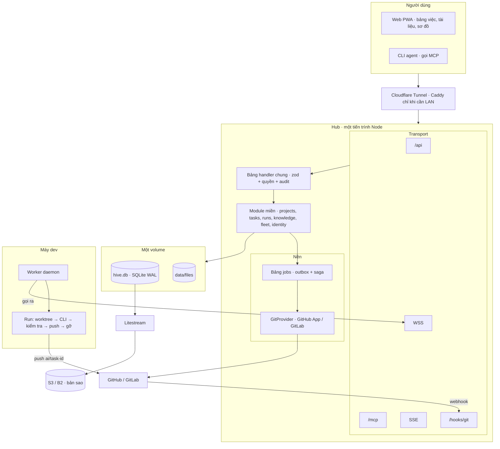

# Thiết kế lại xDev Hive: tạo project trên web (2026-10)

Bản nháp để review. Trang có mockup giao diện: [`index.html`](index.html) (bản artifact cùng nội dung). Sơ đồ là ảnh SVG trong `diagrams/`, mã Mermaid nằm trong mục thu gọn dưới mỗi ảnh.
Quy ước: **[Giả định]** là điều suy ra, chưa kiểm bằng code hoặc chưa có trong dữ liệu đã đưa. Chỗ ghi "đã kiểm" là đã đọc trong code ở commit `9fc04774`.

Yêu cầu đang xét: **(1) tạo project mới ngay trên web: repo mới + project trên hub + agent nhận việc được.** Yêu cầu 2, 3 còn trống.

---

## 1. Phân tích

### 1.1 Hiện trạng so với yêu cầu (1)

| Mảnh cần cho "tạo project trên web" | Hiện có (đã kiểm) | Thiếu |
|---|---|---|
| Thực thể project trên hub | `projects.list/archive/restore/delete/retire/resume` ở `packages/core/src/methods.ts:1294`. `ProjectSummary` tổng hợp số task/doc/memory/run và máy báo repo. | `projects.create`. [Giả định] project là khoá ngầm: chỉ có bảng trạng thái (archived/deleted/retired), không có bảng `projects` chứa repo URL, provider, nhánh mặc định. |
| Ra lệnh cho máy clone | `machines.projectCommand` (`op: add/remove`, `repo`, `gitlabProject`, `cloneUrl`), TTL 24 giờ, máy trả kết quả qua `machines.commandResult` (`packages/core/src/machine-projects.ts`). | `add` bắt buộc có đường dẫn `repo` tuyệt đối do hub đặt. Hub không biết cấu trúc ổ đĩa của máy. |
| Tích hợp git provider | Cài đặt token GitHub (PAT fine-grained: Contents + Pull requests) và GitLab (scope `api`), mở MR/PR, import cả nhóm GitLab (roadmap 19a), `suggestProjectKey`. | Không có lớp `GitProvider` phía hub. Token GitHub hiện không đủ quyền tạo repo trong org (cần thêm Administration: write). |
| Template repo | Chưa thấy. | Bộ file mẫu (AGENTS.md có project key, CLAUDE.md, `.mcp.json`, `.claude/skills/`) và cách áp vào repo. |
| Tiến trình nhiều bước | Onboarding UX-70 (`ProjectOnboarding.tsx`) đọc tiến độ từ repo/heartbeat/policy/task. | Không có job/saga phía hub: bước nào lỗi thì làm lại từ đầu, không idempotent. |
| Agent nhận việc ngay | `task_create`, `run_dispatch`, `machines.setupMissing`. | Không có điều kiện "project sẵn sàng" để tự giao task đầu tiên. |

**Kết luận:** khoảng 40% đường đi đã có (lệnh máy clone, token provider, onboarding). Phần thiếu chính là **thực thể project + GitProvider phía hub + job nhiều bước**.

### 1.2 Mạnh và yếu

| | Mạnh | Yếu |
|---|---|---|
| Hợp đồng | 204 method khai báo bằng zod, quyền theo method (`viewer`/`admin`). Thêm method mới rẻ. | `methods.ts` cũng phình. Không có version API. |
| Ranh giới máy/hub | Máy gọi ra, credential CLI ở lại máy. Hợp với tạo project: hub gọi provider, máy tự clone. | Máy clone repo private cần quyền đọc riêng. Nguyên tắc 4 làm bước "gắn máy" dễ lỗi. |
| Lưu trữ | node:sqlite một file: deploy đơn giản, backup bằng copy. | `sqlite.ts` 11.320 dòng, mọi miền trong một class. Mọi PR đụng cùng file. |
| Runner | Nhiều CLI agent, merge queue, gate. | `runner.ts` 3.542 dòng. Run thiếu MCP vẫn `succeeded`. Worktree chỉ dọn khi gọi `machines.manageWorktrees` bằng tay. |
| Chất lượng | 2.214 test. | Chưa có e2e web, chưa test máy thật. Nhiều phần merge chỉ qua typecheck. |
| Bảng task | Spec Kit + `plan.create` tạo đồ thị task. | 139 task mở, 58 task nhỏ từ Spec Kit. Board thành nhiễu. |

### 1.3 Giữ / Sửa / Bỏ

| Quyết định | Thành phần | Lý do |
|---|---|---|
| **Giữ** | JSON-RPC + zod, MCP HTTP/stdio, SSE | Hợp đồng chặt, đã có test. |
| **Giữ** | Kênh WSS máy gọi ra, worktree tạm, nhánh `ai/<task>` | Đúng nguyên tắc 2, 3. Không cần mở cổng trên máy. |
| **Giữ** | node:sqlite (trước mắt), SeaweedFS | Một hub, tải thấp. Chưa có lý do đổi. Xem 2.2. |
| **Giữ** | Electron chỉ để soạn tài liệu | Tách vai rõ. Tạo project chỉ làm trên web. |
| **Sửa** | `sqlite.ts` → module theo miền + repository + unit of work | Giảm xung đột PR, mở đường sang Postgres. |
| **Sửa** | `runner.ts` → pipeline pha: prepare → exec → verify → publish → cleanup | Có chỗ đặt kiểm tra kết quả và dọn dẹp. |
| **Sửa** | Định nghĩa `succeeded`: cần bằng chứng (commit mới trên nhánh, hoặc `task_update` qua MCP, hoặc lý do "không cần đổi") | Run rỗng không được báo thành công. |
| **Sửa** | `projectCommand add`: cho phép chỉ có `cloneUrl`, máy tự chọn thư mục trong `projectsRoot` | Hub không phải đoán đường dẫn trên máy. |
| **Sửa** | Dọn worktree/nhánh tự động theo trạng thái task + thời hạn giữ | Hết cảnh hơn 50 worktree, hơn 100 nhánh. |
| **Bỏ** | Project sinh ngầm khi máy thêm thư mục | Đổi thành: máy báo repo lạ → hub hiện "Nhận làm project?". Project chỉ sinh từ `projects.create`. |
| **Bỏ** | Spec Kit đẩy từng task nhỏ lên board | Task nhỏ thành checklist trong task cha. Board chỉ giữ việc giao được cho một run. |
| **Bỏ (cần chốt)** | `retire` tách khỏi `archive` | [Giả định] hai trạng thái gần nghĩa với người dùng. Gộp thành một vòng đời: `provisioning → active → archived → deleted`. |

---

## 2. Kiến trúc đích

### 2.1 Sơ đồ thành phần


<details><summary>Mã Mermaid</summary>



</details>

Điểm mới so với hiện tại: **projects + provisioning**, **Jobs (outbox + saga)**, **GitProvider phía hub**, **webhook vào**, và domain module thay cho một class `SqliteHive`. Nguyên tắc 3 vẫn giữ: hub gọi ra provider, không gọi vào máy.

### 2.2 Đổi công nghệ: khi nào

| Đề xuất | Lý do | Làm khi nào | Bây giờ làm gì |
|---|---|---|---|
| SQLite → Postgres | Nhiều instance hub, ghi đồng thời, PITR | Khi có **một** trong: cần 2 hub chạy song song (HA), `SQLITE_BUSY` lặp lại trong log, DB vượt vài GB, cần backup theo thời điểm | Tách repository theo miền (bước C). Viết bộ test hợp đồng repository chạy được trên cả hai. Không đổi ngay. |
| Bảng `jobs` trong SQLite (không thêm Redis/BullMQ) | Saga tạo project cần retry, idempotent, sống qua restart | Ngay ở bước B4 | Một bảng `jobs` + `job_steps`, worker trong tiến trình hub. |
| GitProvider bằng `fetch` + zod (không Octokit/gitbeaker) | Chỉ cần ~8 endpoint mỗi bên, tránh thêm dependency lớn | Bước B2 | Test bằng `undici` MockAgent. |
| GitHub App thay PAT | Token ngắn hạn, quyền theo repo, webhook có sẵn | Sau bản đầu, nếu tổ chức đồng ý (xem câu hỏi) | Interface `GitProvider` không phụ thuộc kiểu token. |
| Giữ Express 5, React 19, Vite 7 | Không có vấn đề ở lớp này | — | — |

---

## 3. Luồng tạo project mới


<details><summary>Mã Mermaid</summary>



</details>

Quy tắc của saga:
- Mỗi bước có khoá idempotent (ví dụ `createRepo:<owner>/<name>`). Chạy lại thì bước đã xong trả kết quả cũ.
- Lỗi ở bước provider: dừng, hiện lỗi + nút **Thử lại bước này**. Không tự xoá repo đã tạo ([Giả định], xem câu hỏi 8).
- Lỗi ở bước máy clone (thường là máy chưa có quyền đọc repo private): project vẫn `active` nếu có máy khác ok. Máy lỗi hiện cách sửa.

---

## 4. Hợp đồng API

### 4.1 `projects.create` (zod 4)

```ts
// packages/core/src/domains/projects/schema.ts
import { z } from "zod";
import { PROJECT_NAME } from "#core/keys.ts";
import { isSafeCloneUrl } from "#core/machine-projects.ts";

export const gitProviderKind = z.enum(["github", "gitlab"]);
const owner = z.string().regex(/^[A-Za-z0-9][\w.-]{0,99}(\/[\w.-]+)*$/); // org hoặc group/subgroup
const repoName = z.string().regex(/^[A-Za-z0-9._-]{1,100}$/).refine(n => n !== "." && n !== "..");
const branch = z.string().regex(/^(?!\/)(?!.*\.\.)[\w./-]{1,200}(?<!\/)$/);
const machineRef = z.string().min(1).max(200);

/** Kết nối provider đã lưu trong Cài đặt (token mã hoá trong secrets), không gửi token qua API này. */
const connection = z.string().regex(/^[a-z0-9-]{1,40}$/);

const newRepo = z.object({
  mode: z.literal("new"),
  provider: gitProviderKind,
  connection,
  owner,
  name: repoName,
  visibility: z.enum(["private", "internal", "public"]).default("private"),
  description: z.string().max(350).optional(),
  defaultBranch: branch.default("main"),
});

const existingRepo = z.object({
  mode: z.literal("existing"),
  provider: gitProviderKind,
  connection,
  url: z.string().refine(isSafeCloneUrl, "https hoặc ssh, không kèm credential"),
  defaultBranch: branch.optional(), // bỏ trống: lấy từ provider
  /** Repo có sẵn không bị commit thẳng: file mẫu đi qua một PR. */
  applyTemplate: z.enum(["pr", "skip"]).default("pr"),
});

export const projectCreateInput = z.object({
  key: z.string().regex(PROJECT_NAME), // project key trên hub, gợi ý bằng suggestProjectKey
  title: z.string().min(1).max(100),
  repo: z.discriminatedUnion("mode", [newRepo, existingRepo]),
  template: z.object({
    id: z.string().regex(/^[a-z0-9-]{1,40}$/).default("xdev-standard"),
    version: z.string().max(40).optional(), // bỏ trống: bản mới nhất
    vars: z.record(z.string().regex(/^[a-zA-Z][\w]{0,39}$/), z.string().max(500)).default({}),
  }).default({ id: "xdev-standard", vars: {} }),
  protection: z.object({
    protectDefault: z.boolean().default(true),
    requiredApprovals: z.number().int().min(0).max(6).default(1),
    webhook: z.boolean().default(true),
  }).default({}),
  machines: z.array(z.object({
    machineId: machineRef,
    /** Bỏ trống: máy tự đặt dưới projectsRoot của nó. */
    dir: z.string().max(2000).optional(),
  })).max(20).default([]),
  access: z.array(z.object({
    principal: z.string().min(1).max(200), // email người dùng hoặc tên nhóm
    role: z.enum(["viewer", "member", "manage"]),
  })).max(100).default([]),
  system: z.string().max(60).optional(),
  firstTask: z.object({
    title: z.string().min(1).max(200),
    note: z.string().max(2000),
  }).nullable().default(null), // null: dùng task mẫu của template
  dryRun: z.boolean().default(false),
  idempotencyKey: z.uuid(),
});

export const provisionStepKind = z.enum([
  "check-access", "create-repo", "commit-template", "protect-branch",
  "add-webhook", "seed-hub", "attach-machine", "first-task",
]);
export const provisionStepState = z.enum(["pending", "running", "done", "skipped", "failed"]);

export interface ProvisionStep {
  kind: z.output<typeof provisionStepKind>;
  target: string | null;          // ví dụ machineId cho attach-machine
  state: z.output<typeof provisionStepState>;
  error: { key: string; message: string; fix: string | null } | null;
  startedAt: string | null;
  finishedAt: string | null;
}

export interface ProjectCreateResult {
  project: string;
  state: "planned" | "provisioning" | "active" | "failed"; // planned chỉ khi dryRun
  jobId: string | null;
  repoUrl: string | null;
  steps: ProvisionStep[];
  warnings: Array<{ key: string; message: string }>;
}

// Method đi kèm (methods.ts):
//   "projects.create":     projectCreateInput           → ProjectCreateResult   quyền: "admin"
//   "projects.provision":  { project }                  → ProjectCreateResult   quyền: "viewer"
//   "projects.retryStep":  { project, kind, target? }   → ProjectCreateResult   quyền: "admin"
//   "projects.templates":  {}                           → ProjectTemplate[]     quyền: "viewer"
// Audit: ghi qua #report sẵn có, gồm actor, via (web/mcp/api), input đã bỏ mọi trường bí mật,
// repo id bên provider và jobId. Mỗi bước saga ghi một dòng audit con với cùng jobId.
```

### 4.2 `GitProvider`

```ts
// packages/core/src/integrations/git-provider.ts
export interface RepoRef { owner: string; name: string }

export interface RepoInfo extends RepoRef {
  id: string;
  defaultBranch: string;
  visibility: "private" | "internal" | "public";
  httpUrl: string;
  sshUrl: string;
  webUrl: string;
}

export interface CreateRepoInput extends RepoRef {
  visibility: RepoInfo["visibility"];
  description?: string;
  defaultBranch: string;
}

export interface BranchRules {
  requirePullRequest: boolean;
  requiredApprovals: number;
  allowForcePush: false;
  requiredChecks?: string[];
}

export interface PullRequestInput {
  head: string;
  base: string;
  title: string;
  body: string;
  draft?: boolean;
  labels?: string[];
}

export type GitProviderErrorCode =
  | "unauthorized" | "forbidden" | "not_found" | "conflict" | "rate_limited" | "unavailable" | "invalid";

export class GitProviderError extends Error {
  constructor(
    readonly code: GitProviderErrorCode,
    message: string,
    readonly retryAfterMs: number | null = null,
    readonly missingScopes: string[] = [],
  ) { super(message); }
}

export interface GitProvider {
  readonly kind: "github" | "gitlab";
  /** Token có tạo được repo trong owner không, thiếu quyền gì. Dùng cho dryRun. */
  checkAccess(owner: string): Promise<{ canCreate: boolean; missingScopes: string[] }>;
  getRepo(ref: RepoRef): Promise<RepoInfo | null>;
  /** Idempotent: repo đã có với cùng marker trong description thì trả lại repo đó, khác thì conflict. */
  createRepo(input: CreateRepoInput): Promise<RepoInfo>;
  /** Một commit nhiều file. GitHub: Git Data API (tree + commit). GitLab: Commits API với actions. */
  commitFiles(ref: RepoRef, input: {
    branch: string;
    fromBranch?: string; // tạo nhánh mới từ nhánh này (dùng cho PR template vào repo có sẵn)
    message: string;
    files: Array<{ path: string; content: string }>;
  }): Promise<{ sha: string }>;
  protectBranch(ref: RepoRef, branch: string, rules: BranchRules): Promise<void>;
  openPR(ref: RepoRef, input: PullRequestInput): Promise<{ number: number; url: string }>;
  addWebhook(ref: RepoRef, input: {
    url: string;
    secret: string;
    events: Array<"push" | "pull_request">; // GitLab đổi pull_request → merge_requests_events
  }): Promise<{ id: string }>;
  removeWebhook(ref: RepoRef, id: string): Promise<void>;
}
```

---

## 5. Kế hoạch làm

Mỗi dòng vừa một PR. Code mới của B viết thẳng vào `packages/core/src/domains/projects/` để làm mẫu cho bước C.

### A. Sửa lỗi vận hành

| PR | Việc | Xong khi | Cách test |
|---|---|---|---|
| A1 | Run phải có bằng chứng mới `succeeded` | Run không có commit mới, không có lệnh MCP nào, không khai báo "không cần đổi" → `failed` với lý do `runs.noEffect`. Run không nạp được MCP → `failed: runs.mcpMissing`. | Unit test bộ phân loại kết quả. Fixture CLI giả không gọi MCP. |
| A2 | Dọn worktree tự động | Sau khi task `done`/`cancelled` hoặc nhánh đã merge, worktree bị xoá sau N ngày (mặc định 3). Có cờ tắt. | Repo git tạm với 10 worktree giả, chạy job, đếm còn lại. |
| A3 | Dọn nhánh `ai/*` | Nhánh local đã merge vào nhánh mặc định bị xoá. Nhánh remote chỉ xoá khi bật. Báo cáo số nhánh đã xoá trên trang Máy. | Repo git tạm có nhánh merge và chưa merge. |
| A4 | Gộp task nhỏ của Spec Kit | `plan.create` có cờ `checklist: true`: task con thành checklist trong note task cha. Script một lần gộp 58 task hiện có (chạy thử `--dry-run` trước). | Test `plan.create` cả hai chế độ. Chạy script trên bản sao DB. |
| A5 | Cổng test tối thiểu | Merge queue cảnh báo khi PR đổi `src/` của core/worker mà không đổi file test. E2E web (`apps/web/e2e/browser.mjs`) phủ đăng nhập → tạo task → xem run. | Chạy e2e tại máy. |

### B. `projects.create`

| PR | Việc | Xong khi | Cách test |
|---|---|---|---|
| B1 | Bảng `projects` thật + backfill | Mỗi project có dòng với `repoUrl`, `provider`, `defaultBranch`, `state`. Migration lấy từ grants + heartbeat hiện có. `projects.get`. | Test migration trên DB mẫu có project ngầm. |
| B2 | `GitProvider` GitHub + GitLab | Đủ các method ở 4.2, lỗi map sang `GitProviderError`. | `undici` MockAgent cho từng endpoint, cả lỗi 401/403/409/429. |
| B3 | Template `xdev-standard` | Render AGENTS.md (project key), CLAUDE.md, `.mcp.json`, skills mặc định. `projects.templates`. | Snapshot test file render. |
| B4 | Jobs: outbox + saga | Bảng `jobs`, `job_steps`. Bước idempotent, retry có backoff, sống qua restart hub, phát SSE. | Test kill giữa chừng rồi chạy tiếp. |
| B5 | `projects.create` chế độ `existing` | dryRun trả kế hoạch. Template vào bằng PR. Audit đủ trường. | Test với provider giả. |
| B6 | Chế độ `new` + bảo vệ nhánh + webhook | Repo mới, nhánh mặc định có bảo vệ, webhook ký HMAC. `/hooks/git` kiểm chữ ký. | Provider giả + test chữ ký sai bị từ chối. |
| B7 | Gắn máy bằng `cloneUrl` | `projectCommand add` chỉ cần `cloneUrl`, máy chọn thư mục. Lỗi quyền đọc trả `fix` dễ hiểu. | Test worker với remote file:// và remote từ chối. |
| B8 | Giao diện wizard + trang tiến trình | Đúng mockup trong `index.html`. Chữ ở `vi.ts` và `en.ts`. | E2E: tạo project với provider giả, thấy đủ bước. |
| B9 | Task đầu tiên tự giao | Project `active` → tạo task mẫu, dispatch, PR mở, task sang review. | E2E trên máy thật (một lần, ghi lại kết quả). |

### C. Tách `sqlite.ts`

| PR | Việc | Xong khi | Cách test |
|---|---|---|---|
| C1 | Lõi `Db` + transaction + migration ra file riêng | `SqliteHive` chỉ còn gọi qua. Không đổi hành vi. | Toàn bộ test hiện có pass. |
| C2–C7 | Mỗi PR một miền: projects, tasks, runs, knowledge, fleet, identity (chat sau cùng) | Miền đó có repository riêng, `SqliteHive` chỉ chuyển tiếp. | Test hiện có pass + test hợp đồng repository mới. |
| C8 | `sqlite.ts` thành facade | Dưới 1.500 dòng. | Typecheck + test. |

### D. Phần còn lại

| PR | Việc | Xong khi |
|---|---|---|
| D1–D3 | Tách `runner.ts` theo pha prepare/exec/verify/publish/cleanup | Mỗi pha một file, có test riêng. |
| D4 | Webhook provider điều khiển trạng thái review/merge | PR merged trên provider → task `done` không cần polling. |
| D5 | Sẵn sàng Postgres | Bộ test hợp đồng repository chạy trên Postgres trong Docker. Chưa đổi production. |

---

## 6. Câu hỏi cần chốt trước khi code

1. Bản đầu hỗ trợ provider nào: GitHub, GitLab tự host, hay cả hai?
2. Repo mới tạo trong một org/group mặc định hay chọn được nhiều? Một hub có mấy kết nối provider?
3. Tạo repo bằng PAT của tổ chức (đã mã hoá) hay chuyển sang GitHub App?
4. Máy clone repo private bằng gì? Giữ nguyên tắc 4 thì máy phải có quyền đọc sẵn. Có chấp nhận hub tạo deploy key riêng cho từng máy không?
5. Template lưu ở đâu: repo template trên provider, hay hub giữ (như doc/skill) rồi commit bằng API?
6. Ai được tạo project: chỉ hub admin, hay cả người có quyền `manage` trên một system?
7. Repo có sẵn: luôn đưa file mẫu qua PR (đề xuất), hay cho commit thẳng?
8. Lỗi giữa chừng: giữ repo đã tạo để thử lại (đề xuất), hay xoá/archive?
9. Task đầu tiên: dùng task mẫu cố định của template hay bắt buộc admin nhập?
10. Gộp task nhỏ Spec Kit thành checklist có làm hỏng luồng nào đang dùng không?
11. Tiêu chí tối thiểu của run `succeeded` (commit mới? lệnh MCP? cả hai?).
12. Bỏ `retire`, gộp vào `archive` được không?
13. Yêu cầu 2 và 3 là gì? Có thể đổi thứ tự kế hoạch.
14. GitLab của đội là gói Free hay Premium? Quyết định có dùng được template tự định nghĩa không.
15. Bản rút gọn ở phần 7: đồng ý bỏ Electron và SeaweedFS chưa?

---

## 7. Kiến trúc rút gọn

Phần này dựa trên tìm hiểu trên mạng ngày 11/10/2026, nguồn ghi ở cuối mục. Mục tiêu: giảm số thứ phải chạy và phải bảo trì, nhưng vẫn đạt yêu cầu (1).

### 7.1 Các sản phẩm tương tự dùng những gì

Mọi sản phẩm cùng loại đi theo một khuôn: **giao việc → môi trường tạm → nhánh → PR → báo trạng thái về nơi giao việc**.

| Sản phẩm | Chạy agent ở đâu | Điều đáng học |
|---|---|---|
| GitHub Copilot coding agent | Runner GitHub Actions dùng một lần | Cài môi trường bằng một file (`copilot-setup-steps.yml`). Runner tự host chỉ được khuyên dùng khi dùng một lần. [12] |
| Cursor background agents | Mỗi agent một VM cloud | Làm trên nhánh, kết thúc bằng PR. [13] |
| Linear agents | Không tự chạy | Chỉ giữ phiên làm việc của agent với trạng thái `pending/active/error/awaitingInput/complete`, suy từ hoạt động cuối agent gửi về. [17] |
| Vibe Kanban | Worktree trên máy | Một backend + một DB SQL + web UI + MCP server. Tự dọn worktree mồ côi. [15] |

Hive đã đúng khuôn này. Chỗ thừa là có nhiều thành phần phụ, và vòng đời worktree/run không khép kín.

### 7.2 Giữ / Gộp / Bỏ theo bản rút gọn

| Thành phần hiện tại | Quyết định | Lý do |
|---|---|---|
| node:sqlite một file | **Giữ**, bật WAL, thêm Litestream | Một hub, transaction ngắn thì một writer vẫn đủ. Chỉ đổi sang Postgres khi cần nhiều server hoặc ghi rất nhiều. Litestream chạy riêng, đẩy backup liên tục lên S3/B2, không sửa code. [1][2] |
| Hàng đợi job, merge queue | **Gộp** vào SQLite (bảng `jobs` kiểu outbox) | Job ghi cùng transaction với dữ liệu nên không lệch. Không cần Redis. Claim bằng `UPDATE … RETURNING`. [3][4] |
| `sqlite.ts` 11k dòng | **Tách** thành repository theo miền + một hàm `tx()` | Giữ ranh giới bằng test kiến trúc (cấm import chéo miền). [6] |
| SeaweedFS | **Thay** bằng thư mục `data/files` trên volume, S3 ngoài nếu cần | Đội nhỏ không cần lưu trữ phân tán. Cần S3 tự host thì Garage gọn hơn (một file chạy). [7][8] |
| JSON-RPC `/api` + MCP `/mcp` | **Gộp** về một bảng handler, hai transport | Một chỗ khai báo method, quyền, zod. MCP chỉ là một cách gọi khác. [15] |
| SSE (UI) + WSS (worker) | **Giữ cả hai** | SSE tự kết nối lại và phát lại theo event ID. Worker cần hai chiều nên giữ WSS. Gộp không lợi gì. [9] |
| Electron desktop | **Bỏ**, chuyển trình soạn tài liệu và sơ đồ vào web (PWA) | Electron nặng khoảng 100 MB và phải tự vá Chromium. Excalidraw đã bỏ bản Electron vì lý do này. [10][11] [Giả định] phần lớn màn soạn thảo đã nằm ở `packages/ui` nên web dùng lại được. |
| Caddy | **Giữ là tuỳ chọn** (đã là profile `https` trong `compose.yaml`) | Truy cập qua Cloudflare Tunnel thì không cần Caddy. Cần HTTPS trong LAN thì bật lại. |
| Ollama | **Bỏ khỏi bản mặc định**, để thành tuỳ chọn | Chỉ phục vụ embedding cho memory. Hub vẫn chạy được khi không có Ollama. |
| Runner 3,5k dòng | **Viết lại** thành máy trạng thái nhỏ | Mỗi run: tạo worktree → chạy CLI → kiểm tra kết quả → push → `finally` gỡ worktree. Không có commit hoặc diff thì `no_changes`, không phải `succeeded`. [12][26] |

### 7.3 Sơ đồ bản rút gọn


<details><summary>Mã Mermaid</summary>



</details>

So với hiện tại: **9 thứ phải chạy còn 5** (hub, worker, tunnel, Litestream, web). Bỏ SeaweedFS và Electron, Caddy và Ollama thành tuỳ chọn.

### 7.4 Tạo repo từ template: API thật

| Provider | Cách làm | Quyền cần |
|---|---|---|
| GitHub | `POST /repos/{template_owner}/{template_repo}/generate` với `owner`, `name`, `private`. Repo nguồn phải bật "Template repository". Không dùng template thì `POST /orgs/{org}/repos`. [18] | Administration: write + Contents: read. GitHub khuyên dùng **GitHub App** cho tích hợp của tổ chức: PAT gắn với một người, người đó mất quyền thì PAT hết tác dụng. [19][20][21] |
| GitLab Premium/Ultimate | `POST /projects` với `namespace_id`, `use_custom_template=true`, `template_project_id`. [22] | Token scope `api`. Có bug cũ với `template_project_id`, cần thử trên bản GitLab đang dùng. [23] |
| GitLab Free | `POST /projects` tạo repo trống, rồi `POST /projects/:id/repository/commits` với `actions[]` để đẩy mọi file mẫu trong một commit. [24] | Token scope `api`. |

Hệ quả cho hợp đồng ở phần 4: Hub giữ template (render AGENTS.md có project key) và luôn dùng `commitFiles`. Như vậy cả ba trường hợp trên chạy chung một đường. `/generate` của GitHub chỉ là tối ưu thêm sau.

### 7.5 Đổi kế hoạch

Thêm nhóm **E** sau A, chạy song song với B:

| PR | Việc | Xong khi |
|---|---|---|
| E1 | Litestream trong `compose.yaml`, có tài liệu khôi phục | Khôi phục thử từ bucket ra một hub mới, đủ dữ liệu. |
| E2 | File đính kèm từ SeaweedFS sang `data/files` | Script chuyển chạy thử trên bản sao. Bỏ service `seaweedfs`. |
| E3 | Gộp `/api` và `/mcp` về một bảng handler | Thêm một method thì cả hai transport đều có. |
| E4 | Màn soạn tài liệu, sơ đồ chạy đủ trên web + manifest PWA | Mọi chức năng của app desktop dùng được trên web. Sau đó mới ngừng phát hành Electron. |

### 7.6 Rủi ro của bản rút gọn

- Litestream sao chép không đồng bộ. Mất kết nối bucket lâu thì WAL phình. Cần cảnh báo độ trễ và diễn tập khôi phục mỗi tháng. [1][25]
- Bảng jobs trong SQLite dùng chung writer với API. Job ghi nhiều có thể làm API chậm. Giữ transaction của job ngắn.
- GitLab Free không có template tự định nghĩa, nên đường `commitFiles` là bắt buộc. [22]
- Worker trên máy dev không cách ly như container. Copilot chỉ khuyên runner tự host khi runner dùng một lần. [12]
- Bỏ Electron thì mất truy cập file cục bộ tự do. PWA chỉ đọc file người dùng cấp quyền, và mỗi trình duyệt hỗ trợ khác nhau. [10]

### Nguồn

1. https://litestream.io/
2. https://sqlite.org/whentouse.html
3. https://dev.to/zeybek/the-outbox-pattern-without-a-relay-41oo
4. https://npmjs.com/package/liteque
5. https://simonwillison.net/2026/Apr/24/honker/
6. https://www.skills.sh/marcioaltoe/claude-craftkit/backend-engineer (nguồn yếu)
7. https://glukhov.org/data-infrastructure/object-storage/self-hosted-s3-alternatives/
8. https://lwn.net/SubscriberLink/1077739/b606371dff81aa58/
9. https://websocket.org/comparisons/sse/
10. https://magenest.com/en/pwa-vs-electron/
11. https://web.dev/case-studies/deprecating-excalidraw-electron
12. https://docs.github.com/en/copilot/how-tos/use-copilot-agents/coding-agent/customize-the-agent-environment
13. https://cursor.com/help/ai-features/background-agents
14. https://docs.openhands.dev/usage/runtimes/overview
15. https://github.com/BloopAI/vibe-kanban
16. https://jannikreinhard.com/claude-code-github-actions/
17. https://linear.app/developers/agents
18. https://docs.github.com/en/rest/repos/repos#create-a-repository-using-a-template
19. https://docs.github.com/en/rest/authentication/permissions-required-for-fine-grained-personal-access-tokens
20. https://docs.github.com/en/rest/authentication/permissions-required-for-github-apps
21. https://github.blog/security/application-security/introducing-fine-grained-personal-access-tokens-for-github/
22. https://docs.gitlab.com/api/projects/
23. https://gitlab.com/gitlab-org/gitlab/-/issues/290003
24. https://docs.gitlab.com/api/commits/
25. https://kx.cloudingenium.com/en/sqlite-production-database-when-how-use-guide/
26. https://git-scm.com/docs/git-worktree
