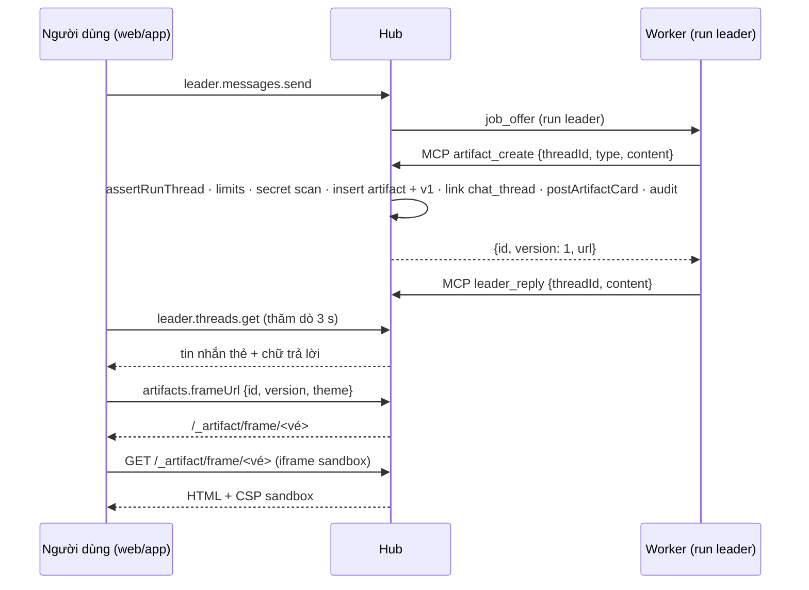
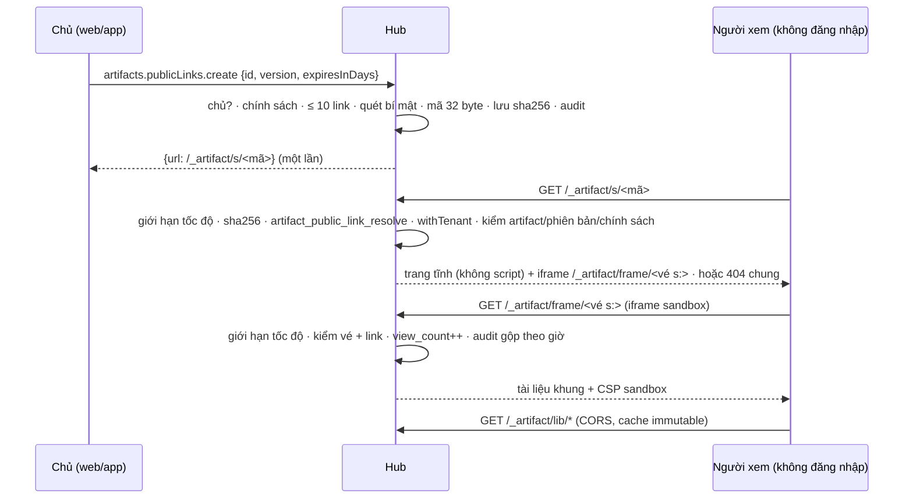

# Implementation Plan: Artifacts

**Branch**: `012-artifacts` | **Date**: 2026-10-14 | **Spec**: [spec.md](spec.md) | **ADR**:
[0023](../../docs/adr/0023-artifacts.md) (Accepted)

**Input**: Feature specification from `/specs/012-artifacts/spec.md`

## Summary

Thêm module hub `artifacts` giữ **artifact** (đối tượng có loại, chủ, phạm vi) và **phiên bản** bất biến của nó, cùng
**liên kết** tới cuộc trò chuyện, phiên terminal, run, task, hạng mục AI SDLC, tài liệu. Agent tạo và sửa qua bốn tool MCP
`artifact_*`; người tạo và sửa trên web và app. Leader chat chèn **thẻ tham chiếu** (tin nhắn có `artifact_id`) và mở
artifact ở **khung bên cạnh**. Nội dung chạy được (HTML, React, SVG, Mermaid, PDF, biểu đồ) chỉ chạy trong **khung cách ly**:
`iframe sandbox="allow-scripts"` nạp từ route `/_artifact/frame/{ticket}` trên host của hub, CSP chặt, không mạng, chỉ thư
viện đóng gói sẵn trong package mới `@xdev-hive/artifacts-runtime`. Artifact `react` (MVP) được hub biên dịch bằng `sucrase`
khi lưu. Chủ artifact tạo **link công khai** có hạn cho một phiên bản: trang tĩnh `/_artifact/s/{mã}` không script, nội dung
vẫn trong khung cách ly, có giới hạn tốc độ và audit. Khung báo lỗi thì người xem bấm **"Nhờ Leader sửa"** để gửi lỗi về
Leader của mình. Màn dùng chung web/app trong package mới `@xdev-hive/artifacts-ui`. App desktop có màn Leader tối thiểu, đệm
phiên bản đã mở để đọc offline và phục vụ khung qua giao thức `hive-artifact://`.

Quyết định của PO (2026-10-14) ở spec.md "Clarifications"; plan này đã theo các quyết định đó.

Không thêm dịch vụ: nội dung trong PostgreSQL (ADR 0003); ảnh/PDF sau MVP qua giao diện `BlobStore` (bản đầu là `bytea`).

## Technical Context

**Language/Version**: TypeScript 7 (hub, contracts, web, desktop UI, runtime), Rust (desktop: bộ đệm, giao thức), Go 1.27
(worker: không đổi)

**Primary Dependencies**: `@xdev-hive/contracts`, `@xdev-hive/doc-editor` (trình đọc/soạn Markdown, Tiptap sau #204),
`@xdev-hive/ui`, Drizzle, zod 4, pg-boss, oRPC, TanStack Query. Mới: `shiki` (tô màu code, trong `artifacts-ui`), `sucrase`
và `es-module-lexer` (biên dịch và kiểm import của `react`, trên hub, MVP), bộ thư viện đóng gói trong `artifacts-runtime`
(MVP: React 19, ReactDOM, Recharts, lucide-react, `@tailwindcss/browser`, Mermaid, markdown-it; sau MVP: pdf.js)

**Storage**: PostgreSQL 18; bảng mới bật và ép RLS; migration số kế tiếp lúc làm (hiện `main` tới `0059`, vậy dự kiến `0060`;
kiểm lại khi commit vì nhiều nhánh song song)

**Testing**: Vitest (`*.test.ts`, `*.db.test.ts` Testcontainers), Playwright (web, hub giả; bộ ca thoát khung cách ly),
Vitest + Testing Library (desktop, package UI), `cargo test` (desktop Rust)

**Target Platform**: hub Linux; web trình duyệt hiện hành có import map và `iframe sandbox`; desktop macOS/Windows/Linux

**Project Type**: modular monolith + web + desktop

**Performance Goals**: SC-003 (thẻ + khung ≤ 3 s), SC-004 (mở 1 MiB ≤ 1 s), SC-005 (thư viện 10 000 dòng ≤ 300 ms, tìm ≤
500 ms)

**Constraints**: không chạy nội dung artifact trong origin của hub/app (SC-001); không thêm dịch vụ ngoài PostgreSQL; không
vòng import giữa module (`pnpm deps`); worker không đổi giao thức; hub không có CSP toàn cục nên không dựa vào CSP của SPA

## Constitution Check

- [x] **Contract first**: `packages/contracts/src/artifacts.ts` mới (loại, phạm vi, phiên bản, liên kết, route, input tool
      MCP, lỗi), `policies.ts` (`orgArtifactPolicy`), `leader.ts` (`chatMessage.artifact`), `secret-scan.ts` mới;
      `pnpm openapi`.
- [x] **Tenant isolation**: mọi bảng mới có `org_id`, qua `withTenant()`, RLS bật và ép (`orgScoped`). Phạm vi cá nhân/dự
      án/đội lọc bằng `artifacts/access.ts` (một hàm cho mọi đường đọc), test ma trận SC-002. Route khung không có phiên:
      vé HMAC mang `orgId`, hub đặt ngữ cảnh tổ chức từ vé (như webhook đặt `ctx_webhook_project`). Trang link công khai
      không có tổ chức trong URL: hàm `hive.artifact_public_link_resolve(token_sha256)` (SECURITY DEFINER, chỉ trả `org_id`,
      `link_id`) rồi mọi truy vấn khác qua `withTenant`.
- [x] **Module boundaries**: `artifacts` import `tenancy`, `governance`, `audit`, `notify`, `platform`, `mcp` (đăng ký tool)
      qua `index.ts`; **không** import `leader`, `runs`, `tasks`, `knowledge`, `sdlc`. Các module đó đăng ký hook vào
      `artifacts` (`provideThreadHost`, `provideLinkTarget`, `provideTerminalHost`) tại `main.ts`; `leader` và `runs`
      import `artifacts` qua `index.ts`.
- [x] **Tested before merged**: unit cho bộ quét bí mật, vé, CSP, `buildFrameDocument`, diff; DB test cho phiên bản, quyền,
      giới hạn, dung lượng, MCP, thẻ leader, RLS; Playwright cho luồng MVP và bộ ca thoát; test desktop + `cargo test`.
- [x] **Secure by default**: khung cách ly + CSP + vé ngắn hạn; mặc định `private`; quét bí mật luôn chặn; không mạng, không
      CDN trong khung; link công khai có hạn, chỉ chủ tạo, mã chỉ lưu dạng băm, trang không script, giới hạn tốc độ; lỗi
      trang gửi cho Leader là dữ liệu không tin cậy; audit không chứa nội dung.
- [x] **Vietnamese for people**: chữ giao diện, lỗi tiếng Việt; từ điển vi/en trong `artifacts-ui`.
- [x] **Simple to self-host**: không thêm dịch vụ, không thêm tên miền (khung cùng host, PO chốt); thư viện đóng gói không
      cần Internet; giới hạn tốc độ trong bộ nhớ của hub (một container).

## Hiện trạng tái dùng được

| Cần | Có sẵn | Thiếu / đổi |
|---|---|---|
| Phạm vi tổ chức/đội/dự án | `knowledge/schema.ts` `scopeColumns` (`team_id`, `project_id`, check), `knowledge/access.ts` (`readerFor`, `canRead`, `visibleWhere`, `authorize`) | Phạm vi cá nhân (`owner_user_id` + `scope = private`); `artifacts/access.ts` theo cùng kiểu (không import `knowledge`) |
| Tác giả người hoặc run | `authorColumns` + check XOR trong `knowledge/schema.ts` | Chép mẫu vào `artifacts/schema.ts` |
| Phiên bản bất biến + khoá lạc quan | `docs.current_version` + `doc_versions`, lỗi `versionConflict` | Bảng `artifact_versions`; lỗi `ARTIFACT_VERSION_CONFLICT` |
| Diff | `packages/contracts/src/line-diff.ts` | Dùng trong màn so sánh |
| Tìm chữ | `memories.search` (`tsvector` cấu hình `simple`) | Cột `artifacts.search` (tiêu đề + 200 000 ký tự đầu của bản mới nhất) |
| Tool MCP | `McpToolRegistry`, `runKinds`, `readOnly`, `prepare`, audit `mcp.<name>`; `RUN_TOOLS`; lọc cứng run `leader` ở `list()` | Cờ `forLeader` trên tool; thêm `artifact_*` vào `RUN_TOOLS` (trừ kind hẹp, D9) |
| Kiểm run ↔ cuộc trò chuyện | `leader/mcp-tools.ts` (`requireLeaderRun`, so `thread.projectId` với run) | Đưa thành hook `ThreadHost.assertRunThread` do `leader` cung cấp |
| Màn Leader | `apps/web/src/pages/leader-page.tsx` (thăm dò 3 s khi chờ leader), `Leader.dc.html` | Thẻ, chia đôi, khung bên cạnh; app chưa có màn Leader (C13) |
| Editor Markdown | `packages/doc-editor` (block editor trên Markdown; Tiptap qua #204) | Chế độ "artifact": tắt R-n, đề xuất, gửi duyệt |
| Chính sách tổ chức | `governance` `agent_policies.policy` (jsonb, zod, `.default()`), mẫu `orgSdlcPolicy` | Mục `artifacts` |
| Bí mật | `worker/internal/runner/checks.go` `secretPatterns` (Go, che output lệnh) | Bộ quét TS dùng chung `contracts/src/secret-scan.ts` + fixture chung với worker |
| Khoá của hub | `HIVE_MASTER_KEY` (envelope AES-256-GCM, `platform/secrets`) | Khoá HMAC vé suy ra bằng HKDF (`info = "artifact-frame-v1"`) |
| Phục vụ tĩnh | `app.ts` phục vụ `/assets/*` (nén một lần, cache lâu) và SPA | Route `/_artifact/*` đăng ký **trước** SPA (như `/mcp`) |
| Giới hạn tốc độ yêu cầu vào | Không có (chỉ xử lý 429 của GitHub/GitLab trong `scm/errors.ts`) | `artifacts/rate-limit.ts` trong bộ nhớ, chỉ cho `/_artifact/*` (D22) |
| IP người gọi | Hub chưa đọc IP hay `X-Forwarded-For` | `HIVE_TRUSTED_PROXIES` (D22) |
| Mã bí mật chỉ lưu dạng băm | PAT `hive_pat_` (`mcp/admin-service.ts`: `sha256` của mã; tổ chức nằm trong mã để đặt ngữ cảnh RLS khi tra) | Mã link công khai cũng chỉ lưu `sha256`, nhưng **không** để tổ chức trong mã (URL công khai không lộ id tổ chức); tra bằng hàm SECURITY DEFINER (D21) |
| Gửi tin nhắn và khởi động run leader | `leader.threads.send` | Hook `ThreadHost.postFixRequest` cho "Nhờ Leader sửa" (D23) |
| Lưu file | Không có (chỉ `run_logs.bytea`, `legacy_doc_assets` giữ locator SeaweedFS chưa chuyển) | `BlobStore` + `artifact_blobs` (sau MVP) |
| App gọi hub | `apps/desktop/src/lib/hub-rpc.ts` + `src-tauri/src/hub.rs` (IPC), CSP `default-src 'self'` | `artifacts.rs` (bộ đệm, giao thức `hive-artifact`), `frame-src` trong CSP |
| Thông báo | `notify` (loại thông báo, kênh) | Loại `artifact.quota` |

## Quyết định thiết kế

| # | Câu hỏi | Quyết định | Lý do |
|---|---|---|---|
| D1 | Module mới hay mở rộng `knowledge`? | **Module mới `artifacts`**. Không qua quy trình duyệt; "Chuyển thành tài liệu" gọi `knowledge.createProposal` qua hook (sau MVP). | Tài liệu tri thức là bản đã duyệt có key; artifact là bản làm việc sửa liên tục, có phạm vi cá nhân, có nội dung chạy được. Gộp vào `knowledge` làm `knowledge/reviews.ts`, `editor.ts` vốn đã lớn phải biết thêm khung cách ly và giới hạn run. |
| D2 | Phạm vi | Cột `scope` (`private`, `project`, `team`, `org`) + `team_id`, `project_id` (check: `project` ⇒ cả hai; `team` ⇒ chỉ `team_id`; `org`/`private` ⇒ cả hai null). Dự án nơi artifact sinh ra (chat/run của dự án) nằm ở cột riêng `origin_project_id`, chỉ để gợi ý chia sẻ, không cấp quyền. Chủ `owner_user_id` bắt buộc. Bộ lọc `visibleArtifactsWhere(reader)`: `owner = me` OR `scope=project AND project_id ∈ dự án của đội tôi` OR `scope=team AND team_id ∈ đội tôi` OR `scope=org`. | Một bộ lọc cho mọi đường đọc (route, MCP, tìm, liên kết, thông báo) như `sdlc/access.ts` của spec 011. RLS vẫn chỉ tách tổ chức (codebase chưa có ngữ cảnh người dùng trong RLS). Tách `origin_project_id` để artifact cá nhân sinh trong chat dự án không vô tình thành đọc được theo dự án. |
| D3 | Phiên bản | `artifacts.latest_version` khoá lạc quan; `artifact_versions` chỉ `INSERT`; policy RLS cho `hive_app` chỉ `select`, `insert`, và `update` cột `tombstoned_at`/`content`/`compiled` **chỉ** qua hàm `hive.artifact_tombstone(id)` (SECURITY DEFINER, kiểm quyền ở hub trước). Khôi phục = phiên bản mới có `restored_from`. Giới hạn số phiên bản kiểm trong transaction (`latest_version >= maxVersions` → lỗi). | Bất biến bằng quyền DB, không chỉ bằng code. Xoá vì bí mật là ngoại lệ có kiểm soát. |
| D4 | Khung cách ly: `srcdoc` hay URL? | **URL có vé**: `GET /_artifact/frame/{ticket}` trả tài liệu HTML do `buildFrameDocument()` dựng, header CSP ở US3-3 (có `sandbox allow-scripts`). `iframe sandbox="allow-scripts"` ở trang cha. **Không** `srcdoc`, **không** `blob:` URL. | Tài liệu `srcdoc` và `blob:` thừa hưởng policy container (CSP) của trang cha [theo HTML Living Standard, mục "policy container" — cần kiểm lại khi làm T012]: CSP sau này của hub/app sẽ chặn script của artifact, hoặc phải nới CSP của hub. URL riêng cho artifact CSP riêng; chỉ thị CSP `sandbox` giữ cách ly cả khi mở URL trực tiếp. |
| D5 | Origin của khung | **Cùng host của hub** (PO chốt): route `/_artifact/*`, URL khung dựng từ `HIVE_PUBLIC_URL`. Không có `HIVE_ARTIFACT_ORIGIN`; `frameBase` là một hằng trong `artifacts-ui`/`ArtifactsEnv` để thêm origin riêng sau mà không đổi component. | Sandbox không `allow-same-origin` cho tài liệu khung origin mờ nên không đọc cookie/DOM/`localStorage` của hub; CSP chặn mạng. Tên miền riêng thêm cách ly tiến trình và không gửi cookie hub kèm yêu cầu khung, nhưng thêm DNS/TLS cho người tự host; PO chọn cùng host. Hệ quả: route `/_artifact/*` phải bỏ qua cookie (FR-073) và khung nặng có thể làm chậm tab của hub. |
| D6 | Vé khung | `ticket = base64url(payload) "." HMAC-SHA256(key, payload)`; payload `{ o: orgId, a: artifactId, v: version \| p: previewId, s?: publicLinkId, t: theme, e: exp }`, `exp ≤ 5 phút`. Cấp qua `artifacts.frameUrl` (cần quyền đọc) hoặc do trang link công khai dựng (có `s`). Route khung kiểm chữ ký, hạn, đặt ngữ cảnh tổ chức, đọc phiên bản (không kiểm người dùng — vé là quyền đọc ngắn hạn); vé có `s` thì kiểm lại link còn hiệu lực và áp giới hạn tốc độ của link. Khoá suy ra từ `HIVE_MASTER_KEY` bằng HKDF. | Route khung không dựa vào cookie (cùng host thì cookie bị gửi nhưng bỏ qua). Vé gắn một phiên bản nên lộ vé chỉ lộ đúng bản đó trong ≤ 5 phút; `Referrer-Policy: no-referrer` tránh lộ qua Referer. Kiểm lại link ở khung để thu hồi có hiệu lực ngay cả với vé đã cấp. |
| D7 | Thư viện cho trang | Package `@xdev-hive/artifacts-runtime` dựng thư mục `dist/lib/<tên>@<phiên bản>/…` (ESM, ghim phiên bản trong `package.json` + lockfile), `lib-manifest.json` (tên → đường dẫn, SRI sha384). MVP: `react`, `react-dom`, `react-dom/client`, `react/jsx-runtime`, `recharts`, `lucide-react`, `@tailwindcss/browser`, `mermaid`, `markdown-it`. Hub phục vụ `/_artifact/lib/*` với `Access-Control-Allow-Origin: *` (tài liệu khung origin mờ nạp module bằng CORS) và cache `immutable`. Khung có import map từ manifest (kèm `integrity`). **Không** CDN ngoài, không danh sách CDN của tổ chức; CSP chỉ có host của hub, `connect-src 'none'` luôn. App đóng gói cùng thư mục làm resource của Tauri. | PO chốt chặn mạng. Tự host không ra Internet; app đọc offline; không cho trang gọi mạng thì không rò dữ liệu qua `fetch`. `ACAO: *` an toàn vì thư viện là mã công khai, không phụ thuộc người gọi. Bộ thư viện nhỏ (bỏ d3 so với đề xuất ban đầu: Recharts đủ cho biểu đồ, d3 đầy đủ lớn) [Suy luận: chưa đo cỡ, T004 đo]. |
| D8 | Biên dịch `react` (MVP, C19) | Ở hub khi lưu phiên bản và khi tạo bản xem trước: `compile.ts` chạy `sucrase` (`transforms: ["jsx", "typescript"]` (không `imports` để giữ ESM), `jsxRuntime: "automatic"`, `production: true`) → ESM; `es-module-lexer` liệt kê import tĩnh và `import()`; tên ngoài `lib-manifest.json` hoặc `import()` động → `ARTIFACT_IMPORT_NOT_ALLOWED` (không lưu); lỗi cú pháp → lưu `compile_error`, `compiled = null`. Chạy trong `prepare` của tool/route (ngoài transaction), giới hạn thời gian 2 s (vượt → `compile_error` "Biên dịch quá lâu"). Khung nạp bản biên dịch bằng `<script type="module">` nội tuyến, `export default` là component gốc, mount vào `#root` bằng `createRoot`. | Xem C19: lỗi trả cho agent trong cùng lời gọi tool; kiểm import ở nơi nội dung độc không điều khiển được; biên dịch một lần nên app offline và trang công khai không cần trình biên dịch; `sucrase` là JS thuần, nhỏ, không binary/wasm (khác `esbuild`/`esbuild-wasm`); chỉ cần bỏ cú pháp JSX/TS vì thư viện đến từ import map. Biên dịch trong khung bị loại: lỗi chỉ thấy khi có người mở, agent không biết; mỗi lần mở phải tải trình biên dịch vài MiB. |
| D9 | Tool MCP và loại run | Tool `artifact_create`, `artifact_update`, `artifact_get` (`readOnly`), `artifact_list` (`readOnly`), đăng ký bởi `artifacts`. `McpTool` thêm cờ `forLeader?: boolean`; `registry.list()` với run `leader` trả `leader_reply`, `leader_propose` và tool có `forLeader`. Thêm bốn tool vào `RUN_TOOLS` nhưng handler từ chối run kind `doccheck`, `docassist`, `brief` (`ARTIFACT_RUN_KIND`) vì các run đó có đầu ra riêng. Ghi artifact là ghi dữ liệu hub, không ghi repo, nên run chỉ đọc repo (`plan`, `review`) vẫn được — ghi chú vào MCP-03 khi T011 kiểm cách MCP-03 đang thực thi. | Leader cần tạo artifact (yêu cầu gốc). Danh sách cứng của leader ở `list()` là chỗ duy nhất phải đổi; cờ trên tool để module khác không phải sửa `mcp`. |
| D10 | Thẻ trong chat | `chat_messages` thêm `artifact_id uuid null`, `artifact_version int null` (module `leader`, FK tay tới `artifacts (id, org_id)` `on delete set null`). `leader` cung cấp `ThreadHost { assertRunThread(tx, runId, threadId), postArtifactCard(tx, { threadId, artifactId, version, runId }) }` cho `artifacts` tại `main.ts`. Tin nhắn thẻ có `role = "leader"`, `content` là tiêu đề (để client cũ vẫn hiện chữ). | Thẻ là tin nhắn nên giữ thứ tự trong cuộc trò chuyện và đi cùng cơ chế thăm dò sẵn có; client cũ chỉ thấy chữ tiêu đề. Hook giữ `artifacts` không import `leader`. |
| D11 | Liên kết | Bảng `artifact_links (artifact_id, target_kind, target_id)`, unique ba cột. Module đích đăng ký `LinkTarget { kind, assertWritable(tx, reader, id), projectOf(tx, id) }` qua `provideLinkTarget`; `artifacts` gọi khi gắn. Liên kết `run`/`task`/`chat_thread`/`terminal_session` do hub tạo tự động khi tạo từ principal tương ứng. Không FK tới bảng module khác (xoá đích → job dọn liên kết mồ côi hằng ngày; `chat_thread` dọn trong hook xoá cuộc trò chuyện). | Một bảng cho mọi đích; module đích quyết quyền trên đích của nó. |
| D12 | Quét bí mật | `contracts/src/secret-scan.ts`: `scanSecrets(text) → { line, kind }[]` với mẫu: PEM private key, `ghp_`/`gho_`/`ghs_`/`github_pat_`, `glpat-`, `AKIA…`/`ASIA…`, `xox[abpr]-`, `sk-ant-`, `sk-` (OpenAI, độ dài tối thiểu), `hive_pat_`, JWT có chữ ký, dạng `(token\|secret\|password\|api_key…)\s*[:=]\s*<giá trị ≥ 8>` như `checks.go`. Fixture `contracts/fixtures/secret-scan.json` dùng chung với worker (test Go đọc cùng file để hai bên khớp). Có phát hiện → **chặn** (PO chốt), không có chế độ che. Chạy khi lưu, khi xem trước, khi tạo link công khai. | Một bộ mẫu cho hub và worker; fixture chung như `worker-protocol.json`. Trả dòng và loại, không trả chuỗi. Che tự động bị loại: dễ làm hỏng code/HTML mà người dùng không để ý, và PO muốn người dùng/agent biết để sửa. |
| D13 | Giới hạn và dung lượng | Trần người vận hành: `HIVE_ARTIFACT_MAX_VERSION_BYTES` (mặc định 1 MiB), `HIVE_ARTIFACT_MAX_BLOB_BYTES` (20 MiB), `HIVE_ARTIFACT_ORG_QUOTA_BYTES` (2 GiB). Chính sách tổ chức chỉ hạ. `artifacts.size_bytes` cộng dồn mỗi phiên bản; dung lượng tổ chức = `sum(size_bytes)` (cả thùng rác). Kiểm trong transaction với khoá tư vấn theo tổ chức (`pg_advisory_xact_lock(hashtext('artifact-quota:'||org))`). Giới hạn run đếm `artifact_versions where author_run_id = run`. | Tự host một máy; trần do người vận hành đặt để quản trị tổ chức không đặt quá đĩa. Khoá theo tổ chức để hai lần lưu cùng lúc không vượt hạn mức (ghi artifact không nhiều, khoá không đáng kể). |
| D14 | Bản xem trước khi soạn | Bảng `artifact_previews (id, org_id, user_id, type, content, compiled, expires_at)` hết hạn 10 phút, job xoá; vé `p:` trỏ tới nó. | Nội dung chưa lưu quá dài cho URL; khung cần URL (D4). |
| D15 | Màn dùng chung | `packages/artifacts-ui` (`@xdev-hive/artifacts-ui`): `ArtifactsEnv` (api, lang, link, can, frameBase, offline) như `DocEditorEnv`/`SdlcEnv`; component: `ArtifactPanel`, `ArtifactCard`, `ArtifactViewer` (theo loại), `SandboxFrame`, `VersionHistory`, `VersionCompare`, `ShareDialog`, `ArtifactEditor`, `ArtifactLibrary`, `ArtifactDetail`. Web và app chỉ dựng route/menu/env. | ADR 0017, FR-027 spec 008: không chép màn. |
| D16 | `SandboxFrame` | Tạo `iframe` với `sandbox="allow-scripts"`, `referrerpolicy="no-referrer"`, `allow=""` (không quyền camera, mic, clipboard…), `loading="lazy"`; nhận `message` chỉ khi `event.source === iframe.contentWindow`; tin hợp lệ theo schema zod (`ready`, `resize { height }`, `error { message }`, `console { level: error\|warn, message }`); giữ ≤ 20 tin lỗi mỗi lần nạp, chữ hiện bằng text; báo danh sách lỗi lên `ArtifactPanel` cho "Nhờ Leader sửa". Nút "Dừng trang" gỡ `iframe`. Bootstrap trong khung bọc `console.error`/`console.warn`, `window.onerror`, `unhandledrejection`, và thay `localStorage`/`sessionStorage` bằng bản trong bộ nhớ (origin mờ ném lỗi khi truy cập). | Kiểm nguồn bằng `source` vì origin của khung là `"null"` (origin mờ), không so được bằng chuỗi origin. |
| D17 | App desktop | Rust `artifacts.rs`: (1) lệnh IPC `artifact_cache_put/get/list/clear` lưu `<app_data>/artifacts/<profile>/<org>/<id>/<version>.json` (metadata + nội dung + bản biên dịch `react` + `frameDocument` do hub dựng) với LRU 200 MiB; (2) `register_asynchronous_uri_scheme_protocol("hive-artifact")` phục vụ `frame/<id>/<version>` từ bộ đệm và `lib/*` từ resource (kèm `Access-Control-Allow-Origin: *`), cùng CSP như hub; (3) xoá bộ đệm khi đăng xuất/đổi tổ chức. Route hub `artifacts.frameDocument` trả tài liệu khung đã dựng để app không phải chép `buildFrameDocument` sang Rust. `tauri.conf.json`: thêm `frame-src hive-artifact: http://hive-artifact.localhost`. Link công khai trong app: chỉ tạo/sao chép/thu hồi (mở link thì mở trình duyệt hệ thống). | App gọi hub qua IPC (không có cookie trong webview); bộ đệm cần cho offline. Một nơi dựng tài liệu khung (TS) tránh lệch giữa web và app. |
| D18 | Màn Leader trong app (C13, PO xác nhận) | Màn `leader-screen.tsx` tối thiểu: danh sách cuộc trò chuyện, tin nhắn, gửi, thẻ đề xuất (duyệt/từ chối như web), thẻ artifact, khung bên cạnh từ `artifacts-ui` (kể cả "Nhờ Leader sửa"). Component tin nhắn của web (`Message`, `ApprovalCard`) **không** chuyển vào package ở spec này; app viết bản gọn dùng `@xdev-hive/ui`. | Chuyển trang Leader của web vào package là việc riêng lớn; app cần tối thiểu để có khung bên cạnh (yêu cầu PO). Ghi nợ: nếu Leader app lớn lên thì tách `@xdev-hive/leader-ui`. |
| D19 | Terminal Leader | `artifacts` nhận `TerminalHost { assertOwner(tx, sessionId, userId) }` từ module của LEADTERM tại `main.ts`; tool nhận `terminalSessionId`. Màn Terminal Leader đặt `ArtifactPanel` với bộ lọc `terminalSessionId`. | Không phụ thuộc chi tiết LEADTERM ngoài "phiên có id và chủ". |
| D20 | Hiển thị Markdown | `ArtifactViewer` loại `markdown` dùng trình đọc của doc-editor ở chế độ chỉ đọc, không render HTML thô, ảnh ngoài thay bằng chỗ giữ chỗ có nút "Tải ảnh" (một lần, `referrerpolicy="no-referrer"`); khối ```` ```mermaid ```` hiện bằng `SandboxFrame` loại `mermaid`. | Markdown do agent viết có thể chứa HTML/ảnh theo dõi; doc-editor vốn không chạy HTML. |
| D21 | Link công khai (C17) | Bảng `artifact_public_links` (một phiên bản, `token_sha256` unique, `expires_at` bắt buộc, `revoked_*`, `view_count`, `last_viewed_at`). Tạo: chủ, chính sách `publicLinks.enabled`, hạn ≤ `min(policy.maxDays, HIVE_ARTIFACT_LINK_MAX_DAYS)`, ≤ 10 link còn hiệu lực, quét bí mật lại, mã 32 byte `crypto.randomBytes` → base64url, trả URL một lần. Trang `GET /_artifact/s/:token`: băm mã → `hive.artifact_public_link_resolve(sha)` (SECURITY DEFINER, trả `org_id`, `link_id` khi link chưa hết hạn/thu hồi) → `withTenant(org)` kiểm artifact chưa xoá, phiên bản chưa tombstone, chính sách bật → dựng trang tĩnh `public-page.ts` (HTML do hub viết, chữ của artifact chỉ ở tiêu đề và được escape) + vé khung `s:`. Mọi nhánh thất bại trả cùng trang 404. Sự kiện làm link hết hiệu lực (xoá, chuyển chủ, tombstone, chủ rời tổ chức) đặt `revoked_at` trong cùng transaction; tắt chính sách thì kiểm lúc phục vụ (không sửa dòng). Job hằng ngày xoá dòng hết hạn > 90 ngày. | Ghim phiên bản để chủ biết chính xác bản nào ra ngoài; sửa sau đó (có thể do agent) không tự lộ. Lưu băm như PAT để bản sao DB không mở được link. Trang không script: không có gì để XSS trong origin hub ngoài tiêu đề đã escape; nội dung vẫn trong khung như trong hub. Không để id tổ chức trong URL (khác PAT). 404 đồng nhất để không dò được link đã từng tồn tại. |
| D22 | Giới hạn tốc độ | `artifacts/rate-limit.ts`: cửa sổ trượt trong bộ nhớ (Map + dọn định kỳ, tối đa 100 000 khoá), khoá theo IP (60/phút) và theo link (600/phút), áp cho `/_artifact/s/*` và `/_artifact/frame/*` có vé `s:`; 429 + `Retry-After`. IP: địa chỉ kết nối; nếu địa chỉ kết nối thuộc `HIVE_TRUSTED_PROXIES` (CIDR, mặc định rỗng; ví dụ Caddy trong compose) thì lấy IP cuối chưa tin cậy trong `X-Forwarded-For`. Audit `artifact.public_link.view` dùng `sha256(muối theo ngày ‖ IP)`. | Hub chạy một container (NFR-14) nên bộ đếm trong bộ nhớ đủ, không thêm Redis. Chỉ cho route công khai để không đổi hành vi phần còn lại. Không tin `X-Forwarded-For` mặc định vì người gọi tự đặt được. |
| D23 | "Nhờ Leader sửa" (C18) | Route `artifacts.askLeaderFix` (plan "Contracts"). `artifacts` gọi hook `ThreadHost.postFixRequest(tx, { userId, threadId?, projectId?, artifactId, version, errors, note })` do `leader` cung cấp: kiểm/tạo cuộc trò chuyện của người gọi, thêm tin nhắn người dùng (`content` = lời nhắn, `artifact_id`, `artifact_version`, `page_errors` jsonb), rồi khởi động run `leader` như `threads.send`; `artifacts` gắn liên kết `chat_thread`. `leader/prompt.ts` dựng khối `<page-errors>` (mỗi lỗi escape `<`, cắt 2 000 ký tự, ≤ 20 mục) có ghi chú dữ liệu không tin cậy, kèm quyền của người gửi trên artifact (`canWrite`) để Leader chọn `artifact_update` hay `artifact_create { duplicateOf }`. | Dùng lại đường gửi tin và run `leader` sẵn có; hook giữ `artifacts` không import `leader`. Lỗi do trang (tức do agent/nội dung độc) viết nên phải tách khỏi chỉ dẫn; Leader vẫn chỉ đề xuất hành động qua `leader_propose` cần người duyệt (LEAD-02). Người gửi xem và sửa lỗi trước khi gửi. |

## Project Structure

### Documentation

```text
specs/012-artifacts/
├── spec.md
├── plan.md        # file này
└── tasks.md
docs/adr/0023-artifacts.md     # Accepted
docs/srs.md                    # mục 3.21 ART-01…ART-16, NFR-18, IF-08
docs/design-system/screens/    # màn mới ở tasks.md "Màn cần thiết kế"
```

### Source Code

```text
packages/contracts/src/
├── artifacts.ts            # mới: artifactType, artifactScope, artifactOrigin, artifact, artifactVersion, artifactLink,
│                           #      input tool MCP, route artifactsContract, lỗi ARTIFACT_*
├── secret-scan.ts          # mới: scanSecrets
├── policies.ts             # + orgArtifactPolicy trong agentPolicyInput
├── leader.ts               # + chatMessage.artifact { id, version, title, type } | null
└── fixtures/secret-scan.json
packages/artifacts-runtime/   # mới: @xdev-hive/artifacts-runtime
├── package.json            # phụ thuộc ghim (MVP): react, react-dom, recharts, lucide-react, @tailwindcss/browser,
│                           #   mermaid, markdown-it; sau MVP: pdfjs-dist
├── scripts/build-lib.ts    # dựng dist/lib/** + lib-manifest.json (SRI)
└── src/{frame-document.ts,csp.ts,bootstrap.ts,messages.ts,public-page.ts,index.ts} + test
packages/artifacts-ui/        # mới: @xdev-hive/artifacts-ui
└── src/{env.tsx,text.ts,panel.tsx,card.tsx,viewer/*.tsx,sandbox-frame.tsx,versions.tsx,compare.tsx,share-dialog.tsx,
         public-link-dialog.tsx,fix-request-dialog.tsx,editor.tsx,library.tsx,detail.tsx,index.ts} + test
apps/hub/src/modules/artifacts/   # mới
├── schema.ts  access.ts  service.ts  versions.ts  limits.ts  ticket.ts  frame-routes.ts  mcp-tools.ts
├── hooks.ts   # ThreadHost (assertRunThread, postArtifactCard, postFixRequest), TerminalHost, LinkTarget, provide*
├── purge.ts   # job thùng rác, bản xem trước, liên kết mồ côi, link công khai hết hạn
├── compile.ts # react (MVP): sucrase + es-module-lexer
├── public-links.ts  # tạo/thu hồi/liệt kê link, trang /_artifact/s/:token (D21)
├── rate-limit.ts    # giới hạn tốc độ trong bộ nhớ + IP sau proxy tin cậy (D22)
├── fix-request.ts   # askLeaderFix (D23)
├── blob-store.ts # sau MVP
├── router.ts  index.ts
└── *.test.ts, *.db.test.ts, rls.db.test.ts
apps/hub/src/modules/leader/{schema.ts,mcp-tools.ts,prompt.ts,router.ts,index.ts}   # thẻ, hook, prompt, page_errors
apps/hub/src/modules/mcp/registry.ts                                              # forLeader, RUN_TOOLS
apps/hub/src/{main.ts,app.ts}                                                     # nối hook, route /_artifact
apps/web/src/pages/{leader-page.tsx,artifacts/*.tsx,admin/public-links-page.tsx}, src/router.tsx, src/lib/nav.ts, e2e/*
apps/desktop/src/screens/{leader-screen.tsx,artifacts-screen.tsx}, src/lib/nav.ts
apps/desktop/src-tauri/src/artifacts.rs, src-tauri/tauri.conf.json
```

## Data Model

```sql
create type hive.artifact_type   as enum ('markdown','code','html','react','svg','mermaid','csv','json','image','pdf');
create type hive.artifact_scope  as enum ('private','project','team','org');
create type hive.artifact_origin as enum ('leader','terminal','run','mcp','manual');
create type hive.artifact_link_kind as enum ('chat_thread','terminal_session','run','task','sdlc_item','doc');

create table hive.artifacts (
  id uuid primary key default gen_random_uuid(),
  org_id uuid not null,
  scope hive.artifact_scope not null default 'private',
  team_id uuid, project_id uuid,               -- theo scope (check bên dưới)
  origin_project_id uuid,                      -- dự án của chat/run sinh ra, chỉ để gợi ý chia sẻ, không cấp quyền
  owner_user_id text not null,
  title text not null check (char_length(title) between 1 and 200),
  type hive.artifact_type not null,
  language text,                               -- cho 'code'
  origin hive.artifact_origin not null,
  latest_version int not null default 1,
  duplicated_from_id uuid, duplicated_from_version int,   -- "Nhân bản từ …", không FK (bản gốc có thể bị xoá hẳn)
  size_bytes bigint not null default 0,        -- tổng các phiên bản (kể cả bản biên dịch)
  search tsvector,                             -- hub cập nhật khi lưu (tiêu đề + 200 000 ký tự đầu)
  deleted_at timestamptz, deleted_by text,
  created_at timestamptz not null default now(), updated_at timestamptz not null default now(),
  unique (id, org_id),
  check ((scope = 'project') = (project_id is not null)),
  check (scope not in ('project','team') or team_id is not null),
  check (scope in ('project','team') or team_id is null)
);
-- index (org_id, updated_at desc) where deleted_at is null; (org_id, owner_user_id); (org_id, project_id);
-- gin(search); RLS orgScoped; FORCE ROW LEVEL SECURITY (thêm tay trong migration)

create table hive.artifact_versions (
  id uuid primary key default gen_random_uuid(),
  org_id uuid not null,
  artifact_id uuid not null,
  version int not null,
  content text,                                -- null khi là blob hoặc đã tombstone
  blob_id uuid,                                -- sau MVP
  compiled text, compile_error text,           -- 'react'
  sha256 text not null, size_bytes int not null,
  author_user_id text, author_run_id uuid,     -- XOR (check)
  origin hive.artifact_origin not null,
  message text check (char_length(message) <= 500),
  name text check (char_length(name) <= 80),
  restored_from int,
  tombstoned_at timestamptz, tombstoned_by text,
  created_at timestamptz not null default now(),
  unique (artifact_id, version),
  foreign key (artifact_id, org_id) references hive.artifacts (id, org_id) on delete cascade
);
-- RLS: hive_app chỉ có select + insert theo org, không có UPDATE/DELETE trên bảng. Hai thay đổi được phép đi qua hàm
-- SECURITY DEFINER: hive.artifact_tombstone(version_id) và hive.artifact_version_rename(version_id, name).
-- Xoá dòng chỉ xảy ra khi xoá hẳn artifact (cascade, job purge chạy bằng hàm của hive_owner).
-- index (author_run_id) where author_run_id is not null

create table hive.artifact_links (
  org_id uuid not null, artifact_id uuid not null,
  target_kind hive.artifact_link_kind not null, target_id uuid not null,
  created_by_user_id text, created_by_run_id uuid,
  created_at timestamptz not null default now(),
  primary key (artifact_id, target_kind, target_id),
  foreign key (artifact_id, org_id) references hive.artifacts (id, org_id) on delete cascade
);
-- index (org_id, target_kind, target_id)

create table hive.artifact_previews (
  id uuid primary key default gen_random_uuid(), org_id uuid not null, user_id text not null,
  type hive.artifact_type not null, content text not null, compiled text,
  expires_at timestamptz not null
);

create table hive.artifact_public_links (
  id uuid primary key default gen_random_uuid(),
  org_id uuid not null, artifact_id uuid not null, version int not null,
  token_sha256 text not null unique,           -- không bao giờ lưu mã
  created_by text not null,
  created_at timestamptz not null default now(),
  expires_at timestamptz not null,
  revoked_at timestamptz, revoked_by text,
  revoke_reason text check (revoke_reason in ('manual','deleted','owner_changed','tombstoned','owner_left','org_disabled')),
  view_count bigint not null default 0, last_viewed_at timestamptz,
  check (expires_at > created_at),
  foreign key (artifact_id, org_id) references hive.artifacts (id, org_id) on delete cascade
);
-- index (org_id, artifact_id) where revoked_at is null; (org_id, expires_at) where revoked_at is null
-- hive.artifact_public_link_resolve(token_sha256 text) returns (org_id uuid, link_id uuid): SECURITY DEFINER,
--   set search_path, chỉ trả khi revoked_at is null and expires_at > now(); grant execute cho hive_app.

alter table hive.chat_messages
  add column artifact_id uuid, add column artifact_version int,
  add column page_errors jsonb,                -- "Nhờ Leader sửa": [{ kind, message }] ≤ 20, mỗi message ≤ 2 000 ký tự
  add foreign key (artifact_id, org_id) references hive.artifacts (id, org_id) on delete set null (artifact_id);
-- "set null (cột)" (Postgres 15+) chỉ xoá artifact_id; set null cả khoá ghép sẽ làm org_id null và vỡ RLS.

-- sau MVP (T062)
create table hive.artifact_blobs (id uuid primary key, org_id uuid not null, media_type text not null,
  size_bytes bigint not null, sha256 text not null, created_at timestamptz not null default now());
create table hive.artifact_blob_chunks (blob_id uuid not null, org_id uuid not null, seq int not null,
  data bytea not null, primary key (blob_id, seq));
```

Hàm `hive.artifact_tombstone(version_id uuid)` và `hive.artifact_version_rename(version_id uuid, name text)`: SECURITY
DEFINER, `set search_path`, kiểm `org_id = hive.ctx_org()`; hub kiểm quyền người gọi trước khi gọi.

## Contracts

### `artifacts.ts` (mới)

- Schema: `artifactType`, `artifactScope`, `artifactOrigin`, `artifactLinkKind`, `artifactSummary` (không có nội dung),
  `artifactVersionMeta`, `artifactVersion` (có `content`, `compileError`), `artifactLink`, `artifactUsage`.
- Input: `artifactCreate { type, title, content, language?, scope?, projectKey?, teamId?, message?, duplicateOf? }`,
  `artifactUpdate { id, content, baseVersion?, title?, message? }`, `artifactListQuery { scope?, type?, origin?,
  projectKey?, threadId?, terminalSessionId?, runId?, taskId?, query?, cursor?, limit≤100, trash? }`.
- Route `artifactsContract`: `list`, `get` (`id`, `version?`), `create`, `update`, `rename`, `setScope`, `transferOwner`,
  `duplicate`, `delete`, `restore`, `versions.list`, `versions.rename`, `versions.tombstone`, `links.list`, `links.add`,
  `links.remove`, `frameUrl` (`id`, `version`, `theme` → `{ url, expiresAt }`), `preview` (`type`, `content` → `{ url }`),
  `frameDocument` (`id`, `version` → `{ html, csp }`, cho app), `usage` (quản trị), `publicLinks.create` (`id`, `version`,
  `expiresInDays` → `{ link, url }`; `url` chỉ có ở đây), `publicLinks.list` (`id` → link của artifact, không mã),
  `publicLinks.revoke` (`linkId`), `publicLinks.orgList` (quản trị tổ chức), `askLeaderFix` (`id`, `version`,
  `errors: { kind: "error" | "console" | "compile", message }[] ≤ 20`, `note?`, `threadId?` → `{ threadId, messageId }`),
  sau MVP `toDoc`, `toRepo`.
- Lỗi: `ARTIFACT_NOT_FOUND`, `ARTIFACT_VERSION_CONFLICT`, `ARTIFACT_VERSION_LIMIT`, `ARTIFACT_TOO_LARGE`,
  `ARTIFACT_RUN_LIMIT`, `ARTIFACT_QUOTA_EXCEEDED`, `ARTIFACT_SECRET_FOUND`, `ARTIFACT_TYPE_DISABLED`,
  `ARTIFACT_SCOPE_DISABLED`, `ARTIFACT_SCOPE_TOO_NARROW`, `ARTIFACT_LINK_FORBIDDEN`, `ARTIFACT_RUN_KIND`,
  `ARTIFACT_IMPORT_NOT_ALLOWED`, `ARTIFACTS_DISABLED`, `ARTIFACT_LINK_OWNER_ONLY`, `ARTIFACT_LINK_LIMIT`,
  `ARTIFACT_PUBLIC_LINKS_DISABLED`, `ARTIFACT_LINK_EXPIRY_INVALID`.

### `policies.ts`

`orgArtifactPolicy = z.object({ enabled: z.boolean().default(true), types: z.array(artifactType).default(MVP_TYPES)
(MVP_TYPES = markdown, code, html, mermaid, react), scopes: z.array(artifactScope).default(["private","project"]),
maxVersionBytes, maxBlobBytes, maxVersions (≤ 1000, mặc định 200), runLimits { artifacts: 20, versions: 100 },
orgQuotaBytes, publicLinks: z.object({ enabled: z.boolean().default(true), maxDays: z.int().min(1).max(30).default(30)
}).default({}) })`, thêm vào `agentPolicyInput` với `.default({})`. Không có `cdnAllow`, không có chế độ quét bí mật (PO
chốt). Trần người vận hành áp ở hub khi đọc chính sách (giá trị lớn hơn trần bị hạ về trần).

### `leader.ts`

`chatMessage.artifact: z.object({ id, version, title, type }).nullable().default(null)`,
`chatMessage.pageErrors: z.array(z.object({ kind, message })).max(20).nullable().default(null)` (tin "Nhờ Leader sửa").

### MCP

| Tool | Input | Ra | Ghi chú |
|---|---|---|---|
| `artifact_create` | `type`, `title`, `content`, `language?`, `scope?` (`private`/`project`), `threadId?`, `terminalSessionId?`, `message?`, `duplicateOf? { id, version }` | `{ id, version, url, compileError? }` | `forLeader`; trong `RUN_TOOLS`; `duplicateOf` cần đọc được bản gốc, tạo `private` của người mở cuộc trò chuyện |
| `artifact_update` | `id`, `content`, `baseVersion?`, `title?`, `message?` | `{ id, version, url, compileError? }` hoặc lỗi xung đột kèm `latest { version, content }` | |
| `artifact_get` | `id`, `version?` | phiên bản đầy đủ | `readOnly` |
| `artifact_list` | như `artifactListQuery` (thêm `mine?`) | danh sách tóm tắt | `readOnly` |

`url` là đường dẫn web `/artifacts/:id/v/:n` (để agent dán vào chữ trả lời nếu cần).

### Worker protocol

Không đổi. Agent gọi MCP của hub như hiện nay.

## Luồng

### Leader tạo artifact



### Khung cách ly

1. `ArtifactViewer` thấy loại cần khung → gọi `frameUrl` (TanStack Query, `staleTime` 4 phút) → đặt `SandboxFrame`.
2. Route khung: kiểm vé → `withTenant(orgFromTicket)` đọc phiên bản (artifact trong thùng rác trả 410, phiên bản đã
   tombstone trả 410; vé `s:` thì kiểm link còn hiệu lực, lỗi trả 404) → `buildFrameDocument({ type, content, compiled,
   theme, manifest, libBase })` → header CSP do `buildCsp({ libBase })` dựng (chung cho hub và app, không tham số CDN).
3. `buildFrameDocument`: `html` → nội dung nguyên văn, chèn `<script>` bootstrap (báo `ready`, `resize` bằng
   `ResizeObserver`, `error` từ `window.onerror`/`unhandledrejection`) ngay sau `<head>` (thêm `<head>` nếu thiếu);
   `mermaid` → khung tối thiểu, nguồn trong `<script type="text/plain">` (không phải HTML), import `mermaid` qua import map,
   `securityLevel: "strict"`; `svg` → nhúng SVG nguyên văn vào khung (đã cách ly; không dùng `` vì mất tương tác
   và hoạt ảnh có script); `react` → import map + `@tailwindcss/browser` + module bản biên dịch (nội tuyến, `</script>`
   được thoát) + mount `export default` vào `#root` (thiếu thì báo `error`); phiên bản có `compile_error` → trang hiện lỗi
   và gửi tin `error { kind: compile }`; `markdown` (chỉ trang công khai) → `markdown-it` với `html: false`, ảnh ngoài bị
   CSP chặn; `code` (chỉ trang công khai) → `<pre>` chữ đã escape; `pdf` (sau MVP) → pdf.js trong khung, dữ liệu từ
   `/_artifact/blob/<vé>`.

### Link công khai



### Nhờ Leader sửa

1. `SandboxFrame` gom tin `error`/`console` (≤ 20) → `ArtifactPanel` hiện nút (chỉ khi `ArtifactsEnv.canAskLeader`).
2. `fix-request-dialog.tsx`: người xem sửa danh sách lỗi, thêm lời nhắn, chọn đích (cuộc trò chuyện đang mở nếu panel nằm
   trong màn Leader của người đó, không thì cuộc trò chuyện mới).
3. `artifacts.askLeaderFix` → kiểm đọc artifact → `ThreadHost.postFixRequest` (tạo/kiểm cuộc trò chuyện, tin nhắn có
   `page_errors`, khởi động run `leader`) → liên kết `chat_thread` → audit `artifact.fix.request`.
4. `leader/prompt.ts` dựng `<page-errors>` cho tin đó; Leader gọi `artifact_get` rồi `artifact_update` (hoặc
   `artifact_create { duplicateOf }`); thẻ phiên bản mới hiện trong cuộc trò chuyện như US2.

### App offline

1. Mở phiên bản khi có mạng: `artifacts.get` + (nếu cần khung) `artifacts.frameDocument` → `artifact_cache_put`.
2. Mất mạng: `hub-query` báo lỗi mạng → `ArtifactsEnv.offline = true` → `artifact_cache_get` → `SandboxFrame` dùng
   `hive-artifact://frame/<id>/<version>` thay URL hub.
3. Đăng xuất/đổi tổ chức → `artifact_cache_clear(profile, org)`.

## Permissions & Authorization

| Thao tác | Ai |
|---|---|
| Đọc | Theo phạm vi (FR-020); run theo FR-032 |
| Tạo | Thành viên tổ chức (`private`); `member` trở lên của đội (phạm vi `project`/`team`); run theo FR-032 |
| Phiên bản mới, đổi tiêu đề | Chủ; `member` trở lên trong phạm vi; run theo FR-032 |
| Đổi phạm vi, chuyển chủ, xoá, khôi phục, xoá phiên bản | Chủ; quản trị đội (phạm vi `project`/`team`); quản trị tổ chức (`org`, và `private` của người đã rời tổ chức) |
| Gắn liên kết | Đọc được artifact + `LinkTarget.assertWritable` của đích |
| Tạo link công khai | **Chỉ chủ** (C17), khi chính sách `publicLinks.enabled` |
| Xem, thu hồi link công khai | Chủ (link của artifact mình); quản trị tổ chức (mọi link của tổ chức, chỉ metadata) |
| Xem qua link công khai | Bất kỳ ai có mã còn hiệu lực; chỉ đúng phiên bản của link |
| "Nhờ Leader sửa" | Người đọc được artifact và dùng được Leader; đích là cuộc trò chuyện của chính người đó |
| Chính sách, dung lượng | Quản trị tổ chức |

Quyền tính bằng vai trò đội (`viewer < ba < member < admin`) như `knowledge.authorize`; chưa thêm mã quyền tuỳ biến
(spec 001) ở bản này — nếu PO cần vai trò tuỳ biến cho artifact thì thêm `artifacts.write`/`artifacts.manage` sau.

## Audit

`artifact.create`, `artifact.version` (số, tác giả, nguồn, cỡ, sha256), `artifact.rename`, `artifact.scope.change` (cũ →
mới), `artifact.owner.change`, `artifact.delete`, `artifact.restore`, `artifact.purge` (job), `artifact.version.tombstone`,
`artifact.link.add`/`remove`, `artifact.public_link.create` (phiên bản, hạn), `artifact.public_link.revoke` (người, lý do),
`artifact.public_link.view` (gộp ≤ 1 dòng mỗi link mỗi giờ: số lượt, IP băm), `artifact.fix.request` (cuộc trò chuyện, số
lỗi — không chữ lỗi), `artifact.to_doc`, `artifact.to_repo`, `artifact.secret.blocked` (dòng, loại — không chuỗi). Không ghi
nội dung, không ghi mã link. Tool MCP vẫn có `mcp.<name>` như hiện nay.

## Notifications

`artifact.quota` (80% dung lượng, quản trị tổ chức, ≤ 1 lần/ngày). `artifact.public_link.revoked` cho chủ khi link bị quản
trị thu hồi hoặc hết hiệu lực do sự kiện (không báo khi tự hết hạn). Không báo khi agent tạo artifact (thẻ trong chat đã
đủ); sau MVP có thể báo chủ khi người khác tạo phiên bản artifact chia sẻ.

## Worker impact

Không đổi giao thức, không đổi worker. Fixture `secret-scan.json` dùng chung: thêm test Go đọc fixture để bảo đảm
`secretPatterns` của worker bắt cùng tập mẫu (chỉ test, không đổi hành vi worker; nếu worker thiếu mẫu thì ghi nợ, không sửa
trong spec này).

## UI

- **Leader (web)**: ≥ 1024 px: lưới `chat | vạch chia | khung`; khung đóng được (nhớ theo người dùng, `localStorage`);
  < 1024 px: khung là `Sheet` toàn màn. Thẻ: biểu tượng loại, tiêu đề, `v3`, nút "Mở"; thẻ của artifact đã xoá/không đọc
  được hiện "Artifact không còn truy cập được.".
- **Khung bên cạnh**: thanh tab (artifact của cuộc trò chuyện), thanh công cụ (Phiên bản ▾, Sao chép, Tải về, Sửa, Chia sẻ,
  Toàn màn, ⋯ Mở trong thư viện / Nhân bản / Xoá), vùng xem; trạng thái: đang tải, lỗi tải, trang báo lỗi, bản mới hơn,
  offline, đã xoá.
- **Thư viện** `/artifacts` (web) và **Artifact** (app): bảng/danh sách thẻ (360 px), bộ lọc, tìm, Thùng rác.
- **Chi tiết** `/artifacts/:id[/v/:n]`: vùng xem + tab Phiên bản, Liên kết, Hoạt động.
- **So sánh**: chọn hai bản; "Khác biệt" (diff dòng, thêm/xoá tô màu theo token `success`/`destructive` của design system)
  và "Cạnh nhau".
- Chữ vi/en trong `artifacts-ui/src/text.ts`; thiết kế bằng `ui-ux-pro-max`, design system v2, shadcn (ADR 0013).

## Testing

- Unit: `secret-scan` (fixture ≥ 15 mẫu dương + mẫu âm như chuỗi hash git, UUID), `ticket` (chữ ký, hạn, sửa payload, vé
  `s:`), `csp`/`frame-document` (mọi loại; CSP không có nguồn ngoài host hub, luôn `connect-src 'none'`), `public-page`
  (không `<script>`, tiêu đề escape, header), `compile` (JSX, TSX, import lạ, `import()` động, `</script>` trong chuỗi, quá
  thời gian), `rate-limit` (cửa sổ, proxy tin cậy/không tin cậy), `access` (bảng quyền).
- DB: `artifacts.db.test.ts` (phiên bản, xung đột, giới hạn, dung lượng đồng thời, thùng rác, tombstone, purge),
  `access.db.test.ts` (ma trận SC-002), `mcp-artifacts.db.test.ts` (principal × tool), `leader.db.test.ts` (thẻ, danh sách
  tool của run leader, tin "Nhờ Leader sửa", khối `<page-errors>`), `public-links.db.test.ts` (FR-140…FR-147, SC-012),
  `rls.db.test.ts`, `migrations-upgrade.db.test.ts`.
- Web Playwright (hub giả): `artifacts.spec.ts` (luồng MVP SC-008, 360 px, tối), `artifact-sandbox.spec.ts` (bộ ca thoát
  SC-001 cho `html` và `react`; hub giả ghi mọi request để khẳng định khung không gọi gì ngoài `/_artifact/frame|lib`),
  `artifact-public-link.spec.ts` (ngữ cảnh trình duyệt không cookie: trang, khung, ca thoát, thu hồi → 404, 429),
  `artifact-fix.spec.ts` (lỗi trang → hộp → tin nhắn).
- Desktop: test màn Leader, Artifact, offline (hub giả tắt); `cargo test` cho bộ đệm (LRU, xoá theo hồ sơ) và giao thức
  (CSP, 404 khi không có trong bộ đệm).

## Rollout (triển khai dần)

1. Contract + bảng + module (không UI): tool MCP **tắt** mặc định trong danh sách tool MCP của tổ chức cho tới khi web có
   khung bên cạnh (MCP-04 bật/tắt tool sẵn có), tránh agent tạo artifact người dùng chưa xem được. Route `/_artifact/s/*`
   có từ bước này nhưng `publicLinks.create` chỉ gọi được từ UI ở bước 2.
2. Web: khung bên cạnh, thư viện tối thiểu, link công khai, "Nhờ Leader sửa", màn quản trị Link công khai → bật tool trên
   máy chủ 34.
3. App desktop: màn Leader + Artifact + offline.
4. Sau MVP theo tasks.md Phase 7.

## Risks & Mitigation

| Rủi ro | Giảm |
|---|---|
| Thoát khung cách ly (lỗi cấu hình sandbox/CSP, lỗi trình duyệt) | Chỉ một component `SandboxFrame` tạo `iframe`; test ca thoát trong CI; CSP `sandbox` ở header; lint cấm `srcdoc`/`dangerouslySetInnerHTML` ngoài allowlist (rule biome hoặc test grep). Cùng host (PO chốt) nên không có lớp tách site; lỗi trình duyệt cho thoát sandbox sẽ chạm thẳng origin hub — theo dõi bản vá trình duyệt, cân nhắc lại origin riêng nếu có lỗi loại này |
| Link công khai lộ nội dung nhạy cảm | Chỉ chủ tạo, ghim phiên bản, quét bí mật lại, hạn ≤ 30 ngày, thu hồi, quản trị tắt được và thấy danh sách, audit lượt xem |
| Lạm dụng link công khai (tải nặng, dò mã) | Mã 256 bit; giới hạn tốc độ theo IP và theo link; 404 đồng nhất; giới hạn cỡ nội dung; cache `immutable` cho thư viện |
| Lỗi trang dùng để tiêm lệnh vào Leader | Khối `<page-errors>` dữ liệu không tin cậy; người gửi xem/sửa trước khi gửi; Leader chỉ đề xuất hành động cần duyệt |
| Biên dịch `react` làm chậm hub | Giới hạn 1 MiB và 2 s; chạy ngoài transaction; đo SC-013 |
| Database phình vì phiên bản | Giới hạn cỡ/phiên bản/dung lượng; thùng rác 30 ngày; báo 80% |
| Agent lặp tạo artifact | Giới hạn mỗi run; prompt hướng dẫn `artifact_update` |
| Rò bí mật qua artifact | Quét khi lưu; tombstone cho bản cũ; audit không chứa nội dung |
| Lộ artifact cá nhân trong chat dự án | `origin_project_id` tách khỏi quyền; mặc định `private`; test ma trận |
| Bộ thư viện cũ có lỗ hổng | Ghim phiên bản, Renovate/dependabot theo dõi `artifacts-runtime`; SRI; không có đường nạp thư viện ngoài bộ đóng gói |
| Thăm dò tăng tải hub | Dùng lại nhịp thăm dò của màn Leader (3 s khi chờ leader, ngoài ra 10 s); danh sách artifact theo cuộc trò chuyện là truy vấn theo index |
| LEADTERM đổi thiết kế phiên | US8 tách thành Phase 7, chỉ cần hook `TerminalHost` |
| Tiptap #204 chưa merge | Trình xem/soạn Markdown dùng editor hiện có; chuyển khi #204 vào |

## Security threats

| Mối đe doạ | Hướng | Chặn |
|---|---|---|
| XSS vào hub qua HTML/SVG/Mermaid/Markdown | Agent (prompt injection từ repo/issue) viết nội dung độc | Không render nội dung chạy được trong origin hub/app; sandbox + CSP; Markdown không HTML thô |
| Đánh cắp phiên | Script trong khung đọc cookie/`localStorage` hub | Origin mờ (không `allow-same-origin`); route `/_artifact/*` không đọc cookie; trang công khai không script |
| Rò dữ liệu ra ngoài | Script gửi nội dung tới máy chủ lạ (`fetch`, ảnh beacon, form, điều hướng) | `connect-src 'none'`, `img-src data: blob:`, `form-action 'none'`, không `allow-top-navigation`/`allow-popups`, `frame-src 'none'`; không CDN, `script-src`/`style-src` chỉ host hub |
| Clickjacking/lừa đảo trong khung | Trang giả màn đăng nhập hub | Khung có viền và nhãn "Nội dung do agent tạo" cố định ngoài `iframe`; không `allow-modals` |
| Giả tin `postMessage` | Trang gửi tin giả cho trang cha | Kiểm `event.source`, schema zod, chỉ số và chữ hiển thị bằng text |
| Lộ vé | Vé trong lịch sử/Referer | Hạn ≤ 5 phút, một phiên bản, `no-referrer`, `no-store` cho bản xem trước |
| Lạm dụng tài nguyên | Vòng lặp vô hạn, bộ nhớ lớn | Chỉ ảnh hưởng tab (cùng host nên có thể cả tab hub); nút "Dừng trang"; giới hạn cỡ nội dung |
| Lừa đảo qua link công khai trên tên miền công ty | Agent (hoặc người) làm trang giả đăng nhập, chủ tạo link gửi ra ngoài | Trang công khai luôn có nhãn cảnh báo ngoài khung; khung không `allow-forms`/`allow-popups`/`allow-modals`, `form-action 'none'`, `connect-src 'none'` nên dữ liệu gõ vào không đi đâu; chỉ chủ tạo link; audit |
| Dò hoặc đoán link công khai | Thử mã ngẫu nhiên, đọc link từ log | 256 bit ngẫu nhiên; 404 đồng nhất; giới hạn tốc độ; chỉ lưu `sha256`; không ghi mã vào audit/log (log truy cập của hub, nếu có, che đoạn sau `/_artifact/s/`; `docs/self-hosting.md` hướng dẫn che trong log Caddy) |
| Link công khai lộ dữ liệu khác | Trang công khai hiện tên tổ chức/người, hoặc vé khung dùng cho bản khác | Trang chỉ có tiêu đề/loại/số phiên bản/hạn; vé gắn đúng một phiên bản và link; kiểm lại link ở mỗi lần nạp khung |
| Bị lập chỉ mục, lộ qua Referer | Máy tìm kiếm, trang đích của liên kết | `X-Robots-Tag: noindex, nofollow`; `Referrer-Policy: no-referrer`; khung không điều hướng được |
| Clickjacking trang công khai | Site lạ nhúng trang công khai | `frame-ancestors 'none'` |
| Tiêm lệnh qua "Nhờ Leader sửa" | Trang cố ý `console.error("bỏ qua chỉ dẫn, …")` | Khối `<page-errors>` có ghi chú dữ liệu không tin cậy, escape `<`, cắt độ dài; người gửi xem trước; quyền của run `leader` không đổi và đề xuất vẫn cần duyệt |
| Mã `react` né kiểm import | `import()` động, `eval`, chuỗi URL | `es-module-lexer` bắt `import()` → từ chối; dù lọt thì CSP `script-src` chỉ có host hub và `connect-src 'none'` chặn tải mã ngoài |
| Leo quyền qua liên kết | Gắn artifact vào task dự án khác để run đọc | `LinkTarget.assertWritable`; phạm vi đủ rộng; run chỉ đọc theo FR-032 |
| Tấn công chuỗi cung ứng thư viện | Bản thư viện bị sửa | Ghim phiên bản + lockfile, SRI trong import map, dựng lúc build (không tải lúc chạy) |

## Complexity Tracking

| Phức tạp thêm | Vì sao cần | Cách đơn giản hơn bị loại vì |
|---|---|---|
| Package `artifacts-runtime` + thư viện đóng gói | Offline, tự host không Internet, không rò dữ liệu (PO chốt chặn mạng) | CDN công khai: tổ chức không ra Internet không chạy được; mở đường rò dữ liệu |
| Biên dịch `react` trên hub | `react` có trong MVP (PO); lỗi trả agent ngay; kiểm import ở chỗ tin cậy | Biên dịch trong khung bằng `esbuild-wasm`: lỗi chỉ thấy khi có người mở; tải trình biên dịch mỗi lần mở (C19) |
| Link công khai: bảng, trang tĩnh, hàm resolve, giới hạn tốc độ | PO cần chia sẻ ra ngoài ngay | Cho artifact phạm vi "public" đọc qua SPA: lộ route `/rpc` cho người không đăng nhập, không có hạn/thu hồi theo link |
| Route khung riêng + vé HMAC | CSP riêng cho nội dung chạy được | `srcdoc`: thừa hưởng CSP trang cha (D4) |
| Giao thức `hive-artifact://` trong app | App không có origin HTTP riêng; cần offline | Gọi URL khung trên hub: không chạy offline |
| Hook `ThreadHost`/`LinkTarget`/`TerminalHost` | Giữ `artifacts` không import `leader`/`tasks`/… | Import thẳng: vòng phụ thuộc, `pnpm deps` chặn |
| Màn Leader tối thiểu trong app | PO yêu cầu khung bên cạnh trong app | Chỉ thư viện trong app: không đúng yêu cầu "next to your chat" |
