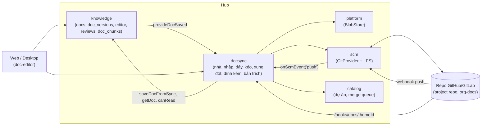

# Implementation Plan: Tài liệu trên hub, nhập từ repo, đồng bộ hai chiều với repo

**Branch**: `018-docs-repo-sync` · **Date**: 2026-10-15 · **Spec**: [spec.md](spec.md) · **Research**: [research.md](research.md)

Q1–Q12 chưa chốt. Plan làm theo khuyến nghị trong spec. Chỗ nào phụ thuộc câu trả lời thì ghi **[Giả định Qn]**.

## Tóm tắt

Thêm module hub **`docsync`**. Module này gắn mỗi tài liệu với một "nhà" (repo + thư mục) và làm bốn việc:
- **nhập** tài liệu có sẵn từ repo;
- **đẩy** phiên bản mới trên hub vào repo theo lô (`pr` hoặc `direct`);
- **kéo** thay đổi từ repo về hub, hợp theo khối hoặc tạo xung đột cho người giải quyết;
- quản lý **đính kèm** (kho file, Git LFS) và **bản trích** của file Word/PDF/Excel/PowerPoint.

Phần mới ở chỗ khác:
- **`platform`**: BlobStore (bytea chia đoạn), dùng chung với artifact (spec 012 T062).
- **`scm`**: `GitProvider` thêm đọc nhị phân, so sánh commit, tải archive, commit có xoá, đổi tên và nhị phân, Git LFS.
- **`knowledge`**:
  - cột mới cho `doc_versions` và `docs`;
  - hook `provideDocSaved`;
  - "Lưu trữ" tài liệu;
  - chỉ mục đoạn `doc_chunks` và tìm theo nghĩa `docs.search`, tool MCP `doc_search`.
- **`packages/doc-editor`**: ảnh, tải file lên, link tương đối, nhãn đồng bộ, màn xung đột ba bản.
- **Web**: cài đặt "Tài liệu" của dự án, thẻ repo tài liệu tổ chức, màn nhập, cây tài liệu, xung đột, bản trích chờ
  duyệt, ô tìm theo nghĩa.
- **Desktop**: "Soạn tài liệu" có nhãn đồng bộ, tìm theo nghĩa, xung đột (qua package chung).

Worker Go không đổi.

## Technical Context

| Mục | Giá trị |
|---|---|
| Ngôn ngữ | TypeScript strict (hub chạy thẳng `.ts` bằng Node) |
| Hub | Hono + oRPC, Drizzle, pg-boss, `withTenant()`, role `hive_app` |
| Lưu trữ | PostgreSQL: bảng mới, bytea chia đoạn 512 KiB cho file, pgvector tuỳ chọn (như memory) |
| Phụ thuộc mới (hub) | `yaml`, `tar`, `mammoth`, `turndown`, `unpdf`, `exceljs`, `jszip` (research.md mục 4). Glob dùng `matchGlob` có sẵn |
| Test | Vitest. `*.db.test.ts` với Testcontainers. Provider `memory` của `scm` cho mọi luồng đồng bộ. Playwright cho màn web |
| Hiệu năng | SC-001 (5.000 file ≤ 15 phút), SC-002 (≤ 2 phút hub → repo), SC-003 (≤ 1 phút repo → hub) |
| Giới hạn | `DOC_MAX_CHARS` 200.000 ký tự; `HIVE_DOC_ASSET_MAX_BYTES` 50 MiB; hạn mức kho file tổ chức `HIVE_DOC_ORG_STORAGE_BYTES` 5 GiB; nhập `HIVE_DOC_IMPORT_MAX_BYTES` 2 GiB |

## Constitution Check

| Nguyên tắc | Cách tuân |
|---|---|
| I. Contract first | `packages/contracts/src/doc-sync.ts` mới. `knowledge.ts` thêm `docs.search`, `docs.archive`, `docs.restore`. `projects.ts` thêm `settings.docs`. Chạy `pnpm openapi`, commit `openapi.json` |
| II. Tenant isolation | Mọi bảng mới có `org_id`, `ENABLE` + `FORCE ROW LEVEL SECURITY`, policy `<bảng>_rw` theo `hive.ctx_org()`. `rls.db.test.ts` thêm bảng mới. Quyền đội và dự án kiểm trong module bằng `canRead`/`authorize` của `knowledge`. `recordAudit()` cho FR-045 |
| III. Module boundaries | `docsync` import `knowledge`, `scm`, `catalog`, `platform`, `notify`, `audit` qua `index.ts`. `knowledge` không import `docsync`: nhận báo lưu qua hook `provideDocSaved`, như `provideDocAccess` và `provideReviewHooks` |
| IV. Tested | Unit cho phần thuần (key, front-matter, EOL, LFS, hợp, ghép đổi tên). `*.db.test.ts` cho RLS, migration, luồng đồng bộ với provider `memory`. Playwright cho nhập, xung đột, duyệt bản trích |
| V. Secure by default | `scanSecrets` ở nhập, kéo, lưu, trích, trước embedding. Token Git vẫn mã hoá envelope trong `scm_connections`. Secret webhook nhà tổ chức mã hoá như `skill_repos.webhook_secret_enc`. File SVG/HTML trả `attachment` + CSP. Trích chạy trong `worker_threads` có giới hạn |
| VI. Ngôn ngữ | Chữ giao diện, lỗi tiếng Việt. ADR, SRS, code tiếng Anh. Spec này viết tiếng Việt theo yêu cầu của chủ dự án (như spec 011–017). **Lệch** constitution VI; ghi ở "Complexity Tracking" |
| VII. Simple to self-host | Không thêm dịch vụ. File trong PostgreSQL. ADR 0028 ghi lý do và đường mở sang S3 |
| Giao diện | Màn thiết kế bằng `ui-ux-pro-max`, shadcn/ui, token màu. 360 px, sáng/tối, bàn phím. Playwright theo role |

## Kiến trúc



### Cấu trúc file

```text
apps/hub/src/modules/docsync/
  index.ts          export router, register, webhook handler, MCP tool
  schema.ts         doc_homes, doc_repo_files, doc_sync_batches, doc_conflicts, doc_imports, doc_import_files, doc_assets, doc_extracts
  paths.ts          key ↔ đường dẫn, loại trừ, chồng thư mục (thuần)
  content.ts        front-matter, EOL/BOM, hash, con trỏ LFS, .gitattributes (thuần)
  homes.ts          cấu hình nhà, kiểm quyền repo, tạo repo org-docs, webhook nhà tổ chức
  scan.ts           quét repo, bản xem trước
  import.ts         job nhập theo lô, chạy tiếp được
  push.ts           gom lô, commit/PR, thử lại
  pull.ts           so sánh commit, ghép đổi tên, áp/hợp/xung đột
  conflicts.ts      giải quyết xung đột
  assets.ts         đính kèm, tải lên, tải xuống, link tương đối
  extracts.ts       hàng bản trích, duyệt
  extract/worker.ts worker_threads: docx, pdf, xlsx, csv, pptx
  jobs.ts           đăng ký queue và cron
  router.ts         oRPC + route Hono (tải lên, tải xuống, webhook)
  mcp-tools.ts      doc_asset_get
apps/hub/src/modules/platform/
  blob-store.ts     BlobStore + bản PostgreSQL
  schema.ts         blobs, blob_chunks (mới: platform chưa có schema.ts)
apps/hub/src/modules/knowledge/
  doc-search.ts     chia đoạn, job chỉ mục, docs.search
  docs.ts           hook provideDocSaved, saveDocFromSync, archive/restore
  schema.ts         cột mới, doc_chunks
apps/hub/src/modules/scm/
  types.ts, github.ts, gitlab.ts, memory.ts   phương thức mới
  lfs.ts            Batch API dùng chung hai provider
```

## Thiết kế từng phần

### 1. Mô hình dữ liệu (FR-001, FR-029, FR-044)

Mọi bảng có `org_id uuid not null`, RLS bật và ép. Cột thời gian `created_at`, `updated_at`.

**`knowledge`** (mở rộng):
- `docs.archived_at timestamptz null`. `listDocs`, `getDoc` (không chỉ định phiên bản), MCP, tìm kiếm bỏ tài liệu đã
  lưu trữ.
- `doc_versions`:
  - `content_hash text` (sha256 nội dung LF, tính khi lưu). Migration điền cho dòng cũ bằng hàm có sẵn của PostgreSQL
    `encode(sha256(convert_to(content, 'UTF8')), 'hex')`, không cần `pgcrypto` (migrations hiện không bật extension
    này). Dòng cũ đã lưu nguyên văn nên hash khớp cách tính ở hub, trừ nội dung có CRLF **[Suy luận]**: T004 so hai
    cách trên dữ liệu thật;
  - `source text not null default 'hub'` (`hub`, `repo`, `import`, `merge`);
  - `repo_commit text null`;
  - `secret_flag boolean not null default false`.
- `doc_chunks`: `id`, `doc_id` hoặc `extract_id` (một trong hai), `version`, `ord`, `heading_path`, `content`,
  `search tsvector` (GIN), `embedding` (thêm bằng `hive.enable_doc_vectors()` như memory).

**`platform`**:
- `blobs`: `id`, `org_id`, `sha256`, `size`, `media_type`, `chunk_count`, `created_at`. Unique `(org_id, sha256)`.
- `blob_chunks`: `blob_id`, `org_id`, `ord`, `data bytea`. PK `(blob_id, ord)`.
- Xoá blob không còn ai dùng: job dọn hằng ngày tìm blob không có tham chiếu từ `doc_assets` và `artifact_versions`.
  Mỗi module đăng ký hàm "blob đang dùng" qua `provideBlobRefs`, để `platform` không import module trên.

**`docsync`**:

| Bảng | Cột chính | Ràng buộc |
|---|---|---|
| `doc_homes` | `scope` (`project`/`org`), `project_id` null, `connection_id`, `owner`, `name`, `branch`, `root`, `assets_dir`, `mode` (`pr`/`direct`/`off`), `include text[]`, `exclude text[]`, `repo_changes_need_review`, `last_commit`, `status` (`active`/`paused`/`error`), `status_reason`, `error`, `webhook_secret_enc`, `webhook_id`, `pr_number`, `pr_url`, `lfs_patterns text[]` (đọc từ `.gitattributes`), `configured_by` | Unique `(org_id, project_id)` khi `scope='project'`; unique `(org_id)` khi `scope='org'` |
| `doc_repo_files` | `doc_id`, `home_id`, `repo_path`, `synced_version`, `synced_commit`, `synced_hash`, `repo_hash`, `state` (`synced`, `pending`, `conflict`, `failed`, `deleted_in_repo`, `blocked_secret`, `excluded`), `eol` (`lf`/`crlf`), `bom`, `error` | Unique `(home_id, repo_path)`, unique `(doc_id)` |
| `doc_sync_batches` | `home_id`, `mode`, `branch`, `doc_versions jsonb` (danh sách `{docId, version}`), `asset_ids uuid[]`, `commit_sha`, `pr_number`, `attempts`, `next_at`, `state` (`queued`, `pushing`, `done`, `failed`), `error` | |
| `doc_conflicts` | `doc_id`, `base_version`, `hub_version`, `repo_commit`, `repo_content`, `state` (`open`, `resolved`), `resolution` (`hub`, `repo`, `manual`), `resolved_by`, `resolved_version` | Unique một xung đột mở mỗi tài liệu (partial index `WHERE state='open'`) |
| `doc_imports` | `home_id`, `commit_sha`, `include`, `exclude`, `preview jsonb`, `selected jsonb`, `state` (`scanning`, `ready`, `importing`, `done`, `failed`, `cancelled`), `progress jsonb` (`done`, `total`, `cursor`), `report jsonb`, `started_by` | |
| `doc_import_files` | `import_id`, `repo_path`, `blob_sha`, `kind` (`markdown`, `image`, `office`, `other`), `size`, `warnings text[]`, `state` (`pending`, `done`, `skipped`, `blocked_secret`, `failed`), `doc_id`, `asset_id`, `confirmed_by` | Unique `(import_id, repo_path)`. Chạy tiếp được nhờ trạng thái từng file |
| `doc_assets` | `home_id`, `repo_path`, `blob_id`, `media_type`, `size`, `sha256`, `lfs`, `state` (`available`, `missing_lfs`, `too_large`, `pending_push`), `owner_doc_id` null | Unique `(home_id, repo_path)` |
| `doc_extracts` | `asset_id`, `source_sha256`, `content`, `state` (`pending`, `review`, `approved`, `rejected`, `failed`), `error`, `secret_flag`, `reviewed_by`, `reviewed_at` | Một bản `approved` hiện hành mỗi đính kèm |

**[Giả định]** `doc_import_files` tách khỏi `doc_imports.preview` vì 5.000 dòng trong một `jsonb` khó cập nhật từng file.
Spec liệt kê thực thể "Lần nhập"; bảng phụ này là chi tiết của nó.

### 2. Cài đặt và nhà (US4, US8, FR-001…FR-005)

- `projects.settings.docs` (contracts, `.default()` mọi trường):
  `{ enabled: false, root: "docs/", repoSync: "pr", include: [...Q11], exclude: [...Q11], assetsDir: "assets", repoChangesNeedReview: false }`.
  Bật lần đầu thì `homes.ts` tạo dòng `doc_homes` từ cài đặt và repo của dự án. Đổi cài đặt thì cập nhật dòng đó.
  **[Giả định]** Giữ hai nơi (settings và `doc_homes`) vì settings là chỗ người dùng sửa, còn `doc_homes` giữ trạng
  thái chạy (commit cuối, PR, lỗi) mà settings không nên chứa. Nguồn sự thật cho cấu hình là settings.
- Nhà tổ chức: `docHomes.configureOrg { connectionId, owner, name, branch?, create?: boolean }`.
  - `create` gọi `GitProvider.createRepo` (riêng tư), commit `README.md` mô tả bố cục `org/`, `teams/<slug>/`.
  - Thêm webhook tới `/hooks/docs/:homeId`, secret mã hoá envelope. Mẫu theo `skill-repo.ts` `configure` và thẻ web
    `skill-repo-card.tsx`.
- Kiểm khi lưu cấu hình:
  - `checkAccess` đọc và ghi;
  - chồng thư mục với nhà khác trên cùng repo (`paths.ts` `overlaps`);
  - chồng `sdlc.docsRoot` của dự án;
  - chồng kho skill (`skill_repos` cùng owner/name).
  Lỗi trả `DOCSYNC_HOME_OVERLAP`, `DOCSYNC_NO_ACCESS`.
- Quyền: nhà dự án cần quản trị dự án (như sửa settings dự án hiện nay); nhà tổ chức cần quản trị tổ chức.
  `recordAudit` mọi thay đổi.

### 3. Ánh xạ key và đường dẫn (FR-009, FR-023, FR-024)

`paths.ts` (thuần, test kỹ):
- **Đường dẫn → key**:
  - phạm vi theo nhà: `project/<key>/` hoặc `org/` (thư mục `org/`) hoặc `team/<slug>/` (thư mục `teams/<slug>/`);
  - phần còn lại: bỏ đuôi `.md`, bỏ dấu tiếng Việt (NFD + bỏ dấu kết hợp, `đ`→`d`), chữ thường, ký tự ngoài
    `[a-z0-9._-]` thành `-`, gộp `-`, mỗi đoạn bắt đầu bằng `[a-z0-9]`;
  - `README.md` trong thư mục `x/` thành `x/readme`;
  - front-matter `hive.key` thắng nếu hợp lệ và đúng phạm vi;
  - trùng thì `-2`, `-3`; quá 200 ký tự thì cắt và thêm `-<8 hex của sha256 đường dẫn>`.
- **Key → đường dẫn** (tài liệu tạo trên hub): `<root>` + phần sau phạm vi + `.md`. Tài liệu đội trong nhà tổ chức:
  `teams/<slug>/…`.
- **Loại trừ cứng** (không sửa được trong cài đặt): `.git/`, `.hive/`, `.claude/`, `node_modules/`, `AGENTS.md`,
  `CLAUDE.md`, thư mục `sdlc.docsRoot` và đường dẫn trong `sdlc_artifact_syncs` của dự án, key `project/<k>/sdlc/…`.
  `docsync` đọc đường dẫn SDLC qua hàm export mới `sdlcManagedPaths(tx, projectId)` của `sdlc/index.ts`.

### 4. Nhập (US1, FR-006…FR-011)

1. **Quét** (`scan.ts`, job `docsync-scan-import`):
   - `branchHead` lấy commit;
   - `listFiles` lấy cây; GitHub `truncated` thì duyệt theo thư mục (sửa `github.ts`);
   - lọc mẫu bằng `matchGlob` và loại trừ cứng;
   - phân loại theo đuôi, kích thước từ cây;
   - ghi `doc_import_files` trạng thái `pending` kèm cảnh báo có được mà chưa cần đọc nội dung: quá lớn, LFS (đọc
     `.gitattributes`), do hệ khác quản lý, trùng key có sẵn.
   - Cảnh báo bí mật cần nội dung, nên quét nội dung markdown chạy ở bước 2 trước khi nhập từng file. Bản xem trước ghi
     "Chưa quét bí mật" cho tới khi bước 2 chạy. **[Giả định]** Chấp nhận để bản xem trước nhanh. Nếu repo nhỏ
     (≤ 100 file) thì quét luôn ở bước 1.
2. **Nhập** (`import.ts`, job `docsync-import`, `singletonKey` theo nhà):
   - > 100 file cần đọc: `archive()` tải tarball/archive, đọc stream bằng `tar`, chỉ lấy file đã chọn. Không thì đọc
     từng file (`readBlob`).
   - Mỗi lô 200 file trong một transaction:
     - markdown: `scanSecrets` (có kết quả thì `blocked_secret`, dừng ở file đó);
     - đọc front-matter, EOL, BOM;
     - `saveDocFromSync` (phiên bản 1 nguồn `import`);
     - ghi `doc_repo_files` (`synced`).
   - Ảnh và file khác: `BlobStore.put`, ghi `doc_assets`, xếp job trích cho tài liệu văn phòng.
   - Cập nhật `progress.cursor`. Lỗi `retryable` thì job thử lại theo `retryAfterMs`, bắt đầu lại từ file chưa `done`.
3. **Xác nhận bí mật**: `docImports.confirmSecret { importId, path }` cần quản trị dự án, ghi audit, nhập lại file đó.
4. **Tài liệu hub chưa có nhà** (FR-011, Q10): `docHomes.adoptPreview` liệt kê tài liệu trong phạm vi chưa có
   `doc_repo_files`, kèm đường dẫn dự kiến và cảnh báo file đã tồn tại trong repo. `adopt` tạo `doc_repo_files`
   trạng thái `pending` rồi xếp một lô **riêng** chế độ `pr` (luôn `pr`, kể cả nhà `direct`).
5. Nhập lại: file có `(home, repo_path)` trong `doc_repo_files` thì không tạo tài liệu mới; nếu hash khác thì gửi sang
   luồng kéo (mục 6).

### 5. Hub → repo (US2, FR-012…FR-016)

- **Hook**: `knowledge/docs.ts` gọi `docSavedHook?.(tx, { orgId, docId, key, version, source })` trong transaction của
  `applyDocSave`. `docsync` đăng ký lúc khởi động (`main.ts`), xếp job `docsync-push` với
  `singletonKey = home_id` và `startAfter = 60 s`, như `sdlc/sync.ts:263-264,582-583` đang gom. Lần lưu sau trong 60
  giây không tạo job mới (pg-boss bỏ job trùng `singletonKey` còn chờ) **[Chưa kiểm]**: T002 xác nhận. Trần 10 phút: job ghi `first_queued_at`,
  quá 10 phút thì chạy ngay.
- **Lập lô** (`push.ts`):
  - lấy `doc_repo_files` trạng thái `pending` hoặc có `synced_version < current_version`, bỏ `conflict`,
    `blocked_secret`;
  - với mỗi file: lấy phiên bản mới nhất **không** có nguồn `repo` (phiên bản nguồn `repo` đã có trong repo);
  - đổi EOL/BOM về kiểu gốc, tính hash;
  - **kiểm trước khi ghi** (FR-016): đọc hash file ở đầu nhánh (từ cây, 1 lời gọi cho cả lô). Khác `synced_hash` thì
    bỏ file khỏi lô và xếp `docsync-pull` cho nhà.
  - Đính kèm `pending_push`: nhị phân base64, hoặc LFS (đẩy đối tượng trước, commit con trỏ).
  - Tài liệu lưu trữ: xoá file. Di chuyển: `move`.
- **Commit**:
  - `direct`: `commitFiles` vào nhánh mặc định. Lỗi 403/409/422 do bảo vệ nhánh thì `failed` với lỗi
    `DOCSYNC_BRANCH_PROTECTED`, thông báo gợi ý chuyển `pr`.
  - `pr`: `commitFiles` vào `hive/docs-sync-<nhà>` (`fromBranch` = nhánh mặc định khi nhánh chưa có), `openPR`
    (idempotent), `setCommitStatus("xdev-hive/docs", "success")`, rồi `enqueueMerge` của `catalog` nếu
    `settings.merge` cho phép. Nhà tổ chức không có cài đặt merge của dự án: **[Giả định Q1]** chế độ `pr` của nhà tổ
    chức chờ người merge.
  - Message: `docs: sync <n> document(s) from xDev Hive` + trailer `Hive-Doc-Sync: <batchId>` + `Co-authored-by`
    mỗi người soạn có email.
- **Sau commit**: cập nhật `doc_repo_files` (`synced_version`, `synced_commit`, `synced_hash`, `repo_hash`, `synced`)
  và `doc_homes.last_commit` (chỉ khi `direct`; chế độ `pr` cập nhật khi PR merge, mục 6).
- **Lỗi**: lịch `[1,2,5,10,20,30]` phút như `sdlc/sync.ts` `recordFailure`. Hết lượt thì `failed` + `notify`
  (`docsync.sync_failed`). Nút "Thử lại" gọi `docHomes.syncNow`.
- **PR bị đóng không merge** (webhook `pull_request` closed, `merged=false`): các file trong lô về `pending`, nhà ghi
  "PR bị đóng", không tự mở lại tới lần lưu tiếp hoặc "Đồng bộ ngay".

### 6. Repo → hub (US3, FR-017…FR-022)

- **Kích hoạt**:
  - nhà dự án: `onScmEvent("push", onDocsPush)` (chạy cùng handler của `sdlc`, không thay);
  - nhà tổ chức: route `POST /hooks/docs/:homeId` (`app.ts`), kiểm chữ ký bằng `verifyGitHubSignature`/
    `verifyGitLabToken`;
  - cron `*/15` quét nhà không có webhook hoặc `last_commit` khác `branchHead`.
  Chỉ nhánh của nhà. Job `docsync-pull` `singletonKey = home_id`, gom 30 giây.
- **Sự kiện merge PR đồng bộ**: push vào nhánh mặc định do merge PR `hive/docs-sync-<nhà>` cũng đi qua luồng này; các
  file có hash trùng phiên bản hub được đánh dấu `synced`, không tạo phiên bản (chống lặp).
- **Tìm thay đổi**: `compare(last_commit, head)`. Kết quả `incomplete` hoặc không có `last_commit` thì so cây hai commit
  (`listFiles`) theo blob sha.
- **Ghép đổi tên** (research.md mục 3.2): `renamed` từ API, rồi cùng blob sha, rồi độ giống ≥ 0,8.
- **Từng file** (base = nội dung `synced_version`, hub = phiên bản hiện tại, repo = nội dung mới):
  - hash repo trùng một phiên bản hub đã đẩy (`content_hash` + `repo_commit` hoặc trailer): cập nhật `synced`, bỏ qua;
  - `scanSecrets` có kết quả: tạo phiên bản với `secret_flag = true`, trạng thái `blocked_secret` (spec Edge Cases);
  - hub không đổi (`current_version == synced_version`):
    - `repo_changes_need_review` tắt: `saveDocFromSync` nguồn `repo`, ghi `repo_commit`, tác giả commit trong `message`;
    - bật: `proposeDoc` + `startReview` (như `sdlc/sync.ts` `proposeFromRepo`);
  - hub đổi: `mergeBlocks(base, hub, repo)`.
    - Không xung đột: phiên bản nguồn `merge`, xếp lô đẩy.
    - Xung đột: `doc_conflicts` (hoặc cập nhật xung đột đang mở với bản repo mới), `state = conflict`, `notify`
      (`docsync.conflict`) cho người có `manage`.
  - file xoá: `deleted_in_repo`, `notify`;
  - file mới khớp mẫu: tạo tài liệu nguồn `repo`;
  - file đính kèm đổi: `BlobStore.put`, cập nhật `doc_assets`, xếp trích lại.
- **Nhánh mặc định đổi**: mỗi lần kéo theo cron và mỗi lần đẩy lỗi "không thấy nhánh" thì gọi thêm `getRepo` (một lời
  gọi). `defaultBranch` khác `doc_homes.branch` thì `paused` + `status_reason = 'default_branch_changed'`, `notify`.
  `docHomes.acceptBranch` đổi nhánh, đặt `last_commit = null` để so cây toàn bộ.

### 7. Giải quyết xung đột (FR-020)

- `docConflicts.get` trả ba bản và kết quả `mergeBlocks` (khối nào xung đột).
- `docConflicts.resolve { id, choice: "hub" | "repo" | "manual", content?, baseVersion }`:
  - `hub`: giữ nội dung hub, tạo phiên bản mới (để repo nhận lại);
  - `repo`: phiên bản mới = nội dung repo;
  - `manual`: nội dung người sửa (qua `scanSecrets`).
  Cần `manage`. Ghi audit. Phiên bản mới nguồn `merge`, `synced_hash = hash bản repo` (base mới), rồi xếp lô đẩy.
- **[Giả định]** Giải quyết xung đột không đi qua quy trình duyệt, vì người giải quyết đã có `manage` (cùng quyền lưu
  thẳng hiện nay).

### 8. Đính kèm, link tương đối, LFS (US5, FR-025, FR-028…FR-032)

- **BlobStore** (`platform/blob-store.ts`):
  ```ts
  interface BlobStore {
    put(tx: Tx, orgId: string, body: AsyncIterable<Uint8Array>, mediaType: string): Promise<BlobRef>; // dedupe theo sha256
    get(tx: Tx, orgId: string, id: string): Promise<AsyncIterable<Uint8Array>>;
    stat(tx: Tx, orgId: string, id: string): Promise<BlobRef | null>;
  }
  ```
  Kiểm magic bytes bằng hàm nhỏ trong `platform` (PNG, JPEG, GIF, WebP, PDF, ZIP/OOXML, SVG theo nội dung XML).
  Hạn mức tổ chức tính `sum(size)` trên `blobs`.
- **Tải lên**: route Hono `POST /api/v1/docs/assets` (multipart, `docKey`, file) vì oRPC không hợp với stream lớn.
  Kiểm `authorize(propose)` trên tài liệu, kích thước, magic bytes, LFS. Trả `{ assetId, relativePath }`. Ảnh dán từ
  clipboard đặt tên `image-<yyyymmdd-hhmmss>.png`.
- **Tải xuống**: `GET /api/v1/docs/assets/:id` hoặc theo `?doc=<key>&path=<rel>`. Kiểm `canRead` tài liệu chủ (hoặc mọi
  tài liệu trong nhà trỏ tới, với đính kèm dùng chung). SVG/HTML: `Content-Disposition: attachment` hoặc
  `Content-Security-Policy: default-src 'none'`. `Cache-Control: private`.
- **Link tương đối** (`packages/doc-editor`):
  - `DocEditorEnv` thêm `resolveLink(docKey, href) → { kind: "doc", key } | { kind: "asset", url } | { kind: "external", url }`
    và `uploadAsset(docKey, file) → { relativePath }`;
  - hub cung cấp `docAssets.resolve { docKey, hrefs[] }` (một lời gọi cho cả tài liệu);
  - nội dung không đổi khi hiển thị. Node ảnh của Tiptap hiện ảnh qua `resolveLink`; ảnh chưa đổi vẫn ghi lại nguyên
    văn nhờ `MarkdownCodec` giữ khối không sửa.
- **LFS** (`scm/lfs.ts`): `batch(conn, repo, op, objects)`, `upload(href, headers, stream)`, `download(href)`. Mẫu LFS
  đọc từ `.gitattributes` mỗi lần kéo, lưu `doc_homes.lfs_patterns`.

### 9. Bản trích (US6, FR-033…FR-035)

- Job `docsync-extract` (concurrency 2 mỗi tiến trình hub) chạy `extract/worker.ts` trong `worker_threads` với
  `resourceLimits.maxOldGenerationSizeMb = 512`, hết giờ 60 giây (`worker.terminate()`).
- Đầu ra: markdown + cảnh báo. `scanSecrets` → `secret_flag`. Trạng thái `review`.
- `docExtracts.list/get/update/approve/reject`. Duyệt cần `manage` trên tài liệu chủ hoặc phạm vi nhà. Duyệt thì xếp
  `knowledge-doc-index` cho bản trích.
- File gốc đổi (sha256 khác): tạo bản trích mới `pending`, bản `approved` cũ giữ tới khi bản mới duyệt.

### 10. Tìm kiếm (US7, FR-036…FR-039)

- `knowledge/doc-search.ts`:
  - job `knowledge-doc-index` sau mỗi phiên bản (qua `provideDocSaved` nội bộ của `knowledge`, không cần `docsync`) và
    sau mỗi bản trích được duyệt (gọi từ `docsync` qua hàm export `indexExtract`);
  - chia đoạn (research.md mục 3.8), xoá đoạn cũ của tài liệu, ghi đoạn mới;
  - embedding theo lô bằng `Embedder` đang dùng cho memory. Bỏ qua khi `secret_flag`, `confidential: true` hoặc chưa
    cấu hình.
- `docs.search { query, scope?, project?, limit≤20 }`: tsvector + vector, RRF k = 60. Lọc phạm vi trong SQL theo tiền
  tố key được đọc (danh sách tiền tố từ `canRead` của người gọi), rồi kiểm lại `canRead` từng kết quả.
- MCP `doc_search` (knowledge), `doc_asset_get` (docsync). Kết quả có `key`, `title`, `headingPath`, `snippet`,
  `repoPath`.
- Bản tự host không có pgvector: chỉ tsvector, `docs.search` trả `mode: "keyword"` để giao diện ghi "Đang tìm theo từ".

### 11. Bí mật (FR-010, FR-016, FR-038, SC-007)

| Điểm | Hành vi |
|---|---|
| Nhập | File `blocked_secret`, chờ xác nhận từng file (Q9) |
| Lưu trên hub | `saveDoc`, `submitDraft`, `resolve`: có kết quả thì lỗi `DOC_SECRET_FOUND` (loại + dòng). Người có `manage` gửi lại với `acknowledgeSecrets: true` để lưu, ghi audit, `secret_flag = true` |
| Kéo từ repo | Tạo phiên bản `secret_flag = true` để không lệch repo; ẩn với agent; `blocked_secret` |
| Đẩy | Bỏ phiên bản có `secret_flag` mà chưa xác nhận |
| Embedding | Bỏ khi `secret_flag` |
| Bản trích | `secret_flag`, chặn duyệt tới khi xác nhận |

Kiểm `saveDoc` cho mọi tài liệu (kể cả chưa có nhà) là thay đổi hành vi hiện tại. **[Giả định]** Chấp nhận: quy tắc
`no-secrets` của review đã chặn ở đường đề xuất, lưu thẳng chưa chặn là lỗ hổng.

### 12. Giao diện

Thiết kế trước bằng `ui-ux-pro-max` (T010), rồi dựng.

| Màn | Nơi | Nội dung |
|---|---|---|
| Cài đặt dự án → "Tài liệu" | `apps/web/src/pages/project-docs-settings.tsx` (mới), tab trong `project-settings-page.tsx` | Bật, thư mục, chế độ, mẫu lấy/bỏ, cảnh báo phạm vi đọc, trạng thái nhà, "Đồng bộ ngay", "Tạm dừng", "Đưa tài liệu hub vào repo" |
| Thẻ "Kho tài liệu tổ chức" | `apps/web/src/pages/knowledge/org-docs-repo-card.tsx` (mới), cạnh `skill-repo-card.tsx` | Chọn hoặc tạo repo, chế độ, trạng thái |
| Nhập từ repo | `apps/web/src/pages/knowledge/doc-import-page.tsx` (mới) | Quét, cây chọn, cảnh báo, tiến độ, báo cáo, xác nhận bí mật |
| Tài liệu | `docs-page.tsx` (sửa) | Cây theo đường dẫn repo, nhãn đồng bộ, lọc "Xung đột", "Lỗi", ô tìm theo nghĩa |
| Xung đột | `packages/doc-editor/src/conflict-view.tsx` (mới), trang web `doc-conflict-page.tsx` (mới) | Ba cột trên màn rộng, tab trên 360 px; chọn hub/repo/sửa tay |
| Bản trích chờ duyệt | `apps/web/src/pages/knowledge/doc-extracts-page.tsx` (mới) | Xem file gốc (ảnh/PDF qua link), bản trích, sửa, duyệt |
| Editor | `packages/doc-editor` | Ảnh, tải lên, link tương đối, nhãn đồng bộ `sync-badge.tsx` |
| Desktop "Soạn tài liệu" | `apps/desktop/src/screens/write-screen.tsx` | Nhãn đồng bộ, ô tìm theo nghĩa, mở xung đột (dùng `conflict-view`). Từ điển vi/en |

"Tài liệu từ code" (desktop) không đổi trong spec này.

### 13. Job và cấu hình

| Queue | Kích hoạt | Ghi chú |
|---|---|---|
| `docsync-scan-import` | Người bấm "Quét" | |
| `docsync-import` | Người bấm "Nhập", xác nhận bí mật | `singletonKey` nhà |
| `docsync-push` | `provideDocSaved`, giải quyết xung đột, "Đồng bộ ngay" | Gom 60 s, trần 10 phút |
| `docsync-pull` | Webhook push, cron `*/15`, phát hiện lệch khi đẩy | Gom 30 s |
| `docsync-extract` | Nhập, kéo, tải lên file văn phòng | `worker_threads` |
| `knowledge-doc-index` | Phiên bản mới, duyệt bản trích | |
| `platform-blob-gc` | Cron hằng ngày | |

Biến môi trường mới (`deploy/.env.example`, `apps/hub/.env.example`, `platform/config.ts`):
`HIVE_DOC_ASSET_MAX_BYTES` (50 MiB), `HIVE_DOC_ORG_STORAGE_BYTES` (5 GiB), `HIVE_DOC_IMPORT_MAX_BYTES` (2 GiB).

Thông báo mới (`packages/contracts/src/notify.ts`): `docsync.sync_failed`, `docsync.conflict`, `docsync.paused`,
`docsync.import_done`, `docsync.deleted_in_repo`, `docsync.extract_review`.

## Rủi ro

| # | Rủi ro | Cách giảm |
|---|---|---|
| R1 | Ghi đè thay đổi repo (mất dữ liệu) | Kiểm hash đầu nhánh trước mọi commit (FR-016). Test tranh chấp (SC-006). Chế độ `pr` mặc định cho repo dự án |
| R2 | Vòng lặp hub ↔ repo sinh phiên bản vô hạn | Trailer + `content_hash` + bỏ phiên bản nguồn `repo` khi đẩy (SC-004). Test vòng đầy đủ với provider `memory` |
| R3 | Hết hạn mức API khi nhập repo lớn | Archive thay cho đọc từng file. Theo `retryAfterMs`. Chạy tiếp được |
| R4 | Spec 012 T062 làm BlobStore riêng trong `artifacts`, trùng với bản `platform` | T001 sửa ghi chú T062 trong `specs/012-artifacts/tasks.md` trỏ sang `platform/blob-store.ts`. Ai làm trước thì làm bản chung |
| R5 | Đụng SDLC sync trên cùng file | Loại trừ cứng đường dẫn SDLC (mục 3). Chặn cấu hình chồng thư mục |
| R6 | Lộ tài liệu repo riêng tư cho phạm vi hub rộng hơn | Cảnh báo ở cấu hình (FR-040). Nhà dự án mặc định phạm vi dự án |
| R7 | DB phình vì file | Hạn mức tổ chức, dedupe sha256, GC. ADR 0028 ghi đường sang S3 |
| R8 | File độc khi trích (zip bomb, PDF lặp) | `worker_threads` giới hạn bộ nhớ và thời gian, kiểm magic bytes, giới hạn dòng và sheet |
| R9 | Editor ghi lại markdown khác nguyên văn ở khối đã chạm (bảng, danh sách) | Chỉ khối người sửa bị đổi (`MarkdownCodec`). SC-005 đo trên bộ mẫu. Diff PR cho người thấy |
| R10 | Chặn lưu khi có bí mật làm phiền người dùng hiện nay | Có đường xác nhận cho `manage`. Thông báo chỉ rõ dòng |

## Phương án đã cân nhắc

| Phương án | Lý do không chọn |
|---|---|
| Git là nguồn sự thật, hub chỉ là bộ đệm (như kho skill) | Chủ dự án chốt hub là nơi chính. Sửa trên hub sẽ phải chờ commit mới hiện |
| Repo đổi luôn thành đề xuất (như SDLC sync) | Mỗi push sinh việc duyệt. Giữ làm tuỳ chọn `repoChangesNeedReview` (Q4) |
| Thêm vào `knowledge` thay cho module mới | `knowledge` đã hơn 20 file. Đồng bộ cần `scm`, `catalog`; `knowledge` import thêm sẽ dễ thành vòng |
| Dùng lại `sdlc/sync.ts` | Gắn chặt với hạng mục SDLC, bảng `sdlc_artifact_syncs`. Tách ra là đổi lớn spec 011 đang chạy |
| Clone repo bằng git trên hub | Hub không có git trong ảnh Docker, thêm đĩa tạm và quyền. API của provider đủ cho việc này |
| Mỗi tài liệu một PR | Quá nhiều PR (research.md mục 3.4) |

## Complexity Tracking

| Lệch | Lý do | Phương án đơn giản hơn bị loại vì |
|---|---|---|
| Spec viết tiếng Việt (constitution VI nói spec tiếng Anh) | Chủ dự án yêu cầu spec tiếng Việt cho việc này, như spec 011–017 | — |
| Thêm 7 phụ thuộc hub | Trích Word/PDF/Excel/PowerPoint và đọc tarball cần thư viện | Tự viết parser OOXML/PDF không an toàn và tốn hơn |

## SRS và ADR

- **ADR 0028** "Docs repo sync": hub là nơi chính, git là bản lưu bền; chính sách xung đột; BlobStore trong PostgreSQL;
  module `docsync`. (ADR 0027 dành cho spec 017.)
- **SRS 3.23 `DSYNC-01…DSYNC-12`** ánh xạ FR của spec. Mục 3.15 DOC thêm dòng trỏ sang 3.23. (3.22 dành cho spec 017.)
- `docs/architecture.md`, `docs/add.md` mục 8 (bảo mật): thêm `docsync`, BlobStore, quét bí mật khi lưu.

## Ước lượng tổng

Xem [tasks.md](tasks.md): **27 task giao agent** (T001–T027) cộng T028 cho chủ dự án, khoảng **51,5 ngày-agent**, **15–16 ngày lịch**
với 4–6 agent **[Suy luận]**.
