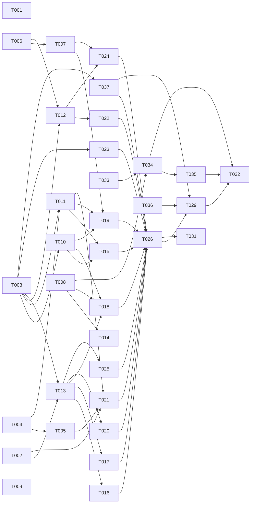

# Tasks: Extension VS Code tích hợp sâu (mức 2)

**Input**: [spec.md](spec.md), [plan.md](plan.md), [research.md](research.md)

## Quy ước

- **Định dạng**: `[ID] [P?] [Story] [Tier] · ước lượng`.
  - **[P]**: chạy song song được với task khác cùng đợt. Bộ file không giao nhau và không chờ task chưa xong.
  - **Tier**: chọn model theo CLAUDE.md.
    - **nặng** = Opus `--effort high`;
    - **vừa** = Sonnet `--effort high`;
    - **nhẹ** = Sonnet `--effort medium`.
  - **Ước lượng**: ngày-agent (một agent làm liên tục, gồm test). **[Suy luận]** theo các spec 012, 015.
- **PHẠM VI**: file duy nhất task được sửa. Hai task cùng đợt không có file chung.
- **File chung của extension**:
  - T003 tạo sẵn `apps/vscode/package.json` (đủ mọi `contributes`, lệnh, setting, view, menu), `package.nls*.json` và
    `src/extension.ts`. `extension.ts` gọi `register(ctx)` của từng thư mục con. T003 tạo mỗi `src/<phần>/index.ts`
    dạng rỗng.
  - Task sau chỉ sửa thư mục của mình, không sửa ba file trên. Cần thêm khoá manifest thì ghi vào ghi chú bàn giao;
    T026 gộp lại.
  - Chữ giao diện: mỗi phần có `src/<phần>/strings.ts` (vi/en), dùng hàm `t()` của `src/lib/i18n.ts`.
- **File chung khác**:
  - `worker/cmd/hive/main.go`, `worker/cmd/hive-worker/main.go`: chỉ thêm một dòng `case`, task sửa chúng chạy nối tiếp.
  - `packages/contracts/src/index.ts`, `openapi.json`: cùng quy tắc.
- Mỗi task kèm test trong cùng commit.
- **Kiểm tra theo loại task**:
  - Go: `gofmt -l .`, `go vet ./...`, `GOOS=windows go vet ./...`, `go test ./...` trong `worker/`. Test giả `HOME` đặt
    cả `HOME` và `USERPROFILE`.
  - Extension: `pnpm --filter @xdev-hive/vscode typecheck`, `test`, `build`.
  - Hub: `pnpm --filter @xdev-hive/hub test` (test DB cần Docker, xem AGENTS.md).
  - Mọi task: `pnpm biome check --write .`, `pnpm deps`.
- **Migration**: chỉ sinh ở bước cuối của task hub (T008, T030, T034), sau khi rebase lên `main` mới nhất.
- **Ghi chú chung**: task sửa `apps/desktop` (T006, T009, T014) chờ các nhánh desktop đang mở (DESKCLIENT, spec 015) merge.
- **Quyết định 2026-10-15**: chủ dự án chốt Q1–Q9.
  - Q1 công khai ngay: bỏ T027, T028 (giữ ID, không đánh số lại); thêm T036, T037; sửa T029.
  - Q5 đồng bộ PR hai chiều: thêm T033, T034, T035; T008, T014, T018, T032 thêm phần liên quan.
- **Task của người**: T036 do chủ dự án làm (tài khoản, PAT). Không giao agent, không có tier.

## Đợt 0: quyết định và kiểm khả năng (song song)

- [ ] **T001 [P] [—] [nhẹ] · 0,5 ngày — ADR 0027 và mục SRS cho extension VS Code**
  - **Goal**:
    - Viết ADR 0027 "Extension VS Code": các quyết định ở research.md mục 5, quyết định đã chốt Q1–Q9 (Q1 công khai
      ngay, Q5 đồng bộ bình luận với PR), đường dẫn tới spec 017.
    - Thêm SRS mục 3.22 `VSC-01…VSC-15`, ánh xạ FR của spec (gồm FR-038…FR-052).
  - **PHẠM VI**:
    - `docs/adr/0027-vscode-extension.md` (mới)
    - `docs/adr/README.md` (một dòng mục lục)
    - `docs/srs.md` (chỉ thêm mục 3.22)
  - **Kiểm**: `pnpm biome check .`.

- [ ] **T002 [P] [—] [vừa] · 1,5 ngày — Spike: Cursor, Windsurf, Remote, CSP webview**
  - **Goal**: kiểm từng dòng **[Chưa kiểm]** ở research.md mục 2–3 và plan.md bằng extension thử (không commit
    extension thử, chỉ commit kết quả):
    - engine version của Cursor, Windsurf bản mới nhất; `createChatParticipant` có hiện không; `selectChatModels` trả gì;
    - API MCP riêng của Cursor; đường dẫn file cấu hình MCP;
    - `env.asExternalUri` với loopback trên SSH và WSL: hub chuyển hướng về đúng chưa;
    - `shiki` và Mermaid dưới CSP FR-022; `iframe` http trong webview (mixed content);
    - `vscode.changes` có ở 1.101 không; `workbench.extensions.installExtension` nhận URI file VSIX không.
  - **PHẠM VI**:
    - `specs/017-vscode-extension/research.md` (thêm mục 6 "Kết quả spike", sửa nhãn)
  - **Kiểm**: mỗi dòng có kết quả "có / không / chưa rõ" kèm editor, bản và ngày thử.

- [ ] **T036 [—] [người: chủ dự án] · 0,5 ngày người — Publisher Marketplace, namespace Open VSX, PAT trong secret CI**
  - **Goal**: plan.md mục 11 "Chuẩn bị", FR-047, FR-048.
    - Kiểm tên `xdev` còn trống trên Marketplace và Open VSX. Đã có người giữ thì chọn tên khác và báo trước khi T003
      ghi `publisher`.
    - Tạo publisher `xdev` (Azure DevOps) và namespace `xdev` (Open VSX, sau khi ký Eclipse Publisher Agreement).
    - Tạo `VSCE_PAT` (chỉ scope Marketplace "Manage", hạn ≤ 90 ngày) và `OVSX_PAT`.
    - Tạo GitHub environment `vscode-publish`: người duyệt bắt buộc, chỉ tag `vscode-v*`, lưu hai PAT làm secret.
  - **PHẠM VI**: không sửa file trong repo. Không gửi PAT qua chat, issue hay commit.
  - **Xong khi**: ghi vào PR của T029 tên publisher, tên environment, ngày hết hạn PAT (không ghi giá trị PAT).

## Đợt 1: nền (song song, sau T002 với phần phụ thuộc kết quả spike)

- [ ] **T003 [P] [—] [vừa] · 1,5 ngày — Khung `apps/vscode` và manifest đủ**
  - **Goal**:
    - Gói `@xdev-hive/vscode`: `package.json` (manifest đủ theo plan.md: `publisher: "xdev"` (hoặc tên T036 báo),
      `engines.vscode ^1.101.0`, `extensionKind`, `capabilities.untrustedWorkspaces`, `activationEvents`,
      `contributes.{commands, configuration, viewsContainers, views, viewsWelcome, menus, chatParticipants,
      mcpServerDefinitionProviders, terminal.profiles, authentication, walkthroughs}`). Trường gallery (`license`,
      `homepage`, `categories`…) để T037 điền qua ghi chú bàn giao.
    - `scripts/build.ts` (esbuild hai đích, Tailwind CLI), `tsconfig.json` (alias `@/`), `vitest.config.ts`,
      `test/vscode-mock.ts`.
    - `src/extension.ts` và `src/<phần>/index.ts` rỗng cho mọi phần trong plan.md; `src/lib/{log,i18n,config,redact,
      exec}.ts` đủ dùng.
    - Rule ranh giới trong `.dependency-cruiser.cjs`: `apps/vscode/src` không import `apps/vscode/webview` và ngược lại.
    - `pnpm-lock.yaml` cập nhật.
  - **PHẠM VI**:
    - `apps/vscode/**` (trừ phần các task sau sở hữu: chỉ tạo `index.ts` rỗng)
    - `.dependency-cruiser.cjs` (một rule)
    - `pnpm-lock.yaml`
  - **Test**: `redact.test.ts` (che `hive_pat_`, `hwm_`, `hwr_`), `exec.test.ts` (không qua shell), activate với mock
    không lỗi; `vsce package` chạy ra VSIX.

- [ ] **T004 [P] [US1] [nặng] · 2 ngày — `hive auth` (cầu nối keychain)**
  - **Goal**:
    - `hive auth token|store|logout|status --json` như plan.md mục 1. `store` đọc token từ stdin.
    - Dùng chung code keychain và `hive.json` của `login.go` (tách hàm, không chép).
    - Kiểm chéo: test (chạy tay, ghi kết quả vào mô tả commit) đọc mục do desktop Rust ghi trên macOS và Windows. Không
      đọc được thì ghi rõ để thêm task desktop đổi sang `hive auth`.
  - **PHẠM VI**:
    - `worker/cmd/hive/auth.go`, `worker/cmd/hive/auth_test.go` (mới)
    - `worker/cmd/hive/login.go` (tách hàm keychain dùng chung)
    - `worker/cmd/hive/main.go` (một dòng `case "auth"`)
  - **Test**: keyring giả (`keyring.MockInit()`), token không xuất hiện trong stderr, mã thoát 3 khi chưa có token.

- [ ] **T006 [P] [US7] [vừa] · 1 ngày — Op socket `worker.status` và cờ `--owner`**
  - **Goal**:
    - `hive-worker run --owner desktop|vscode|cli` (mặc định `cli`).
    - Op NDJSON `worker.status` → `{state, hubConnected, registered, machineId, version, runs, owner}`. Không cần bắt tay
      mới; bản giao thức vẫn `v: 1` (op lạ đã trả lỗi theo giao thức hiện có).
    - Desktop truyền `--owner desktop` (một dòng trong `worker.rs`).
  - **PHẠM VI**:
    - `worker/cmd/hive-worker/local.go`, `worker/cmd/hive-worker/local_unix_test.go`
    - `worker/internal/localipc/**` (nếu cần thêm kiểu)
    - `worker/cmd/hive-worker/main.go` (chỉ flag `--owner` trong `run`)
    - `apps/desktop/src-tauri/src/worker.rs` (một tham số)
  - **Test**: Go test gọi `worker.status` qua socket tạm; Windows `go vet`.

- [x] **T008 [P] [US3] [nặng] · 3,5 ngày — Hub: bình luận theo dòng cho review code**
  - **Goal**: theo plan.md mục 4 và FR-018:
    - bảng `code_review_comments` (có `deleted_at`, `origin`, `external_author`), RLS bật và ép;
    - service, router `codeReviews.comments.{list, add, reply, edit, delete, resolve, reopen}`. Sửa và xoá chỉ cho tác
      giả, chỉ bình luận `origin = 'hive'`;
    - trường đồng bộ trong hợp đồng (`syncState`, `providerUrl`) dạng tuỳ chọn, trả `null`. T034 điền giá trị;
    - audit; thông báo hộp thư cho người giao việc và reviewer;
    - hợp đồng trong `packages/contracts/src/code-reviews.ts`, `pnpm openapi`;
    - migration sinh ở bước cuối.
  - **PHẠM VI**:
    - `apps/hub/src/modules/codereview/{schema.ts, comments.ts, comments.db.test.ts, router.ts, index.ts,
      rls.db.test.ts}`
    - `packages/contracts/src/code-reviews.ts`, `packages/contracts/src/code-reviews.test.ts`
    - `packages/contracts/openapi.json`
    - `apps/hub/db/migrations/<số kế tiếp>_*.sql` và `meta/**`
  - **Test**: DB test cho thêm, trả lời, sửa, xoá mềm, xử lý, `outdated` theo `headSha`; RLS chặn tổ chức khác; người
    không xem được review không bình luận được; người khác tác giả không sửa, xoá được.

- [ ] **T009 [P] [US7] [vừa] · 0,5 ngày — `optimizer.Link` tạo cả `~/.xdev-hive/bin/hive`**
  - **Goal**: `Link` nhận thêm đường dẫn `hive` (cùng thư mục với `hive-worker` trong bundle desktop) và tạo liên kết thứ
    hai. Thiếu file nguồn thì bỏ qua, không lỗi.
  - **PHẠM VI**:
    - `worker/internal/optimizer/link.go`, `worker/internal/optimizer/link_test.go`
    - `worker/cmd/hive-worker/optimize.go`, `worker/cmd/hive-worker/optimize_test.go`
  - **Phụ thuộc**: không chung file với T006 (T006 chỉ sửa `main.go`, `local.go`).

- [ ] **T033 [P] [US11] [nặng] · 2,5 ngày — scm: API bình luận PR theo dòng và webhook bình luận**
  - **Goal**: plan.md mục 4b phần "scm (T033)", FR-038, FR-039, FR-043 (phần `checkAccess`):
    - `GitProvider` thêm `listReviewComments`, `createReviewComment`, `replyReviewComment`, `editReviewComment`,
      `deleteReviewComment`, `setReviewThreadResolved`, cho GitHub (REST + GraphQL), GitLab (discussions, `diff_refs`
      theo phiên bản MR), `MemoryProvider`; `local` ném `unsupported`;
    - mã lỗi mới `position_invalid` trong `GitProviderError` (GitHub 422, GitLab 400 vị trí sai);
    - `WebhookEvent` thêm `pull_request_review_comment`; parser cho GitHub `pull_request_review_comment`,
      `pull_request_review_thread` và GitLab `note` có `position`;
    - `checkAccess` báo thiếu quyền ghi PR;
    - job chạy một lần `scm.webhooks.refresh` cập nhật sự kiện cho webhook của kết nối sẵn có.
  - **PHẠM VI**:
    - `apps/hub/src/modules/scm/{types.ts, errors.ts, github.ts, gitlab.ts, memory.ts, local.ts, events.ts,
      webhooks.ts, index.ts}` và test cạnh từng file (`*.test.ts`)
    - `apps/hub/src/modules/scm/review-comments.test.ts` (mới, test chung cho ba provider qua `mock-http.ts`)
    - `apps/hub/src/modules/scm/fixtures/{github,gitlab}/**` (payload webhook và phản hồi API mẫu)
  - **Phụ thuộc**: không. Không chung file với T008 (T008 chỉ sửa `codereview`, contracts).
  - **Test**: fixture GitHub/GitLab giả cho từng thao tác; 422 thành `position_invalid`; 403 hết hạn mức thành
    `rate_limited` có `retryAfterMs`; parser webhook trả đúng `{provider, prNumber, commentId, threadId, path, line, side,
    commitSha, body, author, updatedAt, action}`.

## Đợt 2: lõi extension và CLI (sau Đợt 1)

- [ ] **T005 [US5] [nặng] · 2 ngày — `hive mcp` (proxy stdio ↔ streamable HTTP)**
  - **Phụ thuộc**: T004 (token, `main.go`).
  - **Goal**: plan.md mục 6 và FR-015. Xử lý phản hồi JSON và SSE, `Mcp-Session-Id` nếu hub trả, huỷ khi stdin đóng.
    Token hết hạn: lỗi JSON-RPC có lời nhắn "Chạy hive login".
  - **PHẠM VI**:
    - `worker/cmd/hive/mcp.go`, `worker/cmd/hive/mcp_test.go` (mới)
    - `worker/cmd/hive/main.go` (một dòng `case "mcp"`)
  - **Test**: hub giả `httptest` trả JSON và SSE; token không lọt ra stderr; `X-Hive-Project` gửi đúng.

- [ ] **T007 [US6] [vừa] · 1 ngày — `hive-worker context-pack`**
  - **Phụ thuộc**: T006 (`main.go`).
  - **Goal**: `hive-worker context-pack --json --cwd <dir> --query <câu> [--budget N]` bọc `buildContextPack` bản tại máy,
    in `{markdown, files[], tokens}`. Không gọi hub.
  - **PHẠM VI**:
    - `worker/cmd/hive-worker/contextpack.go`, `worker/cmd/hive-worker/contextpack_test.go` (mới)
    - `worker/cmd/hive-worker/main.go` (một dòng `case`)
  - **Test**: repo tạm có vài file, kết quả có đúng file liên quan, chạy được không có mạng.

- [ ] **T010 [P] [US2] [nặng] · 2 ngày — Client hub, SSE, hỏi lại định kỳ, fake hub**
  - **Phụ thuộc**: T003.
  - **Goal**: plan.md mục 2. `hub/client.ts`, `sse.ts` (`Last-Event-ID`), `poll.ts` (focus, backoff), `errors.ts` (lỗi
    tiếng Việt), `project.ts` (dự án của workspace từ `hive-worker projects --json` hoặc `.mcp.json`).
    `test/fake-hub.ts` dựng route theo `@xdev-hive/contracts` cho mọi task sau. Thêm test hub chứng minh SSE nhận PAT.
  - **PHẠM VI**:
    - `apps/vscode/src/hub/**`
    - `apps/vscode/test/fake-hub.ts`
    - `apps/hub/src/runs/stream-pat.db.test.ts` (mới, chỉ test) **[Giả định: thư mục test SSE; agent chọn đúng chỗ cạnh
      `runStreamHandler`]**
  - **Test**: 401 gọi `auth.invalidate` một lần; poll dừng khi mất focus; SSE nối lại không mất sự kiện.

- [ ] **T011 [P] [US1] [nặng] · 2,5 ngày — Authentication Provider `xdev-hive`**
  - **Phụ thuộc**: T003, T004 (giao diện JSON của `hive auth`).
  - **Goal**: plan.md mục 1, FR-003…FR-005. PKCE, loopback, `asExternalUri`, `store.ts` hai tầng, `hub-url.ts`, gỡ phiên
    khi 401, hỏi khi đăng xuất. Lấy tên và vai trò sau đăng nhập. Chưa có hub URL (người dùng tải từ Marketplace) thì
    trạng thái "chưa cấu hình hub", lệnh "Nhập URL hub" kiểm `GET /api/v1/health` trước khi lưu (FR-051).
  - **PHẠM VI**:
    - `apps/vscode/src/auth/**`
  - **Test**: `state` sai bị từ chối; quá 5 phút huỷ; không có `hive` thì dùng `SecretStorage`; token không vào log
    (kiểm Output giả).

- [ ] **T012 [P] [US7] [nặng] · 2,5 ngày — Worker: tìm, tải, kiểm chữ ký, giám sát**
  - **Phụ thuộc**: T003, T006.
  - **Goal**: plan.md mục 7. `bin.ts` (thứ tự tìm, bản tối thiểu, tải như `worker/internal/update`, ECDSA + sha256),
    `ipc.ts` (NDJSON socket/pipe, `hello`, `worker.status`, `session.list`), `supervisor.ts` (máy trạng thái, mã 4,
    `stop` rồi kill), `status-bar.ts`. Chép `release-signing.pem` vào `src/worker/`.
  - **PHẠM VI**:
    - `apps/vscode/src/worker/**`
  - **Test**:
    - binary giả thoát mã 4 → `External`;
    - không gửi `stop` cho worker không do mình chạy;
    - chữ ký sai → xoá file tải;
    - test so `src/worker/release-signing.pem` với `worker/internal/update/release-signing.pem`.
  - **[Chưa kiểm]**: gói phát hành `hive-worker_<os>_<arch>` có kèm binary `hive` không. Không kèm thì ghi vào bàn giao;
    T029 thêm `hive` vào gói.

- [ ] **T013 [P] [US2] [vừa] · 2 ngày — Webview host, cầu nối, CSP, theme**
  - **Phụ thuộc**: T003, kết quả CSP của T002.
  - **Goal**: plan.md mục 3. `webview-host/{panel,view,bridge,csp,html}.ts`; `webview/{main.tsx, bridge.ts, styles.css}`
    có router màn rỗng; allowlist thủ tục theo màn (mỗi task màn tự khai báo trong `webview-host/allowlist/<màn>.ts`).
  - **PHẠM VI**:
    - `apps/vscode/src/webview-host/**`
    - `apps/vscode/webview/main.tsx`, `apps/vscode/webview/bridge.ts`, `apps/vscode/webview/styles.css`,
      `apps/vscode/webview/theme.ts`
  - **Test**: HTML có nonce mới mỗi lần, CSP đúng FR-022; thủ tục ngoài allowlist bị từ chối; HTML không chứa
    `hive_pat_`.

- [ ] **T014 [P] [US3] [vừa] · 2 ngày — Luồng bình luận trong `@xdev-hive/code-review`, web và desktop**
  - **Phụ thuộc**: T008.
  - **Goal**: plan.md mục 4 (web và desktop). `FileDiff` nhận `threads`, `onAddComment`, `onReply`, `onResolve`; có
    nhãn "Đã cũ". Web và desktop nối `codeReviews.comments.*`, hỏi lại 30 giây khi phiên đang mở.
    - Sửa, xoá bình luận của mình; "Bình luận đã bị xoá" giữ chỗ trong luồng.
    - Khi trường có giá trị: nhãn nguồn "GitHub"/"GitLab" kèm login, nhãn "Chờ đồng bộ"/"Lỗi đồng bộ", link "Xem trên
      PR", nút "Thử lại" (gọi `retrySync`, có sau T034; trước đó ẩn). Kiểm renderer Markdown chặn HTML thô.
  - **PHẠM VI**:
    - `packages/code-review/src/{file-diff.tsx, file-diff.test.tsx, comment-thread.tsx, comment-thread.test.tsx,
      index.ts, text.ts}`
    - `apps/web/src/pages/knowledge/code-reviews-tab.tsx` (+ test cạnh file)
    - `apps/desktop/src/screens/reviews-screen.tsx` (+ test cạnh file)
  - **Test**: không truyền `threads` thì giao diện như cũ (snapshot cũ xanh).

## Đợt 3: tính năng (song song, sau Đợt 2)

- [ ] **T015 [P] [US2] [vừa] · 2 ngày — Tree: Việc của tôi, Chờ duyệt, Lượt chạy, Hàng merge, badge**
  - **Phụ thuộc**: T010, T011.
  - **Goal**: US2-1…4, 6, 7. Log run vào Output qua SSE. Chưa cấu hình hub thì view hiện "Chưa cấu hình hub xDev Hive"
    (Edge Cases).
  - **PHẠM VI**: `apps/vscode/src/views/{mine,approvals,runs,merge-queue,badge}.ts` (+ test)
  - **Test**: fake hub; badge đúng tổng; chưa đăng nhập và chưa có hub URL đều không gọi mạng.

- [ ] **T016 [P] [US2] [vừa] · 1,5 ngày — View AI SDLC (webview `sdlc-ui`)**
  - **Phụ thuộc**: T013.
  - **PHẠM VI**: `apps/vscode/src/views/sdlc.ts`, `apps/vscode/webview/screens/sdlc.tsx`,
    `apps/vscode/src/webview-host/allowlist/sdlc.ts` (+ test)
  - **Test**: `SdlcEnv.link` mở đúng màn; quyền ẩn nút theo `can`.

- [ ] **T017 [P] [US8] [nặng] · 2,5 ngày — View Artifact và panel artifact cách ly**
  - **Phụ thuộc**: T013.
  - **Goal**: plan.md mục 8. Thư viện artifact tải về `globalStorage` có kiểm sha256; CSP ADR 0023; chỉ nhận thông điệp
    của `@xdev-hive/artifacts-runtime`; bộ đệm LRU 200 MiB.
  - **PHẠM VI**: `apps/vscode/src/views/artifacts.ts`, `apps/vscode/src/artifacts/**`,
    `apps/vscode/webview/screens/{artifacts,artifact-frame}.tsx`, `apps/vscode/src/webview-host/allowlist/artifacts.ts`
    (+ test)
  - **Test**: panel có `enableCommandUris: false`; thông điệp lạ bị bỏ; xoá bộ đệm khi đăng xuất.

- [ ] **T018 [P] [US3] [nặng] · 3 ngày — Review bằng Comments API và diff**
  - **Phụ thuộc**: T008, T010, T013.
  - **Goal**: plan.md mục 4 (extension), US3 toàn bộ. Fallback webview `CodeReviewPane` khi không có repo. Sửa, xoá
    bình luận của mình. Bình luận từ PR hiện tác giả "login · GitHub"; trạng thái đồng bộ qua `Comment.label`,
    `contextValue`; thân hiện bằng `MarkdownString` `isTrusted = false`, `supportHtml = false`.
  - **PHẠM VI**: `apps/vscode/src/review/**`, `apps/vscode/webview/screens/review.tsx`,
    `apps/vscode/src/webview-host/allowlist/review.ts` (+ test)
  - **Test**: 4 luồng từ dữ liệu mẫu; `add` gửi đúng `side`, `headSha`; `decide` khi `headSha` đổi hiện đúng thông báo;
    không đổi working tree (repo tạm, so `git status`).

- [ ] **T019 [P] [US4] [nặng] · 3 ngày — Chat participant `@hive`**
  - **Phụ thuộc**: T010, T011, T007 (context pack).
  - **Goal**: plan.md mục 5. Bốn lệnh, nút hành động, che bí mật bằng `secret-scan` của contracts, rơi về khi không có
    model.
  - **PHẠM VI**: `apps/vscode/src/chat/participant/**` (+ test)
  - **Test**: `vscode.lm` giả; `/giao` không gọi `tasks.create` trước khi bấm; diff gửi model không có chuỗi bí mật mẫu;
    không có `vscode.chat` thì không đăng ký và không lỗi.

- [ ] **T020 [P] [US4] [vừa] · 1,5 ngày — Webview chat dự phòng (Leader + Giao việc)**
  - **Phụ thuộc**: T013.
  - **PHẠM VI**: `apps/vscode/src/chat/fallback/**`, `apps/vscode/webview/screens/chat.tsx`,
    `apps/vscode/src/webview-host/allowlist/chat.ts` (+ test)
  - **Test**: gửi, hỏi lại, hiện đề xuất với nút Duyệt/Từ chối; form Giao việc gọi `tasks.create`.

- [ ] **T021 [P] [US5] [nặng] · 2,5 ngày — MCP provider và ghi cấu hình cho Claude Code, Cursor, Windsurf**
  - **Phụ thuộc**: T005, T011, kết quả Cursor của T002.
  - **Goal**: plan.md mục 6, FR-013…FR-017.
  - **PHẠM VI**: `apps/vscode/src/mcp/**` (+ test)
  - **Test**: `HOME` tạm; ghi giữ nguyên khoá khác; gỡ trả về đúng từng byte; file không chứa `hive_pat_`;
    `resolveMcpServerDefinition` gắn token mới nhất.

- [ ] **T022 [P] [US9] [vừa] · 1 ngày — Terminal profile Hive Leader và gắn phiên**
  - **Phụ thuộc**: T012 (`ipc.ts`, `bin.ts`).
  - **PHẠM VI**: `apps/vscode/src/terminal/**` (+ test)
  - **Test**: không có `hive` thì báo đúng chữ; chọn "Chỉ xem" thêm `--view`.

- [ ] **T023 [P] [US10] [vừa] · 1,5 ngày — CodeLens và Hover**
  - **Phụ thuộc**: T003; phần trạng thái hub dùng T010.
  - **PHẠM VI**: `apps/vscode/src/codelens/**` (+ test)
  - **Test**: `tasks.md` 300 dòng dựng lens ≤ 50 ms; Restricted Mode không có lens "Giao agent"; hover PHẠM VI đúng task.

- [ ] **T024 [P] [US6] [vừa] · 1,5 ngày — View Máy này: tối ưu token, memory, context pack**
  - **Phụ thuộc**: T007, T012.
  - **PHẠM VI**: `apps/vscode/src/local/**`, `apps/vscode/src/views/machine.ts` (+ test)
  - **Test**: chặn `globalThis.fetch`, mọi lệnh vẫn chạy với `hive-worker` giả.

- [ ] **T025 [P] [US2] [vừa] · 1 ngày (P3) — Duyệt tài liệu tri thức (`ReviewPane`) trong webview**
  - **Phụ thuộc**: T013.
  - **PHẠM VI**: `apps/vscode/webview/screens/doc-review.tsx`, `apps/vscode/src/views/doc-review.ts`,
    `apps/vscode/src/webview-host/allowlist/doc-review.ts` (+ test)
  - **Test**: Duyệt/Trả lại gọi `reviews.decide`; nút "Sửa trên web" mở URL hub.

- [ ] **T034 [P] [US11] [nặng] · 3,5 ngày — Hub: đồng bộ hai chiều bình luận review với PR**
  - **Phụ thuộc**: T008 (bảng và hợp đồng bình luận), T033 (API provider, webhook).
  - **Goal**: plan.md mục 4b phần "codereview (T034)", FR-040…FR-046, US11:
    - bảng `code_review_comment_links`, RLS bật và ép;
    - đẩy ra theo job pg-boss `codereview.comment-sync` gom theo PR, dấu ẩn trong thân, rơi về bình luận chung khi
      `position_invalid`;
    - nhận về qua `registerCodeReviewScm`: tạo, sửa, xoá, trả lời, resolve; bỏ qua sự kiện đã có (so `body_hash`,
      `provider_updated_at`); không bao giờ đẩy ngược bình luận `origin <> 'hive'`;
    - job đối chiếu 10 phút cho phiên đang mở;
    - giới hạn ghi theo kết nối, hoãn theo `retryAfterMs`, thử lại tối đa 5 lần rồi `failed`;
    - kiểm quyền ghi PR của kết nối; thiếu thì `disabled` kèm lý do;
    - `features.prCommentSync` trong `ProjectSettings`; `codeReviews.comments.retrySync`; điền `syncState`,
      `providerUrl`, `origin`, `externalAuthor` trong `list`;
    - audit `code_review.comment.sync_out|sync_in|sync_failed`; hộp thư báo bình luận từ PR như bình luận Hive;
    - migration sinh ở bước cuối.
  - **PHẠM VI**:
    - `apps/hub/src/modules/codereview/{comment-sync.ts, comment-sync-in.ts, comment-sync.db.test.ts,
      comment-sync-in.db.test.ts, scm.ts, jobs.ts, schema.ts, comments.ts, router.ts, index.ts, rls.db.test.ts}`
    - `packages/contracts/src/{code-reviews.ts, code-reviews.test.ts, projects.ts}`, `packages/contracts/openapi.json`
    - `apps/hub/db/migrations/<số kế tiếp>_*.sql` và `meta/**`
  - **Test** (GitHub, GitLab giả bằng `MemoryProvider` và fixture của T033, DB thật):
    - thêm, trả lời, sửa, xoá, resolve ở hub sang provider đúng tham số;
    - webhook về trước phản hồi API: một bình luận mỗi bên (SC-010); webhook giao lại 100 lần không đổi gì;
    - bình luận của người ngoài trên PR tạo luồng đúng dòng; trả lời vào đúng luồng;
    - hai bên cùng sửa: bản sau thắng; xoá thắng sửa;
    - `rate_limited` hoãn tới `retryAfterMs`; kết nối thiếu quyền thì `disabled`, không gọi provider;
    - dấu ẩn giả từ tác giả khác tài khoản kết nối bị bỏ qua;
    - RLS chặn tổ chức khác trên bảng link.

- [ ] **T037 [P] [—] [nhẹ] · 1 ngày — Gói đăng Marketplace: README, CHANGELOG, icon, giấy phép, quyền riêng tư, walkthrough**
  - **Phụ thuộc**: T003.
  - **Goal**: plan.md mục 11 "Gói đăng", FR-049…FR-052:
    - `README.md` cho trang Marketplace: tính năng, bảng "cần hub" / "chạy tại máy", đăng nhập, MCP cho từng công cụ,
      Remote, quyền riêng tư, link hướng dẫn. Viết tiếng Việt, có mục tiếng Anh ngắn;
    - `CHANGELOG.md` bản đầu; `LICENSE` (giấy phép riêng theo FR-052, đánh dấu chờ chủ dự án duyệt); `PRIVACY.md` (vi,
      en) theo FR-050;
    - icon 128×128 từ biểu tượng trong `docs/design-system` (PNG nền đặc, không trong suốt hoàn toàn);
    - walkthrough "Bắt đầu với xDev Hive" (4 bước FR-051) bằng Markdown;
    - ghi chú bàn giao cho T026: khoá manifest `license`, `homepage`, `bugs`, `categories`, `keywords`,
      `galleryBanner`, `pricing`, `contributes.walkthroughs`.
  - **PHẠM VI**: `apps/vscode/{README.md, CHANGELOG.md, LICENSE, PRIVACY.md}`, `apps/vscode/media/**`,
    `apps/vscode/walkthrough/**`
  - **Kiểm**: `pnpm biome check .`; README không có link tới repo private; mọi ảnh trong README dùng URL `https`
    (Marketplace chặn ảnh SVG và `http`).

## Đợt 4: ghép, phát hành, tài liệu

- [ ] **T026 [US1–US10] [vừa] · 2 ngày — Ghép, Workspace Trust, test tích hợp**
  - **Phụ thuộc**: T015…T025, T037.
  - **Goal**:
    - gộp ghi chú bàn giao về manifest, `extension.ts`, `package.nls*.json`, kể cả khoá gói đăng và
      `contributes.walkthroughs` của T037;
    - kiểm mọi lệnh cần hub hiện "Chưa cấu hình hub" khi chưa có URL (FR-051);
    - kiểm Restricted Mode tắt đúng phần (Edge Cases);
    - test tích hợp `@vscode/test-electron`: activate ≤ 300 ms, đăng nhập với fake hub, mở view, review, khoá worker
      (SC-005, SC-007).
  - **PHẠM VI**: `apps/vscode/package.json`, `apps/vscode/package.nls*.json`, `apps/vscode/src/extension.ts`,
    `apps/vscode/test/integration/**`

- ~~**T027 — Hub: phát VSIX kênh nội bộ**~~ **Bỏ** (Q1, 2026-10-15: không có kênh nội bộ).

- ~~**T028 — Bộ cập nhật kênh nội bộ trong extension**~~ **Bỏ** (Q1, 2026-10-15).

- [ ] **T029 [P] [—] [vừa] · 1,5 ngày — CI và đăng công khai Marketplace, Open VSX**
  - **Phụ thuộc**: T026, T036 (publisher, environment, PAT), T037 (gói đăng).
  - **Goal**: `.github/workflows/vscode.yml` theo plan.md mục 11 và FR-031, FR-048, FR-049:
    - PR: lint, typecheck, test, test tích hợp, `vsce package`, kiểm nội dung VSIX (không `*.map`, `test/`, `.env*`,
      không chuỗi `hive_pat_`, ≤ 8 MB);
    - tag `vscode-v*`: job dùng environment `vscode-publish`, kiểm bản trong tag khớp `package.json`, đăng cùng một
      file VSIX lên Marketplace và Open VSX, đính VSIX vào Release. Thiếu secret thì job lỗi;
    - `.vscodeignore`;
    - `docs/releasing.md` mục VS Code: cách gắn tag, người duyệt, lịch xoay vòng PAT, cách gỡ một bản lỗi
      (`vsce unpublish` một bản, phát bản vá).
    - Nếu T012 báo gói phát hành thiếu `hive` thì thêm vào `release.yml`.
  - **PHẠM VI**: `.github/workflows/vscode.yml` (mới), `.github/workflows/release.yml` (chỉ khi cần),
    `apps/vscode/.vscodeignore`, `docs/releasing.md` (thêm mục VS Code)
  - **Kiểm**: chạy workflow trên nhánh (không có tag) ra VSIX ≤ 8 MB (SC-006); job publish không chạy khi không có tag.
    Bản đầu đăng thật do người điều phối gắn tag sau khi T032 xanh (SC-011).

- [ ] **T035 [US11] [vừa] · 1 ngày — Web: cài đặt đồng bộ bình luận PR của dự án**
  - **Phụ thuộc**: T034.
  - **Goal**: plan.md mục 4b phần "Web (T035)". Công tắc "Đồng bộ bình luận review với GitHub/GitLab" ở trang cài đặt
    dự án; hiện quyền ghi PR còn thiếu của kết nối (từ `checkAccess`); số bình luận lỗi đồng bộ, link tới review.
  - **PHẠM VI**: `apps/web/src/pages/project-settings-page.tsx` và test cạnh file; Playwright spec của trang cài đặt
    dự án (sửa spec có sẵn, không tạo file e2e chung mới)
  - **Test**: công tắc gọi cập nhật `features.prCommentSync`; kết nối thiếu quyền thì công tắc tắt và có lời giải thích;
    dự án dùng provider `local` không hiện công tắc.

- [ ] **T030 [P] [US1] [vừa] · 1,5 ngày (P3) — Nhãn token riêng `xdev-hive-vscode` (Q9)**
  - **Phụ thuộc**: Q9 đã chốt để sau bản đầu; làm khi chủ dự án xếp lịch P3.
  - **Goal**: `purpose = 'ide'` trong hợp đồng `desktop-connect`, ràng buộc bảng `desktop_connect_codes`, clientId
    `xdev-hive-vscode`, trang quản lý token hiện nhãn "VS Code". Extension gửi `purpose=ide` nếu hub hỗ trợ.
  - **PHẠM VI**: `packages/contracts/src/desktop-connect.ts`, `packages/contracts/openapi.json`,
    `apps/hub/src/modules/fleet/{desktop-connect.ts, schema.ts}` (+ test), `apps/hub/src/modules/mcp/admin-service.ts`,
    migration (bước cuối), `apps/vscode/src/auth/pkce.ts`

- [ ] **T031 [P] [—] [nhẹ] · 0,5 ngày — Hướng dẫn dùng**
  - **Phụ thuộc**: T026.
  - **PHẠM VI**: `docs/vscode-extension.md` (mới), `docs/README` hoặc mục lục nếu có (một dòng)
  - **Goal**: cài, đăng nhập, MCP cho từng công cụ, Remote, gỡ cấu hình, câu hỏi thường gặp.

- [ ] **T032 [—] [vừa] · 1,5 ngày — Kiểm thử chấp nhận trên editor thật**
  - **Phụ thuộc**: T026, T029, T034, T035.
  - **Goal**: chạy US1–US11 trên VS Code ổn định, Cursor, Windsurf, Remote SSH, WSL; SC-001…SC-011. Ghi kết quả.
    - US11 với repo GitHub thử và project GitLab thử của tổ chức (không dùng repo khách hàng).
    - Cài từ VSIX bản thử trước khi gắn tag đăng thật; kiểm trang Marketplace bằng chế độ xem trước của `vsce`.
  - **PHẠM VI**: `specs/017-vscode-extension/research.md` (mục 7 "Kiểm thử chấp nhận")

## Đồ thị phụ thuộc

T036 là việc của chủ dự án (tạo publisher, environment, PAT), không giao agent. T027, T028 đã bỏ.

## Đợt chạy song song

Tối đa khoảng 6 agent build cùng lúc trên Mac mini (CLAUDE.md).

| Đợt | Task | Số agent | Tier | Ước lịch |
|---|---|---|---|---|
| 0 | T001, T002 (+ T036 chủ dự án làm song song) | 2 | nhẹ, vừa | 1,5 ngày |
| 1 | T003, T004, T006, T008, T009, T033 | 6 | vừa, nặng, vừa, nặng, vừa, nặng | 3,5 ngày (T008 dài nhất) |
| 2 | T005, T007, T010, T011, T012, T013, T014 | 6 cùng lúc (T007 sau T006, T005 sau T004 đều xong ở Đợt 1) | nặng ×4, vừa ×3 | 2,5 ngày |
| 3 | T015…T025, T034, T037 | 6 cùng lúc, 2–3 lượt | nặng ×5, vừa ×7, nhẹ ×1 | 5 ngày |
| 4 | T026 → T029, T031; T035 (ngay sau T034) → T032 | 1–3 | vừa, nhẹ | 5 ngày |

Tổng ước: **60,5 ngày-agent** cho 34 task giao agent (gồm T030 P3 1,5 ngày, làm sau bản đầu), cộng T036 cho chủ dự án; khoảng
**17–18 ngày lịch** với 5–6 agent **[Suy luận]**. Phần P1 (US1–US5) xong sau Đợt 3 lượt đầu nếu xếp T015, T018, T019,
T021 trước. T034 dài nhất Đợt 3 nên bắt đầu ở lượt đầu.

## Theo user story

| Story | Task |
|---|---|
| US1 Đăng nhập | T004, T011, T026, T030 |
| US2 View | T010, T013, T015, T016, T025 |
| US3 Review | T008, T014, T018 |
| US4 Chat | T019, T020 |
| US5 MCP | T005, T021 |
| US6 Tại máy | T007, T024 |
| US7 Worker | T006, T009, T012 |
| US8 Artifact | T017 |
| US9 Terminal | T022 |
| US10 CodeLens/Hover | T023 |
| US11 Đồng bộ PR | T033, T034, T035 |
| Chung | T001, T002, T003, T026, T029, T031, T032, T036, T037 |
