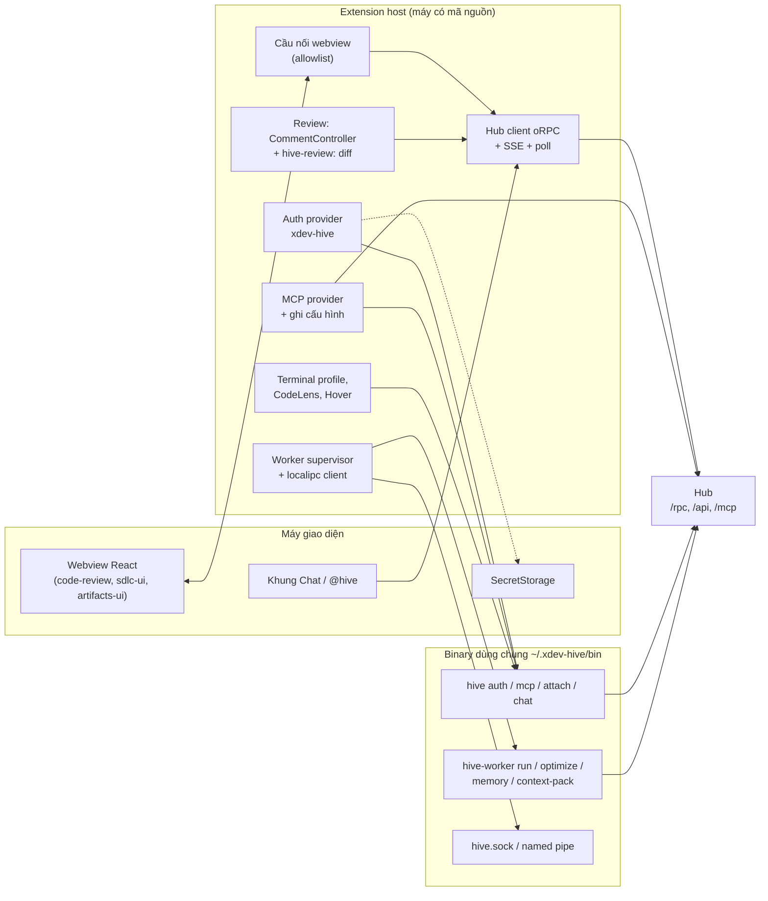
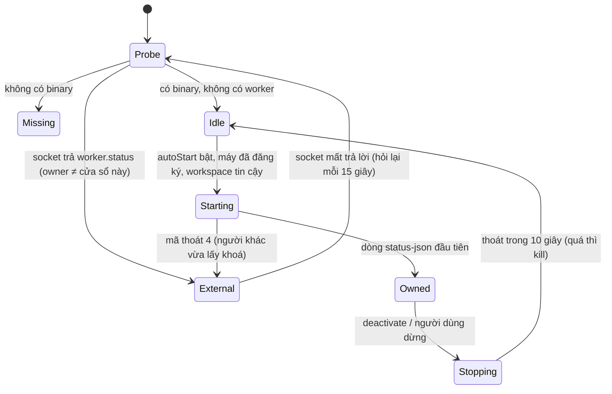

# Implementation Plan: Extension VS Code tích hợp sâu (mức 2)

**Branch**: `017-vscode-extension` · **Date**: 2026-10-15 · **Spec**: [spec.md](spec.md) · **Research**: [research.md](research.md)

Mọi lựa chọn ghi **[Giả định]** đi theo khuyến nghị ở câu hỏi Q1–Q9 của spec, chờ chủ dự án xác nhận.

## Tóm tắt

Thêm `apps/vscode`, một extension VS Code viết bằng TypeScript và build bằng esbuild. Extension dùng lại:
- hợp đồng oRPC của `@xdev-hive/contracts`;
- các package React (`code-review`, `sdlc-ui`, `artifacts-ui`, `ui`) trong webview;
- binary Go `hive`, `hive-worker` cho keychain, MCP stdio, worker và context pack.

Phần mới ở chỗ khác:
- **hub**: bình luận theo dòng cho review code (bảng, API, RLS); route phát VSIX nội bộ;
- **worker (Go)**: `hive auth`, `hive mcp`, op socket `worker.status`, `hive-worker context-pack`, liên kết `hive` vào
  `~/.xdev-hive/bin`;
- **package `code-review`**: hiện luồng bình luận trên web và desktop.

## Technical Context

| Mục | Giá trị |
|---|---|
| Ngôn ngữ | TypeScript (strict, như repo), Go cho phần CLI và worker |
| Engine | `engines.vscode: ^1.101.0` (research.md mục 1); `@types/vscode` ghim `1.101.x` để không dùng nhầm API mới hơn |
| Build | esbuild: `dist/extension.cjs` (platform `node`, format `cjs`, external `vscode`); `dist/webview/main.js` (platform `browser`, format `esm`) và `dist/webview/main.css` (Tailwind 4 CLI) |
| Phụ thuộc | `@orpc/client`, `@xdev-hive/contracts`, `@xdev-hive/{ui,code-review,sdlc-ui,artifacts-ui}`, `react`, `react-dom`, `@tanstack/react-query`. Không dùng module native |
| Test | Vitest cho logic thuần (mock `vscode` ở `test/vscode-mock.ts`); `@vscode/test-electron` cho test tích hợp; Go test cho phần worker |
| Đóng gói | `@vscode/vsce` 4.x, `ovsx` 1.x (devDependency của `apps/vscode`) |
| Nền tảng | macOS, Windows, Linux; Remote SSH, WSL. Dev Container chỉ có phần không cần worker |
| Hiệu năng | activate ≤ 300 ms (SC-005); `activationEvents` theo view, lệnh, `onAuthenticationRequest:xdev-hive`, `onStartupFinished` (chỉ thanh trạng thái) |

## Constitution Check

Đối chiếu `AGENTS.md` và `docs/decisions.md`:

| Quy tắc | Cách tuân |
|---|---|
| Module hub chỉ import qua `index.ts` | Bình luận review nằm trong module `codereview` (T008). Không có import chéo mới |
| Bảng mới bật và ép RLS | `code_review_comments` có policy theo `org_id`. `rls.db.test.ts` phủ bảng mới |
| Đổi contracts thì chạy `pnpm openapi` | T008, T027 commit `openapi.json` |
| Import ghi đuôi `.ts` (hub); web/desktop dùng alias | `apps/vscode` dùng alias `@/…` cho `src` (esbuild `alias`, tsconfig `paths`), không `../` |
| Chữ giao diện tiếng Việt | Từ điển `src/lib/i18n.ts`; `package.nls.json` tiếng Việt |
| Không commit secret | `VSCE_PAT`, `OVSX_PAT` chỉ ở GitHub secret. Khoá công khai ECDSA được phép commit |
| ADR cho quyết định lớn | T001 viết ADR 0027 "Extension VS Code" |

## Kiến trúc



### Cấu trúc `apps/vscode`

```text
apps/vscode/
├── package.json              # manifest: contributes, activationEvents, engines; khai báo đủ ở T003
├── package.nls.json          # chữ manifest tiếng Việt
├── package.nls.en.json
├── tsconfig.json             # paths @/* → src/*
├── vitest.config.ts
├── scripts/build.ts          # esbuild extension + webview, Tailwind CLI, chép thư viện artifact
├── .vscodeignore
├── README.md · CHANGELOG.md · media/icon.png · media/hive.svg
├── src/
│   ├── extension.ts          # activate(): nối các phần; mỗi phần một dòng đăng ký
│   ├── lib/                  # log.ts (che token), i18n.ts, config.ts, redact.ts, exec.ts (chạy binary, không shell)
│   ├── hub/                  # client.ts (RPCLink + bearer), sse.ts, poll.ts (focus-aware, backoff), errors.ts, project.ts
│   ├── auth/                 # provider.ts, pkce.ts, loopback.ts, store.ts (hive auth → SecretStorage), hub-url.ts
│   ├── worker/               # bin.ts (tìm, tải, kiểm chữ ký), ipc.ts (NDJSON socket/pipe), supervisor.ts, status-bar.ts
│   ├── webview-host/         # panel.ts, view.ts, bridge.ts (allowlist thủ tục), csp.ts, html.ts
│   ├── views/                # mine.ts, approvals.ts, runs.ts, merge-queue.ts, sdlc.ts, artifacts.ts, machine.ts
│   ├── review/               # controller.ts, diff-provider.ts, git.ts, threads.ts, decide.ts
│   ├── chat/participant/     # participant.ts, giao.ts, hoi.ts, review.ts, trangthai.ts, context.ts
│   ├── chat/fallback/        # command.ts (mở webview chat)
│   ├── mcp/                  # provider.ts, writers/{claude,cursor,windsurf}.ts, state.ts
│   ├── terminal/             # profiles.ts
│   ├── codelens/             # tasks-md.ts, symbols.ts, hover.ts, scope-index.ts
│   ├── local/                # optimize.ts, memory.ts, context-pack.ts
│   └── update/               # internal-channel.ts (chỉ khi cài từ kênh nội bộ)
├── webview/
│   ├── main.tsx              # router theo `screen` trong state ban đầu
│   ├── bridge.ts             # fetch giả → postMessage; clipboard, download, openExternal
│   ├── styles.css            # Tailwind 4: @source các package; ánh xạ --vscode-* → token
│   └── screens/              # review.tsx, sdlc.tsx, artifacts.tsx, artifact-frame.tsx, chat.tsx, doc-review.tsx
└── test/
    ├── vscode-mock.ts
    ├── fake-hub.ts           # Hono nhỏ: /rpc giả theo contracts, desktop/connect, SSE
    └── integration/          # @vscode/test-electron: activate, auth, view, review, worker lock
```

`pnpm-workspace.yaml` đã có `apps/*`, nên không phải sửa. Turbo nhận các task `build`, `typecheck`, `test` theo
`package.json` của gói. Thêm `apps/vscode` vào rule ranh giới `.dependency-cruiser.cjs`: extension host (`src/`) không
được import `webview/`, và ngược lại.

## Thiết kế từng phần

### 1. Đăng nhập (US1, FR-003…FR-007)

- `PKCE`: `code_verifier` 32 byte ngẫu nhiên, `challenge = base64url(sha256)`, `state` 16 byte. Loopback dùng
  `http.createServer` trên `127.0.0.1:0`, chỉ nhận `GET /callback`, đóng sau lần đầu hoặc sau 5 phút.
- **Remote**: `env.remoteName` có giá trị thì gọi `env.asExternalUri(Uri.parse("http://127.0.0.1:<port>"))`, lấy cổng
  của URI trả về gửi cho hub. Hub vẫn chuyển hướng về `127.0.0.1:<cổng>` ở máy giao diện, và VS Code chuyển tiếp về máy
  remote **[Chưa kiểm, T002 kiểm trên SSH và WSL]**. Hub kiểm cổng 1024–65535; cổng chuyển tiếp nằm ngoài khoảng đó thì
  báo lỗi rõ.
- `hive auth` (T004, Go, trong `worker/cmd/hive`):
  - `hive auth token --json [--hub URL]` → `{hubUrl, token, orgId, source: "keychain"|"file"}`, hoặc mã thoát 3 khi
    chưa có;
  - `hive auth store --hub URL` đọc token từ **stdin** (không qua argv, để không lộ trong `ps`);
  - `hive auth logout [--hub URL]`;
  - `hive auth status --json`.
- `store.ts`: có `hive` đủ bản thì dùng `hive auth`; không có thì dùng `context.secrets` khoá `xdev-hive.token:<hubUrl>`.
  Khi đăng nhập bằng extension mà có `hive`, ghi cả hai để desktop và CLI thấy.
- Sau khi có token: `GET /api/v1/me` để lấy tên và email, rồi `hive_whoami` (MCP) hoặc thủ tục tương đương để lấy vai
  trò (FR-036).

### 2. Client hub (FR-006, FR-025)

```ts
// src/hub/client.ts — phác thảo
const link = new RPCLink({
  url: () => `${hubUrl()}/rpc`,
  fetch: async (req, init) => {
    const token = await auth.token(); // chỉ trong extension host
    const headers = new Headers(init?.headers);
    headers.set("authorization", `Bearer ${token}`);
    headers.set("x-hive-org", orgFromToken(token));
    const res = await fetch(req, { ...init, headers });
    if (res.status === 401) auth.invalidate();
    return res;
  },
});
export const hub: ContractRouterClient<typeof contract> = createORPCClient(link);
```

- `poll.ts`: lịch theo view; dừng khi `window.state.focused === false`; backoff 2^n, tối đa 5 phút.
- `sse.ts`: `fetch` có `Authorization`, đọc `text/event-stream`, nối lại với `Last-Event-ID`.

### 3. Webview và cầu nối (FR-021…FR-023)

- Một bundle React cho mọi màn. Màn chọn theo `data-screen` trong HTML.
- Webview tạo client oRPC với `fetch` giả: gửi `{type: "rpc", id, path, body}` qua `acquireVsCodeApi().postMessage`.
  Extension host kiểm `path` có trong `ALLOWED_PROCEDURES` (danh sách tĩnh theo màn), gọi hub, rồi trả `{id, status,
  body}`.
- Thao tác trình duyệt bị chặn trong webview đi qua cầu nối: `clipboard.write` → `env.clipboard.writeText`; tải file →
  `showSaveDialog` và ghi file; mở link → `env.openExternal` (chỉ `https:` và hub URL).
- `sessionStorage` của `artifacts-ui` thay bằng `vscode.getState/setState`.
- CSP như FR-022, nonce mới mỗi lần dựng HTML. `localResourceRoots` = `dist/webview`.
- Theme: `styles.css` đặt `--background: var(--vscode-editor-background)`, `--foreground:
  var(--vscode-editor-foreground)`, `--primary: var(--vscode-button-background)`… Lớp `vscode-dark`,
  `vscode-high-contrast` trên `body` bật biến thể `dark`.

**Rủi ro CSP** (T002 kiểm):
- `shiki` dùng WASM: có thể cần `'wasm-unsafe-eval'` trong `script-src`. Nếu cần, chỉ thêm ở webview review, ghi lý do.
- Mermaid tạo `<style>` lúc chạy: đã có `'unsafe-inline'` trong `style-src`.

### 4. Review code (US3, FR-018…FR-020)

**Hub (T008)**:

```sql
-- apps/hub/src/modules/codereview/schema.ts (drizzle) — tóm tắt cột
code_review_comments(
  id uuid pk, org_id uuid not null, review_id uuid not null references code_reviews,
  thread_id uuid not null,            -- = id của bình luận đầu luồng
  path text not null, line int not null, side text check (side in ('old','new')),
  head_sha text not null, body text not null check (length(body) <= 20000),
  author_id uuid not null, created_at timestamptz, edited_at timestamptz,
  resolved_at timestamptz, resolved_by uuid
)
-- RLS: enable + force; policy org_id = current_setting('hive.org_id')::uuid
```

Hợp đồng `codeReviews.comments`:

| Thủ tục | Vào | Ra |
|---|---|---|
| `list` | `{reviewId}` | `{threads: [{id, path, line, side, headSha, outdated, resolved, comments[]}]}`. `outdated` = `headSha` khác head hiện tại **và** dòng nằm trong phần đổi giữa hai SHA **[Giả định: bản đầu chỉ so SHA]** |
| `add` | `{reviewId, path, line, side, headSha, body}` | luồng mới |
| `reply` | `{threadId, body}` | bình luận |
| `resolve` / `reopen` | `{threadId}` | luồng |

Quyền: ai xem được review thì bình luận được. Sửa và xoá chỉ cho tác giả (để sau, không có trong bản đầu). Audit:
`code_review.comment.add|reply|resolve|reopen`. Hộp thư: người giao việc và reviewer khác nhận "Có bình luận mới".

**Extension (T018)**:
- `git.ts`: tìm repo khớp `repoUrl` của dự án trong workspace (`vscode.git` extension API nếu có, không thì
  `git remote -v`), rồi `git fetch origin <headRef>` và `git cat-file -e <sha>`.
- `diff-provider.ts`: `hive-review:/<reviewId>/<side>/<path>?sha=<sha>` → `git show <sha>:<path>`. Mở bằng lệnh
  `vscode.changes` (danh sách file) hoặc `vscode.diff` cho từng file **[Chưa kiểm: `vscode.changes` có ở 1.101 không;
  không có thì dùng `vscode.diff` và tree file riêng]**.
- `controller.ts`: `commentingRangeProvider` trả mọi dòng của tài liệu `hive-review:`. `Comment.contextValue` phân biệt
  `ai` / `human` / `outdated`. Menu `comments/commentThread/title` có "Đánh dấu đã xử lý".
- Nút Duyệt/Trả lại ở `editor/title` khi tài liệu là `hive-review:`, và ở tree Chờ duyệt.

**Web và desktop (T014)**: `FileDiff` nhận thêm `threads?`, `onAddComment?`, `onReply?`, `onResolve?`. Không truyền gì
thì giữ hành vi cũ. Web `code-reviews-tab.tsx` và desktop `reviews-screen.tsx` nối API.

### 5. Chat participant (US4, FR-008…FR-012)

| Lệnh | Dùng LM | Gọi hub | Ghi |
|---|---|---|---|
| `/giao <mô tả>` | Có: soạn JSON `{title, description, acceptance[], files[]}` (prompt tiếng Việt, kèm context pack) | `projects.list` để chọn dự án | Chỉ khi bấm "Giao cho agent": `tasks.create`, rồi `runs.start` nếu người dùng chọn |
| `/hoi <câu>` | Không | `leader.threads.list/create`, `send`, hỏi lại `get` mỗi 2 giây (tối đa 5 phút) | Nút Duyệt/Từ chối gọi `leader.approvals.approve/reject` |
| `/review` | Có: review diff đã che bí mật, theo quy tắc review của dự án lấy từ hub (spec 009) **[Giả định: nguồn quy tắc chốt ở T019]** | Không (trừ "Nhờ hub review") | "Gắn vào editor": luồng bình luận chỉ ở máy (controller riêng, không đồng bộ) |
| `/trangthai` | Không | `tasks.list({mine})`, `runs.list` | Không |

- Prompt gửi model không chứa token, không chứa nội dung file bị loại trừ. `/review` giới hạn diff ở 2 000 dòng; dài hơn
  thì chia theo file và tóm tắt.
- Model trả JSON hỏng thì thử lại một lần với lời nhắc sửa, rồi rơi về văn bản thô.
- Fallback webview (T020): màn `chat.tsx` dùng `leader.threads.*` và form "Giao việc". Lệnh `xdevHive.openChat` luôn
  có; nút trong view chỉ hiện khi không có khung Chat.

### 6. MCP (US5, FR-013…FR-017)

```ts
// src/mcp/provider.ts — phác thảo
vscode.lm.registerMcpServerDefinitionProvider("xdev-hive.mcp", {
  onDidChangeMcpServerDefinitions: changed.event, // phát khi đăng nhập/xuất, đổi hub, đổi dự án workspace
  provideMcpServerDefinitions: async () =>
    (await auth.hasSession()) ? [new vscode.McpHttpServerDefinition("xDev Hive", vscode.Uri.parse(`${hubUrl()}/mcp`))] : [],
  resolveMcpServerDefinition: async (def) => {
    const token = await auth.token({ createIfNone: true });
    def.headers = { Authorization: `Bearer ${token}`, "X-Hive-Project": await project.current() ?? "" };
    return def;
  },
});
```

`hive mcp` (T005, Go):
- đọc JSON-RPC từ stdin, POST tới `{hub}/mcp` (streamable HTTP), ghi phản hồi ra stdout;
- hỗ trợ cả phản hồi `application/json` và `text/event-stream`;
- token lấy theo `hive auth`; `--project` hoặc tự dò từ `.mcp.json`/`hive-worker projects` theo cwd.

Ghi cấu hình (T021):

| Công cụ | Cách | Nội dung |
|---|---|---|
| Claude Code | `claude mcp add --scope user xdev-hive -- <hive> mcp`; không có lệnh `claude` thì sửa `~/.claude.json` khoá `mcpServers` | `{"command": "<đường dẫn hive>", "args": ["mcp"]}` |
| Cursor | API của Cursor nếu T002 xác nhận có; không có thì `~/.cursor/mcp.json` | như trên |
| Windsurf | `~/.codeium/windsurf/mcp_config.json` | như trên |

Ghi nguyên tử (file tạm + rename), sao lưu `<file>.xdev-hive.bak` lần đầu, lưu manifest ở
`~/.xdev-hive/vscode/mcp-state.json`. Không xoá khoá của người khác.

### 7. Worker dùng chung (US7, FR-028, FR-029)



- Op mới `worker.status` (T006) trong `worker/cmd/hive-worker/local.go`: trả `{state, hubConnected, registered,
  machineId, version, runs, owner}`. `owner` lấy từ cờ mới `--owner desktop|vscode|cli` của `run` (mặc định `cli`).
- Nhiều cửa sổ VS Code: không cần khoá riêng. Cửa sổ nào chạy worker trước thì giữ; cửa sổ khác thấy `External`. Cửa sổ
  giữ worker đóng thì worker dừng; cửa sổ khác thấy socket mất và lên `Idle` → `Starting` (≤ 30 giây, SC-007).
- Tìm và tải binary (`worker/bin.ts`):
  - thứ tự `xdevHive.binPath` → `~/.xdev-hive/bin/{hive,hive-worker}` → `PATH`;
  - cần bản tối thiểu (đọc `hive-worker version --json`);
  - tải: cùng nguồn với `hive-worker update` (`worker/internal/update/update.go`: GitHub Release của repo, `LatestAPI`,
    khoá `release-signing.pem`). Bản TS làm lại đúng các bước của `Source.Latest`/`Source.Download`;
  - kiểm chữ ký ECDSA của file checksum bằng khoá công khai chép từ `worker/internal/update/release-signing.pem` (test so
    hai file giống nhau), rồi sha256;
  - ghi vào `~/.xdev-hive/bin/` bằng file tạm + rename, `chmod 0755`. Trên macOS gỡ quarantine **[Chưa kiểm: có cần không
    khi tải bằng Node]**.
- Remote: worker chạy ở máy remote. Máy chưa đăng ký thì view Máy này có "Đăng ký máy này với Hive", chạy
  `hive-worker register` (luồng có sẵn).

### 8. Artifact (US8, FR-024)

- View Artifact dùng `ArtifactViewer` trong webview chung. Khi cần khung tương tác, `ArtifactsEnv.frameBase` trỏ về một
  lệnh của cầu nối thay vì URL hub: webview gửi `{type: "openArtifactFrame", artifactId, version}`.
- Extension host gọi `artifacts.frameDocument`, mở `WebviewPanel` riêng (`enableScripts: true`, `enableCommandUris:
  false`, `enableForms: false`, `localResourceRoots: [globalStorage/artifact-lib]`) và đặt HTML có CSP của ADR 0023.
- Thư viện artifact (React, Tailwind runtime…) tải một lần từ `/_artifact/lib/` của hub về `globalStorage`, kiểm sha256
  theo manifest của hub.
- Bộ đệm phiên bản đã mở: `globalStorage/artifacts/` LRU 200 MiB, xoá khi đăng xuất.

### 9. Terminal, CodeLens, Hover (US9, US10)

- `registerTerminalProfileProvider("xdev-hive.leader")` → `new TerminalProfile({ shellPath: hive, shellArgs: ["chat"],
  cwd })`. `xdev-hive.attach`: `showQuickPick` từ `session.list` (socket), rồi `["attach", id]` (thêm `--view` nếu chọn
  "Chỉ xem").
- CodeLens `tasks.md`: regex `^- \[[ xX]\] \*\*(T\d{3}[a-z]?)` theo dòng. Chỉ quét file khớp `**/specs/*/tasks.md`.
- `scope-index.ts`: đọc mục `PHẠM VI` của mọi `specs/*/tasks.md` một lần, theo dõi đổi bằng `FileSystemWatcher`, ánh xạ
  đường dẫn → `[T0NN, spec]`. Hover tra map này.
- Hover token cho `CLAUDE.md`/`AGENTS.md`/`MEMORY.md`: `hive-worker memory scan --json` nếu có, không thì ký tự / 4 (ghi
  "ước tính thô").

### 10. Phần tại máy (US6)

Gọi `hive-worker optimize status|report --json`, `hive-worker memory scan --json`,
`hive-worker context-pack --json --cwd --query` (T007). Không gọi `fetch` nào. Test chặn `globalThis.fetch` để chứng
minh.

`hive-worker context-pack` (T007): bọc `buildContextPack` bản tại máy (`contextpack_local.go`), in
`{markdown, files[], tokens}`. Không cần hub.

### 11. Phát hành (FR-031…FR-035)

| Kênh | Ai dùng | Cập nhật |
|---|---|---|
| VS Code Marketplace (`xdev.xdev-hive`) | VS Code, Insiders | Editor tự cập nhật |
| Open VSX (`xdev/xdev-hive`) | Cursor, Windsurf, VSCodium | Editor tự cập nhật **[Chưa kiểm với từng editor]** |
| Nội bộ (hub) | Mọi editor, khi chưa đăng công khai (Q1) | `update/internal-channel.ts`: mỗi 24 giờ gọi `GET /api/v1/vscode/updates/latest`, tải VSIX, kiểm sha256 và ECDSA, hỏi người dùng, rồi `workbench.extensions.installExtension` với URI file **[Chưa kiểm: lệnh nhận URI file VSIX ở 1.101]** |

- Extension biết mình cài từ kênh nào bằng cờ build `HIVE_CHANNEL` (esbuild `define`): bản Marketplace/Open VSX không có
  mã cập nhật nội bộ.
- `.github/workflows/vscode.yml`:
  - PR đổi `apps/vscode/**`, `packages/**`: lint, typecheck, test, test tích hợp (xvfb), `vsce package`;
  - tag `vscode-v*`: build hai kênh, ký bản nội bộ (secret ECDSA như release worker), `vsce publish` / `ovsx publish` nếu
    có `VSCE_PAT`/`OVSX_PAT`, đính VSIX vào Release.
- Hub (T027): bảng hoặc thư mục phát hành như desktop updates. Hub đọc manifest đã ký và phát `latest`.

### 12. Bảo mật

| Mối đe doạ | Biện pháp |
|---|---|
| Webview hoặc artifact đọc token | Token chỉ ở extension host; webview `connect-src 'none'`; cầu nối có allowlist; artifact panel không có cầu nối hub |
| Callback đăng nhập giả | `state` ngẫu nhiên, chỉ nghe `127.0.0.1`, đóng sau lần đầu, PKCE S256 |
| Token trong `ps`, log, file cấu hình | `hive auth store` đọc stdin; log che; cấu hình MCP chỉ có lệnh `hive mcp` |
| Workspace độc hại (đặt `xdevHive.binPath`, `.mcp.json` giả) | `binPath`, `hubUrl` là setting phạm vi `machine` (không đọc từ workspace). Restricted Mode tắt mọi phần chạy tiến trình |
| Binary tải về bị tráo | ECDSA + sha256; chỉ tải từ hub đã cấu hình hoặc GitHub Release của repo |
| Model gửi dữ liệu ra ngoài | Chỉ gửi khi người dùng gõ lệnh; che bí mật; bỏ file loại trừ |
| Telemetry | Không có |

## Phương án đã cân nhắc

| Vấn đề | Chọn | Bỏ | Lý do |
|---|---|---|---|
| Đọc keychain từ Node | `hive auth` | `keytar`, `@napi-rs/keyring` | Không module native; một nơi viết keychain |
| UI chi tiết | Webview React dùng lại package | Tree và Quick Pick thuần | Không viết lại review, SDLC, artifact |
| Dữ liệu trực tiếp | Hỏi lại định kỳ + SSE run | WebSocket mới ở hub | Hub chưa có; web cũng hỏi lại |
| MCP cho công cụ ngoài | stdio `hive mcp` | HTTP + header trong file | Không có token chữ thường |
| Diff review | `git show` tại máy + `vscode.diff` | Dựng file từ patch của hub | Có điều hướng code, xem cả file |
| Một hay nhiều VSIX | Một VSIX chung | VSIX theo nền tảng có binary | Q3 |

## Ước lượng tổng

Khoảng **54,5 ngày-agent** cho 32 task (xem tasks.md). Với 5–6 agent chạy song song theo đợt, ước **15 ngày lịch** cho
P1 + P2 **[Suy luận, dựa theo tốc độ các spec 012, 015]**.
