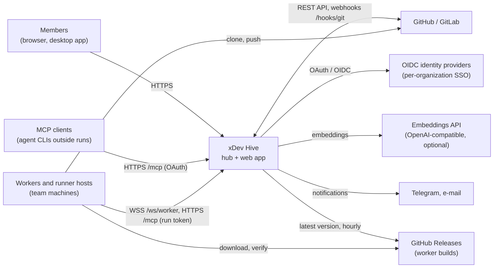
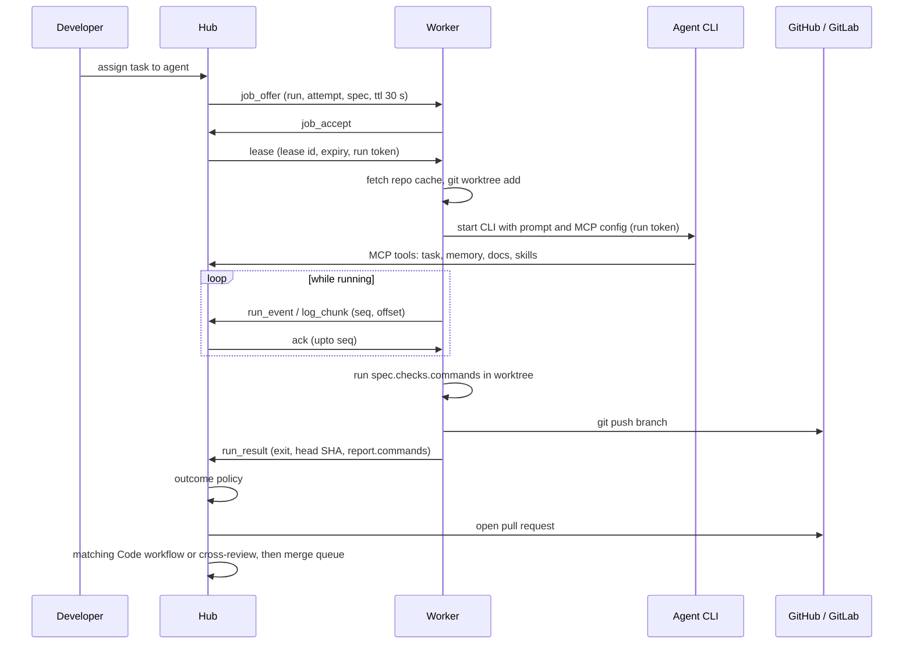
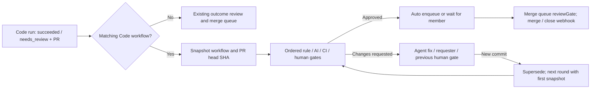
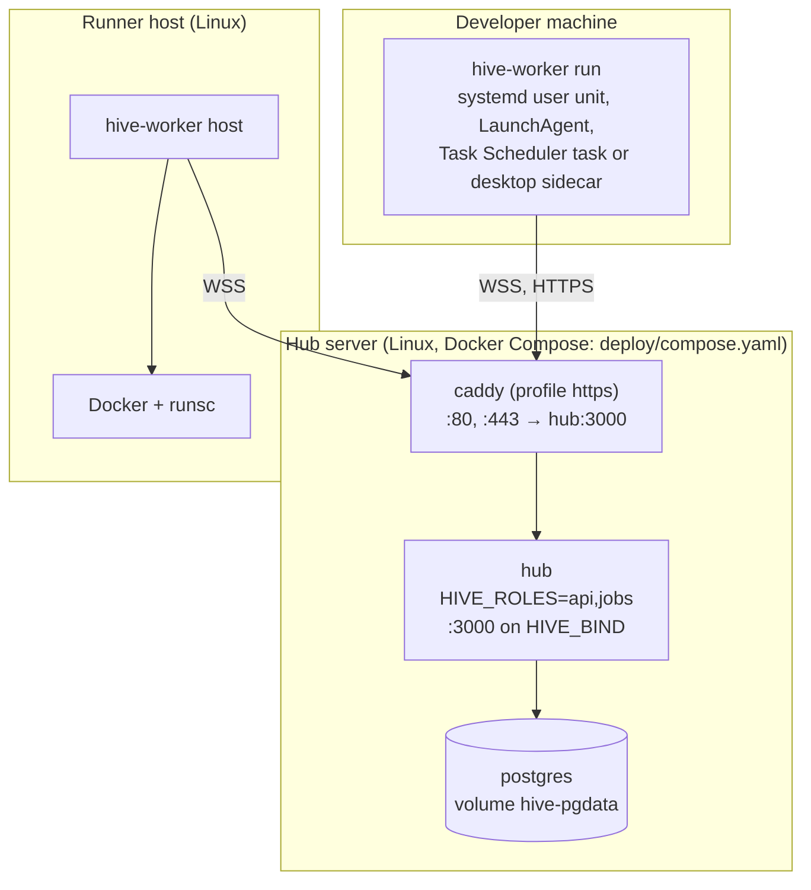

# xDev Hive: Architecture Design Document

| | |
|---|---|
| Status | Describes the code on `main` at commit `c550537` (12 October 2026) |
| Scope | Hub, web app, worker, runner host, egress proxy, desktop app, deployment |
| Related | [decisions.md](decisions.md) (scope, stack, pinned versions), [architecture.md](architecture.md) (original design notes, Vietnamese), [self-hosting.md](self-hosting.md) (operations), [releasing.md](releasing.md) |

This document follows a reduced [arc42](https://arc42.org) outline. It describes what is built. Planned work that is not
in the code is listed in [section 11](#11-risks-technical-debt-and-planned-work), not mixed into the design.

Spec 009 sections were checked against `origin/main` at `8676c4f` on 14 October 2026, including production wiring
(T070) and command delivery/evaluation (T091); other sections retain the baseline above.

## 1. Introduction and goals

xDev Hive lets teams in one organization hand tasks to coding agent CLIs (Claude Code, Codex, Gemini CLI), share
memory, documents and skills between those agents, and review and merge what they produce. The agents run on the
team's own machines with the logins already present there; the hub coordinates and never receives CLI credentials.

### Stakeholders

| Role | Wants |
|---|---|
| Developer | Assign work to an agent from the web app, watch it live, steer it, review the pull request |
| Team administrator | Register machines, set project policies (merge mode, budget, sandbox, cross-review), keep cost visible |
| Organization administrator | Members, teams, sign-in (SSO), sandbox network policy, audit |
| Hub operator | One-command deploy on a single Linux server, backups, upgrades, no external SaaS dependency |
| Agent CLI (via MCP) | Read tasks, memory, docs and skills; report results within the rights of its run |

### Quality goals

| Priority | Goal | How it is met |
|---|---|---|
| 1 | Tenant isolation | Every organization query runs through PostgreSQL row-level security (section 8.1) |
| 2 | No lost or duplicated run output | Leases with fencing by attempt, at-least-once delivery with acknowledgement, idempotent inserts (section 6.2) |
| 3 | Least privilege for agents | Run-scoped tokens, read-only CLI modes for review and plan runs, optional gVisor sandbox with default-deny egress (sections 8.2, 6.4) |
| 4 | Simple self-hosting | One container image plus PostgreSQL; PostgreSQL is also the queue and the notification bus (section 7) |
| 5 | Works from any developer machine | Outbound-only connections; worker for macOS, Linux and Windows (section 5.3) |

## 2. Constraints

- Self-hosted, licensed AGPL-3.0. No required external service besides the Git host.
- Hub in TypeScript on Node 24, executed directly without a build step (imports carry `.ts`). Worker in Go 1.27 as a
  separate module. PostgreSQL 18; pgvector optional.
- Machines connect out to the hub; no inbound port is required on developer machines or runner hosts.
- Agent CLIs keep their own authentication on each machine.
- User-facing text and API error messages are Vietnamese; code and this document are English.

## 3. Context and scope

| Interface | Protocol | Defined in |
|---|---|---|
| Web app to hub | oRPC over HTTP (`/rpc/*`), SSE for run streams | `packages/contracts`, `apps/hub/src/app.ts` |
| Public API | OpenAPI generated from the same router (`/api/*`) | `packages/contracts/openapi.json` |
| Worker and runner host to hub | WebSocket `/ws/worker`, JSON messages, protocol version 1 | `packages/contracts/src/worker-protocol.ts` |
| Agents to hub | MCP over streamable HTTP at `/mcp` | `apps/hub/src/modules/mcp` |
| Git hosts to hub | Webhooks `POST /hooks/git/{projectId}` with HMAC | `apps/hub/src/modules/scm` |
| Desktop updater | `GET /api/v1/desktop/updates/{os}/{arch}/{version}` (Tauri format) | `apps/hub/src/modules/system` |

## 4. Solution strategy

| Problem | Approach |
|---|---|
| Many concerns, small team, self-hosted | Modular monolith: one hub package, modules under `src/modules/<name>`, boundaries enforced by dependency-cruiser |
| Queues, events, search, vectors | PostgreSQL for all of them: pg-boss for jobs, `LISTEN/NOTIFY` for live run updates, full-text plus pgvector for memory |
| Machines behind NAT and firewalls | Worker opens an outbound WebSocket; the hub pushes offers and commands over it |
| Typed API for web, Go and third parties | Contract-first with oRPC and zod in `packages/contracts`; the same router serves RPC and OpenAPI |
| Multi-tenancy | One database, row-level security forced on every tenant table, `withTenant()` sets the tenant per transaction |
| Running untrusted agent work | Read-only modes for non-code runs; optional runner host with a gVisor container per run and a per-run egress proxy |
| Distributing the worker | Prebuilt, signed releases; install script and self-update verify an ECDSA signature and SHA-256 |

## 5. Building block view

### 5.1 Level 1: deployable parts

| Part | Technology | Responsibility | Code |
|---|---|---|---|
| Hub | Node 24, Hono, oRPC, Drizzle, pg-boss, Better Auth, MCP SDK | API, web hosting, worker gateway, MCP, background jobs | `apps/hub` |
| Web app | React, Vite, TanStack Router and Query, Tailwind | User interface, served by the hub | `apps/web` |
| Contracts | zod, oRPC contracts | API and worker protocol schemas, OpenAPI generation, shared semver helpers | `packages/contracts` |
| Worker | Go | Runs agent CLIs in git worktrees on developer machines (`hive-worker run`) | `worker` |
| Runner host | Go (same binary) | Runs each sandboxed run in a gVisor container (`hive-worker host`) | `worker/internal/runner` |
| Egress proxy | Go (in the worker process) | Per-run allowlist proxy reachable only through a Unix socket | `worker/internal/egress` |
| Desktop app | Tauri 2 | Tray app that registers the machine and runs the worker as a sidecar | `apps/desktop` |
| Database | PostgreSQL 18, pgvector optional | All state, job queue, run logs | `apps/hub/db/migrations` |

### 5.2 Level 2: hub modules

| Module | Responsibility | Main tables |
|---|---|---|
| `platform` | Configuration, database pools, `withTenant`, migrations, pg-boss, envelope encryption | `hive.migrations` |
| `identity` | Better Auth: e-mail and password, GitHub and GitLab, per-organization OIDC SSO, JWT, MCP OAuth | `auth.user`, `auth.session`, `auth.account`, `auth.ssoProvider`, `auth.oauth*` |
| `tenancy` | Organizations, members, teams, systems, invitations, permissions | `orgs`, `org_members`, `teams`, `team_members`, `systems`, `invitations` |
| `fleet` | Machine registration, machine tokens, WebSocket gateway, worker release lookup, machine labels (`labels`, `labels_only`), agent accounts of shared machines | `machines`, `machine_tokens`, `registration_tokens` |
| `catalog` | Projects, provisioning saga, agent file templates, merge queue | `projects`, `project_provision_steps`, `merge_queue_entries` |
| `scm` | GitHub and GitLab clients, organization Git connections, webhooks | `scm_connections`, `webhook_deliveries` |
| `tasks` | Tasks, plan-mode plans, task dependencies | `tasks`, `plans`, `task_dependencies` |
| `runs` | Dispatch, offers, leases, run events and logs, outcome policy, review, SSE | `runs`, `run_events`, `run_logs`, `run_leases` |
| `codereview` | Agent PR review instances, rule/AI/CI/human gates, revision rounds, SLA and merge gate | `code_reviews`, `code_review_gate_runs` |
| `knowledge` | Memory (full-text and vector), documents, skills, proposals, legacy import | `memories`, `docs`, `doc_versions`, `skills`, `skill_versions`, `proposals`, `legacy_*` |
| `sdlc` | AI SDLC mode (specs/011, ADR 0021): modes and presets, items through phases, `sdlc` document runs, questions, repository sync, task breakdown in waves, gate on code runs, traceability, converge, release notes, AI auto-approval, multi-project items, metrics | `sdlc_modes`, `sdlc_items`, `sdlc_item_projects`, `sdlc_item_phases`, `sdlc_artifacts`, `sdlc_artifact_syncs`, `sdlc_questions`, `sdlc_steps`, `sdlc_item_tasks`, `sdlc_trace_links`, `sdlc_overrides`, `sdlc_auto_approvals` |
| `leader` | Leader chat and proposals that need human approval | `chat_threads`, `chat_messages`, `approvals` |
| `artifacts` | Versioned artifacts (markdown, code, html, mermaid, react), scopes, public links, hub-side React compile, sandboxed-frame routes, trash purge job | `artifacts`, `artifact_versions`, `artifact_links`, `artifact_previews`, `artifact_public_links` |
| `sandbox` | Egress allowlists, environment images, organization sandbox settings | `sandbox_org_settings`, `egress_allowlists`, `env_images` |
| `cost` | Token and cost aggregation (cost columns live on `runs`) | — |
| `notify` | Notification channels (Telegram, e-mail) and the in-app inbox | `notification_channels`, `notifications`, `inbox_items` |
| `mcp` | MCP endpoint, token authentication, tool registry; tools run inside `withTenant` and are audited | — |
| `audit` | Append-only audit log; other modules write only through `recordAudit()`. Per-organization retention and daily cleanup | `audit_log`, `audit_settings` |
| `system` | Health, version, desktop update manifests | — |

Tables live in schema `hive` unless prefixed with `auth.`. A module imports another only through that module's
`index.ts`; `pnpm deps` (dependency-cruiser, `.dependency-cruiser.cjs`) fails the build otherwise, and also forbids
cycles and imports of `app.ts`/`main.ts`.

### 5.3 Level 2: worker packages

| Package | Responsibility |
|---|---|
| `cmd/hive-worker` | Commands: `register`, `run`, `host`, `service`, `update`, `config`, `check`, `egress-proxy`, `sandbox-init` |
| `internal/channel` | WebSocket session, hello and heartbeat, job offers and leases, durable outbox of unacknowledged messages on disk |
| `internal/runner` | Repository cache, worktrees, CLI command lines per kind, push guard, sandbox containers, setup script |
| `internal/egress` | Allowlist parser and CONNECT proxy: default deny, private and metadata addresses blocked, SNI must match |
| `internal/service` | User service per OS: systemd user unit, LaunchAgent, Task Scheduler task |
| `internal/update` | Release lookup, signature and checksum verification, atomic replacement of the running binary |
| `internal/hubclient` | REST client for registration and health, generated with oapi-codegen |
| `internal/config` | Per-user configuration file with hub URL, machine id and machine token |

## 6. Runtime view

### 6.1 Registering and connecting a machine

1. A team administrator creates a registration token in the web app (`hwr_` prefix, single use, valid one hour, stored
   as a SHA-256 hash). The dialog shows a one-line install command.
2. The install script downloads the worker for the OS and CPU, verifies `checksums.txt.sig` and the archive's SHA-256,
   then runs `hive-worker register`, which exchanges the token for a long-lived machine token (`hwm_`, stored hashed).
3. `hive-worker service install` registers a user service that runs `hive-worker run`.
4. The worker opens `wss://<hub>/ws/worker` with `Authorization: Bearer <machine token>` and sends `hello` with its
   version, protocol range, OS, available CLIs, capacity and runs to resume. The hub answers `welcome` and marks the
   machine online.
5. Heartbeats every 30 seconds renew leases; the hub closes the connection after three missed heartbeats. Close codes
   4401 (revoked), 4403 (machine mismatch) and 4426 (protocol unsupported) stop the worker instead of reconnecting.

### 6.2 A code run

- **Offers and leases.** An offer expires after 30 seconds; a lease lasts 90 seconds and is renewed by heartbeats.
  When a lease expires the run becomes `lost` and is requeued with the next attempt, or fails when attempts run out.
- **Fencing.** Every run message carries `attempt`; the hub drops messages from an older attempt or another machine.
- **Delivery.** The worker writes each message to `<cache>/xdev-hive/worker/pending/` before sending and deletes it
  when acknowledged, so messages survive restarts. The hub deduplicates with unique keys on
  `(run_id, attempt, seq)` for events and `(run_id, attempt, offset)` for log chunks.
- **Live view.** State changes call `pg_notify('hive_runs', runId)` in the same transaction; new log chunks notify at
  most once per run every 200 ms. Each hub process holds one
  `LISTEN` connection and streams Server-Sent Events to browsers; the cursor `<eventId>.<logId>` is the
  `Last-Event-ID`, so a reconnecting browser misses nothing.
- **Outcome policy.** The project's checks (`changes`, `agentReport`, `review`, `command`, plus `ci` which is not
  evaluated yet) decide between `succeeded`, `no_changes`, `needs_review` and `failed`. The policy is snapshotted on
  the run.
- **Steering.** A developer can send extra instructions to a running Claude run (stream-json input); the worker
  reports a `steer_result` event.

Run states: `queued`, `planning`, `awaiting_plan`, `leased`, `preparing`, `running`, `awaiting_input`, `verifying`,
`cancelling`, and the terminal states `succeeded`, `no_changes`, `needs_review`, `failed`, `lost`, `cancelled`.

### 6.3 Plan mode, cross-review and merge queue

- **Plan mode** (`features.planMode` or per dispatch): the hub first runs a read-only `plan` run whose agent calls
  `plan_submit`; the parent run waits in `awaiting_plan` until a person approves the plan.
- **Cross-review** (`features.crossReview`): after a code run the hub dispatches a read-only `review` run on the same
  branch with the CLI named in the review check (it may be the same CLI, so single-CLI projects work). Its
  `review_submit` score is compared with the project's minimum (default 7).
- **Merge queue** (`features.mergeQueue`): pull requests that pass enter a per-project queue processed by the
  `catalog-merge` job, according to `merge.mode` (`review` or `auto`), required approvals, merge method and CI.

Review, plan and leader runs are read-only on the machine: Claude runs with `--permission-mode plan`, Codex with
`--sandbox read-only`, Gemini with `--approval-mode plan`, and the worker refuses to push for these kinds.

#### Code review workflows (spec 009)

Implementation checked against `origin/main` at `8676c4f` on 14 October 2026: the following flow includes
production router, job, SCM and dependency wiring (T070) and hub command delivery/evaluation (T091).

Workflow definitions stay in `knowledge.review_workflows`, with an immutable `subject` (`doc` or `code`) and Code
scope/options. `codereview` owns the separate runtime tables. Only PRs opened by Hive runs qualify. A matching
workflow replaces the outcome policy's `review` check (recorded as skipped) and direct automatic merge enqueue for
that run; the remaining outcome checks still apply. No match keeps the existing cross-review and merge behaviour.
Creating a workflow from project settings produces an unsaved draft, never an automatic conversion.

AI gates start one read-only `review` run per reviewer (one to three), aggregate scores and blocking findings, and
post one summary PR comment. They are team runs by default (`owner_user_id = null`, `created_by = workflow:<id>`)
on shared machines or runner hosts; `runner: requester` inherits the original code run owner. Human decisions use
quorum, SLA and the SHA reviewed. The requester cannot approve unless the gate permits it; organization admins can
decide. Automated gate overrides require permission and a reason. Audit and notifications record transitions;
overdue human gates are reminded once per wait.

Agent fixes reuse `code` runs on the same task, branch, CLI and owner, without planning; revision count (default two)
and task budget bound them. Every new head supersedes the previous instance and reruns automated gates with the
first round's snapshot. Earlier human approvals can carry forward unless `dismissStaleApprovals` is enabled.
The merge gate holds unapproved PRs in `waiting`; merge/close webhooks finish instances as `merged`/`cancelled`.

To avoid an import cycle, `runs` calls `codereview/index.ts`, while `codereview` receives `startReviewRuns`,
`queueFixRun` and `runEvidence` through dependency injection in `app.ts` and `main.ts`. `app.ts` registers the
`codeReviews` router. The jobs role in `main.ts` registers the `codereview` worker, CI polling every two minutes
(up to 60 checks), the `codereview-sla` cron every ten minutes, and push/merge/close SCM handlers. The catalog merge
queue receives `reviewGate` by injection too.

The hub builds `spec.checks.commands` from the run policy snapshot and the workflow matched at dispatch,
including conditional command gates because the diff is not yet known. It deduplicates trimmed commands using the
shortest timeout. The worker runs them after the agent, before push, returning `report.commands` with exit code,
duration and redacted output tails. The hub evaluates outcome commands: zero passes, nonzero fails; required
failures yield `failed`, optional failures yield `needs_review`. Missing outcome evidence yields `needs_review`;
missing workflow evidence (old worker or a manual push round) leaves command gates waiting for a person. Evidence
from a different head SHA is not reused. Outcome `ci` remains unsupported; workflow CI is a separate gate.
Q1 is settled: use commit status `xdev-hive/review` for branch protection, not provider approvals for
human gates; publishing that status and the settings guidance still await T101.

See [ADR 0018](adr/0018-code-review-workflows.md) and [SRS CR-01–CR-09](srs.md#318-code-review-workflows-cr).

### 6.4 A sandboxed run

Projects with `features.sandbox` are offered only to runner hosts (machines registered with kind `host`).

1. The job spec carries an immutable snapshot of the effective allowlist and the environment image
   (`baseImage`, SHA-256 of `.hive/setup.sh`).
2. The runner host verifies the setup script hash, runs it in a separate container from `baseImage`, then starts the
   agent container with `--runtime=runsc --network=none --read-only`, a `noexec` tmpfs, the workspace as the only
   writable mount, `--cap-drop=ALL`, `no-new-privileges`, the host user's uid and gid, and CPU, memory and PID limits
   (defaults 2 CPUs, 4 GB, 256 processes).
3. The worker starts an egress proxy for this run inside its own process, listening on a Unix socket that is
   bind-mounted into the container. `hive-worker sandbox-init`, the container entry point, relays `127.0.0.1:3128`
   to that socket. The proxy resolves DNS itself and denies by default. It blocks loopback, private, link-local,
   CGNAT, multicast, reserved and cloud metadata addresses unless an IP or CIDR entry allows them explicitly, blocks
   IPv6, requires the TLS SNI to match the requested host and rejects ECH. It does not decrypt TLS.
4. The effective allowlist is the organization entries plus the project entries, plus five suggested public hosts when
   the organization enables them. When the organization locks the list, project entries are ignored.

gVisor must allow host Unix sockets (`runsc install -- --host-uds=open`); the runner host refuses to start otherwise.

### 6.5 Leader chat and approvals

A leader thread runs a read-only `leader` run on a worker. The leader can only propose actions (`task.create`,
`run.dispatch`, `run.cancel`, `project.settings`); each proposal is stored in `approvals` and executed by the hub only
after a person with the required rights approves it. Rejections need a reason.

### 6.6 An AI SDLC item

Specs/011 and ADR 0021; the Vietnamese overview is in [architecture.md §4.4](architecture.md#44-chế-độ-ai-sdlc).

1. A person with `sdlc.write` (member or the BA/PO role), an issue or an approved Leader proposal (`sdlc.item.create`)
   creates an item. The item snapshots its mode (preset or custom), has one home project and optional participant
   projects, possibly owned by other teams.
2. Each phase runs agent steps as runs of kind `sdlc` on the home project: a temporary worktree from the default branch,
   `workspace` permission, no commit and no push. `spec.sdlc` carries `seed` files (baselines, drafts, a summary of each
   participant repository) and `collect` paths. Workers that declare `sdlc-multirepo` also receive `repos` and get a
   read-only shallow checkout of participant repositories under `.hive/repos/`, cloned with the machine's own Git
   credentials. Runs that require labels (`settings.sdlc.labels`) go only to machines with all of them.
3. The agent calls the MCP tools `sdlc_context`, `sdlc_ask` (the run still finishes; once
   the questions are answered the hub starts a new drafting round with the answers) and `sdlc_report`.
   Collected files return in `report.artifacts` and become document versions.
4. A phase gate is a document review session. Multi-team items need a reviewer from each team. AI auto-approval applies
   only when both mode and project allow it, the score passes the threshold, no denied path or keyword is touched, and
   a person can revoke it within the revoke window.
5. Approved baselines are written to the repository (`repoSync`: a PR through the merge queue, a direct push or off).
6. The breakdown document becomes ordinary tasks with dependencies, run in waves. Before a code run of an item task the
   engine calls `codeRunGate`; missing approved documents, including contracts the project consumes, block the run
   with `SDLC_GATE_BLOCKED` unless someone records an override with a reason.
7. Converge runs one `sdlc` run per participating project, merges findings and sends gaps back to the breakdown step
   until the round limit; release notes and a retrospective close the item (Spec Kit preset).

### 6.7 Updating a worker

1. The hub asks the GitHub releases API for the latest worker version at most once an hour and the Machines page marks
   machines that run an older version.
2. A team administrator presses **Update**. The hub records `machine.update` in the audit log and sends `update` over
   the machine's connection.
3. The worker stops accepting offers, waits for its current runs to finish, downloads the release for its platform,
   verifies the ECDSA P-256 signature of `checksums.txt` with the public key compiled into the binary and the
   archive's SHA-256, runs the new binary once to confirm its version, replaces itself and re-executes with the same
   arguments (`exec` on Unix; a new process on Windows). If anything fails it restarts on the old binary.

The same verification runs for `hive-worker update` on the command line and in the install scripts. A worker bundled
with the desktop app ignores `update`; the app updates as a whole.

## 7. Deployment view

| Item | Detail |
|---|---|
| Image | One image from `Dockerfile`: Node 24, web app built into it, runs as user `node`; on start it bootstraps roles (when an admin URL is given), applies migrations, then starts the hub |
| Process roles | `api` serves HTTP, MCP, SSE and the worker gateway; `jobs` runs pg-boss workers and schedules. Default `api,jobs` in one process. Only one `api` process is supported, because offers go out over sockets held by that process |
| Database roles | `hive_owner` (owns schema `hive`, runs migrations), `hive_app` (the hub, subject to RLS), `hive_auth` (schema `auth`), `hive_jobs` (schema `pgboss`); none is superuser or bypasses RLS |
| Network | Hub published on `HIVE_BIND:3000` (loopback by default). With a public name, the `https` profile adds Caddy with automatic certificates; a name pointing at a private IP gets a Let's Encrypt certificate over DNS-01 (Cloudflare, `HIVE_TLS=dns-cloudflare`); an IP uses Caddy's internal CA. On a LAN without HTTPS, `HIVE_BIND=0.0.0.0` and MCP OAuth turns off (run tokens can still be allowed with `HIVE_MCP_ALLOW_HTTP=1`) |
| Deploy | `deploy/remote.sh` sends a `git archive` over SSH, generates secrets on the server once into a mode-600 `.env`, keeps the previous source in `src.old`, runs `docker compose up -d --build` and waits for `/api/v1/health` |
| Backup | `deploy/backup.sh`: `pg_dump -Fc`, `meta` (Compose project and SHA-256 of `HIVE_MASTER_KEY`, no secret) and `SHA256SUMS`, with retention; `.env` is kept separately by the administrator. `deploy/restore.sh` checks the key against `meta` and restores in one transaction |
| Worker builds | Tag `v*` → `.github/workflows/release.yml`: goreleaser builds six archives, signs `checksums.txt`, creates a draft, verifies signature and version, attests provenance, then publishes |
| CI | `.github/workflows/ci.yml`: TypeScript checks and tests with PostgreSQL, worker on Ubuntu, macOS and Windows, end-to-end smoke test, gVisor sandbox test, image build, desktop check |

## 8. Crosscutting concepts

### 8.1 Multi-tenancy

- `withTenant(pool, { userId, orgId })` opens a transaction and sets `app.user_id` and `app.org_id` as transaction-local
  settings. Policies on every tenant table read them; RLS is enabled and forced, so even the table owner is filtered.
- Token lookups that happen before the tenant is known (machine tokens, invitations) set a hash setting
  (`app.fleet_token_hash`, `app.invite_token_hash`) that policies accept for exactly that row.
- The `rls.db.test.ts` suites (fleet, leader, notify, runs, sandbox, tasks, tenancy) fail when a table lacks RLS.
- `audit_log` is append-only for `hive_app` (UPDATE, DELETE and TRUNCATE revoked). Expired entries are removed only by
  `hive.purge_expired_audit_log()` (SECURITY DEFINER), run daily by the `audit-retention` queue. Its owner role's policies
  expose only rows older than the organization retention (`audit_settings.retention_days`, default 365, minimum 90), so
  rows cannot be deleted early; each cleanup records an `audit.purge` entry. Expired entries are deleted, not archived.

### 8.2 Authentication and tokens

| Credential | Holder | Lifetime | Form |
|---|---|---|---|
| User session | Browser, desktop app | Session | Better Auth cookie |
| Registration token | First install of a machine | Single use, one hour | `hwr_…`, stored as SHA-256 |
| Machine token | Worker, runner host | Until revoked | `hwm_…`, stored as SHA-256, revoked by deleting it |
| Run token | Agent CLI inside one run | Run timeout | HS256 JWT with `aud=<hub>/mcp`, `run_id`, `task_id`, `org_id`, `attempt`; key derived from `HIVE_AUTH_SECRET` with HKDF |
| MCP OAuth token | MCP clients outside runs | OAuth | Better Auth MCP plugin with client ID metadata documents; no dynamic client registration |

Sign-in is invitation-only: e-mail and password requires an invitation, except addresses in `HIVE_ORG_CREATORS`
before the first organization exists; GitHub and GitLab need a verified e-mail with a pending invitation or a creator
listing; SSO creates
accounts only for a domain the organization verified with a DNS TXT record. MCP tools are filtered by principal and run
kind, and every call is audited.

Git operations in runs use the Git credentials of the machine; the hub uses the organization's Git connection (GitHub
App or token) for pull requests, webhooks and merges.

### 8.3 Secrets

`HIVE_MASTER_KEY` (32 bytes) encrypts Git connection secrets, notification channel configuration and project webhook
secrets with AES-256-GCM, one data key per record. Losing the key loses those secrets, so backups include it.
`HIVE_AUTH_SECRET` signs sessions and derives the run token key.

Document saves run the shared `scanSecrets` check before accepting content. A finding returns `DOC_SECRET_FOUND`
with the secret kind and line number, without the value. A user with document management permission can acknowledge
an apparent false positive; the audit record ties that acknowledgement to the content hash. Import and repo pull also
scan content; unacknowledged findings block onward sync, agent access and embedding.

### 8.4 Contracts and code generation

`packages/contracts` holds every API contract and the worker protocol as zod schemas. `pnpm openapi` writes
`openapi.json`, and CI fails when it drifts. The Go REST client is generated from it; the Go protocol types are written
by hand and kept in step by a shared fixture file (`packages/contracts/fixtures/worker-protocol.json`) that both the
TypeScript and Go tests round-trip.

### 8.5 Background jobs

pg-boss queues: `catalog-provision`, `catalog-merge`, `runs-timer`, `scm.event`, `knowledge-embed`, `notify.deliver`,
`notify.inbox-cleanup`, `fleet-offline-check`, `tenancy-orphan-users`, `audit-retention`. Jobs are enqueued inside the business
transaction, so a job exists exactly when its change commits.

### 8.6 Logs and observability

Run logs are stored as `bytea` chunks in `run_logs`. The hub logs to standard output; there is no metrics or tracing
export. `GET /api/v1/health` reports status and the deployed commit.

### 8.7 Document attachments and extraction

`docsync` serves attachments through authenticated routes and checks the owning document's read permission. File type
inspection uses magic bytes rather than trusting the filename. SVG, HTML and other active XML types are served as
attachments (`Content-Disposition: attachment`), with `X-Content-Type-Options: nosniff` and a restrictive CSP, so they
are downloaded rather than rendered as hub pages.

Office and PDF extraction runs in a fresh `node:worker_threads` worker for each file, with a 512 MB old-generation
heap limit and a 60-second timeout. The worker is terminated on completion, error or timeout; separate archive limits
bound decompressed bytes because Buffer allocations are outside the V8 heap limit. The extraction queue allows two
workers per jobs process. These workers run inside the hub process deployment, independently of the Go agent worker.
Extracted markdown stays on the hub and requires approval before it is indexed for search or exposed to agents; the
original attachment remains in the repo and BlobStore.

The shared PostgreSQL BlobStore (`platform/blob-store.ts`) stores 512 KiB chunks with tenant RLS and per-organization
SHA-256 deduplication. Storage is included in PostgreSQL backups. `HIVE_DOC_ASSET_MAX_BYTES`,
`HIVE_DOC_ORG_STORAGE_BYTES` and `HIVE_DOC_IMPORT_MAX_BYTES` set positive integer byte limits, defaulting to 50 MiB,
5 GiB and 2 GiB respectively; deployment examples forward all three to the hub.

## 9. Architecture decisions

The decisions and pinned versions are recorded in [decisions.md](decisions.md). Points where the code departs from the
original notes:

| Topic | Original note | Code |
|---|---|---|
| Worker self-update | `go-selfupdate` | Own package `worker/internal/update` using only the Go standard library; the library alone added about 8 MB and over 15 modules to an 8 MB binary |
| Hub roles | `api`, `gateway`, `jobs`, `collab` | `api` (includes the gateway) and `jobs`; no collaborative editing service |
| Asynchronous messaging | Outbox table | pg-boss enqueue in the same transaction, `pg_notify` for live updates |
| Machine authentication | Machine key pair, short-lived access tokens | Long-lived hashed machine token, revocable |
| Protocol mismatch | Hub sends `upgrade_required` | Hub closes with 4426; administrators trigger updates with `update` |

## 10. Quality scenarios

| Scenario | Expected behaviour |
|---|---|
| A worker loses its connection mid-run | Unacknowledged messages stay on disk and are resent after reconnecting; the run continues if the lease has not expired |
| A worker dies and does not return | The lease expires after 90 seconds; the run becomes `lost` and is requeued with the next attempt; messages from the old attempt are dropped |
| A member queries another organization's data | RLS returns no rows; the request fails as not found |
| An agent in a sandbox tries to reach an address outside the allowlist | The egress proxy refuses the connection; the container has no other network |
| A release asset is replaced on the download server | The signature check of `checksums.txt` or the SHA-256 check fails; nothing is installed |
| The hub cannot reach GitHub | Machines still work; the Machines page does not mark outdated versions |

## 11. Risks, technical debt and planned work

| Item | State |
|---|---|
| Single `api` process | Offers and commands go over sockets held by one process. Several `api` processes need NOTIFY-based forwarding |
| Outcome check `ci` | Not evaluated; leads to `needs_review`. Outcome commands are delivered and evaluated; workflow CI is separate |
| Code review workflows (spec 009) | Runtime wiring and command checks are implemented. Commit status and branch protection guidance await T101 |
| In-run approvals | `approval_needed` and `approval_result` exist in the protocol, but nothing moves a run to `awaiting_input` |
| Git credentials in runs | Runs use the machine's Git credentials; scoped per-run Git tokens are not implemented |
| Machine key pairs and short-lived access tokens | Not implemented (`welcome.accessTokenExp` is unused) |
| Secret masking in logs, setup-phase secrets | Not implemented |
| Environment images | Only verified and executed; no image build, cache or warm pool |
| Log archival, blob storage | Not implemented; logs stay in PostgreSQL |
| Artifacts beyond the MVP (spec 012) | Types `svg`, `json`, `csv`, `image`, `pdf`, scopes `team`/`org`, Terminal Leader panel, links to tasks/runs/SDLC items, documents and repository export, policy and storage screens, full manual editor are not implemented (tasks T061–T068) |
| Runner host as a service | `service install` covers `run` only; `host` is started by hand or by the operator's own unit |
| Metrics and tracing | Not implemented |
| Desktop auto-update | Plugin installed, but no public key or endpoint configured |
| Hub image and desktop releases | Only the worker has a release pipeline |
| AI SDLC (spec 011) | Participant checkouts use the machine's own Git credentials, not a hub token (awaiting the project owner's confirmation). The metrics screen has no per-creator auto-approval rate, the item list is not filtered by date, and SC-007 (500 items) is not measured. Only the Spec Kit preset requires release notes and a retrospective |

## 12. Glossary

| Term | Meaning |
|---|---|
| Run | One execution of an agent CLI for a task, with attempts |
| Attempt | A numbered try of a run; used to fence messages from an older try |
| Lease | The time-limited right of one machine to execute one attempt |
| Kind | `code`, `review`, `plan` or `leader`; all but `code` are read-only |
| Runner host | A Linux machine that runs sandboxed runs in gVisor containers |
| Effective allowlist | The set of hosts a sandboxed run may reach, after organization lock and suggestions |
| Leader | An agent that chats with members and proposes actions that people approve |
