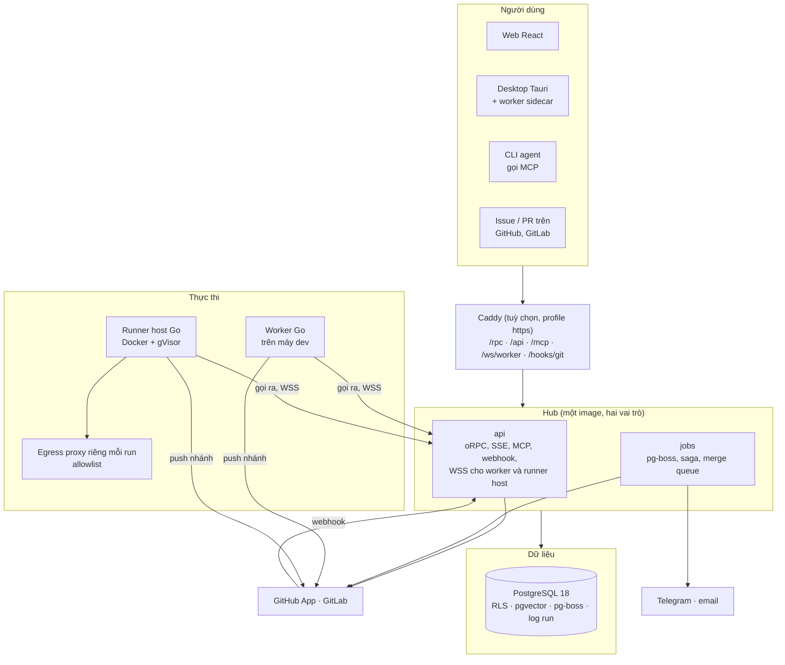
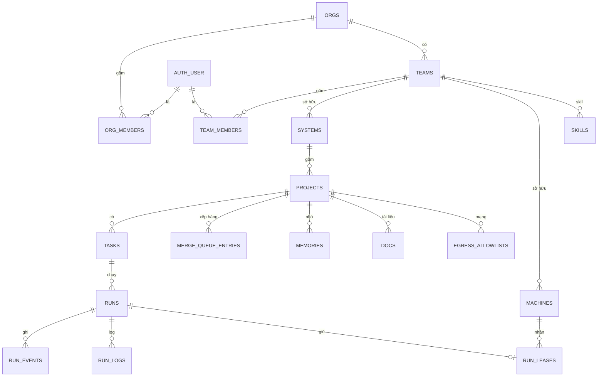
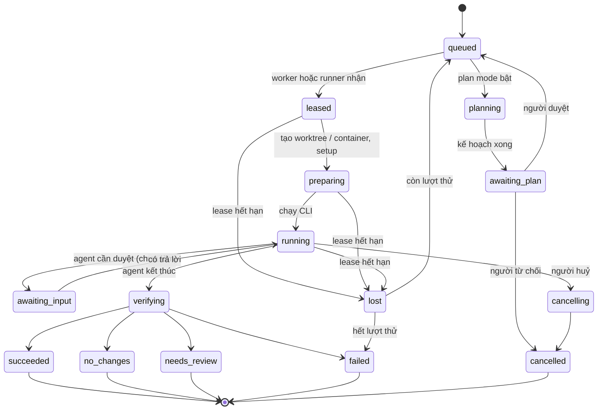
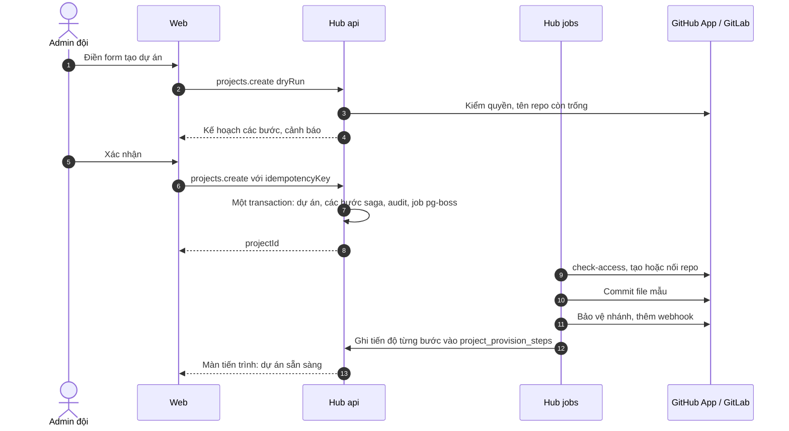

# Kiến trúc xDev Hive

Bản thiết kế ngày 11/10/2026, đối chiếu lại với code ngày 12/10/2026 (commit `c550537`). Phần thiết kế chưa có trong code ghi **[Chưa làm]**. Hiện trạng đầy đủ, bằng tiếng Anh, ở [add.md](add.md). Các lựa chọn công nghệ và phạm vi đã chốt nằm ở [decisions.md](decisions.md). Nguồn tham khảo ghi ở cuối file. Điều tự suy ra, chưa có nguồn, ghi **[Suy luận]**.

## 1. Tổng quan

xDev Hive là nơi nhiều đội trong một tổ chức giao việc cho coding agent CLI (Claude Code, Codex, Gemini CLI), dùng chung memory, tài liệu, skill, rồi review và merge kết quả.

Hệ thống có bốn khối:

| Khối | Là gì | Viết bằng |
|---|---|---|
| **Hub** | Một modular monolith. Một image, hai vai trò tiến trình: `api` (HTTP, MCP, SSE và cổng WSS cho worker) và `jobs` (pg-boss). **[Chưa làm]** tách `gateway` riêng, vai trò `collab` | TypeScript (Node) |
| **Worker** | Daemon trên máy dev. Gọi ra hub, chạy CLI trong git worktree tạm | Go |
| **Runner host** | Cùng binary Go ở chế độ `host`, trên server nội bộ. Chạy mỗi run trong một container gVisor dùng một lần | Go |
| **Dữ liệu** | PostgreSQL (dữ liệu, hàng đợi pg-boss, NOTIFY, vector, log run). **[Chưa làm]** kho blob tương thích S3 cho log đã lưu trữ và artifact | — |

Web là ứng dụng React do hub phục vụ. App desktop là Tauri, gói cửa sổ web và worker Go (sidecar).

**Vì sao là modular monolith, không tách service:** GitHub Actions, GitLab Runner, Buildkite và Coder đều có một control plane tập trung, còn agent là tiến trình mỏng tự gọi ra. Đội nhỏ, tự host, cần ranh giới module rõ chứ chưa cần deploy riêng từng phần. Ranh giới được ép bằng kiểm tra phụ thuộc (`pnpm deps`, chạy trong `pnpm check` và CI), theo cách Shopify làm với Packwerk. [1][2][3][4][5]

## 2. Module của hub

Mỗi module là một thư mục trong `apps/hub/src/modules/<tên>/`, chỉ lộ ra ngoài qua `index.ts`. Module khác chỉ được import `index.ts` đó. `dependency-cruiser` chạy trong `pnpm deps` (gồm trong `pnpm check` và CI) và chặn import vượt ranh giới. [5]

Bảng thuộc schema `hive`, trừ bảng có tiền tố `auth.` (Better Auth).

| Module | Việc | Sở hữu bảng chính |
|---|---|---|
| `identity` | Đăng nhập (Better Auth: SSO OIDC, GitHub/GitLab, email), phiên, JWT, OAuth cho MCP | `auth.user`, `auth.account`, `auth.session`, `auth.ssoProvider`, `auth.oauth*` |
| `tenancy` | Tổ chức, thành viên, đội, hệ thống, lời mời, cấp quyền | `orgs`, `org_members`, `teams`, `team_members`, `systems`, `invitations` |
| `catalog` | Dự án, file mẫu cho agent, saga tạo dự án, cấu hình dự án (jsonb `settings` trên `projects`), merge queue | `projects`, `project_provision_steps`, `merge_queue_entries` |
| `scm` | GitHub App, GitLab, kết nối Git của tổ chức, webhook vào, mở PR/MR | `scm_connections`, `webhook_deliveries` |
| `tasks` | Task, plan mode, nhận việc từ issue | `tasks`, `plans` |
| `runs` | Máy trạng thái của run, lease, chính sách kết quả, review chéo, SSE | `runs`, `run_events`, `run_logs`, `run_leases` |
| `fleet` | Máy, đăng ký, cổng WSS, phiên bản worker | `machines`, `machine_tokens`, `registration_tokens` |
| `sandbox` | Image môi trường, allowlist mạng, cấu hình sandbox của tổ chức | `sandbox_org_settings`, `env_images`, `egress_allowlists` |
| `knowledge` | Memory (tìm theo từ và pgvector), tài liệu có phiên bản, skill, đề xuất sửa, nhập từ hệ cũ. **[Chưa làm]** sửa tài liệu cộng tác (Yjs) | `memories`, `docs`, `doc_versions`, `skills`, `skill_versions`, `proposals`, `legacy_*` |
| `leader` | Chat với leader agent, đề xuất hành động cần người duyệt | `chat_threads`, `chat_messages`, `approvals` |
| `mcp` | Cổng MCP: xác thực token, giới hạn tool theo vai trò, ghi audit | — (dùng module khác) |
| `notify` | Telegram, email, hộp thư trong app | `notification_channels`, `notifications`, `inbox_items` |
| `cost` | Tổng hợp token, chi phí theo run, đội, dự án, người, CLI. Chỉ theo dõi; cột chi phí nằm trên `runs` | — |
| `audit` | Nhật ký append-only mọi thao tác ghi và mọi lời gọi MCP | `audit_log` |
| `system` | Health, phiên bản, manifest cập nhật app desktop | — |
| `platform` | Lõi dùng chung: `db` + transaction có tenant, cấu hình, mã hoá secret, migration, pg-boss | `migrations` |

Giao tiếp giữa module:
- **Đồng bộ:** gọi hàm public trong cùng transaction khi cần nhất quán (ví dụ tạo task kèm audit).
- **Bất đồng bộ:** đẩy job pg-boss ngay trong transaction nghiệp vụ (`enqueue(..., { tx })`), nên job có khi và chỉ khi thay đổi được commit; cập nhật run gọi `pg_notify('hive_runs', runId)` trong cùng transaction. Consumer phải idempotent. **[Chưa làm]** bảng `outbox`. [6]

## 3. Mô hình dữ liệu

Quy tắc chung:
- Mọi bảng thuộc tenant có `org_id`, `team_id` (có index) và bật **RLS + FORCE RLS**. Mỗi policy có cả `USING` và `WITH CHECK`, để UPDATE không chuyển được dòng sang đội khác. [7][8]
- Hub gắn tenant vào **transaction**, không vào kết nối: `withTenant()` gọi `set_config('app.user_id', $1, true)` và `set_config('app.org_id', $2, true)`. Gắn ở mức session sẽ rò sang request khác qua pool. [7]
- Bốn role Postgres, không role nào là superuser hay có BYPASSRLS: `hive_owner` (sở hữu schema `hive`, chạy migration), `hive_app` (hub dùng, chịu RLS), `hive_auth` (schema `auth` của Better Auth), `hive_jobs` (schema `pgboss`). [8]
- Test bắt buộc: truy vấn không có tenant context trả về 0 dòng ở mọi bảng tenant.
- Dự án thuộc một hệ thống, hệ thống thuộc một đội. **[Chưa làm]** cấp quyền thêm cho một dự án qua `role_bindings` (người hoặc đội khác).
- `audit_log` là append-only: role `hive_app` không có UPDATE, DELETE, TRUNCATE.

## 4. Run

### 4.1 Máy trạng thái

- Mọi chuyển trạng thái ghi một dòng `run_events` và gọi `pg_notify('hive_runs', runId)` trong cùng transaction. **[Chưa làm]** chuyển sang `awaiting_input`: hub chưa xử lý `approval_needed`.
- Mỗi lần thử có `attempt` riêng. Hub từ chối mọi gói của `attempt` cũ (fencing), nên worker treo rồi sống lại không ghi đè được run đã giao lại. [9]
- **Chính sách kết quả** chạy ở hub, ở bước `verifying`, theo cấu hình dự án ([decisions.md](decisions.md)). **[Chưa làm]** kiểm tra `command` và `ci`: hub nhận cấu hình nhưng chưa chạy, kết quả thành `needs_review`. Hub lưu `policy_snapshot` vào run để kết quả không đổi khi cấu hình đổi sau.
- **Review chéo:** bước `review` tạo một run con loại `review` trên cùng nhánh, với CLI ghi trong kiểm tra review (ví dụ Codex viết, Claude review; trùng CLI run cha vẫn được, để dự án chỉ có một loại CLI vẫn dùng được). Run cha chờ kết quả.

### 4.2 Giao job và lease

- Run `queued` được ghép với máy theo: đội sở hữu, CLI có sẵn, chỗ trống, loại máy (dự án bật sandbox chỉ giao cho runner host). **[Chưa làm]** nhãn máy; ưu tiên máy dev rảnh rồi mới tới container.
- Lease lưu trong `run_leases`, có hạn (mặc định 90 giây) và được gia hạn bằng heartbeat. Máy mất kết nối thì lease hết hạn, run sang `lost`. Chỉ một tiến trình `api` giao job, vì đề nghị đi qua socket mà tiến trình đó giữ; **[Chưa làm]** chuyển tiếp qua NOTIFY để chạy nhiều tiến trình `api`. [9][10]
- Job đẩy qua WSS. **[Chưa làm]** long-poll `POST /v1/worker/claim` (khoảng 50 giây) khi WSS không qua được proxy công ty, giống GitHub runner. [11][12]

## 5. Giao thức worker

WSS tới `/ws/worker`. Mỗi gói là JSON có `v` (phiên bản giao thức), `id`, và `seq` (với gói của một run). Định nghĩa bằng zod trong `packages/contracts/src/worker-protocol.ts`. Kiểu Go viết tay trong `worker/internal/channel/protocol.go`, giữ khớp bằng file mẫu dùng chung `packages/contracts/fixtures/worker-protocol.json` mà test hai bên cùng đọc. `oapi-codegen` chỉ sinh client REST cho đăng ký và health.

| Hướng | Gói | Ý nghĩa |
|---|---|---|
| W → H | `hello{machineId, version, protoRange, os, clis[], capacity, resumeRuns[], localProjects?}` | Mở phiên, báo các run đang dở. `localProjects{bound[], full[]}`: dự án máy đã gắn repo và dự án máy cho toàn quyền ([ADR 0020](adr/0020-local-project-folders-and-machine-full-permission.md)) |
| H → W | `welcome{sessionId, heartbeatSec, accessTokenExp}` · `upgrade_required{url, sha256, sig}` | Chấp nhận, hoặc buộc cập nhật. `accessTokenExp` chưa dùng. **[Chưa gửi]** `upgrade_required`: lệch giao thức thì hub đóng kết nối mã 4426 |
| W → H | `heartbeat{load, runs[{runId, attempt, leaseId}], localProjects?}` | Gia hạn lease, gửi lại `localProjects` khi công tắc đổi |
| H → W | `heartbeat_ack{renewed[], cancel[]}` | Lệnh huỷ đi kèm heartbeat, nên huỷ vẫn tới khi kênh khác lỗi [13] |
| H → W | `job_offer{runId, attempt, spec, ttl}` | Đề nghị job |
| W → H | `job_accept` · `job_reject{reason}` | Nhận hoặc từ chối |
| H → W | `lease{leaseId, expiresAt, runToken}` | Cấp lease và token của run |
| W → H | `run_event{runId, attempt, seq, type, data}` | phase, plan, tool_call, cost, approval_needed (hub chưa xử lý), check_result, agent_report, steer_result |
| W → H | `log_chunk{runId, attempt, offset, bytes}` | Log terminal |
| H → W | `ack{runId, uptoSeq}` | Xác nhận, worker bỏ phần đã ack khỏi bộ đệm |
| H → W | `steer{runId, steerId, input}` · `approval_result{requestId, decision}` | Điều khiển giữa chừng. **[Chưa gửi]** `approval_result` |
| H → W | `cancel{runId, graceSec}` | Worker gửi SIGINT, hết thời gian chờ thì kill |
| W → H | `run_result{runId, attempt, exit, headSha, report}` | Kết thúc phần agent; hub chạy chính sách kết quả |
| H → W | `drain` | Không nhận job mới rồi thoát khi hết việc. **[Chưa gửi]** |
| H → W | `update{version?}` | Admin bấm cập nhật: worker ngừng nhận job, chờ run đang chạy xong, tự cập nhật rồi chạy lại |

- **At-least-once:** worker giữ gói chưa ack trên đĩa, gửi lại khi nối lại. Hub loại trùng theo `(run_id, attempt, seq)` với sự kiện và `(run_id, attempt, offset)` với log.
- **Phiên bản:** hai bên thoả thuận trong `protoRange`; lệch thì hub đóng kết nối mã 4426. Worker tự cập nhật bằng gói `worker/internal/update` (kiểm chữ ký ECDSA của `checksums.txt` và `sha256`) khi admin bấm cập nhật hoặc khi chạy `hive-worker update`. Không dùng `go-selfupdate` vì riêng thư viện đó thêm khoảng 8 MB và hơn 15 module ([add.md](add.md) mục 9).
- **Worktree:** worker tạo worktree trong thư mục riêng của nó, và luôn gỡ ở bước `finally`. Dự án đã gắn với repo trên máy (`projects.json`, ADR 0020) thì worktree tạo từ repo đó thay cho repo cache bare, nhánh của run hiện trong repo của người dùng. Khi khởi động, worker quét và gỡ worktree không thuộc run đang sống. Hệ cũ để lọt hơn 50 worktree vì thiếu bước này.

## 6. Bảo mật và token

| Token | Cấp cho | Đời sống | Cách cấp |
|---|---|---|---|
| Phiên người dùng | Trình duyệt, app desktop | Theo phiên | Better Auth |
| Registration token | Lần cài worker hoặc runner host đầu tiên | Một lần, khoảng 1 giờ | Admin đội tạo trên web |
| Machine token | Worker, runner host | Đến khi thu hồi | `hwm_…`, hub trả một lần lúc đăng ký và chỉ lưu băm |
| Khoá máy, access token máy | Worker, runner host | Ngắn (khoảng 15 phút) | **[Chưa làm]** Máy tạo cặp khoá lúc đăng ký, ký challenge bằng khoá máy để đổi lấy access token |
| Run token | Một run | Hết hạn theo thời gian chờ của run | Hub cấp cùng `lease`. JWT HS256 có `run_id`, `task_id`, `org_id`, `attempt`, `aud`; khoá suy ra từ `HIVE_AUTH_SECRET` bằng HKDF |
| Token MCP | CLI agent trong run | Như run token | Agent dùng run token với `aud=/mcp`; người dùng ngoài run dùng OAuth (Better Auth + CIMD) |
| Token git | Push nhánh trong run | Ngắn, chỉ repo của dự án | **[Chưa làm]** Hub đổi từ GitHub App installation token hoặc GitLab project token. Hiện run clone và push bằng thông tin đăng nhập git sẵn có trên máy |

- Không dùng mTLS cho máy vì proxy công ty hay chặn hoặc làm hỏng. [Suy luận]
- Cổng MCP kiểm `aud`, không chuyển tiếp token xuống dịch vụ sau, giới hạn tool theo vai trò và theo loại run, ghi audit mọi lời gọi. [14][15]
- Secrets mã hoá kiểu envelope (AES-256-GCM): mỗi bản ghi có khoá dữ liệu riêng, khoá dữ liệu được mã hoá bằng khoá chủ của hub (`HIVE_MASTER_KEY` hoặc `HIVE_MASTER_KEY_FILE`). Áp dụng cho secret của kết nối Git, cấu hình kênh thông báo và secret webhook của dự án.
- **[Chưa làm]** Secret của dự án chỉ đưa vào pha `preparing` (setup), xoá trước pha `running`. Log stream che mọi giá trị secret đã biết. [16]
- Tài khoản AI trong container dùng API key của đội hoặc gói đăng ký của người giao việc, theo cấu hình đội ([decisions.md](decisions.md)).

## 7. Container runner

- Runner host là binary Go ở chế độ `host`. Nó gọi ra hub như worker, báo dung lượng (số slot, CPU, RAM) và nhận job loại `sandbox`.
- Mỗi run một container chạy runtime gVisor (`runsc`) với `--network=none`. Đường ra duy nhất là egress proxy theo allowlist: proxy chạy trong tiến trình runner host, riêng cho từng run, nối vào container qua Unix socket; `hive-worker sandbox-init` trong container chuyển `127.0.0.1:3128` sang socket đó. gVisor phải cho nối Unix socket của máy chủ (`--host-uds=open`). [17]
- **Allowlist:** mặc định chặn. Có danh sách đề xuất gồm năm địa chỉ công khai (API Anthropic, OpenAI, registry npm, proxy và sum của Go). Dự án thêm được mục riêng. Tổ chức khoá được để dự án không nới. Chặn IPv6 và ép DNS qua proxy để không lách được. [18][19]
- **Image môi trường:** mỗi dự án khai báo image gốc và sha256 của script setup (`.hive/setup.sh`). Runner host kiểm hash rồi chạy script trong một container riêng từ image gốc. **[Chưa làm]** build sẵn rồi cache theo hash của script; giữ vài container chờ sẵn để khởi động nhanh. [16]
- Hết run thì container bị xoá. Kết quả chỉ ra ngoài bằng nhánh đã push. **[Chưa làm]** artifact gửi lên hub.

## 8. Tạo dự án trên web

**[Chưa làm]** trong luồng trên: nạp tài liệu và skill mặc định, đề nghị máy clone repo bằng token git ngắn hạn, tạo và giao task đầu tiên.

- Saga chạy trên pg-boss (hàng `catalog-provision`). Các bước `check-access`, `create-repo` hoặc `link-repo`, `commit-template`, `protect-branch`, `add-webhook` ghi trạng thái vào `project_provision_steps`; bước lỗi dừng saga, báo thông báo và chạy lại được.
- Template do hub giữ. Hub render file mẫu (AGENTS.md có project key, cấu hình MCP, skill) rồi commit bằng API. Cách này chạy được trên cả GitHub và GitLab gói Free. [20][21]
- Không dùng Temporal: tự host cần nhiều service. Nếu saga phình ra nhiều loại, cân nhắc DBOS (thư viện chạy trên Postgres). [22]

## 9. Realtime và log

- Mỗi tiến trình `api` giữ **một** kết nối `LISTEN hive_runs` và phát lại trong bộ nhớ cho các luồng SSE. Payload của NOTIFY chỉ chứa `runId`. NOTIFY được gom theo lô, không gửi cho từng dòng log, vì NOTIFY lấy lock toàn cục lúc commit. [23]
- **Log run:**
  - Đoạn log mới nằm trong `run_logs` (Postgres) để web xem trực tiếp.
  - **[Chưa làm]** Khi run kết thúc, job gộp log thành một file nén, đẩy lên kho blob, rồi xoá các đoạn trong Postgres. GitLab làm theo cách này. [24]
- Web nhận log trực tiếp qua SSE theo `runId`. Con trỏ `<eventId>.<logId>` là `Last-Event-ID`, nên nối lại không mất đoạn nào.

## 10. Vận hành

- **Triển khai:** Docker Compose trên một server (`deploy/compose.yaml`): `postgres`, `hub` (một container, vai trò `api,jobs`), `caddy` (profile `https`, tuỳ chọn). `deploy/remote.sh` triển khai qua SSH. Runner host cài worker bằng script cài rồi chạy `hive-worker host`. **[Chưa làm]** tách `hub-api` (2 bản), `hub-gateway`, `hub-jobs`, `hub-collab`; `blob` (Garage hoặc S3 ngoài); `cloudflared`; `otel-collector`; cài runner host thành dịch vụ bằng một lệnh.
  - Không dùng Kubernetes. Gitpod đã rời K8s cho tải có nhiều trạng thái. [25] [Suy luận cho quy mô này]
- **Nâng cấp:** migration kiểu expand rồi contract; test `migrations-upgrade.db.test.ts` nâng cấp một database đã migrate tới ngay trước mỗi migration có `ALTER TYPE ... ADD VALUE`, để bắt lỗi chỉ hiện khi nâng cấp. Hiện chỉ có một container hub nên nâng cấp gián đoạn ngắn lúc container khởi động lại; worker tự nối lại theo giao thức ở mục 5. **[Chưa làm]** đổi lần lượt hai bản `hub-api` để không gián đoạn. [Suy luận]
- **Backup:** `deploy/backup.sh` (pg_dump kèm `.env` và `SHA256SUMS`, giữ theo `HIVE_BACKUP_KEEP`), `deploy/restore.sh` khôi phục trong một transaction. **[Chưa làm]** pgBackRest (full + incremental, khôi phục theo thời điểm) lên kho blob; diễn tập khôi phục hằng tháng. [26]
- **Quan sát:** hub ghi log ra stdout, `GET /api/v1/health` báo trạng thái và commit đang chạy. **[Chưa làm]** OpenTelemetry cho hub (HTTP, pg) và worker; span của run theo quy ước GenAI (`invoke_agent`, `gen_ai.usage.*`). [27]

## 11. Rủi ro và cách tránh

| Rủi ro | Cách tránh |
|---|---|
| Tenant context rò qua pool | Chỉ `set_config(..., true)` trong transaction; test 0 dòng khi thiếu context |
| Kết nối bằng owner hoặc BYPASSRLS làm RLS vô hiệu mà không báo | Tách role, FORCE RLS, test kiểm role của pool |
| UPDATE chuyển dòng sang đội khác | `WITH CHECK` cho mọi policy |
| NOTIFY làm nghẽn commit | Chỉ gửi id, gom lô, không NOTIFY cho log |
| Worker treo ghi đè run đã giao lại | Fencing bằng `attempt`, kiểm lease khi ghi |
| Lệnh huỷ không tới | Gửi kèm heartbeat, có hạn cứng ở hub |
| Secret lọt vào pha agent hoặc log | Chỉ có ở setup, che trong log (**[Chưa làm]**) |
| Lách allowlist qua IPv6, DNS, tiến trình con | `--network=none` + proxy, chặn IPv6, ép DNS |
| Token MCP bị dùng sai chỗ | Kiểm `aud`, không chuyển tiếp, audit |
| Saga đổi code giữa chừng | Lưu phiên bản saga theo từng instance, chạy hết bằng bản cũ |
| Drizzle 1.0, Better Auth, MCP spec mới còn đổi | Khoá phiên bản, bọc sau lớp của mình, theo dõi bản vá |
| PTY trên Windows | Smoke test worker trên Windows trước mỗi bản phát hành |

## 12. Thứ tự xây dựng

| Mốc | Nội dung | Xong khi |
|---|---|---|
| M0 | Khung repo: pnpm workspace, `apps/hub`, `apps/web`, `apps/desktop`, `worker/` (Go), `packages/contracts`; CI chạy lint, typecheck, test, dependency-cruiser | Một PR mẫu qua hết kiểm tra |
| M1 | `platform`, `identity`, `tenancy`: Postgres, migration, RLS, ba cách đăng nhập, tổ chức/đội/hệ thống | Test RLS 0 dòng qua hết; đăng nhập được bằng cả ba cách |
| M2 | `catalog`, `scm`: dự án, GitHub App, GitLab, template, webhook | Tạo được dự án có repo mới trên cả GitHub và GitLab |
| M3 | `tasks`, `runs`, `fleet`, worker Go: giao run cho máy dev, log trực tiếp, huỷ, chính sách kết quả | Một task chạy từ đầu tới PR trên máy thật (macOS, Linux, Windows) |
| M4 | `knowledge`, `mcp`: memory, tài liệu cộng tác, skill, đề xuất; cổng MCP với run token | Agent trong run gọi được memory_search, doc_get, task_update |
| M5 | Review và merge queue theo cấu hình dự án; review chéo | PR qua review chéo, vào queue, merge tuần tự |
| M6 | `sandbox`, runner host: container gVisor, allowlist, image theo dự án | Run chạy trong container, không ra mạng ngoài allowlist |
| M7 | Plan mode, `leader` chat, `notify` (Telegram, email), `cost` | Leader lập plan, người duyệt, run chạy theo plan |
| M8 | Desktop Tauri, chuyển memory/tài liệu/skill từ hệ cũ, giao việc từ issue | Hệ cũ chuyển sang chỉ đọc |

## Nguồn

1. https://docs.github.com/en/enterprise-server@3.13/actions/concepts/runners/communicating-with-self-hosted-runners
2. https://docs.gitlab.com/ci/runners/long_polling/
3. https://buildkite.com/docs/agent/self-hosted/configure/job-dispatch
4. https://coder.com/docs/v2.37/reference/glossary
5. https://shopify.engineering/enforcing-modularity-rails-apps-packwerk
6. https://microservices.io/patterns/data/transactional-outbox
7. https://stackharbor.com/en/knowledge-base/pg-row-level-security-multi-tenant/
8. https://dev.to/wenceslaudev/postgres-rls-multi-tenancy-two-traps-that-silently-disable-your-policies-5gn8
9. https://docs.temporal.io/encyclopedia/detecting-activity-failures
10. https://npmjs.com/package/pg-boss
11. https://depot.dev/blog/github-actions-runner-architecture-part-1-the-listener
12. https://pkg.go.dev/github.com/buildkite/agent/v3@v3.63.1/api
13. https://docs.temporal.io/concepts/what-is-a-heartbeat-timeout
14. https://workos.com/blog/oauth-resource-indicators-rfc-8707
15. https://zuplo.com/blog/bind-mcp-tokens-to-one-server
16. https://developers.openai.com/codex/cloud/environments
17. https://gvisor.dev/docs/user_guide/networking
18. https://docs.github.com/en/copilot/how-tos/use-copilot-agents/coding-agent/customize-the-agent-firewall
19. https://mfyz.com/ai-coding-agent-sandbox-container/
20. https://docs.github.com/en/rest/repos/repos#create-a-repository-using-a-template
21. https://docs.gitlab.com/api/commits/
22. https://dbos.dev/compare/compare-dbos-vs-temporal-dbos
23. https://recall.ai/blog/postgres-listen-notify-does-not-scale
24. https://docs.gitlab.com/administration/job_logs
25. https://devclass.com/2024/11/06/gitpod-discontinues-journey-of-experiments-failures-and-dead-ends-with-kubernetes
26. https://www.kunalganglani.com/blog/postgresql-backup-tools-compared.md
27. https://opentelemetry.io/docs/specs/semconv/gen-ai/gen-ai-agent-spans
