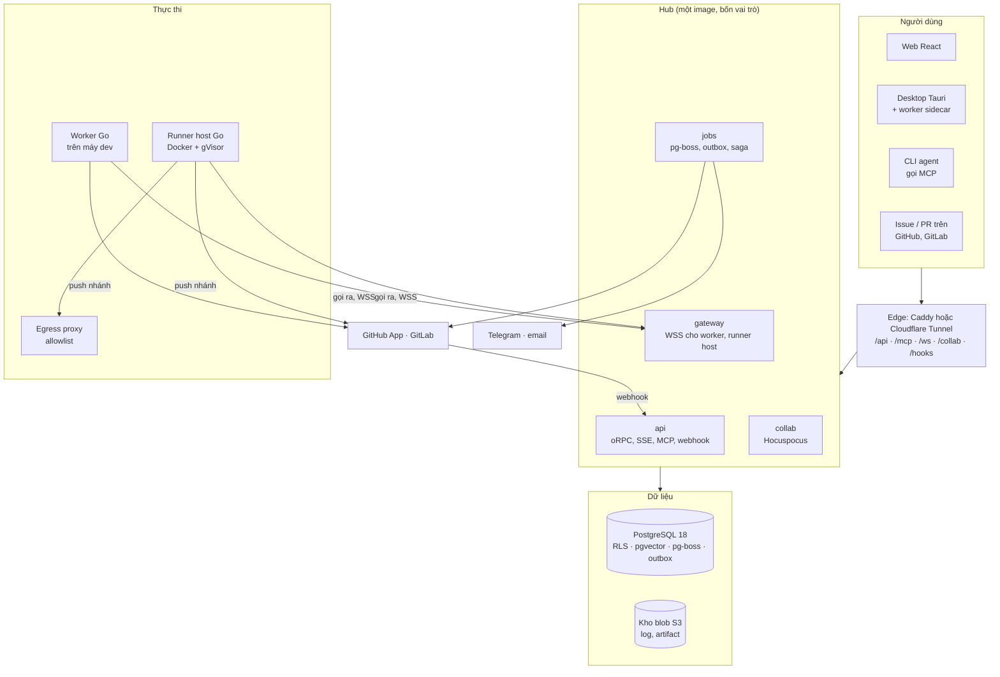
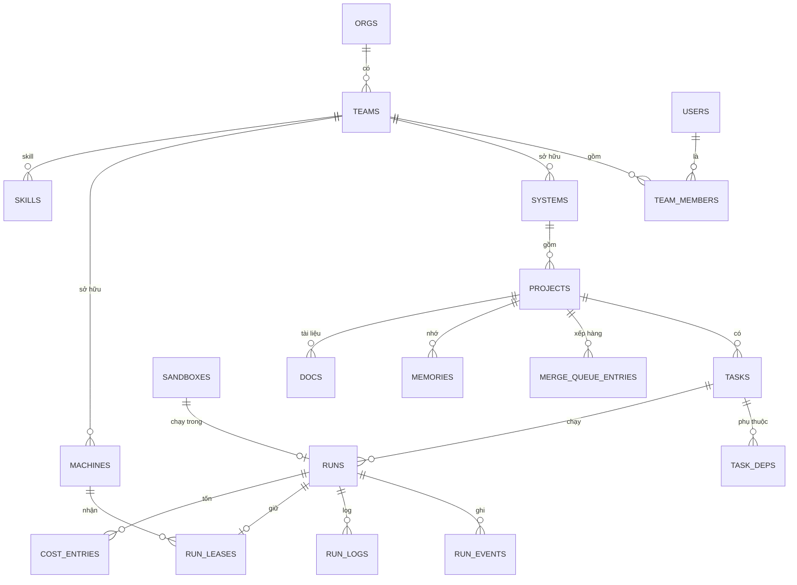
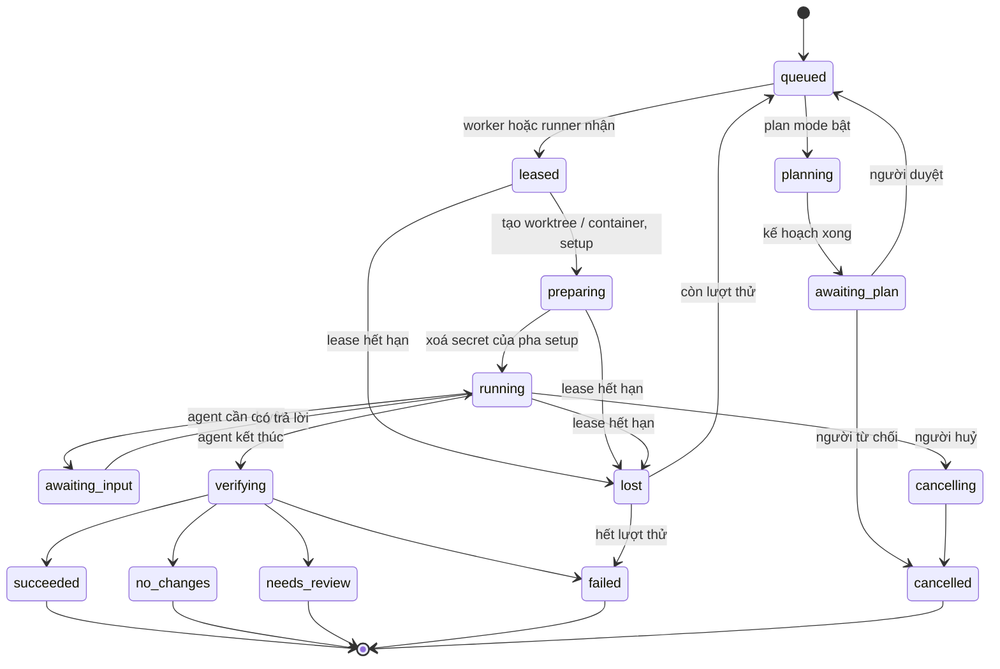
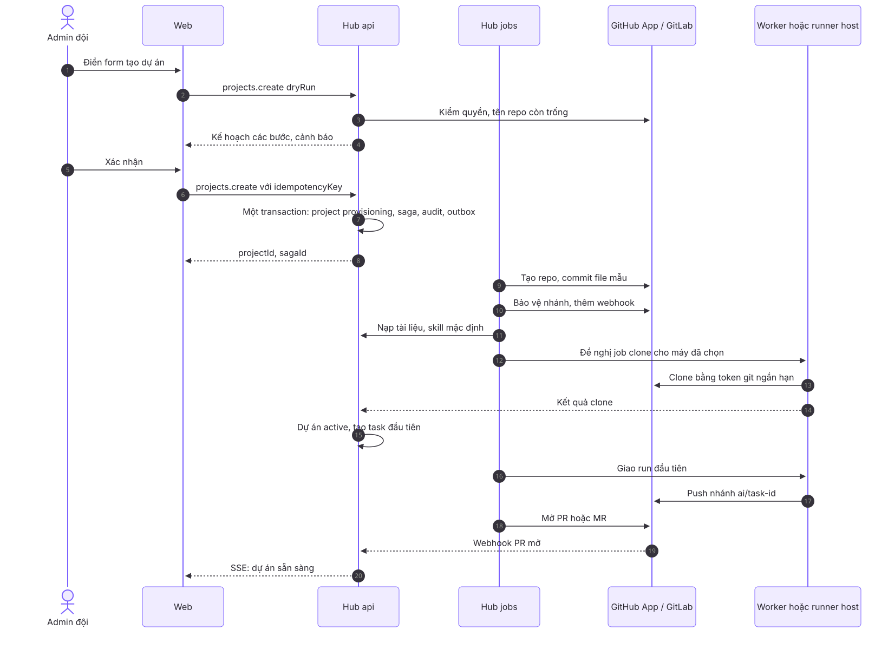
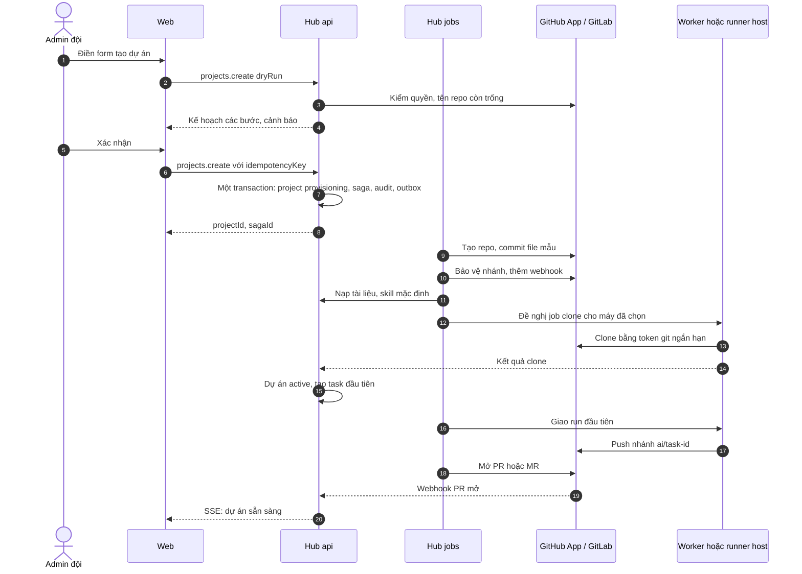

# Kiến trúc xDev Hive

Bản nháp ngày 11/10/2026. Các lựa chọn công nghệ và phạm vi đã chốt nằm ở [decisions.md](decisions.md). Nguồn tham khảo ghi ở cuối file. Điều tự suy ra, chưa có nguồn, ghi **[Suy luận]**.

## 1. Tổng quan

xDev Hive là nơi nhiều đội trong một tổ chức giao việc cho coding agent CLI (Claude Code, Codex, Gemini CLI), dùng chung memory, tài liệu, skill, rồi review và merge kết quả.

Hệ thống có bốn khối:

| Khối | Là gì | Viết bằng |
|---|---|---|
| **Hub** | Một modular monolith. Một image, chạy bốn vai trò tiến trình: `api`, `gateway`, `jobs`, `collab` | TypeScript (Node) |
| **Worker** | Daemon trên máy dev. Gọi ra hub, chạy CLI trong git worktree tạm | Go |
| **Runner host** | Cùng binary Go ở chế độ `host`, trên server nội bộ. Chạy mỗi run trong một container gVisor dùng một lần | Go |
| **Dữ liệu** | PostgreSQL (dữ liệu, hàng đợi, outbox, vector) + kho blob tương thích S3 cho log đã lưu trữ và artifact | — |

Web là ứng dụng React do hub phục vụ. App desktop là Tauri, gói cửa sổ web và worker Go (sidecar).

**Vì sao là modular monolith, không tách service:** GitHub Actions, GitLab Runner, Buildkite và Coder đều có một control plane tập trung, còn agent là tiến trình mỏng tự gọi ra. Đội nhỏ, tự host, cần ranh giới module rõ chứ chưa cần deploy riêng từng phần. Ranh giới được ép bằng kiểm tra phụ thuộc trong test, theo cách Shopify làm với Packwerk. [1][2][3][4][5]

Mã Mermaid

## 2. Module của hub

Mỗi module là một thư mục trong `apps/hub/src/modules/<tên>/`, chỉ lộ ra ngoài qua `index.ts`. Module khác chỉ được import `index.ts` đó. `dependency-cruiser` chạy trong `pnpm test` và chặn import vượt ranh giới. [5]

| Module | Việc | Sở hữu bảng chính |
|---|---|---|
| `identity` | Đăng nhập (Better Auth: SSO OIDC, GitHub/GitLab, email), phiên, token người dùng | `users`, `accounts`, `sessions` |
| `tenancy` | Tổ chức, đội, hệ thống, vai trò, cấp quyền | `orgs`, `teams`, `team_members`, `systems`, `role_bindings` |
| `catalog` | Dự án, template, cấu hình dự án (merge, chính sách kết quả, tính năng bật/tắt) | `projects`, `templates`, `project_settings` |
| `scm` | GitHub App, GitLab, webhook vào, mở PR/MR, merge queue | `scm_installations`, `webhook_deliveries`, `merge_queue_entries` |
| `tasks` | Task, phụ thuộc, plan mode, nhận việc từ issue | `tasks`, `task_deps`, `plans` |
| `runs` | Máy trạng thái của run, chính sách kết quả, review chéo | `runs`, `run_events`, `run_logs`, `artifacts` |
| `fleet` | Máy, đăng ký, lease, giao job, phiên bản worker | `machines`, `machine_tokens`, `run_leases` |
| `sandbox` | Runner host, image môi trường, allowlist mạng | `sandbox_hosts`, `sandboxes`, `env_images`, `egress_allowlists` |
| `knowledge` | Memory (pgvector), tài liệu (Yjs), skill, đề xuất sửa | `memories`, `docs`, `doc_versions`, `skills`, `skill_versions`, `proposals` |
| `leader` | Chat với leader agent, đề xuất hành động cần người duyệt | `chat_threads`, `chat_messages`, `approvals` |
| `mcp` | Cổng MCP: xác thực token, giới hạn tool theo vai trò, ghi audit | — (dùng module khác) |
| `notify` | Telegram, email, theo cấu hình nhóm quản trị | `notification_channels`, `notifications` |
| `cost` | Ghi token, chi phí theo run, đội, dự án, người, CLI. Chỉ theo dõi | `cost_entries` |
| `audit` | Nhật ký append-only mọi thao tác ghi và mọi lời gọi MCP | `audit_log` |
| `platform` | Lõi dùng chung: `db` + transaction có tenant, outbox, cấu hình, secrets | `outbox`, `secrets` |

Giao tiếp giữa module:
- **Đồng bộ:** gọi hàm public trong cùng transaction khi cần nhất quán (ví dụ tạo task kèm audit).
- **Bất đồng bộ:** ghi sự kiện vào `outbox` trong cùng transaction. Bộ phát của vai trò `jobs` đọc outbox, đẩy thành job pg-boss hoặc NOTIFY. Consumer phải idempotent. [6]

## 3. Mô hình dữ liệu

Mã Mermaid

Quy tắc chung:
- Mọi bảng thuộc tenant có `org_id`, `team_id` (có index) và bật **RLS + FORCE RLS**. Mỗi policy có cả `USING` và `WITH CHECK`, để UPDATE không chuyển được dòng sang đội khác. [7][8]
- Hub gắn tenant vào **transaction**, không vào kết nối: `select set_config('app.org_id', $1, true)`, `set_config('app.team_ids', $2, true)`. Gắn ở mức session sẽ rò sang request khác qua pool. [7]
- Ba role Postgres: `hive_app` (không owner, không BYPASSRLS), `hive_jobs` (cho pg-boss), `hive_migrator` (chỉ dùng khi migrate). [8]
- Test bắt buộc: truy vấn không có tenant context trả về 0 dòng ở mọi bảng tenant.
- Dự án thuộc một hệ thống, hệ thống thuộc một đội. Có thể cấp quyền thêm cho một dự án qua `role_bindings` (người hoặc đội khác).
- `run_events`, `audit_log`, `cost_entries` là append-only: role `hive_app` chỉ có INSERT và SELECT.

## 4. Run

### 4.1 Máy trạng thái

Mã Mermaid

- Mọi chuyển trạng thái ghi một dòng `run_events` và một sự kiện outbox trong cùng transaction.
- Mỗi lần thử có `attempt` riêng. Hub từ chối mọi gói của `attempt` cũ (fencing), nên worker treo rồi sống lại không ghi đè được run đã giao lại. [9]
- **Chính sách kết quả** chạy ở hub, ở bước `verifying`, theo cấu hình dự án ([decisions.md](decisions.md)). Các bước `command` chạy trên worker hoặc container theo lệnh của hub, kết quả gửi về như `run_event`. Hub lưu `policy_snapshot` vào run để kết quả không đổi khi cấu hình đổi sau.
- **Review chéo:** bước `review` tạo một run con loại `review` cho agent khác (ví dụ Codex viết, Claude review). Run cha chờ kết quả.

### 4.2 Giao job và lease

- Run `queued` được ghép với máy theo: đội sở hữu, CLI có sẵn, nhãn máy, chế độ của dự án (máy dev, container, hoặc ưu tiên máy dev rảnh rồi mới tới container).
- Hub giữ job bằng `run_leases` với `FOR UPDATE SKIP LOCKED`. Lease có hạn và được gia hạn bằng heartbeat. Máy mất kết nối thì lease hết hạn, run sang `lost`. [9][10]
- Ưu tiên đẩy job qua WSS. Khi WSS không qua được proxy công ty thì worker dùng long-poll `POST /v1/worker/claim` (khoảng 50 giây), giống GitHub runner. [11][12]

## 5. Giao thức worker

WSS tới `/ws/worker`. Mỗi gói là JSON có `v` (phiên bản giao thức), `id`, và `seq` (với gói của một run). Định nghĩa bằng zod ở hub, sinh JSON Schema và OpenAPI, rồi sinh kiểu Go bằng `oapi-codegen`.

| Hướng | Gói | Ý nghĩa |
|---|---|---|
| W → H | `hello{machineId, version, protoRange, os, clis[], capacity, resumeRuns[]}` | Mở phiên, báo các run đang dở |
| H → W | `welcome{sessionId, heartbeatSec, accessTokenExp}` · `upgrade_required{url, sha256, sig}` | Chấp nhận, hoặc buộc cập nhật |
| W → H | `heartbeat{load, runs[{runId, attempt, leaseId}]}` | Gia hạn lease |
| H → W | `heartbeat_ack{renewed[], cancel[]}` | Lệnh huỷ đi kèm heartbeat, nên huỷ vẫn tới khi kênh khác lỗi [13] |
| H → W | `job_offer{runId, attempt, spec, ttl}` | Đề nghị job |
| W → H | `job_accept` · `job_reject{reason}` | Nhận hoặc từ chối |
| H → W | `lease{leaseId, expiresAt, runToken}` | Cấp lease và token của run |
| W → H | `run_event{runId, attempt, seq, type, data}` | phase, plan, tool_call, cost, approval_needed, check_result |
| W → H | `log_chunk{runId, attempt, offset, bytes}` | Log terminal |
| H → W | `ack{runId, uptoSeq}` | Xác nhận, worker bỏ phần đã ack khỏi bộ đệm |
| H → W | `steer{runId, input}` · `approval_result{requestId, decision}` | Điều khiển giữa chừng |
| H → W | `cancel{runId, graceSec}` | Worker gửi SIGINT, hết thời gian chờ thì kill |
| W → H | `run_result{runId, attempt, exit, headSha, report}` | Kết thúc phần agent; hub chạy chính sách kết quả |
| H → W | `drain` | Không nhận job mới (trước khi cập nhật hoặc tắt máy) |

- **At-least-once:** worker giữ gói chưa ack trên đĩa, gửi lại khi nối lại. Hub loại trùng theo `(run_id, attempt, seq)`.
- **Phiên bản:** hai bên thoả thuận trong `protoRange`. Worker quá cũ nhận `upgrade_required` và tự cập nhật bằng `go-selfupdate` (kiểm `sha256` và chữ ký).
- **Worktree:** worker tạo worktree trong thư mục riêng của nó, và luôn gỡ ở bước `finally`. Khi khởi động, worker quét và gỡ worktree không thuộc run đang sống. Hệ cũ để lọt hơn 50 worktree vì thiếu bước này.

## 6. Bảo mật và token

| Token | Cấp cho | Đời sống | Cách cấp |
|---|---|---|---|
| Phiên người dùng | Trình duyệt, app desktop | Theo phiên | Better Auth |
| Registration token | Lần cài worker hoặc runner host đầu tiên | Một lần, khoảng 1 giờ | Admin đội tạo trên web |
| Khoá máy | Worker, runner host | Đến khi thu hồi | Máy tạo cặp khoá, gửi public key lúc đăng ký |
| Access token máy | Worker, runner host | Ngắn (khoảng 15 phút) | Máy ký challenge bằng khoá máy để đổi lấy |
| Run token | Một run | Đến khi run kết thúc | Hub cấp cùng `lease`. JWT có `run_id`, `task_id`, `aud` |
| Token MCP | CLI agent trong run | Như run token | Agent dùng run token với `aud=/mcp`; người dùng ngoài run dùng OAuth (Better Auth + CIMD) |
| Token git | Push nhánh trong run | Ngắn, chỉ repo của dự án | Hub đổi từ GitHub App installation token hoặc GitLab project token, chỉ quyền repo đó |

- Không dùng mTLS cho máy vì proxy công ty hay chặn hoặc làm hỏng. [Suy luận]
- Cổng MCP kiểm `aud`, không chuyển tiếp token xuống dịch vụ sau, giới hạn tool theo vai trò và theo loại run, ghi audit mọi lời gọi. [14][15]
- Secrets mã hoá kiểu envelope: mỗi bản ghi có khoá dữ liệu riêng, khoá dữ liệu được mã hoá bằng khoá chủ của hub. Khoá chủ đọc từ biến môi trường hoặc file mount. [Suy luận]
- Secret của dự án chỉ đưa vào pha `preparing` (setup), xoá trước pha `running`. Log stream che mọi giá trị secret đã biết. [16]
- Tài khoản AI trong container dùng API key của đội hoặc gói đăng ký của người giao việc, theo cấu hình đội ([decisions.md](decisions.md)).

## 7. Container runner

- Runner host là binary Go ở chế độ `host`. Nó gọi ra hub như worker, báo dung lượng (số slot, CPU, RAM) và nhận job loại `sandbox`.
- Mỗi run một container chạy runtime gVisor (`runsc`) với `--network=none`. Đường ra duy nhất là egress proxy (sidecar) theo allowlist. [17]
- **Allowlist:** mặc định chặn. Có danh sách đề xuất (registry npm/Go nội bộ, API của nhà cung cấp AI). Dự án thêm được mục riêng. Tổ chức khoá được để dự án không nới. Chặn IPv6 và ép DNS qua proxy để không lách được. [18][19]
- **Image môi trường:** mỗi dự án khai báo image gốc và script setup (`.hive/setup.sh`). Runner host build sẵn rồi cache theo hash của script. Có thể giữ vài container chờ sẵn để khởi động nhanh. [16]
- Hết run thì container bị xoá. Kết quả chỉ ra ngoài bằng nhánh đã push và artifact gửi lên hub.

## 8. Tạo dự án trên web

Mã Mermaid

- Saga chạy trên pg-boss, mỗi bước có khoá idempotent và ghi tiến độ vào `run_events` của một run loại `provision`. Màn tiến trình trên web chỉ là màn xem run đó.
- Template do hub giữ. Hub render file mẫu (AGENTS.md có project key, cấu hình MCP, skill) rồi commit bằng API. Cách này chạy được trên cả GitHub và GitLab gói Free. [20][21]
- Không dùng Temporal: tự host cần nhiều service. Nếu saga phình ra nhiều loại, cân nhắc DBOS (thư viện chạy trên Postgres). [22]

## 9. Realtime và log

- Mỗi tiến trình `api` giữ **một** kết nối `LISTEN` và phát lại trong bộ nhớ cho các luồng SSE. Payload của NOTIFY chỉ chứa id và loại. NOTIFY được gom theo lô, không gửi cho từng dòng log, vì NOTIFY lấy lock toàn cục lúc commit. [23]
- **Log run:**
  - Đoạn log mới nằm trong `run_logs` (Postgres) để web xem trực tiếp.
  - Khi run kết thúc, job gộp log thành một file nén, đẩy lên kho blob, rồi xoá các đoạn trong Postgres. GitLab làm theo cách này. [24]
- Web nhận log trực tiếp qua SSE theo `runId`, kèm `offset` để nối tiếp khi mất kết nối.

## 10. Vận hành

- **Triển khai:** Docker Compose trên một server cho hub: `hub-api` (2 bản sau proxy), `hub-gateway`, `hub-jobs`, `hub-collab`, `postgres`, `blob` (Garage hoặc S3 ngoài), `caddy` hoặc `cloudflared`, `otel-collector`. Runner host cài trên các server khác bằng một lệnh.
  - Không dùng Kubernetes. Gitpod đã rời K8s cho tải có nhiều trạng thái. [25] [Suy luận cho quy mô này]
- **Nâng cấp không gián đoạn:** migration kiểu expand rồi contract. Đổi lần lượt hai bản `hub-api`. Worker nối lại theo giao thức ở mục 5. pg-boss tự nhả job khi tiến trình dừng. [Suy luận]
- **Backup:** pgBackRest (full + incremental, khôi phục theo thời điểm) lên kho blob. Diễn tập khôi phục hằng tháng. [26]
- **Quan sát:** OpenTelemetry cho hub (HTTP, pg) và worker. Span của run theo quy ước GenAI (`invoke_agent`, `gen_ai.usage.*`), nối thẳng với `cost_entries`. [27]

## 11. Rủi ro và cách tránh

| Rủi ro | Cách tránh |
|---|---|
| Tenant context rò qua pool | Chỉ `set_config(..., true)` trong transaction; test 0 dòng khi thiếu context |
| Kết nối bằng owner hoặc BYPASSRLS làm RLS vô hiệu mà không báo | Tách role, FORCE RLS, test kiểm role của pool |
| UPDATE chuyển dòng sang đội khác | `WITH CHECK` cho mọi policy |
| NOTIFY làm nghẽn commit | Chỉ gửi id, gom lô, không NOTIFY cho log |
| Worker treo ghi đè run đã giao lại | Fencing bằng `attempt`, kiểm lease khi ghi |
| Lệnh huỷ không tới | Gửi kèm heartbeat, có hạn cứng ở hub |
| Secret lọt vào pha agent hoặc log | Chỉ có ở setup, che trong log |
| Lách allowlist qua IPv6, DNS, tiến trình con | `--network=none` + proxy, chặn IPv6, ép DNS |
| Token MCP bị dùng sai chỗ | Kiểm `aud`, không chuyển tiếp, audit |
| Saga đổi code giữa chừng | Lưu phiên bản saga theo từng instance, chạy hết bằng bản cũ |
| Drizzle 1.0, Better Auth, MCP spec mới còn đổi | Khoá phiên bản, bọc sau lớp của mình, theo dõi bản vá |
| PTY trên Windows | Smoke test worker trên Windows trước mỗi bản phát hành |

## 12. Thứ tự xây dựng

| Mốc | Nội dung | Xong khi |
|---|---|---|
| M0 | Khung repo: pnpm workspace, `apps/hub`, `apps/web`, `apps/desktop`, `worker/` (Go), `packages/contracts`; CI chạy lint, typecheck, test, dependency-cruiser | Một PR mẫu qua hết kiểm tra |
| M1 | `platform`, `identity`, `tenancy`: Postgres, migration, RLS, ba cách đăng nhập, tổ chức/đội/hệ thống | Test RLS 0 dòng qua hết; đăng nhập được bằng cả ba cách |
| M2 | `catalog`, `scm`: dự án, GitHub App, GitLab, template, webhook | Tạo được dự án có repo mới trên cả GitHub và GitLab |
| M3 | `tasks`, `runs`, `fleet`, worker Go: giao run cho máy dev, log trực tiếp, huỷ, chính sách kết quả | Một task chạy từ đầu tới PR trên máy thật (macOS, Linux, Windows) |
| M4 | `knowledge`, `mcp`: memory, tài liệu cộng tác, skill, đề xuất; cổng MCP với run token | Agent trong run gọi được memory_search, doc_get, task_update |
| M5 | Review và merge queue theo cấu hình dự án; review chéo | PR qua review chéo, vào queue, merge tuần tự |
| M6 | `sandbox`, runner host: container gVisor, allowlist, image theo dự án | Run chạy trong container, không ra mạng ngoài allowlist |
| M7 | Plan mode, `leader` chat, `notify` (Telegram, email), `cost` | Leader lập plan, người duyệt, run chạy theo plan |
| M8 | Desktop Tauri, chuyển memory/tài liệu/skill từ hệ cũ, giao việc từ issue | Hệ cũ chuyển sang chỉ đọc |

## Nguồn

1. https://docs.github.com/en/enterprise-server@3.13/actions/concepts/runners/communicating-with-self-hosted-runners
2. https://docs.gitlab.com/ci/runners/long_polling/
3. https://buildkite.com/docs/agent/self-hosted/configure/job-dispatch
4. https://coder.com/docs/v2.37/reference/glossary
5. https://shopify.engineering/enforcing-modularity-rails-apps-packwerk
6. https://microservices.io/patterns/data/transactional-outbox
7. https://stackharbor.com/en/knowledge-base/pg-row-level-security-multi-tenant/
8. https://dev.to/wenceslaudev/postgres-rls-multi-tenancy-two-traps-that-silently-disable-your-policies-5gn8
9. https://docs.temporal.io/encyclopedia/detecting-activity-failures
10. https://npmjs.com/package/pg-boss
11. https://depot.dev/blog/github-actions-runner-architecture-part-1-the-listener
12. https://pkg.go.dev/github.com/buildkite/agent/v3@v3.63.1/api
13. https://docs.temporal.io/concepts/what-is-a-heartbeat-timeout
14. https://workos.com/blog/oauth-resource-indicators-rfc-8707
15. https://zuplo.com/blog/bind-mcp-tokens-to-one-server
16. https://developers.openai.com/codex/cloud/environments
17. https://gvisor.dev/docs/user_guide/networking
18. https://docs.github.com/en/copilot/how-tos/use-copilot-agents/coding-agent/customize-the-agent-firewall
19. https://mfyz.com/ai-coding-agent-sandbox-container/
20. https://docs.github.com/en/rest/repos/repos#create-a-repository-using-a-template
21. https://docs.gitlab.com/api/commits/
22. https://dbos.dev/compare/compare-dbos-vs-temporal-dbos
23. https://recall.ai/blog/postgres-listen-notify-does-not-scale
24. https://docs.gitlab.com/administration/job_logs
25. https://devclass.com/2024/11/06/gitpod-discontinues-journey-of-experiments-failures-and-dead-ends-with-kubernetes
26. https://www.kunalganglani.com/blog/postgresql-backup-tools-compared.md
27. https://opentelemetry.io/docs/specs/semconv/gen-ai/gen-ai-agent-spans
