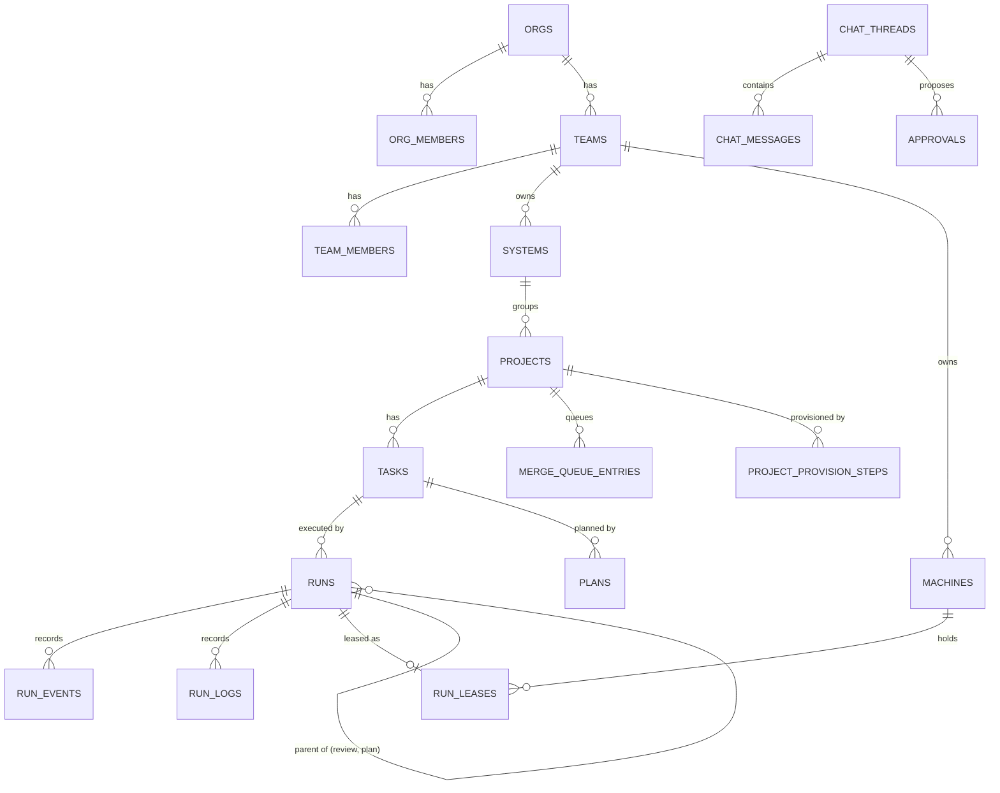
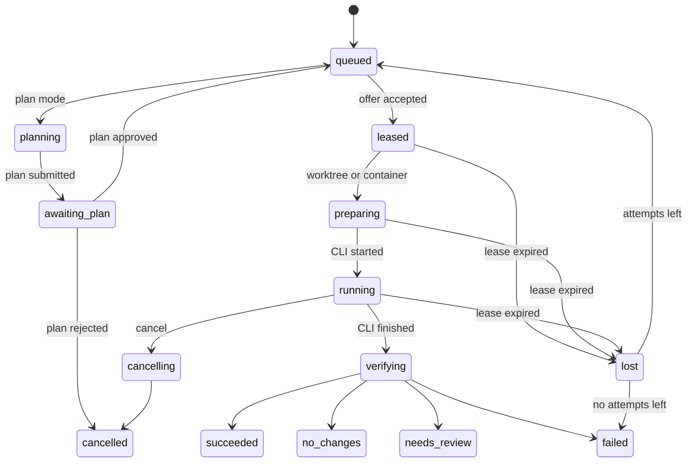

# xDev Hive: Software Design Description

| | |
|---|---|
| Status | Describes the code on `main` at commit `221d5b6` (12 October 2026) |
| Structure | Reduced from IEEE 1016-2009: design viewpoints with the views this system needs |
| Related | [add.md](add.md) (architecture: context, building blocks, runtime, deployment), [srs.md](srs.md) (requirements), [adr/](adr/README.md) (decisions) |

The ADD explains how the system is put together. This document records the detailed design that code changes must keep
consistent: entities and tables, interfaces, state machines, algorithms and limits. Views already covered by the ADD
are referenced, not repeated.

## 1. Design concerns

| Concern | Addressed in |
|---|---|
| Which data belongs to which module and tenant | Section 3 |
| What each interface accepts and guarantees | Section 4 |
| Which states runs, tasks, machines and queue entries go through | Section 5 |
| How runs are matched, timed out, judged; how egress and updates are decided | Section 6 |
| Limits and timeouts that callers can rely on | Section 7 |

## 2. Context, composition and deployment viewpoints

See [add.md section 3](add.md#3-context-and-scope) for the context, [section 5](add.md#5-building-block-view) for the
composition into deployable parts, hub modules and worker packages, and [section 7](add.md#7-deployment-view) for
deployment.

## 3. Information viewpoint

### 3.1 Core entities

Every table in schema `hive` carries `org_id`, has row-level security enabled and forced, and is queried through
`withTenant()`. Most also carry `team_id` so team-scoped policies can filter without joins.

### 3.2 Table catalogue

| Module | Table | Key columns and notes |
|---|---|---|
| tenancy | `orgs` | `slug`, `name`, `email_domain`, `sso_join` (`pending`, `member`) |
| tenancy | `org_members` | `role` (`owner`, `admin`, `member`), `status` (`active`, `pending`, `blocked`) |
| tenancy | `teams`, `team_members` | Team `role` (`admin`, `member`, `viewer`) |
| tenancy | `systems` | Groups projects inside a team |
| tenancy | `invitations` | `token_hash`, `org_role`, optional `team_id` and `team_role`, `expires_at`, `accepted_at` |
| fleet | `machines` | `kind` (`worker`, `host`), `os`, `version`, `clis`, `capacity`, `status` (`online`, `offline`, `revoked`), `paused_at`, `last_seen_at`; `public_key` is reserved and unused |
| fleet | `machine_tokens`, `registration_tokens` | `token_hash` only; registration tokens have `kind`, `expires_at`, `used_at` |
| catalog | `projects` | `key`, repository fields, `state` (`provisioning`, `active`, `failed`, `archived`), `settings` (jsonb, schema `projectSettings` in contracts), `webhook_secret_enc` |
| catalog | `project_provision_steps` | `position`, `kind`, `state` (`pending`, `running`, `done`, `failed`, `skipped`), `attempts`, `error` |
| catalog | `merge_queue_entries` | `pr_number`, `head_sha`, `ci_state`, `state` (`queued`, `updating`, `waiting`, `merging`, `merged`, `failed`, `removed`), `attempts` |
| scm | `scm_connections` | `kind` (`github`, `gitlab`), `auth_mode` (`app`, `token`), `installation_id`, `secret_enc` |
| scm | `webhook_deliveries` | `delivery_id` unique per project, `status` (`queued`, `processed`, `ignored`, `failed`) |
| tasks | `tasks` | `key` (`<PROJECT>-<n>`), `type`, `status` (`todo`, `queued`, `running`, `awaiting_plan`, `review`, `done`, `cancelled`), `preferred_cli`, `source` |
| tasks | `plans` | `revision`, `status` (`awaiting`, `approved`, `rejected`, `superseded`), `content`, `edited_content`, `note` |
| runs | `runs` | `kind`, `state`, `attempt`, `max_attempts`, `machine_id`, `offer_machine_id`, `offer_expires_at`, `rejected_by`, `cli`, `model`, `branch`, `policy_snapshot`, `result`, `head_sha`, `pr_url`, `timeout_sec`, token and cost counters, `parent_run_id`, `leader_thread_id` |
| runs | `run_events` | Unique `(run_id, attempt, seq)`; `type`, `data` |
| runs | `run_logs` | Unique `(run_id, attempt, offset)`; `data` is `bytea` |
| runs | `run_leases` | One per run; `attempt`, `machine_id`, `expires_at` |
| knowledge | `memories` | `kind` (`decision`, `convention`, `gotcha`, `note`), `status`, `content`, `search` (tsvector), optional `embedding`, `superseded_by` |
| knowledge | `docs`, `doc_versions`, `skills`, `skill_versions` | Versioned by `current_version`; scope is team or project |
| knowledge | `proposals` | `kind` (`doc`, `skill`), `base_version`, `status` (`pending`, `approved`, `rejected`), `result_version` |
| knowledge | `legacy_imports`, `legacy_doc_assets` | Idempotent import bookkeeping from the previous system |
| leader | `chat_threads`, `chat_messages` | Message `role` (`user`, `leader`, `system`); leader replies link `run_id` |
| leader | `approvals` | `action` (jsonb), `status` (`pending`, `approved`, `rejected`, `expired`), `expires_at`, `reason` |
| sandbox | `sandbox_org_settings` | `locked`, `use_suggested_defaults` |
| sandbox | `egress_allowlists` | `rule`; `project_id` null means organization-wide |
| sandbox | `env_images` | One per project: `base_image`, `setup_script_hash` |
| notify | `notification_channels`, `notifications`, `inbox_items` | Channels hold `config_enc`; notifications have `status` (`queued`, `sent`, `failed`) and `attempts` |
| audit | `audit_log` | `actor_user_id`, `action`, `target_type`, `target_id`, `data`; append-only for `hive_app` |

Identity tables live in schema `auth` and are owned by Better Auth (`user`, `session`, `account`, `verification`,
`ssoProvider`, `jwks`, `oauth*`).

## 4. Interface viewpoint

### 4.1 HTTP API

All operations are defined once in `packages/contracts` and served as oRPC under `/rpc` and OpenAPI under `/api/v1`.
The permission noted in each operation's summary is enforced in the hub module.

| Group | Operations |
|---|---|
| System | `GET /health`, `GET /desktop/updates/{os}/{arch}/{currentVersion}`, `GET /setup` |
| Identity | `GET /me` |
| Organizations | `GET /orgs/mine`, `POST /orgs`, `GET/PATCH /orgs/{orgId}` |
| Members and invitations | `GET /members`, `PATCH /members/{userId}/role`, `PATCH /members/{userId}/status`, `POST /members/{userId}/approve`, `POST /members/{userId}/deny`; `POST/GET /invitations`, `DELETE /invitations/{id}`, `POST /invitations/preview`, `POST /invitations/accept` |
| SSO | `GET/PUT/DELETE /sso`, `POST /sso/domain-verification`, `POST /sso/domain-verification/check` |
| Teams and systems | `GET/POST /teams`, `PATCH/DELETE /teams/{teamId}`, `GET/POST /teams/{teamId}/members`, `PATCH/DELETE /teams/{teamId}/members/{userId}`; `GET/POST /systems`, `PATCH/DELETE /systems/{systemId}` |
| Git connections | `GET/POST /scm-connections`, `POST /scm-connections/{id}/test`, `DELETE /scm-connections/{id}` |
| Projects | `POST/GET /projects`, `GET /projects/{id}`, `GET /projects/{id}/provision`, `POST /projects/{id}/provision/{stepId}/retry`, `GET/POST /projects/{id}/merge-queue`, `DELETE /projects/{id}/merge-queue/{entryId}`, `PATCH /projects/{key}/settings` |
| Tasks and plans | `POST/GET /tasks`, `GET/PATCH /tasks/{id}`, `POST /tasks/{id}/cancel`, `GET /tasks/{id}/plan`, `GET /tasks/{id}/plans`, `POST /tasks/{id}/plan/approve`, `POST /tasks/{id}/plan/reject` |
| Runs | `POST/GET /runs`, `GET /tasks/{taskId}/runs`, `GET /runs/search`, `GET /runs/{id}`, `POST /runs/{id}/cancel`, `POST /runs/{id}/steer`, `GET /runs/{id}/events`, `GET /runs/{id}/logs`, SSE `GET /runs/{id}/stream` |
| Machines | `GET /teams/{teamId}/machines`, `POST /teams/{teamId}/machines/registrations`, `POST /machines/{id}/revoke`, `POST /machines/{id}/pause`, `POST /machines/{id}/resume`, `POST /machines/{id}/update`, `GET /worker/releases/latest`, `POST /worker/register` |
| Knowledge | `POST/GET /memories`, `GET /memories/search`, `POST /memories/{id}/supersede`; `GET/POST /docs`, `GET /docs/item`, `GET /docs/history`; `GET/POST /skills`, `GET /skills/item`; `POST/GET /proposals`, `POST /proposals/{id}/approve`, `POST /proposals/{id}/reject` |
| Leader | `POST/GET /leader/threads`, `GET /leader/threads/{id}`, `POST /leader/threads/{id}/messages`, `GET /leader/approvals`, `POST /leader/approvals/{id}/approve`, `POST /leader/approvals/{id}/reject` |
| Sandbox | `GET/POST /sandbox/allowlist`, `DELETE /sandbox/allowlist/{entryId}`, `GET/PUT /sandbox/settings`, `GET /sandbox/projects/{projectId}/allowlist`, `GET/PUT /sandbox/projects/{projectId}/image` |
| Notifications | `GET/POST /notification-channels`, `PATCH/DELETE /notification-channels/{id}`, `POST /notification-channels/{id}/test`; `GET /inbox`, `GET /inbox/unread-count`, `POST /inbox/read`, `POST /inbox/read-all` |
| Costs | `GET /costs/summary`, `GET /costs/budget-stopped` |

Errors carry an oRPC code (`UNAUTHORIZED`, `FORBIDDEN`, `NOT_FOUND`, `CONFLICT`, `BAD_REQUEST`) and a stable
`data.code` such as `TEAM_ROLE_REQUIRED` or `MACHINE_OFFLINE`; messages are Vietnamese.

### 4.2 Worker protocol

WebSocket `/ws/worker`, authenticated with `Authorization: Bearer <machine token>`. Every message is JSON with `type`,
`v` (protocol version, currently 1) and `id`. Schemas: `packages/contracts/src/worker-protocol.ts`.

| Direction | Message | Purpose |
|---|---|---|
| W → H | `hello` | Machine id, version, protocol range, OS, runner mode, CPU and memory, CLIs, capacity, runs to resume |
| H → W | `welcome` | Session id and heartbeat interval |
| W → H | `heartbeat` | Load and held leases |
| H → W | `heartbeat_ack` | Renewed leases and runs to cancel |
| H → W | `job_offer` | Run, attempt, spec, time to answer |
| W → H | `job_accept`, `job_reject` | Answer to an offer |
| H → W | `lease` | Lease id, expiry, run token |
| W → H | `run_event` | `phase`, `plan`, `tool_call`, `cost`, `check_result`, `agent_report`, `steer_result` (`approval_needed` is not handled yet) |
| W → H | `log_chunk` | Terminal output with byte offset |
| H → W | `ack` | Highest sequence stored; the worker deletes acknowledged messages from disk |
| H → W | `steer`, `cancel` | Extra instructions; cancellation with grace period |
| W → H | `run_result` | Exit code, head SHA, report |
| H → W | `update` | Finish current runs, then self-update (optional `version`) |
| H → W | `upgrade_required`, `drain`, `approval_result` | Defined but not sent by the hub |

Close codes: 4400 bad message, 4401 revoked, 4403 machine mismatch, 4408 hello timeout, 4426 protocol unsupported.
Workers stop instead of reconnecting on 4401, 4403 and 4426. Compatibility rule: new fields are optional and new
message types are ignored by older peers.

### 4.3 MCP tools

| Module | Tools |
|---|---|
| tenancy | `hive_whoami`, `orgs_list`, `teams_list`, `systems_list` |
| runs | `task_get`, `task_update`, `plan_submit` (plan runs), `review_submit` (review runs) |
| knowledge | `memory_search`, `memory_write`, `doc_list`, `doc_get`, `doc_propose`, `skill_list`, `skill_get` |
| leader | `leader_reply`, `leader_propose` (leader runs) |

Read-only run kinds receive no write tools (`task_update`, `memory_write`, `doc_propose`).

### 4.4 Worker command line

| Command | Purpose |
|---|---|
| `hive-worker register --hub URL --token T [--machine NAME] [--capacity N]` | Exchange a registration token for a machine token |
| `hive-worker run [--capacity N] [--status-json] [--stdin-control]` | Connect and execute runs on this machine |
| `hive-worker host [--image I] [--cpus C] [--memory M] [--pids-limit P]` | Runner host mode (Linux, gVisor) |
| `hive-worker service install / uninstall / status / restart` | Manage the per-user service that runs `run` |
| `hive-worker update [--check] [--version X.Y.Z] [--json]` | Install a verified release |
| `hive-worker config`, `check`, `version` | Inspect configuration and connectivity |
| `hive-worker egress-proxy`, `sandbox-init` | Egress proxy and the container entry point used by sandboxed runs |

## 5. State dynamics viewpoint

### 5.1 Run

`awaiting_input` exists in the enum but no transition reaches it yet. Every transition writes a `run_events` row and
calls `pg_notify('hive_runs', runId)` in the same transaction.

### 5.2 Other lifecycles

| Entity | States | Moves on |
|---|---|---|
| Task | `todo` → `queued` → `running` → `review` → `done`; `awaiting_plan`; `cancelled` | Dispatch, run progress, PR merged (done) or closed (back to `todo`) |
| Machine | `online`, `offline`, `revoked`; paused is `paused_at` set on top of the status | WebSocket connect and close, admin actions |
| Merge queue entry | `queued` → `updating` → `waiting` → `merging` → `merged`; `failed`; `removed` | `catalog-merge` job per project |
| Provisioning step | `pending` → `running` → `done` / `failed` / `skipped` | `catalog-provision` saga; failed steps can be retried |
| Plan | `awaiting` → `approved` / `rejected`; `superseded` by a new revision | Member decision |
| Leader approval | `pending` → `approved` / `rejected` / `expired` | Member decision or expiry |

## 6. Algorithm viewpoint

### 6.1 Matching a run to a machine

A queued run is offered to one machine at a time. Candidates are machines of the run's team that are connected to this
hub process, online, not paused, of the right kind (runner hosts for sandbox projects, developer machines otherwise),
have the run's CLI and have free capacity (capacity minus held leases). Machines that rejected the run are skipped. An
offer that is not accepted within 30 seconds expires and the run is offered elsewhere; with no candidate the run stays
queued until a machine connects or frees capacity.

### 6.2 Leases and timers

A lease lasts 90 seconds and is renewed by each heartbeat. The `runs-timer` job checks offer and lease expiry; an
expired lease moves the run to `lost`, then to `queued` with `attempt + 1` while `attempt < max_attempts`, else to
`failed`. Messages with an older attempt or from another machine are dropped.

### 6.3 Outcome policy

The policy snapshot on the run lists checks in order. Evaluation: a failed required check gives `failed`; no new
commit when the policy has a `changes` check gives `no_changes`; a failed optional check or a check the hub cannot
evaluate yet (`command`, `ci`) gives `needs_review`; otherwise `succeeded`. A `review` check first runs a child review
run and waits for its score.

### 6.4 Effective allowlist and egress decision

Effective allowlist = organization entries + (project entries unless the organization locked the list) + the five
suggested hosts when enabled. The job spec carries this list as an immutable snapshot. For each CONNECT the egress
proxy normalises the host, matches it against entries (domain, `*.domain`, IP or CIDR, optional port), resolves DNS
itself, rejects the request if any resolved address is blocked (loopback, private, link-local, CGNAT, multicast,
reserved, metadata) unless an IP or CIDR entry allows it, then reads the TLS ClientHello and requires the SNI to match.

### 6.5 Worker self-update

Target version: the requested one, or the latest release when it is newer than the running version. Download
`checksums.txt` and `checksums.txt.sig`; verify the ECDSA P-256 signature over the SHA-256 of `checksums.txt` with the
embedded public key; download the platform archive and compare its SHA-256; extract the binary; write it next to the
running binary; run it with `version` and require the target version; rename it over the running binary (on Windows,
move the running binary to `.old` first); re-execute with the same arguments.

## 7. Resource viewpoint: limits and timeouts

| Item | Value | Where |
|---|---|---|
| Registration token lifetime | 1 hour, single use | `fleet/registration.ts` |
| Offer time to answer | 30 seconds | `runs/engine.ts` |
| Lease | 90 seconds, renewed by heartbeat | `runs/engine.ts` |
| Heartbeat | 30 seconds; disconnect after 3 missed | `fleet/gateway.ts` |
| Offline notification | 300 seconds (`HIVE_MACHINE_OFFLINE_NOTIFY_SEC`) | `fleet/machines.ts` |
| Worker capacity | 1 by default, at most 64 | `--capacity`, contracts |
| Review diff file | 1 MB | `worker/internal/runner` |
| Sandbox container | 2 CPUs, 4 GB, 256 processes by default | `hive-worker host` flags |
| Release archive | 200 MB maximum | `worker/internal/update` |
| Latest release lookup | Once an hour; retry after 5 minutes on error | `fleet/releases.ts` |
| Desktop update manifest cache | 5 minutes | `system/desktop-updates.ts` |
| Merge queue | One job per project; recheck every 30 seconds, give up after 24 hours | `catalog/merge-queue.ts` |
| Notification delivery | Up to 5 attempts for temporary errors | `notify` |
| Password | At least 10 characters | `identity/auth.ts` |
| Hub `api` processes | Exactly one | `main.ts` |

## 8. Design rationale and traceability

Decisions are recorded in [docs/adr](adr/README.md). Requirement areas map to modules as follows:

| SRS area | Hub modules | Other parts |
|---|---|---|
| AUTH | `identity`, `tenancy` | web login |
| TEN | `tenancy` | |
| PROJ | `catalog`, `scm` | |
| TASK | `tasks`, `scm` | |
| RUN | `runs`, `catalog` (merge queue), `cost` | worker `channel`, `runner` |
| FLEET | `fleet` | worker `service`, `update`, install scripts |
| SBX | `sandbox` | worker `runner`, `egress` |
| KNOW | `knowledge` | |
| LEAD | `leader` | |
| MCP | `mcp` and the modules that register tools | |
| OPS | `notify`, `cost`, `audit` | `deploy/` |
