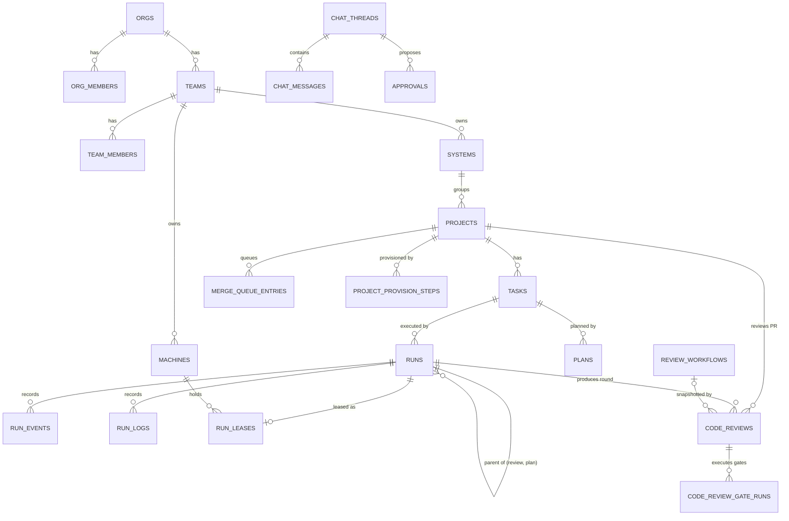
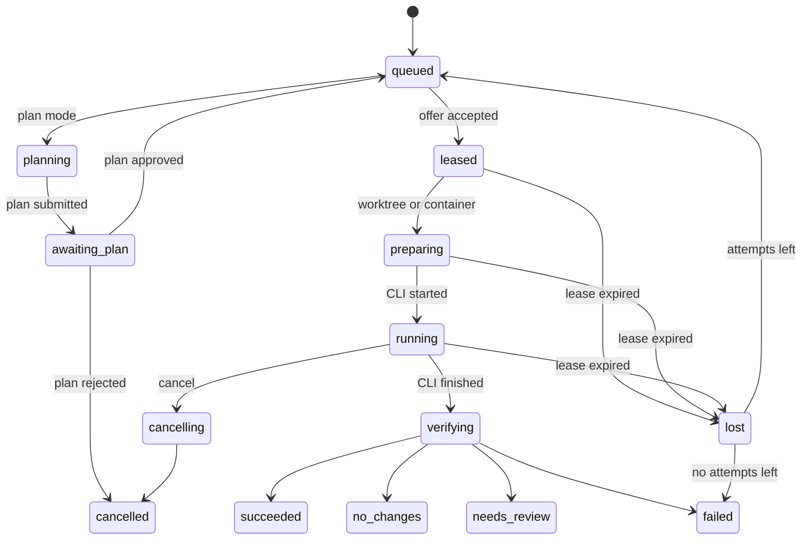

# xDev Hive: Software Design Description

| | |
|---|---|
| Status | Describes the code on `main` at commit `221d5b6` (12 October 2026) |
| Structure | Reduced from IEEE 1016-2009: design viewpoints with the views this system needs |
| Related | [add.md](add.md) (architecture: context, building blocks, runtime, deployment), [srs.md](srs.md) (requirements), [adr/](adr/README.md) (decisions) |

The ADD explains how the system is put together. This document records the detailed design that code changes must keep
consistent: entities and tables, interfaces, state machines, algorithms and limits. Views already covered by the ADD
are referenced, not repeated.

Spec 009 update checked against `origin/main` at `8676c4f` on 14 October 2026: hub wiring (T070) and command
delivery/outcome evaluation (T091) are implemented. Commit status remains pending (T101).

## 1. Design concerns

| Concern | Addressed in |
|---|---|
| Which data belongs to which module and tenant | Section 3 |
| What each interface accepts and guarantees | Section 4 |
| Which states runs, tasks, machines and queue entries go through | Section 5 |
| How runs are matched, timed out, judged; how egress and updates are decided | Section 6 |
| Limits and timeouts that callers can rely on | Section 7 |

## 2. Context, composition and deployment viewpoints

See [add.md section 3](add.md#3-context-and-scope) for the context, [section 5](add.md#5-building-block-view) for the
composition into deployable parts, hub modules and worker packages, and [section 7](add.md#7-deployment-view) for
deployment.

## 3. Information viewpoint

### 3.1 Core entities

Every table in schema `hive` carries `org_id`, has row-level security enabled and forced, and is queried through
`withTenant()`. Most also carry `team_id` so team-scoped policies can filter without joins.

### 3.2 Table catalogue

| Module | Table | Key columns and notes |
|---|---|---|
| tenancy | `orgs` | `slug`, `name`, `email_domain`, `sso_join` (`pending`, `member`) |
| tenancy | `org_members` | `role` (`owner`, `admin`, `member`), `status` (`active`, `pending`, `blocked`) |
| tenancy | `teams`, `team_members` | Team `role` (`admin`, `member`, `viewer`) |
| tenancy | `systems` | Groups projects inside a team |
| tenancy | `invitations` | `token_hash`, `org_role`, optional `team_id` and `team_role`, `expires_at`, `accepted_at` |
| fleet | `machines` | `kind` (`worker`, `host`), `os`, `version`, `clis`, `capabilities`, `labels`, `labels_only`, `capacity`, `status` (`online`, `offline`, `revoked`), `paused_at`, `last_seen_at`; `public_key` is reserved and unused |
| fleet | `machine_tokens`, `registration_tokens` | `token_hash` only; registration tokens have `kind`, `expires_at`, `used_at` |
| catalog | `projects` | `key`, repository fields, `state` (`provisioning`, `active`, `failed`, `archived`), `settings` (jsonb, schema `projectSettings` in contracts), `webhook_secret_enc` |
| catalog | `project_provision_steps` | `position`, `kind`, `state` (`pending`, `running`, `done`, `failed`, `skipped`), `attempts`, `error` |
| catalog | `merge_queue_entries` | `pr_number`, `head_sha`, `ci_state`, `state` (`queued`, `updating`, `waiting`, `merging`, `merged`, `failed`, `removed`), `attempts` |
| scm | `scm_connections` | `kind` (`github`, `gitlab`), `auth_mode` (`app`, `token`), `installation_id`, `secret_enc` |
| scm | `webhook_deliveries` | `delivery_id` unique per project, `status` (`queued`, `processed`, `ignored`, `failed`) |
| tasks | `tasks` | `key` (`<PROJECT>-<n>`), `type`, `status` (`todo`, `queued`, `running`, `awaiting_plan`, `review`, `done`, `cancelled`), `preferred_cli`, `source` |
| tasks | `plans` | `revision`, `status` (`awaiting`, `approved`, `rejected`, `superseded`), `content`, `edited_content`, `note` |
| runs | `runs` | `kind`, `state`, `attempt`, `max_attempts`, `machine_id`, `offer_machine_id`, `offer_expires_at`, `rejected_by`, `cli`, `model`, `branch`, `policy_snapshot`, `result`, `head_sha`, `pr_url`, `timeout_sec`, token and cost counters, `parent_run_id`, `leader_thread_id` |
| runs | `run_events` | Unique `(run_id, attempt, seq)`; `type`, `data` |
| runs | `run_logs` | Unique `(run_id, attempt, offset)`; `data` is `bytea` |
| runs | `run_leases` | One per run; `attempt`, `machine_id`, `expires_at` |
| knowledge | `memories` | `kind` (`decision`, `convention`, `gotcha`, `note`), `status`, `content`, `search` (tsvector), optional `embedding`, `superseded_by` |
| knowledge | `docs`, `doc_versions`, `skills`, `skill_versions` | Versioned by `current_version`; scope is team or project |
| knowledge | `proposals` | `kind` (`doc`, `skill`), `base_version`, `status` (`pending`, `approved`, `rejected`), `result_version` |
| knowledge | `legacy_imports`, `legacy_doc_assets` | Idempotent import bookkeeping from the previous system |
| leader | `chat_threads`, `chat_messages` | Message `role` (`user`, `leader`, `system`); leader replies link `run_id` |
| leader | `approvals` | `action` (jsonb), `status` (`pending`, `approved`, `rejected`, `expired`), `expires_at`, `reason` |
| sandbox | `sandbox_org_settings` | `locked`, `use_suggested_defaults` |
| sandbox | `egress_allowlists` | `rule`; `project_id` null means organization-wide |
| sandbox | `env_images` | One per project: `base_image`, `setup_script_hash` |
| knowledge | `review_workflows`, `review_instances`, `review_gate_runs` | Workflow definitions with immutable `subject` (`doc`/`code`), phases/gates as jsonb and Code scope/options; document runtime remains one snapshot per doc proposal and gate runs (`waiting`, `passed`, `failed`, `skipped`) |
| codereview | `code_reviews` | PR review round keyed by run/project/PR/head SHA: workflow snapshot, `round`, `gate_index`, requester, revision count, status (`in_review`, `changes_requested`, `approved`, `merged`, `cancelled`, `superseded`); RLS enabled and forced |
| codereview | `code_review_gate_runs` | Gate result: status, checklist, AI reviewers/run IDs, command evidence, approvals, decision/override reason, SLA deadline; RLS enabled and forced |
| knowledge | `doc_drafts`, `doc_suggestions`, `doc_threads`, `doc_comments`, `doc_snapshots`, `doc_presence` | Document editor, keyed by doc key: one shared draft per doc (optimistic `revision`), inline suggestions (`pending`, `accepted`, `rejected`), comment threads anchored to a quote, named snapshots (a submitted snapshot links to its proposal), presence seen in the last minute |
| governance | `agent_policies` | One per organization: `policy` (jsonb, schema `agentPolicyInput` in contracts), `template_sync`; runs keep the applied policy in `runs.agent_policy_snapshot` |
| notify | `notification_channels`, `notifications`, `inbox_items` | Channels hold `config_enc`; notifications have `status` (`queued`, `sent`, `failed`) and `attempts` |
| tasks | `task_dependencies` | `task_id`, `depends_on_id` (no self-reference) |
| sdlc | `sdlc_modes` | Custom modes per organization (`team_id` null) or team: `slug`, `base_preset`, `definition` (jsonb, schema `sdlcMode`), `version`; presets live in `packages/contracts/src/sdlc-presets` |
| sdlc | `sdlc_items` | `number` per project, `mode_ref` and `mode` snapshot, `status` (`active`, `paused`, `done`, `cancelled`), `size` (`S`–`XL`), optional source issue |
| sdlc | `sdlc_item_projects` | `role` (`home`, `participant`), `team_id`, `removed_at`; team-scoped access joins this table |
| sdlc | `sdlc_item_phases`, `sdlc_steps` | Phase state per item; agent steps with `run_id` (one step per run) |
| sdlc | `sdlc_artifacts`, `sdlc_artifact_syncs` | `scope` (`item`, `project`, `contract`), `doc_key`, `repo_path`, consumer projects; repository sync attempts |
| sdlc | `sdlc_questions` | Questions from `sdlc_ask`, answers, reminders |
| sdlc | `sdlc_item_tasks`, `sdlc_trace_links` | Breakdown slices mapped to tasks; links from requirements to `task`, `run`, `pr`, `commit`, `test`, `ci`, `finding` |
| sdlc | `sdlc_overrides`, `sdlc_auto_approvals` | Gate overrides with a reason; AI auto-approvals with score and revoke deadline |
| audit | `audit_log` | `actor_user_id`, `action`, `target_type`, `target_id`, `data`; append-only for `hive_app`; expired rows removed only by `hive.purge_expired_audit_log()` |
| audit | `audit_settings` | One per organization: `retention_days` (90–3650, default 365 when absent); no DELETE for `hive_app` |
| terminal | `terminal_sessions` | `origin` (`hub` Terminal Leader, `local` from `hive chat`, `remote` started from the phone), `visibility` (`private`, `team`), machine, owner, CLI, account and folder labels only (no absolute paths), `remote`, `next_seq`, `exit_code`, `end_reason`, `ended_at` |
| terminal | `terminal_chunks` | Unique `(session_id, seq)`; masked output as `bytea`; removed by `hive.purge_terminal_chunks()` in the `runs-log-retention` job |
| terminal | `terminal_events` | Session events: `kind` (`controller`, `resize`, `gap`, `input_rejected`, …), `seq`, actor user and device |
| terminal | `remote_devices` | Paired devices as reported by the machine (`term_state`): `user_id`, `label`, `synced`, `revoked_at`; the passkey public key stays on the machine |
| terminal | `machine_remote_state` | Last `term_state` of each machine: `enabled`, root labels, CLIs, accounts, `totp_enabled`, `totp_locked_until`, `confirm_on_machine` |
| terminal | `push_subscriptions` | Reserved for Web Push; unused (out of scope since 2026-10-23) |

Identity tables live in schema `auth` and are owned by Better Auth (`user`, `session`, `account`, `verification`,
`ssoProvider`, `jwks`, `oauth*`).

## 4. Interface viewpoint

### 4.1 HTTP API

All operations are defined once in `packages/contracts` and served as oRPC under `/rpc` and OpenAPI under `/api/v1`.
The permission noted in each operation's summary is enforced in the hub module.

| Group | Operations |
|---|---|
| System | `GET /health`, `GET /desktop/updates/{os}/{arch}/{currentVersion}`, `GET /setup` |
| Identity | `GET /me` |
| Organizations | `GET /orgs/mine`, `POST /orgs`, `GET/PATCH /orgs/{orgId}` |
| Members and invitations | `GET /members`, `PATCH /members/{userId}/role`, `PATCH /members/{userId}/status`, `POST /members/{userId}/approve`, `POST /members/{userId}/deny`; `POST/GET /invitations`, `DELETE /invitations/{id}`, `POST /invitations/preview`, `POST /invitations/accept` |
| SSO | `GET/PUT/DELETE /sso`, `POST /sso/domain-verification`, `POST /sso/domain-verification/check` |
| Teams and systems | `GET/POST /teams`, `PATCH/DELETE /teams/{teamId}`, `GET/POST /teams/{teamId}/members`, `PATCH/DELETE /teams/{teamId}/members/{userId}`; `GET/POST /systems`, `PATCH/DELETE /systems/{systemId}` |
| Git connections | `GET/POST /scm-connections`, `POST /scm-connections/{id}/test`, `DELETE /scm-connections/{id}` |
| Projects | `POST/GET /projects`, `GET /projects/{id}`, `GET /projects/{id}/provision`, `POST /projects/{id}/provision/{stepId}/retry`, `GET/POST /projects/{id}/merge-queue`, `DELETE /projects/{id}/merge-queue/{entryId}`, `PATCH /projects/{key}/settings` |
| Tasks and plans | `POST/GET /tasks`, `GET/PATCH /tasks/{id}`, `POST /tasks/{id}/cancel`, `GET /tasks/{id}/plan`, `GET /tasks/{id}/plans`, `POST /tasks/{id}/plan/approve`, `POST /tasks/{id}/plan/reject` |
| Runs | `POST/GET /runs`, `GET /tasks/{taskId}/runs`, `GET /runs/search`, `GET /runs/{id}`, `POST /runs/{id}/cancel`, `POST /runs/{id}/steer`, `GET /runs/{id}/events`, `GET /runs/{id}/logs`, SSE `GET /runs/{id}/stream` |
| Machines | `GET /teams/{teamId}/machines`, `POST /teams/{teamId}/machines/registrations`, `POST /machines/{id}/revoke`, `POST /machines/{id}/pause`, `POST /machines/{id}/resume`, `POST /machines/{id}/update`, `GET /worker/releases/latest`, `POST /worker/register` |
| Knowledge | `POST/GET /memories`, `GET /memories/search`, `POST /memories/{id}/supersede`; `GET/POST /docs`, `GET /docs/item`, `GET /docs/history`; `GET/POST /skills`, `GET /skills/item`; `POST/GET /proposals`, `POST /proposals/{id}/approve`, `POST /proposals/{id}/reject` |
| Leader | `POST/GET /leader/threads`, `GET /leader/threads/{id}`, `POST /leader/threads/{id}/messages`, `GET /leader/approvals`, `POST /leader/approvals/{id}/approve`, `POST /leader/approvals/{id}/reject` |
| Sandbox | `GET/POST /sandbox/allowlist`, `DELETE /sandbox/allowlist/{entryId}`, `GET/PUT /sandbox/settings`, `GET /sandbox/projects/{projectId}/allowlist`, `GET/PUT /sandbox/projects/{projectId}/image` |
| Notifications | `GET/POST /notification-channels`, `PATCH/DELETE /notification-channels/{id}`, `POST /notification-channels/{id}/test`; `GET /inbox`, `GET /inbox/unread-count`, `POST /inbox/read`, `POST /inbox/read-all` |
| Costs | `GET /costs/summary`, `GET /costs/budget-stopped` |
| Reviews | `GET/POST /review-workflows`, `POST /review-workflows/remove`, `POST /review-workflows/dry-run`, `GET /reviews`, `GET /reviews/item`, `POST /reviews/decide` |
| Code reviews | `codeReviews.list/count/get/files/decide/override/enqueue/recheck/dryRun/workflowFromProject`; registered in the application router |
| Policies | `GET/POST /policies`, `POST /policies/templates/preview`, `POST /policies/templates/sync` |
| Terminal Leader | `GET /terminal/options`, `POST/GET /terminal/sessions`, `GET /terminal/sessions/{id}`, `POST /terminal/sessions/{id}/close`, `POST /terminal/sessions/{id}/visibility`, `POST /terminal/sessions/{id}/ticket`, `GET /terminal/sessions/{id}/chunks`, `GET /terminal/sessions/{id}/activity` |
| Remote sessions | `GET /remote/machines`, `POST/GET /remote/sessions`, `GET /remote/sessions/{id}`, `GET /remote/sessions/{id}/chunks`, `POST /remote/sessions/{id}/ticket`, `POST /remote/sessions/{id}/close`, `POST /remote/sessions/{id}/visibility`, `POST /remote/machines/{machineId}/disable`, `POST /remote/machines/{machineId}/pair/options`, `POST /remote/machines/{machineId}/pair`, `GET /remote/machines/{machineId}/devices`, `POST /remote/machines/{machineId}/devices/{deviceId}/revoke`. There is no route to turn remote control on or add a device without the machine. `remote.pushKey`, `pushSubscribe` and `pushUnsubscribe` are in the contract but not served by the hub |

Errors carry an oRPC code (`UNAUTHORIZED`, `FORBIDDEN`, `NOT_FOUND`, `CONFLICT`, `BAD_REQUEST`) and a stable
`data.code` such as `TEAM_ROLE_REQUIRED` or `MACHINE_OFFLINE`; messages are Vietnamese.

### 4.2 Worker protocol

WebSocket `/ws/worker`, authenticated with `Authorization: Bearer <machine token>`. Every message is JSON with `type`,
`v` (protocol version, currently 1) and `id`. Schemas: `packages/contracts/src/worker-protocol.ts`.

| Direction | Message | Purpose |
|---|---|---|
| W → H | `hello` | Machine id, version, protocol range, OS, runner mode, CPU and memory, CLIs, capacity, runs to resume |
| H → W | `welcome` | Session id and heartbeat interval |
| W → H | `heartbeat` | Load and held leases |
| H → W | `heartbeat_ack` | Renewed leases and runs to cancel |
| H → W | `job_offer` | Run, attempt, spec, time to answer |
| W → H | `job_accept`, `job_reject` | Answer to an offer |
| H → W | `lease` | Lease id, expiry, run token |
| W → H | `run_event` | `phase`, `plan`, `tool_call`, `cost`, `check_result`, `agent_report`, `steer_result` (`approval_needed` is not handled yet) |
| W → H | `log_chunk` | Terminal output with byte offset |
| H → W | `ack` | Highest sequence stored; the worker deletes acknowledged messages from disk |
| H → W | `steer`, `cancel` | Extra instructions; cancellation with grace period |
| W → H | `run_result` | Exit code, head SHA, report |
| H → W | `update` | Finish current runs, then self-update (optional `version`) |
| H → W | `upgrade_required`, `drain`, `approval_result` | Defined but not sent by the hub |
| H → W | `term_open`, `term_close` | Open a Terminal Leader session on a shared machine; end any session |
| W → H | `term_opened`, `term_output`, `term_exit`, `term_event` | Session started (`origin`, labels, `record`, `remote`); masked output by `seq`; end; events |
| H → W | `term_ack` | Output stored up to `upto`; the worker drops its disk buffer |
| W → H | `term_state` | Remote state of the machine: enabled, TOTP, root labels, CLIs, accounts, devices, sessions, `confirmOnMachine` |
| H → W | `term_input`, `term_resize` | Keys and size; remote control adds `connId`, `seq` and a 16-byte HMAC |
| H → W | `term_pair` · W → H `term_pair_result` | Device pairing with a tag made with the QR secret |
| H → W | `term_control`, `term_detach` · W → H `term_granted`, `term_revoked` | Control request with a passkey assertion or TOTP code, or resume with `resumeToken`; grant with the worker's ECDH key |
| H → W | `term_start` · W → H `term_denied` | New session from the phone, signed; refused with a code |
| H → W | `term_disable`, `term_device_revoke` | Emergency off; remove a device |

`job_offer.spec.sdlc` exists only for runs of kind `sdlc`: `step`, `seed` (at most 100 files written into the temporary
worktree before the CLI starts), `collect` (files read back after the CLI exits and returned in `report.artifacts` with
their SHA-256; at most 20 files, 200,000 characters each, 2,000,000 bytes in total) and optional `repos`. The hub sends `sdlc`
runs only to workers that declare the `sdlc` capability, and `repos` only to workers that declare `sdlc-multirepo`:
up to 7 entries `{projectKey, cloneUrl, branch, dir}` with `dir = .hive/repos/<projectKey>`. The worker clones them
shallow with its own Git credentials, removes `.git`, makes them read-only and writes `.hive/repos/STATUS.md`
(200 MB per repository, 500 MB in total, 5 minutes per clone; a repository it cannot fetch is skipped, not fatal).

`term_*` messages are exchanged only when `hello.capabilities` contains `terminal` and `welcome.features` contains
`terminal`. `welcome` also carries `owner` (the user who registered the machine) and `policy.totpFallback`. Details of
each field, the browser frames on `/ws/terminal` (close codes 4401, 4403, 4404, 4429) and the checks on the machine are
in [architecture.md §5.3](architecture.md#53-phiên-terminal-và-điều-khiển-từ-xa-spec-010).

Close codes: 4400 bad message, 4401 revoked, 4403 machine mismatch, 4408 hello timeout, 4426 protocol unsupported.
Workers stop instead of reconnecting on 4401, 4403 and 4426. Compatibility rule: new fields are optional and new
message types are ignored by older peers.

### 4.3 MCP tools

| Module | Tools |
|---|---|
| tenancy | `hive_whoami`, `orgs_list`, `teams_list`, `systems_list` |
| catalog | `project_list`, `mcp_server_list` (allowed external MCP servers of a project, for the desktop Environment screen) |
| runs | `task_get`, `task_update`, `plan_submit` (plan runs), `review_submit` (review runs), `doc_check_submit` (doccheck runs), `doc_assist_submit` (docassist runs), `run_list` (users: recent runs, filter by machine) |
| knowledge | `memory_search`, `memory_write`, `doc_list`, `doc_get`, `doc_propose`, `doc_draft_get`, `doc_suggest`, `doc_comment` (document editor drafts; users and docassist runs), `skill_list`, `skill_get`, `skill_propose` |
| leader | `leader_reply`, `leader_propose` (leader runs) |
| sdlc | `sdlc_context` (the item of the run: idea, projects, phases, documents, contracts, questions), `sdlc_ask` (`sdlc` runs, at most 5 questions per round), `sdlc_report` (`sdlc` runs: structured step results such as `size`, `findings`, `lessons`) |

Read-only run kinds receive no write tools (`task_update`, `memory_write`, `doc_propose`, `skill_propose`).

External MCP servers (MCP-05, MCP-06) are rules in `mcp_server_rules`, for the organization or one project. Specific
rules (name, URL, command) decide before `*` rules, deny wins over allow, and a server no rule allows is blocked.
`job_offer.spec.mcpServers` of a code run carries the allowed servers. The worker writes them next to the hub gateway
in the Claude Code `--mcp-config` file (run with `--strict-mcp-config`) or the Codex `mcp_servers` overrides (after
`mcp_servers={}`), so servers configured on the machine are not loaded, and blanks hub tokens in their environment.

### 4.4 Worker command line

| Command | Purpose |
|---|---|
| `hive-worker register --hub URL --token T [--machine NAME] [--capacity N]` | Exchange a registration token for a machine token |
| `hive-worker run [--capacity N] [--status-json] [--stdin-control]` | Connect and execute runs on this machine |
| `hive-worker host [--image I] [--cpus C] [--memory M] [--pids-limit P]` | Runner host mode (Linux, gVisor) |
| `hive-worker service install / uninstall / status / restart` | Manage the per-user service that runs `run` |
| `hive-worker update [--check] [--version X.Y.Z] [--json]` | Install a verified release |
| `hive-worker config`, `check`, `version` | Inspect configuration and connectivity |
| `hive-worker egress-proxy`, `sandbox-init` | Egress proxy and the container entry point used by sandboxed runs |

The `hive` binary (specs/010) talks to the running worker over the local socket and to the hub with a personal token.
User guide: [hive-cli.md](hive-cli.md).

| Command | Purpose |
|---|---|
| `hive login [--hub URL] [--with-token] [--no-browser]`, `logout`, `whoami` | Personal token through loopback PKCE or stdin, kept in the keychain |
| `hive chat` / `hive run [--task KEY] [--project KEY] [--no-record] [--escape KEY]` | Interactive CLI session through the worker, recorded on the hub unless `--no-record` |
| `hive ls [--json] [--all]`, `hive attach ID [--view]`, `hive kill ID` | List, join and end sessions; `--all` and run attach use the hub |
| `hive remote status / on [--yes] / off / roots [add / rm] / devices [rm] / pair / set / watch` | Remote control settings at the machine |
| `hive remote totp status / enroll / confirm / disable / unlock` | TOTP fallback for an `http://` hub |
| `hive version` | Version |

## 5. State dynamics viewpoint

### 5.1 Run

`awaiting_input` exists in the enum but no transition reaches it yet. Every transition writes a `run_events` row and
calls `pg_notify('hive_runs', runId)` in the same transaction.

### 5.2 Other lifecycles

| Entity | States | Moves on |
|---|---|---|
| Task | `todo` → `queued` → `running` → `review` → `done`; `awaiting_plan`; `cancelled` | Dispatch, run progress, PR merged (done) or closed (back to `todo`) |
| Machine | `online`, `offline`, `revoked`; paused is `paused_at` set on top of the status | WebSocket connect and close, admin actions |
| AI SDLC item | `active`, `paused`, `done`, `cancelled`; each phase moves through its steps and gate | Step runs finish, gates approved or auto-approved, overrides, closing after release notes and retrospective |
| Merge queue entry | `queued` → `updating` → `waiting` → `merging` → `merged`; `failed`; `removed` | `catalog-merge` job per project |
| Provisioning step | `pending` → `running` → `done` / `failed` / `skipped` | `catalog-provision` saga; failed steps can be retried |
| Plan | `awaiting` → `approved` / `rejected`; `superseded` by a new revision | Member decision |
| Leader approval | `pending` → `approved` / `rejected` / `expired` | Member decision or expiry |

## 6. Algorithm viewpoint

### 6.1 Matching a run to a machine

A queued run is offered to one machine at a time. Candidates are machines of the run's team that are connected to this
hub process, online, not paused, of the right kind (runner hosts for sandbox projects, developer machines otherwise),
have the run's CLI and have free capacity (capacity minus held leases). Machines that rejected the run are skipped. An
offer that is not accepted within 30 seconds expires and the run is offered elsewhere; with no candidate the run stays
queued until a machine connects or frees capacity.

Runs of kind `sdlc` also need the `sdlc` capability. Runs that require labels (the `sdlc` runs of a project and the code
runs of its AI SDLC item tasks, from `settings.sdlc.labels`) go only to machines that carry every required label. A
machine with `labels_only` takes no run that requires no label (`labelsMatch` in `runs/engine.ts`). Labels match
`^[a-z0-9][a-z0-9-]{0,31}$`, at most 10 per machine; they come from the registration token and can be changed later.

### 6.2 Leases and timers

A lease lasts 90 seconds and is renewed by each heartbeat. The `runs-timer` job checks offer and lease expiry; an
expired lease moves the run to `lost`, then to `queued` with `attempt + 1` while `attempt < max_attempts`, else to
`failed`. Messages with an older attempt or from another machine are dropped.

### 6.3 Outcome policy

The policy snapshot on the run lists checks in order. Evaluation: a failed required check gives `failed`; no new
commit when the policy has a `changes` check gives `no_changes`; a failed optional check or a check the hub cannot
evaluate yet (`ci`, or commands with missing evidence) gives `needs_review`; otherwise `succeeded`.
A `review` check first runs a child review run and waits for its score.

The worker supports `spec.checks.commands` and returns `report.commands` after executing commands in the code
worktree after the agent and before push. At dispatch the hub combines commands from the policy snapshot and
matching workflow, including conditional gates, deduplicating trimmed commands with the shortest timeout.
Outcome commands pass on exit 0 and fail otherwise (including timeout/start errors); missing evidence yields
`needs_review`, while workflow command gates wait for a person. Workflow CI gates poll the PR head independently of
the outcome `ci` check, which remains unsupported.

#### Code review workflow execution

`runs` matches Code workflows and skips `outcome.review` with a reason when matched. The entry point opens an instance only for `succeeded`/`needs_review` code runs with a PR. Matching uses project scope,
target branch, task type and changed paths; explicit project scope outranks team scope, then organization scope,
with latest update breaking ties. No match preserves the existing run policy and merge path.

`codereview` snapshots the workflow and head SHA, advances ordered gates through the `codereview` pg-boss queue and
skips gates whose conditions do not match. Rule gates consume diff/report/command evidence. AI gates create one to
three `review` runs, aggregate by `all` or `avg` plus blocking severity, and post a summary comment. Team ownership is
the default; requester ownership is optional. CI gates check the same head SHA. Human decisions lock the instance,
check reviewer eligibility and quorum, and compare the reviewed SHA to the provider head. The requester needs the
explicit self-approval option; organization admins can decide. Overrides require `reviews.override` and a reason.

Returns route to `agent`, `author` or the previous human gate. Agent fixes retain task, branch, CLI and owner without
planning and obey revision/budget limits; unavailable fixes fall back to the requester. A new head supersedes the
instance and starts another round from the first workflow snapshot. Automated evidence is rerun; prior human
approvals before the returned gate persist unless stale approvals are dismissed. Manual push rounds cannot reuse
command evidence from the old SHA.

Approval enqueues according to the effective workflow/project merge mode when the queue is enabled, otherwise
waits for a member or manual merge. `reviewGate` keeps unapproved instances waiting; merge/close webhooks mark them
`merged`/`cancelled`. SLA reminders are once per human wait; mutations are audited and relevant members notified.

`app.ts` registers the API router and injects run ports. The jobs role in `main.ts` registers the `codereview`
worker, the ten-minute `codereview-sla` cron and push/merge/close SCM handlers, injecting `startReviewRuns`,
`queueFixRun`, `runEvidence` and `MergeDeps.reviewGate`. CI polls every two minutes, at most 60 times.
`codereview` never imports `runs`; both this injection and the catalog merge port prevent cycles. The proposed commit status is settled by spec 009 Q1 (`xdev-hive/review`); T101 implementation
is pending. Provider approvals do not count as Hive human decisions.

### 6.4 Effective allowlist and egress decision

Effective allowlist = organization entries + (project entries unless the organization locked the list) + the five
suggested hosts when enabled. The job spec carries this list as an immutable snapshot. For each CONNECT the egress
proxy normalises the host, matches it against entries (domain, `*.domain`, IP or CIDR, optional port), resolves DNS
itself, rejects the request if any resolved address is blocked (loopback, private, link-local, CGNAT, multicast,
reserved, metadata) unless an IP or CIDR entry allows it, then reads the TLS ClientHello and requires the SNI to match.

### 6.5 Worker self-update

Target version: the requested one, or the latest release when it is newer than the running version. Download
`checksums.txt` and `checksums.txt.sig`; verify the ECDSA P-256 signature over the SHA-256 of `checksums.txt` with the
embedded public key; download the platform archive and compare its SHA-256; extract the binary; write it next to the
running binary; run it with `version` and require the target version; rename it over the running binary (on Windows,
move the running binary to `.old` first); re-execute with the same arguments.

## 7. Resource viewpoint: limits and timeouts

| Item | Value | Where |
|---|---|---|
| Registration token lifetime | 1 hour, single use | `fleet/registration.ts` |
| Offer time to answer | 30 seconds | `runs/engine.ts` |
| Lease | 90 seconds, renewed by heartbeat | `runs/engine.ts` |
| Heartbeat | 30 seconds; disconnect after 3 missed | `fleet/gateway.ts` |
| Offline notification | 300 seconds (`HIVE_MACHINE_OFFLINE_NOTIFY_SEC`) | `fleet/machines.ts` |
| Worker capacity | 1 by default, at most 64 | `--capacity`, contracts |
| Review diff file | 1 MB | `worker/internal/runner` |
| Sandbox container | 2 CPUs, 4 GB, 256 processes by default | `hive-worker host` flags |
| Release archive | 200 MB maximum | `worker/internal/update` |
| Latest release lookup | Once an hour; retry after 5 minutes on error | `fleet/releases.ts` |
| Desktop update manifest cache | 5 minutes | `system/desktop-updates.ts` |
| Merge queue | One job per project; recheck every 30 seconds, give up after 24 hours | `catalog/merge-queue.ts` |
| Notification delivery | Up to 5 attempts for temporary errors | `notify` |
| Password | At least 10 characters | `identity/auth.ts` |
| Hub `api` processes | Exactly one | `main.ts` |
| AI SDLC `seed` / `collect` | 100 seed files; 20 collected files, 200,000 characters each, 2,000,000 bytes in total | `SDLC_ARTIFACT_LIMITS` in contracts, `worker/internal/runner/sdlc.go` |
| AI SDLC participant checkouts | 7 repositories per run; 200 MB each, 500 MB in total, 5 minutes per clone | `SDLC_MAX_REPOS` in contracts, `worker/internal/runner/sdlc_repos.go` |
| AI SDLC questions | At most 5 per `sdlc_ask` round (the step may set fewer) | `sdlc/questions.ts` |
| Machine labels | 10 per machine, 32 characters; 5 required labels per project | contracts |
| Remote sessions on the hub | 8 recorded sessions per machine; 16 viewers per session, 4 for `team` viewers; replay buffer 512 KiB; 512 KiB/s per viewer, 2 MiB/s per machine, 1 MiB backlog, then `sync` with a 128 KiB tail | `REMOTE_LIMITS` in contracts, `terminal/live.ts` |
| Remote timers | Resume 120 s; control idle 900 s; confirmation at the machine 60 s; heartbeat 20 s; WS ticket 60 s | `REMOTE_LIMITS`, `TERMINAL_TICKET_TTL_SEC` |
| Worker recording | Flush every 8 ms or 32 KiB; 32 MB of unacknowledged output per session on disk, then `gap` | `worker/internal/terminal/record.go` |
| Remote control on the machine | Assertion `ts` ±120 s; 3 bad input packets revoke control; remote sessions end after 2 detached hours or 12 hours in total (SIGHUP, kill after 10 s); TOTP locks after 5 wrong codes for 5 minutes, doubling up to 1 hour; pairing secret 10 minutes | `worker/internal/terminal`, `worker/internal/remoteauth` |
| Remote audit log | `remote-audit.log` 0600, rotated at 10 MB, 5 files | `worker/internal/terminal` |

## 8. Design rationale and traceability

Decisions are recorded in [docs/adr](adr/README.md). Requirement areas map to modules as follows:

| SRS area | Hub modules | Other parts |
|---|---|---|
| AUTH | `identity`, `tenancy` | web login |
| TEN | `tenancy` | |
| PROJ | `catalog`, `scm` | |
| TASK | `tasks`, `scm` | |
| RUN | `runs`, `catalog` (merge queue), `cost` | worker `channel`, `runner` |
| CR | `codereview`, `knowledge` (workflow definitions), `runs`, `catalog`, `scm`, `notify`, `audit` | shared `packages/code-review`, web/desktop review views; worker command runner; production router/jobs/SCM/run ports and command delivery/evaluation connected |
| FLEET | `fleet` | worker `service`, `update`, install scripts |
| SBX | `sandbox` | worker `runner`, `egress` |
| POL | `governance`, `runs` (dispatch), `catalog` (templates) | worker `runner` (hooks) |
| KNOW | `knowledge` | |
| LEAD | `leader` | |
| MCP | `mcp` and the modules that register tools, `runs` (external servers in the job) | worker `runner` (MCP configuration) |
| OPS | `notify`, `cost`, `audit` | `deploy/` |
| RMT | `terminal` | `hive` CLI, worker `terminal`, `remoteauth`, `localipc`; web `/remote`; desktop remote screen and tray |
