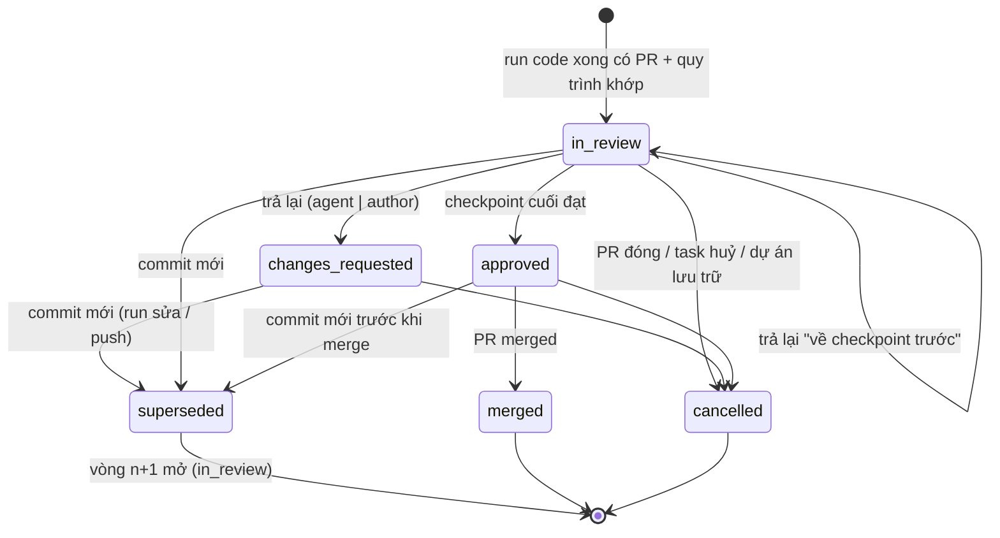

# Implementation Plan: Quy trình review code tự động

**Branch**: `009-code-review-workflows` | **Date**: 2026-10-13 | **Spec**: [spec.md](spec.md) | **ADR**:
[0018](../../docs/adr/0018-code-review-workflows.md)

**Input**: Feature specification from `/specs/009-code-review-workflows/spec.md`

## Summary

Đưa PR do run code của agent mở vào mô hình quy trình duyệt của spec 004. Quản trị cấu hình quy trình **Code (PR)** ở
cùng trang Quy trình duyệt. Run code kết thúc có PR và khớp phạm vi thì hub mở **phiên review code**, chạy checkpoint
quy tắc, AI (nhiều CLI/model, rubric), CI trên đầu PR, rồi người duyệt (quorum, SLA). Trả lại thì tạo run sửa với chỉ
dẫn, về người giao việc, hoặc về checkpoint trước. Đạt thì vào hàng merge theo chế độ merge. Dự án không có quy trình
khớp giữ nguyên chính sách kết quả hiện nay.

## Technical Context

**Language/Version**: TypeScript 7 (hub, contracts, web, desktop UI), Go 1.27 (worker)

**Primary Dependencies**: `@xdev-hive/contracts`, Drizzle, zod 4, pg-boss, oRPC, TanStack Query, `@xdev-hive/ui`,
`line-diff` của contracts (diff tài liệu đã có), Octokit/Gitbeaker qua `GitProvider`

**Storage**: PostgreSQL 18; RLS bật và ép trên bảng mới

**Testing**: Vitest (`*.test.ts`, `*.db.test.ts` với Testcontainers), Playwright (web, hub giả), Vitest + Testing
Library (desktop), `go test` (worker)

**Target Platform**: hub Linux; web trình duyệt hiện đại; desktop macOS/Windows/Linux; worker macOS/Linux/Windows

**Project Type**: modular monolith + web + desktop + worker

**Performance Goals**: SC-002 (≤ 30 s chuyển checkpoint), SC-003 (≤ 300 ms hàng chờ), SC-007 (≤ 2 s diff 100 file)

**Constraints**: không đổi hành vi dự án không có quy trình Code (SC-001); worker cũ vẫn chạy được (trường mới tuỳ
chọn); không vòng import giữa module (`pnpm deps`)

## Constitution Check

- [x] **Contract first**: `packages/contracts/src/code-reviews.ts` mới, `workflows.ts` mở rộng; `pnpm openapi`.
- [x] **Tenant isolation**: bảng mới qua `withTenant()`, RLS bật và ép, thêm vào `rls.db.test.ts` của module.
- [x] **Module boundaries**: module mới `codereview`; `runs` và `catalog` gọi nó qua `index.ts` hoặc qua deps tiêm ở
      `main.ts` (giống `startDocCheck`), không có vòng.
- [x] **Tested before merged**: unit cho luật gộp AI, chọn quy trình, điều kiện; DB test cho máy trạng thái, RLS, hàng
      merge; Playwright cho cấu hình và hàng chờ; Go test cho chạy lệnh kiểm.
- [x] **Secure by default**: người duyệt kiểm ở hub; quyết thay cần quyền riêng và lý do; output lệnh che bí mật; run
      review chỉ đọc (FLEET-08).
- [x] **Vietnamese for people**: chữ giao diện và lỗi tiếng Việt; desktop có từ điển vi/en.
- [x] **Simple to self-host**: không thêm dịch vụ; job trên pg-boss.

## Quyết định thiết kế

| # | Câu hỏi | Quyết định | Lý do |
|---|---|---|---|
| D1 | Dùng chung trang Quy trình duyệt hay tách trang? | **Dùng chung** `/knowledge/workflows`. Mỗi quy trình có `subject` = `doc` hoặc `code`, chọn khi tạo, không đổi sau. Danh sách có nhãn và bộ lọc theo loại. "Chờ tôi duyệt" có hai tab. | Một chỗ cấu hình, cùng mô hình giai đoạn/checkpoint, dùng lại trình sửa checkpoint (người duyệt, quorum, SLA, hướng trả lại), khung mẫu, chạy thử, quyền `workflows.write`. Tách trang sẽ chép gần hết trình sửa. Một quy trình chỉ một loại vì checkpoint và điều kiện khác nhau (loại tài liệu, từ khoá vs đường dẫn, lệnh, CLI). |
| D2 | Lưu phiên review code ở đâu? | **Bảng mới** `code_reviews`, `code_review_gate_runs` trong **module mới** `codereview`. Quy trình vẫn ở `review_workflows` (module `knowledge`) thêm cột `subject`, `code`. | `review_instances.proposal_id` bắt buộc và mang trường tài liệu; dồn PR vào đó cần nới ràng buộc và làm phình module `knowledge` bằng nghiệp vụ Git/run. Module riêng giữ ranh giới: `codereview` import `knowledge` (đọc quy trình, hàm thuần SLA/quorum), `catalog`, `scm`, `notify`, `tenancy`; tạo run qua deps tiêm từ `main.ts`. `runs` import `codereview` (mở phiên, báo run review xong) nên `codereview` không được import `runs`: `matchGlob` chuyển sang `packages/contracts/src/glob.ts`, `runs/policy.ts` re-export để code cũ không đổi. |
| D3 | Quan hệ với `outcome.review` | **Chạy cùng, quy trình được ưu tiên theo run.** Các kiểm tra khác của chính sách (`changes`, `agentReport`, `command`, `ci`) vẫn chạy trước như cổng vào. Run khớp quy trình: hub bỏ kiểm tra `review` (ghi `skipped`, lý do "Quy trình X đảm nhận review"), không tạo run review chéo, không tự vào hàng merge ở bước kết luận run. Không khớp: hành vi cũ. **Chuyển đổi** là thao tác chủ động "Tạo từ cấu hình dự án" (bản nháp), không tự chuyển. | Không phá dự án đang chạy (SC-001), tránh review hai lần, không có migration dữ liệu cấu hình. Dự án có thể thử quy trình trên một nhánh (`release/*`) trước. |
| D4 | Chủ run review AI | Mặc định **run của đội**: `owner_user_id = null`, `created_by = 'workflow:<id>'`, chỉ chạy trên máy dùng chung hoặc runner host (ADR 0017). Tuỳ chọn mỗi checkpoint `runner: 'requester'`: chủ là chủ run code gốc (run gốc không có chủ thì về đội). | Review là luật của đội, cần độc lập với người giao việc, và CLI/model reviewer (Codex, Gemini) thường chỉ có trên máy chung. Tuỳ chọn `requester` cho đội chưa có máy dùng chung, giống review chéo hiện nay (run con kế thừa chủ). |
| D5 | Run review là loại run nào? | Dùng lại loại **`review`** (`parent_run_id` = run code của vòng), không thêm loại mới. Prompt thêm rubric và đường dẫn trọng tâm; `review_submit` thêm trường tuỳ chọn `checklist`. | Worker đã biết loại `review`: chế độ chỉ đọc, ghi `.hive-review.diff`, tool MCP `review_submit`. Không cần worker mới cho checkpoint AI. |
| D6 | Run sửa của agent | Run **`code`** mới qua `queueRun` với `instructions` (như nhắc @bot trên PR), `plan: false`, cùng CLI, chủ như run gốc, `created_by = 'workflow:<id>'`. Giới hạn `maxAgentRevisions` (mặc định 2). | Dùng đúng đường đã có cho "chạy lại theo bình luận"; không lập kế hoạch lại cho một lần sửa nhỏ. |
| D7 | Quy tắc `command` | Worker chạy lệnh trong worktree **trong run code**, sau khi agent xong, trước khi đẩy; trả `run_result.report.commands`. Job spec thêm `checks.commands` (tuỳ chọn). Cùng cơ chế dùng để chạy `outcome.command` (đóng phần thiếu của RUN-07). | Lệnh cần môi trường của repo (deps, toolchain) mà run review chỉ đọc không có. Worker cũ bỏ qua trường lạ; hub thấy thiếu kết quả thì checkpoint chờ người (như "chưa hỗ trợ" hiện nay). |
| D8 | Vòng (round) | Mỗi `head_sha` một phiên; commit mới đóng phiên cũ (`superseded`), mở phiên vòng `n+1` với **bản chụp quy trình của vòng 1**. Checkpoint tự động chạy lại; phê duyệt người ở trước checkpoint đã trả lại được giữ, trừ khi bật `dismissStaleApprovals`. | Bằng chứng (điểm AI, CI, lệnh) gắn với một commit. Giữ phê duyệt cũ tránh bắt người duyệt sớm duyệt lại vì sửa nhỏ, có cờ cho đội cần chặt. |
| D9 | Hàng merge biết trạng thái review | `MergeDeps` thêm `reviewGate(tx, projectId, prNumber, headSha)` tiêm từ `main.ts`; trả `waiting` với ghi chú khi phiên chưa `approved`. | `catalog` không import `codereview` (tránh vòng vì `codereview` gọi `enqueueMerge`). |
| D10 | Diff hiển thị | Lấy từ nhà cung cấp Git: `GitProvider.prFiles(ref, number)` (GitHub `pulls/{n}/files`, GitLab `merge_requests/{iid}/diffs`), không lưu DB; bộ nhớ đệm theo `head_sha` trong tiến trình 10 phút. | Diff đã nằm ở nhà cung cấp; lưu vào DB tốn chỗ và lệch khi push. Bộ đệm theo SHA không bao giờ sai. |
| D11 | Phê duyệt trên GitHub/GitLab | Chờ Q1. Mặc định đề xuất: commit status `xdev-hive/review` qua `GitProvider.setCommitStatus`; trang cài đặt dự án gợi ý đổi bảo vệ nhánh. | Bot mở PR không tự approve được; status check là cách chuẩn cho cổng ngoài. |

## Project Structure

### Documentation

```text
specs/009-code-review-workflows/
├── spec.md
├── plan.md
└── tasks.md
docs/adr/0018-code-review-workflows.md
docs/srs.md                         # mục 3.18 CR-01 … CR-09
```

### Source Code

```text
packages/contracts/src/
├── workflows.ts                    # + subject, codeScope, codeOptions, trường checkpoint cho code, CODE_WORKFLOW_PRESETS
├── code-reviews.ts                 # MỚI: summary, detail, prFile, list, count, get, files, decide, override, enqueue,
│                                   #      recheck, dryRun, workflowFromProject; hàm thuần outcomeToCodeWorkflow()
├── glob.ts                         # MỚI: matchGlob chuyển từ apps/hub/src/modules/runs/policy.ts
├── roles.ts                        # + leaf reviews.override (team admin)
├── notify.ts                       # + code_review.awaiting|overdue|returned|approved
├── worker-protocol.ts              # + jobOffer.spec.checks.commands (qua catchall), runResult report.commands (tài liệu hoá)
├── index.ts                        # + codeReviews contract
└── openapi.json                    # sinh lại

apps/hub/src/modules/
├── codereview/                     # MỚI
│   ├── index.ts
│   ├── schema.ts                   # code_reviews, code_review_gate_runs
│   ├── match.ts                    # chọn quy trình khớp run (thuần)
│   ├── gates.ts                    # điều kiện, gộp AI, quy tắc code, lệnh (thuần)
│   ├── service.ts                  # máy trạng thái: start, advance, gate rule/ext/human, cancel
│   ├── ai.ts, prompt.ts            # checkpoint AI: tạo run review, gộp, bình luận PR; prompt theo rubric
│   ├── decide.ts, queries.ts       # duyệt, trả lại, quyết thay, đưa vào hàng merge; list/get/files/count
│   ├── routing.ts                  # hướng trả lại, run sửa, vòng mới, supersede
│   ├── merge.ts                    # reviewGate cho hàng merge; kết thúc phiên khi PR merged/closed
│   ├── sla.ts, jobs.ts             # nhắc hạn; queue codereview (CI, chạy lại sau lỗi tạm)
│   ├── dry-run.ts                  # chạy thử, tạo quy trình từ cấu hình dự án
│   ├── scm.ts                      # handler push / pull_request.merged / pull_request.closed
│   ├── router.ts                   # oRPC codeReviews.*
│   ├── *.test.ts, *.db.test.ts
│   └── rls.db.test.ts
├── knowledge/
│   ├── schema.ts                   # review_workflows + subject, code
│   ├── reviews.ts                  # save/list theo subject; matchWorkflow và dry-run chỉ subject = doc
│   └── index.ts                    # + listCodeWorkflows, flatGates, slaOf, requiredApprovals, eligible
├── runs/
│   ├── engine.ts                   # verifyCode gọi startCodeReview; verifyReview báo codereview; queueFixRun, startCodeReviewRuns
│   ├── policy.ts                   # bỏ review khi có quy trình; đánh giá command từ report.commands
│   ├── review.ts                   # reviewPrompt nhận rubric; reviewReportInput + checklist
│   └── index.ts
├── catalog/merge-queue.ts          # MergeDeps.reviewGate
├── scm/{types,github,gitlab,memory,local}.ts  # prFiles, setCommitStatus
└── notify/                         # không đổi schema
apps/hub/src/main.ts, app.ts        # nối deps và router
apps/hub/db/migrations/0056_code_review_workflows.sql

packages/code-review/               # MỚI: UI dùng chung web + desktop (ADR 0017)
└── src/{index.ts, code-review-pane.tsx, file-diff.tsx, ai-results.tsx, gate-stepper.tsx, decision-form.tsx}

apps/web/src/
├── pages/knowledge/workflows-page.tsx        # chọn subject, lọc, nút "Tạo từ cấu hình dự án"
├── pages/knowledge/workflow-code-config.tsx  # MỚI: phạm vi + checkpoint riêng cho code
├── pages/knowledge/reviews-page.tsx          # tab Tài liệu | Code
├── pages/knowledge/code-reviews-tab.tsx      # MỚI
├── pages/project-settings-page.tsx           # ghi chú quy trình đang thay review chéo
├── lib/review-workflows.ts, lib/code-reviews.ts (MỚI), lib/nav.ts (badge)
└── e2e/code-reviews.spec.ts, e2e/workflows.spec.ts, e2e/fake-hub.ts

apps/desktop/src/screens/reviews-screen.tsx    # tab Code dùng packages/code-review

worker/internal/runner/                         # chạy checks.commands sau agent, che bí mật, báo report.commands
```

## Data Model

```sql
-- apps/hub/db/migrations/0056_code_review_workflows.sql (sinh bằng db:generate, thêm tay phần FORCE và hàm)

ALTER TABLE hive.review_workflows
  ADD COLUMN subject text NOT NULL DEFAULT 'doc',
  ADD COLUMN code jsonb,                         -- phạm vi + tuỳ chọn; null với subject = 'doc'
  ADD CONSTRAINT review_workflows_subject CHECK (subject in ('doc', 'code')),
  ADD CONSTRAINT review_workflows_code CHECK ((subject = 'code') = (code is not null));

CREATE TABLE hive.code_reviews (
  id uuid PRIMARY KEY DEFAULT gen_random_uuid(),
  org_id uuid NOT NULL,
  team_id uuid NOT NULL,
  project_id uuid NOT NULL,
  task_id uuid,
  run_id uuid NOT NULL,                          -- run code tạo ra head_sha (null không được: chỉ PR của run, Q3)
  workflow_id uuid REFERENCES hive.review_workflows(id) ON DELETE SET NULL,
  workflow_name text NOT NULL,
  phases jsonb NOT NULL,                         -- bản chụp
  options jsonb NOT NULL,                        -- bản chụp code.{merge, maxAgentRevisions, dismissStaleApprovals}
  pr_number integer NOT NULL,
  pr_url text NOT NULL,
  branch text NOT NULL,
  base_branch text NOT NULL,
  head_sha text NOT NULL,
  round integer NOT NULL DEFAULT 1,
  previous_id uuid REFERENCES hive.code_reviews(id) ON DELETE SET NULL,
  gate_index integer NOT NULL DEFAULT 0,
  status text NOT NULL DEFAULT 'in_review',
  route text,                                    -- hướng của lần trả lại gần nhất
  resume_gate_index integer,                     -- "agent sửa rồi quay lại đây"
  requester_user_id text,                        -- chủ run code gốc
  agent_revisions integer NOT NULL DEFAULT 0,
  added_lines integer NOT NULL DEFAULT 0,
  deleted_lines integer NOT NULL DEFAULT 0,
  changed_files integer NOT NULL DEFAULT 0,
  run_reasons jsonb NOT NULL DEFAULT '[]',       -- lý do needs_review của run, hiện cho người duyệt
  created_at timestamptz NOT NULL DEFAULT now(),
  updated_at timestamptz NOT NULL DEFAULT now(),
  CONSTRAINT code_reviews_status CHECK (status in ('in_review','changes_requested','approved','merged','cancelled','superseded'))
);
-- Một phiên mở cho mỗi PR; vòng cũ phải superseded trước khi mở vòng mới.
CREATE UNIQUE INDEX code_reviews_open_pr ON hive.code_reviews (project_id, pr_number)
  WHERE status in ('in_review', 'changes_requested', 'approved');
CREATE INDEX code_reviews_org_status ON hive.code_reviews (org_id, status, updated_at DESC);
CREATE INDEX code_reviews_run ON hive.code_reviews (run_id);

CREATE TABLE hive.code_review_gate_runs (
  id uuid PRIMARY KEY DEFAULT gen_random_uuid(),
  org_id uuid NOT NULL,
  review_id uuid NOT NULL REFERENCES hive.code_reviews(id) ON DELETE CASCADE,
  gate_index integer NOT NULL,
  gate_id text NOT NULL,
  head_sha text NOT NULL,
  status text NOT NULL DEFAULT 'waiting',
  score double precision,
  checklist jsonb NOT NULL DEFAULT '[]',
  details jsonb NOT NULL DEFAULT '[]',           -- AI: [{cli, model, runId, score, summary, findings, checklist}]; lệnh: [{run, exit, ms, tail}]
  approvals jsonb NOT NULL DEFAULT '[]',
  run_ids uuid[] NOT NULL DEFAULT '{}',
  note text,
  decided_by text,
  overridden boolean NOT NULL DEFAULT false,
  due_at timestamptz,
  overdue_notified_at timestamptz,
  started_at timestamptz NOT NULL DEFAULT now(),
  finished_at timestamptz,
  CONSTRAINT code_review_gate_runs_status CHECK (status in ('waiting','passed','failed','skipped'))
);
CREATE INDEX code_review_gate_runs_review ON hive.code_review_gate_runs (review_id, started_at);
CREATE INDEX code_review_gate_runs_due ON hive.code_review_gate_runs (status, due_at);
CREATE INDEX code_review_gate_runs_runs ON hive.code_review_gate_runs USING gin (run_ids);

-- RLS: như 0051.
ALTER TABLE hive.code_reviews ENABLE ROW LEVEL SECURITY;
ALTER TABLE hive.code_reviews FORCE ROW LEVEL SECURITY;
CREATE POLICY code_reviews_rw ON hive.code_reviews FOR ALL TO hive_app
  USING (org_id = hive.ctx_org()) WITH CHECK (org_id = hive.ctx_org());
ALTER TABLE hive.code_review_gate_runs ENABLE ROW LEVEL SECURITY;
ALTER TABLE hive.code_review_gate_runs FORCE ROW LEVEL SECURITY;
CREATE POLICY code_review_gate_runs_rw ON hive.code_review_gate_runs FOR ALL TO hive_app
  USING (org_id = hive.ctx_org()) WITH CHECK (org_id = hive.ctx_org());
CREATE POLICY code_review_gate_runs_owner_select ON hive.code_review_gate_runs FOR SELECT TO hive_owner USING (true);

-- Job nhắc hạn chạy không có tổ chức trong context (như hive.review_overdue_orgs).
CREATE FUNCTION hive.code_review_overdue_orgs() RETURNS TABLE (org_id uuid)
  LANGUAGE sql STABLE SECURITY DEFINER SET search_path = '' AS $$
  SELECT DISTINCT r.org_id FROM hive.code_review_gate_runs AS r
  WHERE r.status = 'waiting' AND r.due_at < now() AND r.overdue_notified_at IS NULL
$$;
REVOKE ALL ON FUNCTION hive.code_review_overdue_orgs() FROM PUBLIC;
GRANT EXECUTE ON FUNCTION hive.code_review_overdue_orgs() TO hive_app;
```

Tương thích migration: cột mới có mặc định, quy trình cũ thành `subject = 'doc'`; `migrations-upgrade.db.test.ts` kiểm
nâng từ 0054. Không đổi bảng `runs` (liên kết run review qua `code_review_gate_runs.run_ids`, run sửa qua
`code_reviews.run_id` của vòng sau).

## Contracts

### `workflows.ts` (mở rộng, tương thích)

```ts
export const workflowSubject = z.enum(["doc", "code"]);
export const workflowPreset = z.enum(["aidlc", "speckit", "bmad", "custom", "code-basic", "code-strict", "code-fast"]);
export const ruleCheck = z.enum([
  "sections", "requirements", "no-secrets", "max-diff",                         // có sẵn
  "command", "max-files", "deny-paths", "agent-report",                          // chỉ code
]);
export const codeScope = z.object({
  projects: z.array(projectKey).max(50).default([]),
  baseBranches: z.array(glob).max(20).default([]),       // rỗng: nhánh mặc định
  taskTypes: z.array(taskType).max(20).default([]),
  paths: z.array(glob).max(50).default([]),
});
export const codeOptions = z.object({
  merge: z.enum(["project", "auto", "manual"]).default("project"),
  maxAgentRevisions: z.number().int().min(0).max(5).default(2),
  dismissStaleApprovals: z.boolean().default(false),
});
// reviewGate thêm (đều optional để quy trình tài liệu cũ vẫn hợp lệ):
//   ai.reviewers: [{ cli: "claude"|"codex"|"gemini", model? }] (1..3), ai.aggregate: "all"|"avg",
//   ai.blockOn: "critical"|"major"|null, ai.runner: "team"|"requester"
//   commands: [{ run, timeout }] (1..5), maxFiles, denyPaths
//   ext.whenNone: "pass"|"fail"
//   reviewers.allowRequester: boolean
//   conditions.paths, conditions.taskTypes
// workflowInput thêm subject (mặc định "doc"), code (bắt buộc khi subject = "code"); docPrefixes chỉ bắt buộc với doc.
// superRefine kiểm: quy tắc đúng loại, AI code cần reviewers, gate `ext` code chỉ "ci".
```

Thêm route:

| Route | Mô tả |
|---|---|
| `GET /v1/review-workflows?subject=` | Lọc theo loại; `save`, `remove` nhận quy trình Code như tài liệu |
| `POST /v1/review-workflows/dry-run` | Giữ cho tài liệu; quy trình Code trả lỗi "Chạy thử quy trình code ở /v1/code-reviews/dry-run." |

Chạy thử và "Tạo từ cấu hình dự án" của quy trình Code nằm ở `code-reviews.ts` (bảng dưới) vì cần luật chọn và điều
kiện của module `codereview`; đặt ở `knowledge` sẽ tạo vòng `knowledge → codereview → knowledge`.

### `code-reviews.ts` (mới)

| Route | Mô tả |
|---|---|
| `GET /v1/code-reviews` | `{ scope: mine\|all, status?, projectId?, sla?, limit, cursor }` → `{ items: CodeReviewSummary[], nextCursor }` |
| `GET /v1/code-reviews/count` | `{ awaitingMe }` cho badge menu (web và app) |
| `GET /v1/code-reviews/item` | `{ id }` → `CodeReviewDetail` (stepper, lượt checkpoint, kết quả AI, lệnh, CI, vòng trước, `canDecide`, `canOverride`, `canEnqueue`) |
| `GET /v1/code-reviews/files` | `{ id }` → danh sách file (`path`, `status`, `additions`, `deletions`, `patch?`, `truncated`) |
| `POST /v1/code-reviews/decide` | `{ id, headSha, decision: approve\|changes, note?, route? }` → detail |
| `POST /v1/code-reviews/override` | `{ id, headSha, passed: boolean, note }` (bắt buộc ghi chú) → detail |
| `POST /v1/code-reviews/enqueue` | `{ id }` đưa PR đã duyệt vào hàng merge (`merge.enqueue`) |
| `POST /v1/code-reviews/recheck` | `{ id }` chạy lại checkpoint tự động hiện tại (người giao việc, quản trị đội) |
| `POST /v1/code-reviews/dry-run` | `{ workflow, runId }` → quy trình có khớp không, quy trình nào lấn, từng checkpoint chạy/bỏ qua kèm lý do (FR-009) |
| `POST /v1/code-reviews/workflow-from-project` | `{ projectKey }` → `WorkflowInput` nháp từ `outcome.review`, `merge` (FR-010); cần `workflows.write` |

`CodeReviewSummary`: `id, project{id,key,name}, task{id,key,title}|null, pr{number,url,branch,baseBranch,headSha},
workflow{id,name}, status, round, gate{id,name,kind,phase,index,total,dueAt,sla}|null, requester{userId,name}|null,
awaitingMe, aiScore, addedLines, deletedLines, changedFiles, createdAt, updatedAt`.

### MCP

`review_submit` thêm `checklist?: { label, passed, note? }[]` (tuỳ chọn, agent cũ không gửi vẫn hợp lệ).

### Worker protocol (tương thích)

- `jobOffer.spec.checks?: { commands: { run: string; timeoutSec: number }[] }` — qua `catchall`, worker cũ bỏ qua.
- `runResult.report.commands?: { run, exit, durationMs, tail }[]` — `report` là record nên không đổi schema; ghi tài
  liệu và fixture dùng chung.
- Hub nhận biết worker cũ: không có `report.commands` khi spec có `checks.commands` → checkpoint chờ người (FR-017).

## Luồng



1. `runs.verifyCode`: trước khi tạo run review chéo, gọi `codereview.matchFor(tx, run, project, task, diffStats)`. Có
   quy trình: đánh giá chính sách **không có** kiểm tra `review`, mở PR như cũ, kết luận run (`succeeded` /
   `needs_review`), rồi trong cùng transaction `codereview.start(tx, …)` thay vì `enqueueMerge`.
2. `codereview.advance(reviewId)` (job): lấy checkpoint ở `gate_index`, xét điều kiện, chạy:
   - `rule`: thuần trên `diffStats`, `changedFiles`, `report.commands`, `agentReport`, quét bí mật trên patch.
   - `ai`: tiêm `startReviewRuns(tx, review, gate)` → các run `review` (D4/D5); khi mỗi run xong, `runs.verifyReview`
     gọi `codereview.onReviewRunFinished(tx, run)` (import qua `codereview/index.ts`); đủ kết quả thì gộp và kết luận.
   - `ext`: job hỏi `checksFor(head_sha)` mỗi 2 phút, tối đa 60 lần (như gate CI tài liệu).
   - `human`: đặt `due_at`, gửi `code_review.awaiting`.
3. Trả lại hướng `agent`: tiêm `queueFixRun(tx, review, instructions)`; run sửa xong vào `verifyCode` → bước 1 thấy phiên
   `changes_requested` của PR → `superseded` + vòng mới với bản chụp cũ, `resume_gate_index`.
4. Push (webhook) vào `branch` có phiên mở với SHA khác: vòng mới, `run_id` giữ run gần nhất, lệnh không có kết quả.
5. Đạt: `enqueueMerge` khi chế độ hiệu lực `auto` và `features.mergeQueue`; `setCommitStatus(success)` nếu Q1 chốt.

Mọi bước ghi trong transaction có `withTenant`, khoá hàng `code_reviews` (`FOR UPDATE`) như `lockRun`.

## Permissions & Authorization

| Thao tác | Ai |
|---|---|
| Tạo/sửa/xoá quy trình Code | `workflows.write` ở đội sở hữu (quy trình đội) hoặc quản trị tổ chức (quy trình tổ chức), như tài liệu |
| Xem phiên | thành viên đội của dự án (`runs.read`), quản trị tổ chức |
| Quyết ở checkpoint người duyệt | người đủ điều kiện (`eligible` của spec 004 trên đội của dự án); không phải người giao việc trừ `allowRequester`; quản trị tổ chức |
| Quyết thay checkpoint tự động | **`reviews.override`** (lá mới, nhánh `work`, `danger`; vai trò hệ thống: quản trị đội, quản trị tổ chức) |
| Đưa PR đã duyệt vào hàng merge | `merge.enqueue` |
| Chạy lại checkpoint tự động | người giao việc, `reviews.override` |

## Audit

`codereview.start`, `codereview.gate` (kết quả checkpoint tự động: `gateId`, `passed`, `score`), `codereview.approve`,
`codereview.changes` (`route`), `codereview.override` (`passed`, `note`), `codereview.fix_run` (`runId`, `revision`),
`codereview.supersede`, `codereview.cancel`, `codereview.enqueue`; lưu quy trình dùng action hiện có của quy trình duyệt,
thêm `subject` vào `data`. Run review và run sửa ghi `run.start` như hiện nay với `data.codeReviewId`.

## Notifications

Loại sự kiện mới trong `notificationEvent`: `code_review.awaiting`, `code_review.overdue`, `code_review.returned`,
`code_review.approved`. Người nhận tính như `notifyReviewers` của spec 004 (trừ người giao việc khi không
`allowRequester`). Link: `/knowledge/reviews?tab=code&id=<id>`. Hộp thư (OPS-02) nhận cùng sự kiện.

## Worker impact

- Chỉ cho quy tắc `command` (D7): `worker/internal/runner` đọc `spec.checks.commands`, chạy tuần tự sau khi agent
  thoát 0 và trước khi đẩy, trong worktree (hoặc trong container khi `execution = sandbox`), env theo allowlist như CLI,
  thời hạn từng lệnh, giữ 200 dòng cuối, che chuỗi giống bí mật, trả `report.commands`. Lệnh lỗi không chặn đẩy (hub
  quyết).
- Checkpoint AI không cần worker mới (D5). Worker cũ vẫn chạy mọi thứ trừ lệnh kiểm.
- Kiểm ở Linux, macOS, Windows (shell: `sh -c` / `cmd /C`), như NFR-12.

## UI

- **Quy trình duyệt** (web): nút "Tạo quy trình" mở hộp chọn **Tài liệu** / **Code (PR)**; quy trình Code thay ô
  "Tiền tố tài liệu" bằng khối **Phạm vi** (dự án, nhánh đích, loại task, đường dẫn) và **Khi đạt** (chế độ merge, số
  lượt agent sửa, bỏ phê duyệt cũ); trình sửa checkpoint hiện trường theo loại. Nút "Tạo từ cấu hình dự án". Chạy thử
  chọn một run gần đây của dự án.
- **Chờ tôi duyệt** (web `/knowledge/reviews`, app `#/reviews`): tab Tài liệu/Code với số đếm. Khung Code: tiêu đề PR,
  stepper, thẻ "Máy đã kiểm" (quy tắc, lệnh, CI), thẻ "Review AI" (mỗi reviewer: CLI/model, điểm, tóm tắt, rubric), diff
  theo file với phát hiện gắn dòng, lịch sử vòng, form quyết định (Duyệt / Trả lại + hướng + ghi chú). Thiết kế theo
  skill `ui-ux-pro-max`, component shadcn/ui, token có sẵn; 360 px, sáng/tối.
- **Menu**: "Quy trình duyệt" và "Chờ tôi duyệt" giữ đường dẫn cũ (link trong thông báo cũ vẫn chạy); badge "Chờ tôi
  duyệt" cộng số của hai tab.
- **Cài đặt dự án**: khi có quy trình Code khớp dự án, mục Review chéo hiện ghi chú và link tới quy trình.

## Testing

| Lớp | Nội dung |
|---|---|
| Unit (contracts) | `workflowInput` theo subject; khung mẫu code hợp lệ; `outcomeToCodeWorkflow` |
| Unit (hub) | `match.test.ts` (độ cụ thể, nhánh, đường dẫn, loại task), `gates.test.ts` (gộp `all`/`avg`, `blockOn`, quy tắc, thiếu kết quả lệnh) |
| DB | `codereview.db.test.ts`: mở phiên từ run; AI hai reviewer; CI; người duyệt quorum 2; trả lại agent/author/previous; hết lượt; vòng mới giữ/bỏ phê duyệt; push ngoài Hive; `headSha` cũ bị từ chối; quyết thay; nhắc SLA; audit. `rls.db.test.ts`. `merge-queue.db.test.ts` thêm chờ phiên. `runs.db.test.ts`, `review.db.test.ts` thêm ca có/không có quy trình |
| Upgrade | `migrations-upgrade.db.test.ts` từ 0054 |
| Playwright | `workflows.spec.ts` (tạo quy trình Code, chạy thử, từ cấu hình dự án), `code-reviews.spec.ts` (hàng chờ, diff, duyệt, trả lại, 360 px, tối) |
| Desktop | `reviews-screen.test.tsx` tab Code |
| Worker | `runner` chạy lệnh, timeout, che bí mật, Windows shell |

## Rollout

1. Contracts + migration + module `codereview` với checkpoint `rule`, `ext`, `human` (không cần worker mới).
2. Checkpoint `ai` nhiều reviewer + bình luận PR.
3. Web cấu hình + hàng chờ; desktop tab Code.
4. Worker chạy lệnh (đồng thời bật `outcome.command`, cập nhật RUN-07, ADR 0009).
5. Commit status (sau khi chốt Q1).

Mọi bước chỉ có hiệu lực khi có quy trình `subject = 'code'` bật, nên merge từng bước không đổi hành vi dự án hiện có.

## Risks & Mitigation

| Rủi ro | Mức | Cách giảm |
|---|---|---|
| Vòng sửa vô hạn giữa AI và agent | Cao | `maxAgentRevisions`, ngân sách task (RUN-10), chuyển về người giao việc |
| Đội không có máy dùng chung → checkpoint AI treo | Vừa | `runner: requester`, sự kiện `waiting_machine`, SLA + nhắc, quyết thay |
| Hàng merge kẹt vì bảo vệ nhánh đòi approve trên GitHub | Cao | Q1: commit status + gợi ý đổi bảo vệ nhánh |
| Lệnh kiểm chạy mã tuỳ ý trên máy dev | Vừa | Chỉ quản trị đội cấu hình; cùng mức tin cậy với agent đã chạy trên máy; sandbox nếu dự án bật; output che bí mật |
| `engine.ts` (2 192 dòng) thêm nhánh rẽ khó đọc | Vừa | Toàn bộ logic phiên ở `codereview`; `engine` chỉ gọi 3 điểm nối |
| Chi phí AI tăng (nhiều reviewer × nhiều vòng) | Vừa | Điều kiện theo đường dẫn/số dòng; chi phí run review tính vào dự án (OPS-03) |
| Diff lớn làm chậm web | Thấp | Danh sách file trước, patch từng file khi mở, bộ đệm theo SHA |

## Complexity Tracking

Không vi phạm nguyên tắc. Thêm một module hub (`codereview`) và một package UI (`packages/code-review`) vì ADR 0017 yêu
cầu web và app dùng chung màn, không chép.
