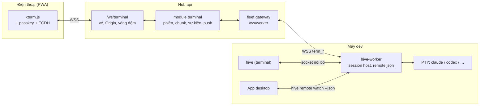
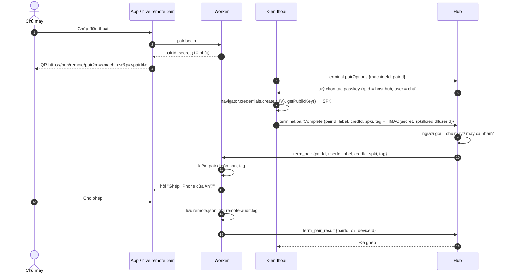
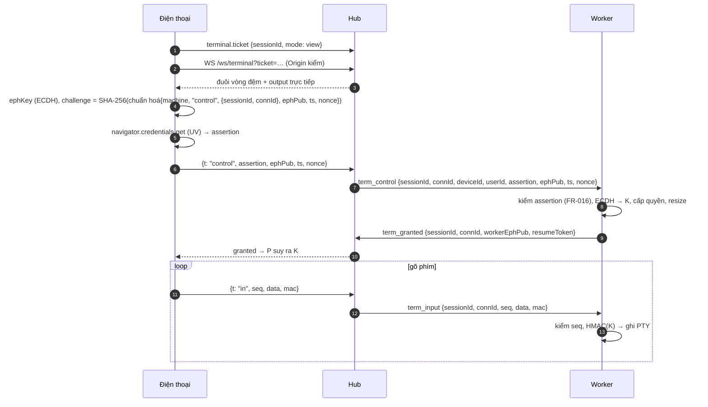

# Implementation Plan: CLI `hive` và điều khiển agent từ xa qua web trên điện thoại

**Branch**: `010-hive-cli-remote` | **Date**: 2026-10-13 | **Spec**: [spec.md](spec.md) | **ADR**:
[0019](../../docs/adr/0019-hive-cli-and-remote-sessions.md)

**Input**: Feature specification from `/specs/010-hive-cli-remote/spec.md`

## Summary

Thêm binary `hive` (Go, cùng module với worker) để mở phiên agent CLI **tương tác** trên máy. Worker giữ PTY của phiên,
chọn tài khoản theo `accounts.json` và ghi output lên hub qua kênh WSS sẵn có. Điện thoại vào cùng PTY qua web của hub
(PWA): điện thoại → hub `/ws/terminal` → WSS → worker → PTY. Điều khiển từ xa mặc định tắt và chỉ bật được tại máy.
Điện thoại phải được ghép tại máy bằng passkey. Worker tự kiểm assertion WebAuthn cho mỗi lần mở phiên hay xin quyền gõ,
và kiểm HMAC trên từng gói nhập, nên hub chỉ chuyển tiếp: hub bị chiếm cũng không mở được phiên hay gõ được vào máy.

## Technical Context

**Language/Version**: Go 1.27 (worker, `hive`), TypeScript 7 (hub, contracts, web, desktop UI), Rust (Tauri 2.12)

**Primary Dependencies**:

- Go mới: `aymanbagabas/go-pty` 0.2 (PTY, ConPTY; đã chọn trong decisions.md), `zalando/go-keyring` (keychain),
  `golang.org/x/term` (raw mode; module `x` đã dùng), `rsc.io/qr` hoặc tương đương nhỏ để in QR trong terminal.
- Go có sẵn: `coder/websocket`, `crypto/ecdh`, `crypto/ecdsa`, `crypto/hkdf`.
- Web mới: `@xterm/xterm` + `@xterm/addon-fit` (+ `addon-webgl` nếu đo thấy cần), `vite-plugin-pwa` 2.0 (đã có trong
  decisions.md).
- Hub mới: `web-push` (VAPID). WebAuthn phía web dùng API gốc `navigator.credentials`, không thêm thư viện.

**Storage**: PostgreSQL 18 (module mới `terminal`, RLS bật và ép); tại máy `remote.json`, `remote-audit.log`,
`terminal/<session>/pending/*` cạnh `worker.json`.

**Testing**: `go test` (PTY với CLI giả, kiểm assertion bằng vector tạo từ WebCrypto, socket nội bộ), Vitest
(`*.test.ts`, `*.db.test.ts`), Playwright (web 360 px, virtual authenticator, service worker), Vitest + Testing Library
(desktop), e2e `scripts/e2e-*.ts` với hub thật + worker thật + CLI giả.

**Target Platform**: worker/`hive` trên macOS, Linux, Windows (amd64, arm64); web trên Safari iOS 16.4+, Chrome/Edge
Android, trình duyệt máy tính; desktop macOS/Windows/Linux.

**Project Type**: modular monolith + web + desktop + worker

**Performance Goals**: SC-002 (độ trễ phím), SC-003 (≤ 2 s vào phiên), SC-008 (50 phiên × 3 người xem).

**Constraints**: tương thích ngược hai chiều của giao thức (SC-010); không tăng `PROTOCOL_VERSION`; hub không có đường
nào bật từ xa hay thêm thiết bị (FR-012); không vòng import giữa module hub.

## Constitution Check

- [x] **Contract first**: gói `term_*` trong `worker-protocol.ts` + fixture dùng chung; route `terminal.*` trong
      `packages/contracts/src/terminal.ts`; `pnpm openapi`.
- [x] **Tenant isolation**: bảng mới qua `withTenant()`, RLS bật và ép, thêm vào `rls.db.test.ts` của module.
- [x] **Module boundaries**: module mới `terminal`; `fleet/gateway.ts` chuyển gói `term_*` qua handler tiêm từ `main.ts`
      (như cách gateway gọi `runs`), `terminal` chỉ import `fleet`, `tasks`, `tenancy`, `audit`, `notify` qua `index.ts`.
- [x] **Tested before merged**: test tấn công cho SC-001 là điều kiện merge của làn bảo mật.
- [x] **Secure by default**: tắt mặc định, bật chỉ tại máy, passkey + HMAC kiểm ở worker, audit hai nơi.
- [x] **Vietnamese for people**: chữ giao diện, lỗi CLI, thông báo tiếng Việt; desktop có từ điển vi/en.
- [x] **Simple to self-host**: không thêm dịch vụ; khoá VAPID sinh lần đầu và lưu mã hoá bằng khoá chủ.

## Quyết định thiết kế

| # | Câu hỏi | Quyết định | Lý do |
|---|---|---|---|
| D1 | `hive` là lệnh con của `hive-worker` hay binary riêng? | **Binary riêng** `worker/cmd/hive`, cùng module, cùng gói phát hành đã ký; `hive-worker update` thay cả hai; app kèm cả hai làm sidecar. | `hive-worker run` đã là "chạy daemon", trùng tên với `hive run`; tên ngắn cho dùng hằng ngày; help của người dùng không lẫn cờ daemon. Cùng module nên dùng chung `internal/accounts`, `internal/config`, kiểu giao thức; cùng gói nên không lệch phiên bản. Bỏ binary đa tên vì symlink trên Windows cần quyền và sidecar Tauri cần file riêng (ADR 0019). |
| D2 | Ai giữ PTY? | **Worker**. `hive` là client qua socket nội bộ. | Chỉ worker có kết nối WSS (machine token) tới hub; phiên sống qua việc đóng terminal (như tmux); điện thoại và terminal đi cùng một đường; bộ chọn tài khoản đếm chung phiên và run. |
| D3 | Lưu phiên ở đâu trên hub? | **Module mới `terminal`**, bảng riêng; không dùng `runs`. | `runs.project_id` bắt buộc; run có lease, attempt, chính sách kết quả, `runs_task_active` — đều không hợp với phiên người gõ. Phiên chỉ trỏ tới dự án/task. |
| D4 | Trình duyệt nối hub bằng gì? | **WebSocket `/ws/terminal`** (khung nhị phân cho output, JSON cho điều khiển), vé dùng một lần 60 s, kiểm `Origin`. | Cần hai chiều, giữ thứ tự, chi phí mỗi phím thấp. SSE + POST mỗi phím không giữ thứ tự và tốn. Vé tránh CSWSH và tránh dựa vào cookie trong WS. |
| D5 | Xác thực khi mở phiên/xin quyền | **Passkey của thiết bị đã ghép, worker kiểm**. | Hub bị chiếm hoặc phiên web bị đánh cắp không đủ để có shell trên máy dev. UV (Face ID, vân tay, mã máy) là bước thứ hai; passkey không xuất được. |
| D6 | Ghép thiết bị chống hub đổi khoá | Bí mật ghép trong **fragment** của URL QR (không tới hub), điện thoại gửi HMAC(bí mật, SPKI‖credId‖userId); chủ máy bấm Cho phép tại máy. | Hub không biết bí mật nên không thay được khoá; bấm tại máy chứng minh ý định. Dùng `getPublicKey()` (SPKI) nên worker không cần CBOR. |
| D7 | Chống hub chèn phím | ECDH P-256 (khoá tạm của điện thoại nằm trong yêu cầu đã ký) + HKDF → khoá HMAC; gói nhập có `seq` và HMAC 16 byte. | Hub thay khoá tạm của worker gửi về điện thoại chỉ làm hỏng HMAC (từ chối dịch vụ), không chèn được. Output vẫn để hub đọc để ghi và phát nhiều người xem. |
| D8 | Phát lại khi vào phiên | Hub giữ **bộ đệm vòng 512 KiB** mỗi phiên trong bộ nhớ; thiếu thì đọc `terminal_chunks`. Không dựng màn hình ở worker. | TUI (Claude Code dùng Ink) vẽ lại khi đổi kích thước; phát lại đuôi + đổi kích thước là đủ. Không thêm bộ giả lập VT trong Go. |
| D9 | Băng thông | Worker gom 8 ms / 32 KiB; hub cắt luồng trực tiếp 512 KiB/s mỗi người xem, 2 MiB/s mỗi máy; client chậm (đệm > 1 MiB) nhận "đồng bộ lại". Bản ghi luôn đủ. | Một lệnh in nhiều không làm nghẽn kênh worker (chung với run) hay điện thoại 4G. |
| D10 | Tài khoản cho phiên | `Pool.Acquire(cli, "interactive")`: bỏ tài khoản tắt/chưa đăng nhập; đang nghỉ chỉ khi `--force`; **không** áp ngưỡng dừng; phiên tính là đang dùng. | Ngưỡng dừng (spec 008 FR-031) là phần để dành cho chủ dùng tay; phiên tương tác chính là phần đó. Tính đang dùng để run tránh tài khoản đang có người gõ. |
| D11 | Báo "agent cần bạn" | Claude: hook `Notification` gọi `hive __hook attention` (qua socket nội bộ) → `term_event{attention}`. CLI khác: có output rồi im 60 s → `idle`. | Hook là tín hiệu chính xác; hook của Hive đã có (`runner/hooks.go`). Cách đoán theo im lặng chỉ là dự phòng. |
| D12 | Đăng nhập CLI | Luồng loopback PKCE của app với `purpose: "cli"` (chỉ cấp token cá nhân, client `xdev-hive-cli`) hoặc `--with-token`; lưu keychain. Token **không** cần cho `hive run` (worker ghi bằng danh tính máy); cần cho `--task`, `hive attach <run>`, xem phiên máy khác. | Dùng lại `desktop-connect` đã kiểm; không cấp mã đăng ký máy cho CLI. |
| D13 | Máy dùng chung, runner host | `hive run` chạy tại máy nhưng không ghi, không từ xa. | Không biết người gõ ở máy dùng chung là ai; ADR 0017 chỉ cho máy cá nhân dùng gói của chủ. |
| D14 | Tương thích giao thức | `hello.capabilities += "terminal"`; `welcome.features?: string[]`, `welcome.owner?: {userId, shared}`; mỗi bên chỉ gửi `term_*` khi bên kia khai. | Hub cũ đóng 4400 với gói lạ; worker cũ bỏ qua gói lạ nhưng không hiểu. Không tăng `PROTOCOL_VERSION`. |

## Kiến trúc



### Luồng: phiên tại máy (`hive chat`)

```mermaid
sequenceDiagram
  autonumber
  actor D as Dev
  participant C as hive
  participant W as Worker
  participant H as Hub
  D->>C: hive chat --task PAY-12
  C->>H: tasks.get (token cá nhân) → taskId, projectId
  C->>W: session.create {cli, cwd, cols, rows, taskId}
  W->>W: Pool.Acquire(cli, interactive), mở PTY
  W-->>C: {sessionId} rồi luồng khung (output/input/resize)
  W->>H: term_opened {sessionId, origin: local, …}
  H->>H: kiểm chủ máy, task; tạo terminal_sessions
  loop output
    W->>H: term_output {offset, bytes}
    H-->>W: term_ack {upto}
  end
  D->>C: /exit
  W->>H: term_exit {code}
```

### Luồng: ghép điện thoại



### Luồng: điều khiển từ điện thoại



## Giao thức

Thêm vào `packages/contracts/src/worker-protocol.ts`, đối chiếu kiểu Go trong `worker/internal/channel/protocol.go` và
fixture `packages/contracts/fixtures/worker-protocol.json`. Mọi gói dùng `envelope` hiện có. `bytes`/`data` là base64.

| Hướng | Gói | Trường chính | Ghi chú |
|---|---|---|---|
| W → H | `hello` (thêm) | `capabilities` có `terminal` | Worker cũ không gửi |
| H → W | `welcome` (thêm) | `features?: ["terminal"]`, `owner?: {userId, shared}` | Worker đổi chủ → xoá thiết bị |
| W → H | `term_state` | `enabled`, `roots[{id, label}]`, `clis[]`, `accounts[{id, label, cli, state}]`, `devices[{id, label, userId, synced}]`, `sessions[{id, origin, controller}]`, `confirmOnMachine` | Sau `welcome` và khi đổi; không gửi đường dẫn tuyệt đối của root, chỉ nhãn |
| W → H | `term_opened` | `sessionId`, `requestId?`, `origin`, `cli`, `accountLabel`, `cwdLabel`, `projectId?`, `taskId?`, `cols`, `rows`, `record`, `remote` | Phiên tại máy và phiên từ xa |
| W → H | `term_denied` | `requestId`, `code`, `reason` | `REMOTE_DISABLED`, `ROOT_ESCAPE`, `ROOT_MISSING`, `ASSERTION_*`, `CONFIRM_DENIED`, `CONFIRM_TIMEOUT`, `ACCOUNT_*`, `CLI_MISSING` |
| W → H | `term_output` | `sessionId`, `offset`, `bytes` (≤ 32 KiB) | Lưu đĩa tới khi `term_ack` |
| W → H | `term_event` | `sessionId`, `seq`, `event` (`attention`, `idle`, `controller`, `resize`, `gap`, `input_rejected`, `viewer`), `data` | Enum riêng, không đụng `runEventKind` |
| W → H | `term_granted` / `term_revoked` | `sessionId`, `connId`, `workerEphPub`, `resumeToken` / `reason` | |
| W → H | `term_exit` | `sessionId`, `exitCode`, `reason`, `by?` | |
| W → H | `term_pair_result` | `pairId`, `ok`, `deviceId?`, `reason?` | |
| H → W | `term_start` | `requestId`, `userId`, `deviceId`, `cli`, `accountId?`, `rootId`, `subdir?`, `model?`, `projectId?`, `taskId?`, `prompt?`, `cols`, `rows`, `auth{assertion, ephPub, ts, nonce}` | `params` của challenge là các trường này theo thứ tự cố định |
| H → W | `term_control` | `sessionId`, `connId`, `userId`, `deviceId`, `auth{…}` hoặc `resumeToken` | |
| H → W | `term_input` | `sessionId`, `connId`, `seq`, `data` (≤ 4 KiB), `mac` | |
| H → W | `term_resize` | `sessionId`, `connId`, `cols`, `rows`, `seq`, `mac` | |
| H → W | `term_detach` | `sessionId`, `connId` | |
| H → W | `term_ack` | `sessionId`, `upto` (offset) | |
| H → W | `term_close` | `sessionId`, `by`, `reason` | Chủ phiên, quản trị đội |
| H → W | `term_disable` | `by` | Chỉ tắt; không có gói bật |
| H → W | `term_pair` | `pairId`, `userId`, `label`, `credentialId`, `spki`, `tag` | |
| H → W | `term_device_revoke` | `deviceId`, `by` | |

**Chuẩn hoá challenge**: JSON theo thứ tự khoá cố định, không khoảng trắng, chuỗi UTF-8 NFC; hàm viết một lần trong
contracts (`terminal-auth.ts`) và một lần trong Go (`internal/remoteauth`), cùng đọc vector trong
`packages/contracts/fixtures/terminal-auth.json` (sinh bằng WebCrypto trong test, gồm assertion thật từ virtual
authenticator).

**Giới hạn**: `term_output` 32 KiB; `term_input` 4 KiB; tối đa 8 phiên ghi lên hub mỗi máy; mỗi phiên tối đa 16 kết
nối xem từ xa, trong đó tối đa 4 kết nối của người khác chủ (chế độ `team`).

## Socket nội bộ (worker ↔ `hive`, app)

- Đường dẫn: `<UserConfigDir>/xdev-hive/run/hive.sock` (thư mục 0700, socket 0600; kiểm `SO_PEERCRED`/`LOCAL_PEERCRED`
  bằng UID của worker). Windows: `\\.\pipe\xdev-hive-<SID>` với DACL chỉ SID hiện tại, kiểm SID của client.
- Bắt tay: `{"op":"hello","v":1,"client":"hive/0.x"}` → `{"ok":true,"v":1,"worker":"0.x"}`; khác `v` thì CLI báo "Phiên
  bản hive và hive-worker khác nhau. Chạy `hive-worker update`.".
- Yêu cầu JSON một dòng: `session.create`, `session.list`, `session.attach{id, mode}`, `session.kill`, `remote.status`,
  `remote.enable`, `remote.disable`, `remote.roots.add|remove`, `remote.devices.remove`, `remote.settings`,
  `remote.pair.begin`, `remote.pair.decide`, `remote.confirm.decide`, `watch` (luồng sự kiện cho app: yêu cầu ghép, yêu
  cầu xác nhận, phiên, trạng thái), `hook` (cho `hive __hook`).
- Sau `session.attach` kết nối chuyển sang khung nhị phân `[loại u8][độ dài u32][dữ liệu]`: `out`, `in`, `resize`,
  `ctl` (JSON: giành quyền, bị giành, thoát).
- Chỉ người dùng hệ điều hành của worker kết nối được; đây là ranh giới "tại máy" của FR-012.

## Lệnh `hive`

| Lệnh | Việc |
|---|---|
| `hive login [--hub URL] [--with-token]`, `logout`, `whoami` | Token cá nhân (D12) |
| `hive chat [--cli] [--account] [--model] [--task KEY \| --project KEY] [--no-record] [--no-remote] [--force]` | Phiên tương tác (US1) |
| `hive run "<lời nhắc>" [cờ như chat]` | Như chat, gửi lời nhắc làm câu đầu |
| `hive ls [--all] [--json]` | Phiên trên máy (+ run gần đây của tôi khi đã đăng nhập) |
| `hive attach <id> [--escape KEY]` | Phiên trên máy / run (log + chỉ dẫn) / phiên máy khác (chỉ xem) |
| `hive kill <id>` | Ngắt phiên trên máy |
| `hive remote on\|off\|status`, `remote roots add <dir> [--label] \| rm <id>`, `remote devices [rm <id>]`, `remote pair`, `remote set <khoá> <giá trị>`, `remote watch --json` | US2, US5; `watch` cho app |
| `hive version` | Phiên bản `hive` và worker |
| `hive __hook <loại>` | Ẩn; hook của CLI gọi |

Mã thoát: 0 xong, 1 lỗi của agent/phiên, 2 dùng sai hoặc thiếu điều kiện (chưa đăng nhập, worker chưa chạy), 3 bị từ
chối quyền.

## Hub

**Module `terminal`** (`apps/hub/src/modules/terminal/`):

- `schema.ts`:
  - `terminal_sessions`: `id`, `org_id`, `team_id`, `machine_id`, `owner_user_id`, `origin`, `cli`, `account_label`,
    `cwd_label`, `project_id?`, `task_id?`, `visibility`, `state`, `cols`, `rows`, `exit_code?`, `end_reason?`,
    `bytes`, `started_at`, `ended_at`
  - `terminal_chunks(session_id, org_id, offset, bytes)`, khoá chính `(session_id, offset)`
  - `terminal_events(id, session_id, org_id, seq?, kind, data, actor_user_id?, device_id?, at)`
  - `remote_devices(id, org_id, machine_id, user_id, label, synced, created_at, last_used_at, revoked_at)`
  - `push_subscriptions(id, org_id, user_id, endpoint, p256dh, auth, device_label, created_at)`
  - `machine_remote_state(machine_id, org_id, enabled, roots jsonb, accounts jsonb, updated_at)` (từ `term_state`, để
    điện thoại thấy khi máy offline)

  Mọi bảng `orgScoped`, RLS ép. Migration số kế tiếp lúc làm (sau migration của spec 009).
- `gateway.ts`: handler `onWorkerPacket(machine, packet)` cho mọi gói `term_*`, do `fleet/gateway.ts` gọi qua deps tiêm
  ở `main.ts`; `send(machineId, packet)` dùng hàm gửi có sẵn của fleet.
- `live.ts`: bộ đệm vòng, danh sách kết nối, người điều khiển, giới hạn băng thông, nối lại theo offset.
- `ws.ts`: `/ws/terminal` (vé, `Origin` bằng `HIVE_PUBLIC_URL`, đóng 4401/4403/4404/4429).
- `record.ts`: gộp chunk (64 KiB hoặc 1 s) rồi ghi, ack worker sau khi ghi; hàm `hive.purge_terminal_chunks()` theo số
  ngày lưu log của chính sách agent (cùng cron `retention.ts`).
- `pairing.ts`, `devices.ts`, `push.ts` (VAPID; khoá sinh lần đầu, mã hoá envelope bằng khoá chủ), `router.ts`, `index.ts`.

**Route oRPC `terminal.*`** (contracts `terminal.ts`):

| Route | Ai | Việc |
|---|---|---|
| `machines` | người dùng | Máy của tôi: online, `remote` (bật, roots nhãn, CLI, tài khoản), phiên đang chạy |
| `list`, `get`, `chunks` | chủ phiên; đội khi `team` | Danh sách, chi tiết, đọc bản ghi theo offset (phân trang) |
| `ticket` | như `get` | Vé WS dùng một lần 60 s (`view`); quyền gõ xin trong WS |
| `start` | chủ máy | Chuyển `term_start`; trả `requestId`, kết quả qua `get`/WS |
| `close` | chủ phiên, quản trị đội | `term_close` |
| `setVisibility` | chủ phiên | `private`/`team` |
| `disableRemote` | chủ máy, quản trị đội | `term_disable` |
| `pairOptions`, `pairComplete` | chủ máy | Ghép (FR-014) |
| `devices`, `revokeDevice` | chủ máy | Danh sách, gỡ |
| `pushKey`, `pushSubscribe`, `pushUnsubscribe` | người dùng | Web Push |

`desktop-connect` thêm `purpose: "desktop" | "cli"` (mặc định `desktop`); `cli` chỉ trả token cá nhân với client
`xdev-hive-cli`, audit `cli.connect.exchange`.

**Quyền**: kiểm ở hub (người gọi = `machines.registered_by`, `shared = false`, `kind = worker`, máy online, có
`terminal`), và kiểm lần nữa ở worker (thiết bị, người dùng, assertion). Audit `terminal.remote_enable|remote_disable|
root_add|root_remove|pair|pair_denied|device_revoke|open|deny|attach|detach|control_grant|control_revoke|control_take|
resize|input_rejected|close|exit|visibility`. Gói từ worker về trạng thái tại máy (bật, root, ghép) được hub ghi audit với
`actor = chủ máy`, `data.source = "machine"`.

## Web

- Trang mới dưới `apps/web/src/pages/remote/`: `remote-page.tsx` (máy và phiên), `session-page.tsx` (terminal),
  `new-session-sheet.tsx`, `pair-page.tsx`, `devices-page.tsx`.
- `lib/terminal/`: `ws-client.ts` (vé, nối lại theo offset, hàng đợi nhập), `webauthn.ts` (tạo/dùng passkey, chuẩn hoá
  challenge từ contracts), `input-mac.ts` (ECDH, HKDF, HMAC bằng WebCrypto), `keys.ts` (thanh phím: Esc, Tab, Ctrl giữ,
  Alt, ↑↓←→, Ctrl-C, Ctrl-D, `/`, Enter; ô soạn dòng), `push.ts`.
- `components/terminal-view.tsx`: xterm.js + fit; ở 360 px giữ tối thiểu 40 cột (cỡ chữ 11–14 px), terminal cuộn trong
  khung, trang không cuộn ngang; tắt OSC 52; link cần chạm xác nhận; tải lười (route lazy) để không tăng gói chính.
- PWA: `vite-plugin-pwa` (manifest `xDev Hive`, icon 192/512 và maskable, `display: standalone`, `start_url: /remote`,
  `scope: /`); service worker `injectManifest` chỉ đệm vỏ ứng dụng, mạng trước cho mọi `/rpc`, `/api`, `/ws`; xử lý
  `push` và `notificationclick` (mở `/remote/sessions/<id>`). Nút "Cài lên màn hình chính" và hướng dẫn riêng cho iOS.
- Trang task: mục "Phiên tương tác" (danh sách phiên gắn task, link).
- CSP: thêm `connect-src` cho `wss:` cùng origin; không `unsafe-eval` (xterm không cần).

## App desktop

- Màn mới `remote-screen.tsx` trong AppNav (mục "Điều khiển từ xa"), từ điển vi/en.
- Rust `remote.rs`: chạy sidecar `hive remote watch --json` (đọc sự kiện từng dòng), lệnh `remote_*` gọi
  `hive remote … --json` (cùng cách `profiles.rs` gọi `hive-worker accounts`); hộp xác nhận ghép và "Hỏi trên máy" là cửa
  sổ của app (hiện cả khi app đang ẩn), thông báo bằng `tauri_plugin_notification`.
- Khay: mục "Tắt điều khiển từ xa ngay" khi đang bật; biểu tượng khay có chấm khi có người điều khiển từ xa.
- `tauri.conf.json`: thêm `hive` vào `externalBin`; capability chỉ cho cửa sổ app cục bộ (ADR 0016), cửa sổ web hub không
  có quyền gọi lệnh `remote_*`.
- Mục "Cài lệnh hive vào PATH": macOS/Linux tạo symlink trong `~/.local/bin` (báo thêm PATH nếu thiếu); Windows thêm thư
  mục sidecar vào PATH người dùng.

## Bảo mật

### Bất biến

1. Chỉ người ở máy (người dùng hệ điều hành của worker) bật được từ xa, thêm thư mục, ghép thiết bị.
2. Mở phiên từ xa và gõ phím từ xa cần passkey có UV của thiết bị đã ghép, worker kiểm; hub không giả được.
3. Chỉ chủ máy (máy cá nhân) điều khiển; người khác tối đa chỉ xem khi chủ cho.
4. Từ xa chỉ mở agent CLI trong danh sách, trong thư mục được phép; không shell, không đối số tự do.
5. Tắt luôn có hiệu lực ngay, từ máy hoặc từ web; bật chỉ tại máy.

### Phân tích mối đe doạ (ngắn)

| # | Kẻ tấn công / tình huống | Muốn | Chặn bằng | Còn lại |
|---|---|---|---|---|
| T1 | Đánh cắp cookie web hoặc token cá nhân của chủ | Mở phiên, gõ lệnh | Passkey + UV kiểm ở worker (FR-016) | Xem output và bản ghi của chủ; ngắt phiên; tắt từ xa |
| T2 | Hub bị chiếm, người vận hành hub xấu, ghi thẳng DB | Như trên trên mọi máy | Như T1; không có gói bật/ghép; HMAC trên gói nhập (FR-017); bí mật ghép không qua hub (FR-014) | Đọc output; giả output hiển thị; từ chối dịch vụ |
| T3 | Đồng nghiệp cùng đội | Chiếm phiên, dùng gói của chủ | Hub kiểm chủ máy; worker kiểm `userId` của thiết bị; một người điều khiển | Xem khi chủ bật "Cho đội xem" |
| T4 | Mất điện thoại | Dùng passkey | UV (sinh trắc/mã); gỡ thiết bị tại máy hoặc web; thu quyền ngay | Passkey đồng bộ còn trên thiết bị khác cùng tài khoản nền tảng — gỡ thiết bị là gỡ khoá |
| T5 | Phát lại assertion, gói nhập | Lặp thao tác | `nonce` + `ts` ±120 s + `signCount`; `seq` tăng nghiêm ngặt | — |
| T6 | Trang độc mở WS tới hub (CSWSH) | Xem phiên | Vé một lần qua oRPC (cần phiên + CSRF của oRPC), kiểm `Origin` | — |
| T7 | XSS trên web hub | Gõ qua trang đang có quyền | CSP chặt; xterm hiển thị chữ; khoá K chỉ trong bộ nhớ trang; quyền hết khi không gõ 15 phút | XSS trong lúc có quyền gõ là nguy hiểm — giữ CSP và review code web như phần bảo mật |
| T8 | Thoát thư mục | Đọc `~/.ssh`, `~/.aws` | Root theo id, `subdir` tương đối, giải symlink, kiểm tiền tố (FR-018) | Agent tự đọc file ngoài thư mục nếu CLI cho phép — theo mức quyền CLI |
| T9 | Prompt injection khiến agent chạy lệnh | Lệnh nguy hiểm | Phiên từ xa ở chế độ hỏi quyền (FR-019); người gõ duyệt từng lệnh | Như dùng agent tại máy |
| T10 | Lộ token qua terminal | Lấy machine token, PAT | Env theo danh sách cho phép; che giá trị đã biết trong output (FR-010) | Bí mật khác agent in ra nằm trong bản ghi (riêng tư mặc định, xoá theo hạn) |
| T11 | Chuỗi điều khiển trong output | Ghi clipboard, mở link | Tắt OSC 52, link cần xác nhận | — |
| T12 | Làm ngập băng thông | Nghẽn kênh worker/hub | Gom, giới hạn, bỏ khung, đồng bộ lại (D9) | — |
| T13 | Tiến trình khác của người dùng khác trên máy | Dùng socket nội bộ | Quyền file 0600/DACL, kiểm UID/SID | Tiến trình độc của chính người dùng đó vốn đã có mọi quyền |
| T14 | Sửa audit để giấu dấu vết | Che việc đã làm | `audit_log` append-only ở hub; `remote-audit.log` tại máy độc lập với hub | — |

## Hiệu năng, độ trễ, nối lại

- Đường phím: điện thoại → hub (1 khung WS) → worker (1 gói WSS) → PTY; echo đi ngược lại. Hub chuyển tiếp ngay trong
  tiến trình, không qua DB hay NOTIFY; ghi DB đi đường riêng sau.
- Worker gom output 8 ms/32 KiB; hub không gom output trực tiếp.
- Nối lại phía điện thoại: client giữ `lastOffset`; WS mới gửi `{t: "resume", offset, resumeToken?}`; hub gửi từ vòng
  đệm hoặc DB; có `resumeToken` còn hạn (2 phút) thì worker cấp lại quyền với khoá K cũ, `seq` tiếp tục.
- Nối lại phía worker: như run hiện nay (gửi lại phần chưa ack); quyền từ xa bị thu khi mất kết nối hub quá 2 phút.
- Heartbeat WS trình duyệt 20 s; Safari iOS đóng WS khi ẩn trang — nối lại khi trang hiện lại (`visibilitychange`).

## Project Structure

### Documentation

```text
specs/010-hive-cli-remote/
├── spec.md
├── plan.md
└── tasks.md
docs/adr/0019-hive-cli-and-remote-sessions.md
docs/srs.md                         # mục 3.19 RMT-01 … RMT-12, IF-07, NFR-17
```

### Source Code

```text
packages/contracts/
├── src/worker-protocol.ts          # + term_* packets, welcome.features/owner, hello capability "terminal"
├── src/terminal.ts                 # MỚI: route terminal.*, kiểu phiên, mã lỗi, khung WS trình duyệt
├── src/terminal-auth.ts            # MỚI: chuẩn hoá challenge, kiểu assertion (dùng chung web và test)
├── src/desktop-connect.ts          # + purpose cli
├── fixtures/worker-protocol.json   # + mẫu term_*
├── fixtures/terminal-auth.json     # MỚI: vector assertion/HMAC dùng chung TS và Go
└── openapi.json

worker/
├── cmd/hive/                       # MỚI: main.go, login.go, chat.go, attach.go, ls.go, remote.go, hook.go, term_*.go
├── internal/pty/                   # MỚI: bọc go-pty (unix, windows)
├── internal/localipc/              # MỚI: server/client socket nội bộ, kiểm UID/SID, khung
├── internal/remoteauth/            # MỚI: remote.json, WebAuthn ES256, challenge, nonce, ECDH/HKDF/HMAC, ghép
├── internal/terminal/              # MỚI: session host, quản lý client và người điều khiển, ghi, hết giờ, audit tại máy
├── internal/accounts/accounts.go   # + vai trò interactive
├── internal/channel/{protocol.go,channel.go}  # + gói term_*, chuyển cho internal/terminal
└── cmd/hive-worker/main.go         # mở socket nội bộ, nối terminal vào channel

apps/hub/src/modules/terminal/      # MỚI (xem mục Hub)
apps/hub/src/modules/fleet/{gateway.ts,desktop-connect.ts}
apps/hub/src/{main.ts,app.ts}
apps/hub/db/migrations/00NN_terminal.sql

apps/web/src/pages/remote/**, apps/web/src/lib/terminal/**, apps/web/src/components/terminal-view.tsx,
apps/web/vite.config.ts, apps/web/src/sw.ts, apps/web/public/icons/**, apps/web/e2e/remote*.spec.ts

apps/desktop/src/screens/remote-screen.tsx, apps/desktop/src-tauri/src/remote.rs, tray_icon.rs, lib.rs,
apps/desktop/src-tauri/tauri.conf.json, capabilities/*.json

worker/.goreleaser.yaml (build thứ hai `hive`, cùng archive và checksums.txt), .github/workflows/release.yml,
scripts/install.sh, scripts/install.ps1, worker/internal/update/update.go, apps/desktop/scripts/build-sidecar.ts
scripts/e2e-remote.ts               # MỚI: hub thật + worker thật + CLI giả + trình duyệt
```

## Kiểm thử

- **Go**: PTY với CLI giả (echo, in nhiều, đổi kích thước, thoát); socket nội bộ (UID khác bị từ chối — test bằng
  `SO_PEERCRED` giả qua interface); `remoteauth` với vector từ virtual authenticator (đúng, sai origin, sai rpId, thiếu
  UV, phát lại, lệch giờ, signCount lùi, khoá lạ); ghép (tag sai, hết hạn, người dùng khác); HMAC nhập (sai, `seq` lùi);
  tắt từ xa; thoát thư mục qua `..` và symlink; bộ chọn tài khoản `interactive`.
- **Hub DB**: RLS; chủ máy/máy dùng chung/runner host/người khác; ghi và loại trùng chunk; vòng đệm và nối lại; vé dùng
  một lần, sai `Origin`; người xem gửi nhập → 4403; audit đủ (SC-006); purge theo hạn; `desktop-connect` `purpose: cli`.
- **Tương thích**: `fleet.db.test.ts` với worker giả không khai `terminal` → không có gói `term_*`; worker Go với hub giả
  không có `features` → không gửi `term_*` (SC-010).
- **Playwright**: 360×740, virtual authenticator, ghép (với worker giả trong `fake-hub.ts`), mở phiên, điều khiển, ô
  soạn tiếng Việt, mất mạng, tắt từ xa, PWA manifest + service worker + push giả.
- **e2e** `scripts/e2e-remote.ts`: hub + worker + CLI giả + Chromium; đo SC-002, SC-003, SC-005.
- **Desktop**: màn Điều khiển từ xa với `hive remote watch` giả; hộp xác nhận; khay.
- **Bảo mật**: chạy `/security-review` trên các PR làn bảo mật; review tay bởi người thứ hai cho `remoteauth`.

## Triển khai dần

1. Phát hành worker + `hive` có ghi phiên tại máy (US1) — không có gì từ xa; hub mới khai `features`.
2. Bật ghép và điều khiển phiên có sẵn (US2, US3, US5) sau cờ hub `HIVE_REMOTE_TERMINAL=1` (mặc định tắt) để thử nội bộ.
3. Mở phiên từ xa (US4), PWA + đẩy (US7), xem cùng (US8).
4. Bỏ cờ sau một tuần thử nội bộ không có sự cố bảo mật.
