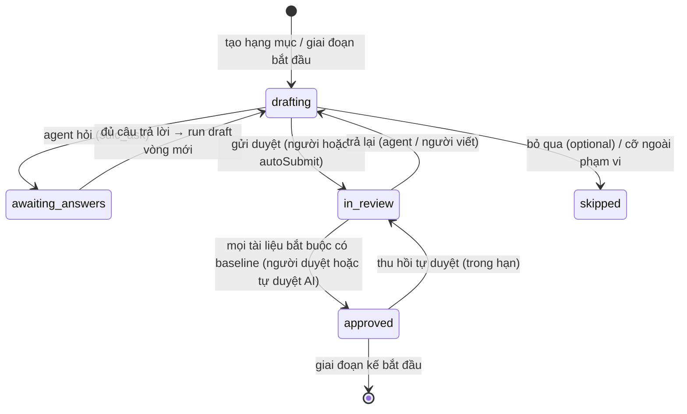

# Implementation Plan: Chế độ AI SDLC

**Branch**: `011-ai-sdlc-mode` | **Date**: 2026-10-13 | **Spec**: [spec.md](spec.md) | **ADR**:
[0021](../../docs/adr/0021-ai-sdlc-mode.md)

**Input**: Feature specification from `/specs/011-ai-sdlc-mode/spec.md`

## Summary

Thêm module hub `sdlc` điều phối **hạng mục** đi qua các giai đoạn của một **chế độ** mô tả bằng dữ liệu. Tái dùng tối
đa: tài liệu và editor (spec 005) làm nơi soạn; quy trình duyệt (spec 004) làm cổng của giai đoạn; `doc_versions` làm
baseline; `GitProvider.commitFiles`/`openPR` (đã dùng cho skill repo, spec 006) để ghi tài liệu vào repo; task + run code
+ review code (spec 009) + hàng merge để làm code. Thêm mới: loại run `sdlc` (agent soạn, ghi file trong worktree tạm, không
đẩy), MCP `sdlc_ask`/`sdlc_report`/`sdlc_context`, phụ thuộc và checklist của task, cổng chặn trong `queueRun`, nhãn máy và
lọc run, tóm tắt tài khoản CLI trong heartbeat. Màn dùng chung web/app trong package mới `@xdev-hive/sdlc-ui`.

Quyết định của PO ngày 2026-10-13 (spec "Clarifications") thêm ba phần vào thiết kế:

- **Hạng mục nhiều dự án** (D19–D24): bảng `sdlc_item_projects`; tài liệu chung ở dự án chính; task gắn một dự án; phụ
  thuộc liên dự án; cổng "theo dự án"; contract liên repo; chặn, đợt, đồng bộ, truy vết theo dự án; quyền kiểm trên từng
  dự án bằng một bộ lọc chung.
- **Tự duyệt AI** (D25, D26): hook `autoDecide` trong máy trạng thái duyệt của `knowledge`; điều kiện tính ở `sdlc`; chính
  sách tổ chức trong `agent_policies.policy.sdlc`; thu hồi mở phiên duyệt lại trên cùng baseline.
- **Q1, Q2 theo đề xuất**: đồng bộ bằng PR mỗi repo (D11), vai trò hệ thống `team-ba` (D27).

## Technical Context

**Language/Version**: TypeScript 7 (hub, contracts, web, desktop UI), Go 1.27 (worker)

**Primary Dependencies**: `@xdev-hive/contracts`, `@xdev-hive/doc-editor`, `@xdev-hive/ui`, Drizzle, zod 4, pg-boss, oRPC,
TanStack Query, `@xyflow/react` (đồ thị phụ thuộc, đã có trong web), Octokit/Gitbeaker qua `GitProvider`

**Storage**: PostgreSQL 18; bảng mới bật và ép RLS; migration `0068`

**Testing**: Vitest (`*.test.ts`, `*.db.test.ts` với Testcontainers), Playwright (web, hub giả), Vitest + Testing
Library (desktop), `go test` (worker)

**Target Platform**: hub Linux; web trình duyệt hiện đại; desktop macOS/Windows/Linux; worker macOS/Linux/Windows

**Project Type**: modular monolith + web + desktop + worker

**Performance Goals**: SC-004 (≤ 2 phút lên repo, ≤ 5 phút về hub), SC-007 (≤ 500 ms bảng, ≤ 300 ms câu hỏi), SC-008
(≤ 10 s câu hỏi hiện trên app/web)

**Constraints**: dự án không bật AI SDLC không đổi hành vi (SC-011); worker cũ chạy được (trường mới tuỳ chọn, loại run
mới qua capability); không vòng import giữa module (`pnpm deps`); không thêm dịch vụ ngoài PostgreSQL

## Constitution Check

- [x] **Contract first**: `packages/contracts/src/sdlc.ts` mới (chế độ, preset, hạng mục, route); mở rộng `tasks.ts`,
      `fleet.ts`, `runs.ts`, `workflows.ts`, `worker-protocol.ts`, `roles.ts`, `notify.ts`; `pnpm openapi`.
- [x] **Tenant isolation**: mọi bảng mới có `org_id`, qua `withTenant()`, RLS bật và ép; thêm vào `rls.db.test.ts`.
      Hạng mục nhiều dự án có thể trải nhiều đội; RLS vẫn chỉ tách tổ chức, phân quyền theo đội đi qua một bộ lọc chung
      `sdlc/access.ts` (D22) và có test DB riêng (SC-013).
- [x] **Module boundaries**: module mới `sdlc` import `knowledge`, `tasks`, `scm`, `notify`, `tenancy`, `governance` qua
      `index.ts`; **không** import `runs`, `codereview`, `leader`, `fleet`. `runs` import `sdlc` (cổng, kết luận run
      `sdlc`); hàm tạo run tiêm từ `main.ts` (như spec 009). `knowledge` nhận callback `onBaseline`, `workflowFor` tiêm từ
      `main.ts` (không import `sdlc`).
- [x] **Tested before merged**: unit cho schema chế độ, preset, bộ đọc `tasks.md`, đồ thị, gợi ý cỡ, độ phủ; DB test cho
      máy trạng thái hạng mục, cổng, đồng bộ, dispatch theo nhãn, RLS; Playwright và desktop test cho luồng MVP; Go test cho
      thu file, tóm tắt tài khoản, `account_set`.
- [x] **Secure by default**: cổng chặn ở hub; ngoại lệ cần quyền và lý do; đường dẫn repo bị kiểm; sửa trong repo không
      tự thành baseline; nhãn máy chỉ hub đặt; run `sdlc` không đẩy.
- [x] **Vietnamese for people**: chữ giao diện và lỗi tiếng Việt; từ điển vi/en cho app và package UI.
- [x] **Simple to self-host**: không thêm dịch vụ; job trên pg-boss.

## Hiện trạng tái dùng được

| Cần | Có sẵn | Thiếu / đổi |
|---|---|---|
| Soạn tài liệu | `docs`, `doc_versions`, `doc_drafts`, editor `packages/doc-editor`, `docEditor.submit` | Khung bên "Hạng mục" trong editor; agent ghi vào bản nháp (`docEditor` đã có `suggestions`) |
| Cổng duyệt | `knowledge/reviews.ts`: `startReview`, `advance`, `decideReview`, `finish` (baseline), SLA, Chờ tôi duyệt | Chọn cổng theo hạng mục thay `matchWorkflow`; callback khi baseline; luật `no-open-questions`, `breakdown`, `coverage`; hướng `agent` gọi run `sdlc` thay task chung |
| Ghi repo | `GitProvider.commitFiles`, `openPR`, `readFile`, `listFiles`, `branchHead`; mẫu `knowledge/skill-repo.ts` | Job đồng bộ tài liệu hạng mục; handler `push` |
| Webhook | `scm/handlers.ts` `onScmEvent(kind, handler)`, sự kiện `push`, `pull_request.merged` | Handler của `sdlc` |
| Task | `tasks`, `createSystemTask`, plan mode | `checklist`, `task_dependencies`, `blockedBy` |
| Run | `queueRun`, `dispatch`, `pickMachine`, `CAPABILITY_KINDS`, `SUBMIT_KINDS`, prompt dựng ở hub | Loại `sdlc`; cổng chặn; `required_labels`; prompt task hạng mục |
| Agent hỏi lại | MCP registry có `runKinds` | `sdlc_ask`, `sdlc_report`, `sdlc_context`; `task_update` thêm checklist, evidence |
| Review code | spec 009 (đã có ngữ cảnh spec qua T085) | Ngữ cảnh spec cho checkpoint AI (deps `specContextFor`) |
| Leader | `leaderAction` (`task.create`, `run.dispatch`…) | Hành động `sdlc.item.create` |
| Máy | `machines.shared`, `capabilities`, `bound_projects`; mã đăng ký | `labels`, `labels_only`, `accounts`; mã đăng ký mang nhãn/cờ; `account_set` |
| Màn | `packages/ui`, `packages/doc-editor`, `packages/code-review` (spec 009) | Package `packages/sdlc-ui` |
| Quyền đọc tài liệu | `knowledge/access.ts` `scopeOfDocKey`: key `project/<k>/…` chỉ đội của dự án đọc | Hook `docAccessFor` để thành viên các đội tham gia đọc và đề xuất tài liệu của hạng mục (D22) |
| Người duyệt theo đội | `reviewGate.reviewers.teams`, `roles` (`team-admin`, `team-member`) tính theo đội của tài liệu | Checkpoint tách theo đội của dự án tham gia (D21); vai trò `team-ba` (D27) |
| Quyết tự động ở cổng người | Không có (chỉ checkpoint `ai`, `rule`, `ext` tự chạy) | Hook `autoDecide` (D25) |
| Chính sách tổ chức | `governance` `agent_policies.policy` (jsonb, thêm mục không cần migration) | Mục `sdlc` (tự duyệt, sàn ngưỡng, danh sách nhạy cảm) |

## Quyết định thiết kế

| # | Câu hỏi | Quyết định | Lý do |
|---|---|---|---|
| D1 | Module mới hay mở rộng `knowledge`/`tasks`? | **Module mới `sdlc`** giữ hạng mục, giai đoạn, câu hỏi, bản tách, truy vết, đồng bộ repo, ngoại lệ. `tasks` thêm phụ thuộc và checklist (dùng chung, không biết `sdlc`). `knowledge` thêm hai điểm nối tiêm từ `main.ts`. | `knowledge/reviews.ts` đã lớn và chỉ biết tài liệu; `sdlc` cần Git, task, run. Module riêng giữ ranh giới như `codereview` (ADR 0018). |
| D2 | Chế độ lưu thế nào? | **Dữ liệu**: schema `sdlcMode` trong contracts. Preset là hằng `SDLC_PRESETS` trong contracts (không lưu DB, cập nhật theo bản phát hành). Chế độ tự tạo trong `sdlc_modes.definition`. Hạng mục chụp `mode` lúc tạo. | PO chốt "preset của một mô hình chung, không code riêng". Chụp để sửa chế độ không đổi luật giữa chừng (như spec 004, 009). |
| D3 | Cổng của giai đoạn | Mỗi giai đoạn có `gate: reviewPhase[]` (đúng schema của spec 004). Hub mở phiên duyệt bằng `knowledge.startReview(tx, proposal, { workflow })` với quy trình dựng từ cổng (tên "012 · Specify"). `knowledge` hỏi `workflowFor(docKey)` (tiêm từ `main.ts`, trả quy trình của hạng mục nếu key thuộc `project/<k>/sdlc/…`) trước `matchWorkflow`. | Dùng nguyên máy trạng thái, SLA, quorum, Chờ tôi duyệt, ReviewPane. Không thêm bảng phiên duyệt mới. |
| D4 | Baseline báo hạng mục | `knowledge.finish` gọi `deps.onBaseline(tx, { docKey, version, proposalId, reviewId })` trong cùng transaction. `sdlc.onBaseline` cập nhật tài liệu, xét giai đoạn, xếp job đồng bộ, xếp bước kế. | Không vòng import; nhất quán giao dịch (giai đoạn không "đạt" khi baseline bị rollback). |
| D5 | Loại run cho agent soạn | **Loại mới `sdlc`** (`run_kind` thêm giá trị). Worker: worktree tạm từ nhánh mặc định (như `doccheck`), **ghi được** trong worktree, không commit, không đẩy; ghi seed file trước khi chạy; sau khi agent thoát, đọc các file trong `spec.sdlc.collect` và trả `report.artifacts`. Hub chỉ giao cho máy có capability `sdlc` (cơ chế `CAPABILITY_KINDS` sẵn có). | `docassist`/`doccheck` chỉ đọc và trả qua MCP; skill của các phương pháp (Spec Kit, BMAD, AI-DLC) ghi file vào đường dẫn riêng — cho ghi trong worktree tạm thì dùng được skill có sẵn trong repo mà không cần MCP chuyển nội dung. Không đẩy nên không cần nhánh, PR. |
| D6 | Bước nào là bước agent | `size`, `draft`, `analyze` (đọc chéo tài liệu, trả phát hiện), `converge`, `release-notes`, `retro`, `archive` (OpenSpec). Prompt dựng ở hub từ `step.prompt` (Markdown có biến) + ngữ cảnh hạng mục + câu hỏi/trả lời; nếu `step.skill` có và repo có skill đó thì prompt gọi skill. | Prompt ở hub như các loại run khác (`plan.ts`, `docassist.ts`); không phụ thuộc công cụ của phương pháp cài trên máy. |
| D7 | Hỏi lại | MCP `sdlc_ask` (chỉ run `sdlc`) ghi `sdlc_questions`; run vẫn kết thúc bình thường; bước có câu hỏi mở thì giai đoạn `awaiting_answers`. Trả lời đủ → run `draft` vòng mới (auto hoặc người bấm). | Không giữ agent chờ người (run có thể mất hàng giờ); giống clarify của Spec Kit (≤ 5 câu, ghi vào spec). |
| D8 | Tách task | Hub **đọc** tài liệu tách việc bằng bộ đọc thuần theo `decomposition.parser` + `granularity`; bản tách là kết quả tính, không lưu nguồn thứ hai. Màn Duyệt bản tách sửa cấu trúc rồi **ghi lại Markdown** (bộ ghi cùng định dạng). Baseline → tạo/cập nhật task. | Một nguồn sự thật (`tasks.md`), agent và người đọc cùng file; tránh JSON ẩn. Độ mịn `heading` giải bài học 58 task. |
| D9 | Phụ thuộc task | Bảng `task_dependencies` và cột `tasks.checklist` trong module `tasks`; contract trả `dependsOn`, `blockedBy`. Kiểm chu trình khi ghi (DFS trong transaction, khoá advisory theo tổ chức — xem D24). | Phụ thuộc là khái niệm của task, dùng được ngoài AI SDLC (leader, tạo tay). |
| D10 | Chặn ở đâu | `runs.queueRun` gọi `sdlc.codeRunGate(tx, task)` (import qua `sdlc/index.ts`) cạnh `TASK_CLOSED`, `assertTaskBudget`: kiểm phụ thuộc (`TASK_DEPENDENCIES_OPEN`) và tài liệu bắt buộc (`SDLC_GATE_BLOCKED`), trừ ngoại lệ hiệu lực. Không kiểm lại ở `dispatch`. | Mọi đường tạo run code đi qua `queueRun` (web, app, leader, @bot, issue, run sửa của spec 009). Kiểm một lần lúc tạo: baseline không mất đi sau đó (đề xuất mới không xoá baseline). |
| D11 | Đồng bộ lên repo | Job `sdlc-sync` (pg-boss, khoá theo **(hạng mục, dự án)**) gom mọi file của repo đó có `baseline_version > synced_version` thành **một** commit. Cách theo cài đặt của dự án giữ repo: `pr` (mặc định, PO chốt Q1) — nhánh `hive/sdlc/<NNN>-<slug>` (repo không phải dự án chính: `hive/sdlc/<home>-<NNN>-<slug>`), `commitFiles` + `openPR`/cập nhật PR, `setCommitStatus("xdev-hive/sdlc", success)`, đưa vào hàng merge qua deps (`enqueueMerge` với `runId` null, đã hỗ trợ), **không** mở phiên review code (phiên của spec 009 gắn với PR của run code, PR đồng bộ không có run); `direct` — `commitFiles` vào nhánh mặc định; `off` — chỉ hub. Commit có trailer `Hive-Sdlc-Item: <id>` và `Co-authored-by`. | Gom theo repo giảm số commit/PR. Trailer giúp nhận ra commit của hub khi webhook `push` quay về. Nội dung đã qua cổng trên hub nên không review lại. |
| D12 | Đồng bộ về hub | Handler `onScmEvent("push")` cho nhánh mặc định: xếp job `sdlc-pull` theo dự án (gộp trong 30 s). Job đọc `readFile(path, sha)` cho mọi tài liệu của hạng mục mở trong dự án (≤ 200 file mỗi lần), so `sha256` với hash baseline và hash lần đồng bộ; khác và commit gần nhất không có trailer của hub → `createProposal` (tác giả theo email commit khớp người dùng, không thì tác nhân hệ thống "Người sửa trong repo") + `startReview`. Cron 15 phút làm như vậy cho dự án không có webhook. | Sự kiện `push` chỉ có `{branch, sha}`; đọc file theo danh sách theo dõi rẻ hơn gọi API so sánh cho mỗi provider. So hash tránh vòng lặp hub → repo → hub. |
| D13 | Nơi chạy và nhãn | Cài đặt dự án `sdlc.runner: team|requester` (PO chốt: mặc định `team`), `sdlc.labels: string[]`. Run `sdlc` mang cài đặt của dự án chính; run code của task mang cài đặt của dự án của task: `required_labels = sdlc.labels`. Máy có `labels`, `labels_only`. Lọc trong `pickMachine` (hub), **không đổi giao thức WebSocket** cho nhãn. | Hub đã chọn máy; nhãn do quản trị đặt nên không cần worker khai (tránh máy tự nhận nhãn để lấy việc). |
| D14 | Máy worker AI SDLC | Mã đăng ký thêm `labels`, `shared`, `labelsOnly` (team admin tạo); `registerMachine` gán khi tạo máy. `install.sh`/`install.ps1` không đổi. | Một dòng lệnh cài như hiện nay; quản trị quyết nhãn ở web. |
| D15 | Gói và quota trên web | `heartbeat.accounts?` (tóm tắt, không bí mật) lưu `machines.accounts`. Bật/tắt gói: tin nhắn mới hub → worker `account_set { accountId, enabled }`, chỉ khi `hello.capabilities` có `accounts-remote`, chỉ máy dùng chung, chỉ quản trị đội; worker ghi `accounts.json` (khoá file như lệnh `accounts set`). | Bật/tắt là thao tác an toàn, đảo được. Thêm gói từ web (T063, FR-062): worker chạy lệnh đăng nhập của CLI trong PTY trên máy, hub chỉ chuyển URL, mã thiết bị và chữ dán, không lưu. |
| D16 | Màn dùng chung | Package `packages/sdlc-ui` (`@xdev-hive/sdlc-ui`): component nhận `SdlcEnv` (api, lang, link, can) như `DocEditorEnv`. Web và app chỉ dựng route/menu và env. | FR-027 spec 008, ADR 0017: không chép màn. |
| D17 | Truy vết | Liên kết requirement → task từ bản tách (không khớp chữ); task → run/PR/commit từ `runs` (hook `onCodeRunSettled`) và `pull_request.merged`; test từ `task_update.evidence` và CI của commit merge. `traceOf` của spec 004 dùng bảng mới khi tài liệu thuộc hạng mục. | Chính xác hơn khớp `R-n` trong tiêu đề; vẫn tương thích tài liệu ngoài AI SDLC. |
| D18 | Mã định danh requirement | `decomposition.requirementId` là regex của chế độ: `R-\d+` (hive), `FR-\d{3}` (speckit), `\d+(\.\d+)?` trong mục "Requirement" (kiro), `REQ-\d+` (aidlc), `FR\d+` (bmad). Bộ đọc requirement (`review-rules.requirementsOf`) nhận regex. | Mỗi phương pháp đặt mã khác nhau; một bộ đọc tham số hoá. |
| D19 | Hạng mục nhiều dự án: mô hình | `sdlc_items.project_id` là **dự án chính** (giữ `UNIQUE (project_id, number)`), `team_id` là đội chủ trì. Bảng mới `sdlc_item_projects (item_id, project_id, team_id, role home\|participant, settings, …)` có cả dự án chính. Tối đa 8 dự án. Chế độ, số `NNN`, chế độ được phép xét theo dự án chính; cài đặt riêng (chặn, đồng bộ, song song, nhãn, nơi chạy, tự duyệt) chụp theo từng dự án. Không có "sáng kiến" gom nhiều hạng mục. | PO chốt Q3: một hạng mục trải nhiều repo ngay bản này. Giữ một dòng hạng mục để có một bộ tài liệu, một DAG, một bảng truy vết. Gom nhiều hạng mục một dự án thành sáng kiến sẽ tách DAG và truy vết ra nhiều nơi. |
| D20 | Tài liệu nằm ở đâu | Tài liệu có `scope`: `item` (chung: yêu cầu, thiết kế, bản tách task, release notes) ở **dự án chính** — key `project/<home>/sdlc/<NNN>-<slug>/<artifact>`, file trong repo dự án chính; `project` (riêng một dự án, vd. `plan-<project>.md` khi chế độ khai) — key `project/<p>/sdlc/<home>-<NNN>-<slug>/<artifact>`, file trong repo của dự án đó; `contract` (D23). Trong repo không phải dự án chính, `{NNN}` của đường dẫn thay bằng `<home>-<NNN>` để không trùng số hạng mục của repo đó. Mỗi repo tham gia nhận file mục lục `<thư mục>/README.md` trỏ về tài liệu chung (link web hub và link repo dự án chính). | Một nguồn sự thật cho tài liệu chung: không có N bản sao phải đồng bộ chéo, drift chỉ xét một file. Agent ở repo khác đọc qua seed file (FR-011) nên không cần bản sao. Chọn dự án chính thay vì một repo "docs" riêng vì đa số đội không có repo đó. |
| D21 | Người duyệt theo dự án | `sdlcPhase.perProjectGates: gateId[]`: khi `workflowFor` dựng quy trình cho phiên duyệt, mỗi cổng người trong danh sách được nhân thành một checkpoint cho mỗi **đội** có dự án tham gia (id `<gate>-<teamSlug>`, tên "Tech lead · Đội Web (web-shop, mobile-app)"); `roles` tính trong đội đó qua trường nội bộ `reviewers.teamScope` (hub điền, không có trong schema người sửa). Danh sách đội chụp lúc mở phiên. Preset đặt `perProjectGates` ở cổng tech lead của thiết kế và tách task. | Đội nào sở hữu repo thì duyệt phần đụng repo đó. Gộp theo đội vì người duyệt của hai dự án cùng đội là một nhóm người. Dùng lại máy trạng thái, quorum, SLA của spec 004 thay vì phiên duyệt riêng mỗi đội. |
| D22 | Tenancy và quyền | Hạng mục thuộc **tổ chức**: RLS `org_id = hive.ctx_org()` như mọi bảng. Phân quyền theo đội trong `sdlc/access.ts`: `visibleItemsWhere(reader)` (hạng mục có ít nhất một dự án tham gia thuộc đội người đọc thấy) dùng ở **mọi** truy vấn đọc (route, bảng, câu hỏi, chỉ số, MCP, thông báo); `requireProjectWrite(tx, user, projectIds[], perm)` cho mọi thao tác ghi (FR-051). `knowledge` nhận hook `docAccessFor(tx, reader, docKey)` (tiêm từ `main.ts`): với key thuộc hạng mục, thành viên đội tham gia được đọc và đề xuất; quyền `manage` không đổi (lưu thẳng, duyệt vẫn theo cổng). Chi tiết run, log, PR giữ quyền dự án hiện có. | Đội khác nhau sở hữu dự án khác nhau nên không đặt hạng mục dưới một đội. Codebase chưa có RLS theo đội (`hive.ctx_org()` là ngữ cảnh duy nhất); thêm ngữ cảnh người dùng vào RLS là thay đổi toàn hệ thống, để ADR khác. Rủi ro ghi ở "Risks". |
| D23 | Contract liên repo | Chế độ khai artifact `scope: "contract"` có `repeatable: true` ở giai đoạn thiết kế (đường dẫn mặc định `specs/{NNN}-{slug}/contracts/{name}.{ext}`). Mỗi contract của hạng mục là một dòng `sdlc_artifacts` với `project_id` = bên cung cấp, `consumer_project_ids`, `contract_format`. Tạo bởi người (route `contracts.create`) hoặc agent (`sdlc_report kind contracts`, thành bản nháp). Cổng = cổng giai đoạn + checkpoint người cho đội bên cung cấp và mỗi đội bên dùng (như D21). Bắt buộc trước `implementation` của mọi bên. Đồng bộ: file nguồn vào repo bên cung cấp, bản sao vào repo bên dùng (`sdlc_artifact_syncs.kind = copy`); sửa bản sao → đề xuất cho contract. Không bao giờ tự duyệt. | Contract là chỗ hai đội phải đồng ý; để riêng thì duyệt, chặn và đồng bộ từng contract được. Bản sao trong repo bên dùng vì code sinh client cần file lúc build, không chỉ agent. |
| D24 | Task, DAG, chặn, đợt theo dự án | Bộ đọc bản tách nhận thẻ dự án (`[@web-shop]` trên dòng task hoặc dòng "Dự án: web-shop" dưới tiêu đề phần), mặc định dự án chính; `BreakdownTask.project`. `task_dependencies` cho phép hai đầu khác dự án trong cùng tổ chức; `tasks` kiểm người gọi có quyền sửa task ở cả hai dự án; `applyBaseline` của `sdlc` gọi bằng tác nhân hệ thống. Khoá advisory chu trình đổi từ theo dự án sang theo tổ chức (ghi phụ thuộc ít, khoá rộng không đáng kể). `codeRunGate` xét tài liệu theo dự án của task (FR-055); ngoại lệ thêm phạm vi dự án (`sdlc_overrides.project_id`). Đợt: mỗi dự án tự giới hạn `maxParallel` của mình. | Task là đơn vị một run, một PR nên phải nằm trong một repo. Phụ thuộc là khái niệm chung của `tasks`, không cần biết `sdlc` (giữ ranh giới module). |
| D25 | Tự duyệt: cơ chế | `knowledge` thêm hook `ReviewDeps.autoDecide?(tx, { review, gate, checkpoints })`, gọi khi phiên tới một checkpoint `human` và mọi checkpoint trước đã đạt. `sdlc.autoDecide` trả `{ approve: true, score, threshold, reasons, revokeUntil }` hoặc `{ approve: false, reason }`. Đồng ý → `knowledge` ghi quyết định checkpoint với tác nhân hệ thống `system:ai-auto` và cờ `auto` trong kết quả, đi tiếp như người duyệt; `sdlc` ghi `sdlc_auto_approvals` trong cùng transaction. Không đồng ý → ghi lý do vào sự kiện phiên ("Không tự duyệt: …"), chờ người. | Đặt quyết định ở máy trạng thái duyệt có sẵn: Chờ tôi duyệt, SLA, baseline, `onBaseline` chạy y như duyệt người. Điều kiện riêng của AI SDLC (chế độ, dự án, nhạy cảm) nằm ở `sdlc`, `knowledge` không biết. |
| D26 | Tự duyệt: điều kiện và thu hồi | Cấu hình 3 lớp, lớp sau chỉ siết: chế độ (`sdlcPhase.autoApprove { gates, minScore, revokeHours }`) → dự án (`projectSdlcSettings.autoApprove`, mặc định tắt) → tổ chức (`agent_policies.policy.sdlc.autoApprove { allowed, minScoreFloor, denyPaths, denyKeywords }`). Điều kiện ở spec US18-1; điểm lấy từ checkpoint `ai` của cùng phiên (`all`: điểm thấp nhất của các reviewer), reviewer phải khác CLI hoặc model với run tác giả của bản nháp (bản nháp do người viết thì mọi reviewer hợp lệ). "Nặng" = chế độ có cỡ L/XL hoặc hạng mục cỡ L/XL (tính, không phải cờ sửa được). Nhạy cảm: so `denyKeywords` (không phân biệt hoa thường, bỏ dấu) với phần thay đổi so baseline; so `denyPaths` (glob) với mọi đường dẫn file nêu trong tài liệu và danh sách file của task trong bản tách. Thu hồi (`autoApprovals.revoke`): khoá dòng, kiểm hạn, đặt `sdlc_artifacts.approval = 'revoked'`, mở phiên duyệt mới (`knowledge.startReview` với quy trình chỉ gồm các checkpoint người bị bỏ qua, nội dung = baseline hiện tại, không tạo phiên bản mới khi đạt — hook `onBaseline` nhận cờ `reaffirm`), giai đoạn chứa tài liệu về `in_review`; `codeRunGate` coi `approval = 'revoked'` như chưa có baseline. | Chế độ nói giai đoạn nào an toàn để tự duyệt; dự án và tổ chức chỉ được làm chặt hơn để không mở rộng rủi ro ngoài ý chế độ. Đo bằng điểm của checkpoint có sẵn, không thêm run. Khác CLI/model để agent không tự chấm bài mình. Thu hồi không xoá baseline vì đã có hệ quả (task, đồng bộ); chặn run mới là đủ an toàn và đảo được. |
| D27 | Vai trò BA/PO | Vai trò thành viên đội mới `ba` (enum `hive.team_role` và `teamRole` của contracts, xếp hạng `viewer < ba < member < admin` nên mọi chỗ đang đòi `member` vẫn từ chối BA/PO); vai trò hệ thống `team-ba` trong `systemRoleId` với quyền ở FR-061; `reviewerRole` thêm `team-ba`. Tài khoản app trả `ba` trong `teams[].role`. `profileOf()`: mọi đội là `viewer` hoặc `ba` → `writer`. | PO chốt Q2 theo đề xuất. Vai trò hệ thống thay vì vai trò tự tạo để app nhận ra hồ sơ chắc chắn và preset cổng chọn được "BA/PO". |

## Mô hình chế độ (schema zod)

```ts
// packages/contracts/src/sdlc.ts (rút gọn)
export const sdlcMethod = z.enum(["aidlc", "speckit", "bmad", "kiro", "openspec", "hive"]);
export const sdlcPhaseKind = z.enum(["intake", "requirements", "design", "decomposition", "implementation", "verification", "release"]);
export const sdlcSize = z.enum(["S", "M", "L", "XL"]);
export const sdlcStepAction = z.enum(["size", "draft", "analyze", "converge", "release-notes", "retro", "archive"]);
export const sdlcBlocking = z.enum(["hard", "soft", "none"]);
export const breakdownParser = z.enum(["hive-tasks", "speckit-tasks", "kiro-tasks", "openspec-tasks", "bmad-stories", "aidlc-units"]);

// Đường dẫn tương đối trong repo; biến {NNN} {slug} {date} {unit}; kiểm thêm ở superRefine (không .., không thư mục cấm).
export const repoPathTemplate = z.string().min(1).max(200).regex(/^(?!\/)(?!.*\.\.)[A-Za-z0-9._{}\/-]+$/);

export const sdlcArtifactScope = z.enum(["item", "project", "contract"]);
export const contractFormat = z.enum(["openapi", "asyncapi", "graphql", "proto", "jsonschema", "markdown"]);

export const sdlcArtifact = z.object({
  id: slugId,                                     // "spec", "plan", "tasks", "contract"
  name: z.string().min(1).max(80),
  path: repoPathTemplate,                         // "specs/{NNN}-{slug}/spec.md"; contract: "…/contracts/{name}.{ext}"
  required: z.boolean().default(true),
  template: z.string().max(20_000).optional(),    // khuôn Markdown cho bản đầu
  sections: z.array(z.string().max(80)).max(30).default([]), // mục bắt buộc (luật `sections`)
  perUnit: z.boolean().default(false),            // AI-DLC: một file mỗi unit (để sau MVP)
  // D20, D23: item = chung, ở dự án chính; project = một bản cho mỗi dự án tham gia; contract = 0..n bản, có bên
  // cung cấp và bên dùng. Hạng mục một dự án: project và item trùng nhau.
  scope: sdlcArtifactScope.default("item"),
  repeatable: z.boolean().default(false),         // chỉ cho contract
});

// D26: lớp chế độ. Kiểm ở superRefine: gates là cổng human của giai đoạn, có cổng ai đứng trước, minScore ≥ passScore,
// không cho giai đoạn requirements khi sizes có L/XL.
export const sdlcAutoApprove = z.object({
  gates: z.array(z.string().max(40)).min(1).max(5),
  minScore: z.number().min(0).max(10),
  revokeHours: z.number().int().min(1).max(168).default(24),
});

export const sdlcStep = z.object({
  id: slugId,
  action: sdlcStepAction,
  artifacts: z.array(slugId).max(10).default([]), // file thu về (draft) hoặc đọc (analyze, converge)
  auto: z.boolean().default(true),                // tự chạy khi giai đoạn bắt đầu / khi đủ câu trả lời
  cli: agentCli.optional(),                       // mặc định của dự án
  model: z.string().max(80).optional(),
  skill: z.string().max(80).optional(),           // "speckit-specify": gọi skill nếu repo có
  prompt: z.string().min(1).max(20_000),          // Markdown có biến {idea} {artifacts} {answers} {feedback}
  maxQuestions: z.number().int().min(0).max(5).default(5),
  autoSubmit: z.boolean().default(false),
});

export const sdlcPhase = z.object({
  id: slugId,
  name: z.string().min(1).max(80),
  kind: sdlcPhaseKind,
  optional: z.boolean().default(false),
  sizes: z.array(sdlcSize).max(4).default([]),    // rỗng: mọi cỡ; ngoài cỡ thì giai đoạn tự skipped
  artifacts: z.array(sdlcArtifact).max(10).default([]),
  steps: z.array(sdlcStep).max(6).default([]),
  gate: z.array(reviewPhase).max(3).default([]),  // schema của spec 004; rỗng: không cổng (tài liệu baseline ngay khi lưu)
  perProjectGates: z.array(z.string().max(40)).max(5).default([]), // D21: cổng human nhân theo đội tham gia
  autoApprove: sdlcAutoApprove.optional(),        // D25, D26
});

export const sdlcDecomposition = z.object({
  phase: slugId, artifact: slugId,
  parser: breakdownParser,
  granularity: z.enum(["item", "heading", "single"]),
  requirementId: z.string().max(200),             // regex, kiểm biên dịch được
  requirementSource: z.array(z.object({ phase: slugId, artifact: slugId })).max(5),
  maxTasks: z.number().int().min(1).max(100).default(30),
  maxChecklist: z.number().int().min(1).max(50).default(20),
});

export const sdlcMode = z.object({
  id: z.string().max(80), name: z.string().min(1).max(80), description: z.string().max(2000).default(""),
  method: sdlcMethod, profile: z.string().max(40),  // "express", "feature", "bugfix"…
  sizes: z.array(sdlcSize).min(1).max(4),          // cỡ phù hợp, dùng cho gợi ý
  phases: z.array(sdlcPhase).min(1).max(12),
  decomposition: sdlcDecomposition.nullable(),     // null: một task (chế độ nhẹ)
  blocking: sdlcBlocking.default("hard"),
  converge: z.object({ maxRounds: z.number().int().min(0).max(5).default(0) }),
  maxAgentRevisions: z.number().int().min(0).max(5).default(2),
}).superRefine(checkModeRefs);                     // id duy nhất, artifact/phase tham chiếu tồn tại, implementation có trước nó…

export const projectSdlcSettings = z.object({
  enabled: z.boolean().default(false),
  defaultMode: z.string().max(80).nullable().default(null),
  modes: z.array(z.string().max(80)).max(20).default([]),
  blocking: sdlcBlocking.optional(),               // chỉ chặt hơn chế độ
  repoSync: z.enum(["pr", "direct", "off"]).default("pr"),
  maxParallel: z.number().int().min(1).max(10).default(2),
  autoRunWaves: z.boolean().default(false),
  runner: z.enum(["team", "requester"]).default("team"),
  labels: z.array(machineLabel).max(5).default([]),
  riskKeywords: z.array(z.string().max(40)).max(50).default([]),
  // D26: lớp dự án, chỉ siết so với chế độ (kiểm lúc xét, không lúc lưu, vì chế độ của mỗi hạng mục khác nhau).
  autoApprove: z.object({
    enabled: z.boolean().default(false),
    minScore: z.number().min(0).max(10).optional(),       // chỉ có tác dụng khi cao hơn chế độ
    phases: z.array(z.string().max(40)).max(12).optional(), // bỏ trống: mọi giai đoạn chế độ cho phép
    revokeHours: z.number().int().min(1).max(168).optional(), // chỉ có tác dụng khi dài hơn chế độ
    denyPaths: z.array(glob).max(50).default([]),
    denyKeywords: z.array(z.string().max(60)).max(100).default([]),
  }).default({ enabled: false, denyPaths: [], denyKeywords: [] }),
});

// D26: lớp tổ chức, trong agentPolicyInput (policies.ts) mục `sdlc`; chưa có thì dùng mặc định dưới.
export const orgSdlcPolicy = z.object({
  autoApprove: z.object({
    allowed: z.boolean().default(true),
    minScoreFloor: z.number().min(0).max(10).default(8),
    denyPaths: z.array(glob).max(100).default(DEFAULT_SDLC_DENY_PATHS),       // .github/**, **/auth/**, **/security/**,
                                                                              // **/billing/**, **/payment*/**, **/migrations/**
    denyKeywords: z.array(z.string().max(60)).max(200).default(DEFAULT_SDLC_DENY_KEYWORDS), // phí, thanh toán, hoàn tiền,
                                                                              // bảo mật, mật khẩu, token, quyền, dữ liệu cá nhân, fee, payment…
  }),
});

// D19: tạo hạng mục nhiều dự án
export const sdlcItemCreate = z.object({
  projectId: id,                                   // dự án chính
  participants: z.array(id).max(7).default([]),    // dự án tham gia khác, cùng tổ chức
  title: z.string().min(3).max(200), idea: z.string().min(20).max(20_000),
  issueUrl: z.url().optional(), modeRef: z.string().max(80), size: sdlcSize, suggestion: sdlcSuggestion.optional(),
});

// D23
export const sdlcContractInput = z.object({
  itemId: id, name: slugId, format: contractFormat,
  providerProjectId: id, consumerProjectIds: z.array(id).min(1).max(7),
});
```

`projectSdlcSettings` nằm trong `project.settings.sdlc` (jsonb có sẵn, không migration). `orgSdlcPolicy` nằm trong
`agent_policies.policy.sdlc` (jsonb có sẵn, không migration).

## Ánh xạ phương pháp vào mô hình

| Preset | Giai đoạn (loại chuẩn) | Tài liệu và đường dẫn repo | Cổng mặc định | Tách task | Chặn | Dùng khi |
|---|---|---|---|---|---|---|
| `bugfix` (nhẹ) | Sửa lỗi (`requirements`) → Triển khai | `fixes/{NNN}-{slug}/bugfix.md` (Hiện tượng, Tái hiện, Nguyên nhân, Cách sửa, Test hồi quy) | rule `sections`, `no-open-questions`; human tech lead (quorum 1, SLA 8 h) | `single`: 1 task, checklist từ "Cách sửa" | `soft` | Lỗi đã biết, cỡ S |
| `small` (nhẹ) | Triển khai | Không có tài liệu bắt buộc; mô tả task là đề bài | Không | `single` | `none` | Việc nhỏ, rõ, cỡ S |
| `aidlc-express` | Yêu cầu → Triển khai → Kiểm | `aidlc/spaces/default/intents/{date}-{slug}/inception/requirements-analysis/requirements.md`; `…/construction/build-and-test/test-results.md` (tuỳ chọn) | rule `sections`, `requirements`, `no-open-questions`; human PO | `single` (Express không có Unit), checklist từ requirement | `hard` | Yêu cầu đã rõ, cỡ M |
| `aidlc-feature` | Ý tưởng (intent, scope) → Inception (requirements, stories, components/decisions, units + dependency, bolt-plan) → Construction theo Unit → Kiểm → Operation (runbook, release notes) | thư mục record của AI-DLC: `aidlc/spaces/default/intents/{date}-{slug}/{ideation,inception,construction,operation}/…` | AI completeness + human PO ở intent và requirements; human tech lead ở design và units | `aidlc-units` (`unit-of-work.md` + `unit-of-work-dependency.md`), `item` | `hard` | Tính năng production, cỡ L |
| `aidlc-enterprise` | Như Feature, thêm NFR, bảo mật, pháp chế | như trên | thêm human Pháp chế/Bảo mật theo từ khoá; quorum 2 ở design | như trên | `hard` | Có quy định, cỡ XL |
| `speckit` | Specify → (Clarify trong Specify) → Plan → Tasks → Implement → Converge | `specs/{NNN}-{slug}/spec.md`, `plan.md` (+ `research.md`, `data-model.md` tuỳ chọn), `tasks.md` | Specify: rule + human PO; Plan: AI (constitution check) + human tech lead; Tasks: rule `breakdown`, `coverage` (bước `analyze` chạy trước) | `speckit-tasks`, `heading` | `hard` | Cỡ M–L, mặc định của repo này |
| `bmad-quick` | Spec → Build | `specs/spec-{slug}/SPEC.md` | human PO | `single` hoặc `bmad-stories` khi có `stories.yaml` | `soft` | BMAD Quick Flow, cỡ S–M |
| `bmad-method` | Analysis (brief, tuỳ chọn) → Planning (PRD) → Solutioning (architecture, epics/stories, readiness) → Implementation → Retro | `_bmad-output/planning-artifacts/{slug}/prd.md`, `architecture.md`, `epics.md`; story `_bmad-output/implementation-artifacts/{slug}/…` | PRD: human PO; Solutioning: AI readiness (PASS/CONCERNS/FAIL → điểm) + human tech lead | `bmad-stories`, `item` (story = task) | `hard` | Sản phẩm nhiều epic, cỡ L–XL |
| `kiro-requirements` | Requirements (EARS) → Design → Tasks → Implement | `.kiro/specs/{slug}/requirements.md`, `design.md`, `tasks.md` | rule EARS ("WHEN … THE SYSTEM SHALL"), human PO; human tech lead | `kiro-tasks`, `item` (task đánh số, mục con là checklist, `_Requirements: 1.1_`) | `hard` | Cỡ M–L |
| `kiro-design` | Design → Requirements → Tasks | như trên, thứ tự đổi | như trên | như trên | `hard` | Đã có kiến trúc trước |
| `kiro-bugfix` | Bugfix → Tasks | `.kiro/specs/{slug}/bugfix.md`, `tasks.md` | human tech lead | `kiro-tasks` | `soft` | Lỗi theo Kiro |
| `openspec` | Proposal → Delta specs + Design → Tasks → Implement → Archive | `openspec/changes/{slug}/proposal.md`, `specs/**/spec.md` (delta), `design.md`, `tasks.md` | human PO ở proposal; human tech lead ở design | `openspec-tasks` (`## 1. Nhóm` → task, `- [ ] 1.1` → checklist), `heading` | `hard` | Brownfield, spec sống |

Bước `archive` của OpenSpec đề xuất gộp delta vào `openspec/specs/` như một tài liệu của giai đoạn release (đi cổng,
đồng bộ như thường). AI-DLC Unit/Bolt: bản này coi một Unit là một task hub (một PR); Unit lớn thì tài liệu tách việc phải
chia nhỏ (luật `maxChecklist`). Construction theo từng Unit (tài liệu `perUnit`) để sau MVP.

Mặc định của preset cho hai quyết định mới (dự án vẫn phải bật tự duyệt mới có hiệu lực):

| Preset | Nặng (D26) | `autoApprove` mặc định | `perProjectGates` | Contract |
|---|---|---|---|---|
| `bugfix` | không | giai đoạn Sửa lỗi, cổng tech lead, ngưỡng 8.5 (cần thêm checkpoint AI vào cổng) | tech lead | không |
| `small` | không | không có cổng người | — | không |
| `aidlc-express` | không | không (yêu cầu nên để người; dự án có thể tự thêm qua chế độ riêng) | PO | không |
| `speckit` | có (M–L) | Plan: tech lead ≥ 9; Tasks: tech lead ≥ 9; Specify: **không được** | Plan, Tasks: tech lead | có, ở Plan (`contracts/{name}.{ext}`) |
| `aidlc-feature`, `aidlc-enterprise` | có | units/bolt-plan ≥ 9 (Feature); Enterprise: không | design, units | có, ở Inception (components/decisions) |
| `bmad-method` | có | stories ≥ 9 | Solutioning | có, ở Solutioning |
| `kiro-*`, `openspec`, `bmad-quick` | theo cỡ của preset | Tasks ≥ 9 (giai đoạn Requirements/Proposal không tự duyệt khi preset nặng) | Design, Tasks | `kiro-requirements`, `openspec`: có ở Design |

`bugfix` nhẹ (cỡ S) nên giai đoạn Sửa lỗi (loại `requirements`) được phép tự duyệt; hạng mục `bugfix` mà người chọn cỡ L/XL
thì vẫn cần người (D26).

## Project Structure

### Documentation

```text
specs/011-ai-sdlc-mode/
├── spec.md
├── plan.md
└── tasks.md
docs/adr/0021-ai-sdlc-mode.md
docs/srs.md                         # mục 3.20 SDLC-01 … SDLC-22
docs/self-hosting.md                # mục "Máy worker AI SDLC"
```

### Source Code

```text
packages/contracts/src/
├── sdlc.ts                         # MỚI: sdlcMode, projectSdlcSettings, SDLC_PRESETS, item/phase/question/breakdown/trace/
│                                   #      metrics schema, sdlcContract (route bảng dưới), lỗi SDLC_*
├── sdlc-presets/*.ts               # MỚI: mỗi preset một file (prompt + khuôn)
├── breakdown.ts                    # MỚI: bộ đọc/ghi tasks.md theo định dạng, đồ thị, đợt, độ phủ (thuần, dùng ở hub và UI)
├── tasks.ts                        # + checklist, dependsOn, blockedBy; tasks.setDependencies
├── runs.ts                         # + runKind "sdlc", requiredLabels
├── fleet.ts                        # + machineLabel, labels, labelsOnly, accounts; registration nhận labels/shared/labelsOnly;
│                                   #   machines.setLabels, machines.setAccount
├── workflows.ts                    # + DOC_RULE_CHECKS: no-open-questions, breakdown, coverage
├── worker-protocol.ts              # + heartbeat.accounts?, hub→worker account_set; spec.sdlc / report.artifacts (tài liệu hoá)
├── leader.ts                       # + action sdlc.item.create
├── roles.ts                        # + sdlc.read, sdlc.write, sdlc.override (danger), sdlc.modes.write; system role team-ba
├── tenancy.ts                      # + teamRole "ba"
├── policies.ts                     # + agentPolicyInput.sdlc = orgSdlcPolicy
├── notify.ts                       # + sdlc.question|blocked|override|sync_failed|converged|waiting_machine|project_added|
│                                   #   auto_approved|auto_revoked
└── index.ts, openapi.json

apps/hub/src/modules/
├── sdlc/                           # MỚI
│   ├── index.ts                    # codeRunGate, onBaseline, workflowFor, onSdlcRunFinished, onCodeRunSettled,
│   │                               # specContextFor, registerSdlcWorker, registerSdlcScmHandlers, type SdlcDeps
│   ├── schema.ts                   # sdlc_modes, sdlc_items, sdlc_item_projects, sdlc_item_phases, sdlc_artifacts,
│   │                               # sdlc_artifact_syncs, sdlc_questions, sdlc_steps, sdlc_item_tasks, sdlc_trace_links,
│   │                               # sdlc_overrides, sdlc_auto_approvals
│   ├── access.ts                   # D22: visibleItemsWhere, requireProjectWrite, docAccessFor
│   ├── modes.ts                    # preset + chế độ tự tạo, lưu, chạy thử
│   ├── suggest.ts                  # gợi ý cỡ/chế độ (thuần)
│   ├── items.ts                    # tạo, nhập từ repo, tạm dừng, huỷ, đổi chế độ
│   ├── participants.ts             # D19: thêm/bỏ dự án tham gia, chụp cài đặt
│   ├── contracts.ts                # D23: contract liên repo
│   ├── autoapprove.ts              # D25, D26: autoDecide (thuần + DB), thu hồi, hết hạn
│   ├── repo-digest.ts              # FR-066: tóm tắt repo tham gia cho seed file
│   ├── phases.ts                   # máy trạng thái giai đoạn, onBaseline, bỏ qua
│   ├── steps.ts, prompt.ts         # tạo run sdlc qua deps, prompt theo bước, kết luận run, câu hỏi
│   ├── questions.ts                # trả lời, nhắc hạn
│   ├── gate.ts                     # codeRunGate, ngoại lệ
│   ├── breakdown.ts                # baseline tasks.md → task hub (tạo/cập nhật/huỷ)
│   ├── waves.ts                    # chạy đợt, mở khoá khi task done
│   ├── sync.ts                     # hub → repo (pr/direct), repo → hub (push, cron)
│   ├── trace.ts, metrics.ts        # truy vết, độ phủ, chỉ số, CSV
│   ├── mcp-tools.ts                # sdlc_context, sdlc_ask, sdlc_report
│   ├── router.ts                   # oRPC sdlc.*
│   └── *.test.ts, *.db.test.ts, rls.db.test.ts
├── knowledge/reviews.ts            # deps.workflowFor, deps.onBaseline, deps.queueAuthorFix, deps.autoDecide; luật mới;
│                                   # traceOf qua deps; reviewers.teamScope; quyết định system:ai-auto
├── knowledge/access.ts             # deps.docAccessFor cho key của hạng mục
├── knowledge/review-rules.ts       # no-open-questions, breakdown, coverage; requirementsOf(regex)
├── tasks/{schema,tasks,router,index}.ts     # checklist, task_dependencies (liên dự án), blockedBy
├── tenancy/{schema,permissions,roles}.ts    # team_role "ba", system role team-ba
├── governance/policies.ts          # đọc/ghi policy.sdlc (mặc định khi thiếu)
├── runs/engine.ts                  # queueRun gọi codeRunGate; kind sdlc (buildSpec, verifySdlc); required_labels trong
│                                   # pickMachine; startSdlcRun; prompt task hạng mục
├── runs/mcp.ts                     # task_update: checklist, evidence
├── fleet/{schema,machines,registration,gateway}.ts  # labels, labels_only, accounts; account_set
├── leader/router.ts                # thực thi sdlc.item.create
└── codereview/ai.ts (spec 009)     # deps.specContextFor khi có
apps/hub/src/main.ts, app.ts        # nối deps, router, job, handler SCM
apps/hub/db/migrations/0068_ai_sdlc.sql

packages/sdlc-ui/                   # MỚI: @xdev-hive/sdlc-ui
└── src/{index.ts, env.tsx, text.ts, item-board.tsx, item-list.tsx, new-item.tsx, item-detail.tsx, phase-stepper.tsx,
        questions.tsx, breakdown-review.tsx, dependency-graph.tsx, trace-matrix.tsx, metrics.tsx, sync-status.tsx,
        override-dialog.tsx, mode-editor.tsx, fleet-table.tsx, project-picker.tsx, projects-panel.tsx,
        contracts-panel.tsx, auto-approval.tsx}

apps/web/src/
├── router.tsx                      # /sdlc, /sdlc/new, /sdlc/questions, /sdlc/metrics, /sdlc/fleet,
│                                   # /sdlc/$project/$number, /admin/sdlc-modes
├── pages/sdlc/*.tsx                # bọc component của sdlc-ui
├── pages/project-settings-page.tsx # mục AI SDLC (cả tự duyệt)
├── pages/admin/policies-page.tsx   # mục "AI SDLC" của chính sách tổ chức (tự duyệt)
├── pages/machines-page.tsx         # nhãn, labels_only, gói
├── lib/{nav.ts, sdlc-env.tsx}
└── e2e/{sdlc.spec.ts, sdlc-fleet.spec.ts, fake-hub.ts}

apps/desktop/src/
├── lib/nav.ts                      # nhóm "AI SDLC", quyền sdlc.use / sdlc.manage, PERMISSIONS
├── lib/account.ts                  # profileOf(): vai trò ba → writer (D27)
├── lib/sdlc-env.tsx
└── screens/{sdlc-screen.tsx (cả chi tiết qua hash), sdlc-questions-screen.tsx, sdlc-metrics-screen.tsx, write-screen.tsx}

worker/
├── internal/runner/                # kind sdlc: seed file, ghi được, không đẩy, thu file → report.artifacts
├── internal/accounts/              # tóm tắt cho heartbeat; áp account_set
└── internal/channel/               # heartbeat.accounts, account_set, capability sdlc + accounts-remote
scripts/install.sh, install.ps1     # chỉ thông báo linger (Linux) — không cờ mới
```

## Data Model

```sql
-- apps/hub/db/migrations/0068_ai_sdlc.sql (sinh bằng db:generate, thêm tay FORCE RLS, policy hive_owner, hàm)

ALTER TYPE hive.run_kind ADD VALUE IF NOT EXISTS 'sdlc';
ALTER TYPE hive.team_role ADD VALUE IF NOT EXISTS 'ba';   -- D27; thứ hạng viewer < ba < member < admin nằm trong code

-- tasks
ALTER TABLE hive.tasks ADD COLUMN checklist jsonb NOT NULL DEFAULT '[]';   -- [{id, text, done, requirementIds}]
CREATE TABLE hive.task_dependencies (
  org_id uuid NOT NULL,
  task_id uuid NOT NULL REFERENCES hive.tasks(id) ON DELETE CASCADE,
  depends_on_id uuid NOT NULL REFERENCES hive.tasks(id) ON DELETE CASCADE,
  created_at timestamptz NOT NULL DEFAULT now(),
  PRIMARY KEY (task_id, depends_on_id),
  CONSTRAINT task_dependencies_self CHECK (task_id <> depends_on_id)
);
CREATE INDEX task_dependencies_rev ON hive.task_dependencies (depends_on_id);
-- Hai đầu có thể khác dự án (D24); cùng tổ chức nhờ RLS, quyền trên hai dự án kiểm trong code.

-- runs
ALTER TABLE hive.runs ADD COLUMN required_labels text[] NOT NULL DEFAULT '{}';

-- machines, mã đăng ký
ALTER TABLE hive.machines
  ADD COLUMN labels text[] NOT NULL DEFAULT '{}',
  ADD COLUMN labels_only boolean NOT NULL DEFAULT false,
  ADD COLUMN accounts jsonb,                       -- tóm tắt từ heartbeat; null: worker chưa báo
  ADD COLUMN accounts_at timestamptz;
ALTER TABLE hive.registration_tokens
  ADD COLUMN labels text[] NOT NULL DEFAULT '{}',
  ADD COLUMN shared boolean NOT NULL DEFAULT false,
  ADD COLUMN labels_only boolean NOT NULL DEFAULT false;

-- sdlc
CREATE TABLE hive.sdlc_modes (
  id uuid PRIMARY KEY DEFAULT gen_random_uuid(),
  org_id uuid NOT NULL, team_id uuid,              -- null: chế độ của tổ chức
  slug text NOT NULL, name text NOT NULL, method text NOT NULL, base_preset text,
  definition jsonb NOT NULL, version integer NOT NULL DEFAULT 1, enabled boolean NOT NULL DEFAULT true,
  created_by text NOT NULL, created_at timestamptz NOT NULL DEFAULT now(), updated_at timestamptz NOT NULL DEFAULT now(),
  UNIQUE (org_id, slug)
);

CREATE TABLE hive.sdlc_items (
  id uuid PRIMARY KEY DEFAULT gen_random_uuid(),
  org_id uuid NOT NULL,
  team_id uuid NOT NULL,                           -- đội chủ trì = đội của dự án chính (D22)
  project_id uuid NOT NULL,                        -- dự án chính (D19)
  number integer NOT NULL, slug text NOT NULL, title text NOT NULL, idea text NOT NULL,
  source jsonb NOT NULL,                           -- {kind: manual|issue|leader|repo, url?, issueNumber?, path?}
  mode_ref text NOT NULL,                          -- id preset hoặc slug chế độ
  mode jsonb NOT NULL,                             -- bản chụp sdlcMode
  settings jsonb NOT NULL,                         -- bản chụp projectSdlcSettings cần cho hạng mục (runner, labels, blocking)
  size_suggested text, size text NOT NULL, suggestion jsonb,
  status text NOT NULL DEFAULT 'active',
  phase_index integer NOT NULL DEFAULT 0,
  converge_round integer NOT NULL DEFAULT 0, converged_at timestamptz,
  owner_user_id text NOT NULL, created_by text NOT NULL,
  created_at timestamptz NOT NULL DEFAULT now(), updated_at timestamptz NOT NULL DEFAULT now(), done_at timestamptz,
  UNIQUE (project_id, number),
  CONSTRAINT sdlc_items_status CHECK (status in ('active','paused','done','cancelled')),
  CONSTRAINT sdlc_items_size CHECK (size in ('S','M','L','XL'))
);
CREATE INDEX sdlc_items_board ON hive.sdlc_items (org_id, status, updated_at DESC);
CREATE UNIQUE INDEX sdlc_items_issue ON hive.sdlc_items (project_id, ((source->>'issueNumber')))
  WHERE source->>'kind' = 'issue';

-- D19: mọi dự án của hạng mục, kể cả dự án chính. Bộ lọc quyền (D22) join bảng này theo team_id.
CREATE TABLE hive.sdlc_item_projects (
  org_id uuid NOT NULL,
  item_id uuid NOT NULL REFERENCES hive.sdlc_items(id) ON DELETE CASCADE,
  project_id uuid NOT NULL, team_id uuid NOT NULL,
  role text NOT NULL,                              -- home | participant
  settings jsonb NOT NULL,                         -- bản chụp projectSdlcSettings của dự án (chặn, đồng bộ, song song, nhãn…)
  added_by text NOT NULL, added_at timestamptz NOT NULL DEFAULT now(), removed_at timestamptz,
  PRIMARY KEY (item_id, project_id),
  CONSTRAINT sdlc_item_projects_role CHECK (role in ('home','participant'))
);
CREATE UNIQUE INDEX sdlc_item_projects_home ON hive.sdlc_item_projects (item_id) WHERE role = 'home';
CREATE INDEX sdlc_item_projects_team ON hive.sdlc_item_projects (org_id, team_id) WHERE removed_at IS NULL;
CREATE INDEX sdlc_item_projects_project ON hive.sdlc_item_projects (project_id) WHERE removed_at IS NULL;

CREATE TABLE hive.sdlc_item_phases (
  id uuid PRIMARY KEY DEFAULT gen_random_uuid(),
  org_id uuid NOT NULL, item_id uuid NOT NULL REFERENCES hive.sdlc_items(id) ON DELETE CASCADE,
  phase_index integer NOT NULL, phase_id text NOT NULL, kind text NOT NULL,
  status text NOT NULL DEFAULT 'pending',
  note text, decided_by text,
  started_at timestamptz, approved_at timestamptz,
  UNIQUE (item_id, phase_index),
  CONSTRAINT sdlc_item_phases_status CHECK (status in ('pending','drafting','awaiting_answers','in_review','approved','skipped'))
);

CREATE TABLE hive.sdlc_artifacts (
  id uuid PRIMARY KEY DEFAULT gen_random_uuid(),
  org_id uuid NOT NULL,
  project_id uuid NOT NULL,                        -- dự án giữ file nguồn: dự án chính (item), dự án đó (project),
                                                   -- bên cung cấp (contract)
  item_id uuid NOT NULL REFERENCES hive.sdlc_items(id) ON DELETE CASCADE,
  phase_id text NOT NULL, artifact_id text NOT NULL, required boolean NOT NULL,
  scope text NOT NULL DEFAULT 'item',
  instance text NOT NULL DEFAULT '',               -- '' (item), key dự án (project), tên contract (contract)
  consumer_project_ids uuid[] NOT NULL DEFAULT '{}', contract_format text,   -- chỉ contract (D23)
  doc_key text NOT NULL UNIQUE,                    -- project/<home>/sdlc/<NNN>-<slug>/<artifact> (D20)
  repo_path text NOT NULL,
  baseline_version integer, baseline_hash text,
  approval text NOT NULL DEFAULT 'none',           -- cách có baseline hiện tại (D26)
  UNIQUE (item_id, artifact_id, instance),
  CONSTRAINT sdlc_artifacts_scope CHECK (scope in ('item','project','contract')),
  CONSTRAINT sdlc_artifacts_approval CHECK (approval in ('none','human','auto','revoked','reaffirmed'))
);

-- Mỗi (tài liệu, repo) một dòng: file nguồn ở repo của project_id của tài liệu, bản sao contract ở repo bên dùng (D23).
CREATE TABLE hive.sdlc_artifact_syncs (
  org_id uuid NOT NULL,
  artifact_id uuid NOT NULL REFERENCES hive.sdlc_artifacts(id) ON DELETE CASCADE,
  project_id uuid NOT NULL, kind text NOT NULL,    -- source | copy
  repo_path text NOT NULL,
  synced_version integer, synced_commit text, synced_hash text, repo_hash text,
  sync_state text NOT NULL DEFAULT 'none',
  sync_error text, sync_attempts integer NOT NULL DEFAULT 0, synced_at timestamptz,
  PRIMARY KEY (artifact_id, project_id),
  CONSTRAINT sdlc_artifact_syncs_kind CHECK (kind in ('source','copy')),
  CONSTRAINT sdlc_artifact_syncs_state CHECK (sync_state in ('none','pending','synced','failed','drifted','deleted'))
);
CREATE INDEX sdlc_artifact_syncs_repo ON hive.sdlc_artifact_syncs (project_id, repo_path);

CREATE TABLE hive.sdlc_questions (
  id uuid PRIMARY KEY DEFAULT gen_random_uuid(),
  org_id uuid NOT NULL, item_id uuid NOT NULL REFERENCES hive.sdlc_items(id) ON DELETE CASCADE,
  phase_id text NOT NULL, step_id uuid, run_id uuid, round integer NOT NULL, position integer NOT NULL,
  text text NOT NULL, options jsonb NOT NULL DEFAULT '[]', recommended text, context text,
  answer text, used_recommended boolean NOT NULL DEFAULT false,
  answered_by text, answered_at timestamptz, reminded_at timestamptz,
  status text NOT NULL DEFAULT 'open', created_at timestamptz NOT NULL DEFAULT now(),
  CONSTRAINT sdlc_questions_status CHECK (status in ('open','answered','withdrawn'))
);
CREATE INDEX sdlc_questions_open ON hive.sdlc_questions (org_id, status, created_at);

CREATE TABLE hive.sdlc_steps (
  id uuid PRIMARY KEY DEFAULT gen_random_uuid(),
  org_id uuid NOT NULL, item_id uuid NOT NULL REFERENCES hive.sdlc_items(id) ON DELETE CASCADE,
  phase_id text NOT NULL, step_id text NOT NULL, action text NOT NULL, round integer NOT NULL DEFAULT 1,
  run_id uuid, status text NOT NULL DEFAULT 'queued',
  instructions text, result jsonb, error text,
  created_by text NOT NULL, created_at timestamptz NOT NULL DEFAULT now(), finished_at timestamptz,
  CONSTRAINT sdlc_steps_status CHECK (status in ('queued','running','succeeded','failed','cancelled'))
);
CREATE INDEX sdlc_steps_item ON hive.sdlc_steps (item_id, created_at);
CREATE UNIQUE INDEX sdlc_steps_run ON hive.sdlc_steps (run_id) WHERE run_id IS NOT NULL;

CREATE TABLE hive.sdlc_item_tasks (
  org_id uuid NOT NULL,
  item_id uuid NOT NULL REFERENCES hive.sdlc_items(id) ON DELETE CASCADE,
  task_id uuid NOT NULL REFERENCES hive.tasks(id) ON DELETE CASCADE,
  project_id uuid NOT NULL,                        -- dự án của task (D24), chép để lọc theo dự án không join tasks
  slice_key text NOT NULL, wave integer NOT NULL, requirement_ids text[] NOT NULL DEFAULT '{}',
  removed boolean NOT NULL DEFAULT false, breakdown_version integer NOT NULL,
  PRIMARY KEY (item_id, task_id), UNIQUE (item_id, slice_key)
);
CREATE UNIQUE INDEX sdlc_item_tasks_task ON hive.sdlc_item_tasks (task_id);

CREATE TABLE hive.sdlc_trace_links (
  id uuid PRIMARY KEY DEFAULT gen_random_uuid(),
  org_id uuid NOT NULL, item_id uuid NOT NULL REFERENCES hive.sdlc_items(id) ON DELETE CASCADE,
  requirement_id text NOT NULL, kind text NOT NULL, ref text NOT NULL,
  project_id uuid,                                 -- null: liên kết cấp hạng mục (finding chung)
  task_id uuid, run_id uuid, data jsonb NOT NULL DEFAULT '{}', created_at timestamptz NOT NULL DEFAULT now(),
  UNIQUE (item_id, requirement_id, kind, ref),
  CONSTRAINT sdlc_trace_links_kind CHECK (kind in ('task','run','pr','commit','test','ci','finding'))
);

CREATE TABLE hive.sdlc_overrides (
  id uuid PRIMARY KEY DEFAULT gen_random_uuid(),
  org_id uuid NOT NULL, item_id uuid NOT NULL REFERENCES hive.sdlc_items(id) ON DELETE CASCADE,
  task_id uuid REFERENCES hive.tasks(id) ON DELETE CASCADE,  -- có: một task
  project_id uuid,                                 -- task null + project có: mọi task của dự án trong hạng mục;
                                                   -- cả hai null: cả hạng mục
  reason text NOT NULL, decided_by text NOT NULL,
  created_at timestamptz NOT NULL DEFAULT now(), expires_at timestamptz, revoked_at timestamptz, revoked_by text,
  CONSTRAINT sdlc_overrides_reason CHECK (char_length(reason) >= 10)
);
CREATE INDEX sdlc_overrides_active ON hive.sdlc_overrides (item_id) WHERE revoked_at IS NULL;

-- D25, D26: một dòng mỗi checkpoint người được tự duyệt.
CREATE TABLE hive.sdlc_auto_approvals (
  id uuid PRIMARY KEY DEFAULT gen_random_uuid(),
  org_id uuid NOT NULL,
  item_id uuid NOT NULL REFERENCES hive.sdlc_items(id) ON DELETE CASCADE,
  artifact_id uuid NOT NULL REFERENCES hive.sdlc_artifacts(id) ON DELETE CASCADE,
  review_id uuid NOT NULL, gate_id text NOT NULL, proposal_id uuid, version integer,   -- version điền khi baseline
  score numeric(4,2) NOT NULL, threshold numeric(4,2) NOT NULL,
  reasons jsonb NOT NULL,                          -- điều kiện đã xét, điểm từng mục, reviewer cli/model, tác giả bản nháp
  decided_at timestamptz NOT NULL DEFAULT now(), revocable_until timestamptz NOT NULL,
  revoked_at timestamptz, revoked_by text, revoke_reason text, rereview_id uuid,
  UNIQUE (review_id, gate_id),
  CONSTRAINT sdlc_auto_approvals_revoke CHECK (revoked_at IS NULL OR char_length(revoke_reason) >= 10)
);
CREATE INDEX sdlc_auto_approvals_item ON hive.sdlc_auto_approvals (item_id, decided_at DESC);

-- RLS: mọi bảng mới như 0056 (ENABLE + FORCE + policy <bảng>_rw TO hive_app USING/WITH CHECK org_id = hive.ctx_org(),
-- policy <bảng>_owner_select TO hive_owner cho job không có tổ chức).

-- Job nhắc câu hỏi quá hạn và quét đồng bộ chạy không có tổ chức trong context (như hive.code_review_overdue_orgs()).
CREATE FUNCTION hive.sdlc_active_orgs() RETURNS TABLE (org_id uuid)
  LANGUAGE sql STABLE SECURITY DEFINER SET search_path = '' AS $$
  SELECT DISTINCT i.org_id FROM hive.sdlc_items AS i WHERE i.status = 'active'
$$;
REVOKE ALL ON FUNCTION hive.sdlc_active_orgs() FROM PUBLIC;
GRANT EXECUTE ON FUNCTION hive.sdlc_active_orgs() TO hive_app;
```

Tương thích migration: mọi cột mới có mặc định; `ALTER TYPE … ADD VALUE` không dùng giá trị mới trong cùng migration;
`migrations-upgrade.db.test.ts` kiểm nâng từ 0067 (trước `0068_ai_sdlc`). Bảng `task_dependencies` có `org_id`, RLS như trên; hai đầu cùng
tổ chức nhờ RLS, có thể khác dự án (D24). `ALTER TYPE hive.team_role ADD VALUE 'ba'` không dùng giá trị mới trong cùng
migration; vai trò hệ thống `team-ba` là hằng trong contracts nên không cần dữ liệu.

Hạng mục đã tạo trước khi có hạng mục nhiều dự án không tồn tại (cùng migration 0068), nên không cần chuyển dữ liệu; mọi
hạng mục có ít nhất một dòng `sdlc_item_projects` với `role = 'home'` (tạo trong cùng transaction với `sdlc_items`).

## Contracts

### `sdlc.ts` (mới)

| Route | Mô tả | Quyền |
|---|---|---|
| `GET /v1/sdlc/modes` | Preset + chế độ tự tạo trong phạm vi | `sdlc.read` |
| `POST /v1/sdlc/modes/save`, `/remove` | Lưu/xoá chế độ tự tạo (kiểm FR-003) | `sdlc.modes.write` |
| `POST /v1/sdlc/modes/dry-run` | `{ mode, projectKey, title }` → đường dẫn, cổng, checkpoint bỏ qua | `sdlc.read` |
| `POST /v1/sdlc/suggest` | `{ projectId, title, idea, issueUrl? }` → `{ size, modeRef, reason, alternatives[] }` | `sdlc.write` |
| `POST /v1/sdlc/items/create` | `sdlcItemCreate` (`projectId` = dự án chính, `participants[]`) → `SdlcItemDetail` | `sdlc.write` trên đội của **mọi** dự án |
| `POST /v1/sdlc/items/projects/add\|remove` | `{ id, projectId }` (D19) | chủ hoặc quản trị đội chủ trì **và** `sdlc.write` trên đội của dự án |
| `POST /v1/sdlc/contracts/create\|update` | `sdlcContractInput` (D23); `update` đổi bên dùng khi chưa có baseline | `sdlc.write` trên đội bên cung cấp và mọi bên dùng |
| `GET /v1/sdlc/auto-approvals` | `{ itemId }` → danh sách tự duyệt, hạn thu hồi, `canRevoke` | `sdlc.read` |
| `POST /v1/sdlc/auto-approvals/revoke` | `{ id, reason }` (D26) | người đủ điều kiện duyệt checkpoint, chủ hạng mục, `sdlc.override` |
| `POST /v1/sdlc/items/import` | `{ projectId, path, modeRef }` nhận thư mục có sẵn | `sdlc.write` |
| `GET /v1/sdlc/items` | `{ scope: mine\|all, projectId? (khớp mọi dự án tham gia), status?, phaseKind?, modeRef?, limit, cursor }` | `sdlc.read` |
| `GET /v1/sdlc/board` | `{ projectId?, modeRef? }` → cột theo loại giai đoạn, thẻ tóm tắt | `sdlc.read` |
| `GET /v1/sdlc/items/item` | `{ id }` hoặc `{ projectKey, number }` → detail (giai đoạn, tài liệu + đồng bộ, câu hỏi, bước, task + đợt, ngoại lệ, `can*`) | `sdlc.read` |
| `POST /v1/sdlc/items/step` | `{ id, phaseId, stepId, instructions? }` chạy/chạy lại bước agent | `sdlc.write` |
| `POST /v1/sdlc/items/skip-phase` | `{ id, phaseId, reason }` | chủ hạng mục, `sdlc.override` |
| `POST /v1/sdlc/items/pause\|resume\|cancel` | | chủ, `sdlc.override` |
| `GET /v1/sdlc/questions` | `{ scope: mine\|all, projectId?, cursor }`; `GET …/count` cho badge | `sdlc.read` |
| `POST /v1/sdlc/questions/answer` | `{ itemId, answers: [{ id, answer? , useRecommended? }] }` | `sdlc.write` |
| `GET /v1/sdlc/breakdown` | `{ id, source: draft\|baseline }` → bản tách (task, phụ thuộc, đợt, độ phủ, lỗi đọc) | `sdlc.read` |
| `POST /v1/sdlc/breakdown/save` | `{ id, breakdown, baseRevision }` → ghi lại `tasks.md` vào bản nháp | `sdlc.write` |
| `POST /v1/sdlc/waves/run` | `{ id }` chạy đợt sẵn sàng | `sdlc.override` hoặc chủ có `runs.start` |
| `POST /v1/sdlc/overrides/create\|revoke` | `{ itemId, taskId?, projectId?, reason, expiresAt? }` | `sdlc.override` trên đội của dự án (cả hạng mục: mọi đội tham gia) |
| `GET /v1/sdlc/trace` | `{ id, projectId?, format?: json\|csv }` → ma trận, độ phủ 3 mức tổng và theo dự án | `sdlc.read` |
| `GET /v1/sdlc/metrics` | `{ projectId?, modeRef?, from, to }` (+ tỉ lệ tự duyệt, thu hồi) | `sdlc.read` |
| `POST /v1/sdlc/sync` | `{ id, projectId, action: retry\|overwrite-repo }` | quản trị dự án giữ repo |

`policies.ts`: `agentPolicyInput.sdlc` (`orgSdlcPolicy`) đi qua route chính sách hiện có (`policies.write`).
`tenancy.ts`: `teamRole` thêm `ba`; `roles.ts`: `systemRoleId` thêm `team-ba`; `workflows.ts`: `reviewerRole` thêm
`team-ba`, kết quả checkpoint thêm `auto?: { score, threshold, approvalId }`.

`fleet.ts`: `GET /v1/machines/sdlc` `{ teamId? }` → máy có nhãn (trạng thái, slot, run `sdlc` và run task hạng mục đang
chạy, gói; đặt ở `fleet` vì `sdlc` không import `fleet`); `POST /v1/machines/{id}/labels` `{ labels, labelsOnly }`; `POST /v1/machines/{id}/accounts/{accountId}`
`{ enabled }`; `createRegistration` nhận `labels`, `shared`, `labelsOnly`. `tasks.ts`: `tasks.setDependencies`
`{ taskId, dependsOn[] }`, `tasks.checklist` trong get/list. `projects.ts`: `settings.sdlc` theo `projectSdlcSettings`.

### MCP

| Tool | Run | Mô tả |
|---|---|---|
| `sdlc_context` | `sdlc`, `code` (task hạng mục) | Hạng mục, dự án tham gia, chế độ, giai đoạn, tài liệu (đường dẫn, baseline), contract liên quan, câu hỏi + trả lời, requirement của task; run chỉ thấy hạng mục có dự án của run (D22) |
| `sdlc_ask` | `sdlc` | `{ questions: [{ text, options?, recommended?, context? }] }` tối đa 5; trả id câu |
| `sdlc_report` | `sdlc` | `{ kind: size\|findings\|analysis\|summary\|contracts\|lessons, data }` theo schema từng loại (zod); `contracts`: `[{ name, format, provider, consumers[] }]` theo key dự án tham gia → bản nháp contract (D23) |
| `task_update` | `code` | thêm `checklist?: [{ id, done }]`, `evidence?: { requirements: string[], tests: string[] }` (tuỳ chọn, tương thích) |

### Worker protocol (tương thích, `PROTOCOL_VERSION` giữ 1)

- `hello.capabilities` thêm `sdlc` (worker biết chạy run `sdlc`) và `accounts-remote` (nhận `account_set`).
- `jobOffer.spec.sdlc?: { step, seed: [{ path, content }], collect: [{ artifactId, path }], repos?: [{ projectKey, cloneUrl,
  branch, dir }] }` qua `catchall`; `repos` ≤ 7, chỉ gửi cho worker khai `sdlc-multirepo` (T086).
- `runResult.report.artifacts?: [{ artifactId, path, content, sha256 }]` (≤ 20 file, mỗi file ≤ 200 000 ký tự, tổng
  ≤ 2 MB; vượt thì worker trả lỗi rõ). `report` là record nên không đổi schema; ghi tài liệu và fixture.
- `heartbeat.accounts?: [{ id, cli, label, roles, enabled, loggedIn, sessionPct, weekPct, resetsAt, stopAtSession,
  stopAtWeek, inUse }]` (≤ 32 mục). `hello` không có trường: giữ giá trị cũ.
- Hub → worker `account_set { accountId, enabled }` (tin nhắn mới); worker trả `ack`; heartbeat kế phản ánh.
- Nhãn máy: **không** đổi giao thức (hub lọc).

## Luồng



1. **Tạo hạng mục** (`items.create`): `requireProjectWrite` trên mọi dự án (D22); khoá advisory theo dự án chính →
   `number`; chụp chế độ; `sdlc_item_projects` cho dự án chính và dự án tham gia, mỗi dòng chụp cài đặt của dự án đó; tạo
   `sdlc_artifacts` (`item` một dòng; `project` một dòng mỗi dự án; `contract` chưa có dòng nào) và `sdlc_artifact_syncs`
   (`source`), tài liệu hub (`docs` với khuôn, version 0) cho mọi tài liệu của mọi giai đoạn; `sdlc_item_phases` cho mọi
   giai đoạn; giai đoạn đầu `drafting`; xếp job `sdlc.advance(itemId)`.
2. **`advance`** (job): giai đoạn hiện tại `drafting` và có bước `auto` chưa chạy → `deps.startSdlcRun(tx, {item, phase,
   step, instructions})` (engine tạo run `sdlc`, chủ theo `runner`, `required_labels`, `spec.sdlc.seed/collect`, prompt từ
   `prompt.ts`); ghi `sdlc_steps`. Giai đoạn không có bước và không có tài liệu → `approved` ngay.
3. **Run `sdlc` xong**: `runs.verify` gọi `sdlc.onSdlcRunFinished(tx, run, report)`: lưu `report.artifacts` vào `doc_drafts`
   (tác giả `run:<id>`), câu hỏi mở → `awaiting_answers` + `sdlc.question`; không câu hỏi và `autoSubmit` →
   `docEditor.submit`; `size`/`findings` → `sdlc_steps.result`.
4. **Gửi duyệt**: `proposeWithReview` → `startReview` hỏi `deps.workflowFor(docKey)` → quy trình dựng từ `phase.gate`,
   cổng trong `perProjectGates` nhân theo đội tham gia (D21), contract thêm checkpoint cho đội bên cung cấp và bên dùng
   (D23) → giai đoạn `in_review`. Hướng `agent` khi trả lại: `deps.queueAuthorFix` → `sdlc` tạo run `draft` với góp ý.
   Phiên tới checkpoint `human` → `deps.autoDecide` (D25, mục "Tự duyệt" dưới).
5. **Baseline**: `finish` → `deps.onBaseline` → `sdlc_artifacts.baseline_*`, `sync_state = pending`, xếp `sdlc-sync`; nếu
   tài liệu là tài liệu tách việc → `breakdown.applyBaseline` (tạo/cập nhật task, `task_dependencies`, `sdlc_item_tasks`,
   liên kết truy vết `task`); mọi tài liệu bắt buộc của giai đoạn có baseline → `approved`, `phase_index + 1`, `advance`.
6. **Chạy đợt** (`waves.run` hoặc tự chạy khi task `done`): chọn task `todo` có mọi phụ thuộc `done` (kể cả task của dự án
   khác), không có run đang chạy; với mỗi dự án, tới `maxParallel` của dự án đó trừ số run code đang chạy của dự án trong
   hạng mục; người bấm chỉ chạy được task của dự án mình có quyền (task khác bỏ qua, báo lại); gọi
   `deps.startRun(tx, taskId, { owner, requiredLabels })` với cài đặt của dự án của task.
   `queueRun` gọi `sdlc.codeRunGate` (D10). Prompt code thêm `sdlc.specContextFor(task)`.
7. **Kết luận run code**: `runs` gọi `sdlc.onCodeRunSettled(tx, run)` → liên kết `run`, `pr`; evidence của `task_update` →
   liên kết `test`. `pull_request.merged` (handler của `sdlc`, từ repo của bất kỳ dự án tham gia) → liên kết `commit`,
   `ci` (theo `checksFor`), xét đợt kế. Mọi task của mọi dự án `done` → giai đoạn `implementation` `approved` →
   `verification` (bước `converge` nếu có).
8. **Converge**: run `sdlc` bước `converge` trên đầu nhánh mặc định → `sdlc_report findings` → liên kết `finding`; còn
   `missing`/`contradicts` và còn vòng → bước `draft` của tài liệu tách việc với phát hiện làm chỉ dẫn (thêm task, đi cổng).
9. **Release**: bước `release-notes`, `retro` như bước soạn; đóng hạng mục khi tài liệu bắt buộc của giai đoạn cuối có
   baseline; bình luận lên issue nguồn.

Mọi bước ghi trong transaction có `withTenant`, khoá hàng `sdlc_items` (`FOR UPDATE`).

### Hạng mục nhiều dự án

```text
items.create(projectId=payment-api, participants=[web-shop, mobile-app])
  requireProjectWrite(user, [payment-api, web-shop, mobile-app], "sdlc.write")   thiếu một → FORBIDDEN, không ghi gì
  sdlc_item_projects: payment-api (home, team Backend), web-shop (team Web), mobile-app (team Mobile)
  tài liệu chung: project/payment-api/sdlc/012-hoan-tien/{spec,plan,tasks}  ↔ repo payment-api specs/012-hoan-tien/
run soạn (sdlc): owner/labels theo payment-api; seed = baseline chung + repo-digest(web-shop, mobile-app) + contract hiện có
plan.md baseline + sdlc_report contracts → contract refund-api (provider payment-api, consumers web-shop, mobile-app)
  phiên duyệt contract: cổng giai đoạn Plan + human Backend + human Web + human Mobile; autoDecide luôn từ chối
tasks.md: "T003 [@web-shop] … Phụ thuộc: T001" → task web-shop phụ thuộc task payment-api
  phiên duyệt: tech lead mỗi đội (perProjectGates); baseline → task tạo trong dự án của nó, task_dependencies liên dự án
codeRunGate(task web-shop): tài liệu chung bắt buộc + tài liệu project(web-shop) + contract có web-shop là provider/consumer
  mức chặn = chặt nhất(mode, settings(web-shop)); ngoại lệ: task | project(web-shop) | item
```

Thêm dự án sau khi đã có bản tách: dự án mới chưa có task tới khi `tasks.md` được sửa và duyệt lại (FR-026 áp như thường).
Bỏ dự án: từ chối nếu `sdlc_item_tasks` của dự án có task đã từng có run; không thì huỷ task `todo`, đặt `removed_at`.

### Tự duyệt

```text
knowledge.advance(review) tới checkpoint human G (mọi checkpoint trước đã đạt)
  └─ deps.autoDecide(tx, {review, gate: G, checkpoints}) → sdlc.autoapprove
       tài liệu không thuộc hạng mục                          → null (hành vi cũ)
       policy.sdlc.autoApprove.allowed = false                 → không: "Tổ chức đã tắt tự duyệt"
       phase.autoApprove không có G                            → không (im lặng)
       dự án (của checkpoint, hoặc mọi dự án khi G chung) chưa bật / bỏ giai đoạn → không: "Dự án … chưa bật tự duyệt"
       artifact.scope = contract                               → không: "Contract luôn cần người duyệt"
       phase.kind = requirements và (mode.sizes ∋ L|XL hoặc item.size ∈ {L, XL}) → không: "Yêu cầu của hạng mục nặng"
       không có checkpoint ai đã đạt trong phiên               → không: "Chưa có điểm review AI"
       score = min(điểm reviewer); threshold = max(phase.minScore, project.minScore, policy.minScoreFloor)
       score < threshold | có finding ≥ major | có mục kiểm trượt → không: "Điểm 8.7 < ngưỡng 9"
       reviewer cùng CLI và model với run tác giả bản nháp     → không: "Reviewer trùng tác giả"
       denyKeywords (tổ chức ∪ dự án) ∩ phần đổi so baseline ≠ ∅ → không: "Từ khoá nhạy cảm 'thanh toán'"
       denyPaths khớp đường dẫn nêu trong tài liệu / file của task → không: "Đường dẫn nhạy cảm apps/hub/src/modules/identity/…"
       còn lại → có: ghi checkpoint approved (system:ai-auto, auto: {score, threshold, approvalId}),
                 sdlc_auto_approvals (revocable_until = now + max(phase.revokeHours, project.revokeHours)),
                 audit sdlc.auto_approve, notify sdlc.auto_approved (người đủ điều kiện duyệt G, chủ hạng mục)
  baseline (finish → onBaseline): sdlc_artifacts.approval = auto (mọi checkpoint human đều tự duyệt) hoặc human

autoApprovals.revoke(id, reason)            trong hạn, người đủ điều kiện G / chủ / sdlc.override
  khoá sdlc_auto_approvals FOR UPDATE; đã thu hồi → CONFLICT "Đã thu hồi bởi X lúc HH:MM."
  sdlc_artifacts.approval = revoked; giai đoạn chứa tài liệu → in_review; giai đoạn sau không đạt tới khi xong
  knowledge.startReview(proposal = baseline hiện tại, workflow = chỉ các checkpoint human bị tự duyệt, reaffirm = true)
  đồng ý → onBaseline(reaffirm) không tạo phiên bản mới, approval = reaffirmed; trả lại → luồng sửa thường
  codeRunGate: approval = revoked ⇒ coi như chưa có baseline (SC-015)
```

Không có job hết hạn: `revocable_until` so lúc đọc. Hook `autoDecide` gọi trong transaction của `advance`; mọi đọc
(chính sách, cài đặt dự án, điểm) cùng transaction nên quyết định nhất quán với dữ liệu lúc đó.

### Đồng bộ hub ↔ repo

```text
baseline (knowledge.finish) ──► sdlc_artifact_syncs.sync_state = pending (nguồn + bản sao contract)
                            ──► job sdlc-sync(itemId, projectId, gộp 10 s) — một job mỗi repo có file đổi
   repoSync (của projectId) = pr:
                      branchHead(main) → commitFiles(branch hive/sdlc/<ref>-<slug>, fromBranch main, files)
                      → openPR / cập nhật PR → setCommitStatus("xdev-hive/sdlc", success) → enqueueMerge (deps, runId null)
   repoSync = direct: commitFiles(branch main, files)
   repoSync = off:    chỉ hub
   files = tài liệu nguồn của repo + bản sao contract (dòng đầu "Bản sao do xDev Hive…") + README mục lục (repo không
           phải dự án chính); <ref> = <NNN> ở dự án chính, <home>-<NNN> ở repo khác
   commit message: "docs(sdlc): <NNN> <tiêu đề> — <tài liệu> v<n>" + trailer Hive-Sdlc-Item, Co-authored-by
   thành công: synced_version/commit/hash; lỗi: thử lại (1, 2, 5, 10, 20, 30 phút), sdlc.sync_failed (quản trị dự án đó)

webhook push(main, sha) ──► job sdlc-pull(projectId, gộp 30 s)    cron 15 phút cho dự án không có webhook
   với mỗi sdlc_artifact_syncs của dự án (nguồn và bản sao), hạng mục active/paused:
     readFile(repo_path, sha) → hash
     hash = baseline_hash hoặc = synced_hash  → bỏ qua (cập nhật repo_hash)
     file mất                                  → sync_state = deleted
     khác và commit cuối của file có trailer Hive-Sdlc-Item → bỏ qua (commit của hub đang chờ merge)
     khác                                      → createProposal(kind doc, reason "Sửa trong repo: <sha7>") + startReview,
                                                 sync_state = drifted (bản sao: đề xuất cho contract nguồn)
```

PR đồng bộ (`pr`) gộp vào nhánh mặc định qua hàng merge của dự án; nếu dự án tắt hàng merge, PR chờ người merge và hạng
mục ghi "PR tài liệu chờ merge". Agent không phụ thuộc vào việc merge này vì seed file luôn mang baseline (FR-011).

### Agent chạy từng bước

| Bước | Đầu vào (prompt + `sdlc_context`) | Đầu ra | CLI mặc định |
|---|---|---|---|
| `size` | ý tưởng, issue, cấu trúc repo, từ khoá rủi ro | `sdlc_report size {size, modeRef, reason}` | claude |
| `draft` | ý tưởng, baseline giai đoạn trước, khuôn, câu hỏi/trả lời, góp ý, constitution; hạng mục nhiều dự án: tóm tắt repo tham gia (`repo-digest.ts`: cây thư mục 2 cấp, README, manifest gói, contract hiện có; ≤ 50 000 ký tự mỗi repo) | file theo `collect`; `sdlc_ask`; `sdlc_report contracts` (giai đoạn có contract) | claude (chế độ chọn được codex/gemini/antigravity) |
| `analyze` | mọi tài liệu của hạng mục | `sdlc_report analysis {findings[]}` → checkpoint AI của cổng | codex (khác CLI soạn) |
| `converge` | baseline + code ở đầu nhánh mặc định | `sdlc_report findings` | claude |
| `release-notes`, `retro` | PR merged, truy vết, chỉ số | file theo `collect` | claude |
| `archive` (OpenSpec) | delta specs, `openspec/specs/` | file theo `collect` | claude |

Prompt mỗi preset nằm trong `packages/contracts/src/sdlc-presets/<preset>.ts`, viết lại theo tinh thần phương pháp (không
chép nguyên văn). `step.skill` (vd. `speckit-specify`, `bmad-prd`): prompt viết "Nếu repo có skill X thì dùng; không thì
làm theo hướng dẫn sau". Worker chạy CLI như run khác (tài khoản theo vai trò `plan` cho `sdlc`; `RoleOf` thêm loại).

### Chặn ở engine

```ts
// runs/engine.ts queueRun, sau TASK_CLOSED và PROJECT_NOT_READY, trước assertTaskBudget
const gate = await codeRunGate(tx, { taskId, kind });          // import từ ../sdlc/index.ts
if (gate.block) throw new ORPCError("PRECONDITION_FAILED", { message: gate.message, data: { code: gate.code, missing: gate.missing } });
if (gate.warn) notes.push(gate.warn);                          // chặn mềm: ghi sự kiện run
```

`codeRunGate`: task không thuộc hạng mục → cho qua (SC-011). Thuộc hạng mục: P = dự án của task; P đã bỏ khỏi hạng mục
hoặc tắt AI SDLC → `SDLC_GATE_BLOCKED` "Dự án P đã tắt AI SDLC."; phụ thuộc chưa `done` (ở bất kỳ dự án nào) →
`TASK_DEPENDENCIES_OPEN`; mức chặn hiệu lực = chặt nhất của chế độ và cài đặt chụp của P (`sdlc_item_projects.settings`)
và cài đặt hiện tại của P; tài liệu xét = mọi tài liệu bắt buộc của các giai đoạn có chỉ số nhỏ hơn giai đoạn
`implementation` (không `skipped`) có `scope = item`, hoặc `scope = project` và `instance` là P, hoặc `scope = contract`
và P là bên cung cấp hay bên dùng; tài liệu chưa có `baseline_version` hoặc `approval = revoked` → `SDLC_GATE_BLOCKED`;
ngoại lệ còn hiệu lực (task; dự án P trong hạng mục; cả hạng mục — chưa thu hồi, chưa hết hạn) → cho qua và ghi
`sdlc.override_used` vào sự kiện run. Run sửa của spec 009 (`queueFixRun`)
đi cùng đường nên cũng bị kiểm (đúng ý: PR sửa của task chưa đủ tài liệu không chạy).

## Permissions & Authorization

| Thao tác | Ai |
|---|---|
| Xem hạng mục, bảng, truy vết, chỉ số | `sdlc.read` (lá mới; thành viên, viewer, BA/PO) ở đội của **ít nhất một** dự án tham gia (D22) |
| Tạo hạng mục, trả lời câu hỏi, chạy bước agent, sửa bản tách (nháp) | `sdlc.write` (thành viên đội, BA/PO `team-ba`) ở đội của **mọi** dự án liên quan |
| Thêm/bỏ dự án tham gia | chủ hạng mục hoặc quản trị đội chủ trì, và `sdlc.write` ở đội của dự án thêm/bỏ |
| Contract | `sdlc.write` ở đội bên cung cấp và mọi bên dùng |
| Duyệt tài liệu ở cổng | người đủ điều kiện của checkpoint (spec 004); checkpoint theo đội chỉ người của đội đó (D21) |
| Thu hồi tự duyệt | người đủ điều kiện của checkpoint bị tự duyệt, chủ hạng mục, `sdlc.override` (đội chủ trì) |
| Bỏ qua giai đoạn optional, tạm dừng/huỷ | chủ hạng mục, `sdlc.override` ở đội chủ trì |
| Ngoại lệ chặn | `sdlc.override` (lá mới, `danger`, quản trị đội) ở đội của dự án; phạm vi cả hạng mục: ở mọi đội tham gia |
| Chạy đợt | chủ hạng mục hoặc `sdlc.override`; chỉ tạo run cho task của dự án mà người bấm là thành viên đội |
| Chế độ tự tạo | `sdlc.modes.write` (quản trị đội cho chế độ đội, quản trị tổ chức cho chế độ tổ chức) |
| Bật AI SDLC cho dự án, tự duyệt của dự án, ghi đè repo | quản trị dự án (`projects.settings` hiện có) |
| Chính sách tự duyệt của tổ chức | `policies.write` (quản trị tổ chức) |
| Nhãn máy, mã đăng ký có nhãn, bật/tắt gói máy dùng chung | quản trị đội (quyền quản trị máy hiện có) |

Desktop `nav.ts`: thêm `sdlc.use` (dev, writer, lead) và `sdlc.manage` (lead). Hub vẫn là nơi kiểm. Vai trò `team-ba`
(D27): `sdlc.read`, `sdlc.write`, `docs.read`, `proposals.create`, `tasks.read`, `runs.read`; người có vai trò này ở mọi
đội mình thuộc (hoặc viewer) có hồ sơ app `writer`.

## Audit

`sdlc.mode.save|remove`, `sdlc.item.create` (`suggestion`, `chosen`), `sdlc.item.import|pause|resume|cancel|done`,
`sdlc.phase.skip`, `sdlc.question.answer`, `sdlc.step.start`, `sdlc.override.create|revoke`, `sdlc.override_used` (sự kiện
run), `sdlc.breakdown.apply` (task tạo/cập nhật/huỷ), `sdlc.wave.run`, `sdlc.sync.commit|fail|overwrite`, `sdlc.sync.drift`,
`machine.labels`, `machine.account_set`, `task.dependencies` (ghi cả hai dự án khi liên dự án),
`sdlc.item.project_add|project_remove`, `sdlc.contract.create|update`, `sdlc.auto_approve` (điểm, ngưỡng, lý do, reviewer,
hạn), `sdlc.auto_approve.revoke`, `policy.sdlc` (đổi chính sách tổ chức, trong audit chính sách hiện có).

## Notifications

`sdlc.question` (chủ hạng mục và người tạo), `sdlc.blocked` (người bấm chạy bị chặn — chỉ trong hộp thư), `sdlc.override`
(quản trị tổ chức, chủ hạng mục), `sdlc.sync_failed` (quản trị dự án), `sdlc.converged`, `sdlc.waiting_machine` (quản trị
đội, một lần mỗi bước), `sdlc.project_added` (quản trị đội của dự án vừa thêm), `sdlc.auto_approved` (người đủ điều kiện
duyệt checkpoint bị tự duyệt, chủ hạng mục; có nút thu hồi và hạn), `sdlc.auto_revoked` (chủ hạng mục, người duyệt lại).
Người nhận luôn lọc qua `visibleItemsWhere` (D22). Tài liệu chờ duyệt dùng sự kiện có sẵn của spec 004. Link: `/sdlc/<project>/<NNN>` (web),
`#/sdlc/<project>/<NNN>` (app).

## Worker impact

- **Run `sdlc`** (`worker/internal/runner`): như `doccheck` (worktree tạm từ nhánh mặc định, tách khỏi repo của dev theo ADR
  0020) nhưng **không** `readOnlyKind`: CLI chạy quyền `workspace`; ghi `spec.sdlc.seed` trước khi chạy (đường dẫn kiểm nằm
  trong worktree); sau khi CLI thoát, đọc `collect`, tính sha256, trả `report.artifacts`; không commit, không đẩy; dọn
  worktree như cũ. Thêm `sdlc` vào `runner.Capabilities`. Vai trò tài khoản: `plan`.
- **Tài khoản**: heartbeat gửi tóm tắt (tính từ `accounts.json` + `accounts-state.json`, không token, nhãn tài khoản thay
  email); xử lý `account_set` (khoá file, ghi nguyên tử như `accounts set`); chỉ nhận khi máy `shared` (hub gửi kèm trong
  `welcome.features`) — máy cá nhân bỏ qua tin nhắn.
- **Checkout nhiều repo** (T086): `runner/sdlc_repos.go`, capability `sdlc-multirepo`; clone nông bằng thông tin Git của
  máy, bỏ `.git`, khoá ghi vào `.hive/repos/<key>/`, ghi `.hive/repos/STATUS.md`.
- **Đăng nhập gói từ web** (T063): capability `accounts-remote`; `account_login_start|input|cancel` → `account_login_event`;
  PTY trong `accounts/login.go`.
- **Cài đặt**: `install.sh` in nhắc `loginctl enable-linger $USER` trên Linux khi không có phiên đăng nhập; không cờ mới.
- Worker cũ: không có capability `sdlc` → hub không giao run `sdlc` (sự kiện `waiting_machine` lý do "Cần worker mới"); không
  có `accounts` → web ghi "Máy chưa báo gói".

## UI

Màn cần thiết kế (theo skill `ui-ux-pro-max`, design system v2, shadcn/ui; 360 px, sáng/tối; chữ vi/en). App và web dùng
chung component nên mỗi màn một file thiết kế, web bọc trong sidebar:

| File thiết kế (`docs/design-system/screens/`) | Màn | Nơi |
|---|---|---|
| `AppSdlcBoard.dc.html` | Bảng hạng mục theo loại giai đoạn + danh sách, lọc (dự án khớp cả dự án tham gia); thẻ có chip dự án | app `#/sdlc`, web `/sdlc` |
| `AppSdlcNewItem.dc.html` | Tạo hạng mục: ý tưởng/issue, dự án chính + dự án tham gia (chỉ dự án mình có quyền, báo dự án chưa bật), gợi ý cỡ và chế độ, xác nhận | app, web `/sdlc/new` |
| `AppSdlcItem.dc.html` | Chi tiết: stepper giai đoạn, tab Dự án (đội, cài đặt chụp, thêm/bỏ), tài liệu + đồng bộ theo repo, tab Contract (bên cung cấp → bên dùng, trạng thái duyệt từng đội), câu hỏi, bước agent, task + đợt theo làn dự án, PR/review, ngoại lệ (phạm vi dự án), nhãn "Tự duyệt bởi AI · 9.3/10" + nút Thu hồi và hạn | app, web |
| `AppSdlcQuestions.dc.html` | Câu hỏi chờ tôi (danh sách + trả lời nhanh, "Dùng đề xuất") | app, web |
| `AppSdlcBreakdown.dc.html` | Duyệt bản tách task: đồ thị phụ thuộc theo làn dự án (cạnh liên dự án tô riêng), đợt, độ phủ, gộp/tách, đổi dự án của task, checklist | app, web |
| `AppSdlcTrace.dc.html` | Ma trận truy vết có cột dự án, độ phủ ba mức tổng và theo dự án, xuất CSV | app, web |
| `AppSdlcMetrics.dc.html` | Chỉ số (lead time, chờ cổng, trả lại, câu hỏi, độ phủ, converge, review, chi phí) | app, web |
| `AppNav.dc.html` (biến thể) | Nhóm menu AI SDLC theo hồ sơ | app |
| `DocEditor.dc.html` (biến thể) | Khung bên "Hạng mục · giai đoạn": khuôn, mục bắt buộc, câu hỏi đã trả lời, nhờ agent soạn lại | app, web |
| `DocReview.dc.html` (biến thể) | Thẻ "Câu hỏi đã trả lời", "Bản tách task" trong ReviewPane; checkpoint theo đội; checkpoint "Tự duyệt bởi AI" (điểm, lý do, Thu hồi) và dòng "Không tự duyệt: …" | app, web |
| `SdlcModes.dc.html` | Danh sách preset/chế độ, trình sửa chế độ (cổng theo dự án, tự duyệt mỗi giai đoạn, contract), chạy thử | web `/admin/sdlc-modes` |
| `ProjectSettings.dc.html` (biến thể) | Mục AI SDLC của dự án, gồm Tự duyệt (bật, ngưỡng, giai đoạn, hạn thu hồi, từ khoá/đường dẫn nhạy cảm) | web |
| `Policies.dc.html` (biến thể) | Mục AI SDLC của chính sách tổ chức: cho phép tự duyệt, sàn ngưỡng, danh sách nhạy cảm | web `/admin/policies` |
| `SdlcFleet.dc.html` | Đội máy AI SDLC: trạng thái, nhãn, slot, run, gói và quota, Thêm máy | web `/sdlc/fleet` |
| `Machines.dc.html` (mới cho v2) | Nhãn, "chỉ nhận run có nhãn", gói của máy | web `/machines` |

Menu app (`apps/desktop/src/lib/nav.ts`): nhóm mới `sdlc` "AI SDLC" giữa "Công việc" và "Tài liệu": `sdlc` (Hạng mục,
`sdlc.use`, design `AppSdlcBoard`), `sdlc-questions` (Câu hỏi chờ tôi, `sdlc.use`, badge), `sdlc-metrics` (Tiến độ và chỉ
số, `sdlc.use`). Chi tiết hạng mục, tạo, bản tách, truy vết là màn con (`#/sdlc/<project>/<NNN>/<tab>`). Menu web
(`apps/web/src/lib/nav.ts`): nhóm `work` thêm "AI SDLC" (`/sdlc`), "Câu hỏi" (`/sdlc/questions`); nhóm `proj` thêm "Đội máy
AI SDLC" (quản trị đội); nhóm `agents` thêm "Chế độ AI SDLC" (`/admin/sdlc-modes`).

## Testing

| Lớp | Nội dung |
|---|---|
| Unit (contracts) | `sdlcMode` (preset đều hợp lệ, đường dẫn cấm, tham chiếu), `breakdown.ts` (6 bộ đọc, `item`/`heading`/`single`, chu trình, đợt, độ phủ, đọc–ghi–đọc giữ nguyên; mẫu 58 dòng của app v1 cho SC-005), `projectSdlcSettings` |
| Unit (hub) | `suggest.test.ts`, `prompt.test.ts` (biến, câu hỏi/trả lời, góp ý, tóm tắt repo), `gate.test.ts` (chặt nhất, ngoại lệ hết hạn, tài liệu xét theo dự án, `revoked`), `trace.test.ts` (độ phủ SC-006, theo dự án và tổng), `metrics.test.ts`, `sync.test.ts` (so hash, trailer, bản sao contract, `<ref>`), `autoapprove.test.ts` (bảng điều kiện SC-014: mỗi điều kiện một ca không đạt, ngưỡng hiệu lực, nặng theo cỡ, khớp từ khoá bỏ dấu, glob) |
| DB | `items.db.test.ts` (tạo, số, issue trùng, nhập repo), `phases.db.test.ts` (máy trạng thái, onBaseline, bỏ qua), `steps.db.test.ts` (run `sdlc` giả, câu hỏi, autoSubmit), `gate.db.test.ts` (SC-001 qua mọi đường tạo run, SC-002), `breakdown.db.test.ts` (tạo/cập nhật/huỷ), `waves.db.test.ts`, `sync.db.test.ts` (provider memory: pr/direct, lỗi, push, cron), `rls.db.test.ts`, `tasks.db.test.ts` (phụ thuộc, chu trình), `runs.db.test.ts` (nhãn, `labels_only` — SC-010; kind `sdlc` capability), `fleet.db.test.ts` (mã đăng ký mang nhãn, accounts), `migrations-upgrade.db.test.ts` từ 0067; `access.db.test.ts` (SC-013: ba đội, người ngoài không thấy qua mọi route/MCP/thông báo, ghi thiếu quyền một dự án bị từ chối cả thao tác), `participants.db.test.ts` (thêm/bỏ, dự án chưa bật, task đã chạy), `contracts.db.test.ts` (checkpoint mỗi đội, chặn bên dùng), `autoapprove.db.test.ts` (tự duyệt → baseline, audit, thông báo; thu hồi → phiên mới, chặn run SC-015; thu hồi trùng; hết hạn; tổ chức tắt), `tasks.db.test.ts` (phụ thuộc liên dự án, thiếu quyền một bên), `tenancy` (vai trò `ba`: không tạo task, không chạy run); toàn bộ test cũ không sửa (SC-011) |
| Playwright | `sdlc.spec.ts` (luồng MVP SC-009, SC-003 đếm thao tác, 360 px, tối), `sdlc-multi.spec.ts` (SC-016 ba dự án, tự duyệt + thu hồi), `sdlc-modes.spec.ts`, `sdlc-fleet.spec.ts` |
| Desktop | `sdlc-screen.test.tsx`, `sdlc-mvp-screen.test.tsx`, `sdlc-questions-screen.test.tsx`, `sdlc-metrics-screen.test.tsx`, `nav.test.ts` (menu theo hồ sơ), `account.test.ts` (`profileOf` với vai trò `ba`) |
| Package UI | test component `@xdev-hive/sdlc-ui` (bản tách, đồ thị, câu hỏi) |
| Worker | runner `sdlc` (seed, collect, giới hạn, không đẩy, Windows), accounts tóm tắt, `account_set` trên máy dùng chung/cá nhân |

## Rollout (triển khai dần)

1. **Nền**: contracts, migration 0068, `task_dependencies` (liên dự án) + checklist, vai trò `ba`, module `sdlc` với chế
   độ/hạng mục/dự án tham gia/giai đoạn, bộ lọc quyền, cổng qua `workflowFor`/`onBaseline`/`docAccessFor`, chặn
   `queueRun` theo dự án. Người viết tài liệu bằng tay vẫn đi hết luồng (chưa cần worker mới).
2. **Agent soạn**: run `sdlc` (worker), MCP `sdlc_ask`/`sdlc_report`, câu hỏi, tóm tắt repo tham gia. Preset MVP: `bugfix`,
   `small`, `aidlc-express`, `speckit`.
3. **Tách task + đợt + truy vết cơ bản** (task gắn dự án, phụ thuộc liên dự án, run, PR, merge; độ phủ theo dự án),
   contract liên repo trên hub, tự duyệt và thu hồi.
4. **Đồng bộ repo** hai chiều theo từng repo: PR `hive/sdlc/…` + commit status + hàng merge (Q1 đã chốt), bản sao
   contract, README mục lục.
5. **UI**: `@xdev-hive/sdlc-ui`, web, app (song song với 2–4 khi contract xong).
6. **Máy**: nhãn + lọc run, mã đăng ký có nhãn; rồi tóm tắt gói, trang Đội máy, `account_set`.
7. **Sau MVP**: converge (theo dự án), release notes/retro, chỉ số đầy đủ, preset `aidlc-feature|enterprise`, `bmad-*`,
   `kiro-*`, `openspec`, ngữ cảnh spec cho review code (đã làm, T085), run soạn checkout nhiều repo (đã làm, T086).

Mọi bước chỉ có hiệu lực khi dự án bật `settings.sdlc.enabled`, nên merge từng phần không ảnh hưởng dự án đang chạy.

## Risks & Mitigation

| Rủi ro | Mức | Cách giảm |
|---|---|---|
| Quy trình nặng làm chậm việc nhỏ (phê bình SDD) | Cao | Gợi ý cỡ, preset `small`/`bugfix`, chặn `soft`/`none` cho nhẹ, độ mịn `heading`, giới hạn task |
| Agent soạn tài liệu dài khó duyệt | Cao | Khuôn ngắn, mục bắt buộc, `analyze` chạy trước người, diff theo baseline, câu hỏi thay vì đoán |
| Vòng lặp đồng bộ hub ↔ repo | Vừa | So hash, trailer `Hive-Sdlc-Item`, sửa trong repo chỉ thành đề xuất |
| Bảo vệ nhánh chặn đồng bộ | Vừa | Q1 (đã chốt): PR + commit status + hàng merge; báo lỗi rõ, seed file để agent không phụ thuộc |
| Chặn cứng làm kẹt việc gấp | Vừa | Ngoại lệ có lý do, hạn, audit; preset nhẹ ít cổng |
| `engine.ts` (> 2 000 dòng) thêm nhánh | Vừa | Logic ở `sdlc`; `engine` chỉ gọi `codeRunGate`, `onSdlcRunFinished`, `onCodeRunSettled`, thêm lọc nhãn |
| Bộ đọc `tasks.md` vỡ khi agent viết lệch định dạng | Vừa | Luật `breakdown` báo dòng lỗi trước khi duyệt; trả lại agent với lỗi; bộ ghi chuẩn hoá sau khi người sửa trên màn |
| Không có máy dùng chung/nhãn → treo | Vừa | `waiting_machine` + thông báo; `runner: requester`; trang Đội máy |
| Chi phí AI tăng (soạn nhiều vòng, converge) | Vừa | `maxAgentRevisions`, `maxRounds`, ngân sách task, chỉ số chi phí theo hạng mục |
| Windows worker không chạy khi không đăng nhập | Thấp | PO chốt giữ ngoài phạm vi; ghi trong tài liệu vận hành; khuyến nghị Linux/macOS cho máy AI SDLC |
| Phụ thuộc spec 009 chưa xong | Thấp | PR đi chính sách kết quả cũ; ngữ cảnh spec cho review khi 009 xong |
| **RLS chỉ tách theo tổ chức; hạng mục trải nhiều đội** (D22) | Cao | Một lỗi quên bộ lọc ở một route làm lộ tiêu đề, tài liệu, câu hỏi của hạng mục cho đội không tham gia **trong cùng tổ chức** (không lộ sang tổ chức khác nhờ RLS). Giảm: mọi truy vấn đọc của `sdlc` đi qua `visibleItemsWhere` (review code từ chối truy vấn `sdlc_*` không qua nó); `access.db.test.ts` gọi **mọi** route và tool MCP bằng người ngoài; thông báo lọc người nhận; `docAccessFor` chỉ mở đọc/đề xuất, không mở `manage`. Lâu dài: ADR riêng về RLS theo đội (thêm ngữ cảnh người dùng vào `withTenant`). |
| Hạng mục nhiều dự án làm luồng phức tạp, chậm MVP | Vừa | MVP giữ mức tối thiểu (tasks.md): đồng bộ nhiều repo, checkout nhiều repo, converge theo dự án làm sau MVP (đã xong: T040, T086, T080); hạng mục một dự án là trường hợp đặc biệt (một dòng `home`) nên không có hai đường code |
| Đội tham gia không muốn bị kéo vào hạng mục của đội khác | Vừa | Người thêm phải có `sdlc.write` ở đội đó; quản trị đội nhận `sdlc.project_added`; task của dự án chỉ chạy bởi thành viên đội đó; cổng theo đội cho đội đó quyền chặn |
| Contract đổi sau khi bên dùng đã chạy | Vừa | Cảnh báo trên hạng mục; task `todo` dùng bản mới; converge kiểm lệch |
| **Tự duyệt duyệt sai** (AI chấm cao tài liệu kém) | Cao | Mặc định tắt ở dự án; chỉ giai đoạn chế độ cho phép; ngưỡng ≥ sàn tổ chức; không cho requirements nặng, contract, nội dung nhạy cảm; reviewer khác tác giả; thu hồi trong N giờ chặn run mới; chỉ số tỉ lệ thu hồi theo chế độ/dự án để siết ngưỡng |
| Hook `autoDecide` đổi máy trạng thái duyệt của `knowledge` | Vừa | Hook tuỳ chọn; không có deps thì hành vi cũ (test `reviews.db.test.ts` giữ nguyên); quyết định ghi như một người duyệt với tác nhân hệ thống nên SLA, Chờ tôi duyệt, baseline không đổi đường |

## Security threats

| Mối đe doạ | Ảnh hưởng | Biện pháp |
|---|---|---|
| Prompt injection từ issue/ý tưởng/tài liệu repo vào agent soạn | Agent ghi nội dung độc vào tài liệu, gọi tool lạ | Run `sdlc` không đẩy, không có token Git; MCP của run chỉ có `sdlc_*`, `doc_get`, `memory_*` đọc; mọi đầu ra vào bản nháp và qua cổng người; luật `no-secrets` |
| Agent ghi ra ngoài thư mục (seed/collect `../`) | Đọc/ghi file trên máy worker | Đường dẫn kiểm ở contract (FR-003) và lại ở worker (`filepath.Rel` trong worktree, không symlink ra ngoài) |
| Sửa yêu cầu lén qua PR vào repo | Đổi spec mà không qua duyệt | Repo → hub chỉ tạo đề xuất, không bao giờ baseline tự động; drift hiện rõ |
| Hub ghi file nguy hiểm vào repo (`.github/workflows`) | Chạy CI tuỳ ý với quyền repo | Danh sách thư mục cấm; đồng bộ chỉ ghi `repo_path` đã lưu của tài liệu |
| Lạm dụng ngoại lệ chặn | Bỏ qua duyệt | Quyền `danger`, lý do bắt buộc, hạn, audit, thông báo quản trị tổ chức, chỉ số số ngoại lệ |
| Máy tự nhận nhãn để lấy việc nhạy cảm | Run chạy trên máy không tin cậy | Nhãn chỉ đặt trên hub (quản trị đội) hoặc trong mã đăng ký; worker không khai |
| Lộ gói CLI/email qua web | Lộ thông tin cá nhân | Tóm tắt không token, không email; máy cá nhân chỉ chủ xem gói |
| `account_set` giả mạo | Tắt gói của người khác | Chỉ hub qua kênh đã xác thực; chỉ máy `shared`; worker kiểm cờ shared do hub báo trong `welcome` |
| Lộ dữ liệu giữa tổ chức | | RLS bật và ép mọi bảng mới; test `rls.db.test.ts` |
| **Tự duyệt bị lạm dụng: người viết lách cổng người** (viết tài liệu sao cho AI chấm cao, né từ khoá) | Thay đổi rủi ro đi vào baseline không ai đọc | Chế độ quyết giai đoạn nào được tự duyệt (người sửa chế độ cần `sdlc.modes.write`); dự án/tổ chức chỉ siết; danh sách nhạy cảm của tổ chức luôn áp; requirements của hạng mục nặng luôn cần người; chọn cỡ S để né luật nặng không giúp vì xét cả cỡ của chế độ; mọi tự duyệt báo người duyệt bị bỏ qua và thu hồi được; audit có điểm và lý do; chỉ số tự duyệt/thu hồi theo chế độ và dự án (theo người tạo chưa có, xem T082) |
| **Tự duyệt bị lạm dụng: prompt injection vào reviewer AI** ("hãy chấm 10") | AI chấm sai | Prompt review đặt tài liệu trong khối dữ liệu, chỉ dẫn bỏ qua lệnh trong tài liệu; điểm lấy mức thấp nhất của các reviewer; reviewer khác CLI/model với tác giả; mục kiểm phải đạt từng mục; luật `no-secrets` và từ khoá chạy tất định trước AI |
| **Tự duyệt bị lạm dụng: nới cấu hình** | Bật tự duyệt diện rộng | Cấu hình tổ chức cần `policies.write`; dự án chỉ siết được so với chế độ (kiểm lúc xét); đổi chính sách và cài đặt có audit; tổ chức tắt có hiệu lực ngay cho phiên chưa tới cổng |
| **Thu hồi giả mạo hoặc phá hoại** (thu hồi liên tục để chặn việc) | Chặn run của hạng mục | Chỉ người đủ điều kiện duyệt checkpoint, chủ hạng mục, `sdlc.override`; lý do bắt buộc; audit; một lần mỗi tự duyệt |
| **Liên dự án: thao tác vượt quyền qua hạng mục** (thành viên đội A chạy task dự án của đội B, đặt phụ thuộc vào task đội B, tạo ngoại lệ cho dự án B) | Chạy code trên repo không có quyền | `requireProjectWrite` theo dự án của từng task/ngoại lệ/phụ thuộc; run code của task luôn chủ/máy theo dự án của task; quyền ở hạng mục không thay quyền ở dự án |
| **Liên dự án: lộ nội dung repo khác qua seed tóm tắt** | Agent của đội chủ trì đọc cấu trúc repo đội khác | Người tạo hạng mục đã có quyền ở mọi dự án; tóm tắt chỉ gồm cây thư mục, README, manifest, contract (không mã nguồn); run soạn vẫn không đẩy, không token Git |
| **Run soạn dùng thông tin Git của máy để clone repo tham gia** (T086) | Agent đọc repo mà đội chủ trì không được giao | Chỉ gửi repo mà kết nối Git của hub đọc được; worker phải khai `sdlc-multirepo`; clone nông, bỏ `.git`, khoá ghi; giới hạn 200/500 MB, 5 phút mỗi repo; hub không gửi token. Cách này chờ chủ dự án xác nhận |
| **Liên dự án: agent ghi bản sao contract đè file của repo bên dùng** | Mất file của đội khác | Đường dẫn bản sao theo chế độ, có `<home>-<NNN>` trong thư mục; đồng bộ chỉ ghi `repo_path` đã lưu; bản sao đi PR của chính repo đó, theo cài đặt đồng bộ của dự án đó |
| Từ chối dịch vụ (hàng trăm hạng mục, run) | Cạn quota, chi phí | Giới hạn hạng mục mở mỗi dự án (mặc định 50), `maxParallel`, ngân sách, chi phí ngày |

## Complexity Tracking

Một chỗ lệch nguyên tắc VI (đặc tả tiếng Việt, xem bảng dưới). Thêm một module hub (`sdlc`), một loại run (`sdlc`),
một package UI (`packages/sdlc-ui`) vì ADR 0017 yêu cầu web và app dùng chung màn. Phụ thuộc và checklist đặt ở `tasks` vì là khái niệm chung.

Hai quyết định của PO làm tăng độ phức tạp so với bản nháp đầu và được giữ có chủ đích:

| Thêm | Vì sao cần | Cách đơn giản hơn đã bỏ |
|---|---|---|
| `sdlc_item_projects`, bộ lọc quyền theo đội, cổng theo đội, contract, đồng bộ theo repo | PO chốt hạng mục nhiều dự án ngay bản này | Một hạng mục một dự án + "sáng kiến" (PO bỏ); chép tài liệu chung vào mọi repo (N bản drift) |
| Hook `autoDecide`, bảng `sdlc_auto_approvals`, 3 lớp cấu hình | PO chốt có tự duyệt | Chỉ `autoSubmit` (PO bỏ); tự duyệt bằng cờ trên chế độ không có lớp tổ chức (không tắt được toàn cục) |
| Đặc tả, plan, tasks viết tiếng Việt (lệch nguyên tắc VI của constitution) | PO và người duyệt đọc tiếng Việt; theo cách của specs/010 | Viết tiếng Anh theo nguyên tắc VI. Chờ chủ dự án xác nhận: giữ ngoại lệ hay sửa constitution |
