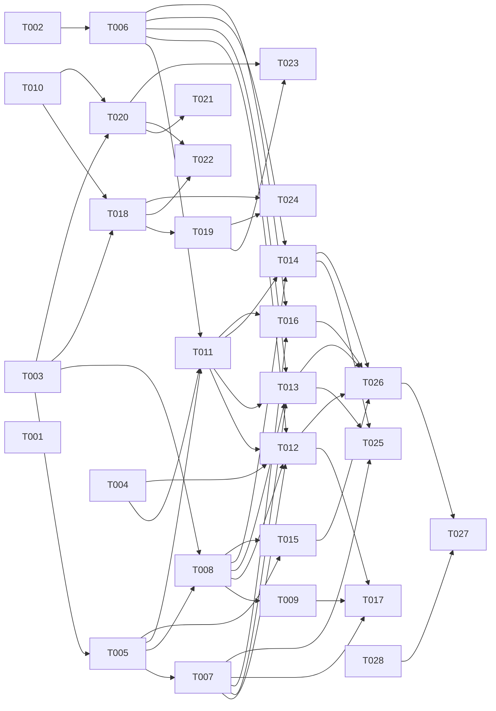

# Tasks: Tài liệu trên hub, nhập từ repo, đồng bộ hai chiều với repo

**Input**: [spec.md](spec.md), [plan.md](plan.md), [research.md](research.md)

## Quy ước

- **Định dạng**: `[ID] [P?] [Story] [Tier] · ước lượng`.
  - **[P]**: chạy song song được với task khác cùng đợt. Bộ file không giao nhau và không chờ task chưa xong.
  - **Tier**: chọn model theo CLAUDE.md.
    - **nặng** = Opus `--effort high`;
    - **vừa** = Sonnet `--effort high`;
    - **nhẹ** = Sonnet `--effort medium`.
  - **Ước lượng**: ngày-agent (một agent làm liên tục, gồm test). **[Suy luận]** theo các spec 011, 012, 017.
- **PHẠM VI**: chỉ được sửa các file liệt kê. Hai task cùng đợt không có file chung. Cần sửa file ngoài phạm vi thì ghi
  vào ghi chú bàn giao, người điều phối xếp lại.
- **File chung có chủ**:
  - `packages/contracts/**` và `openapi.json`: chỉ T003. Task sau thấy thiếu thì ghi bàn giao, không tự sửa.
  - Mọi `schema.ts` và migration: chỉ T005 (một migration cho cả spec). Task sau không đổi bảng.
  - `apps/hub/package.json`, `pnpm-lock.yaml`: chỉ T005 thêm mọi phụ thuộc mới (research.md mục 4).
  - `apps/hub/src/modules/docsync/{index.ts,router.ts,jobs.ts}`, `apps/hub/src/main.ts`, `apps/hub/src/app.ts`: T005
    tạo khung. Mỗi phần có file `routes/<phần>.ts` và hàm `register<Phần>(jobs, deps)` riêng, T005 tạo dạng rỗng
    (ném `NOT_IMPLEMENTED`). Task sau chỉ sửa file của phần mình.
  - `apps/web/src/router.tsx`, `apps/web/e2e/fake-hub.ts`: chỉ T020. T020 tạo sẵn route và trang rỗng cho T021–T023,
    và file fixture `apps/web/e2e/docsync-<phần>-fixture.ts` rỗng cho từng task web.
  - `packages/doc-editor/src/index.ts`: T018, rồi T019 (khác đợt).
- Mỗi task kèm test trong cùng commit.
- **Kiểm tra theo loại task**:
  - Hub: `pnpm --filter @xdev-hive/hub typecheck`, `pnpm --filter @xdev-hive/hub test` (test DB cần Docker, xem
    AGENTS.md).
  - Contracts: `pnpm --filter @xdev-hive/contracts test`, `pnpm openapi`, `git diff --exit-code openapi.json` sau khi
    commit.
  - Package/web/desktop: `typecheck`, `test` của package đó. Web: Playwright file của task
    (`pnpm --filter @xdev-hive/web e2e -- <file>`).
  - Mọi task: `pnpm biome check --write .`, `pnpm deps`. Không chạy `pnpm ci:local` toàn bộ.
- **Migration**: chỉ T005 sinh, ở bước cuối, sau khi rebase lên `main` mới nhất (hiện mới nhất là `0072`).
- **Giả định**: Q1–Q12 chưa chốt. Task làm theo khuyến nghị trong spec. T028 (chủ dự án) chốt; câu trả lời khác
  khuyến nghị thì người điều phối sửa task chưa làm trước khi giao.
- **Provider thật**: mọi test tự động dùng provider `memory` của `scm`. Chỉ T002 và T027 gọi GitHub/GitLab thật, bằng
  repo thử do chủ dự án cấp. Không commit token.

## Đợt 0: quyết định, hợp đồng, phần thuần (song song)

- [x] **T001 [P] [—] [nhẹ] · 0,5 ngày — ADR 0028, SRS 3.23, ghi chú cho spec 012**
  - **Goal**:
    - Viết ADR 0028 "Docs repo sync" (tiếng Anh, theo `docs/adr/template.md`): research.md mục 5 quyết định 1, 3, 5;
      các phương án ở plan.md "Phương án đã cân nhắc"; đường sang S3.
    - Thêm SRS mục 3.23 `DSYNC-01…DSYNC-12` ánh xạ FR-001…FR-046. Mục 3.15 DOC thêm một dòng trỏ sang 3.23.
    - Sửa ghi chú T062 ở `specs/012-artifacts/tasks.md`: BlobStore dùng `platform/blob-store.ts`, bảng `blobs`,
      `blob_chunks` (rủi ro R4).
    - Số ADR và mục SRS: kiểm lại lúc làm (`ls docs/adr`, mọi nhánh mở). 0027 và 3.22 đã dành cho spec 017.
  - **PHẠM VI**:
    - `docs/adr/0028-docs-repo-sync.md` (mới)
    - `docs/adr/README.md` (một dòng mục lục)
    - `docs/srs.md` (chỉ thêm mục 3.23 và một dòng ở 3.15)
    - `specs/012-artifacts/tasks.md` (chỉ ghi chú của T062)
  - **Kiểm**: `pnpm biome check --write .`.

- [x] **T002 [P] [—] [vừa] · 1,5 ngày — Spike: API provider, LFS, thư viện trích**
  - **Goal**: kiểm từng dòng **[Chưa kiểm]** ở research.md mục 2, 3.5, 3.6 và plan.md mục 5, 13. Dùng script tạm ngoài
    repo, chỉ commit kết quả:
    - GitHub: Contents API với file > 1 MB; `trees` `truncated`; tarball; compare (phân trang, `previous_filename`);
      Git Data API xoá file (`sha: null`) và blob base64; LFS Batch với installation token;
    - GitLab: archive với `path`; compare `renamed_file` và `overflow`; commit `move`, `delete`, `base64`; LFS Batch với
      project access token;
    - pg-boss: `singletonKey` + `startAfter` có gom như plan.md mục 5 không, với bản đang dùng;
    - thư viện: giấy phép bản mới nhất, kích thước cài đặt, `pnpm audit`, chạy được trong `worker_threads`; `yaml` có
      tắt tag tuỳ ý mặc định không; `unaccent` có trong image PostgreSQL dev không.
  - **PHẠM VI**:
    - `specs/018-docs-repo-sync/research.md` (thêm mục 6 "Kết quả spike", sửa nhãn)
  - **Kiểm**: mỗi dòng có kết quả "có / không / chưa rõ" kèm provider, bản và ngày thử. Không ghi token hay URL có token.

- [x] **T003 [P] [—] [nặng] · 1,5 ngày — Hợp đồng API**
  - **Goal**: plan.md mục 1–13, theo constitution I.
    - `doc-sync.ts` mới:
      - `docHomesContract`: `get`, `configureProject`, `configureOrg` (có `create`), `remove`, `pause`, `resume`,
        `acceptBranch`, `syncNow`, `adoptPreview`, `adopt`, `status`;
      - `docImportsContract`: `scan`, `get`, `files` (phân trang), `start`, `cancel`, `confirmSecret`, `list`;
      - `docConflictsContract`: `list`, `get`, `resolve`;
      - `docAssetsContract`: `resolve`, `list` (tải lên, tải xuống là route Hono, chỉ khai báo schema phản hồi);
      - `docExtractsContract`: `list`, `get`, `update`, `approve`, `reject`, `confirmSecret`;
      - `docTreeContract`: `list` (cây theo đường dẫn repo kèm trạng thái), `move`;
      - schema trạng thái, lỗi `DOCSYNC_*` (`HOME_OVERLAP`, `NO_ACCESS`, `BRANCH_PROTECTED`, `ASSET_TOO_LARGE`,
        `ORG_STORAGE_FULL`, `CONFLICT_OPEN`, `PAUSED`).
    - `knowledge.ts`: `docs.search`, `docs.archive`, `docs.restore`; `docs.save` thêm `acknowledgeSecrets?`; lỗi
      `DOC_SECRET_FOUND` (kèm loại và dòng); input MCP `doc_search`, `doc_asset_get`.
    - `projects.ts`: `settings.docs` (mọi trường `.default()`, plan.md mục 2). Test: settings cũ không có `docs` vẫn
      parse.
    - `notify.ts`: sáu loại thông báo ở plan.md mục 13.
    - Chữ mô tả route và lỗi tiếng Việt.
  - **PHẠM VI**:
    - `packages/contracts/src/doc-sync.ts` (mới), `doc-sync.test.ts` (mới)
    - `packages/contracts/src/{knowledge.ts,projects.ts,projects.test.ts,notify.ts,index.ts}`
    - `openapi.json`
  - **Kiểm**: contracts test, `pnpm openapi`, typecheck hub và web vẫn qua (route mới chưa có handler thì hub dùng
    `NOT_IMPLEMENTED` ở T005; ghi bàn giao nếu typecheck hub hỏng tới khi T005 xong).

- [x] **T004 [P] [—] [vừa] · 1,5 ngày — Phần thuần: key ↔ đường dẫn, nội dung**
  - **Goal**: plan.md mục 3, research.md mục 2.3, 3.2, 3.6. Hàm thuần, không đụng DB:
    - `paths.ts`: `keyFromPath`, `pathFromKey`, `uniqueKey`, `isHardExcluded`, `matchesHome` (dùng `matchGlob` của
      contracts), `overlaps`, `resolveRelative(docPath, href)`;
    - `content.ts`: `parseFrontMatter` (dùng `yaml`; sai cú pháp trả cảnh báo), `titleOf` (front-matter > `#` > tên
      file), `detectEol`, `toLf`, `fromLf`, BOM, `contentHash`, `isLfsPointer`, `parseLfsPointer`, `lfsPointer`,
      `parseGitattributes` + `isLfsPath`;
    - `renames.ts`: `matchRenames(removed, added)` theo blob sha rồi độ giống khối ≥ 0,8 (`splitBlocks`).
  - Bộ mẫu round-trip (SC-005): ≥ 200 file markdown lấy từ `docs/`, `specs/` của repo này (không có bí mật), test
    `fromLf(toLf(x)) === x` từng byte, và `MarkdownCodec` đọc rồi ghi không sửa ra đúng nội dung (ghi tỉ lệ khớp vào
    bàn giao).
  - `yaml` chưa có trong hub: T004 import qua đường tạm và ghi bàn giao; T005 thêm vào `package.json`. Nếu T005 xong
    trước thì dùng luôn.
  - **PHẠM VI**:
    - `apps/hub/src/modules/docsync/{paths.ts,content.ts,renames.ts}` (mới) + `*.test.ts`
    - `apps/hub/src/modules/docsync/fixtures/roundtrip/**` (mới)
  - **Kiểm**: hub test (các file test mới), typecheck.

- [x] **T010 [P] [—] [vừa] · 1,5 ngày — Thiết kế màn**
  - **Goal**: plan.md mục 12, constitution "User interface". Dùng skill `ui-ux-pro-max`, design system v2, shadcn/ui.
    Mỗi màn có trạng thái rỗng, đang tải, lỗi; 360 px; sáng/tối; chữ tiếng Việt:
    - cài đặt dự án tab "Tài liệu"; thẻ "Kho tài liệu tổ chức";
    - nhập từ repo (quét, cây chọn, cảnh báo, tiến độ, báo cáo, xác nhận bí mật);
    - danh sách tài liệu dạng cây với nhãn đồng bộ và ô tìm theo nghĩa;
    - xung đột ba bản (màn rộng và 360 px);
    - bản trích chờ duyệt;
    - editor: ảnh, tải lên, nhãn đồng bộ;
    - desktop "Soạn tài liệu" có nhãn và tìm kiếm.
  - **PHẠM VI**:
    - `docs/design-system/screens/{DocsSettings,OrgDocsRepo,DocImport,DocsTree,DocConflict,DocExtracts,DocEditorAssets,AppWriteSync}.dc.html`
      (mới)
    - `docs/design-system/screens/README.md`
  - **Kiểm**: mở từng file trong trình duyệt ở 360 px và 1280 px, sáng và tối.

- [ ] **T028 [—] [người: chủ dự án] · 0,5 ngày người — Chốt Q1–Q12**
  - **Goal**: trả lời Q1–Q12 ở spec.md. Cấp repo thử GitHub và GitLab (riêng tư, không dữ liệu thật) và token có hạn
    ngắn cho T002, T027.
  - **PHẠM VI**: không sửa file. Không gửi token qua chat, issue hay commit.
  - **Xong khi**: người điều phối ghi câu trả lời vào spec.md mục "Câu hỏi mở" (đổi thành "Câu hỏi đã chốt").

## Đợt 1: nền (song song, sau Đợt 0)

- [x] **T005 [P] [—] [nặng] · 2 ngày — Bảng, RLS, migration, phụ thuộc, khung module `docsync`**
  - **Phụ thuộc**: T003.
  - **Goal**: plan.md mục 1, 13.
    - `knowledge/schema.ts`: `docs.archived_at`; `doc_versions.{content_hash,source,repo_commit,secret_flag}`;
      `doc_chunks` (tsvector GIN). Hàm SQL `hive.enable_doc_vectors()` như `enable_memory_vectors()`.
    - `platform/schema.ts` (mới): `blobs`, `blob_chunks`.
    - `docsync/schema.ts` (mới): bảy bảng + `doc_import_files` (plan.md mục 1), index, unique, partial index xung đột
      mở.
    - Mọi bảng mới: `org_id`, `ENABLE` + `FORCE ROW LEVEL SECURITY`, policy `<bảng>_rw`, quyền cho `hive_app`.
    - Migration điền `content_hash` cho phiên bản cũ (plan.md mục 1).
    - `apps/hub/package.json`: thêm `yaml`, `tar`, `mammoth`, `turndown`, `unpdf`, `exceljs`, `jszip` (bản theo T002
      nếu đã có kết quả).
    - Khung `docsync`:
      - `index.ts`; `router.ts` (gộp các `routes/*.ts`);
      - `jobs.ts`: tên queue, `registerDocSync` gọi `register<Phần>`, và `queuePush(homeId)`, `queuePull(homeId)` làm
        thật (chỉ xếp job với `singletonKey` theo nhà, `startAfter` 60 s / 30 s) để T011, T013, T014, T015 gọi được
        ngay;
      - file phần dạng rỗng (export `register<Phần>` không làm gì): `push.ts`, `pull.ts`, `import.ts`,
        `conflicts.ts`, `assets.ts`, `extracts.ts`; `routes/{homes,imports,sync,conflicts,assets,extracts,tree}.ts`;
        `webhook.ts`.
      - `main.ts` gọi `registerDocSync`; `app.ts` gắn route `/hooks/docs/:homeId` và route tải lên/tải xuống tới hàm
        rỗng.
  - **PHẠM VI**:
    - `apps/hub/src/modules/knowledge/schema.ts`
    - `apps/hub/src/modules/platform/schema.ts` (mới)
    - `apps/hub/src/modules/docsync/{schema.ts,index.ts,router.ts,jobs.ts,webhook.ts}` (mới), `jobs.test.ts` (mới)
    - `apps/hub/src/modules/docsync/{push,pull,import,conflicts,assets,extracts}.ts`, `routes/*.ts` (mới, rỗng)
    - `apps/hub/src/modules/docsync/rls.db.test.ts` (mới, phủ mọi bảng mới kể cả `doc_chunks`, `blobs`)
    - `apps/hub/src/main.ts`, `apps/hub/src/app.ts`, router gốc của hub (một dòng gắn `docsyncRouter`)
    - `apps/hub/db/migrations/*` (một file mới + meta)
    - `apps/hub/package.json`, `pnpm-lock.yaml`
  - **Kiểm**: hub typecheck, `rls.db.test.ts`, test upgrade migration từ `0072`, `pnpm deps`.

- [x] **T006 [P] [—] [nặng] · 3 ngày — Mở rộng `GitProvider` và Git LFS**
  - **Phụ thuộc**: T002 (dùng kết quả spike; chưa có thì làm theo research.md và ghi chỗ chưa chắc).
  - **Goal**: research.md mục 2, plan.md mục 8.
    - `types.ts`:
      - `readBlob(ref, sha | path) → Uint8Array` (GitHub Git Blobs API, GitLab `raw`);
      - `compare(ref, from, to) → { files: {path, previousPath?, status, sha}[], incomplete }`;
      - `archive(ref, sha, path?) → ReadableStream` (GitHub tarball, GitLab archive có `path`);
      - `CommitFilesInput.files` nhận `{ path, content }` | `{ path, bytes }` | `{ path, delete: true }` |
        `{ path, previousPath }` (move); `expectedHead?` để lỗi khi nhánh đã đi tiếp.
    - `github.ts`:
      - `listFiles` không ném lỗi khi `truncated`: duyệt từng cây con;
      - `readFile` với file > 1 MB không trả `""` (dùng Blobs API);
      - commit nhị phân, xoá (`sha: null`), move = xoá + thêm.
    - `gitlab.ts`: `actions` `create`/`update`/`delete`/`move`, `encoding: base64`; compare; archive; raw nhị phân.
    - `memory.ts`: đủ mọi phương thức mới, có chế độ giả `truncated`, `incomplete`, 403 bảo vệ nhánh, rate limit.
    - `lfs.ts` (mới): `lfsBatch`, `lfsUpload`, `lfsDownload` dùng chung hai provider, xác thực theo kết nối.
  - **PHẠM VI**:
    - `apps/hub/src/modules/scm/{types.ts,github.ts,gitlab.ts,memory.ts,lfs.ts,index.ts}` + test tương ứng
  - **Kiểm**: hub test phần `scm` (test cũ của SDLC sync và kho skill vẫn qua), typecheck.

- [x] **T018 [P] [US5] [vừa] · 2 ngày — Editor: ảnh, tải lên, link tương đối, nhãn đồng bộ**
  - **Phụ thuộc**: T003, T010.
  - **Goal**: FR-025, FR-030, FR-042, plan.md mục 8.
    - `DocEditorEnv` thêm `resolveLink(docKey, href)` và `uploadAsset(docKey, file)` (tuỳ chọn; không có thì nút tải
      lên ẩn).
    - Node ảnh Tiptap hiện ảnh qua `resolveLink`; ảnh không sửa vẫn ghi lại nguyên văn (`MarkdownCodec`).
    - Dán và kéo thả ảnh, nút "Chèn ảnh", "Đính kèm file": gọi `uploadAsset`, chèn markdown đường dẫn tương đối.
    - Link tương đối: bấm thì gọi `env.link` với kết quả `resolveLink` (tài liệu, đính kèm, link ngoài).
    - `sync-badge.tsx` (mới): nhãn trạng thái đồng bộ (FR-040) dùng chung web và desktop.
  - **PHẠM VI**:
    - `packages/doc-editor/src/{env.tsx,doc-editor.tsx,markdown.ts,paste.ts,editor-views.tsx,index.ts}`
    - `packages/doc-editor/src/sync-badge.tsx` (mới) + test
  - **Kiểm**: doc-editor typecheck, test (round-trip markdown có ảnh không đổi byte).

- [x] **T020 [P] [US4] [vừa] · 2 ngày — Web: cài đặt "Tài liệu" của dự án, thẻ repo tài liệu tổ chức, khung route**
  - **Phụ thuộc**: T003, T010.
  - **Goal**: FR-002…FR-005, US4, US8 (phần giao diện).
    - Tab "Tài liệu" trong cài đặt dự án: bật, thư mục, chế độ, mẫu lấy/bỏ, `repoChangesNeedReview`, cảnh báo phạm vi
      đọc, trạng thái nhà (commit cuối, PR, số tài liệu theo trạng thái, lỗi), nút "Đồng bộ ngay", "Tạm dừng"/"Bật
      lại", "Dùng nhánh mới", "Đưa tài liệu hub vào repo" (xem trước rồi xác nhận).
    - Thẻ "Kho tài liệu tổ chức" cạnh thẻ kho skill: chọn repo có sẵn hoặc tạo mới, chế độ, trạng thái.
    - Khung cho task web sau: route `/knowledge/docs/import`, `/knowledge/docs/conflicts/$id`,
      `/knowledge/docs/extracts` trỏ tới trang rỗng; fixture rỗng `e2e/docsync-{import,docs,review}-fixture.ts` nối
      vào `fake-hub.ts`.
  - **PHẠM VI**:
    - `apps/web/src/pages/project-docs-settings.tsx` (mới), `apps/web/src/pages/project-settings-page.tsx`
    - `apps/web/src/pages/knowledge/org-docs-repo-card.tsx` (mới), `apps/web/src/pages/knowledge/skills-page.tsx`
    - `apps/web/src/pages/knowledge/{doc-import-page,doc-conflict-page,doc-extracts-page}.tsx` (mới, rỗng)
    - `apps/web/src/router.tsx`, `apps/web/src/lib/project-settings.ts` (+ test)
    - `apps/web/e2e/fake-hub.ts`, `apps/web/e2e/docsync-settings.spec.ts` (mới),
      `apps/web/e2e/docsync-{settings,import,docs,review}-fixture.ts` (mới)
  - **Kiểm**: web typecheck, test, Playwright `docsync-settings.spec.ts` (360 px, bàn phím).

## Đợt 2: lõi hub (song song, sau Đợt 1)

- [x] **T007 [P] [US5] [vừa] · 1,5 ngày — BlobStore trong `platform`**
  - **Phụ thuộc**: T005.
  - **Goal**: FR-028, FR-031 (hạn mức), plan.md mục 1, 8.
    - `blob-store.ts`: giao diện `BlobStore` + bản PostgreSQL (đoạn 512 KiB, stream, dedupe sha256 theo tổ chức).
    - `magic.ts`: nhận dạng PNG, JPEG, GIF, WebP, PDF, ZIP/OOXML, SVG; từ chối khi đuôi và nội dung lệch.
    - Hạn mức tổ chức `HIVE_DOC_ORG_STORAGE_BYTES`; `HIVE_DOC_ASSET_MAX_BYTES`, `HIVE_DOC_IMPORT_MAX_BYTES` trong
      `config.ts`.
    - `provideBlobRefs` và job `platform-blob-gc` hằng ngày.
  - **PHẠM VI**:
    - `apps/hub/src/modules/platform/{blob-store.ts,magic.ts,blob-gc.ts}` (mới) + `*.test.ts`, `blob-store.db.test.ts`
    - `apps/hub/src/modules/platform/{config.ts,config.test.ts,index.ts}`
  - **Kiểm**: hub test (`platform`), typecheck, `pnpm deps`.

- [x] **T008 [P] [US2] [nặng] · 2 ngày — `knowledge`: hook lưu, lưu từ đồng bộ, lưu trữ, chặn bí mật khi lưu**
  - **Phụ thuộc**: T003, T005.
  - **Goal**: FR-012, FR-024 (lưu trữ), plan.md mục 5, 11.
    - `provideDocSaved(hook)`; `applyDocSave` gọi hook trong transaction với `{orgId, docId, key, version, source}`.
    - `applyDocSave` ghi `content_hash`, `source`, `repo_commit`, `secret_flag`.
    - `saveDocFromSync(tx, input)` (export): lưu không qua duyệt, người lưu là hệ thống, tác giả ghi trong `message`.
      Không cấp quyền cho run hay người.
    - `docs.archive`, `docs.restore` (cần `manage`, audit). `listDocs`, `getDoc`, MCP `doc_list`/`doc_get` bỏ tài
      liệu lưu trữ và phiên bản `secret_flag` chưa xác nhận (với run).
    - `saveDoc`, `submitDraft`, `finish` của review: `scanSecrets`; có kết quả thì `DOC_SECRET_FOUND`, trừ khi người
      có `manage` gửi `acknowledgeSecrets` (audit).
  - **PHẠM VI**:
    - `apps/hub/src/modules/knowledge/{docs.ts,editor.ts,reviews.ts,router.ts,mcp-tools.ts,index.ts}`
    - `apps/hub/src/modules/knowledge/{knowledge.db.test.ts,editor.db.test.ts}`, `docs-sync-hook.db.test.ts` (mới)
  - **Kiểm**: hub test `knowledge` (mọi test cũ vẫn qua), typecheck, `pnpm deps`.

- [x] **T011 [P] [US4] [vừa] · 2 ngày — Nhà tài liệu: cấu hình, kiểm quyền, repo tổ chức, webhook**
  - **Phụ thuộc**: T004, T005, T006.
  - **Goal**: FR-001…FR-005, FR-017 (route nhà tổ chức), US4, US8 (phần hub trừ "Đồng bộ ngay").
    - `homes.ts`: đọc `settings.docs`, tạo/cập nhật `doc_homes`; `configureOrg` (chọn hoặc `createRepo` + `README.md`
      + webhook, secret mã hoá envelope); `remove` (gỡ webhook, tài liệu thành "chưa có nhà"); `pause`, `resume`,
      `acceptBranch`; kiểm `checkAccess`, `overlaps` với nhà khác, `sdlc.docsRoot`, kho skill.
    - Quyền: quản trị dự án hoặc tổ chức. `recordAudit`.
    - `webhook.ts`: `/hooks/docs/:homeId` kiểm chữ ký, chống lặp (`webhook_deliveries`), gọi `queuePull` (T005 làm trong
      `jobs.ts`; T014 viết phần xử lý job).
    - `sdlc`: export `sdlcManagedPaths(tx, projectId)` (đường dẫn trong `sdlc_artifact_syncs` + `docsRoot`).
  - **PHẠM VI**:
    - `apps/hub/src/modules/docsync/{homes.ts,webhook.ts,routes/homes.ts}` + `homes.db.test.ts` (mới)
    - `apps/hub/src/modules/sdlc/{managed-paths.ts,index.ts}` (`managed-paths.ts` mới) + test
  - **Kiểm**: hub test, typecheck, `pnpm deps`.

- [x] **T019 [P] [US3] [vừa] · 1,5 ngày — `conflict-view` dùng chung**
  - **Phụ thuộc**: T018.
  - **Goal**: FR-020, FR-041. Ba bản (gốc chung, hub, repo), tô khối xung đột từ `mergeBlocks`, chọn "Giữ bản hub",
    "Giữ bản repo", "Sửa tay" (mở editor với bản hợp có đánh dấu). Ba cột trên màn rộng, tab trên 360 px.
  - **PHẠM VI**:
    - `packages/doc-editor/src/conflict-view.tsx` (mới) + test, `packages/doc-editor/src/index.ts`
  - **Kiểm**: doc-editor typecheck, test.

- [x] **T021 [P] [US1] [vừa] · 2 ngày — Web: màn nhập từ repo**
  - **Phụ thuộc**: T020.
  - **Goal**: US1, FR-006, FR-007, FR-010, FR-041. Quét, cây chọn theo thư mục (chọn cả thư mục), sửa mẫu lấy/bỏ,
    cảnh báo theo loại, tiến độ (poll `docImports.get`), báo cáo, "Không phải bí mật, vẫn nhập" (hộp xác nhận nói rõ
    bí mật đã trong lịch sử git). Không hiện giá trị bí mật.
  - **PHẠM VI**:
    - `apps/web/src/pages/knowledge/doc-import-page.tsx`, `doc-import-tree.tsx` (mới) + test
    - `apps/web/e2e/docsync-import.spec.ts` (mới), `apps/web/e2e/docsync-import-fixture.ts`
  - **Kiểm**: web typecheck, test, Playwright file của task.

## Đợt 3: đồng bộ (song song, sau Đợt 2)

- [ ] **T009 [P] [US7] [nặng] · 2 ngày — Chỉ mục đoạn và tìm theo nghĩa**
  - **Phụ thuộc**: T008.
  - **Goal**: FR-036…FR-038, US7, plan.md mục 10.
    - `doc-search.ts`: chia đoạn theo tiêu đề; job `knowledge-doc-index` (đăng ký qua hook lưu nội bộ của
      `knowledge`); embedding theo lô bằng `Embedder` hiện có; bỏ qua `secret_flag`, `confidential: true`, tài liệu lưu
      trữ.
    - `indexExtract(tx, extractId)` export cho `docsync`.
    - `docs.search`: tsvector + vector, RRF k = 60, lọc phạm vi theo `canRead`; `mode: "keyword"` khi không có vector.
    - MCP `doc_search` (run chỉ thấy tài liệu run được đọc).
    - Job điền chỉ mục cho tài liệu có sẵn (chạy một lần khi bật).
  - **PHẠM VI**:
    - `apps/hub/src/modules/knowledge/doc-search.ts` (mới) + `doc-search.test.ts`, `doc-search.db.test.ts`
    - `apps/hub/src/modules/knowledge/{router.ts,mcp-tools.ts,index.ts,docs.ts}`
  - **Kiểm**: hub test, typecheck. Bộ 50 câu hỏi mẫu cho SC-008 trong fixture (đo khi có embedding; không có thì ghi
    bàn giao).

- [x] **T012 [P] [US1] [nặng] · 3 ngày — Quét và nhập**
  - **Phụ thuộc**: T004, T006, T007, T008, T011.
  - **Goal**: US1, FR-006…FR-011, plan.md mục 4. Edge case: hàng nghìn file, trùng key, front-matter, file lớn, LFS,
    không phải UTF-8, bí mật.
    - `scan.ts`: cây file, lọc, phân loại, cảnh báo, ghi `doc_import_files`.
    - `import.ts`: archive (> 100 file) hoặc đọc từng file; lô 200 file; `scanSecrets`; `saveDocFromSync` nguồn
      `import`; `doc_repo_files`; ảnh và file khác vào BlobStore + `doc_assets`; xếp `docsync-extract` cho file văn
      phòng; chạy tiếp được; theo `retryAfterMs`.
    - Tar: bỏ symlink, hardlink, `..`; giới hạn `HIVE_DOC_IMPORT_MAX_BYTES`.
    - `confirmSecret`, `adoptPreview`, `adopt` (FR-011).
    - `notify` `docsync.import_done`.
  - **PHẠM VI**:
    - `apps/hub/src/modules/docsync/{scan.ts,import.ts,adopt.ts,routes/imports.ts}` (mới) + `import.db.test.ts`
  - **Kiểm**: hub test (gồm 2.000 file với provider `memory`, ngắt giữa chừng rồi chạy tiếp, không trùng), typecheck.

- [ ] **T013 [P] [US2] [nặng] · 3 ngày — Hub → repo: gom lô, commit/PR, thử lại**
  - **Phụ thuộc**: T006, T007, T008, T011.
  - **Goal**: US2, FR-012…FR-016, FR-024 (di chuyển, lưu trữ), FR-027, plan.md mục 5.
    - `push.ts`: đăng ký `provideDocSaved`; job `docsync-push` gom 60 s, trần 10 phút; lập lô; kiểm hash đầu nhánh
      (FR-016); EOL/BOM gốc; đính kèm nhị phân hoặc LFS; xoá, move; commit `direct` hoặc PR cuốn chiếu
      `hive/docs-sync-<nhà>` + commit status + `enqueueMerge`; trailer; lịch thử lại; `notify`.
    - PR bị đóng không merge (`onScmEvent("pull_request")`): file về `pending`.
    - `routes/sync.ts`: `syncNow`, thử lại; `routes/tree.ts`: `list`, `move`.
  - **PHẠM VI**:
    - `apps/hub/src/modules/docsync/{push.ts,routes/sync.ts,routes/tree.ts}` + `push.db.test.ts` (mới)
    - `apps/hub/src/modules/docsync/jobs.ts` (chỉ thân `queuePush`, nếu cần trần 10 phút; không task nào khác ở Đợt 3
      sửa file này)
  - **Kiểm**: hub test (gom 3 lần lưu thành 1 commit; PR cuốn chiếu nhận commit thứ hai; nhánh bảo vệ; repo đổi trước
    khi đẩy thì không ghi đè), typecheck.

- [ ] **T014 [P] [US3] [nặng] · 3 ngày — Repo → hub: so sánh, đổi tên, áp, hợp, xung đột**
  - **Phụ thuộc**: T006, T008, T011.
  - **Goal**: US3, FR-017…FR-023, plan.md mục 6. Edge case: đổi tên/di chuyển, nhánh mặc định đổi, webhook về trước
    phản hồi commit, repo đổi tên, quyền mất.
    - `pull.ts`: `registerPull` (xử lý job `docsync-pull`, xếp job qua `queuePull` của `jobs.ts`);
      `onScmEvent("push")` cho nhà dự án; cron `*/15`; gom 30 s; `compare` hoặc so cây; `matchRenames`;
      bỏ commit của hub; từng file theo plan.md mục 6; `repoChangesNeedReview` qua `proposeDoc` + `startReview`;
      `mergeBlocks`; tạo hoặc cập nhật `doc_conflicts`; `deleted_in_repo`; file mới; đính kèm đổi; phát hiện nhánh mặc
      định đổi; `notify`.
  - **PHẠM VI**:
    - `apps/hub/src/modules/docsync/pull.ts` + `pull.db.test.ts` (mới)
  - **Kiểm**: hub test (mọi Acceptance Scenario của US3, đổi tên qua API và qua hash, nhánh mặc định đổi), typecheck.

- [x] **T015 [P] [US3] [vừa] · 1,5 ngày — Giải quyết xung đột**
  - **Phụ thuộc**: T005, T008.
  - **Goal**: FR-020, FR-021 (chọn lưu trữ hoặc ghi lại), plan.md mục 7. `docConflicts.list/get/resolve`; tài liệu
    `deleted_in_repo`: "Lưu trữ tài liệu" hoặc "Ghi lại vào repo". Cần `manage`, `scanSecrets` với bản sửa tay, audit,
    xếp lô đẩy (gọi `queuePush` qua `jobs.ts`).
  - **PHẠM VI**:
    - `apps/hub/src/modules/docsync/{conflicts.ts,routes/conflicts.ts}` (mới) + `conflicts.db.test.ts` (mới)
  - **Kiểm**: hub test (test chèn xung đột trực tiếp vào bảng, không chờ T014), typecheck.

- [ ] **T016 [P] [US5] [nặng] · 2,5 ngày — Đính kèm: tải lên, tải xuống, phân giải link, LFS**
  - **Phụ thuộc**: T006, T007, T011.
  - **Goal**: US5, FR-025, FR-029…FR-032, FR-039 (`doc_asset_get` phần file gốc), plan.md mục 8. Edge case: file lớn,
    link ra ngoài thư mục nhà, link gãy.
    - Route Hono tải lên (multipart, `authorize(propose)`, kích thước, magic bytes, LFS theo `.gitattributes`, hạn
      mức) và tải xuống (`canRead`, `Content-Disposition`/CSP cho SVG/HTML, `Cache-Control: private`).
    - `docAssets.resolve`: một lời gọi cho cả tài liệu; link `.md` → key; đính kèm → URL hub; còn lại → URL file trên
      GitHub/GitLab. Danh sách link gãy cho màn trạng thái.
    - Đính kèm mới: `pending_push`, xếp lô đẩy.
  - **PHẠM VI**:
    - `apps/hub/src/modules/docsync/{assets.ts,routes/assets.ts}` (mới) + `assets.db.test.ts` (mới)
  - **Kiểm**: hub test (SVG có script trả `attachment`; người không đọc được tài liệu không tải được file), typecheck.

## Đợt 4: trích nội dung và giao diện (song song, sau Đợt 3)

- [ ] **T017 [P] [US6] [nặng] · 3 ngày — Trích nội dung và duyệt bản trích**
  - **Phụ thuộc**: T007, T009, T012 (nguồn job trích).
  - **Goal**: US6, FR-033…FR-035, FR-039, plan.md mục 9, research.md mục 3.5.
    - `extract/worker.ts` chạy trong `worker_threads` (bộ nhớ 512 MB, 60 giây); `docx.ts` (mammoth + turndown),
      `pdf.ts` (unpdf, báo "Không có chữ để trích"), `xlsx.ts` (exceljs stream, 2.000 dòng, 20 sheet), `csv.ts`,
      `pptx.ts` (jszip + XML).
    - `extracts.ts`: job `docsync-extract`, `scanSecrets`, trạng thái, giữ bản đã duyệt tới khi bản mới duyệt, duyệt
      gọi `indexExtract`; duyệt, từ chối, xác nhận bí mật ghi `recordAudit` (FR-045); `notify`
      `docsync.extract_review` (FR-046).
    - `routes/extracts.ts`; `mcp-tools.ts` `doc_asset_get` (chỉ bản `approved`).
  - **PHẠM VI**:
    - `apps/hub/src/modules/docsync/extract/**` (mới), `extracts.ts`, `routes/extracts.ts`, `mcp-tools.ts` (mới) +
      test, `fixtures/extract/**` (file mẫu tự tạo, có file hỏng và zip bomb nhỏ)
    - `apps/hub/src/modules/docsync/index.ts` (một dòng export MCP tool)
  - **Kiểm**: hub test (zip bomb bị dừng, PDF có mật khẩu báo lỗi, tiến trình hub không chết), typecheck.

- [ ] **T022 [P] [US7] [vừa] · 2 ngày — Web: cây tài liệu, nhãn đồng bộ, tìm theo nghĩa, editor có ảnh**
  - **Phụ thuộc**: T018, T020 (API từ T009, T013, T016 dùng qua fixture).
  - **Goal**: FR-040, FR-042, US7 (giao diện), US2 scenario 6 (nút "Thử lại").
    - `docs-page.tsx`: cây theo đường dẫn repo (`docTree.list`), nhãn `SyncBadge`, lọc theo trạng thái, link PR/commit,
      "Di chuyển", "Lưu trữ"/"Khôi phục", ô tìm theo nghĩa (kết quả đoạn + đường tiêu đề, ghi "Đang tìm theo từ").
    - `doc-editor-page.tsx`: cung cấp `resolveLink`, `uploadAsset` cho `DocEditor`; nhãn đồng bộ; lỗi
      `DOC_SECRET_FOUND` hiện loại và dòng, người có quyền thấy nút "Vẫn lưu".
  - **PHẠM VI**:
    - `apps/web/src/pages/knowledge/{docs-page.tsx,doc-editor-page.tsx}`, `doc-tree.tsx` (mới) + test
    - `apps/web/e2e/docsync-docs.spec.ts` (mới), `apps/web/e2e/docsync-docs-fixture.ts`
  - **Kiểm**: web typecheck, test, Playwright file của task.

- [ ] **T023 [P] [US3] [vừa] · 2 ngày — Web: trang xung đột và bản trích chờ duyệt**
  - **Phụ thuộc**: T019, T020.
  - **Goal**: FR-041, US3 scenario 3, US6 scenario 2.
    - `doc-conflict-page.tsx`: dùng `ConflictView`, gọi `docConflicts.resolve`, xử lý `VERSION_CONFLICT`.
    - `doc-extracts-page.tsx`: danh sách, xem file gốc (ảnh, PDF qua link), sửa bản trích, duyệt/từ chối, xác nhận bí
      mật.
  - **PHẠM VI**:
    - `apps/web/src/pages/knowledge/{doc-conflict-page.tsx,doc-extracts-page.tsx}` + test
    - `apps/web/e2e/docsync-review.spec.ts` (mới), `apps/web/e2e/docsync-review-fixture.ts`
  - **Kiểm**: web typecheck, test, Playwright file của task.

- [ ] **T024 [P] [—] [vừa] · 1,5 ngày — Desktop "Soạn tài liệu": nhãn, tìm kiếm, xung đột, ảnh**
  - **Phụ thuộc**: T018, T019.
  - **Goal**: FR-040…FR-043 trên desktop. Nhãn đồng bộ trong danh sách và editor; ô tìm theo nghĩa; mở xung đột bằng
    `ConflictView`; `resolveLink`/`uploadAsset` gọi hub. Từ điển vi/en.
  - **PHẠM VI**:
    - `apps/desktop/src/screens/write-screen.tsx`, `apps/desktop/src/lib/i18n.ts` (chỉ khoá mới) + test
  - **Kiểm**: desktop typecheck, test. Chờ các nhánh desktop đang mở merge nếu đụng `write-screen.tsx`.

## Đợt 5: kiểm tổng, tài liệu

- [ ] **T025 [P] [—] [nhẹ] · 0,5 ngày — Biến môi trường và tài liệu kỹ thuật**
  - **Phụ thuộc**: T007, T013, T014.
  - **Goal**: ba biến môi trường mới (plan.md mục 13) vào `deploy/.env.example`, `apps/hub/.env.example`, `deploy/compose.yaml`
    nếu cần; `docs/architecture.md` thêm `docsync` và BlobStore; `docs/add.md` mục 8 thêm quét bí mật khi lưu, tải
    xuống SVG/HTML, trích trong `worker_threads`.
  - **PHẠM VI**:
    - `deploy/.env.example`, `apps/hub/.env.example`, `deploy/compose.yaml`
    - `docs/architecture.md`, `docs/add.md`
  - **Kiểm**: `pnpm biome check --write .`.

- [ ] **T026 [—] [nặng] · 2 ngày — Test tích hợp và hiệu năng**
  - **Phụ thuộc**: T012, T013, T014, T015, T016.
  - **Goal**: SC-001, SC-002, SC-003, SC-004, SC-006, SC-007, SC-009 với provider `memory` (có độ trễ giả):
    - vòng hub → repo → webhook → hub không sinh phiên bản lặp;
    - tranh chấp: repo đổi giữa lúc lập lô và commit;
    - 5.000 file markdown + 500 ảnh trong ≤ 15 phút, đếm lời gọi provider;
    - người không có quyền không thấy tài liệu, đoạn tìm kiếm, file, báo cáo nhập;
    - không file có bí mật nào đi vào repo hoặc embedding khi chưa xác nhận.
  - **PHẠM VI**:
    - `apps/hub/src/modules/docsync/{sync.db.test.ts,perf.db.test.ts}` (mới), `apps/hub/src/modules/docsync/fixtures/**`
  - **Kiểm**: hub test. Ghi kết quả đo vào bàn giao. Sửa lỗi tìm ra thì tạo task mới, không sửa file ngoài phạm vi.

- [ ] **T027 [—] [vừa] · 1 ngày — Smoke với GitHub và GitLab thật**
  - **Phụ thuộc**: T026, T028 (repo thử và token).
  - **Goal**: chạy script trên repo thử: nhập, sửa trên hub (`pr` và `direct`), sửa trong repo, xung đột, ảnh, LFS
    (repo có `.gitattributes`), đổi tên, đổi nhánh mặc định. Ghi kết quả.
  - **PHẠM VI**:
    - `apps/hub/scripts/docsync-smoke.ts` (mới; đọc token từ biến môi trường, không ghi ra log)
    - `specs/018-docs-repo-sync/research.md` (thêm mục 7 "Kết quả smoke")
  - **Kiểm**: mọi bước có kết quả; lỗi tìm ra thành task mới.

## Đồ thị phụ thuộc

T001 không chặn task nào. T028 là việc của chủ dự án.

## Đợt chạy song song

Tối đa khoảng 6 agent build cùng lúc trên Mac mini (CLAUDE.md).

| Đợt | Task | Số agent | Tier | Ước lịch |
|---|---|---|---|---|
| 0 | T001, T002, T003, T004, T010 (+ T028 chủ dự án) | 5 | nhẹ, vừa, nặng, vừa, vừa | 1,5 ngày |
| 1 | T005, T006, T018, T020 | 4 | nặng, nặng, vừa, vừa | 3 ngày (T006 dài nhất) |
| 2 | T007, T008, T011, T019, T021 | 5 | vừa, nặng, vừa, vừa, vừa | 2 ngày |
| 3 | T009, T012, T013, T014, T015, T016 | 6 | nặng ×5, vừa ×1 | 3 ngày |
| 4 | T017, T022, T023, T024 | 4 | nặng, vừa ×3 | 3 ngày |
| 5 | T025, T026 → T027 | 1–2 | nhẹ, nặng, vừa | 3 ngày |

Tổng: **27 task giao agent, 51,5 ngày-agent**, cộng T028 cho chủ dự án. Khoảng **15–16 ngày lịch** với 4–6 agent
**[Suy luận]**.

Đường tới bản dùng được sớm (P1: US1, US2, US3) **[Suy luận]**:
- xong Đợt 3 trừ T009, T016;
- cộng T022 (cây tài liệu) và T023 (trang xung đột);
- khoảng 11 ngày lịch.

## Theo user story

| Story | Task |
|---|---|
| US1 Nhập | T004, T012, T021 |
| US2 Hub → repo | T008, T013, T022 |
| US3 Repo → hub, xung đột | T014, T015, T019, T023 |
| US4 Repo tổ chức | T011, T020 |
| US5 Ảnh, đính kèm, LFS | T006, T007, T016, T018 |
| US6 Trích nội dung | T017, T023 |
| US7 Tìm theo nghĩa | T009, T022 |
| US8 Quản trị đồng bộ | T011, T013, T020 |
| Chung | T001, T002, T003, T005, T010, T024, T025, T026, T027, T028 |

## Theo yêu cầu

| FR | Task |
|---|---|
| FR-001…FR-005 | T003, T005, T011, T020 |
| FR-006…FR-011 | T012, T021 |
| FR-012…FR-016 | T008, T013 |
| FR-017…FR-022 | T011 (route), T014, T015 |
| FR-023…FR-027 | T004, T008 (lưu trữ), T013, T014, T016, T018 |
| FR-028…FR-032 | T006, T007, T016, T018 |
| FR-033…FR-035 | T017, T023 |
| FR-036…FR-039 | T009, T016, T017 |
| FR-040…FR-043 | T018, T019, T020, T021, T022, T023, T024 |
| FR-044…FR-046 | T005 (RLS), T008, T011, T012, T013, T014, T015 (audit, notify) |
