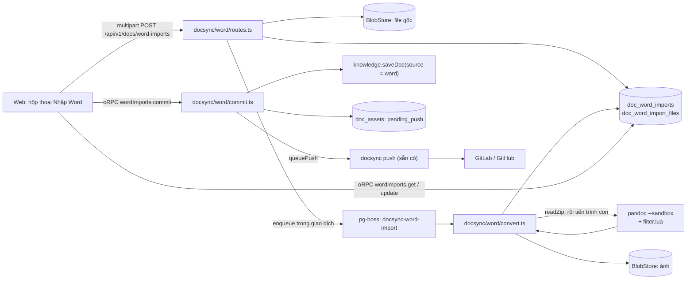

# Implementation Plan: Nhập Word thành tài liệu hub

**Branch**: `019-word-import` · **Date**: 2026-10-16 · **Spec**: [spec.md](spec.md) · **Research**: [research.md](research.md)

Chủ dự án đã chốt Q1–Q15 ngày 2026-10-17 (bảng "Câu hỏi đã chốt" trong spec). Hai chỗ khác khuyến nghị ban đầu:
`.doc` qua LibreOffice (Q9) và làm cả trên app desktop (Q12).

## Tóm tắt

Thêm việc **nhập Word** vào module hub `docsync`, vì module này đã sở hữu nhà tài liệu, đính kèm, nhập từ repo và bản trích.
- File `.docx`/`.odt` tải lên được lưu vào BlobStore.
- Job nền chạy **pandoc** với bộ lọc Lua của hub (Q1), ra Markdown cho editor, ảnh đặt tên theo hash, và cảnh báo.
- Người nhập xem trước rồi bấm tạo. Tài liệu đã có (vd. từ `srs2md`) gắn được với file Word để cập nhật về sau. Tài liệu, ảnh và bản ghi lần nhập được ghi trong một giao dịch. Lô đẩy sẵn có của
  docsync đưa chúng vào repo.

Phần mới ở chỗ khác:
- **`knowledge`**: nguồn phiên bản `word`; `saveDoc` nhận nguồn từ module khác.
- **`packages/doc-editor`**:
  - `<br>` trong ô bảng thành xuống dòng trong ô (FR-015);
  - sửa lỗi mục danh sách rỗng làm codec ném lỗi (FR-016).
- **`docsync`** (ngoài phần nhập): đính kèm có trạng thái chờ xoá để dọn ảnh khi cập nhật (FR-026, P2).
- **Web**: hộp thoại "Nhập Word", trang lượt nhập (xem trước, tiến độ, báo cáo).
- **Đóng gói**: binary pandoc ghim phiên bản trong image hub và trong CI; `/api/v1/health` báo `wordImport`.

- **`.doc`** (Q9): LibreOffice chạy không giao diện đổi sang `.docx`, rồi đi tiếp như `.docx` (mục 3, 12b).
- **App desktop** (Q12): màn "Nhập Word" chọn file hoặc thư mục trên máy, lệnh Rust tải lên bằng token cá nhân, lệnh
  Rust tải nhị phân để hiện ảnh (mục 11b).

Worker Go không đổi.

## Technical Context

| Mục | Giá trị |
|---|---|
| Ngôn ngữ | TypeScript strict (hub chạy thẳng `.ts` bằng Node), bộ lọc Lua chạy trong pandoc |
| Hub | Hono + oRPC, Drizzle, pg-boss, `withTenant()`, role `hive_app` |
| Phụ thuộc mới | Binary **pandoc**, ghim bản 3.12 (bản đã thử trên 261 SRS) cho `linux-amd64` và `linux-arm64`, kiểm SHA-256. **LibreOffice** (chỉ phần Writer, không giao diện) từ kho gói của Debian trong image hub, cho `.doc`. Không thêm gói npm. Desktop: dùng `reqwest` và `tauri-plugin-dialog` sẵn có |
| Lưu trữ | PostgreSQL: 2 bảng mới; file gốc và ảnh trong BlobStore sẵn có |
| Test | Vitest. `*.db.test.ts` với Testcontainers và provider `memory` của `scm`. File `.docx` mẫu trong repo. Playwright cho hộp thoại |
| Hiệu năng | SC-003: xem trước file 3 MB ≤ 20 giây; lượt 50 file ≤ 10 phút |
| Giới hạn | `HIVE_DOC_WORD_MAX_BYTES` 50 MiB/file; 100 file, 500 MiB/lượt; pandoc 120 giây, 512 MiB; `DOC_MAX_CHARS` 200.000 |

## Constitution Check

| Nguyên tắc | Cách tuân |
|---|---|
| I. Contract first | `packages/contracts/src/doc-sync.ts` thêm `wordImports.*` (get, list, update, commit, cancel). Route multipart nằm ngoài oRPC như `docs/assets`, nhưng kiểu input/output vẫn khai trong contracts. Chạy `pnpm openapi`, commit `openapi.json` |
| II. Tenant isolation | Hai bảng mới có `org_id`, `ENABLE` + `FORCE ROW LEVEL SECURITY`, policy theo `hive.ctx_org()`, thêm vào `rls.db.test.ts`. Quyền phạm vi kiểm bằng `authorize` của `knowledge` |
| III. Module boundaries | Phần nhập nằm trong `docsync`. Gọi `knowledge` (`saveDoc`, `authorize`, `assertDocSecrets`), `platform` (BlobStore, jobs, `inspectFileType`), `audit` qua `index.ts`. `authorize` và `assertDocSecrets` hiện chưa export ở `knowledge/index.ts`: thêm export. `knowledge` không import `docsync` |
| IV. Tested | Unit cho đặt tên, chọn phiên bản, hậu xử lý; test vàng cho bộ lọc trên file mẫu; `*.db.test.ts` cho luồng nhập, quyền, bí mật, RLS; test codec cho FR-015/016; Playwright cho hộp thoại |
| V. Secure by default | `inspectFileType` + `readZip` trước pandoc. pandoc chạy `--sandbox`, không mạng, thư mục tạm riêng, giới hạn thời gian và bộ nhớ, dưới user `node`. `assertDocSecrets` trên Markdown. File gốc chỉ tải được khi đọc được tài liệu. Ảnh SVG phục vụ như đính kèm sẵn có (CSP chặn script) |
| VI. Ngôn ngữ | Chữ giao diện, lỗi, cảnh báo tiếng Việt. ADR, SRS, code tiếng Anh. Spec tiếng Việt theo yêu cầu chủ dự án (như 011–018). **Lệch** VI, ghi ở Complexity Tracking |
| VII. Simple to self-host | Không thêm dịch vụ. pandoc và LibreOffice là chương trình trong image, chạy như tiến trình con. Thiếu pandoc thì tính năng tắt; thiếu LibreOffice thì chỉ tắt `.doc` (FR-023). ADR 0029 ghi lý do và dung lượng image |
| Giao diện | Thiết kế theo Navy Hive (PR #410), shadcn/ui, token màu. 360 px, sáng/tối, bàn phím. Playwright theo role |

## Kiến trúc



### Cấu trúc file

```text
apps/hub/src/modules/docsync/word/
  routes.ts          # POST /api/v1/docs/word-imports (multipart, phiên web hoặc token cá nhân), GET file gốc, GET ảnh giữ tạm
  soffice.ts         # .doc → .docx bằng LibreOffice không giao diện, hồ sơ riêng mỗi lần, có giới hạn
  link.ts            # Q13: gắn tài liệu có sẵn với file Word (FR-028)
  pandoc.ts          # tìm pandoc, kiểm phiên bản, chạy tiến trình con có giới hạn, đọc --log JSON
  filter.lua         # bộ lọc chuẩn (FR-014): chuyển từ tools/srs2md/srs.lua, thêm cảnh báo
  convert.ts         # job: kiểm file, chạy pandoc, ảnh → hash, thống kê, bí mật, ghi kết quả
  names.ts           # Q4: bỏ phiên bản, phần đầu chung, chuẩn hoá key; chọn bản cao nhất (FR-006)
  commit.ts          # FR-017: tạo tài liệu + ảnh + audit + queuePush trong một giao dịch
  update.ts          # P2: cập nhật từ Word, hợp ba bên (FR-024…FR-026)
  staging.ts         # P2: giữ tạm cho đề xuất, dọn theo hạn (FR-027)
  fixtures/          # .docx mẫu + Markdown vàng + make-fixtures.py (python-docx) để sinh lại
  *.test.ts, *.db.test.ts
apps/hub/src/modules/docsync/schema.ts      # 2 bảng mới; doc_assets.state thêm 'pending_delete' (P2)
apps/hub/src/modules/docsync/push.ts        # P2: xoá đính kèm 'pending_delete' trong lô
apps/hub/src/modules/knowledge/schema.ts    # doc_versions_source thêm 'word'
apps/hub/src/modules/knowledge/docs.ts      # saveDoc nhận { source } cho module khác (không mở qua oRPC)
apps/hub/src/modules/knowledge/index.ts     # export authorize, assertDocSecrets
apps/hub/src/modules/knowledge/proposals.ts # P2: nguồn và lượt nhập của đề xuất, hook khi duyệt (mục 9)
apps/hub/src/modules/knowledge/reviews.ts   # P2: hook nhiều bên đăng ký (mục 9)
apps/hub/src/modules/docsync/conflicts.ts   # P2: xung đột nguồn Word (mục 8)
apps/hub/src/modules/platform/magic.ts      # nhận .odt, .doc; đọc thư mục OLE để tách .doc khỏi .docx có mật khẩu (FR-002)
apps/hub/src/modules/platform/config.ts     # HIVE_PANDOC_PATH, HIVE_DOC_WORD_MAX_BYTES, HIVE_DOC_WORD_STAGING_DAYS
apps/hub/db/migrations/00xx_word_import.sql # sinh bằng db:generate
packages/contracts/src/doc-sync.ts          # wordImports.*, kiểu route multipart
packages/doc-editor/src/markdown.ts         # FR-015, FR-016
apps/web/src/components/word-import-dialog.tsx
apps/web/src/pages/knowledge/word-import-page.tsx   # /knowledge/docs/word-imports/:id
apps/desktop/src/screens/word-import-screen.tsx      # Q12: chọn file/thư mục, tiến độ, trang lượt nhập
apps/desktop/src-tauri/src/word_import.rs           # hub_upload_word (multipart theo luồng), hub_fetch_bytes
Dockerfile                                   # stage tải pandoc ghim phiên bản + SHA-256; cài LibreOffice Writer
.github/workflows/ci.yml                     # cài pandoc ghim phiên bản cho test
docs/adr/0029-pandoc-for-word-import.md
docs/srs.md                                  # 3.24 Word import (WIMP-01…)
```

## Thiết kế từng phần

### 1. Mô hình dữ liệu (FR-017, Key Entities)

- **`doc_word_imports`**:
  - `id`, `org_id`, `home_id`, `target_dir`, `created_by`;
  - `mode` (`create` | `update` | `link`), `update_doc_id` (US3, US6);
  - `status`, `counts jsonb`, `created_at`, `updated_at`.
- **`doc_word_import_files`**:
  - `id`, `org_id`, `import_id`, `relative_dir` (thư mục con khi kéo cả thư mục), `file_name`, `sha256`, `blob_id`
    (file gốc), `version_label`;
  - `proposed_path`, `proposed_title`, `path_override`, `title_override`, `keep_front`, `excluded`;
  - `status`, `markdown text`, `images jsonb` (`[{name, blobId, mediaType, bytes}]`);
  - `stats jsonb`, `warnings jsonb`, `error jsonb`;
  - `doc_id`, `doc_version`;
  - `unique (import_id, relative_dir, file_name)`.
- **`doc_versions_source`** thêm `'word'`. `onDocSaved` chỉ bỏ qua `repo` và `import` (`push.ts`), nên `word` được đẩy
  như `hub` mà không cần sửa hook. Có test khẳng định điều này.
- **BlobStore GC**: đăng ký nguồn tham chiếu cho `blob_id` và `images[].blobId` của lượt nhập, như ADR 0028 mục 5 (consumer
  tự đăng ký, `platform` không import consumer). Lượt `done` giữ file gốc; ảnh đã chuyển sang `doc_assets` thì tham chiếu
  nằm ở đó.
- Migration bằng `db:generate`; RLS và policy viết tay trong file SQL theo cách các bảng docsync khác đang làm.

### 2. Nhận file (FR-002…FR-004)

`POST /api/v1/docs/word-imports`, multipart gồm `homeId`, `targetDir`, `mode` (`create` | `update` | `link`), `docKey`
(bắt buộc với `update` và `link`: US3, US6), `confidential` (Q15) và `files[]`.
1. Xác thực bằng `auth` sẵn có của route REST: phiên web **hoặc** token cá nhân (`withPersonalTokens` trong `app.ts`,
   như `/api/v1/docs/assets`). Tổ chức lấy từ `x-hive-org`. `requireOrgRole(member)`.
2. `authorize(propose)` ở phạm vi suy từ thư mục đích: `keyFromPath(<thư mục>/x.md, pathHome)` cho ra key, rồi
   `scopeOfDocKey`. Thư mục nằm ngoài gốc nhà thì từ chối. Quyền `manage` được kiểm lại lúc tạo.
3. Kiểm `content-length` với giới hạn lượt. Mỗi file: đuôi `.docx`/`.odt`/`.doc`, `inspectFileType` khớp, ≤
   `HIVE_DOC_WORD_MAX_BYTES`. File OLE (`D0 CF 11 E0`): đọc thư mục OLE, có `EncryptedPackage` thì báo "File có mật khẩu",
   có `WordDocument` thì là `.doc` (Edge Cases). Hub chưa có LibreOffice thì từ chối `.doc` ngay ở bước này.
4. `BlobStore.put` từng file theo luồng (stream), không đọc cả lượt vào bộ nhớ.
5. Trong cùng giao dịch: ghi lượt và các file (`queued`), `enqueue("docsync-word-import", {orgId, fileId})` cho từng file.
6. Trả `{importId}`. Web chuyển sang trang lượt nhập và hỏi trạng thái mỗi 2 giây cho tới khi mọi file xong.

### 3. Chuyển (FR-003, FR-007…FR-013)

Job `docsync-word-import` theo mẫu `runExtractJob`: đọc trong tenant, chạy ngoài giao dịch, ghi kết quả trong tenant.
1. Đọc blob. Ghi file vào thư mục tạm riêng (`mkdtemp`), xoá trong `finally`.
2. `.doc`: chạy LibreOffice (`soffice.ts`, mục 12b) ra `in.docx` trong cùng thư mục tạm. Lỗi hoặc quá giờ thì `failed`.
   `.docx`, `.odt` và `.docx` vừa sinh: `readZip(bytes, EXTRACT_LIMITS)`. Lỗi thì `failed` kèm lý do tiếng Việt.
   `.odt` chạy pandoc với `-f odt` thay cho `-f docx`.
3. Chạy pandoc (`pandoc.ts`):
   ```text
   pandoc in.docx -f docx -t gfm --wrap=none --track-changes=accept --sandbox
          --extract-media=m --lua-filter=<filter.lua> --log=log.json -o out.md +RTS -M512m -RTS
   ```
   - `spawn` không qua shell, `cwd` là thư mục tạm, env tối thiểu;
   - quá 120 giây thì `SIGKILL`;
   - mã thoát khác 0 thì `failed` kèm vài dòng stderr đã lọc.
4. Bộ lọc (`filter.lua`) làm các quy tắc FR-007…FR-011. Nó gồm bản đã chạy trên 261 SRS (`srs.lua`) và thêm:
   - bỏ mục danh sách rỗng;
   - dàn bảng lồng;
   - bỏ màu và tô nền;
   - báo cảnh báo qua `pandoc.log.warn`.
   Hub đọc cảnh báo từ `log.json` (`type: ScriptingWarning`); đã thử với pandoc 3.12 ở chế độ `--sandbox`. Cảnh báo có mã
   cố định (`nested_table`, `equation`, `footnote`, `emf_image`, `tracked_changes`, `comments`, `no_h1`, `textbox`), giao
   diện dịch sang tiếng Việt.
5. Hậu xử lý (`convert.ts`):
   - ảnh trong `m/media/*`: `inspectFileType`, SHA-256, đặt tên `<12 ký tự hash>.<đuôi>`;
   - thay link trong Markdown bằng đường dẫn tương đối từ tài liệu tới `homeDir(home, key)/<assetsDir>/<tên>`
     (`relativeFrom`), vd. `../../assets/9527ba12e6da.png` cho `docs/srs/OPD/OPD17.md`. Đường dẫn tài liệu có thể đổi
     ở bước xem trước, nên link tính lại lúc tạo (mục 6), lúc chuyển chỉ giữ tên ảnh;
   - EMF/WMF giữ làm đính kèm, link tải kèm cảnh báo (Q10). Image đã có LibreOffice nên đổi sang PNG để sau là việc nhỏ;
   - `BlobStore.put` từng ảnh;
   - thống kê số tiêu đề, bảng, ảnh;
   - front matter theo FR-012.
6. `DOC_MAX_CHARS`: quá thì `failed` ("Quá 200.000 ký tự, nên tách file Word").
7. `scanSecrets` trên Markdown: có thì `blocked_secret`, lưu loại và số dòng, không lưu giá trị.
8. Ghi `markdown`, `images`, `stats`, `warnings`, trạng thái `ready`. Cập nhật `counts` của lượt.

Đồng thời: 2 worker mỗi tiến trình hub, như `docsync-extract` (FR-003). Thời gian của 261 SRS bằng script tại máy: 5 phút
14 giây cho cả lượt chạy tuần tự, khoảng 1,2 giây mỗi file (research mục 1).

### 4. Đặt tên và chọn phiên bản (FR-006, Q4)

`names.ts`, hàm thuần, có test:
- `stripVersion(name)`: bỏ `[ _-]*v\d+(\.\d+)*(_\d+)?[ -]*` trước đuôi file, trả về nhãn phiên bản.
- `commonPrefix(names)`: phần đầu chung dài nhất của cả lượt, cắt ở dấu phân cách (`.`, `_`, `-`, dấu cách). Chỉ áp dụng
  khi lượt có ≥ 2 file và phần còn lại không rỗng.
- `slug(name)`: bỏ dấu, chữ thường, ký tự lạ thành `-`. Kiểm bằng `docKey` của contracts.
- Thư mục con: đường dẫn đề xuất là `<thư mục đích>/<thư mục con>/<tên>`. `commonPrefix` và `pick` chạy riêng từng thư
  mục con.
- `pick(files)`: cùng thư mục cuối, cùng tên sau chuẩn hoá thì giữ bản cao nhất. Thứ tự xếp: phiên bản → bản sao `_n` → tên không có tiền tố
  lạ → ngày sửa (`lastModified` web gửi kèm) → tên file. Không phụ thuộc thứ tự sắp xếp của hệ điều hành; lỗi này đã gặp
  ở `srs2md`.

### 5. Xem trước và chỉnh (FR-005)

- `wordImports.get({importId})` trả lượt, các file (không kèm `markdown`), cảnh báo.
- `wordImports.file({fileId})` trả `markdown` cho editor chỉ đọc. Ảnh phân giải qua
  `GET /api/v1/docs/word-imports/:id/files/:fileId/media/:name`:
  - chỉ người tạo lượt và người `manage` ở phạm vi đích xem được;
  - SVG phục vụ như đính kèm (CSP).
- `wordImports.update({fileId, path?, title?, keepFront?, excluded?})`:
  - `keepFront` đổi thì chạy lại pandoc cho file đó. Bộ lọc nhận cờ qua `--metadata keep-front=true`.
  - Đổi đường dẫn thì kiểm trùng ngay (FR-019).

### 6. Tạo tài liệu (FR-017…FR-021)

`wordImports.commit({importId, fileIds?})`. Mỗi file chạy một giao dịch riêng, để một file lỗi không chặn cả lượt:
1. `authorize(manage)` ở phạm vi của key đích. Không đủ quyền thì đi nhánh đề xuất (mục 9, P2), còn P1 thì báo
   "Cần quyền quản lý tài liệu" (Q2).
2. Key đã có thì báo `exists` (FR-019). Kiểm lại trong giao dịch vì có thể có người vừa tạo.
3. `assertDocSecrets` (đã xác nhận thì mang `acknowledgeSecrets`).
4. Ghi `doc_repo_files` với đúng đường dẫn đã chọn, giữ hoa thường, trạng thái `pending`, như nhập từ repo làm. Không có
   dòng này thì lô đẩy lấy đường dẫn từ key (chữ thường, `push.ts`), nên `OPD/OPD02.md` sẽ thành `opd/opd02.md`.
   `saveDoc(tx, principal, {key, baseVersion: 0, content, title}, {source: "word"})`. Nội dung đã thay link ảnh theo
   đường dẫn cuối.
5. Với mỗi ảnh: đường dẫn `homeDir(home, key)/<assetsDir>/<tên>`.
   - Đã có dòng `doc_assets` cùng đường dẫn và cùng hash thì dùng lại.
   - Chưa có thì ghi dòng `pending_push`, trỏ tới `blob_id` sẵn có, không chép blob.
6. `recordAudit("docs.word_import", {importId, fileId, docKey, sha256})`.
7. `queuePush(jobs, {orgId, homeId}, {tx})`.
8. File `done`, ghi `doc_id`, `doc_version`.

### 7. Đẩy vào repo

Dùng nguyên lô đẩy của docsync: tài liệu nguồn `word` được đẩy như `hub`, ảnh `pending_push` đi cùng lô. Chế độ `pr`,
`direct`, `off` theo nhà. File Word gốc không vào lô (Q6). Test với provider `memory`: một commit hoặc một lần cập nhật PR
gồm Markdown và ảnh.

### 8. Cập nhật từ Word (P2: FR-024…FR-026)

- Lượt `mode = update` có `update_doc_id`. Gốc là `markdown` của file `done` gần nhất của tài liệu đó.
- SHA-256 trùng lần trước thì `skipped` ("không có gì thay đổi", FR-025).
- Trước khi hợp, chuẩn link ảnh của cả ba bản về tên ảnh (như mục 8b). Không làm thì ảnh do `srs2md` đặt ở thư mục module
  bị coi là chỗ sửa trên hub ngay lần cập nhật đầu.
- Hợp ba bên: `mergeBlocks(gốc, hiện tại trên hub, bản mới)`.
  - Sạch thì `saveDoc` với `baseVersion` hiện tại, nguồn `word`.
  - Chồng nhau thì tạo xung đột trong `docsync/conflicts.ts`, phía "repo" thay bằng "Word". Bảng xung đột hiện chỉ
    hợp với repo, cần đổi:
    - thêm cột `origin` (`repo` | `word`);
    - `repo_commit` cho phép rỗng khi `origin = word` (hiện `NOT NULL`, `docsync/schema.ts`);
    - lưu `base_content`, vì gốc của Word là Markdown của lần nhập trước, không phải một phiên bản hub (màn xung đột
      hiện đọc gốc từ phiên bản hub, `conflicts.ts`);
    - màn xung đột đổi nhãn theo `origin`.
- Dọn ảnh (FR-026):
  - thêm `'pending_delete'` vào `doc_assets_state`;
  - sau khi lưu, ảnh tên kiểu hash trong thư mục ảnh của nhà không còn tài liệu nào trỏ tới thì chuyển `pending_delete`;
  - `push.ts` thêm `{path, delete: true}` cho các dòng này, đẩy xong thì xoá dòng;
  - ảnh tên `image-<thời điểm>` không bị đụng.

### 8b. Gắn tài liệu có sẵn với file Word (P1: FR-028, Q13)

- Lượt `mode = link` có `update_doc_id`, một file. Chuyển như mục 3.
- So kết quả với nội dung hiện tại sau khi bỏ front matter. Link ảnh của hai bên đều chuẩn về tên ảnh trước khi so:
  `srs2md` để ảnh ở `assets/` của module, hub để ảnh ở thư mục ảnh của nhà.
- Khớp thì file `done` không có `doc_version`, làm gốc cho mục 8. Không khớp thì trang lượt nhập hiện khác biệt từng khối
  (`conflict-view` của editor), người gắn bấm "Lấy bản chuyển làm gốc" hoặc huỷ.
- Không ghi ảnh vào nhà ở bước này: ảnh chỉ được ghi khi cập nhật.

### 9. Đề xuất cho người chỉ có `propose` (P2: FR-027, Q14)

Mỗi file một đề xuất (Q14). Lượt và ảnh nằm ở `doc_word_import_files`, vốn đã là chỗ giữ tạm. Phần đề xuất
hiện tại chưa đủ, phải mở rộng `knowledge`:
- **Liên kết:** bảng `proposals` không có cột metadata (`knowledge/schema.ts`). Thêm `origin jsonb` tuỳ chọn, vd.
  `{kind: "word", importFileId}`. `createProposal`/`proposeDoc` nhận và lưu nó.
- **Nguồn phiên bản:** `approveProposal` lưu với nguồn mặc định `hub` (`proposals.ts`). Có `origin.kind = "word"` thì
  lưu nguồn `word`.
- **Hook khi duyệt:**
  - `provideReviewHooks` chỉ giữ một bộ hook và `sdlc` đã dùng (`main.ts`); gọi lần hai sẽ thay mất hook của `sdlc`;
  - `ReviewHooks` cũng chưa có hook khi duyệt;
  - thêm `provideProposalApproved(handler)` riêng, cho nhiều bên đăng ký, gọi trong giao dịch duyệt với
    `(tx, proposal, savedDoc)`;
  - `docsync` đăng ký để ghi `doc_repo_files`, ảnh, audit và `queuePush` (bước 4–8 của mục 6).
- **Xem ảnh khi duyệt:** bản xem của đề xuất phân giải ảnh qua route media ở mục 5, mở quyền cho người duyệt ở phạm vi
  đích.
- **Dọn:** từ chối, hoặc quá `HIVE_DOC_WORD_STAGING_DAYS`, thì cron dọn file và ảnh giữ tạm; GC của BlobStore xoá blob
  không còn tham chiếu.
- **Duyệt nhiều file:** trang lượt nhập có "Duyệt các file đã chọn", gọi `approveProposal` từng đề xuất. Mỗi đề xuất vẫn
  qua cổng duyệt của nó.

### 10. Editor (FR-015, FR-016), tách làm trước

Hai thay đổi trong `packages/doc-editor/src/markdown.ts`. Làm và gộp **trước** phần nhập, vì có ích ngay cho 261 SRS đã
chuyển bằng `srs2md` và cho Markdown từ repo.
- **FR-015**: trong ô `tableCell`/`tableHeader`:
  - nạp `<br>` (cùng `<br/>`, `<br />`) thành `hardBreak`;
  - xuất `hardBreak` thành `<br>`.
  Test:
  - bảng có `<br>` nạp thành `table`;
  - xuất lại không sửa thì đúng nguyên văn;
  - sửa một ô thì chỉ khối đó đổi;
  - `<br>` ngoài bảng giữ nguyên hành vi cũ.
- **FR-016**: mục danh sách rỗng (`6. `, `- `) không làm codec ném lỗi.
  - Hướng sửa: trong `enhance()` cho `listItem` rỗng một `paragraph` rỗng trước khi đưa cho `@tiptap/markdown`.
  - Test: các trường hợp trong research mục 3 và 24 file đã lỗi (dùng đoạn rút gọn, không chép dữ liệu thật).

### 11. Giao diện (FR-001, FR-005, US2)

- **Hộp thoại "Nhập Word"**, mở từ cạnh `NewDoc` (`docs-page.tsx`) và từ cài đặt tài liệu dự án (cạnh "Nhập từ repo"):
  1. Chọn nhà và thư mục đích. Gợi ý thư mục từ cây tài liệu, mặc định là thư mục gốc của nhà.
  2. Chọn file: nút chọn nhiều file, nút chọn thư mục (`webkitdirectory`), kéo thả. Hiện tổng số file và dung lượng, chặn
     sớm khi quá giới hạn.
  3. Tải lên kèm thanh tiến độ, rồi chuyển sang trang lượt nhập.
- **Trang lượt nhập** `/knowledge/docs/word-imports/:id`:
  - bảng file: tên gốc, đường dẫn (sửa tại chỗ), phiên bản, trạng thái, số cảnh báo;
  - lọc theo trạng thái;
  - bấm một dòng thì mở ngăn bên với editor chỉ đọc, cảnh báo, công tắc "Giữ phần trước tiêu đề đầu tiên";
  - nút "Tạo N tài liệu" (bỏ qua file lỗi, bí mật, bị loại), rồi báo cáo kèm link từng tài liệu.
- **Trên tài liệu chưa gắn Word** (P1): nút "Gắn với file Word" (mục 8b).
- **Trên tài liệu đã nhập** (P2–P3): nhãn "Nhập từ Word", "Cập nhật từ Word", "Tải file Word gốc".
- Chữ tiếng Việt, theo Navy Hive (PR #410). 360 px, sáng/tối, bàn phím. Playwright theo role.
- Nút ẩn khi `/api/v1/health` báo `wordImport: false`. Trang quản trị nói cách cài pandoc.

### 11b. App desktop (FR-029…FR-032, Q12, US7)

- **Màn "Nhập Word"** (`word-import-screen.tsx`), đặt trong nhóm Tài liệu của sidebar desktop. Đây là việc trên máy (đọc file
  trên ổ đĩa), hợp với hướng của PR #412.
  1. Chọn nhà và thư mục đích (gọi `hub` oRPC qua `hub_rpc` như các màn khác).
  2. Chọn file hoặc thư mục bằng `tauri-plugin-dialog`; Rust liệt kê file `.docx`, `.odt`, `.doc` (đệ quy, giữ thư mục con),
     trả tên, kích thước, ngày sửa.
  3. Bấm "Tải lên": lệnh Rust `hub_upload_word` gửi multipart theo luồng bằng `reqwest`, gắn token cá nhân từ keychain và
     `x-hive-org`, phát sự kiện tiến độ từng file. Hub trả `importId`.
  4. Trang lượt nhập dùng cùng API `wordImports.*` với web.
- **Ảnh xem trước:** lệnh Rust `hub_fetch_bytes(path)` tải nhị phân bằng token cá nhân, chỉ cho đường dẫn route media của lượt
  nhập và ảnh tài liệu (kiểm như `safe_rpc_path`), trả về để giao diện tạo URL `blob:`. Màn soạn tài liệu của desktop dùng
  lại lệnh này cho `resolveLink`, vá chỗ thiếu "cầu nối nhị phân" hiện có.
- Không ghi token ra log hay lỗi trả về (như `hub.rs`).

### 12. Đóng gói pandoc (FR-023, Q1)

- **Dockerfile:**
  - stage `pandoc` với `ARG PANDOC_VERSION=3.12`, `ARG PANDOC_SHA256_AMD64`, `ARG PANDOC_SHA256_ARM64`;
  - tải `pandoc-<v>-linux-<arch>.tar.gz` từ release chính thức trên GitHub, `sha256sum -c`;
  - chép `bin/pandoc` vào `/usr/local/bin` của stage `runtime`.
- **Máy chủ không ra được GitHub:** `deploy/remote.sh` dựng image trên máy chủ, nên máy chủ cần ra được GitHub.
  [Unverified] Máy chủ `hive.example.com` có ra được không: kiểm lúc làm task. Không ra được thì:
  - tải tarball sẵn vào `deploy/vendor/` (gitignore) rồi `COPY`;
  - hoặc đặt `HIVE_PANDOC_PATH` trỏ tới pandoc cài sẵn.
- **Lúc khởi động:** `pandoc --version` phải ≥ bản ghim. Kết quả ghi vào cấu hình runtime và `/api/v1/health`.
- **CI:** cài đúng bản ghim (cache theo phiên bản). Test cần pandoc thì **fail** khi chạy trong CI mà thiếu pandoc, và
  **skip** kèm thông báo khi chạy tại máy.
- **Máy dev:** `winget install JohnMacFarlane.Pandoc` hoặc `brew install pandoc`. Ghi vào `AGENTS.md` mục Lệnh.
- [Unverified] Dung lượng image tăng thêm: đo lúc làm task, ghi vào ADR 0029.

### 12b. LibreOffice cho `.doc` (FR-003, FR-023, Q9)

- **Dockerfile:** stage `runtime` cài gói Writer không giao diện của Debian (`libreoffice-writer-nogui`,
  `--no-install-recommends`), cùng font tiếng Việt cơ bản để đổi định dạng không lỗi chữ. [Unverified] Tên gói và dung
  lượng trên `bookworm-slim`: kiểm và đo lúc làm task, ghi vào ADR 0029.
- **Chạy** (`soffice.ts`):
  ```text
  soffice --headless --norestore --nolockcheck --nodefault
          -env:UserInstallation=file://<thư mục tạm>/profile --convert-to docx --outdir <thư mục tạm> in.doc
  ```
  - `spawn` không qua shell, user `node`, env tối thiểu;
  - quá `HIVE_DOC_WORD_DOC_TIMEOUT_MS` thì giết cả nhóm tiến trình (LibreOffice sinh tiến trình con);
  - **mỗi tiến trình hub chỉ một LibreOffice chạy cùng lúc** (hàng đợi riêng `docsync-word-doc`), vì LibreOffice nặng và
    hồ sơ người dùng không dùng chung được;
  - đổi định dạng ở chế độ không giao diện không chạy macro, và không cần mạng.
- **Máy dev và CI:** cài LibreOffice khi cần chạy test `.doc`; test `.doc` **skip** tại máy khi thiếu, **fail** trong CI.

### 13. Cấu hình

| Biến | Mặc định | Ý nghĩa |
|---|---|---|
| `HIVE_PANDOC_PATH` | `pandoc` | Đường dẫn binary |
| `HIVE_SOFFICE_PATH` | `soffice` | LibreOffice cho `.doc`; không có thì tắt riêng `.doc` |
| `HIVE_DOC_WORD_DOC_TIMEOUT_MS` | 120000 | Thời gian tối đa của LibreOffice cho một file `.doc` |
| `HIVE_DOC_WORD_MAX_BYTES` | 50 MiB | Một file Word |
| `HIVE_DOC_WORD_BATCH_FILES` | 100 | Số file mỗi lượt |
| `HIVE_DOC_WORD_BATCH_BYTES` | 500 MiB | Dung lượng mỗi lượt |
| `HIVE_DOC_WORD_TIMEOUT_MS` | 120000 | Thời gian tối đa của pandoc |
| `HIVE_DOC_WORD_STAGING_DAYS` | 30 | Giữ tạm cho đề xuất (P2) |

Thêm vào `apps/hub/.env.example` và `docs/self-hosting.md`.

### 14. Kiểm thử

| Lớp | Nội dung |
|---|---|
| Unit | `names.ts` (biến thể tên của SharePoint ở research mục 1, thứ tự chọn bản); hậu xử lý ảnh và link; đọc `log.json`; front matter tất định |
| Vàng (cần pandoc) | `fixtures/*.docx` sinh bằng `make-fixtures.py` (python-docx, giống test của `srs2md`): ô gộp ngang và dọc, STT tự động, style tiêu đề riêng kế thừa `Heading N`, ảnh kèm chú thích, trang bìa, mục lục, gạch chân, mục danh sách rỗng, bảng lồng, theo dõi thay đổi, bình luận. So từng byte với `*.md` đã duyệt (SC-002) |
| Lỗi file | File có mật khẩu (OLE `EncryptedPackage`), `.doc` thật (OLE `WordDocument`), file đổi đuôi, zip bomb, quá giới hạn, pandoc và LibreOffice bị giết khi quá thời gian (dùng `HIVE_PANDOC_PATH`/`HIVE_SOFFICE_PATH` trỏ tới script treo), SC-005 |
| `.doc`, `.odt` (cần LibreOffice) | Cùng nội dung với một `.docx` mẫu; so với Markdown vàng, khác biệt cho phép ghi trong file vàng (SC-002) |
| Desktop | Rust: `hub_upload_word` gửi multipart theo luồng tới máy chủ HTTP giả, không lộ token, báo tiến độ; `hub_fetch_bytes` chỉ nhận đường dẫn hợp lệ. Vitest: màn chọn thư mục, lọc đuôi, chặn quá giới hạn |
| DB | Luồng tạo với provider `memory`: tài liệu, ảnh, lô đẩy một commit; quyền `propose`/`manage`; bí mật và xác nhận có audit; trùng đường dẫn; RLS hai bảng mới; nguồn `word` được đẩy, nguồn `import` vẫn không |
| Editor | FR-015, FR-016 (mục 10) |
| E2E | Playwright: chọn 3 file mẫu, xem trước, sửa tên, tạo, mở tài liệu thấy bảng sửa được và ảnh |
| Bộ thật (tại máy) | `pnpm --filter @xdev-hive/hub word:corpus <thư mục>`: chạy bộ lọc của hub trên thư mục Word, nạp kết quả vào `MarkdownCodec`, in tỉ lệ bảng sửa được, số lỗi codec, thẻ HTML còn sót. Đo SC-001 trên 261 SRS. Không đưa dữ liệu vào repo |

## Quyết định của người viết

Các điểm spec để người làm tự quyết, đã chọn khi viết plan, đổi được khi làm task:
- **Đường dẫn trong repo** giữ đúng hoa thường người nhập chọn (ghi `doc_repo_files`), key vẫn chữ thường. Lý do:
  `srs2md` và SharePoint dùng `OPD/OPD02`. Để key quyết định thì sẽ ra `opd/opd02`. [Inference] Trên máy Windows/macOS (không
  phân biệt hoa thường), thư mục đó dễ đụng thư mục `OPD/` có sẵn.
- **Ảnh ở thư mục ảnh của nhà** (`<gốc nhà>/assets/`) như ảnh tải lên từ editor, không đặt cạnh từng tài liệu. Lý do:
  một quy ước cho cả hub, và khử trùng được trên cả nhà.
- **Kéo cả thư mục** thì giữ thư mục con dưới thư mục đích.
- **Bảng xung đột** thêm `origin`, `base_content`; `repo_commit` cho phép rỗng với Word (mục 8).
- **Hook khi duyệt đề xuất** là hook mới cho nhiều bên đăng ký, không dùng `provideReviewHooks` (mục 9).
- **Nhãn mật (Q15)**: `wordImportConfidential` nằm trong `projectDocsSettings` (contracts) và cài đặt repo tài liệu tổ
  chức; ghi ra front matter `confidential: true`, vì `knowledge` đã đọc cờ này để không gửi embedding.
- **Đề xuất bị từ chối thì xoá phần giữ tạm ngay**; chỉ đề xuất chưa ai duyệt mới chờ hết hạn giữ.
- **Desktop ở đợt 2b (P2)**, sau phần web, vì dùng chung route và API của hub. Chủ dự án chỉ chốt "làm cả desktop" (Q12),
  chưa nói thứ tự; đổi được.
- **Q9 hiểu là nhận cả `.docx`, `.odt`, `.doc`.**
- **Một LibreOffice mỗi tiến trình hub**, hàng đợi riêng, để `.doc` không chiếm chỗ của `.docx`.

## Rủi ro

| # | Rủi ro | Cách giảm |
|---|---|---|
| R1 | File Word độc nhắm vào pandoc | `inspectFileType`, `readZip` trước; `--sandbox`; không mạng; thư mục tạm riêng; giới hạn thời gian và bộ nhớ; user `node`; ghim phiên bản và theo dõi bản vá của pandoc |
| R2 | Chuỗi cung ứng của binary pandoc | Tải từ release chính thức, kiểm SHA-256 ghim trong Dockerfile. Đổi phiên bản qua PR có chạy lại SC-001, SC-002 |
| R3 | Bộ lọc của hub và `srs2md` lệch nhau | FR-014: hub là bản chuẩn. `srs2md` ghi phiên bản đã chép; test vàng dùng chung bộ file mẫu |
| R4 | Sửa `<br>` trong editor làm đổi tài liệu đang có | Khối không sửa vẫn ghi nguyên văn (`MarkdownCodec`). Test xuất lại từng byte trên bộ mẫu hiện có của `markdown.test.ts` và 261 SRS (tại máy) |
| R5 | Đặt tên sai làm tài liệu nằm sai chỗ trong repo | Xem trước bắt buộc, sửa được từng dòng; chế độ `pr` mặc định nên còn bước duyệt PR |
| R6 | Kho file phình vì file Word gốc | Hạn mức tổ chức sẵn có; khử trùng theo SHA-256; GC theo tham chiếu. 270 SRS khoảng 235 MB |
| R7 | Hub đang chạy chưa có #413 | Đã xử lý: `hive.example.com` lên `9947aeb1` ngày 2026-10-17 |
| R9 | File `.doc` độc nhắm vào LibreOffice (bộ đọc định dạng nhị phân cũ, bề mặt tấn công lớn) | Kiểm cấu trúc OLE và kích thước trước; không macro, không mạng; hồ sơ riêng mỗi lần; một tiến trình mỗi lúc; giới hạn thời gian; user `node`; theo dõi bản vá của Debian; tắt riêng `.doc` được bằng cách không cài LibreOffice |
| R10 | Image hub tăng dung lượng vì LibreOffice | Chỉ cài Writer không giao diện; đo và ghi vào ADR 0029 |
| R11 | Desktop tải nhiều file lớn | Rust đọc và gửi theo luồng, không qua bộ nhớ giao diện; chặn sớm theo giới hạn lượt |
| R8 | Máy chủ không tải được pandoc lúc build | Mục 12: tarball dựng sẵn hoặc `HIVE_PANDOC_PATH`; thiếu pandoc thì tính năng tắt, hub vẫn chạy |

## Phương án đã cân nhắc

| Phương án | Lý do không chọn |
|---|---|
| mammoth + turndown (đã có trong hub) | Mất số STT và tiêu đề style riêng trên SRS thật (research mục 2). Sửa được thì phải tự đọc `styles.xml`, `numbering.xml` |
| LibreOffice cho mọi định dạng (thay pandoc) | Chỉ dùng cho `.doc` (Q9). `.docx` vẫn qua pandoc vì kết quả đã kiểm trên 261 SRS |
| Chuyển trong trình duyệt (mammoth chạy ở web) | Cùng nhược điểm của mammoth. Kết quả phụ thuộc trình duyệt; hub vẫn phải kiểm lại |
| Dịch vụ chuyển đổi riêng (container pandoc) | Thêm dịch vụ, trái constitution VII. Một binary trong image hub là đủ |
| Chỉ giữ `tools/srs2md` | BA không cài được Python và pandoc; mỗi lần BA sửa Word lại phải nhờ dev |
| Ghi file Word gốc vào repo | Repo nặng gấp ba với SRS ACME; Markdown là bản cần cho người và agent (Q6) |

## Complexity Tracking

| Lệch | Lý do | Phương án đơn giản hơn bị loại vì |
|---|---|---|
| Spec viết tiếng Việt (constitution VI nói spec tiếng Anh) | Chủ dự án yêu cầu, như spec 011–018 | — |
| Thêm binary pandoc vào image hub | Giữ đúng tiêu đề, số thứ tự, ô gộp của Word (research mục 2) | mammoth không giữ được những phần này nếu không tự viết bộ đọc OOXML |
| Thêm LibreOffice vào image hub | Chủ dự án chọn nhận `.doc` (Q9) | Bắt người dùng tự lưu `.doc` thành `.docx` trước khi tải |

## SRS và ADR

- **ADR 0029** "Use pandoc and LibreOffice for Word import": pandoc thay cho mammoth; LibreOffice chỉ cho `.doc`; cách chạy
  có giới hạn; cách đóng gói, dung lượng image; cách tắt từng phần khi thiếu.
- **SRS 3.24 Word import (`WIMP-01…`)** ánh xạ FR của spec. Mục 3.23 DSYNC thêm dòng trỏ sang 3.24.
- `docs/architecture.md` mục `docsync`: thêm phần nhập Word. `docs/self-hosting.md`: pandoc và các biến mới.

## Phân đợt và ước lượng

| Đợt | Nội dung | Ước lượng |
|---|---|---|
| 0 | Editor: FR-015, FR-016 (mục 10) | **Đã xong**: PR #416 đã merge, có trong v0.2.22 |
| 1 (P1) | Mục 1–7, 8b, 11 (phần tạo), 12, 13, 14: nhập một hoặc nhiều file cho người `manage`, gắn tài liệu có sẵn | 9,5–11,5 ngày |
| 2 (P2) | Mục 8 (cập nhật, xung đột nguồn Word, dọn ảnh), mục 9 (đề xuất, hook khi duyệt) | 7–9 ngày |
| 1b (P1) | Mục 12b: `.doc` qua LibreOffice (Q9) | 2–3 ngày |
| 2b (P2) | Mục 11b: app desktop (Q12, US7) | 3–4 ngày |
| 3 (P3) | US5: nhãn, tải file gốc, danh sách lượt nhập | 1,5 ngày |

Tổng khoảng 23–29 ngày-agent [Inference] (không tính đợt 0 đã xong), ước theo cỡ của spec 018, chưa chia task. Bước tiếp
theo: viết `tasks.md`.
