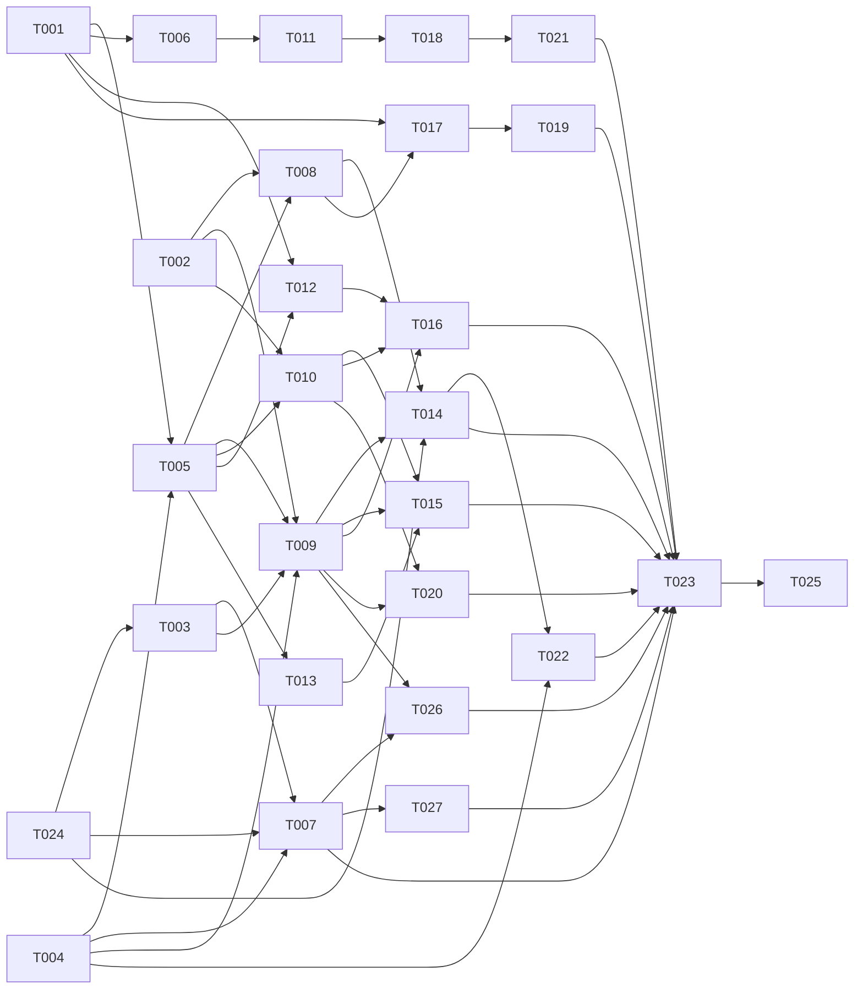

# Tasks: Nhập Word thành tài liệu hub

**Input**: [spec.md](spec.md), [plan.md](plan.md), [research.md](research.md)

## Quy ước

- **Định dạng**: `[ID] [P?] [Story] [Tier] · ước lượng`.
  - **[P]**: chạy song song được với task khác cùng đợt. Bộ file không giao nhau và không chờ task chưa xong.
  - **Tier**: chọn model theo CLAUDE.md.
    - **nặng** = Opus `--effort high` (nhiều module, giao thức, hiệu năng, bảo mật);
    - **vừa** = Sonnet `--effort high` (một màn UI, CRUD + e2e);
    - **nhẹ** = Sonnet `--effort medium` (chữ, tài liệu).
  - **Ước lượng**: ngày-agent (một agent làm liên tục, gồm test). **[Suy luận]** theo cỡ spec 018 và plan.md "Phân đợt
    và ước lượng".
- **Đợt và giai đoạn**: "Đợt N" ở file này là đợt chạy song song. "Giai đoạn" là cột "Đợt" ở plan.md "Phân đợt và ước
  lượng" (0, 1, 1b, 2, 2b, 3). Dòng đầu của Goal ghi giai đoạn của task.
- **Giai đoạn 0 đã xong**: editor FR-015 (` ` trong ô bảng) và FR-016 (mục danh sách rỗng) ở PR #416, đã merge vào
  `main`, có trong v0.2.22. Không có task. Task nào thấy editor còn lỗi thì ghi bàn giao, không sửa
  `packages/doc-editor`.
- **Giả định**: Q1–Q15 đã chốt (spec.md "Câu hỏi đã chốt"). Q9 hiểu là nhận `.docx`, `.odt`, `.doc`.
- **PHẠM VI**: chỉ được sửa các file liệt kê. Hai task cùng đợt không có file chung. Cần sửa file ngoài phạm vi thì ghi
  vào ghi chú bàn giao, người điều phối xếp lại.
- **Worktree**: mỗi task một worktree, chặn push. Agent chỉ commit tại máy. Người điều phối xem lại, chạy test, rồi push
  và mở PR.
- **Tách file so với plan.md "Cấu trúc file"**: `word/routes.ts` của plan tách thành `word/{upload,media,original}.ts`;
  oRPC tách thành `docsync/routes/word-*.ts`; thêm `word/{postprocess,tools,blob-refs}.ts` và
  `docsync/asset-orphans.ts`. Lý do: các task cùng đợt không chung file.
- **File chung có chủ**:
  - `packages/contracts/**` và `openapi.json`: chỉ T001, cho mọi giai đoạn (kể cả P2, P3). Task sau thấy thiếu thì ghi
    bàn giao, không tự sửa.
  - Mọi `schema.ts` và migration: chỉ T005. Một migration cho cả spec, gồm cả cột của P2 và Q15. Task sau không đổi
    bảng.
  - `apps/hub/package.json`: chỉ T007 (script `word:corpus`). Spec không thêm gói npm (plan.md "Technical Context"), nên
    `pnpm-lock.yaml` không đổi. Task nào thấy cần gói mới thì ghi bàn giao.
  - `apps/hub/src/modules/docsync/{index.ts,router.ts,jobs.ts,queues.ts}`, `apps/hub/src/main.ts`,
    `apps/hub/src/app.ts`, `apps/hub/src/modules/system/router.ts` (`/api/v1/health`): T005 tạo khung. Mỗi phần có file
    riêng, T005 tạo dạng rỗng (ném `NOT_IMPLEMENTED`, `register<Phần>` không làm gì, chữ ký hàm như plan). Task sau chỉ
    sửa file của phần mình:
    - `word/upload.ts` (T008), `word/media.ts` (T009, rồi T016), `word/original.ts` (T020);
    - `word/convert.ts` (T009, rồi T014), `word/{commit,link}.ts` (T010), `word/update.ts` (T015),
      `word/staging.ts` (T016), `word/soffice.ts` (T014);
    - `routes/word-imports.ts` (T009, rồi T020), `routes/{word-commit,word-link}.ts` (T010), `routes/word-staging.ts`
      (T016).
    - Riêng `main.ts`: T016 thêm một dòng đăng ký hook duyệt đề xuất (Đợt 3, không task nào khác trong đợt sửa file
      này).
  - `apps/hub/src/modules/knowledge/{docs.ts,index.ts}`: T005 (`saveDoc` nhận `source`; export `authorize`,
    `assertDocSecrets`). Rồi T012 (Đợt 2) sửa `index.ts` để export hook duyệt.
  - `apps/hub/src/modules/platform/magic.ts`: chỉ T008. `platform/config.ts`: chỉ T005 (mọi biến ở plan.md mục 13).
  - `Dockerfile`, `.github/workflows/ci.yml`: T004 (pandoc), rồi T014 (LibreOffice, Đợt 3).
  - `apps/hub/src/modules/docsync/word/fixtures/**` và `word/filter.lua`: T003, rồi T026 (Đợt 2). T014 thêm `.doc`
    vào fixtures (Đợt 3). `.gitattributes` gốc: chỉ T003.
  - `apps/hub/src/modules/docsync/word/{pandoc.ts,pandoc.test.ts}`: T004, rồi T009 (`--eol=lf`, Đợt 2).
    `word/filter.test.ts`: T003, rồi T009.
  - `apps/hub/scripts/word-corpus.ts`: T007, rồi T027. `apps/hub/tsconfig.json`: chỉ T027.
  - `specs/019-word-import/research.md` mục 6: T007, rồi T027.
  - `apps/web/src/router.tsx`, `apps/web/e2e/fake-hub.ts`: chỉ T006. T006 tạo sẵn route và trang rỗng cho T011, T021,
    và fixture `apps/web/e2e/word-import-fixture.ts`. T011, T018, T021 chỉ thêm vào fixture này (khác đợt).
  - `apps/web/src/pages/knowledge/doc-editor-page.tsx`: T011, rồi T018, rồi T021 (khác đợt).
  - Desktop: `apps/desktop/src-tauri/{src/lib.rs,build.rs,capabilities/app.json,Cargo.toml,Cargo.lock}`: chỉ T017.
    `apps/desktop/src/lib/{i18n.ts,nav.ts}`, `apps/desktop/src/screens/index.ts`: chỉ T019.
- Mỗi task kèm test trong cùng commit.
- **Kiểm tra theo loại task**:
  - Hub: `pnpm --filter @xdev-hive/hub typecheck`, `pnpm --filter @xdev-hive/hub test` (test DB cần Docker, xem
    AGENTS.md).
  - Contracts: `pnpm --filter @xdev-hive/contracts test`, `pnpm openapi`, `git diff --exit-code openapi.json` sau khi
    commit.
  - Web, desktop: `typecheck`, `test` của package đó. Web: Playwright file của task
    (`pnpm --filter @xdev-hive/web e2e -- <file>`). Desktop Rust: `cargo test`, `cargo clippy` trong
    `apps/desktop/src-tauri`.
  - Image: `docker build .` khi máy có Docker đang chạy. Agent không tự mở Docker Desktop hay Rancher Desktop; không có
    Docker thì ghi bàn giao.
  - Mọi task: `pnpm biome check --write .`, `pnpm deps`. Không chạy `pnpm ci:local` toàn bộ.
- **Test cần pandoc hoặc LibreOffice**: trong CI thì **fail** khi thiếu binary; tại máy thì **skip** kèm thông báo
  (plan.md mục 12, 12b). Máy dev cài pandoc 3.12 (`brew install pandoc` hoặc `winget install JohnMacFarlane.Pandoc`).
- **Migration**: chỉ T005 sinh, ở bước cuối, sau khi rebase lên `main` mới nhất. Ngày 2026-10-17 file mới nhất trên
  `main` là `0077_code_review_comment_links.sql`, nên file mới dự kiến là `0078`. Spec 020 (nhánh `ai/CICDCONSOLE`) cũng
  thêm bảng: kiểm lại số lúc làm.
- **Số ADR và mục SRS**: ADR 0029 (`docs/adr` hiện tới 0028; spec 020 dành 0030, 0031). SRS mục 3.24 `WIMP-…`
  (`docs/srs.md` hiện tới 3.23; spec 020 cũng thêm mục và chọn số khi gộp). Kiểm lại lúc làm T022.
- **Provider thật**: mọi test tự động dùng provider `memory` của `scm`. Không task agent nào gọi GitHub/GitLab thật. Chỉ
  T025 (chủ dự án) thử trên hub thật. Không commit token.
- **Dữ liệu thật**: 261 SRS ACME và `tools/srs2md` nằm ngoài repo này. Không commit file Word, Markdown hay ảnh của
  bộ thật; chỉ ghi số liệu tổng và mã tài liệu. File mẫu của test sinh bằng `make-fixtures.py`.

## Đợt 0: hợp đồng, bộ lọc, pandoc, phần thuần (song song)

- [x] **T001 [P] [—] [nặng] · 1 ngày — Hợp đồng API cho mọi giai đoạn**
  - **Goal**: giai đoạn 1, làm trước cho cả 1b, 2, 2b, 3. Constitution I, plan.md mục 1, 2, 5, 6, 8, 8b, 9, 11.
    - `doc-sync.ts`:
      - `wordImportsContract`: `get`, `list` (theo nhà, phân trang), `file` (Markdown một file), `update` (`path?`,
        `title?`, `keepFront?`, `excluded?`), `commit` (`fileIds?`, `acknowledgeSecrets?`), `cancel`, `confirmLink`
        (FR-028), `approve` (P2, Q14), `ofDoc` (P3, US5). `get` trả quyền của người hỏi ở phạm vi đích (`manage` hay chỉ
        `propose`) để giao diện chọn "Tạo" hay "Gửi duyệt";
      - schema route multipart `POST /api/v1/docs/word-imports`: `homeId`, `targetDir`, `mode` (`create` | `update` |
        `link`), `docKey?`, `confidential?`, `files[]`, `relativePaths[]`, `lastModified[]`; phản hồi `{importId}`;
      - trạng thái lượt và file theo spec "Key Entities", thêm `proposed` (P2) và `cancelled` **[Suy luận]**;
      - mã cảnh báo cố định (`nested_table`, `equation`, `footnote`, `emf_image`, `tracked_changes`, `comments`,
        `no_h1`, `textbox`, `skipped_older`) kèm chữ tiếng Việt dùng chung cho web và desktop;
      - lỗi `WORD_IMPORT_*` tiếng Việt có cách sửa (FR-022, Edge Cases): có mật khẩu, không phải Word, quá lớn, quá giới
        hạn lượt, hub chưa bật `.doc`, hub chưa bật nhập Word, quá 200.000 ký tự, đã có, trùng đường dẫn trong lượt,
        ngoài thư mục nhà, cần quyền quản lý;
      - `docConflicts`: `origin` (`repo` | `word`), `repoCommit` cho phép rỗng (P2, plan.md mục 8);
      - `docHomes`: `wordImportConfidential` ở trạng thái nhà và input `configureOrg` (Q15).
    - `knowledge.ts`: nguồn phiên bản thêm `word`; đề xuất có `origin?` (`{kind: "word", importFileId}`, P2).
    - `projects.ts`: `settings.docs.wordImportConfidential` `.default(false)` (Q15). Test: settings cũ vẫn parse.
    - `index.ts`: `healthOutput` thêm `wordImport`, `wordImportDoc` (FR-023), giữ tương thích với worker Go.
  - **PHẠM VI**:
    - `packages/contracts/src/{doc-sync.ts,doc-sync.test.ts,knowledge.ts,projects.ts,projects.test.ts,index.ts}`
    - `openapi.json`
  - **Kiểm**: contracts test, `pnpm openapi`, typecheck hub và web vẫn qua (route chưa có handler thì ghi bàn giao tới
    khi T005 xong).

- [x] **T002 [P] [US2] [vừa] · 1 ngày — Phần thuần: tên, phiên bản, hậu xử lý Markdown**
  - **Goal**: giai đoạn 1. FR-006, FR-010 (link ảnh), FR-012, FR-013, plan.md mục 3 bước 5, mục 4, research.md mục 1.
    Hàm thuần, không đụng DB hay pandoc:
    - `names.ts`: `stripVersion`, `commonPrefix` (tính riêng từng thư mục con, chỉ khi ≥ 2 file và phần còn lại không
      rỗng), `slug` (bỏ dấu, kiểm bằng `docKey`), `proposePath(targetDir, relativeDir, name)`, `pick(files)` theo thứ
      tự phiên bản → bản sao `_n` → tên chuẩn → `lastModified` → tên file. Đảo thứ tự đầu vào không đổi kết quả.
    - `postprocess.ts`:
      - đổi tên ảnh `media/*` thành `<12 ký tự đầu SHA-256>.<đuôi>` và thay link;
      - `relinkImages(markdown, docPath, assetsDir)` dùng `relativeFrom` của `docsync/assets.ts`, vì đường dẫn tài liệu
        đổi được ở xem trước (plan.md mục 6);
      - `frontMatter({title, file, sha256, confidential})` theo FR-012, tất định. `confidential: true` khi người nhập
        chọn "Tài liệu mật" (Q15), theo quy ước `splitFrontMatter` ở `knowledge/doc-search.ts` **[Suy luận]**;
      - `countStats` (tiêu đề, bảng, ảnh); `parsePandocLog(json)` lấy cảnh báo `ScriptingWarning` có mã cố định.
    - Test lấy 10 biến thể tên ở research.md mục 1 (`HC_`, `_` thay `.`, dấu cách trước `v`, hậu tố ` -`, thiếu mã), hai
      bản cùng mã, tên tiếng Việt có dấu và dấu cách.
  - **PHẠM VI**:
    - `apps/hub/src/modules/docsync/word/{names.ts,postprocess.ts}` (mới) + `names.test.ts`, `postprocess.test.ts`
  - **Kiểm**: hub test (các file test mới), typecheck.

- [x] **T003 [P] [US1] [nặng] · 2 ngày — Bộ lọc Lua chuẩn và bộ mẫu vàng**
  - **Phụ thuộc**: T024 (bản sao `srs.lua`).
  - **Goal**: giai đoạn 1. FR-007…FR-011, FR-013, FR-014, SC-002, plan.md mục 3 bước 4, mục 14 "Vàng".
    - Chép `tools/srs2md/srs.lua` của repo `acme-ai/docs` (repo riêng, không sửa ở đây) thành `filter.lua`. Đầu
      file ghi `FILTER_VERSION` và commit gốc đã chép. Từ đây bản của hub là bản chuẩn (FR-014).
    - Thêm vào bộ lọc:
      - bỏ mục danh sách rỗng; dàn bảng lồng thành chữ trong ô; bỏ màu, tô nền, gạch chân nhưng giữ chữ;
      - ô nhiều đoạn nối ` `; danh sách trong ô thành `1.`/`•` theo số bắt đầu của Word; chú thích bảng thành đoạn
        ngay trước bảng; hình có chú thích thành ảnh và một đoạn nghiêng ngay sau;
      - bỏ đoạn mục lục (`#_Toc…`), ``, link nội bộ thành chữ thường;
      - bỏ phần trước tiêu đề cấp 1 đầu tiên, trừ khi có `--metadata keep-front=true` (Q5);
      - cảnh báo qua `pandoc.log.warn` với mã cố định của T001 (chưa có thì dùng danh sách ở plan.md mục 3 bước 4).
    - `fixtures/make-fixtures.py` (python-docx, như test của `srs2md`) sinh `.docx` mẫu: ô gộp ngang và dọc, STT tự
      động, style tiêu đề riêng kế thừa `Heading N`, ảnh kèm chú thích, trang bìa, mục lục, gạch chân, mục danh sách
      rỗng, bảng lồng, ảnh EMF, theo dõi thay đổi, bình luận. Thêm một `.odt` cùng nội dung (đổi bằng
      `soffice --convert-to odt` tại máy dev). Commit file sinh ra và `*.md` vàng đã duyệt bằng mắt.
    - `.gitattributes` gốc: `apps/hub/src/modules/docsync/word/fixtures/** -text`, để checkout Windows không đổi LF.
    - `filter.test.ts`: chạy pandoc với đúng tham số ở plan.md mục 3 bước 3, so từng byte với `*.md` vàng, chạy hai lần
      ra cùng byte (FR-013). Nạp `*.md` vàng vào `MarkdownCodec` (đọc codec như `roundtrip.test.ts`, không thêm phụ
      thuộc): mọi bảng thành `table`, không còn thẻ HTML ngoài ` ` trong ô.
  - **PHẠM VI**:
    - `apps/hub/src/modules/docsync/word/filter.lua` (mới), `word/filter.test.ts` (mới), `word/fixtures/**` (mới)
    - `.gitattributes` (một dòng)
  - **Kiểm**: hub test (cần pandoc 3.12), typecheck.
  - **Bàn giao**: `FILTER_VERSION` và danh sách quy tắc mới so với `srs.lua`, để T023 chuyển cho chủ dự án.

- [x] **T004 [P] [—] [nặng] · 1 ngày — pandoc: chạy có giới hạn, kiểm phiên bản, đóng gói**
  - **Goal**: giai đoạn 1. FR-003 và FR-023 (phần pandoc), SC-005, plan.md mục 3 bước 3, mục 12, R1, R2, R8.
    - `pandoc.ts`:
      - `detectPandoc(path)`: chạy `--version`, so với bản ghim 3.12, trả `{ok, version, reason}`;
      - `runPandoc({path, input, from, cwd, filter, keepFront, timeoutMs, memoryMb})`: `spawn` không qua shell, `cwd`
        là thư mục tạm, env tối thiểu, `--sandbox`, `--extract-media`, `--log`, `+RTS -M<n>m -RTS`; quá giờ thì
        `SIGKILL`; stderr cắt ngắn, bỏ đường dẫn tạm; trả Markdown, thư mục media, log.
    - Test: pandoc giả treo và pandoc giả thoát lỗi trong `word/test-bin/` (chạy được cả trên máy dev Windows); tiến
      trình bị giết đúng hạn, hub không chờ; bản pandoc cũ bị từ chối.
    - `Dockerfile`: stage `pandoc` với `ARG PANDOC_VERSION=3.12`, `PANDOC_SHA256_AMD64`, `PANDOC_SHA256_ARM64`; tải
      release chính thức trên GitHub, `sha256sum -c`; chép `bin/pandoc` vào `/usr/local/bin` của stage `runtime`.
    - Đường dự phòng khi máy chủ không ra được GitHub: tarball đặt sẵn ở `deploy/vendor/` (thêm vào `.gitignore`).
    - `.github/workflows/ci.yml`: cài đúng bản ghim cho job chạy test hub, cache theo phiên bản.
  - **PHẠM VI**:
    - `apps/hub/src/modules/docsync/word/pandoc.ts` (mới) + `pandoc.test.ts`, `word/test-bin/**` (mới)
    - `Dockerfile`, `.github/workflows/ci.yml`, `.gitignore`
  - **Kiểm**: hub test, typecheck; `docker build .` (amd64; arm64 nếu máy có buildx); CI xanh trên nhánh.
  - **Bàn giao**: dung lượng image trước và sau (cho ADR 0029 ở T022); kết quả kiểm máy chủ của T024.

- [ ] **T024 [—] [người: chủ dự án] · 0,5 ngày người — Chuẩn bị: bộ lọc gốc, dữ liệu thật, máy chủ**
  - **Còn thiếu**: bộ lọc gốc và bộ 261 SRS đã dùng (T003, T007, research.md mục 6); chưa có ghi nhận kết quả kiểm máy chủ tải được release pandoc và gói LibreOffice Writer (cho T004, T014).
  - **Goal**:
    - đưa bản sao `tools/srs2md/srs.lua` (kèm commit) của repo `acme-ai/docs` cho T003, đặt ngoài repo này;
    - chỉ máy có thư mục 261 SRS (OneDrive) cho T007 và T023;
    - kiểm máy chủ `hive.example.com` tải được release pandoc trên GitHub khi dựng image (plan.md mục 12
      **[Unverified]**) và cài được gói LibreOffice Writer từ kho Debian (mục 12b); báo kết quả cho T004, T014.
  - **PHẠM VI**: không sửa file. Không gửi token qua chat, issue hay commit.
  - **Xong khi**: làm trước khi giao T003. Người điều phối ghi kết quả vào bàn giao của T004.

## Đợt 1: nền (song song, sau Đợt 0)

- [x] **T005 [P] [—] [nặng] · 1,5 ngày — Bảng, RLS, migration, cấu hình, khung `docsync/word`**
  - **Phụ thuộc**: T001, T004 (`detectPandoc`).
  - **Goal**: giai đoạn 1, bảng cho mọi giai đoạn. Plan.md mục 1, 8, 9, 13; spec "Key Entities"; FR-017 (nguồn `word`),
    FR-023 (health), Q15.
    - `docsync/schema.ts`:
      - `doc_word_imports`, `doc_word_import_files` (cột ở plan.md mục 1, trạng thái theo T001,
        `unique (import_id, relative_dir, file_name)`);
      - `doc_conflicts`: `origin` (mặc định `repo`), `base_content`, `repo_commit` cho phép rỗng khi `origin = 'word'`;
      - `doc_assets_state` thêm `pending_delete`; `doc_homes.word_import_confidential` (mặc định `false`).
    - `knowledge/schema.ts`: `doc_versions_source` thêm `word`; `proposals.origin jsonb` (P2).
    - RLS: `ENABLE` + `FORCE ROW LEVEL SECURITY`, policy `<bảng>_rw` theo `hive.ctx_org()`, quyền cho `hive_app`; thêm
      hai bảng mới vào `rls.db.test.ts`.
    - `platform/config.ts`: bảy biến ở plan.md mục 13, kèm test.
    - `knowledge`: `saveDoc(tx, principal, input, {source})` cho module khác (không mở qua oRPC); `index.ts` export
      `authorize`, `assertDocSecrets`.
    - Khung `docsync`:
      - `queues.ts`: `docsync-word-import`, `docsync-word-doc`; `jobs.ts`: `registerDocSync` gọi `registerWordImport`,
        `registerWordDoc`, `registerWordStaging`;
      - `router.ts`: `wordImports` gộp `routes/word-*.ts`; `index.ts` export các handler route;
      - file rỗng (xem "File chung có chủ"), với chữ ký để T009, T010 gọi được ngay: `prepareLink`, `confirmLink`
        (`link.ts`), `prepareUpdate`, `commitUpdate` (`update.ts`), `stageProposal` (`staging.ts`);
      - `word/tools.ts`: dò pandoc (`detectPandoc`) và LibreOffice (`detectSoffice` của `soffice.ts`, rỗng thì `false`)
        lúc khởi động; `word/blob-refs.ts`: tham chiếu `blob_id`, `images[].blobId` cho GC (ADR 0028 mục 5).
    - `main.ts`: dò công cụ, `provideBlobRefs("docsync-word", …)`. `app.ts`: gắn `POST /api/v1/docs/word-imports`,
      `GET …/:id/files/:fileId/media/:name`, `GET …/:id/files/:fileId/original` tới hàm rỗng, qua `auth` đã bọc
      `withPersonalTokens`. `system/router.ts`: `wordImport`, `wordImportDoc`.
    - `homes.ts`, `routes/homes.ts`: đọc và ghi `wordImportConfidential` từ `settings.docs` và `configureOrg`.
    - `word/source.db.test.ts`: bản lưu nguồn `word` tạo dòng chờ đẩy, nguồn `import` thì không (plan.md mục 1).
  - **PHẠM VI**:
    - `apps/hub/src/modules/docsync/schema.ts`, `apps/hub/src/modules/knowledge/schema.ts`
    - `apps/hub/src/modules/docsync/{queues.ts,jobs.ts,jobs.test.ts,router.ts,index.ts,homes.ts,rls.db.test.ts}`,
      `docsync/routes/homes.ts`, `homes.db.test.ts`
    - `apps/hub/src/modules/docsync/word/{tools.ts,blob-refs.ts,source.db.test.ts}` (mới)
    - `apps/hub/src/modules/docsync/word/{upload,media,original,convert,commit,link,update,staging,soffice}.ts` (mới,
      rỗng)
    - `apps/hub/src/modules/docsync/routes/{word-imports,word-commit,word-link,word-staging}.ts` (mới, rỗng)
    - `apps/hub/src/modules/knowledge/{docs.ts,index.ts}`, `apps/hub/src/modules/platform/{config.ts,config.test.ts}`
    - `apps/hub/src/modules/system/router.ts`, `apps/hub/src/main.ts`, `apps/hub/src/app.ts`
    - `apps/hub/db/migrations/*` (một file mới + meta)
  - **Kiểm**: hub typecheck, `rls.db.test.ts`, `migrations-upgrade.db.test.ts` từ `0077`, `pnpm deps`.

- [x] **T006 [P] [US1] [vừa] · 1 ngày — Web: hộp thoại "Nhập Word", khung route, cài đặt "Tài liệu mật"**
  - **Phụ thuộc**: T001.
  - **Goal**: giai đoạn 1. FR-001, FR-002 (chặn sớm ở trình duyệt), FR-023 (ẩn nút), Q8, Q15, plan.md mục 11.
    - `word-import-dialog.tsx`:
      - chọn nhà và thư mục đích (gợi ý từ cây tài liệu, mặc định gốc nhà);
      - chọn nhiều file, chọn thư mục (`webkitdirectory`), kéo thả; lọc `.docx`, `.odt`, `.doc` (`.doc` tắt khi
        `wordImportDoc: false`);
      - tổng số file và dung lượng; chặn sớm khi quá 100 file, 500 MiB hoặc một file quá 50 MiB;
      - ô "Tài liệu mật", mặc định theo `wordImportConfidential` của nhà;
      - tải lên bằng `XMLHttpRequest` có tiến độ, gửi `relativePaths`, `lastModified`; xong thì mở trang lượt nhập;
      - nhận `mode` (`update`, `link`) và `docKey` qua props, cho T011, T018.
    - Nút "Nhập Word" cạnh `NewDoc` (`docs-page.tsx`), link cạnh "Nhập từ repo" (`project-docs-settings.tsx`). Ẩn khi
      `wordImport: false`; khi đó cài đặt tài liệu dự án nói cách bật (pandoc, `docs/self-hosting.md`). Spec Edge Cases
      gọi chỗ này là "trang quản trị": chọn cài đặt tài liệu dự án là **[Suy luận]**.
    - Công tắc "Tài liệu mật khi nhập Word" ở `project-docs-settings.tsx` và `org-docs-repo-card.tsx` (Q15).
    - `build-info.ts`: đọc `wordImport`, `wordImportDoc` từ `/api/v1/health`.
    - Khung: route `/knowledge/docs/word-imports/$id` (T011) và `/knowledge/docs/word-imports` (T021) trỏ tới trang
      rỗng; fixture `e2e/word-import-fixture.ts` (health, nhà, tải lên giả) nối vào `fake-hub.ts`.
    - Chữ tiếng Việt, theo Navy Hive (PR #410), 360 px, sáng/tối, bàn phím.
  - **PHẠM VI**:
    - `apps/web/src/components/word-import-dialog.tsx` (mới) + test
    - `apps/web/src/pages/knowledge/{docs-page.tsx,org-docs-repo-card.tsx}`
    - `apps/web/src/pages/project-docs-settings.tsx`
    - `apps/web/src/pages/knowledge/{word-import-page.tsx,word-imports-page.tsx}` (mới, rỗng)
    - `apps/web/src/lib/build-info.ts` (+ test), `apps/web/src/router.tsx`
    - `apps/web/e2e/fake-hub.ts`, `apps/web/e2e/word-import-fixture.ts` (mới), `apps/web/e2e/word-import-dialog.spec.ts`
      (mới)
  - **Kiểm**: web typecheck, test, Playwright `word-import-dialog.spec.ts` (360 px, bàn phím).

- [x] **T007 [P] [—] [vừa] · 0,5 ngày — Bộ thật: script `word:corpus`, chạy lần đầu trên 261 SRS**
  - **Phụ thuộc**: T003, T004, T024 (máy có dữ liệu).
  - **Goal**: giai đoạn 1. SC-001, plan.md mục 14 "Bộ thật", R3, R4.
    - `apps/hub/scripts/word-corpus.ts`: nhận một thư mục Word; chạy `runPandoc` + `filter.lua` từng file, 2 file cùng
      lúc; nạp kết quả vào `MarkdownCodec` (đọc như `roundtrip.test.ts`, không thêm phụ thuộc); in số file lỗi, số tài
      liệu làm codec ném lỗi, tỉ lệ bảng thành `table`, thẻ HTML còn sót ngoài ` ` trong ô, thời gian mỗi file. Chi
      tiết ghi ra thư mục tạm ngoài repo.
    - Script `word:corpus` trong `apps/hub/package.json`.
    - Chạy trên 261 SRS tại máy có dữ liệu. Ghi số liệu tổng vào research.md mục 6 "Kết quả bộ thật lần 1". Lỗi của bộ
      lọc ghi thành task mới, không sửa `filter.lua` ở task này.
  - **PHẠM VI**:
    - `apps/hub/scripts/word-corpus.ts` (mới), `apps/hub/package.json` (một dòng script)
    - `specs/019-word-import/research.md` (thêm mục 6)
  - **Kiểm**: chạy script trên `word/fixtures` ra đúng số liệu của bộ mẫu. Không có file nào của bộ thật trong commit.

## Đợt 2: lõi nhập, nền cho P2 (song song, sau Đợt 1)

- [x] **T008 [P] [US1] [nặng] · 1 ngày — Nhận file: route multipart, nhận dạng `.odt`, `.doc`, file có mật khẩu**
  - **Phụ thuộc**: T002, T005.
  - **Goal**: giai đoạn 1. FR-002, FR-003 (lưu file gốc), FR-006 (áp tên), FR-021 (tạo lượt), SC-005, SC-007, plan.md
    mục 2, spec Edge Cases.
    - `magic.ts`: nhận `.odt` (ZIP có `mimetype` OpenDocument Text) và `.doc`. File OLE (`D0 CF 11 E0`): đọc thư mục
      OLE; có luồng `EncryptedPackage` là file có mật khẩu, có `WordDocument` là `.doc`. Giới hạn số sector và độ dài
      chuỗi; OLE hỏng thì "không phải Word". Test bằng file OLE nhỏ dựng trong test.
    - `upload.ts` (`handleWordUpload`):
      - phiên web hoặc token cá nhân: `deps.auth` đã bọc `withPersonalTokens` (`app.ts`), nên route của desktop (Q12)
        làm luôn ở đây; tổ chức từ `x-hive-org`; `requireOrgRole(member)`;
      - `authorize(propose)` ở phạm vi suy từ thư mục đích (`keyFromPath`, `scopeOfDocKey`); ngoài gốc nhà thì từ chối;
      - kiểm `content-length`, số file, dung lượng lượt, từng file; đuôi khớp nội dung; `.doc` bị từ chối khi
        `wordImportDoc` tắt (`tools.ts`);
      - `BlobStore.put` theo luồng, không đọc cả lượt vào bộ nhớ;
      - một giao dịch: ghi lượt, các file (`queued`; tên, đường dẫn đề xuất từ `names.ts`; bản bị `pick` bỏ thì
        `skipped` kèm lý do), `enqueue` từng file, `recordAudit`;
      - `mode` `update` hoặc `link` cần `docKey` của tài liệu có sẵn và đúng một file.
    - Test: phiên web và token cá nhân; token của tổ chức khác; người không có `propose`; file có mật khẩu, file đổi
      đuôi, quá từng giới hạn; 30 file có 2 mã hai phiên bản (US2 kịch bản 1).
  - **PHẠM VI**:
    - `apps/hub/src/modules/platform/{magic.ts,magic.test.ts,index.ts}`, `platform/ole.ts` (mới, nếu tách) + test
    - `apps/hub/src/modules/docsync/word/upload.ts` + `upload.db.test.ts` (mới)
  - **Kiểm**: hub test, typecheck, `pnpm deps`.

- [x] **T009 [P] [US1] [nặng] · 2 ngày — Job chuyển, xem trước, ảnh xem trước**
  - **Phụ thuộc**: T002, T003, T004, T005.
  - **Goal**: giai đoạn 1. FR-003, FR-004, FR-005, FR-010, FR-012, FR-018 (đánh dấu), FR-019 (kiểm ở xem trước),
    US2 kịch bản 2 và 4, plan.md mục 3, 5.
    - `convert.ts` (`registerWordImport`, 2 worker mỗi tiến trình hub, theo mẫu job `docsync-extract`):
      - `mkdtemp`, xoá trong `finally`; `.docx`, `.odt` qua `readZip(bytes, EXTRACT_LIMITS)`;
      - `runPandoc` (`-f odt` cho `.odt`); hậu xử lý bằng `postprocess.ts`; ảnh vào BlobStore; EMF/WMF giữ làm đính
        kèm, link tải, cảnh báo (Q10);
      - quá `DOC_MAX_CHARS` thì `failed`; `scanSecrets` có kết quả thì `blocked_secret` (loại và dòng, không giá trị);
      - ghi kết quả, cập nhật `counts`; hub khởi động lại thì chạy tiếp, không tạo trùng (bỏ qua file đã `ready`);
      - `mode = link` gọi `prepareLink`, `mode = update` gọi `prepareUpdate` (rỗng tới T010, T015).
    - `routes/word-imports.ts`: `get`, `list`, `file`, `update` (đổi đường dẫn thì kiểm trùng trong lượt và với tài
      liệu có sẵn; `keepFront` đổi thì xếp chuyển lại), `cancel`.
    - `media.ts`: ảnh giữ tạm của một file; chỉ người tạo lượt và người `manage` ở phạm vi đích; SVG trả `attachment`
      (CSP) như đính kèm; `Cache-Control: private`.
    - `filter.test.ts` chuyển sang gọi `runPandoc`; test của job so Markdown với `*.md` vàng của T003.
    - Hai việc T007 tìm thấy (PR #438, research.md mục 6):
      - `runPandoc` truyền `--eol=lf`, để kết quả trên Windows giống Linux; bỏ `--eol=lf` tự thêm trong `filter.test.ts`;
      - biểu thức kiểm thẻ HTML trong `filter.test.ts` không tính `\<` (dấu `<` đã escape) là thẻ.
    - Test: zip bomb, quá 200.000 ký tự, pandoc treo (SC-005), token giả trong file, logo lặp chỉ một blob (US2 kịch bản
      4), hai file cùng đường dẫn bị chặn; `runPandoc` có `--eol=lf`; `\<b>` không bị tính là thẻ.
  - **PHẠM VI**:
    - `apps/hub/src/modules/docsync/word/{convert.ts,media.ts,filter.test.ts}`, `word/postprocess.ts` (nếu cần)
    - `apps/hub/src/modules/docsync/word/{pandoc.ts,pandoc.test.ts}`
    - `apps/hub/src/modules/docsync/routes/word-imports.ts`
    - `apps/hub/src/modules/docsync/word/{convert.db.test.ts,preview.db.test.ts}` (mới)
  - **Kiểm**: hub test (cần pandoc), typecheck.

- [x] **T010 [P] [US1] [nặng] · 1,5 ngày — Tạo tài liệu, gắn tài liệu có sẵn với file Word**
  - **Phụ thuộc**: T002, T005.
  - **Goal**: giai đoạn 1. FR-017…FR-021, FR-028, US1 kịch bản 2, 3, 5, 6, US6, SC-006, plan.md mục 6, 7, 8b.
    - `commit.ts` + `routes/word-commit.ts` (`wordImports.commit`), mỗi file một giao dịch:
      - `authorize(manage)`; thiếu quyền thì gọi `stageProposal` (rỗng tới T016; tới đó báo "Cần quyền quản lý tài
        liệu", Q2);
      - kiểm lại key đã có trong giao dịch (FR-019; hai người cùng tạo thì một người thắng);
      - `assertDocSecrets`; `acknowledgeSecrets` ghi audit kèm hash nội dung (FR-018);
      - `doc_repo_files` đúng đường dẫn đã chọn, giữ hoa thường, `pending`; `saveDoc(…, {source: "word"})` với Markdown
        đã `relinkImages` theo đường dẫn cuối;
      - ảnh: dùng lại dòng `doc_assets` cùng đường dẫn và hash; không có thì dòng `pending_push` trỏ `blob_id` sẵn có;
      - `recordAudit`, `queuePush`; file `done` kèm `doc_id`, `doc_version`;
      - `mode = update` gọi `commitUpdate` (rỗng tới T015).
    - `link.ts` + `routes/word-link.ts`: `prepareLink` so kết quả chuyển với nội dung hiện tại sau khi bỏ front matter,
      link ảnh hai bên chuẩn về tên ảnh; khớp thì file `done` không có `doc_version`; không khớp thì chờ `confirmLink`
      (audit). Không ghi ảnh vào nhà ở bước này.
    - Test chèn file `ready` thẳng vào bảng, không chờ T009. Với provider `memory`: lô đẩy là một commit (hoặc một lần
      cập nhật PR) có Markdown và ảnh, không có file Word gốc (Q6); bí mật bị chặn rồi xác nhận có audit; trùng đường
      dẫn; `OPD/OPD02.md` giữ hoa thường; gắn khớp và không khớp (US6).
  - **PHẠM VI**:
    - `apps/hub/src/modules/docsync/word/{commit.ts,link.ts}` + `commit.db.test.ts`, `link.db.test.ts` (mới)
    - `apps/hub/src/modules/docsync/routes/{word-commit.ts,word-link.ts}`
  - **Kiểm**: hub test, typecheck, `pnpm deps`.

- [x] **T011 [P] [US1] [vừa] · 1,5 ngày — Web: trang lượt nhập, gắn với file Word**
  - **Phụ thuộc**: T006 (API từ T009, T010 dùng qua fixture).
  - **Goal**: giai đoạn 1. FR-005, FR-018 và FR-019 (giao diện), FR-022, US1, US2, US6, plan.md mục 11.
    - `word-import-page.tsx` (`/knowledge/docs/word-imports/$id`):
      - hỏi `wordImports.get` mỗi 2 giây tới khi mọi file xong;
      - bảng file: tên gốc, đường dẫn sửa tại chỗ, phiên bản, trạng thái, số cảnh báo; lọc theo trạng thái;
      - ngăn bên: editor chỉ đọc với `resolveLink` tới route ảnh xem trước, cảnh báo dịch theo mã, công tắc "Giữ phần
        trước tiêu đề đầu tiên";
      - bí mật: hiện loại và dòng, không hiện giá trị; người `manage` thấy "Không phải bí mật, vẫn nhập";
      - "đã có": "Đổi tên" và "Cập nhật từ Word" (tắt tới T018);
      - nút "Tạo N tài liệu", rồi báo cáo kèm link từng tài liệu và lý do lỗi tiếng Việt.
    - Lượt `link`: khác biệt từng khối bằng `ConflictView`, nút "Lấy bản chuyển làm gốc" và "Huỷ".
    - `doc-editor-page.tsx`: nút "Gắn với file Word" trên tài liệu chưa có lần nhập, mở hộp thoại của T006 ở chế độ
      `link`.
    - Playwright: chọn 3 file mẫu, xem trước, sửa tên, tạo, mở tài liệu thấy bảng sửa được và ảnh (plan.md mục 14 E2E).
  - **PHẠM VI**:
    - `apps/web/src/pages/knowledge/word-import-page.tsx`, `word-import-file-panel.tsx` (mới) + test
    - `apps/web/src/pages/knowledge/doc-editor-page.tsx`
    - `apps/web/e2e/word-import.spec.ts` (mới), `apps/web/e2e/word-import-fixture.ts`
  - **Kiểm**: web typecheck, test, Playwright file của task.

- [x] **T012 [P] [US4] [nặng] · 1 ngày — `knowledge`: nguồn của đề xuất, hook khi duyệt**
  - **Phụ thuộc**: T001, T005.
  - **Goal**: giai đoạn 2. FR-027, plan.md mục 9.
    - `createProposal`, `proposeDoc` nhận và lưu `origin`; `approveProposal` lưu nguồn `word` khi
      `origin.kind = "word"`.
    - `provideProposalApproved(handler)`: nhiều bên đăng ký, gọi trong giao dịch duyệt với `(tx, proposal, savedDoc)`;
      handler lỗi thì giao dịch duyệt rollback. Không đụng `provideReviewHooks` (`sdlc` đang dùng, `main.ts`).
    - Hàm đọc đề xuất theo `origin` (trạng thái, thời điểm) cho cron dọn của `docsync`, export qua `index.ts`, để
      `docsync` không đọc thẳng bảng của `knowledge`.
    - Test: hai bên đăng ký cùng được gọi; hook của `sdlc` vẫn chạy; nguồn `word` khi duyệt; đề xuất không có `origin`
      chạy như cũ.
  - **PHẠM VI**:
    - `apps/hub/src/modules/knowledge/{proposals.ts,reviews.ts,index.ts}`, `reviews.db.test.ts`
    - `apps/hub/src/modules/knowledge/proposal-approved.db.test.ts` (mới)
  - **Kiểm**: hub test `knowledge` (test cũ vẫn qua, gồm `review.db.test.ts`), typecheck, `pnpm deps`.

- [x] **T013 [P] [US3] [vừa] · 1 ngày — Dọn ảnh: `pending_delete` và lô đẩy xoá ảnh**
  - **Phụ thuộc**: T005.
  - **Goal**: giai đoạn 2. FR-026, plan.md mục 8 "Dọn ảnh".
    - `asset-orphans.ts`: `markOrphanAssets(tx, homeId)`. Ảnh tên kiểu hash (`<12 hex>.<đuôi>`) trong thư mục ảnh của
      nhà mà không tài liệu nào của nhà trỏ tới thì chuyển `pending_delete`. Ảnh `image-<thời điểm>.<đuôi>` và file
      khác không đụng.
    - `push.ts`: dòng `pending_delete` thành `{path, delete: true}` trong lô; đẩy xong thì xoá dòng; lô lỗi thì giữ.
    - Test với `memory`: ảnh mồ côi rời repo ở lô kế tiếp; ảnh còn tài liệu trỏ tới và ảnh tải lên từ editor giữ
      nguyên.
  - **PHẠM VI**:
    - `apps/hub/src/modules/docsync/asset-orphans.ts` (mới) + `asset-orphans.db.test.ts`
    - `apps/hub/src/modules/docsync/{push.ts,push.db.test.ts}`
  - **Kiểm**: hub test docsync (test cũ của lô đẩy vẫn qua), typecheck.

- [x] **T026 [P] [US1] [vừa] · 1 ngày — Bộ lọc: ``/`` trong ô bảng, bỏ `<!-- -->` giữa hai danh sách**
  - **Phụ thuộc**: T003, T007. Merge sau T009: T009 so kết quả job với `*.md` vàng, task này đổi bộ vàng.
  - **Goal**: giai đoạn 1. FR-007…FR-009, SC-001. Việc 1 và 3 T007 tìm thấy (PR #438, research.md mục 6).
    - ``, `` trong ô bảng làm cả bảng thành khối thô (EME03 trên bộ thật). Bộ lọc đổi chỉ số dưới, chỉ số
      trên trong ô thành dạng codec đọc được, hoặc bỏ định dạng và giữ chữ. Chọn cách nào thì ghi lý do vào bàn giao.
    - Bỏ dòng `<!-- -->` pandoc chèn giữa hai danh sách liền nhau (28 dòng trên bộ thật), mà hai danh sách vẫn tách
      nhau khi codec đọc lại.
    - Sửa trong `filter.lua`. Không làm được ở bộ lọc mà phải sửa `postprocess.ts` (T009 giữ) thì ghi bàn giao.
    - Mẫu: thêm vào `make-fixtures.py` một bảng có chỉ số dưới, chỉ số trên và hai danh sách liền nhau; sinh lại file
      mẫu và `*.md` vàng.
  - **PHẠM VI**:
    - `apps/hub/src/modules/docsync/word/filter.lua`
    - `apps/hub/src/modules/docsync/word/fixtures/**`
  - **Kiểm**: hub test `word/` (cần pandoc), `word:corpus` trên `word/fixtures`: không còn thẻ HTML ngoài ` ` trong ô,
    không còn `<!-- -->`.

- [x] **T027 [P] [—] [nhẹ] · 0,5 ngày — Bộ thật: phân loại khối thô, 278 so với 261, typecheck `scripts/`**
  - **Phụ thuộc**: T007, T024 (máy có dữ liệu, cho phần chạy trên bộ thật).
  - **Goal**: giai đoạn 1. SC-001. Việc 4, 6 và 7 T007 tìm thấy (PR #438, research.md mục 6).
    - `apps/hub/tsconfig.json` gồm `scripts/`; sửa lỗi kiểu nếu có trong `word-corpus.ts`.
    - `word-corpus.ts`: với mỗi khối không phải bảng mà codec để thô, ghi loại khối và lý do (danh sách lồng, đoạn
      chứa ký tự codec escape khác, ảnh trong chữ nghiêng…) vào thư mục chi tiết; in số đếm theo loại.
    - Chạy trên bộ thật (máy có dữ liệu). Ghi vào research.md mục 6:
      - bảng phân loại 187 khối thô: loại nào là lỗi bộ lọc (thành task mới), loại nào là giới hạn codec;
      - 17 tài liệu chênh giữa 278 và 261: mã chép ở hai thư mục, tài liệu mới trên OneDrive, hay khác cách chọn của
        `srs2md`. Chỉ ghi mã tài liệu, không ghi nội dung.
    - Phần chạy trên bộ thật không làm được trên máy giao task thì commit phần code, ghi bàn giao để người điều phối
      chạy tại máy có dữ liệu.
  - **PHẠM VI**:
    - `apps/hub/tsconfig.json`, `apps/hub/scripts/word-corpus.ts`
    - `specs/019-word-import/research.md` (mục 6)
  - **Kiểm**: hub typecheck (gồm `scripts/`), `word:corpus` trên `word/fixtures` ra đúng số liệu cũ. Không có file nào
    của bộ thật trong commit.

## Đợt 3: `.doc`, cập nhật, đề xuất, desktop Rust (song song, sau Đợt 2)

- [ ] **T014 [P] [US1] [nặng] · 2 ngày — `.doc` qua LibreOffice**
  - **Phụ thuộc**: T008, T009, T024 (gói trên máy chủ).
  - **Goal**: giai đoạn 1b. Q9, FR-003, FR-004, FR-023, SC-002 (`.doc`), SC-005, plan.md mục 12b, R9, R10.
    - `soffice.ts`:
      - `detectSoffice(path)`;
      - `convertDoc`: lệnh ở plan.md mục 12b, `spawn` không qua shell, `detached` để giết cả nhóm tiến trình, hồ sơ
        người dùng riêng trong thư mục tạm, env tối thiểu; kiểm cấu trúc OLE và kích thước trước khi chạy; quá giờ thì
        giết cả nhóm.
    - `convert.ts`: `.doc` đi hàng đợi `docsync-word-doc` (1 job mỗi tiến trình hub), ra `in.docx`, qua `readZip`, rồi
      đi tiếp như `.docx`.
    - `tools.ts`: `wordImportDoc` theo `detectSoffice`.
    - `Dockerfile`: stage `runtime` cài `libreoffice-writer-nogui` (`--no-install-recommends`) và font tiếng Việt cơ
      bản; tên gói trên `bookworm-slim` là **[Unverified]**, kiểm lúc làm. `ci.yml`: cài LibreOffice cho test `.doc`.
    - `fixtures/`: `.doc` cùng nội dung `.docx` mẫu (sinh trong `make-fixtures.py` bằng `soffice --convert-to doc`),
      Markdown vàng kèm danh sách khác biệt cho phép (SC-002).
    - Test: `.doc` thật; LibreOffice giả treo (`word/test-bin/`); hub không có LibreOffice thì `.docx` vẫn chạy.
  - **PHẠM VI**:
    - `apps/hub/src/modules/docsync/word/{soffice.ts,convert.ts,tools.ts}` + `soffice.test.ts`, `doc.db.test.ts` (mới)
    - `apps/hub/src/modules/docsync/word/fixtures/**` (thêm `.doc`), `word/test-bin/**`
    - `Dockerfile`, `.github/workflows/ci.yml`
  - **Kiểm**: hub test (cần LibreOffice), typecheck, `docker build .`.
  - **Bàn giao**: dung lượng image tăng thêm (cho ADR 0029 ở T022).

- [x] **T015 [P] [US3] [nặng] · 2 ngày — Cập nhật từ Word: hợp ba bên, xung đột nguồn Word**
  - **Phụ thuộc**: T009, T010, T013.
  - **Goal**: giai đoạn 2. FR-024, FR-025, FR-026 (gọi dọn ảnh), FR-021, US3, SC-004, plan.md mục 8.
    - `update.ts`:
      - `prepareUpdate`: gốc là `markdown` của file `done` gần nhất của tài liệu (kể cả `mode = link`); SHA-256 trùng
        thì `skipped` "Không có gì thay đổi" (FR-025); thử `mergeBlocks` để xem trước báo "hợp sạch" hoặc "N chỗ chồng
        nhau";
      - `commitUpdate`: `authorize(manage)`; `mergeBlocks(gốc, hiện tại, mới)`. Sạch thì `saveDoc` với `baseVersion`
        hiện tại, nguồn `word`, ghi ảnh mới như T010, `markOrphanAssets`, `queuePush`, audit. Chồng nhau thì tạo xung
        đột `origin = 'word'`, `base_content` là gốc, `repo_commit` rỗng.
    - `conflicts.ts`: đọc gốc từ `base_content` khi có; `resolve` với `origin = 'word'` không đụng repo; nhãn phía bên
      kia theo `origin`.
    - Tài liệu gắn từ `srs2md` có link ảnh kiểu `srs2md`: chuẩn link của gốc và bản hiện tại trước khi hợp, để mọi ảnh
      không thành chỗ sửa trên hub **[Suy luận]** (plan.md mục 8b chỉ nói chuẩn khi so).
    - Test (US3 Independent Test): nhập v1.0, sửa một bảng trên hub, cập nhật v1.1 đổi bảng khác (hợp sạch), rồi đổi
      cùng bảng (xung đột, không ghi đè); tải lại đúng file (không phiên bản, không commit mới, SC-004); ảnh bỏ đi bị
      dọn.
  - **PHẠM VI**:
    - `apps/hub/src/modules/docsync/word/update.ts` + `update.db.test.ts` (mới)
    - `apps/hub/src/modules/docsync/{conflicts.ts,routes/conflicts.ts,conflicts.db.test.ts}`
  - **Kiểm**: hub test docsync (test xung đột cũ vẫn qua), typecheck.
  - **Đã làm**:
    - xem trước ghi `linkMatches` (true là hợp sạch); cùng SHA-256 thì file `skipped`; có xung đột thì file `done`
      không có `doc_version` và bản Word đó thành gốc lần sau; đang có xung đột mở thì báo `DOCSYNC_CONFLICT_OPEN`;
    - ngoài phạm vi: tách `attachImages`, `assetsDirOf`, `stripFrontMatter`, `fileError` từ `commit.ts` sang
      `word/attach.ts` (mới), vì `commit.ts` import `update.ts` nên `update.ts` import ngược thì thành vòng;
    - bàn giao: hợp đồng chưa có số chỗ chồng nhau (T018 cần "N chỗ chồng nhau"), cần thêm trường vào `wordImportFile`;
      `pull.ts` cập nhật hoặc đóng xung đột mở mà không xét `origin`, xung đột Word gặp thay đổi từ repo sẽ bị ghi đè.

- [x] **T016 [P] [US4] [nặng] · 1,5 ngày — Đề xuất cho người chỉ có `propose`**
  - **Phụ thuộc**: T009, T010, T012.
  - **Goal**: giai đoạn 2. FR-027, Q2, Q14, US4, SC-006, SC-007, plan.md mục 9.
    - `staging.ts`:
      - `stageProposal`: mỗi file một đề xuất (`proposeDoc` với `origin {kind: "word", importFileId}`, qua
        `assertDocSecrets` như bản nháp); file chuyển `proposed`;
      - handler `provideProposalApproved`: `origin.kind = "word"` thì chạy bước 4–8 của plan.md mục 6 (đường dẫn, ảnh,
        audit, `queuePush`) trong giao dịch duyệt;
      - `registerWordStaging`: cron dọn file và ảnh giữ tạm của đề xuất bị từ chối, hoặc chờ quá
        `HIVE_DOC_WORD_STAGING_DAYS`; GC của BlobStore xoá blob. Đề xuất bị từ chối được dọn ở lần chạy cron kế tiếp
        **[Suy luận]** (US4 kịch bản 3 nói "theo hạn giữ", FR-027 nói "từ chối hoặc quá hạn").
    - `main.ts`: một dòng đăng ký handler ở tiến trình API, như `provideReviewHooks`.
    - `media.ts`: người duyệt ở phạm vi đích xem được ảnh của đề xuất.
    - `routes/word-staging.ts`: `wordImports.approve` gọi `approveProposal` từng đề xuất đã chọn; mỗi đề xuất vẫn qua
      cổng duyệt của nó.
    - Test (US4 Independent Test): thành viên đội nhập 1 file, quản trị duyệt; kiểm tài liệu, ảnh, lô đẩy. Từ chối thì
      không còn tài liệu hay ảnh nào trong nhà.
  - **PHẠM VI**:
    - `apps/hub/src/modules/docsync/word/{staging.ts,media.ts}` + `staging.db.test.ts` (mới)
    - `apps/hub/src/modules/docsync/routes/word-staging.ts`
    - `apps/hub/src/main.ts` (một dòng)
  - **Kiểm**: hub test, typecheck, `pnpm deps`.

- [ ] **T017 [P] [US7] [nặng] · 1,5 ngày — Desktop Rust: chọn file, tải lên theo luồng, tải nhị phân**
  - **Phụ thuộc**: T001, T008 (route và giới hạn).
  - **Goal**: giai đoạn 2b. FR-029 (phần Rust), FR-030, FR-031, R11, plan.md mục 11b.
    - `word_import.rs`:
      - `pick_word_files(folder)`: hộp thoại của `tauri-plugin-dialog` gọi từ Rust; liệt kê đệ quy `.docx`, `.odt`,
        `.doc`, giữ thư mục con, không theo symlink; trả tên, đường dẫn tương đối, kích thước, ngày sửa;
      - `hub_upload_word`: multipart theo luồng bằng `reqwest`, token cá nhân từ keychain và `x-hive-org` như `hub_rpc`;
        chặn trước khi gửi khi quá giới hạn lượt; phát sự kiện tiến độ từng file; trả `importId`; token hết hạn trả cùng
        lỗi các màn khác đang dùng;
      - `hub_fetch_bytes(path)`: chỉ nhận route ảnh xem trước, file gốc của lượt nhập và đính kèm tài liệu
        (`/api/v1/docs/assets/…`), kiểm như `safe_rpc_path`; trả bytes và `content-type`.
    - Không ghi token ra log hay lỗi trả về (như `hub.rs`).
    - Đăng ký lệnh ở `lib.rs`, `build.rs`, `capabilities/app.json`. `Cargo.toml` bật tính năng `multipart`, `stream` của
      `reqwest`: hiện `default-features = false` **[Suy luận]** là cần bật.
    - Test Rust: máy chủ HTTP giả nhận multipart theo luồng; lỗi không chứa token; tiến độ đúng thứ tự;
      `hub_fetch_bytes` từ chối `..`, `//`, `#`, route khác.
  - **PHẠM VI**:
    - `apps/desktop/src-tauri/src/word_import.rs` (mới), `apps/desktop/src-tauri/src/lib.rs`
    - `apps/desktop/src-tauri/{build.rs,capabilities/app.json,Cargo.toml,Cargo.lock}`
    - `apps/desktop/src-tauri/permissions/autogenerated/**` (sinh khi build)
  - **Kiểm**: `cargo test`, `cargo clippy` trong `apps/desktop/src-tauri` (gồm `capabilities_audit.rs`).

- [x] **T018 [P] [US3] [vừa] · 1,5 ngày — Web: cập nhật từ Word, gửi duyệt, ảnh trong bản duyệt**
  - **Phụ thuộc**: T011 (API P2 từ T015, T016 dùng qua fixture).
  - **Goal**: giai đoạn 2. US3, US4, FR-024, FR-027, Q14 (giao diện).
    - `doc-editor-page.tsx`: nút "Cập nhật từ Word" trên tài liệu đã nhập hoặc đã gắn; mở hộp thoại ở chế độ `update`.
    - `word-import-dialog.tsx`: chế độ `update` chỉ nhận một file.
    - `word-import-page.tsx`, `word-import-file-panel.tsx`:
      - lượt `update`: "Hợp sạch", "N chỗ chồng nhau", "Không có gì thay đổi"; có xung đột thì link tới trang xung đột;
      - người chỉ có `propose` thấy "Gửi duyệt" thay cho "Tạo"; người duyệt thấy "Duyệt các file đã chọn";
      - nút "Cập nhật từ Word" ở dòng "đã có" bật lên.
    - `doc-conflict-page.tsx`: nhãn "Word" thay cho "repo" khi `origin = 'word'`.
    - `reviews-page.tsx`: bản xem đề xuất nguồn Word phân giải ảnh qua route ảnh xem trước. Đề xuất hiện ở trang này là
      **[Suy luận]** từ chỗ dùng `DocEditorProvider`.
    - Playwright: cập nhật hợp sạch, cập nhật có xung đột, gửi duyệt rồi duyệt nhiều file.
  - **PHẠM VI**:
    - `apps/web/src/pages/knowledge/{doc-editor-page.tsx,word-import-page.tsx,word-import-file-panel.tsx}` + test
    - `apps/web/src/pages/knowledge/{doc-conflict-page.tsx,reviews-page.tsx}` + test
    - `apps/web/src/components/word-import-dialog.tsx`
    - `apps/web/e2e/word-import-update.spec.ts` (mới), `apps/web/e2e/word-import-fixture.ts`
  - **Kiểm**: web typecheck, test, Playwright file của task.

## Đợt 4: desktop, lịch sử nhập, tài liệu (song song, sau Đợt 3)

- [ ] **T019 [P] [US7] [vừa] · 1,5 ngày — Desktop: màn "Nhập Word", ảnh trong màn soạn tài liệu**
  - **Phụ thuộc**: T017.
  - **Goal**: giai đoạn 2b. FR-029, FR-031 (dùng ở màn soạn), FR-032, US7, plan.md mục 11b.
    - `word-import-screen.tsx` trong nhóm Tài liệu của sidebar:
      - chọn nhà và thư mục đích (`hub_rpc`); "Chọn file", "Chọn thư mục" (`pick_word_files`);
      - tổng số file, dung lượng, chặn sớm; "Tải lên" (`hub_upload_word`) có tiến độ từng file;
      - trang lượt nhập dùng `wordImports.*` như web: bảng, trạng thái, cảnh báo, xem trước có ảnh (`hub_fetch_bytes`
        thành URL `blob:`), tạo hoặc gửi duyệt theo quyền.
    - `docs-screen.tsx`: `resolveLink` hiện ảnh tài liệu qua `hub_fetch_bytes`.
    - Token hết hạn: "Token không còn dùng được…" như các màn khác. Từ điển vi/en.
    - Test Vitest (lệnh Tauri giả): chọn thư mục, lọc đuôi, chặn quá giới hạn, tiến độ, ảnh xem trước.
  - **PHẠM VI**:
    - `apps/desktop/src/screens/word-import-screen.tsx` (mới) + test
    - `apps/desktop/src/screens/{index.ts,docs-screen.tsx,docs-screen.test.tsx}`
    - `apps/desktop/src/lib/word-import.ts` (mới) + test, `apps/desktop/src/lib/{nav.ts,i18n.ts}`
    - `apps/desktop/src/shell/app-nav.tsx` (nếu nhóm Tài liệu khai báo ở đây)
  - **Kiểm**: desktop typecheck, test. Chạy app (`app:dev`) với thư mục mẫu 5 `.docx`, 1 `.doc`, 1 file có mật khẩu
    (US7 Independent Test): token không lộ ra giao diện, kết quả trùng lượt nhập qua web. Chờ các nhánh desktop đang mở
    merge nếu đụng `docs-screen.tsx`.

- [ ] **T020 [P] [US5] [vừa] · 0,5 ngày — Hub: lần nhập của tài liệu, danh sách lượt, tải file gốc**
  - **Phụ thuộc**: T009, T010.
  - **Goal**: giai đoạn 3. FR-020, FR-021 (tải file gốc), US5, SC-007.
    - `original.ts`: tải file Word gốc chỉ khi đọc được tài liệu tạo ra từ file đó (`canRead`);
      `Content-Disposition: attachment`; `recordAudit`.
    - `routes/word-imports.ts`: `list` chỉ trả lượt do người hỏi tạo hoặc có tài liệu người đó đọc được; `ofDoc` trả tên
      file, ngày, người nhập của lần nhập gần nhất.
    - Test: người không đọc được tài liệu không thấy lượt nhập, không tải được file gốc.
  - **PHẠM VI**:
    - `apps/hub/src/modules/docsync/word/original.ts` + `original.db.test.ts` (mới)
    - `apps/hub/src/modules/docsync/routes/word-imports.ts`
  - **Kiểm**: hub test, typecheck.

- [ ] **T021 [P] [US5] [vừa] · 1 ngày — Web: nhãn "Nhập từ Word", tải file gốc, danh sách lượt nhập**
  - **Phụ thuộc**: T018 (cùng `doc-editor-page.tsx`, khác đợt). API từ T020 dùng qua fixture.
  - **Goal**: giai đoạn 3. US5 (giao diện).
    - `doc-editor-page.tsx`: nhãn "Nhập từ Word" kèm tên file, ngày, người nhập (`wordImports.ofDoc`); nút "Tải file
      Word gốc".
    - `word-imports-page.tsx` (`/knowledge/docs/word-imports`): lượt nhập của nhà, trạng thái, số file theo trạng thái,
      link tới trang lượt nhập. Link tới trang này từ `docs-page.tsx`.
    - Playwright: nhãn, tải file gốc, danh sách.
  - **PHẠM VI**:
    - `apps/web/src/pages/knowledge/{doc-editor-page.tsx,word-imports-page.tsx,docs-page.tsx}` + test
    - `apps/web/e2e/word-import-history.spec.ts` (mới), `apps/web/e2e/word-import-fixture.ts`
  - **Kiểm**: web typecheck, test, Playwright file của task.

- [ ] **T022 [P] [—] [nhẹ] · 1 ngày — ADR 0029, SRS 3.24, tài liệu kỹ thuật**
  - **Phụ thuộc**: T004, T014 (dung lượng image đo được).
  - **Goal**: plan.md "SRS và ADR", mục 12, 12b, 13.
    - ADR 0029 "Use pandoc and LibreOffice for Word import" (tiếng Anh, theo `docs/adr/template.md`): pandoc thay
      mammoth (research.md mục 2); LibreOffice chỉ cho `.doc`; chạy có giới hạn; đóng gói và dung lượng image đo ở T004,
      T014; tắt từng phần khi thiếu; các phương án ở plan.md "Phương án đã cân nhắc".
    - SRS mục 3.24 Word import `WIMP-01…` ánh xạ FR-001…FR-032 (FR-015, FR-016 ghi là đã có từ PR #416). Mục 3.23 DSYNC
      thêm một dòng trỏ sang 3.24.
    - `docs/architecture.md` mục `docsync`: phần nhập Word. `docs/self-hosting.md`: pandoc, LibreOffice, biến mới, đường
      dự phòng `deploy/vendor/`. Biến vào `apps/hub/.env.example`, `deploy/.env.example`.
    - `AGENTS.md` mục Lệnh: cài pandoc ở máy dev, LibreOffice khi chạy test `.doc` (plan.md mục 12).
    - Số ADR và mục SRS: kiểm lại lúc làm (`ls docs/adr`, các mục `### 3.` ở `docs/srs.md`, mọi nhánh mở).
  - **PHẠM VI**:
    - `docs/adr/0029-pandoc-for-word-import.md` (mới), `docs/adr/README.md` (một dòng mục lục)
    - `docs/srs.md` (chỉ thêm mục 3.24 và một dòng ở 3.23)
    - `docs/architecture.md`, `docs/self-hosting.md`, `apps/hub/.env.example`, `deploy/.env.example`, `AGENTS.md`
  - **Kiểm**: `pnpm biome check --write .`.

## Đợt 5: kiểm tổng

- [ ] **T023 [—] [vừa] · 0,5 ngày — Kiểm tổng**
  - **Phụ thuộc**: mọi task agent ở trên.
  - **Goal**: SC-001…SC-007 trên nhánh đã gộp đủ task.
    - `pnpm check`, CI xanh.
    - Chạy lại `word:corpus` trên 261 SRS với bản cuối (SC-001), ghi research.md mục 7.
    - Đo SC-003 trên máy chủ dev: xem trước file SRS 3 MB, lượt 50 file.
    - Rà bảng "Theo yêu cầu": mỗi FR, SC có test, hoặc ghi lý do.
    - Bàn giao cho chủ dự án `FILTER_VERSION` để chép sang `tools/srs2md` của repo `acme-ai/docs` (FR-014). Việc
      chép làm ở repo kia, không thuộc spec này.
  - **PHẠM VI**:
    - `specs/019-word-import/research.md` (thêm mục 7 "Kết quả kiểm tổng")
  - **Kiểm**: mọi dòng có kết quả. Lỗi tìm ra thành task mới, không sửa file khác.

- [ ] **T025 [—] [người: chủ dự án] · 0,5 ngày người — Thử trên hub thật**
  - **Phụ thuộc**: T023, bản đã triển khai lên `hive.example.com`.
  - **Goal**: `/api/v1/health` báo `wordImport`, `wordImportDoc`; nhập vài SRS vào nhà thử (repo thử, chế độ `pr`), xem
    PR; cập nhật từ Word; gửi duyệt bằng tài khoản chỉ có `propose`; desktop nhập một thư mục OneDrive. Nhập vào nhà
    thật của ACME chỉ khi chủ dự án quyết, sau khi xem hub sẽ đổi gì trong repo của đội.
  - **PHẠM VI**: không sửa file. Không gửi token qua chat, issue hay commit.
  - **Xong khi**: người điều phối ghi kết quả vào research.md hoặc mở task sửa lỗi.

## Đồ thị phụ thuộc

T024 và T025 là việc của chủ dự án. T024 làm trước khi giao T003. `T009 --> T026` là thứ tự merge, không phải chờ
code: T026 chạy cùng đợt, merge sau T009 rồi chạy lại test của job với bộ vàng mới.

## Đợt chạy song song

Tối đa khoảng 6 agent build cùng lúc trên Mac mini (CLAUDE.md).

| Đợt | Task | Số agent | Tier | Ước lịch |
|---|---|---|---|---|
| 0 | T001, T002, T003, T004 (+ T024 chủ dự án) | 4 | nặng, vừa, nặng, nặng | 2 ngày (T003) |
| 1 | T005, T006, T007 | 3 | nặng, vừa, vừa | 1,5 ngày |
| 2 | T008, T009, T010, T011, T012, T013, T026, T027 | 8 (tối đa 5 cùng lúc) | nặng ×4, vừa ×3, nhẹ ×1 | 2 ngày (T009) |
| 3 | T014, T015, T016, T017, T018 | 5 | nặng ×4, vừa ×1 | 2 ngày |
| 4 | T019, T020, T021, T022 | 4 | vừa ×3, nhẹ ×1 | 1,5 ngày |
| 5 | T023 (+ T025 chủ dự án) | 1 | vừa | 0,5 ngày |

Tổng: **25 task giao agent, 30,5 ngày-agent**, cộng T024, T025 cho chủ dự án. Khoảng **9,5 ngày lịch** với 3–6 agent
**[Suy luận]**.

So với plan.md "Phân đợt và ước lượng":

| Giai đoạn | Plan | Task | Ngày-agent |
|---|---|---|---|
| 0 Editor | đã xong (PR #416, v0.2.22) | — | 0 |
| 1 (P1) | 9,5–11,5 | T001–T011, T026, T027 | 15,5 |
| 1b (P1) | 2–3 | T014 | 2 |
| 2 (P2) | 7–9 | T012, T013, T015, T016, T018 | 7 |
| 2b (P2) | 3–4 | T017, T019 | 3 |
| 3 (P3) | 1,5 | T020, T021 | 1,5 |
| Chung | — | T022, T023 | 1,5 |
| **Tổng** | **23–29** | | **30,5** |

Giai đoạn 1 cao hơn plan vì T001 và T005 làm hợp đồng và bảng cho mọi giai đoạn; các giai đoạn sau ở cận dưới.

Đường tới bản dùng được sớm (P1 trên web cho người `manage`, `.docx` và `.odt`) **[Suy luận]**:
- xong Đợt 0–2 trừ T012, T013;
- khoảng 5,5 ngày lịch.

## Theo user story

| Story | Task |
|---|---|
| US1 Nhập một file | T003, T006, T008, T009, T010, T011, T014, T026 |
| US2 Nhập nhiều file | T002, T008, T009, T011 |
| US3 Cập nhật từ bản Word mới | T013, T015, T018 |
| US4 Gửi bản nhập để duyệt | T012, T016, T018 |
| US5 Xem lại lần nhập, tải file gốc | T020, T021 |
| US6 Gắn tài liệu có sẵn với file Word | T009 (gọi `prepareLink`), T010, T011 |
| US7 Nhập Word từ app desktop | T008 (token cá nhân), T017, T019 |
| Chung | T001, T004, T005, T007, T022, T023, T024, T025, T027 |

## Theo yêu cầu

| Yêu cầu | Task |
|---|---|
| FR-001 | T006 |
| FR-002 | T001, T005 (cấu hình), T006 (chặn sớm), T008 |
| FR-003 | T004, T008, T009, T014 |
| FR-004 | T009, T014 |
| FR-005 | T001, T002 (thống kê), T009, T011 |
| FR-006 | T002, T008 |
| FR-007…FR-009 | T003 |
| FR-010 | T002, T003, T009, T010 (đường dẫn cuối) |
| FR-011 | T003 |
| FR-012 | T002, T009 |
| FR-013 | T002, T003 |
| FR-014 | T003, T023 (bàn giao cho `srs2md`) |
| FR-015, FR-016 | Giai đoạn 0, PR #416 (đã xong) |
| FR-017 | T005 (nguồn `word`), T010 |
| FR-018 | T009, T010, T011 |
| FR-019 | T009, T010, T011 |
| FR-020 | T020, T021 |
| FR-021 | T008, T010, T015, T020 |
| FR-022 | T001, T011, T019 |
| FR-023 | T004, T005, T006, T014 |
| FR-024 | T015, T018 |
| FR-025 | T015 |
| FR-026 | T013, T015 |
| FR-027 | T012, T016, T018 |
| FR-028 | T009, T010, T011 |
| FR-029 | T017, T019 |
| FR-030 | T017 |
| FR-031 | T017, T019 |
| FR-032 | T019 |
| Key Entities, RLS | T005 |
| Q15 (nhãn mật) | T001, T002, T005, T006, T010 |
| SC-001 | T003 (bộ mẫu), T007, T023 |
| SC-002 | T003, T014 |
| SC-003 | T023 |
| SC-004 | T015 |
| SC-005 | T004, T008, T009, T014 |
| SC-006 | T009, T010, T016 |
| SC-007 | T008, T016, T020 |
