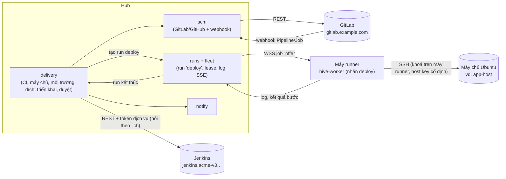

# Implementation Plan: Bảng điều khiển CI/CD và triển khai lên máy chủ

**Branch**: `020-cicd-console` · **Date**: 2026-10-17 · **Spec**: [spec.md](spec.md) · **Research**: [research.md](research.md)

Q1–Q16 chưa chốt. Plan làm theo khuyến nghị trong spec. Chỗ nào phụ thuộc câu trả lời thì ghi **[Giả định Qn]**.

## Tóm tắt

Thêm module hub **`delivery`** gồm hai phần:
- **CI (phần A):**
  - kết nối Jenkins;
  - gộp pipeline GitLab/GitHub và build Jenkins của dự án;
  - đọc log trực tiếp từ nguồn;
  - thao tác: chạy lại, huỷ, job chờ tay, build có tham số, `input`;
  - hỏi trạng thái theo lịch, phát hiện chuyển đỏ/xanh để báo.
- **Triển khai (phần C):**
  - máy chủ, môi trường, đích triển khai, lần triển khai, duyệt, khoá, quay về;
  - đích `ssh-script` chạy như run loại **`deploy`** trên máy runner của đội [Giả định Q1];
  - đích `jenkins-job` và `gitlab-manual` bấm job ngoài rồi theo dõi.

Phần mới ở chỗ khác:
- **`scm`**: `GitProvider` thêm pipeline/job cho GitLab (GitHub ở đợt sau); hook GitLab đăng ký thêm sự kiện Pipeline và
  Job.
- **`runs`, `fleet`**: loại run `deploy` không cần task hay agent CLI, chỉ giao cho máy có năng lực `deploy`.
- **Giao thức worker và worker Go**: spec job `deploy`, bộ chạy bước qua SSH với host key cố định, kiểm health.
- **`notify`**: sự kiện CI và triển khai. **`contracts/roles.ts`**: quyền mới.
- **Web**: tab CI/CD của dự án; bảng "đang chạy" và lịch sử của hệ thống; màn lần triển khai; cài đặt máy chủ và kết
  nối Jenkins.

Desktop không đổi trong spec này. Việc cài khoá SSH lên máy chủ thuộc phiên "Client: chuyển đăng nhập SSH mật khẩu sang
ssh-key".

## Technical Context

| Mục | Giá trị |
|---|---|
| Ngôn ngữ | TypeScript strict (hub, web), Go (worker) |
| Hub | Hono + oRPC, Drizzle, pg-boss, `withTenant()`, role `hive_app` |
| Phụ thuộc mới | Không thêm gói npm. Client Jenkins viết bằng `fetch`. Worker dùng `ssh` của hệ điều hành (OpenSSH) trên máy runner |
| Lưu trữ | PostgreSQL: khoảng 9 bảng mới (Key Entities của spec); log triển khai trong `run_logs` sẵn có |
| Test | Vitest; `*.db.test.ts` (Testcontainers); Jenkins giả bằng máy chủ HTTP trong test; GitLab bằng provider `memory`; worker Go test với `sshd` trong container; Playwright cho màn web |
| Hiệu năng | SC-001: tab CI/CD ≤ 2 giây; trạng thái mới ≤ 30 giây (Jenkins) và ≤ 10 giây (GitLab có webhook) |

## Constitution Check

| Nguyên tắc | Cách tuân |
|---|---|
| I. Contract first | `packages/contracts/src/delivery.ts` mới (CI, máy chủ, môi trường, đích, triển khai, duyệt). `runs.ts` thêm kiểu run `deploy`. `worker-protocol.ts` thêm spec job `deploy`, fixture chung với Go (ADR 0005). `pnpm openapi` |
| II. Tenant isolation | Mọi bảng mới có `org_id`, `ENABLE` + `FORCE ROW LEVEL SECURITY`, có trong `rls.db.test.ts`. Máy chủ thuộc đội; máy runner chỉ nhận việc của đội mình (ADR 0010, 0017) |
| III. Module boundaries | `delivery` gọi `scm`, `runs`, `fleet`, `catalog`, `notify`, `audit`, `platform` qua `index.ts`. `runs` không import `delivery`: kết quả run `deploy` báo ngược qua hook đăng ký (`provideRunFinished` hoặc tương tự) |
| IV. Tested | Unit cho client Jenkins (theo JSON mẫu), máy trạng thái lần triển khai, chính sách duyệt. DB test cho luồng triển khai với runner giả. Go test cho bộ chạy bước với `sshd` thật. Playwright cho tab CI/CD và nút triển khai |
| V. Secure by default | Hub không giữ khoá SSH riêng [Giả định Q2]. Host key cố định. Token Jenkins mã hoá. Worker che bí mật trong log ngay khi đọc output. Chỉ `servers.manage` sửa lệnh. Máy runner cần nhãn `deploy` do quản trị đội gắn, và không chạy agent (Q14). Audit mọi thao tác |
| VI. Ngôn ngữ | Chữ giao diện, lỗi tiếng Việt. ADR, SRS, code tiếng Anh. Spec tiếng Việt theo yêu cầu chủ dự án. **Lệch** VI, ghi ở Complexity Tracking |
| VII. Simple to self-host | Không thêm dịch vụ. Jenkins và GitLab là hệ ngoài có sẵn của người dùng. Máy runner là `hive-worker` đã có |
| Giao diện | Navy Hive (PR #410), shadcn/ui, token màu, 360 px, sáng/tối, bàn phím, Playwright theo role |

## Kiến trúc



### Cấu trúc file

```text
apps/hub/src/modules/delivery/
  index.ts, router.ts, schema.ts
  jenkins/client.ts        # REST: job, build, wfapi, progressiveText, build có tham số, stop, input
  jenkins/connections.ts   # thêm, kiểm, mã hoá token (platform/secrets.ts)
  ci/feed.ts               # gộp GitLab/GitHub/Jenkins thành một danh sách; đệm ngắn trong tiến trình
  ci/actions.ts            # chạy lại, huỷ, chạy job chờ tay, build có tham số, input; audit
  ci/poll.ts               # job pg-boss hỏi theo lịch, ghi ci_runs_seen, phát sự kiện đỏ/xanh
  servers.ts               # máy chủ, runner được phép, kiểm kết nối (run ngắn), dấu vân tay
  environments.ts          # môi trường, chính sách duyệt, khoá
  targets.ts               # đích triển khai, cấu hình có phiên bản
  deploys.ts               # máy trạng thái, khoá một lần đang đi mỗi đích, quay về
  approvals.ts             # duyệt, hạn, không tự duyệt
  runners/ssh-script.ts    # dựng spec job 'deploy' từ cấu hình; nhận kết quả run
  runners/jenkins-job.ts   # bấm job, theo dõi, đọc phiên bản
  runners/gitlab-manual.ts # bấm job chờ tay, theo dõi
  archive-route.ts         # GET /api/v1/deploys/:id/archive: runner tải mã của commit qua hub
  *.test.ts, *.db.test.ts, fixtures/jenkins/*.json
apps/hub/src/modules/scm/types.ts, gitlab.ts, github.ts, events.ts, webhooks …  # pipeline/job; sự kiện mới
apps/hub/src/modules/runs/…             # kind 'deploy'; nhánh giao việc không cần task; hook run kết thúc
apps/hub/src/modules/fleet/…            # nhãn + năng lực 'deploy'; chọn máy theo runner của máy chủ; probe_request
apps/hub/src/modules/notify/…           # sự kiện mới
packages/contracts/src/delivery.ts, runs.ts, worker-protocol.ts, roles.ts, notify.ts
worker/internal/deploy/                 # Go: chạy bước qua ssh, http check, tải archive, báo log và kết quả
worker/internal/channel/jobs.go         # nhận job_offer kind 'deploy' không cần CLI account
apps/web/src/pages/projects/cicd-*.tsx, pages/deploys/*.tsx, pages/settings/servers*.tsx, ci-connections*.tsx
docs/adr/0030-deploy-runs-on-worker-over-ssh.md, docs/adr/0031-jenkins-ci-source.md
docs/srs.md                              # mục CI/CD (CICD-…) và Deploy (DEPLOY-…)
```

## Thiết kế từng phần

### 1. Mô hình dữ liệu

Theo Key Entities của spec, cộng chi tiết:
- `deploy_targets.config jsonb` có `schemaVersion` và kiểu theo cách triển khai (zod ở contracts). `config_version int`
  tăng mỗi lần sửa; khoá lạc quan khi lưu.
- `deploys`:
  - `state` theo FR-014;
  - `steps jsonb`: `[{name, state, startedAt, endedAt, exitCode}]`;
  - `version jsonb`: `{commit, tag?, jenkinsBuild?, image?}`;
  - `run_id` tham chiếu `runs` cho `ssh-script`, `external jsonb` cho build/job ngoài;
  - `origin` (`hive` | `external`): lần do Jenkins tự build là `external` (Q13, FR-032);
  - `rollback_of`, `config_version`.
- **Khoá một lần đang đi mỗi đích**: chỉ mục `unique (target_id) where origin = 'hive' and state in ('chờ duyệt','chờ
  máy','đang chạy')`.
  Trong DB dùng mã tiếng Anh (`pending_approval`, `queued`, `running`); giao diện dịch.
- `deploy_servers.host_key_fingerprints text[]`: SHA256 của từng loại khoá host đã xác nhận.
- `ci_runs_seen`: `(org_id, source, external_id)` duy nhất, `status`, `branch`, `finished_at`, `notified_state`.
- Migration bằng `db:generate`. RLS viết tay theo cách các module khác.

### 2. Client Jenkins (FR-001, FR-005)

- Xác thực Basic bằng user và API token. Gửi POST bằng API token không cần crumb CSRF (Jenkins miễn crumb khi xác thực
  bằng token). [Unverified] Kiểm lại trên Jenkins của acme với plugin OIDC: gọi thử `POST …/build` bằng token
  khi làm task.
- Đọc bằng `?tree=` để chỉ lấy trường cần:
  - job: `property[parameterDefinitions[...]]`;
  - build: `number,result,building,timestamp,duration,actions[causes,lastBuiltRevision,parameters]`.
- Giai đoạn: `GET …/<build>/wfapi/describe` nếu có (plugin Pipeline Stage View); 404 thì bỏ qua giai đoạn.
- Log: `GET …/logText/progressiveText?start=<n>`, đọc header `X-Text-Size` và `X-More-Data`.
- Thao tác:
  - `POST …/buildWithParameters` (hoặc `/build`), lấy `Location` của queue item rồi đợi tới khi có số build;
  - `POST …/<build>/stop`;
  - `POST …/<build>/input/<id>/proceed` hoặc `/abort`.
- Lỗi thành mã: `JENKINS_UNAUTHORIZED`, `JENKINS_FORBIDDEN`, `JENKINS_NOT_FOUND`, `JENKINS_UNAVAILABLE`, kèm cách sửa tiếng
  Việt (giống `describeFailure` của catalog).
- Test: JSON mẫu theo tài liệu REST API của Jenkins trong `fixtures/jenkins/`. Không ghi dữ liệu thật của acme vào
  repo.

### 3. GitLab, GitHub (FR-003, FR-004)

- `GitProvider` thêm `listPipelines`, `pipelineJobs`, `jobLog(from)`, `retryPipeline`, `cancelPipeline`, `retryJob`,
  `cancelJob`, `playJob`.
  - GitLab dùng `rest()` sẵn có với `/api/v4/projects/:id/pipelines`, `/pipelines/:id/jobs`, `/jobs/:id/trace`
    (đọc theo `Range`), `/retry`, `/cancel`, `/play`.
  - Provider `memory` cài đủ để test.
- GitHub (đợt 4): `actions/runs`, `jobs`, `logs`, `rerun`, `cancel`, `pending_deployments` [Giả định Q11].
- Hook GitLab: `addWebhook` đăng ký thêm `pipeline_events`, `job_events`. `addWebhook` đã tự cập nhật hook có cùng URL
  (`gitlab.ts`), nên dự án có sẵn chỉ cần một job chạy lại `addWebhook` một lần. `events.ts` thêm `pipeline`, `job`.
- `compare` hiện chỉ trả file đổi; thêm danh sách commit (API compare của GitLab và GitHub đều trả commit) cho màn
  duyệt (FR-023).

### 4. Hỏi theo lịch và sự kiện đỏ/xanh (Q4, FR-027)

- `delivery-ci-poll` (pg-boss) chạy mỗi phút cho mỗi kết nối Jenkins. Kết nối có build đang chạy thì tự xếp lại sau 15
  giây (`singletonKey` theo kết nối, `startAfter`).
- Dự án GitLab: webhook là chính. Hỏi lại mỗi 5 phút cho dự án có pipeline chưa kết thúc.
- Build xanh của job gắn với đích `jenkins-job` mà không có lần triển khai Hive nào chờ nó thì ghi thành lần triển khai
  `external` (Q13, FR-032).
- So với `ci_runs_seen`:
  - chuyển sang `failed` trên nhánh chính thì `ci.failed`;
  - `failed` sang `success` thì `ci.recovered`;
  - đã báo đỏ thì không báo lại tới khi xanh.
- Danh sách trên tab CI/CD đọc trực tiếp nguồn, đệm 10 giây trong tiến trình theo (dự án, trang). Không đệm chéo tổ chức.

### 5. Run `deploy` trên máy runner (Q1, FR-016…FR-019)

**Hub (`runs`, `fleet`):**
- Thêm `deploy` vào kiểu run. `runs.task_id` đã cho phép rỗng; chỗ chặn thật là:
  - đoạn giao việc của `engine.ts` cần task trừ khi kiểu run thuộc `PROMPT_KINDS`: thêm nhánh cho `deploy`;
  - các cột `NOT NULL` `project_id`, `branch`, `policy_snapshot`: run `deploy` điền dự án của đích, nhánh cấu hình của
    đích, và bản chụp chính sách tối thiểu.
- Chọn máy:
  - chỉ máy có năng lực `deploy`;
  - máy nằm trong `deploy_server_runners` của máy chủ;
  - máy dùng chung của đội (FR-029).
- Không mượn tài khoản CLI. Lease, huỷ, log, SSE dùng nguyên cơ chế sẵn có.
- Chiều ngược lại: máy có nhãn `deploy` bị loại khỏi việc chọn máy cho mọi run của agent (Q14).
- "Kiểm kết nối" máy chủ (FR-010) **không** phải run, vì không có dự án: thêm cặp thông điệp `probe_request` /
  `probe_result` trong giao thức worker, hub chờ kết quả tối đa 30 giây.

**Spec job** (`worker-protocol.ts`, fixture chung với Go):
```text
{ kind: "deploy", deployId,
  ssh: { host, port, user, knownHosts: "<dòng known_hosts sinh từ dấu vân tay>" },
  archive?: { url: "/api/v1/deploys/<id>/archive", sha },
  steps: [ { name, run: "<lệnh trên máy chủ>", timeoutSec } ],
  health?: { url, expectStatus, jsonPath?, equals?, timeoutSec, intervalSec } }
```

**Worker Go** (`worker/internal/deploy`):
- Ghi `knownHosts` ra file tạm, chạy `ssh -o BatchMode=yes -o StrictHostKeyChecking=yes -o UserKnownHostsFile=<tạm>
  -p <port> <user>@<host> <lệnh>`. Khoá lấy theo cấu hình SSH của user chạy worker (ssh-agent, `~/.ssh`) [Giả định Q2].
- Bước `archive`: tải tarball của commit từ hub bằng token của run (hub gọi `scm.archive`, runner không cần quyền Git),
  rồi `ssh … "tar -xzf - -C <dir>/src.new"`.
- Chạy bước tuần tự, dừng ở bước lỗi đầu tiên. Stdout/stderr gửi như log run. Mã thoát từng bước gửi như sự kiện run.
- Health chạy trên runner bằng HTTP client của Go.
- Không phụ thuộc hub đang chạy: hub khởi động lại thì worker giữ log và kết quả rồi gửi khi nối lại (SC-007).
  [Unverified] Cơ chế hiện tại có giữ kết quả khi hub tắt lâu hơn lease 90 giây hay không: kiểm khi làm task. Thiếu thì
  thêm trạng thái "chờ gửi kết quả" ở worker, và hub nhận kết quả muộn của run `deploy` đã `lost` để ghi `không rõ kết
  quả` → kết quả thật.

**Che bí mật:** worker che bằng bộ che sẵn có (`worker/internal/terminal/redact.go`, cách `runner/checks.go` đang dùng),
cộng giá trị các biến đánh dấu bí mật của đích, trước khi gửi log lên hub (FR-019). `scanSecrets` của contracts chỉ
phát hiện, không che, nên chỉ dùng để gắn cờ.

**Hub nhận kết quả:** `runs` gọi hook run kết thúc. `delivery` cập nhật `deploys` và bảng "đang chạy", rồi gửi thông báo.
Log giữ theo `runLogRetentionDays` của tổ chức (mặc định 365 ngày, Q12).

**Mẫu đích cho hub** (seed qua giao diện, không cứng trong code), gần với một lần triển khai lại bằng `deploy/remote.sh`.
Không gồm phần chỉ cần ở lần đầu (sinh secret, thêm biến còn thiếu vào `.env`):
- **kiểm trước**: `test -f <dir>/.env && docker compose -p <project> ls`;
- **sao lưu**: `cd <dir>/src && sh deploy/backup.sh`;
- **đưa mã lên**: `git-archive` vào `<dir>/src.new`;
- **triển khai**: đổi `src.new` → `src` (giữ `src.old`) rồi `docker compose -p <project> --env-file <dir>/.env -f
  deploy/compose.yaml up -d --build` với `HIVE_VERSION=<commit>`;
- **Caddy**: tạo lại container Caddy nếu `Caddyfile` đổi (như `remote.sh`);
- **health**: `https://hive.example.com/api/v1/health`, `version == <commit 8 ký tự>`.

### 6. Đích `jenkins-job`, `gitlab-manual` (FR-021, FR-022)

- `jenkins-job`:
  - tham số = tham số cố định + tham số lấy từ lần triển khai (`{{commit}}`, `{{tag}}`, `{{env}}`);
  - bấm, đợi queue ra số build, theo dõi bằng `delivery-ci-poll` (lần triển khai giữ `external.build`);
  - đọc phiên bản từ tham số, `lastBuiltRevision`, và dòng `HIVE_DEPLOYED_IMAGE=` trong log (tuỳ chọn);
  - bước `input`: phát hiện qua `wfapi/pendingInputActions`; Hive đã duyệt thì Proceed (FR-026).
- Loại "đẩy từ môi trường" (Q15, FR-033): tham số build (vd. `BUILD`) lấy từ `deploys.version.jenkinsBuild` của bản
  đang chạy ở môi trường nguồn. Không có "Quay về" trừ khi đích khai báo job quay về riêng.
- `gitlab-manual`: tìm pipeline của commit, job tên đã cấu hình ở trạng thái `manual`, `playJob`, theo dõi.

### 7. Duyệt, khoá, quay về (P2: FR-023…FR-026)

- Tạo lần triển khai ở môi trường cần duyệt thì vào `pending_approval`, gửi `deploy.approval_requested`.
- Duyệt cần quyền `deploy.approve` ở môi trường, khác người yêu cầu, chưa hết hạn. Đủ số người thì chuyển `queued`.
- Màn duyệt gọi `scm.compare(bản đang chạy, bản sẽ lên)`.
- Khoá môi trường: cột `locked_at`, `locked_by`, `lock_reason`; kiểm khi tạo và khi chuyển `queued`.
- Quay về: tìm lần `thành công` gần nhất trước bản hiện tại ở cùng đích, tạo lần mới với `rollback_of`.

### 8. Quyền (FR-028…FR-030)

- `contracts/roles.ts` thêm lá: `ci.view`, `ci.operate`, `deploy.run`, `deploy.approve`, `servers.manage` (đội) và
  `ci.connections.manage` (tổ chức). Cấp theo vai trò tổ chức và đội như hiện nay (FR-028).
- Môi trường có `policy.deployRoles` và `policy.approveRoles` (danh sách vai trò đội), kiểm thêm sau quyền chung.
- Máy nhận run `deploy` khi có nhãn `deploy` (quản trị đội gắn trên hub, `fleet/machines.ts`) **và** worker báo năng lực
  `deploy` (FR-029).

### 9. Giao diện

- **Dự án → tab CI/CD**:
  - danh sách gộp (nguồn, nhánh, commit, trạng thái, thời lượng, người); lọc;
  - chi tiết: giai đoạn hoặc job, log đọc theo đoạn (dùng `LogCard`);
  - nút thao tác theo quyền;
  - form tham số Jenkins sinh từ `parameterDefinitions`.
- **Hệ thống → Triển khai**:
  - bảng "đang chạy" (dự án × môi trường);
  - lịch sử, lọc theo môi trường;
  - hàng chờ duyệt;
  - nút Triển khai (chọn phiên bản: commit mới nhất của nhánh cấu hình, tag gần đây, hoặc nhập SHA) và Quay về.
- **Lần triển khai** `/deploys/:id`: các bước có trạng thái, log trực tiếp (dùng `use-run-stream`), huỷ, duyệt.
- **Cài đặt**: kết nối Jenkins (tổ chức); máy chủ (đội: thêm, kiểm kết nối, xác nhận dấu vân tay, runner); môi trường
  và đích triển khai (hệ thống).
- Chữ tiếng Việt, theo Navy Hive. Nút ẩn hoặc tắt theo quyền, có lý do.

### 10. Kiểm thử

| Lớp | Nội dung |
|---|---|
| Unit | Client Jenkins trên JSON mẫu (job có tham số, build đang chạy, `input` chờ, 401/403/404); gộp danh sách; máy trạng thái triển khai; chính sách duyệt; dựng spec job `deploy` |
| DB | Kết nối và token mã hoá; khoá một lần đang đi mỗi đích; duyệt (không tự duyệt, hết hạn, khoá môi trường); quay về; RLS bảng mới; quyền theo vai trò |
| Tích hợp hub | Jenkins giả (HTTP server trong test) cho FR-005, FR-021, FR-026; GitLab qua provider `memory` cho FR-003, FR-022; webhook Pipeline/Job |
| Worker Go | Container `sshd` thật: host key đúng/sai (SC-004), bước lỗi dừng chuỗi, hết giờ, huỷ, tải archive, health thử lại; fixture giao thức chung |
| Bí mật | Log có mật khẩu và token giả bị che trước khi lưu (SC-005) |
| E2E | Playwright: tab CI/CD với nguồn giả; tạo máy chủ, xác nhận dấu vân tay; triển khai với runner giả |
| Thật (tay) | Triển khai lại `hive.example.com` bằng Hive (SC-002) từ một máy runner trong cùng mạng |

## Quyết định của người viết

Các điểm spec để người làm tự quyết, đã chọn khi viết plan, đổi được khi làm task:
- **Module mới `delivery`**, không nhét vào `catalog` hay `scm`. Cần nhiều module khác, và `catalog` đã lớn.
- **Run `deploy` dùng lại `runs`** thay vì một hàng đợi job riêng: có sẵn lease, huỷ, log, SSE, chọn máy.
- **Runner tải mã qua hub** (`archive-route.ts`) để máy runner không cần quyền Git của dự án.
- **Client Jenkins tự viết bằng `fetch`**, không thêm thư viện: cần ít endpoint, và các thư viện Jenkins cho Node ít được
  bảo trì [Inference].
- **Mã trạng thái trong DB bằng tiếng Anh**, giao diện dịch tiếng Việt.
- **Quyền theo vai trò tổ chức và đội**, cộng danh sách vai trò trên từng môi trường; không thêm thành viên theo dự án
  hay môi trường (Hive chưa có).
- **Thông báo**: kênh của tổ chức lọc theo sự kiện và hệ thống, cộng hộp thư trong app cho người liên quan. Đăng ký
  riêng từng người để sau.
- **GitLab/Jenkins**: thao tác bằng token của kết nối, không ánh xạ người dùng (FR-034).

## Rủi ro

| # | Rủi ro | Cách giảm |
|---|---|---|
| R1 | Lệnh triển khai chạy trên máy chủ thật: viết sai hay bị sửa trái phép là hỏng máy | Chỉ `servers.manage` sửa lệnh; cấu hình có phiên bản và audit kèm khác biệt; bước "kiểm trước" so thư mục, project; máy runner phải bật `deploy` |
| R2 | Tài khoản dịch vụ Jenkins quyền rộng | Quyền tối thiểu (`developer`); token mã hoá; audit người bấm thật; xoay token được |
| R3 | Hỏi Jenkins nhiều làm nặng Jenkins | `?tree=` giới hạn trường; 15 giây chỉ khi có build chạy; lùi lại khi lỗi |
| R4 | Máy runner mất kết nối giữa chừng, triển khai dở dang | Trạng thái `không rõ kết quả`, không tự chạy lại; gợi ý kiểm health; khoá đích tới khi người dùng đóng |
| R5 | Lộ secret qua log | Worker che bằng bộ che sẵn có và giá trị biến bí mật của đích trước khi gửi; khuyến nghị bước không in `.env` |
| R6 | Người vẫn bấm trực tiếp trên Jenkins, bỏ qua duyệt của Hive | Ngoài tầm Hive; tài liệu khuyến nghị đặt `approvers` cho `acmePromote` và giới hạn quyền build job prod |
| R7 | Hub tự triển khai chính nó | Bước chạy trên runner; worker giữ kết quả khi hub tắt; SC-007 có test |
| R8 | Worker cũ không hiểu job `deploy` | Chỉ máy báo năng lực `deploy` mới được chọn; worker cũ không báo nên không nhận |
| R9 | Host key máy chủ đổi hợp lệ (cài lại máy) | Quản trị xác nhận lại dấu vân tay ở màn máy chủ, có audit |

## Phương án đã cân nhắc

| Phương án | Lý do không chọn |
|---|---|
| Hub tự SSH tới máy chủ | Hub phải giữ khoá riêng của mọi máy chủ và vào được mạng của chúng. Trái kiến trúc "hub điều phối, worker chạy" (Q1) |
| Hive tự chạy pipeline (hướng B) | Trùng Jenkins/GitLab CI đội đang dùng; chủ dự án đã chọn A + C |
| Gọi thẳng Argo CD, kubectl | acme đã đi qua Jenkins → GitOps → Argo CD; thêm sau nếu cần (P3) |
| Lưu log CI ở Hive | Trùng dữ liệu, database phình; đọc trực tiếp đủ dùng (Q12) |
| Bắt Jenkins gọi webhook về hub | Chưa biết mạng `198.51.100.x` có tới được hub không; phải cài plugin. Để tuỳ chọn sau |

## Complexity Tracking

| Lệch | Lý do | Phương án đơn giản hơn bị loại vì |
|---|---|---|
| Spec viết tiếng Việt (constitution VI nói spec tiếng Anh) | Chủ dự án yêu cầu, như spec 011–019 | — |
| Đổi giao thức worker (job `deploy`) | Chạy lệnh trên máy chủ từ máy trong cùng mạng, không để hub giữ khoá | Hub tự SSH: xem Phương án đã cân nhắc |

## SRS và ADR

- **ADR 0030** "Run deploy steps on worker machines over SSH": run `deploy`, năng lực máy, host key cố định, khoá ở máy
  runner, tải mã qua hub.
- **ADR 0031** "Jenkins as an external CI source": REST, tài khoản dịch vụ, hỏi theo lịch, không lưu log.
- **SRS**: mục mới cho CI/CD (`CICD-…`) và triển khai (`DEPLOY-…`). Số mục chọn khi gộp, vì spec 019 (nhánh
  `ai/WORDIMPORT`) cũng thêm mục 3.24.
- `docs/architecture.md`: module `delivery`, run `deploy`. `docs/self-hosting.md`: máy runner cho triển khai.
- Số spec: 019 đã dùng cho "Nhập Word" trên nhánh chưa gộp, nên spec này lấy 020.

## Phân đợt và ước lượng

| Đợt | Nội dung | Ước lượng |
|---|---|---|
| 1 (P1, A) | Mục 2, 3 (GitLab), 4, 9 (tab CI/CD), quyền `ci.*`: US1, US2 | 6–8 ngày |
| 2 (P1, C) | Mục 1, 5, 6, 8, 9 (triển khai, máy chủ): US3, US4 | 10–12 ngày |
| 3 (P2) | Mục 7, thông báo: US5, US6, US7 | 5–6 ngày |
| 4 (P3) | GitHub Actions: US8 | 3 ngày |

Tổng khoảng 24–29 ngày-agent [Inference], chưa chia task. Đợt 1 làm độc lập được với đợt 2. Bước tiếp theo sau khi chốt
Q1–Q16: viết `tasks.md`.
