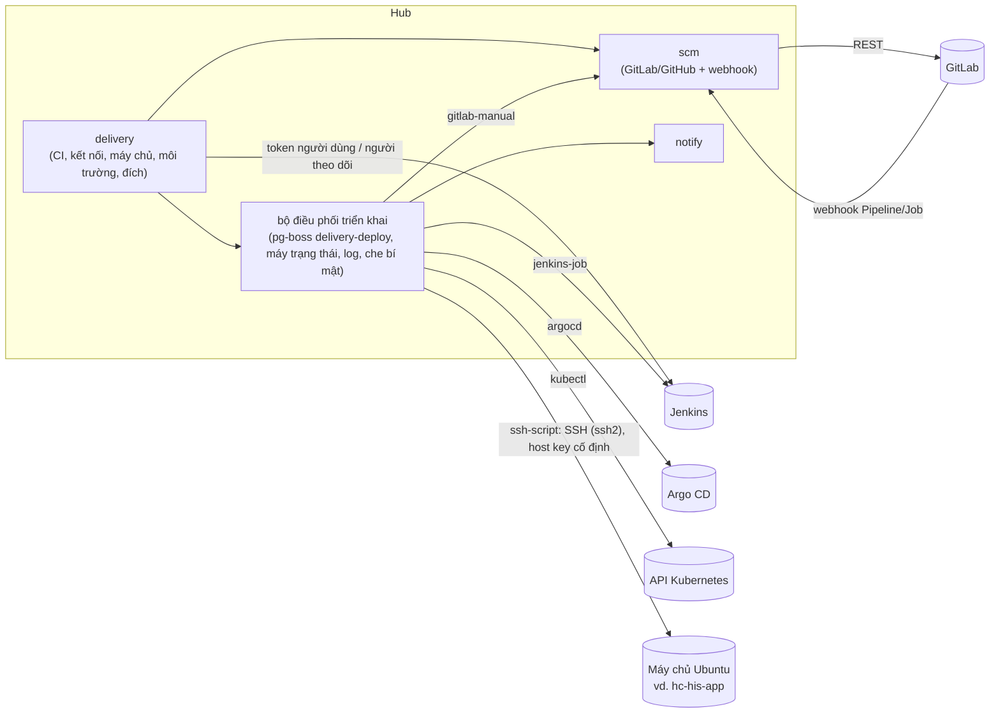

# Implementation Plan: Bảng điều khiển CI/CD và triển khai lên máy chủ

**Branch**: `020-cicd-console` · **Date**: 2026-10-17 · **Spec**: [spec.md](spec.md) · **Research**: [research.md](research.md)

Chủ dự án đã chốt Q1–Q16 ngày 2026-10-17 (bảng "Câu hỏi đã chốt" trong spec).

## Tóm tắt

Thêm module hub **`delivery`** gồm hai phần:
- **CI (phần A):**
  - kết nối Jenkins, token Jenkins của từng người (Q3);
  - gộp pipeline GitLab/GitHub và build Jenkins của dự án, log đọc trực tiếp từ nguồn;
  - thao tác: chạy lại, huỷ, job chờ tay, build có tham số, `input`;
  - hỏi trạng thái theo lịch bằng token của người theo dõi, phát hiện chuyển đỏ/xanh để báo.
- **Triển khai (phần C):**
  - máy chủ với khoá SSH do hub sinh và giữ (Q2), môi trường, đích triển khai, lần triển khai, duyệt, khoá, quay về;
  - năm cách triển khai (Q6): `ssh-script` (hub tự SSH, Q1), `jenkins-job`, `gitlab-manual`, `argocd`, `kubectl`;
  - mọi cách triển khai đi qua một **bộ điều phối** chung: hàng đợi pg-boss, máy trạng thái, log, che bí mật.

Phần mới ở chỗ khác:
- **`scm`**: `GitProvider` thêm pipeline/job cho GitLab (GitHub đợt sau); hook GitLab thêm sự kiện Pipeline và Job;
  `compare` trả thêm commit.
- **`contracts`**: `delivery.ts`; hàm che bí mật dùng chung mẫu với `secret-scan.ts`; quyền mới trong `roles.ts`; sự kiện
  mới trong `notify.ts`.
- **`notify`**: sự kiện CI và triển khai.
- **Phụ thuộc mới của hub**: thư viện SSH thuần JS `ssh2` (cần ADR, mục 5).
- **Web**: tab CI/CD của dự án; bảng "đang chạy" và lịch sử của hệ thống; màn lần triển khai; cài đặt kết nối, máy chủ,
  token Jenkins cá nhân.

Worker Go, giao thức worker, `runs`, `fleet` **không đổi**, vì hub tự SSH (Q1). App desktop không đổi.

## Technical Context

| Mục | Giá trị |
|---|---|
| Ngôn ngữ | TypeScript strict (hub, web) |
| Hub | Hono + oRPC, Drizzle, pg-boss, `withTenant()`, role `hive_app` |
| Phụ thuộc mới | `ssh2` (SSH client thuần JS: ed25519, kiểm host key bằng callback, exec, SFTP). Jenkins, Argo CD, Kubernetes gọi bằng `fetch` |
| Lưu trữ | PostgreSQL, khoảng 11 bảng mới (Key Entities của spec), gồm `deploy_log_chunks` (`bytea`) |
| Test | Vitest; `*.db.test.ts` (Testcontainers); máy chủ SSH thật trong container (OpenSSH, Testcontainers); Jenkins, Argo CD, Kubernetes giả bằng máy chủ HTTP trong test; GitLab bằng provider `memory`; Playwright |
| Hiệu năng | SC-001: tab CI/CD ≤ 2 giây; trạng thái mới ≤ 30 giây (Jenkins), ≤ 10 giây (GitLab có webhook) |

## Constitution Check

| Nguyên tắc | Cách tuân |
|---|---|
| I. Contract first | `packages/contracts/src/delivery.ts` (CI, kết nối, token cá nhân, máy chủ, môi trường, đích, triển khai, duyệt). `pnpm openapi`, commit `openapi.json` |
| II. Tenant isolation | Mọi bảng mới có `org_id`, `ENABLE` + `FORCE ROW LEVEL SECURITY`, có trong `rls.db.test.ts`. Máy chủ thuộc đội; token Jenkins thuộc người dùng, chỉ chính người đó dùng cho thao tác ghi |
| III. Module boundaries | `delivery` gọi `scm`, `catalog`, `notify`, `audit`, `platform` qua `index.ts`. Không module nào import `delivery` |
| IV. Tested | Unit cho client Jenkins, Argo CD, Kubernetes (JSON mẫu), máy trạng thái, chính sách duyệt, che bí mật, script chạy bước. Tích hợp với `sshd` thật, có ca dừng tiến trình hub giữa bước (SC-007). DB test cho quyền, RLS, khoá đích. Playwright cho tab CI/CD và nút triển khai |
| V. Secure by default | Khoá SSH và token mã hoá theo bản ghi (`platform/secrets.ts`), chỉ giải mã trong bộ nhớ. Host key cố định. Che bí mật trước khi lưu log. Chỉ `servers.manage` sửa lệnh. Audit mọi lần dùng khoá. **Rủi ro lớn hơn khuyến nghị cũ** vì hub giữ khoá vào mọi máy chủ (R1) |
| VI. Ngôn ngữ | Chữ giao diện, lỗi tiếng Việt. ADR, SRS, code tiếng Anh. Spec tiếng Việt theo yêu cầu chủ dự án. **Lệch** VI, ghi ở Complexity Tracking |
| VII. Simple to self-host | Không thêm dịch vụ. Một gói npm thuần JS. Hub cần mạng tới máy chủ đích và các hệ ngoài |
| Giao diện | Navy Hive (PR #410), shadcn/ui, token màu, 360 px, sáng/tối, bàn phím, Playwright theo role |

## Kiến trúc



### Cấu trúc file

```text
apps/hub/src/modules/delivery/
  index.ts, router.ts, schema.ts
  connections/jenkins.ts     # kết nối, token cá nhân, người theo dõi
  connections/infra.ts       # kết nối Argo CD, Kubernetes
  clients/jenkins.ts         # REST: job, build, wfapi, progressiveText, build có tham số, stop, input
  clients/argocd.ts          # applications: get, sync, rollback, history
  clients/kube.ts            # workload: get, patch image, theo dõi rollout
  clients/ssh.ts             # ssh2: kết nối với host key cố định, exec, SFTP; giới hạn thời gian
  ci/feed.ts, ci/actions.ts, ci/poll.ts
  servers.ts                 # máy chủ, sinh và đổi khoá, kiểm kết nối, dấu vân tay
  environments.ts, targets.ts, approvals.ts
  deploys/orchestrator.ts    # hàng đợi delivery-deploy, máy trạng thái, khoá đích, gọi đúng cách triển khai
  deploys/ssh-script.ts      # script chạy bước, khởi động tách phiên, đọc log/trạng thái, nối lại
  deploys/jenkins-job.ts, deploys/gitlab-manual.ts, deploys/argocd.ts, deploys/kubectl.ts
  deploys/health.ts          # kiểm health từ hub
  logs.ts, stream-route.ts   # deploy_log_chunks, SSE /api/v1/deploys/:id/stream
  *.test.ts, *.db.test.ts, fixtures/{jenkins,argocd,kube}/*.json
apps/hub/src/modules/scm/types.ts, gitlab.ts, github.ts, events.ts, memory.ts   # pipeline/job; sự kiện; compare có commit
apps/hub/src/modules/notify/…                 # sự kiện mới
packages/contracts/src/delivery.ts, roles.ts, notify.ts, redact.ts (mới, dùng chung mẫu với secret-scan.ts)
apps/web/src/pages/projects/cicd-*.tsx, pages/deploys/*.tsx, pages/settings/{servers,ci-connections,jenkins-token}*.tsx
docs/adr/0030-hub-deploys-over-ssh.md, docs/adr/0031-external-ci-and-deploy-sources.md
docs/srs.md                                    # mục CI/CD (CICD-…) và Deploy (DEPLOY-…)
```

## Thiết kế từng phần

### 1. Mô hình dữ liệu

Theo Key Entities của spec, cộng chi tiết:
- `deploy_servers`:
  - `private_key_enc` và `public_key`, ngữ cảnh mã hoá `deploy_servers:<id>:key`;
  - `pending_private_key_enc` và `pending_public_key` khi đang đổi khoá;
  - `host_keys jsonb`: danh sách `{algorithm, fingerprint}` đã xác nhận (vd. `ssh-ed25519`, `SHA256:…`). Lưu thuật toán
    vì máy có nhiều host key thì dấu vân tay phụ thuộc thuật toán thương lượng (spike T001, research.md mục 4). API vẫn
    trả `fingerprints` theo hợp đồng của T002.
- `ci_jenkins_user_tokens`: `unique (connection_id, user_id)`, `token_enc` với ngữ cảnh `ci_jenkins_user_tokens:<id>`.
  RLS theo tổ chức, quyền đọc dòng chỉ chính người dùng và quản trị (quản trị không thấy giá trị).
- `deploy_connections` (Argo CD, Kubernetes): `kind`, `url`, `ca_pem` (Kubernetes), `token_enc`.
- `deploy_targets.config jsonb` có `schemaVersion` và kiểu theo cách triển khai (zod ở contracts). `config_version int`
  tăng mỗi lần sửa; khoá lạc quan khi lưu.
- `deploys`:
  - `state`: mã tiếng Anh trong DB (`pending_approval`, `queued`, `running`, `succeeded`, `failed`, `failed_needs_review`,
    `unknown`, `canceled`, `rejected`, `expired`), giao diện dịch;
  - `origin` (`hive` | `external`), `steps jsonb`, `version jsonb` (`commit`, `tag`, `jenkinsBuild`, `image`, `revision`);
  - `remote jsonb` cho `ssh-script`: thư mục trên máy chủ, PID, vị trí log đã đọc;
  - `external jsonb` cho build, job, application;
  - `rollback_of`, `config_version`.
- Khoá một lần đang đi mỗi đích: `unique (target_id) where origin = 'hive' and state in ('pending_approval','queued',
  'running')`.
- `ci_runs_seen`: `(org_id, source, external_id)` duy nhất, `status`, `branch`, `finished_at`, `notified_state`.

### 2. Jenkins và token từng người (Q3, FR-001, FR-005)

- Xác thực Basic bằng user và API token của **người bấm** cho mọi thao tác ghi. Token của **người theo dõi** chỉ dùng cho
  đọc theo lịch (mục 4) và cho tab CI/CD khi người xem chưa có token.
- POST bằng API token không cần crumb CSRF. [Unverified] Kiểm trên Jenkins của eHospital (plugin Keycloak OIDC) cả việc
  tạo API token lẫn POST không crumb, khi làm task.
- Đọc bằng `?tree=`:
  - job: `property[parameterDefinitions[...]]`;
  - build: `number,result,building,timestamp,duration,actions[causes,lastBuiltRevision,parameters]`.
- Giai đoạn qua `…/wfapi/describe` (404 thì bỏ qua). Log qua `…/logText/progressiveText?start=<n>`, đọc `X-Text-Size`,
  `X-More-Data`.
- Thao tác:
  - `POST …/buildWithParameters` (hoặc `/build`), lấy `Location` của queue item, đợi tới khi có số build;
  - `POST …/<build>/stop`;
  - `POST …/<build>/input/<id>/proceed|abort`, tìm `input` đang chờ qua `wfapi/pendingInputActions`.
- Lỗi thành mã: `JENKINS_NO_TOKEN`, `JENKINS_UNAUTHORIZED`, `JENKINS_FORBIDDEN`, `JENKINS_NOT_FOUND`,
  `JENKINS_UNAVAILABLE`, kèm cách sửa tiếng Việt.
- Màn **Cài đặt cá nhân → Token Jenkins**: thêm, kiểm (`/me/api/json`), xoá. Kết nối hiện ai là người theo dõi; quản trị
  đổi được.

### 3. GitLab, GitHub (FR-003, FR-004, FR-035)

- `GitProvider` thêm `listPipelines`, `pipelineJobs`, `jobLog(from)`, `retryPipeline`, `cancelPipeline`, `retryJob`,
  `cancelJob`, `playJob`.
  - GitLab qua `rest()` sẵn có với `/api/v4/projects/:id/pipelines`, `/pipelines/:id/jobs`, `/jobs/:id/trace`, `/retry`,
    `/cancel`, `/play`;
  - provider `memory` cài đủ để test.
- `compare` trả thêm `commits` (API compare của GitLab và GitHub đều có).
- Hook GitLab: `addWebhook` đăng ký thêm `pipeline_events`, `job_events`; hàm này đã tự cập nhật hook cùng URL, nên dự án
  có sẵn chỉ cần một job gọi lại một lần. `events.ts` thêm `pipeline`, `job`.
- GitHub Actions: đợt 5 (Q11).

### 4. Hỏi theo lịch, "ngoài Hive", đỏ/xanh (Q4, Q13, FR-025, FR-031)

- `delivery-ci-poll` (pg-boss) 5 phút một lần cho mỗi kết nối Jenkins có người theo dõi khi rảnh (Q4). Có build đang chạy
  thì tự xếp lại sau 15 giây (`singletonKey` theo kết nối). Mở tab CI/CD thì đọc trực tiếp, không chờ lịch.
- GitLab: webhook là chính; hỏi lại mỗi 5 phút cho dự án có pipeline chưa kết thúc.
- Build xanh của job gắn với đích `jenkins-job` mà không có lần triển khai Hive nào chờ nó thì ghi lần triển khai
  `external`.
- So với `ci_runs_seen`:
  - nhánh chính chuyển sang `failed` thì `ci.failed`;
  - `failed` sang `success` thì `ci.recovered`;
  - đã báo đỏ thì không báo lại tới khi xanh.
- Tab CI/CD đọc trực tiếp nguồn, đệm 10 giây trong tiến trình theo (dự án, trang).

### 5. SSH từ hub và đích `ssh-script` (Q1, Q2, FR-010, FR-011, FR-016…FR-018)

**Khoá:**
- Hub sinh cặp ed25519 bằng `ssh2.utils.generateKeyPairSync('ed25519')`: ra khoá riêng `OPENSSH PRIVATE KEY` và dòng
  công khai `ssh-ed25519 …`. Không dùng `crypto.generateKeyPairSync` của Node: khoá PKCS#8 bị `ssh2` báo
  `Unsupported key format` (spike T001).
- Khoá riêng mã hoá ngay. Chỉ giải mã trong `clients/ssh.ts` lúc kết nối, không ghi file, không log.
- Màn máy chủ hiện khoá công khai và lệnh cài: `echo '<khoá công khai>' >> ~/.ssh/authorized_keys`, kèm `mkdir -p ~/.ssh`,
  `chmod`.
- Đổi khoá theo US3 bước 4: khoá mới ở cột `pending_*` tới khi kiểm thành công thì thay khoá cũ.

**Kết nối** (`clients/ssh.ts`, `ssh2`):
- `hostVerifier` so SHA256 của host key với `host_keys`. Chưa có (lần đầu kiểm) thì trả dấu vân tay để quản trị xác
  nhận, không chạy lệnh.
- Đã có host key thì ép `algorithms.serverHostKey` theo thuật toán đã lưu, để máy chủ không thương lượng sang khoá khác
  rồi bị báo nhầm "host key đổi".
- `ssh2` báo cùng một lỗi `Host denied` cho "chưa có" và "đã đổi": `hostVerifier` ghi lý do (`hostkey_unconfirmed`,
  `hostkey_changed`) và dấu vân tay vào biến của lần kết nối.
- Gắn `on('error')` suốt đời kết nối, không dùng `once`: sau lỗi timeout `ssh2` còn phát thêm "Connection lost before
  handshake", `once` làm sập tiến trình hub (spike T001).
- `readyTimeout: 10_000`. Lỗi mạng (`ECONNREFUSED`, `level: client-socket`; timeout) tách khỏi lỗi xác thực
  (`level: client-authentication`) khi báo (US3 bước 3). Xử lý `close` khi đang SFTP.

**Chạy bước tách khỏi phiên SSH** (giải quyết hub tự khởi động lại, SC-007):
1. Hub tạo `~/.hive-deploy/<deployId>/` trên máy chủ qua SFTP, gồm:
   - `run.sh`: script POSIX sinh từ cấu hình đích;
   - các file bước;
   - file biến (quyền 600, xoá khi xong).
2. Hub chạy `cd <dir>; nohup setsid sh run.sh >/dev/null 2>&1 & echo $!` (dùng `;`, không `&&`) rồi đóng phiên; huỷ
   bằng `kill -TERM -- -<pgid>`. `run.sh`:
   - chạy từng bước, ghi output vào `log`;
   - ghi `status.json` (bước hiện tại, mã thoát từng bước, `done`);
   - bắt `TERM` để dừng có kiểm soát khi huỷ.
3. Job `delivery-deploy-watch` (pg-boss, queue `stately`, `singletonKey` theo `deployId`, tự xếp lại bằng `startAfter`;
   2 giây một lần khi đang chạy, `heartbeatSeconds` 10 để hub chết đột ngột thì job được nhận lại trong khoảng 60 giây)
   mở phiên SSH ngắn (khoảng 0,45 giây mỗi lần bắt tay, spike T001):
   - đọc `log` từ vị trí đã lưu (`tail -c +<offset>`), che bí mật, ghi `deploy_log_chunks`, `NOTIFY`;
   - đọc `status.json`, cập nhật `deploys.steps`;
   - lưu vị trí mới trong cùng giao dịch.
4. Hub khởi động lại (vd. đang triển khai chính nó) thì job watch chạy lại từ vị trí đã lưu. Máy chủ không trả lời quá 15
   phút thì `unknown`.
5. Xong các bước thì hub chạy health (mục 7). Thư mục của lần triển khai dọn sau 14 ngày bằng một bước dọn ở lần triển khai
   sau.

**Đưa mã lên** (`git-archive`): hub gọi `scm.archive(commit)` rồi chuyển luồng tarball qua SFTP vào `src.new.tar.gz` của
lần triển khai. `run.sh` giải nén ở bước "đưa mã lên".

**Mẫu đích cho hub** (seed qua giao diện), gần với một lần triển khai lại bằng `deploy/remote.sh`, không gồm phần chỉ cần
ở lần đầu (sinh secret, thêm biến còn thiếu vào `.env`):
- **kiểm trước**: `test -f <dir>/.env`, `docker compose ls` có project;
- **sao lưu**: `cd <dir>/src && sh deploy/backup.sh`;
- **đưa mã lên**: giải nén vào `<dir>/src.new`;
- **triển khai**: đổi `src.new` → `src` (giữ `src.old`), `docker compose -p <project> --env-file <dir>/.env -f
  deploy/compose.yaml up -d --build` với `HIVE_VERSION=<commit>`, tạo lại Caddy nếu `Caddyfile` đổi;
- **health**: `https://hive.xdev.asia/api/v1/health`, `version == <commit 8 ký tự>`.

Hub chạy trong container trên chính `hc-his-app` nên SSH tới IP máy chủ từ trong container. [Unverified] Đường từ mạng
bridge của Docker tới `10.86.224.34:22`: kiểm khi làm task.

### 6. Các cách triển khai khác (FR-021…FR-024, FR-034)

- **`jenkins-job`**:
  - tham số = tham số cố định + tham số từ lần triển khai;
  - bấm bằng token của người yêu cầu (lần cần duyệt: vẫn token người yêu cầu, bấm sau khi đủ duyệt);
  - theo dõi bằng job theo dõi chung của bộ điều phối (`delivery-deploy-watch` gọi `poll` của từng cách), đọc phiên bản
    như spec;
  - "đẩy từ môi trường": tham số build lấy từ `deploys.version.jenkinsBuild` của bản đang chạy ở nguồn;
  - `input` chờ: Proceed bằng token của người duyệt (FR-029).
- **`gitlab-manual`**: tìm pipeline của commit, job tên đã cấu hình ở trạng thái `manual`, `playJob`, theo dõi.
- **`argocd`**:
  - `POST /api/v1/applications/<app>/sync` (tuỳ chọn `revision`);
  - theo dõi `GET /api/v1/applications/<app>` tới `status.sync.status = Synced` và `status.health.status = Healthy`;
  - phiên bản từ `status.sync.revision` và `status.summary.images`;
  - quay về `POST …/rollback` với `id` lịch sử, cảnh báo autoSync bị tắt.
- **`kubectl`** (API Kubernetes, `fetch` với CA của kết nối):
  - `PATCH /apis/apps/v1/namespaces/<ns>/<kind>/<name>` kiểu `strategic-merge-patch` đổi image của container;
  - theo dõi `status.observedGeneration`, `updatedReplicas`, `availableReplicas`, điều kiện `Progressing` (hết hạn
    `ProgressDeadlineExceeded` thì `failed`);
  - quay về đặt lại image của lần thành công trước.
- Mỗi cách cài cùng một giao diện `DeployMethod { start, poll, cancel, version }` để bộ điều phối gọi chung.

### 7. Health, che bí mật, log (FR-018, FR-019)

- Health từ hub, `fetch` với thời gian chờ và chu kỳ thử lại; biểu thức JSON dạng đường dẫn đơn giản (`version`,
  `status.ok`), không chạy mã.
- Che bí mật (`contracts/redact.ts`): thay giá trị biến đánh dấu bí mật của đích, cộng các mẫu của `secret-scan.ts`, thành
  `***`. Áp cho mọi đoạn log trước khi ghi `deploy_log_chunks`. Đoạn cắt giữa một bí mật: giữ đuôi 200 ký tự của đoạn trước
  để ghép rồi mới che.
- Log ghi theo đoạn `bytea`, `LISTEN/NOTIFY` như `runs/stream.ts`. SSE `/api/v1/deploys/:id/stream`. Giữ theo
  `runLogRetentionDays` (Q12), dọn bằng job dọn riêng của `delivery` (không sửa `runs`).

### 8. Duyệt, khoá, quay về (P2: FR-026…FR-029)

- Môi trường cần duyệt thì lần triển khai vào `pending_approval`, gửi `deploy.approval_requested`.
- Duyệt cần `deploy.approve`, vai trò nằm trong danh sách của môi trường, khác người yêu cầu, chưa hết hạn. Đủ người thì
  `queued`.
- Màn duyệt dùng `scm.compare` (có commit, mục 3).
- Khoá môi trường: `locked_at`, `locked_by`, `lock_reason`, kiểm khi tạo và khi chuyển `queued`.
- Quay về theo spec US7, tạo lần mới với `rollback_of`.

### 9. Quyền và an toàn (FR-030, FR-032)

- `contracts/roles.ts` thêm lá: `ci.view`, `ci.operate`, `deploy.run`, `deploy.approve`, `servers.manage` (đội),
  `ci.connections.manage` (tổ chức).
- Môi trường có `policy.deployRoles`, `policy.approveRoles` (vai trò đội), kiểm sau quyền chung.
- Mỗi lần giải mã khoá SSH hay token ghi audit nhẹ (`delivery.secret_used`: loại, id, lý do), gom theo lần triển khai để
  không làm phình audit.
- **Sao lưu (R11, chủ dự án đã chốt 2026-10-19: tách `.env` khỏi bản sao lưu):** database chứa khoá ở dạng mã hoá.
  Trước đây `deploy/backup.sh` chép cả `.env` (có `HIVE_MASTER_KEY`) vào cùng thư mục với bản dump, nên ai có một bản
  sao lưu là giải mã được mọi khoá SSH và token. Nay:
  - bản sao lưu gồm `hive.dump`, `meta` và `SHA256SUMS` (phủ hai file kia). `meta` không có secret, chỉ ghi
    `HIVE_COMPOSE_PROJECT` và `HIVE_MASTER_KEY_SHA256` (sha256 của khoá);
  - `deploy/restore.sh` dùng `.env` đang có trên máy chủ, kiểm project và dấu khoá theo `meta`; lệch thì dừng và báo cần
    `.env` gốc. Bản sao lưu cũ còn `.env` vẫn khôi phục như trước (hỏi trước khi ghi đè `.env`);
  - quản trị cất `.env` riêng, ở nơi chỉ quản trị đọc được. Mất `.env` (mất `HIVE_MASTER_KEY`) thì không giải mã được
    khoá SSH và token trong bản dump, phải sinh lại khoá cho mọi máy chủ;
  - bản sao lưu cũ trên máy chủ vẫn còn `.env` cho tới khi quản trị xoá hoặc retention của `backup.sh` xoá. Quản trị tự
    quyết có xoá sớm không; không script nào xoá thêm.

### 10. Giao diện

- **Dự án → tab CI/CD**:
  - danh sách gộp, lọc;
  - chi tiết: giai đoạn hoặc job, log đọc theo đoạn (dùng `LogCard`);
  - nút thao tác theo quyền và theo việc đã có token Jenkins hay chưa;
  - form tham số Jenkins sinh từ `parameterDefinitions`.
- **Hệ thống → Triển khai**:
  - bảng "đang chạy", lần "ngoài Hive" có nhãn riêng;
  - lịch sử, hàng chờ duyệt;
  - nút Triển khai (commit, tag, image, hoặc "đẩy từ môi trường" tuỳ cách) và Quay về.
- **Lần triển khai** `/deploys/:id`: các bước, log trực tiếp, huỷ, duyệt.
- **Cài đặt**:
  - tổ chức: kết nối Jenkins (người theo dõi), Argo CD, Kubernetes;
  - đội: máy chủ (khoá công khai, lệnh cài, kiểm kết nối, xác nhận dấu vân tay, đổi khoá);
  - hệ thống: môi trường và đích triển khai;
  - cá nhân: token Jenkins.
- Chữ tiếng Việt, theo Navy Hive; nút tắt có lý do.

### 11. Kiểm thử

| Lớp | Nội dung |
|---|---|
| Unit | Client Jenkins, Argo CD, Kubernetes trên JSON mẫu; gộp danh sách; máy trạng thái; chính sách duyệt; sinh `run.sh` (snapshot); che bí mật kể cả bí mật cắt ngang hai đoạn; đổi khoá |
| SSH tích hợp | `sshd` thật (Testcontainers): host key đúng/sai (SC-004); bước lỗi dừng chuỗi; huỷ; tải mã; **dừng tiến trình watch giữa bước rồi chạy lại, log và kết quả đúng** (SC-007) |
| DB | Kết nối, token cá nhân (chỉ chủ token dùng để ghi); khoá đích; duyệt (không tự duyệt, hết hạn, khoá môi trường); quay về; lần "ngoài Hive"; RLS bảng mới |
| Hệ ngoài giả | Jenkins, Argo CD, Kubernetes bằng máy chủ HTTP trong test; GitLab qua provider `memory`; webhook Pipeline/Job |
| Bí mật | Log có mật khẩu và token giả bị che (SC-005); khoá riêng không có trong log, phản hồi API (SC-008) |
| E2E | Playwright: tab CI/CD với nguồn giả; thêm máy chủ, xác nhận dấu vân tay; triển khai `ssh-script` với `sshd` trong container |
| Thật (tay) | Triển khai lại `hive.xdev.asia` bằng Hive (SC-002) |

## Quyết định của người viết

Các điểm spec để người làm tự quyết, đã chọn khi viết plan, đổi được khi làm task:
- **`ssh2`** thay cho binary `ssh` trong image: khoá nằm trong bộ nhớ, không phải ghi khoá riêng ra file tạm, kiểm host key
  bằng callback. [Inference] `ssh2` là thư viện SSH cho Node được dùng rộng rãi; chọn phiên bản và kiểm lỗ hổng khi viết
  ADR.
- **Bước chạy tách khỏi phiên SSH** cho mọi đích `ssh-script`, không chỉ khi triển khai chính hub: một cách duy nhất, chịu
  được hub khởi động lại vì bất kỳ lý do gì.
- **Kết nối Argo CD và Kubernetes dùng token chung của tổ chức**, khác Jenkins (Q3 chỉ nói về Jenkins). Lý do: Kubernetes
  của eHospital đang dùng token ServiceAccount (`his-portal/jenkins-deployer-token`), không có token từng người sẵn.
  [Unverified] Argo CD của eHospital xác thực thế nào chưa đọc được (repo GitOps và Argo CD chưa clone).
- **Gọi API Kubernetes bằng `fetch`**, không thêm `@kubernetes/client-node`: chỉ cần `GET` và `PATCH` một loại tài nguyên.
- **Log triển khai ở bảng riêng**, không dùng `run_logs`: lần triển khai không phải run của máy.
- **Quyền theo vai trò tổ chức và đội**, cộng danh sách vai trò trên từng môi trường. Hive chưa có thành viên theo dự án hay
  môi trường.
- **Thông báo**: kênh của tổ chức lọc theo sự kiện và hệ thống (thêm danh sách hệ thống vào cấu hình kênh), cộng hộp thư
  trong app cho người liên quan.
- **Theo dõi lần triển khai**: một job theo dõi chung (`delivery-deploy-watch`) gọi `poll` của từng cách triển khai, kể
  cả `jenkins-job`; `delivery-ci-poll` chỉ lo tab CI/CD, lần "ngoài Hive" và thông báo đỏ/xanh.

## Rủi ro

| # | Rủi ro | Cách giảm |
|---|---|---|
| R1 | Hub giữ khoá vào mọi máy chủ: lộ database cùng `HIVE_MASTER_KEY` là lộ quyền vào mọi máy chủ (hệ quả của Q1, Q2) | Khoá riêng theo từng máy chủ, mã hoá theo bản ghi; giải mã chỉ trong bộ nhớ; audit mỗi lần dùng; đổi khoá dễ; user trên máy chủ nên là user triển khai riêng, không phải `root` (tài liệu khuyến nghị) |
| R2 | Hub không vào được cổng SSH của mạng khác (`10.205.76.x`). **Đã xảy ra** (T006, 2026-10-19): từ hub không vào được cổng 22 và API Kubernetes của `10.205.76.x` | Triển khai lên hạ tầng eHospital đi qua `jenkins-job` hoặc `argocd`, không qua `ssh-script` hay `kubectl`. `ssh-script` cho máy chủ hub vào được. Đo trước khi khai báo máy chủ (do chủ dự án làm, khi SOC đồng ý); báo lỗi mạng rõ ràng; máy runner để sau (Q14, Q16) |
| R3 | Lệnh triển khai sai hoặc bị sửa trái phép | Chỉ `servers.manage` sửa; cấu hình có phiên bản, audit kèm khác biệt; bước "kiểm trước" so thư mục, project |
| R4 | Token Jenkins từng người: người theo dõi nghỉ hoặc token hết hạn thì mất phần đọc theo lịch | Báo trên tab và cho quản trị; đổi người theo dõi một bước |
| R5 | Hỏi Jenkins nhiều | `?tree=`; 15 giây chỉ khi có build chạy; lùi lại khi lỗi |
| R6 | Lộ secret qua log | Che trước khi lưu (mục 7); khuyến nghị bước không in `.env` |
| R7 | Người vẫn bấm trực tiếp trên Jenkins hay Argo CD, bỏ qua duyệt của Hive | Ngoài tầm Hive; tài liệu khuyến nghị đặt `approvers` cho `ehosPromote` và giới hạn quyền ở Jenkins, Argo CD |
| R8 | Hub tự triển khai chính nó | Bước tách khỏi phiên SSH; job watch nối lại từ vị trí đã lưu; SC-007 có test |
| R9 | Rollback của Argo CD tắt autoSync | Cảnh báo trước khi quay về; tài liệu cách bật lại |
| R10 | Host key đổi hợp lệ (cài lại máy) | Quản trị xác nhận lại dấu vân tay, có audit |
| R11 | Bản sao lưu có cả `.env` (`HIVE_MASTER_KEY`) và dump: lộ một bản sao lưu là lộ quyền vào mọi máy chủ | **Đã chốt 2026-10-19:** tách `.env` khỏi bản sao lưu (mục 9). Bản sao lưu chỉ còn dump và `meta` không có secret; restore kiểm dấu khoá theo `meta`. Quản trị cất `.env` riêng. Còn lại: bản sao lưu cũ trên máy chủ vẫn có `.env` cho tới khi quản trị xoá hoặc retention xoá |

## Phương án đã cân nhắc

| Phương án | Lý do không chọn |
|---|---|
| Máy runner chạy SSH, khoá trên máy runner | Chủ dự án chọn hub tự SSH và giữ khoá (Q1, Q2). Giữ làm hướng mở rộng khi hub không vào được mạng máy chủ |
| Binary `ssh` trong image hub | Phải ghi khoá riêng ra file tạm, khó kiểm host key theo từng lần; `ssh2` giữ khoá trong bộ nhớ |
| Tài khoản dịch vụ Jenkins | Chủ dự án chọn token từng người (Q3) |
| Hive tự chạy pipeline (hướng B) | Trùng Jenkins/GitLab CI; chủ dự án chọn A + C |
| Lưu log CI ở Hive | Trùng dữ liệu, database phình (Q12) |
| Giữ phiên SSH mở suốt lần triển khai | Hub khởi động lại là mất bước đang chạy; không đáp ứng SC-007 |

## Complexity Tracking

| Lệch | Lý do | Phương án đơn giản hơn bị loại vì |
|---|---|---|
| Spec viết tiếng Việt (constitution VI nói spec tiếng Anh) | Chủ dự án yêu cầu, như spec 011–019 | — |
| Hub giữ khoá SSH vào máy chủ | Chủ dự án chọn (Q1, Q2) | Khoá trên máy runner an toàn hơn nhưng cần đổi giao thức worker và có máy runner trong từng mạng |
| Thêm phụ thuộc `ssh2` | Hub tự SSH (Q1) | Binary `ssh`: xem Phương án đã cân nhắc |

## SRS và ADR

- **ADR 0030** "Hub runs deploy steps over SSH": hub giữ khoá theo máy chủ, `ssh2`, host key cố định, bước tách khỏi phiên
  SSH và cách nối lại, rủi ro R1.
- **ADR 0031** "External CI and deploy sources": Jenkins (token từng người, người theo dõi, hỏi theo lịch), GitLab
  pipeline/job, Argo CD, Kubernetes; không lưu log CI.
- **SRS**: mục mới cho CI/CD (`CICD-…`) và triển khai (`DEPLOY-…`). Số mục chọn khi gộp, vì spec 019 (nhánh
  `ai/WORDIMPORT`) cũng thêm mục 3.24.
- `docs/architecture.md`: module `delivery`. `docs/self-hosting.md`: hub cần mạng tới máy chủ đích, bảo vệ
  `HIVE_MASTER_KEY`, khuyến nghị user triển khai riêng trên máy chủ.

## Phân đợt và ước lượng

| Đợt | Nội dung | Ước lượng |
|---|---|---|
| 1 (P1, A) | Mục 2, 3, 4, 10 (tab CI/CD, token cá nhân), quyền `ci.*`: US1, US2 | 7–9 ngày |
| 2 (P1, C) | Mục 1, 5, 7, 9, 10 (máy chủ, triển khai): US3, US4 với `ssh-script` | 9–11 ngày |
| 3 (P1, C) | Mục 6: `jenkins-job`, `gitlab-manual`, `argocd`, `kubectl`: US5 | 6–8 ngày |
| 4 (P2) | Mục 8, thông báo: US6, US7, US8 | 5–6 ngày |
| 5 (P3) | GitHub Actions: US9 | 3 ngày |

Tổng khoảng 30–37 ngày-agent [Inference] cho năm đợt trên. `tasks.md` tính 42,5 ngày-agent vì gồm cả việc bảng này
chưa tính: hợp đồng API, thiết kế màn, ADR và tài liệu, kiểm tổng. Tăng so với bản trước vì thêm Argo CD, Kubernetes (Q6) và token
từng người (Q3), bớt phần giao thức worker (Q1). Đợt 1 làm độc lập với đợt 2–3. Bước tiếp theo: viết `tasks.md`.
