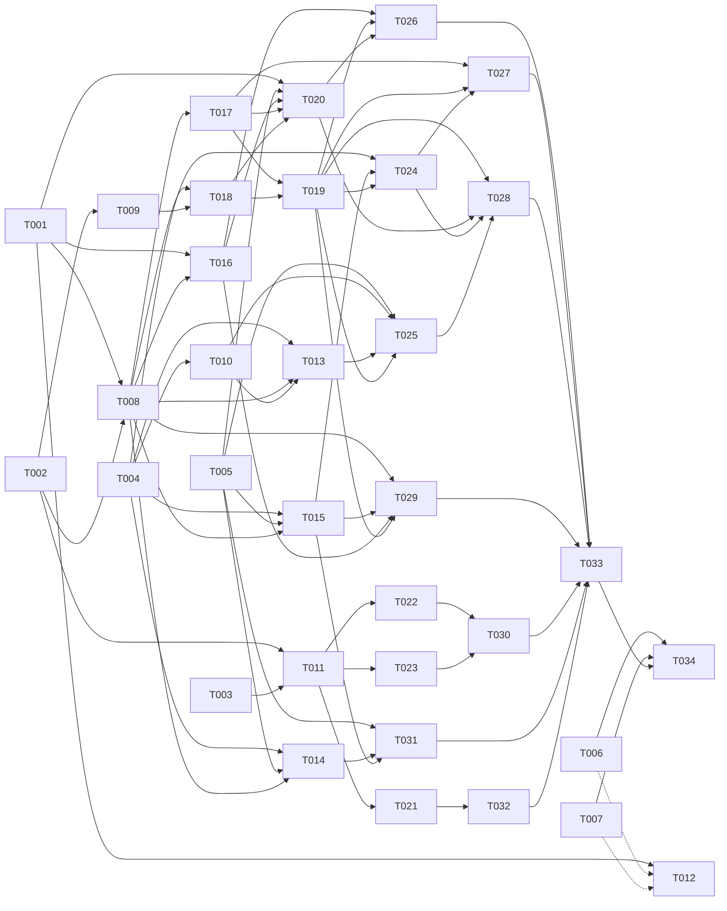

# Tasks: Bảng điều khiển CI/CD và triển khai lên máy chủ

**Input**: [spec.md](spec.md), [plan.md](plan.md), [research.md](research.md)

## Quy ước

- **Định dạng**: `[ID] [P?] [Story] [Tier] · ước lượng`.
  - **[P]**: chạy song song được với task khác cùng đợt. Bộ file không giao nhau và không chờ task chưa xong.
  - **Tier**: chọn model theo CLAUDE.md.
    - **nặng** = Opus `--effort high`;
    - **vừa** = Sonnet `--effort high`;
    - **nhẹ** = Sonnet `--effort medium`.
  - **Ước lượng**: ngày-agent (một agent làm liên tục, gồm test). **[Suy luận]** theo các spec 017, 018.
- **PHẠM VI**: chỉ được sửa các file liệt kê. Hai task cùng đợt không có file chung. Cần sửa file ngoài phạm vi thì ghi
  vào ghi chú bàn giao, người điều phối xếp lại. Mỗi task một worktree, agent chỉ commit tại máy (CLAUDE.md).
- **File chung có chủ**:
  - `packages/contracts/**` và `packages/contracts/openapi.json`: chỉ T002. Riêng
    `packages/contracts/src/{redact.ts,redact.test.ts,secret-scan.ts,secret-scan.test.ts}`: T009 (Đợt 1); T002 tạo
    `redact.ts` dạng khung và export ở `index.ts`. Task sau thấy thiếu thì ghi bàn giao, không tự sửa.
  - Nhãn web của khoá trong hợp đồng, `apps/web/src/lib/{permissions.ts,notification-channels.ts}`: T002 (cùng commit
    với `roles.ts`, `notify.ts`, vì `Record<NotificationEvent, string>` làm hỏng typecheck web khi thiếu nhãn), sau đó
    T029 (Đợt 5, chọn hệ thống cho kênh).
  - Mọi `schema.ts` và migration: chỉ T008 (một migration cho cả spec), gồm một cột ở `notify/schema.ts`. Task sau
    không đổi bảng.
  - `apps/hub/package.json`, `pnpm-lock.yaml`, `pnpm-workspace.yaml` (`allowBuilds`): chỉ T008 thêm `ssh2` và `@types/ssh2` (bản theo T001). Không thêm phụ
    thuộc nào khác: Jenkins, Argo CD, Kubernetes gọi bằng `fetch` hoặc `node:https`.
  - `apps/hub/src/modules/delivery/{index.ts,router.ts,deps.ts,jobs.ts}`, `apps/hub/src/main.ts`, `apps/hub/src/app.ts`:
    T008 tạo khung. Mỗi phần có file riêng và hàm `register<Phần>(jobs, deps)` riêng; T008 tạo dạng rỗng (ném
    `NOT_IMPLEMENTED`). Task sau chỉ sửa file của phần mình. T008 làm thật ba chỗ nhiều task cùng đợt cần:
    `connections/credentials.ts`, `deploys/{method.ts,methods.ts}`, `notifications.ts` (T029 sửa sau ở Đợt 5).
  - `apps/hub/src/modules/scm/{types.ts,gitlab.ts,github.ts,local.ts,memory.ts,events.ts,index.ts}`: T005 (Đợt 0), sau
    đó T031 (Đợt 6). `apps/hub/src/modules/catalog/{saga.ts,webhook-refresh.ts}`: T005, sau đó T031.
    `apps/hub/src/modules/catalog/index.ts`: T005, sau đó T008 (chỉ thêm export còn thiếu).
  - `apps/hub/src/modules/notify/**` (trừ `schema.ts`): chỉ T029.
  - `apps/hub/src/modules/delivery/testing/fake-http.ts`: T004 tạo. `testing/sshd.ts`, `testing/sshd/**`: T020 tạo.
    Task sau chỉ dùng.
  - `apps/web/src/router.tsx`, `apps/web/src/lib/{nav.ts,delivery-text.ts}`, `apps/web/src/shell/user-menu.tsx`,
    `apps/web/src/components/log-card.tsx`, `apps/web/e2e/fake-hub.ts`: chỉ T011. T011 tạo sẵn route và trang rỗng cho
    T021–T023, và file fixture rỗng `apps/web/e2e/delivery-<phần>-fixture.ts` cho từng task web.
- Mỗi task kèm test trong cùng commit.
- **Kiểm tra theo loại task**:
  - Hub: `pnpm --filter @xdev-hive/hub typecheck`, `pnpm --filter @xdev-hive/hub test` (test DB và test có `sshd` cần
    Docker, xem AGENTS.md). `sshd` dựng từ image Ubuntu; bị Docker Hub giới hạn (429) thì đặt image gốc qua
    `public.ecr.aws` (tên biến do T020 chọn; ghi bàn giao để người điều phối thêm vào AGENTS.md).
  - Contracts: `pnpm --filter @xdev-hive/contracts test`, `pnpm openapi`, `git diff --exit-code
    packages/contracts/openapi.json` sau khi commit.
  - Web: `typecheck`, `test`, Playwright file của task (`pnpm --filter @xdev-hive/web e2e -- <file>`).
  - Mọi task: `pnpm biome check --write .`, `pnpm deps`. Không chạy `pnpm ci:local` toàn bộ.
- **Migration**: chỉ T008 sinh, ở bước cuối, sau khi rebase lên `main` mới nhất (hiện mới nhất là `0077`).
- **Số ADR, mục SRS**: ADR 0029 và SRS 3.24 đã dành cho spec 019 (nhánh `ai/WORDIMPORT`). Spec này dùng ADR 0030,
  0031 và SRS 3.25, 3.26 **[Suy luận]**. Kiểm lại lúc làm (`ls docs/adr`, `docs/srs.md`, mọi nhánh mở).
- **Giả định**: Q1–Q16 đã chốt ngày 2026-10-17 (spec.md "Câu hỏi đã chốt"). Task làm theo câu trả lời đó. Kết quả T006,
  T007 (đo mạng, kiểm Jenkins) khác giả định thì người điều phối sửa task chưa làm trước khi giao.
- **Hệ thật**: mọi test tự động dùng đồ giả: provider `memory` của `scm`; Jenkins, Argo CD, Kubernetes bằng máy chủ
  HTTP trong test (`delivery/testing/fake-http.ts`); máy chủ SSH bằng `sshd` trong container (Testcontainers). Chỉ T006,
  T007, T034 chạm hệ thật, do chủ dự án hoặc quản trị hub làm hoặc ngồi cùng. Không commit token, khoá riêng, dấu vân
  tay của máy thật hay URL có token.
- **Không đổi**: worker Go, giao thức worker, `runs`, `fleet`, app desktop (plan.md "Tóm tắt").

## Đợt 0: spike, hợp đồng, thiết kế, client thuần, `scm` (song song)

- [x] **T001 [P] [—] [vừa] · 0,5 ngày — Spike: `ssh2`, chạy bước tách phiên SSH, pg-boss**
  - **Goal**: kiểm từng điểm **[Inference]**/**[Unverified]** ở plan.md mục 5 và "Quyết định của người viết". Dùng
    script tạm ngoài repo, chỉ commit kết quả:
    - `ssh2`: bản mới nhất, giấy phép, `pnpm audit`, kích thước cài đặt, `@types/ssh2`; chạy được trong image hub khi
      không có addon C++;
    - sinh khoá ed25519 dạng OpenSSH: `utils.generateKeyPairSync` của `ssh2` hay `crypto.generateKeyPairSync` của Node
      cộng tự mã hoá; khoá công khai cài vào `authorized_keys` đăng nhập được;
    - `hostVerifier`: chuỗi SHA256 khớp `ssh-keygen -lf` (định dạng hiện cho quản trị);
    - SFTP ghi từ `ReadableStream` (tarball vài chục MB), `chmod 600`;
    - `nohup setsid sh run.sh >/dev/null 2>&1 & echo $!` vẫn chạy sau khi đóng phiên, trên Ubuntu 22.04/24.04 và trong
      image `sshd` dự định cho test; `kill -TERM -- -<pgid>`; `tail -c +<n>`;
    - pg-boss bản đang dùng (`^12`): job tự xếp lại sau 2 giây và 15 giây bằng `singletonKey` + `startAfter`, độ trễ
      thật;
    - image `sshd` cho test: dựng từ `ubuntu:24.04` qua mirror `public.ecr.aws`, thời gian dựng.
  - **PHẠM VI**:
    - `specs/020-cicd-console/research.md` (thêm mục 4 "Kết quả spike")
  - **Kiểm**: mỗi dòng có kết quả "có / không / chưa rõ" kèm bản và ngày thử.

- [x] **T002 [P] [—] [nặng] · 1,5 ngày — Hợp đồng API**
  - **Goal**: plan.md mục 1–10, constitution I.
    - `delivery.ts` mới:
      - `ciConnectionsContract` (Jenkins): `list`, `create`, `update`, `remove`, `test`, `setWatcher`;
      - `ciTokensContract` (token Jenkins của chính người gọi): `list` (không có giá trị), `upsert`, `test`, `remove`;
      - `infraConnectionsContract` (Argo CD, Kubernetes): `list`, `create`, `update`, `remove`, `test`;
      - `ciJobsContract`: `list`, `add`, `remove` (job Jenkins gắn với dự án, FR-002);
      - `ciContract`: `feed` (lọc nguồn, nhánh, trạng thái; con trỏ trang; cờ `stale` kèm giờ khi nguồn không trả
        lời), `detail` (giai đoạn hoặc job), `log` (`from` → `text`, `next`, `more`), `jenkinsParams`, `retry`,
        `cancel`, `play`, `build` (có tham số), `stop`, `input` (`proceed` | `abort`), `approveDeployment` (GitHub).
        Nguồn `gitlab` | `github` | `jenkins` có sẵn từ đầu để T031 không đổi hợp đồng;
      - `serversContract`: `list`, `create` (trả khoá công khai và lệnh cài), `update`, `remove`, `test` (kết quả, hoặc
        loại lỗi `network` | `auth` | `hostkey_changed`, dấu vân tay chờ xác nhận), `confirmHostKey`, `rotateKey`,
        `confirmRotation`;
      - `environmentsContract`: `list`, `create`, `update`, `reorder`, `lock`, `unlock`;
      - `targetsContract`: `list`, `get`, `upsert` (`expectedConfigVersion`), `remove`. Cấu hình là union theo
        `method` (năm cách ở FR-013), có `schemaVersion`; biến bí mật chỉ ghi, đọc ra `{ secret: true, set: boolean }`;
      - `deploysContract`: `create` (phiên bản: commit | tag | image | `fromEnv`; `skipBackup` kèm lý do), `get`,
        `list`, `board`, `cancel`, `rollback`, `rollbackInfo` (được hay không, lý do tắt), `approvals` (`pending`,
        `approve`, `reject`, `compare`);
      - enum trạng thái (`pending_approval` … `expired`, plan.md mục 1), bước, phiên bản (`commit`, `tag`,
        `jenkinsBuild`, `image`, `revision`), nguồn gốc `hive` | `external`;
      - lỗi: `JENKINS_NO_TOKEN`, `JENKINS_UNAUTHORIZED`, `JENKINS_FORBIDDEN`, `JENKINS_NOT_FOUND`,
        `JENKINS_UNAVAILABLE`, `SSH_UNREACHABLE`, `SSH_AUTH_FAILED`, `SSH_HOSTKEY_CHANGED`, `DEPLOY_IN_PROGRESS` (kèm
        người, giờ), `ENV_LOCKED`, `SELF_APPROVAL`, `APPROVAL_EXPIRED`, `TARGET_VERSION_CONFLICT`,
        `ROLLBACK_UNAVAILABLE`.
    - `roles.ts`: nhánh `delivery` với `ci.view`, `ci.operate`, `deploy.run`, `deploy.approve`, `servers.manage` (đội,
      nguy hiểm), `ci.connections.manage` (tổ chức, nguy hiểm). Gán mặc định theo FR-030: `team-admin` có tất cả quyền
      đội, `team-member` có `ci.view`, `ci.operate`, `deploy.run`. Spec không nói các vai trò còn lại; tạm cho
      `team-viewer` `ci.view`, `member` của tổ chức như `team-member`, `team-ba` không có **[Suy luận]**, ghi bàn giao
      để chủ dự án xem.
    - `notify.ts`: bảy sự kiện của FR-031; `systemIds?` cho kênh (lọc theo hệ thống, plan.md "Quyết định của người
      viết").
    - `redact.ts` dạng khung: `createRedactor(secrets: string[]) → { push(chunk): string; flush(): string }`, thân ném
      lỗi; export ở `index.ts`. T009 làm thật.
    - Web: nhãn tiếng Việt cho quyền mới (`permissions.ts`) và sự kiện mới (`notification-channels.ts`).
    - Chữ mô tả route và lỗi tiếng Việt.
  - **PHẠM VI**:
    - `packages/contracts/src/{delivery.ts,delivery.test.ts,redact.ts}` (mới; `redact.ts` là khung)
    - `packages/contracts/src/{roles.ts,notify.ts,index.ts}`, `roles.test.ts` (mới)
    - `packages/contracts/openapi.json`
    - `apps/web/src/lib/{permissions.ts,notification-channels.ts}` (chỉ nhãn)
  - **Kiểm**: contracts test (vai trò mặc định đúng FR-030; cấu hình đích sai kiểu bị từ chối), `pnpm openapi`,
    typecheck hub và web vẫn qua (route mới chưa có handler thì hub dùng `NOT_IMPLEMENTED` ở T008; ghi bàn giao nếu
    typecheck hub hỏng tới khi T008 xong).

- [x] **T003 [P] [—] [vừa] · 1 ngày — Thiết kế màn**
  - **Goal**: plan.md mục 10, constitution "Giao diện". Dùng skill `ui-ux-pro-max`, design system v2 (Navy Hive),
    shadcn/ui. Mỗi màn có trạng thái rỗng, đang tải, lỗi, dữ liệu cũ kèm giờ (nguồn không trả lời); 360 px; sáng/tối;
    chữ tiếng Việt; nút tắt có lý do:
    - tab CI/CD của dự án: danh sách gộp, lọc, chi tiết giai đoạn/job, log, form tham số Jenkins, "Chưa có token";
    - cài đặt tổ chức: kết nối Jenkins (người theo dõi), Argo CD, Kubernetes; cá nhân: token Jenkins;
    - máy chủ: khoá công khai và lệnh cài, kiểm kết nối, xác nhận dấu vân tay, đổi khoá, "Host key của máy chủ đã đổi";
    - môi trường và đích triển khai (form theo năm cách);
    - bảng "đang chạy" (dự án × môi trường, nhãn "ngoài Hive"), lịch sử, hộp Triển khai, trang lần triển khai (bước,
      log trực tiếp), duyệt (danh sách commit), quay về.
  - **PHẠM VI**:
    - `docs/design-system/screens/{CicdTab,CiConnections,JenkinsTokens,Servers}.dc.html` (mới)
    - `docs/design-system/screens/{DeployTargets,DeployBoard,DeployRun,DeployApproval}.dc.html` (mới)
    - `docs/design-system/screens/README.md`
  - **Kiểm**: mở từng file trong trình duyệt ở 360 px và 1280 px, sáng và tối.

- [x] **T004 [P] [US1] [vừa] · 1,5 ngày — Client Jenkins**
  - **Goal**: FR-005, plan.md mục 2. Hàm thuần trên `fetch`, không đụng DB, nhận `{ baseUrl, user, token }`:
    - đọc: `me()` (`/me/api/json`); `job(path)` có `parameterDefinitions`; `builds(path, limit)`, `build(path, n)` qua
      `?tree=` (plan.md mục 2); `stages` (`wfapi/describe`, 404 thì `null`); `log(path, n, start)` qua
      `logText/progressiveText` (`X-Text-Size`, `X-More-Data`); `pendingInputs` (`wfapi/pendingInputActions`);
    - ghi: `build(path, params)` (`buildWithParameters` hoặc `build`, đọc `Location` của queue item, đợi tới khi có
      số build, có hạn chờ), `stop`, `inputProceed`, `inputAbort`;
    - đường dẫn job có folder và multibranch (`a/b/c` → `/job/a/job/b/job/c`, mã hoá từng đoạn);
    - lỗi thành `JenkinsError` mã `UNAUTHORIZED`, `FORBIDDEN`, `NOT_FOUND`, `UNAVAILABLE` (hết giờ, 5xx); 403 do thiếu
      crumb tách riêng để T007 đối chiếu;
    - thời gian chờ mỗi lời gọi; không log header `Authorization`.
  - `testing/fake-http.ts`: máy chủ HTTP trong test (bảng route → phản hồi, ghi lại request) dùng chung cho T010, T013,
    T014, T024, T025.
  - Fixture JSON viết theo tài liệu Jenkins công khai **[Suy luận]**; T007 đối chiếu với Jenkins thật, khác thì người
    điều phối thêm task sửa.
  - **PHẠM VI**:
    - `apps/hub/src/modules/delivery/clients/jenkins.ts` (mới) + `jenkins.test.ts`
    - `apps/hub/src/modules/delivery/testing/fake-http.ts` (mới)
    - `apps/hub/src/modules/delivery/fixtures/jenkins/**` (mới)
  - **Kiểm**: hub test (file mới), typecheck.

- [x] **T005 [P] [US1] [nặng] · 1,5 ngày — `scm`: pipeline/job GitLab, `compare` có commit, webhook Pipeline/Job**
  - **Goal**: FR-003 (GitLab), FR-004 (đăng ký sự kiện), FR-035, plan.md mục 3.
    - `types.ts`: kiểu `CiPipeline`, `CiJob`; `GitProvider` thêm `listPipelines(ref, { branch?, sha?, status?, page })`,
      `pipelineJobs`, `jobLog(ref, jobId, from)` → `{ text, next, complete }`, `retryPipeline`, `cancelPipeline`,
      `retryJob`, `cancelJob`, `playJob`; `compare` trả thêm `commits` (sha, tiêu đề, tác giả, giờ); `WebhookEvent`
      thêm `pipeline`, `job`.
    - `gitlab.ts`: các thao tác trên qua `rest()` (plan.md mục 3); `jobLog` đọc `/trace` rồi cắt từ `from` nếu GitLab
      không đọc được theo khoảng **[Suy luận]**; `addWebhook` bật `pipelineEvents`, `jobEvents`; `compare` có `commits`.
    - `github.ts`, `local.ts`: `compare` có `commits`; thao tác pipeline ném `ScmError` "chưa hỗ trợ" (GitHub làm ở
      T031); `addWebhook` của GitHub bỏ qua `pipeline`, `job` tới T031.
    - `memory.ts`: đủ mọi phương thức mới; hàm thử để tạo pipeline, đổi trạng thái job, phát sự kiện.
    - `events.ts`: hook GitLab `Pipeline Hook`, `Job Hook` thành sự kiện `pipeline`, `job` (id, ref, sha, trạng thái).
    - `catalog/saga.ts`: `WEBHOOK_EVENTS` thêm `pipeline`, `job`. `catalog/webhook-refresh.ts` (mới):
      `refreshProjectWebhooks(deps)` gọi lại `addWebhook` cho mọi dự án GitLab đang hoạt động (hàm này đã tự cập nhật
      hook cùng URL), export qua `catalog/index.ts`; T015 xếp job gọi một lần.
  - **PHẠM VI**:
    - `apps/hub/src/modules/scm/{types.ts,gitlab.ts,github.ts,local.ts,memory.ts,events.ts,index.ts}` + test tương ứng
    - `apps/hub/src/modules/scm/webhooks.ts` (chỉ khi cần nhận header `Pipeline Hook`, `Job Hook`)
    - `apps/hub/src/modules/scm/fixtures/gitlab/{pipeline,job,pipelines,pipeline_jobs,compare}.json` (mới)
    - `apps/hub/src/modules/catalog/{saga.ts,webhook-refresh.ts,index.ts}` (`webhook-refresh.ts` mới) + test
  - **Kiểm**: hub test phần `scm`, `catalog` (test cũ của docsync, SDLC, code review vẫn qua), typecheck.

- [x] **T006 [—] [người: chủ dự án hoặc quản trị hub] · 0,5 ngày người — Đo mạng từ hub**
  - **Goal**: các đường **chưa đo** ở research.md mục 2 và Assumptions của spec. Đo từ **trong container hub** trên
    `app-host` (đúng nơi hub chạy), chỉ lấy kết nối hoặc mã HTTP, không đăng nhập:
    - cổng 22 của các máy `198.51.100.x` sẽ khai báo (`nc -zv -w 5 <ip> 22`);
    - API Kubernetes (RKE2 `.57`, `.60`, `.54`; cổng 6443 hoặc qua nginx `.55`) `GET /version`;
    - URL Argo CD (`/api/version`);
    - từ mạng bridge của Docker tới `192.0.2.10:22` (hub SSH tới chính máy nó, cần cho SC-002);
    - chiều ngược lại: GitLab `gitlab.example.com` gọi về `https://hive.example.com/hooks/git/…` (lịch sử hook của một dự án
      thử), ảnh hưởng SC-001 phần GitLab.
  - **PHẠM VI**: không sửa file. Người điều phối ghi kết quả vào bảng kết nối mạng ở research.md mục 2, sau khi T001
    merge.
  - **Xong khi**: mỗi đích có "vào được / không" kèm ngày. Đích "không" thì T012 ghi vào tài liệu và máy chủ đó chưa
    khai báo được (máy runner để sau, Q14).

- [ ] **T007 [—] [người: chủ dự án] · 0,5 ngày người — Kiểm Jenkins ACME, Argo CD, ServiceAccount**
  - **Còn thiếu**: research.md chưa có mục 5 "Kiểm hệ thật" (Jenkins ACME, Argo CD, ServiceAccount).
  - **Goal**: các dòng **[Unverified]** ở spec Assumptions, plan.md mục 2 và "Quyết định của người viết":
    - Jenkins (Keycloak OIDC, realm `devops`): người dùng tự tạo được API token; `GET /me/api/json` bằng user + token;
      `POST` bằng API token **không cần crumb** (vd. `stop` một build thử hoặc `buildWithParameters` một job thử); có
      plugin Pipeline Stage View (`wfapi/describe`), `pendingInputActions`; bản Jenkins;
    - Argo CD: xác thực thế nào (token của account, SSO), token có quyền `sync`, `rollback` không;
    - Kubernetes: ServiceAccount (vd. `his-portal/jenkins-deployer-token`) có quyền `get`, `patch` Deployment không;
    - một JSON mẫu mỗi loại (đã xoá tên người, URL nội bộ, token) để đối chiếu fixture của T004, T010.
  - **PHẠM VI**: không sửa file. Không gửi token qua chat, issue hay commit. JSON mẫu gửi người điều phối qua kênh
    riêng.
  - **Xong khi**: người điều phối ghi kết quả vào research.md mục 5 "Kiểm hệ thật" (sau khi T001 merge). Jenkins cần
    crumb thì thêm task nhỏ cho `clients/jenkins.ts` (lấy `/crumbIssuer/api/json`) trước T014.

## Đợt 1: nền (song song, sau Đợt 0)

- [x] **T008 [P] [—] [nặng] · 1,5 ngày — Bảng, RLS, migration, `ssh2`, khung module `delivery`**
  - **Phụ thuộc**: T001 (bản `ssh2`), T002.
  - **Goal**: plan.md mục 1, FR-033, spec Key Entities.
    - `delivery/schema.ts` (mới), 11 bảng: `ci_jenkins_connections` (thêm `watcher_user_id`, `last_poll_at`,
      `last_error`), `ci_jenkins_user_tokens`, `deploy_connections`, `ci_project_jobs`, `ci_runs_seen`,
      `deploy_servers`, `deploy_environments` (`policy jsonb`, `locked_at`, `locked_by`, `lock_reason`),
      `deploy_targets`, `deploys`, `deploy_log_chunks`, `deploy_approvals`. Cột, unique, ngữ cảnh mã hoá theo plan.md
      mục 1; partial unique index "một lần do Hive tạo đang đi mỗi đích".
    - Mọi bảng mới: `org_id`, `ENABLE` + `FORCE ROW LEVEL SECURITY`, policy `<bảng>_rw`, quyền cho `hive_app`.
    - Hàm SQL `hive.purge_deploy_logs()` (`SECURITY DEFINER`, theo `runLogRetentionDays` của từng tổ chức), như
      `hive.purge_run_logs()`.
    - `notify/schema.ts`: `notification_channels.system_ids uuid[]` (null là mọi hệ thống) **[Suy luận]**: plan.md chọn
      lọc kênh theo hệ thống, bảng hiện chưa có cột.
    - `apps/hub/package.json`: `ssh2` 1.17.0, `@types/ssh2` 1.15.6 (spike T001). `pnpm-workspace.yaml`: thêm
      `ssh2: false` vào `allowBuilds` (pnpm chặn script cài đặt của `ssh2`; bản JS thuần chạy được, research.md mục 4).
    - `deploy_servers.host_keys jsonb` (`{algorithm, fingerprint}`), không phải `text[]` (plan.md mục 1).
    - `jobs.ts`: `delivery-deploy-watch` là queue `stately`, đặt `heartbeatSeconds` (plan.md mục 5).
    - Khung `delivery`:
      - `index.ts`, `router.ts` (gộp `routes/*.ts`), `deps.ts`;
      - `jobs.ts`: tên queue (`delivery-ci-poll`, `delivery-deploy`, `delivery-deploy-watch`,
        `delivery-approval-expire`, `delivery-log-retention`, `delivery-webhook-refresh`), `registerDelivery` gọi
        `register<Phần>`;
      - làm thật, kèm test:
        - `connections/credentials.ts`: `jenkinsAuth(tx, { connectionId, userId | "watcher" })` giải mã token trong bộ
          nhớ, `userId` chỉ lấy token của chính người đó, thiếu thì `JENKINS_NO_TOKEN`; `infraAuth(tx, connectionId)`;
          audit `delivery.secret_used` gom theo lần dùng (plan.md mục 9);
        - `deploys/method.ts`: giao diện `DeployMethod { start, poll, cancel, version, rollback? }`;
          `deploys/methods.ts`: bảng cách → cài đặt;
        - `notifications.ts`: `emitDeliveryEvent` gọi `notify` hiện có (T029 thêm lọc hệ thống, người nhận);
      - file phần dạng rỗng mà khung gọi tới:
        - `ci/{poll,gitlab-events,webhook-refresh}.ts`, `approvals.ts`, `retention.ts`,
          `deploys/{orchestrator,external}.ts`: export `register<Phần>` không làm gì;
        - `stream-route.ts`: handler trả 501;
        - `deploys/{ssh-script,jenkins-job,gitlab-manual,argocd,kubectl}.ts`: cách triển khai ném `NOT_IMPLEMENTED`;
        - `routes/{ci-connections,ci-tokens,infra-connections,ci-jobs,ci}.ts`,
          `routes/{servers,environments,targets,deploys,approvals}.ts`: ném `NOT_IMPLEMENTED`.
      - `main.ts` gọi `registerDelivery`; `app.ts` gắn `deliveryRouter` và route SSE `/api/v1/deploys/:id/stream`.
    - `catalog/index.ts` (và `tenancy/index.ts` nếu cần): chỉ thêm export còn thiếu để `delivery` đọc dự án, hệ thống,
      đội qua `index.ts` **[Suy luận]**.
  - **PHẠM VI**:
    - `apps/hub/src/modules/delivery/{schema.ts,index.ts,router.ts,deps.ts,jobs.ts,notifications.ts}` (mới) +
      `jobs.test.ts`
    - `apps/hub/src/modules/delivery/connections/credentials.ts`, `deploys/{method.ts,methods.ts}` (mới) + test
    - các file phần rỗng ở trên (mới)
    - `apps/hub/src/modules/delivery/rls.db.test.ts` (mới, phủ 11 bảng), `credentials.db.test.ts` (mới)
    - `apps/hub/src/modules/notify/schema.ts` (một cột)
    - `apps/hub/src/modules/catalog/index.ts`, `apps/hub/src/modules/tenancy/index.ts` (chỉ export)
    - `apps/hub/src/main.ts`, `apps/hub/src/app.ts`
    - `apps/hub/db/migrations/*` (một file mới + meta)
    - `apps/hub/package.json`, `pnpm-lock.yaml`, `pnpm-workspace.yaml` (một dòng `allowBuilds`)
  - **Kiểm**: hub typecheck, `rls.db.test.ts`, test upgrade migration từ bản mới nhất trên `main`, `pnpm deps`.

- [x] **T009 [P] [US4] [nặng] · 0,5 ngày — Che bí mật dùng chung**
  - **Phụ thuộc**: T002 (khung `redact.ts`).
  - **Goal**: FR-019, SC-005, plan.md mục 7.
    - `secret-scan.ts`: export bộ mẫu, không đổi kết quả `scanSecrets`. Thiếu mẫu khoá riêng OpenSSH thì thêm (cả
      `scanSecrets` thấy), ghi bàn giao.
    - `redact.ts`: `createRedactor(secrets)` thay giá trị bí mật (bỏ giá trị rỗng hoặc quá ngắn **[Suy luận]**) và mọi
      mẫu của `secret-scan.ts` bằng `***`; giữ đuôi 200 ký tự của đoạn trước để ghép, nên bí mật cắt ngang hai đoạn vẫn
      bị che; `flush()` khi hết log; không bao giờ trả phần đang giữ khi chưa che.
    - Bộ test: mật khẩu, token GitLab/GitHub/Jenkins giả, khoá riêng PEM/OpenSSH, bí mật cắt ở mọi vị trí giữa hai đoạn
      (vòng lặp), mã ANSI xen giữa.
  - **PHẠM VI**:
    - `packages/contracts/src/{redact.ts,redact.test.ts,secret-scan.ts,secret-scan.test.ts}`
  - **Kiểm**: contracts test, typecheck, `pnpm openapi` không đổi `openapi.json`.

- [x] **T010 [P] [US5] [vừa] · 1 ngày — Client Argo CD và Kubernetes**
  - **Phụ thuộc**: T004 (`testing/fake-http.ts`).
  - **Goal**: FR-006, FR-023, FR-024, plan.md mục 6. Hàm thuần, không đụng DB:
    - `argocd.ts`: `version`, `listApplications(limit)`, `getApplication` (sync, health, revision, `summary.images`,
      autoSync, lịch sử), `sync(app, revision?)`, `rollback(app, historyId)`;
    - `kube.ts`: gọi API bằng `node:https` với CA riêng của kết nối (không thêm phụ thuộc; `undici` chỉ là
      devDependency); `version`, `getWorkload(ns, kind, name)`, `patchImage(ns, kind, name, container, image)`
      (`strategic-merge-patch`), `rolloutStatus` (`observedGeneration`, `updatedReplicas`, `availableReplicas`,
      `ProgressDeadlineExceeded`);
    - lỗi thành mã (`UNAUTHORIZED`, `FORBIDDEN`, `NOT_FOUND`, `UNAVAILABLE`); không log token.
  - **PHẠM VI**:
    - `apps/hub/src/modules/delivery/clients/{argocd.ts,kube.ts}` (mới) + test
    - `apps/hub/src/modules/delivery/fixtures/{argocd,kube}/**` (mới)
  - **Kiểm**: hub test (file mới; Kubernetes giả chạy HTTPS với CA tự sinh trong test), typecheck.

- [x] **T011 [P] [US2] [vừa] · 1,5 ngày — Web: khung route, kết nối CI, token Jenkins cá nhân**
  - **Phụ thuộc**: T002, T003.
  - **Goal**: FR-001, FR-006 (giao diện), US1 scenario 4, US2 scenario 2.
    - `ci-connections-page.tsx` (tổ chức, cần `ci.connections.manage`): kết nối Jenkins (tên, URL, người theo dõi, lần
      đọc cuối, lỗi "Không đọc được Jenkins"), Argo CD, Kubernetes (URL, CA, token chỉ ghi), nút "Kiểm".
    - `jenkins-tokens-page.tsx` (cá nhân): mỗi kết nối một dòng; thêm/cập nhật user + API token, "Kiểm", xoá; không bao
      giờ hiện lại token.
    - Khung cho task web sau: route `/projects/$key/cicd`, `/systems/$systemId/deploys`, `/deploys/$id`,
      `/admin/servers`, `/systems/$systemId/environments`, `/admin/ci-connections`, `/settings/jenkins-tokens`
      **[Suy luận]** (đường dẫn chọn lúc làm, theo `nav.ts`); trang rỗng cho T021–T023; mục menu (`nav.ts`,
      `user-menu.tsx`); link "CI/CD" ở đầu trang dự án (`tasks-page.tsx`), link "Triển khai" ở tab hệ thống của đội
      (`teams-page.tsx`).
    - `components/log-card.tsx`: tách `LogCard` khỏi `run-page.tsx`, không đổi hành vi, để T021, T023 dùng.
    - `lib/delivery-text.ts`: nhãn tiếng Việt cho trạng thái lần triển khai, bước, nguồn CI, mã lỗi của hợp đồng (đủ một
      lần; task sau chỉ đọc).
    - `fake-hub.ts`: nối fixture rỗng `e2e/delivery-{ci,servers,deploys,approvals}-fixture.ts`; SSE giả cho
      `/api/v1/deploys/:id/stream` đọc dòng log từ fixture.
  - **PHẠM VI**:
    - `apps/web/src/pages/settings/{ci-connections-page,jenkins-tokens-page}.tsx` (mới) + test
    - `apps/web/src/pages/projects/cicd-page.tsx`, `apps/web/src/pages/settings/{servers-page,environments-page}.tsx`,
      `apps/web/src/pages/deploys/{board-page,deploy-page}.tsx` (mới, rỗng)
    - `apps/web/src/router.tsx`, `apps/web/src/lib/{nav.ts,nav.test.ts,delivery-text.ts}`,
      `apps/web/src/shell/user-menu.tsx`
    - `apps/web/src/pages/{tasks-page.tsx,teams-page.tsx,run-page.tsx}`, `apps/web/src/components/log-card.tsx` (mới)
    - `apps/web/e2e/fake-hub.ts`, `apps/web/e2e/delivery-settings.spec.ts`, `delivery-settings-fixture.ts` (mới)
    - `apps/web/e2e/delivery-{ci,servers,deploys,approvals}-fixture.ts` (mới, rỗng)
  - **Kiểm**: web typecheck, test, Playwright `delivery-settings.spec.ts` và `projects-runs.spec.ts` (LogCard), 360 px,
    bàn phím.

- [x] **T012 [P] [—] [nhẹ] · 0,5 ngày — ADR 0030, 0031, SRS, tài liệu kỹ thuật**
  - **Phụ thuộc**: T001. T006 đã có (research.md mục 2): hub không vào được cổng 22 và API Kubernetes của
    `198.51.100.x`, nên triển khai lên hạ tầng ACME đi qua `jenkins-job` hoặc `argocd`. T007 chưa có: ghi "chưa
    kiểm" và để mọi chi tiết Jenkins, Argo CD ở mức **[Suy luận]**; người điều phối cập nhật sau.
  - **Goal**:
    - ADR 0030 "Hub runs deploy steps over SSH" (tiếng Anh, theo `docs/adr/template.md`): Q1, Q2; `ssh2` (bản, giấy
      phép, kết quả audit từ T001) thay binary `ssh`; khoá theo máy chủ, mã hoá theo bản ghi; host key cố định; bước
      tách khỏi phiên SSH và cách nối lại; rủi ro R1, R8; máy runner để sau (Q14, Q16).
    - ADR 0031 "External CI and deploy sources": Jenkins (token từng người, người theo dõi, hỏi theo lịch), GitLab
      pipeline/job qua webhook và hỏi lại, Argo CD, Kubernetes bằng `fetch`, không lưu log CI (Q12), GitHub Actions
      sau (Q11).
    - SRS: mục 3.25 CI/CD (`CICD-…`) và 3.26 Deploy (`DEPLOY-…`) ánh xạ FR-001…FR-035. Số mục kiểm lại lúc làm.
    - `docs/architecture.md`: module `delivery` ở mục 2, bảng mới ở mục 3.
    - `docs/self-hosting.md`:
      - hub cần mạng tới cổng SSH của máy chủ đích, Jenkins, GitLab, Argo CD, API Kubernetes (kết quả T006);
      - `HIVE_MASTER_KEY` mở được mọi khoá SSH và token; mất khoá thì phải sinh lại khoá cho mọi máy chủ;
      - bản sao lưu không còn chứa `.env` (R11 đã chốt 2026-10-19, plan.md mục 9; mục backup đã ghi): quản trị cất
        `.env` riêng và bảo vệ như chính khoá SSH. Bản sao lưu cũ còn `.env` thì bảo vệ như vậy cho tới khi xoá;
      - khuyến nghị user triển khai riêng trên máy chủ, không dùng `root` (R1); đặt `approvers` cho `acmePromote` (R7).
  - **PHẠM VI**:
    - `docs/adr/0030-hub-deploys-over-ssh.md`, `docs/adr/0031-external-ci-and-deploy-sources.md` (mới)
    - `docs/adr/README.md` (hai dòng mục lục)
    - `docs/srs.md` (chỉ thêm hai mục)
    - `docs/architecture.md`, `docs/self-hosting.md`
  - **Kiểm**: `pnpm biome check --write .`.

## Đợt 2: lõi hub: kết nối, CI, máy chủ, đích, log (song song, sau Đợt 1)

- [x] **T013 [P] [US2] [nặng] · 1,5 ngày — Kết nối Jenkins, token cá nhân, người theo dõi, Argo CD, Kubernetes**
  - **Phụ thuộc**: T004, T008, T010.
  - **Goal**: FR-001, FR-002, FR-006, FR-032, plan.md mục 2.
    - `connections/jenkins.ts`: kết nối Jenkins (thêm, sửa, xoá, kiểm) cần `ci.connections.manage`; người theo dõi mặc
      định là người tạo, đổi được (người được chọn phải có token cho kết nối); token cá nhân: thêm/cập nhật (kiểm
      `/me/api/json` trước khi lưu), kiểm lại, xoá; danh sách chỉ trả có hay không có token, user Jenkins, lần kiểm
      cuối. Quản trị thấy ai có token, không thấy giá trị.
    - `connections/infra.ts`: kết nối Argo CD, Kubernetes (URL, CA, token mã hoá); kiểm bằng
      `/api/v1/applications?limit=1`, `/version`.
    - `ci/project-jobs.ts`: gắn/bỏ job Jenkins với dự án (cần `projects.settings` **[Suy luận]**); kiểm job tồn tại
      bằng token người gọi hoặc người theo dõi.
    - Mọi thao tác ghi `recordAudit`; token chỉ giải mã qua `connections/credentials.ts`.
  - **PHẠM VI**:
    - `apps/hub/src/modules/delivery/connections/{jenkins.ts,infra.ts}`, `ci/project-jobs.ts` (mới)
    - `apps/hub/src/modules/delivery/routes/{ci-connections,ci-tokens,infra-connections,ci-jobs}.ts`
    - `apps/hub/src/modules/delivery/connections.db.test.ts` (mới)
  - **Kiểm**: hub test (token của người A không dùng được cho người B; API không bao giờ trả token; xoá kết nối xoá
    token), typecheck, `pnpm deps`.

- [x] **T014 [P] [US1] [nặng] · 1,5 ngày — CI: danh sách gộp, chi tiết, log, thao tác**
  - **Phụ thuộc**: T004, T005, T008.
  - **Goal**: US1, US2, FR-005, FR-007…FR-009, FR-035, plan.md mục 2–4.
    - `ci/feed.ts`: gộp pipeline GitLab (`listPipelines`) và build Jenkins của các job trong `ci_project_jobs`, mới
      nhất ở trên, lọc nguồn, nhánh, trạng thái, phân trang. Đọc Jenkins bằng token người xem nếu có, không thì người
      theo dõi; không có token nào thì "Chưa có token để đọc Jenkins". Đệm 10 giây trong tiến trình theo (dự án,
      trang). Nguồn lỗi thì trả dữ liệu lần cuối kèm giờ và cờ `stale`, không chặn nguồn khác.
    - `ci/detail.ts`: giai đoạn Jenkins (`wfapi`), job GitLab. `ci/logs.ts`: log theo đoạn từ nguồn, không lưu (Q12).
    - `ci/actions.ts`:
      - GitLab chạy lại, huỷ, chạy job chờ tay bằng token kết nối của dự án (FR-035);
      - Jenkins build có tham số, dừng, Proceed/Abort bằng **token của người bấm** (`JENKINS_NO_TOKEN` nếu chưa có);
      - cần `ci.operate`; `recordAudit` (người bấm, nguồn, đối tượng, tham số; tham số password không ghi giá trị);
      - lỗi thiếu quyền ở nguồn nói rõ thiếu gì, ở đâu (US2 scenario 4).
    - Đọc cần `ci.view` (US1 scenario 3).
  - **PHẠM VI**:
    - `apps/hub/src/modules/delivery/ci/{feed.ts,detail.ts,logs.ts,actions.ts}` (mới) + `feed.test.ts`
    - `apps/hub/src/modules/delivery/routes/ci.ts`
    - `apps/hub/src/modules/delivery/ci.db.test.ts` (mới)
  - **Kiểm**: hub test (GitLab `memory` 3 pipeline và Jenkins giả 2 build như Independent Test của US1; Jenkins nhận
    header Basic của người bấm; audit đủ), typecheck.

- [ ] **T015 [P] [US1] [nặng] · 1,5 ngày — Hỏi theo lịch, sự kiện GitLab, đỏ/xanh**
  - **Phụ thuộc**: T004, T005, T008.
  - **Goal**: FR-004, FR-025 (phần phát hiện), FR-031 (`ci.failed`, `ci.recovered`), plan.md mục 4, Q4, Q13.
    - `ci/poll.ts`: `delivery-ci-poll` cho mỗi kết nối Jenkins có người theo dõi (`singletonKey` theo kết nối); có build
      đang chạy thì xếp lại sau 15 giây, rảnh thì theo chu kỳ rảnh; lùi lại khi lỗi; token người theo dõi hỏng thì ghi
      `last_error` cho kết nối. Chu kỳ rảnh: spec Q4 chốt 5 phút, plan.md mục 4 viết 1 phút; dùng hằng số, mặc định 5
      phút theo Q4, người điều phối chốt nếu cần đổi.
    - Cập nhật `ci_runs_seen`. Nhánh mặc định của dự án chuyển sang đỏ thì `ci.failed`, xanh lại thì `ci.recovered`;
      đã báo đỏ thì không báo lại (qua `emitDeliveryEvent`).
    - Export `onJenkinsBuildFinished(handler)` để T024 ghi lần triển khai "ngoài Hive".
    - `ci/gitlab-events.ts`: `onScmEvent` cho `pipeline`, `job` cập nhật `ci_runs_seen`; hỏi lại mỗi 5 phút các dự án
      có pipeline chưa kết thúc.
    - `ci/webhook-refresh.ts`: job một lần gọi `refreshProjectWebhooks` của `catalog` (T005).
  - **PHẠM VI**:
    - `apps/hub/src/modules/delivery/ci/{poll.ts,gitlab-events.ts,webhook-refresh.ts}` + `poll.test.ts`
    - `apps/hub/src/modules/delivery/poll.db.test.ts` (mới)
  - **Kiểm**: hub test (đỏ hai lần liên tiếp chỉ một tin; xanh lại một tin; webhook gửi lại không đổi kết quả; chu kỳ
    15 giây khi có build chạy), typecheck.

- [x] **T016 [P] [US3] [nặng] · 2 ngày — Client SSH và máy chủ**
  - **Phụ thuộc**: T001, T008.
  - **Goal**: US3, FR-010, FR-011, FR-032, SC-004, SC-008, plan.md mục 5 "Khoá", "Kết nối".
    - `clients/ssh.ts` (`ssh2`):
      - kết nối bằng khoá riêng trong bộ nhớ, không ghi file;
      - `hostVerifier` so SHA256 với `host_keys`; sai thì dừng trước mọi lệnh (`SSH_HOSTKEY_CHANGED`); lần đầu trả dấu
        vân tay, không chạy lệnh; ghi lý do từ chối trong biến của lần kết nối (`ssh2` báo chung `Host denied`);
      - đã có host key thì ép `algorithms.serverHostKey` theo thuật toán đã lưu;
      - `on('error')` suốt đời kết nối, không dùng `once` (lỗi thứ hai sau timeout làm sập tiến trình, spike T001);
      - chờ kết nối 10 giây; tách lỗi mạng (`ECONNREFUSED`, `ETIMEDOUT`, `EHOSTUNREACH`) khỏi lỗi xác thực;
      - `exec` có hạn giờ và trần output; SFTP `mkdir`, ghi từ stream, `chmod`.
    - `servers.ts`:
      - thêm, sửa, xoá máy chủ của đội (cần `servers.manage`);
      - sinh cặp ed25519 bằng `ssh2.utils.generateKeyPairSync` (spike T001), mã hoá ngay với ngữ cảnh `deploy_servers:<id>:key`; trả khoá công khai và
        lệnh cài (`mkdir -p ~/.ssh`, `chmod`, `echo '…' >> ~/.ssh/authorized_keys`);
      - "Kiểm kết nối": hệ điều hành, phiên bản Docker và Compose, đĩa trống; xác nhận dấu vân tay;
      - "Đổi khoá": khoá mới ở `pending_*`, khoá cũ vẫn dùng tới khi kiểm bằng khoá mới thành công thì thay;
      - host key đổi thì `server.hostkey_changed` và audit; không có API nào trả khoá riêng; audit mọi lần giải mã.
  - **PHẠM VI**:
    - `apps/hub/src/modules/delivery/clients/ssh.ts` (mới) + `ssh.test.ts` (máy chủ SSH trong tiến trình bằng `Server`
      của `ssh2`)
    - `apps/hub/src/modules/delivery/servers.ts` (mới), `routes/servers.ts`
    - `apps/hub/src/modules/delivery/servers.db.test.ts` (mới)
  - **Kiểm**: hub test (host key sai thì không lệnh nào chạy, SC-004 mức đơn vị; khoá riêng không có trong phản hồi API,
    audit, log, SC-008 mức đơn vị; đổi khoá giữa chừng không làm mất đường vào), typecheck, `pnpm deps`.

- [x] **T017 [P] [US3] [vừa] · 1 ngày — Môi trường và đích triển khai**
  - **Phụ thuộc**: T008.
  - **Goal**: FR-012…FR-014, FR-026 (trường chính sách), FR-030 (chỉ `servers.manage` sửa lệnh và cấu hình).
    - `environments.ts`: môi trường của hệ thống (tên, thứ tự, chính sách duyệt: số người, `approveRoles`,
      `deployRoles`, hạn chờ mặc định 24 giờ). Cần `servers.manage` **[Suy luận]**: spec không nói ai tạo môi trường.
    - `targets.ts`: đích = dự án × môi trường; cấu hình kiểm bằng zod của hợp đồng theo cách; máy chủ phải cùng đội với
      hệ thống, kết nối cùng tổ chức; biến bí mật mã hoá từng giá trị (`deploy_targets:<id>:var:<tên>`), không trả ra;
      `config_version` tăng mỗi lần sửa, sai `expectedConfigVersion` thì `TARGET_VERSION_CONFLICT`; `recordAudit` kèm
      khác biệt (bí mật che).
  - **PHẠM VI**:
    - `apps/hub/src/modules/delivery/{environments.ts,targets.ts}` (mới), `routes/{environments,targets}.ts`
    - `apps/hub/src/modules/delivery/targets.db.test.ts` (mới)
  - **Kiểm**: hub test (hai người sửa cùng đích thì người sau bị từ chối; người chỉ có `deploy.run` không sửa được
    lệnh), typecheck.

- [x] **T018 [P] [US4] [vừa] · 1 ngày — Log triển khai, SSE, health, dọn log**
  - **Phụ thuộc**: T008, T009.
  - **Goal**: FR-018, FR-019, Q12, plan.md mục 7.
    - `logs.ts`: `appendDeployLog(tx, deployId, text, redactor)` che bằng `createRedactor` (bí mật của đích và mẫu
      chung) rồi ghi `deploy_log_chunks` (`bytea`), `NOTIFY`; `logsAfter(cursor)`.
    - `stream-route.ts`: SSE `/api/v1/deploys/:id/stream` theo cách `runs/stream.ts` (con trỏ, kết thúc khi lần triển
      khai xong). Ai xem được log triển khai spec không nói; tạm dùng `ci.view` của đội **[Suy luận]**.
    - `deploys/health.ts`: gọi URL từ hub, mã HTTP mong đợi, biểu thức JSON dạng đường dẫn đơn giản (`version == …`),
      thử lại theo chu kỳ trong thời gian chờ (mặc định 3 phút); không chạy mã.
    - `retention.ts`: job hằng ngày gọi `hive.purge_deploy_logs()`.
  - **PHẠM VI**:
    - `apps/hub/src/modules/delivery/{logs.ts,stream-route.ts,retention.ts}`, `deploys/health.ts` (mới) + test
    - `apps/hub/src/modules/delivery/logs.db.test.ts` (mới)
  - **Kiểm**: hub test (mật khẩu giả trong log bị che trước khi ghi, kể cả khi cắt giữa hai đoạn; SSE đọc tiếp từ con
    trỏ), typecheck.

## Đợt 3: điều phối, `ssh-script`, giao diện (song song, sau Đợt 2)

- [ ] **T019 [P] [US4] [nặng] · 2 ngày — Bộ điều phối triển khai, bảng "đang chạy"**
  - **Phụ thuộc**: T008, T017, T018.
  - **Goal**: FR-015, FR-020, FR-027 (kiểm khoá), Q9, plan.md "Kiến trúc", mục 1, 8.
    - `deploys/orchestrator.ts`:
      - tạo lần triển khai: cần `deploy.run` và vai trò trong `deployRoles` của môi trường; môi trường khoá thì
        `ENV_LOCKED`; đích có lần do Hive tạo đang đi thì `DEPLOY_IN_PROGRESS` "Đang triển khai bởi <người> từ <giờ>"
        (dựa partial unique index); môi trường cần duyệt thì `pending_approval` và `deploy.approval_requested`, không
        thì `queued`; lưu `config_version`; "Bỏ qua sao lưu lần này" ghi audit;
      - worker `delivery-deploy` gọi `method.start`; `delivery-deploy-watch` gọi `method.poll`, lưu bước, log, vị trí
        trong cùng giao dịch, tự xếp lại 2 giây khi đang chạy; không đọc được máy chủ hay nguồn quá 15 phút thì
        `unknown`, không tự chạy lại; huỷ gọi `method.cancel`;
      - kiểm khoá môi trường lần nữa khi chuyển `queued`; `deploy.started`, `deploy.succeeded`, `deploy.failed`.
    - `deploys/board.ts`: bảng "đang chạy" của hệ thống (FR-020): bản thành công gần nhất mỗi dự án × môi trường, kể
      cả "ngoài Hive", health lần cuối; lịch sử có lọc.
    - `routes/deploys.ts`: `create`, `get`, `list`, `board`, `cancel`; `rollback`, `rollbackInfo` để `NOT_IMPLEMENTED`
      cho T028.
    - Test dùng một cách triển khai giả đăng ký trong test, không chờ T020.
  - **PHẠM VI**:
    - `apps/hub/src/modules/delivery/deploys/{orchestrator.ts,board.ts}` (`board.ts` mới), `routes/deploys.ts`
    - `apps/hub/src/modules/delivery/deploys.db.test.ts` (mới)
  - **Kiểm**: hub test (bấm hai lần cùng đích thì lần sau bị chặn; khởi động lại worker giữa chừng thì watch chạy tiếp;
    15 phút không đọc được thì `unknown`; lần "ngoài Hive" không tính vào khoá), typecheck.

- [ ] **T020 [P] [US4] [nặng] · 2,5 ngày — Cách `ssh-script`: script chạy bước, tách phiên, đọc tiếp**
  - **Phụ thuộc**: T001, T005 (provider `memory`; `scm.archive` có từ spec 018), T016, T017, T018.
  - **Goal**: US4, FR-016, FR-017, FR-018 (gọi health), SC-007, plan.md mục 5 "Chạy bước tách khỏi phiên SSH", "Đưa
    mã lên".
    - `deploys/run-script.ts`: sinh `run.sh` POSIX từ cấu hình đích (kiểm trước, sao lưu nếu bật và không bỏ qua, đưa
      mã lên, triển khai); output vào `log`; `status.json` (bước hiện tại, mã thoát, giờ, `done`) ghi file tạm rồi
      `mv`; dừng ở bước lỗi đầu; bắt `TERM`; biến đọc từ file quyền 600, xoá khi xong. Test snapshot.
    - `deploys/ssh-script.ts` cài `DeployMethod`:
      - `start`: kiểm host key; SFTP tạo `~/.hive-deploy/<deployId>/`, gửi `run.sh`, file bước, file biến; cách
        `git-archive` thì chuyển luồng `scm.archive(commit)` vào `src.new.tar.gz`; chạy
        `nohup setsid sh run.sh … & echo $!`, lưu thư mục, PID vào `deploys.remote`; dọn thư mục của lần triển khai cũ
        hơn 14 ngày;
      - `poll`: phiên SSH ngắn đọc `tail -c +<offset> log` và `status.json`, trả đoạn log mới, bước, vị trí mới; xong
        các bước thì chạy `health.ts`; health không đạt thì `failed_needs_review`;
      - `cancel`: `kill -TERM -- -<pgid>`; `version`: commit, tag.
    - Bước "kiểm trước" so thư mục, compose project, `.env` với cấu hình; lệch thì dừng (edge case `/opt/xdev-hive`).
    - `testing/sshd/Dockerfile`, `testing/sshd.ts`: `sshd` thật trên Ubuntu (image gốc đổi được qua biến môi trường),
      lệnh `docker` giả in log, ngủ, lỗi theo cờ; helper cài khoá công khai, trả host, cổng, dấu vân tay.
  - **PHẠM VI**:
    - `apps/hub/src/modules/delivery/deploys/{ssh-script.ts,run-script.ts}` (`run-script.ts` mới) +
      `run-script.test.ts`, `__snapshots__/**`
    - `apps/hub/src/modules/delivery/testing/{sshd.ts,sshd/**}` (mới)
    - `apps/hub/src/modules/delivery/ssh-script.db.test.ts` (mới, ca cơ bản: đủ bước, bước lỗi dừng chuỗi)
  - **Kiểm**: hub test (cần Docker), typecheck. Ca khó (SC-004, SC-005, SC-007, SC-008) ở T026.

- [x] **T021 [P] [US1] [vừa] · 1,5 ngày — Web: tab CI/CD của dự án**
  - **Phụ thuộc**: T011 (API của T013, T014 dùng qua fixture).
  - **Goal**: US1, US2 (giao diện), FR-002 (gắn job), FR-007, FR-008.
    - `cicd-page.tsx`: danh sách gộp (nguồn, nhánh, commit, trạng thái, thời lượng, người kích hoạt, link gốc); lọc
      nhánh, trạng thái, nguồn; dữ liệu cũ kèm giờ khi nguồn lỗi; "Chưa có token để đọc Jenkins" kèm nút thêm token;
      ẩn khi không có `ci.view`.
    - `cicd-run-detail.tsx`: giai đoạn hoặc job, log theo đoạn (`LogCard`), tự cuộn, tìm trong log, hỏi tiếp khi đang
      chạy (≤ 15 giây).
    - `jenkins-params-form.tsx`: form sinh từ `parameterDefinitions` (chuỗi, bool, danh sách chọn, password, văn bản).
    - Nút thao tác theo `ci.operate` và theo việc đã có token; nút tắt có lý do "Thêm token Jenkins của bạn ở Cài đặt cá
      nhân"; gắn/bỏ job Jenkins cho người có `projects.settings`.
  - **PHẠM VI**:
    - `apps/web/src/pages/projects/{cicd-page.tsx,cicd-run-detail.tsx,jenkins-params-form.tsx}` + test
    - `apps/web/e2e/delivery-ci.spec.ts` (mới), `apps/web/e2e/delivery-ci-fixture.ts`
  - **Kiểm**: web typecheck, test, Playwright file của task (360 px, bàn phím).

- [ ] **T022 [P] [US3] [vừa] · 1,5 ngày — Web: máy chủ, môi trường, đích triển khai**
  - **Phụ thuộc**: T011.
  - **Goal**: US3, FR-010…FR-014 (giao diện).
    - `servers-page.tsx`, `server-dialogs.tsx`: danh sách theo đội; thêm máy chủ; khoá công khai và lệnh cài (nút
      chép); "Kiểm kết nối" (kết quả, hoặc lỗi mạng, xác thực, host key đổi, mỗi loại một câu tiếng Việt); xác nhận dấu
      vân tay; "Đổi khoá" hai bước.
    - `environments-page.tsx`: môi trường của hệ thống (thứ tự, chính sách duyệt, vai trò), đích của từng dự án.
    - `target-form.tsx`: form theo năm cách; biến bí mật chỉ ghi; xử lý `TARGET_VERSION_CONFLICT`.
    - `target-presets.ts`: mẫu "Hub xDev Hive (docker compose)" theo plan.md mục 5 "Mẫu đích cho hub".
  - **PHẠM VI**:
    - `apps/web/src/pages/settings/{servers-page.tsx,environments-page.tsx}`,
      `apps/web/src/pages/settings/{server-dialogs.tsx,target-form.tsx,target-presets.ts}` (mới) + test
    - `apps/web/e2e/delivery-servers.spec.ts` (mới), `apps/web/e2e/delivery-servers-fixture.ts`
  - **Kiểm**: web typecheck, test, Playwright file của task.

- [ ] **T023 [P] [US4] [vừa] · 1,5 ngày — Web: bảng triển khai, nút Triển khai, trang lần triển khai**
  - **Phụ thuộc**: T011.
  - **Goal**: US4, US5 (giao diện), FR-015, FR-020, FR-034 (chọn "đẩy từ môi trường").
    - `board-page.tsx`: bảng "đang chạy" (dòng dự án, cột môi trường; ô: commit, tag, số build, image, revision, giờ,
      người hoặc nhãn "ngoài Hive", health); lịch sử có lọc; 360 px cuộn ngang trong bảng.
    - `deploy-dialog.tsx`: chọn phiên bản theo cách (commit hoặc tag, mặc định commit mới nhất của nhánh; image; "đẩy
      từ môi trường"); "Bỏ qua sao lưu lần này" kèm lý do; lỗi `DEPLOY_IN_PROGRESS`, `ENV_LOCKED`, `JENKINS_NO_TOKEN`.
    - `deploy-page.tsx` (`/deploys/:id`): các bước (trạng thái, giờ, mã thoát), log trực tiếp qua SSE
      (`use-deploy-stream.ts`, `LogCard`), huỷ.
  - **PHẠM VI**:
    - `apps/web/src/pages/deploys/{board-page.tsx,deploy-page.tsx}`, `deploy-dialog.tsx` (mới) + test
    - `apps/web/src/lib/use-deploy-stream.ts` (mới) + test
    - `apps/web/e2e/delivery-deploys.spec.ts` (mới), `apps/web/e2e/delivery-deploys-fixture.ts`
  - **Kiểm**: web typecheck, test, Playwright file của task.

## Đợt 4: các cách triển khai khác, test `sshd` (song song, sau Đợt 3)

- [ ] **T024 [P] [US5] [nặng] · 1,5 ngày — Cách `jenkins-job`, "đẩy từ môi trường", lần "ngoài Hive"**
  - **Phụ thuộc**: T004, T015, T019.
  - **Goal**: US5 scenario 1, 4; FR-021, FR-025, FR-029 (phần Jenkins), FR-034; Q13, Q15.
    - `deploys/jenkins-job.ts` cài `DeployMethod`:
      - tham số = tham số cố định + tham số từ lần triển khai (`{{commit}}`, `{{tag}}`, `{{env}}`);
      - bấm bằng token của **người yêu cầu** (chưa có thì không tạo được, `JENKINS_NO_TOKEN`); lần cần duyệt vẫn dùng
        token người yêu cầu, bấm sau khi đủ duyệt;
      - theo dõi build, chép log build vào `deploy_log_chunks` (FR-019); xanh thì `succeeded`, đỏ thì `failed`;
      - phiên bản từ tham số, commit của build, dòng `HIVE_DEPLOYED_IMAGE=…` trong log.
    - "Đẩy từ môi trường": tham số build (vd. `BUILD`) lấy `version.jenkinsBuild` của bản đang chạy ở môi trường nguồn;
      nguồn chưa có bản thì báo rõ; không có "Quay về" trừ khi đích có job quay về riêng (cờ cho T028).
    - Bước `input` đang chờ: export `proceedInput(deployId, approverUserId)`, `abortInput` dùng **token của người
      duyệt**, cho T027.
    - `deploys/external.ts`: đăng ký `onJenkinsBuildFinished` (T015); build xanh của job gắn với đích `jenkins-job` mà
      không có lần triển khai Hive nào chờ thì ghi lần `external` (người kích hoạt theo Jenkins), chống trùng theo
      build.
  - **PHẠM VI**:
    - `apps/hub/src/modules/delivery/deploys/{jenkins-job.ts,external.ts}` + `jenkins-job.db.test.ts` (mới)
  - **Kiểm**: hub test với Jenkins giả (header Basic là của người yêu cầu; build ngoài Hive hiện trên bảng, không chặn
    lần triển khai mới; promote lấy đúng số build), typecheck.

- [ ] **T025 [P] [US5] [vừa] · 2 ngày — Cách `gitlab-manual`, `argocd`, `kubectl`**
  - **Phụ thuộc**: T005, T010, T013, T019.
  - **Goal**: US5 scenario 2, 3; FR-022, FR-023, FR-024, FR-035, plan.md mục 6.
    - `deploys/gitlab-manual.ts`: tìm pipeline của commit (`listPipelines({ sha })`), job tên đã cấu hình ở trạng thái
      `manual`, `playJob` bằng token kết nối của dự án, theo dõi tới khi xong, chép trace vào log; không có job chờ tay
      thì báo rõ.
    - `deploys/argocd.ts`: `sync` (tuỳ chọn tới revision), chờ `Synced` và `Healthy` trong thời gian chờ, ghi revision
      và image; `rollback(historyId)` cho T028, kèm cờ autoSync đang bật để cảnh báo.
    - `deploys/kubectl.ts`: dựng image từ mẫu (`…:{{tag}}`), `patchImage`, chờ rollout (`observedGeneration` mới, số
      bản cập nhật và sẵn sàng bằng số mong muốn), `ProgressDeadlineExceeded` thì `failed`; `rollback` đặt lại image
      của lần thành công trước.
    - Ghi các bước và sự kiện chính vào log triển khai.
  - **PHẠM VI**:
    - `apps/hub/src/modules/delivery/deploys/{gitlab-manual.ts,argocd.ts,kubectl.ts}` + `methods.db.test.ts` (mới)
  - **Kiểm**: hub test với GitLab `memory`, Argo CD và Kubernetes giả (hết thời gian chờ thì `failed`; application hay
    workload không còn thì báo "không tìm thấy"), typecheck.

- [ ] **T026 [P] [US4] [nặng] · 1,5 ngày — Test tích hợp với `sshd`, có ca dừng hub giữa bước**
  - **Phụ thuộc**: T016, T019, T020.
  - **Goal**: SC-004, SC-005, SC-007, SC-008, plan.md mục 11 "SSH tích hợp", edge case "Hub khởi động lại khi đang
    triển khai". Dùng `testing/sshd.ts` (T020), pg-boss và bộ điều phối thật:
    - host key đổi: không lệnh nào chạy (file đánh dấu trên máy chủ không xuất hiện), có `server.hostkey_changed`
      (SC-004);
    - bước lỗi dừng chuỗi; huỷ giữa bước; đưa mã lên bằng `git-archive` từ provider `memory`;
    - **dừng tiến trình watch giữa bước** (dừng pg-boss, bỏ mọi trạng thái trong bộ nhớ, `sshd` vẫn chạy), khởi động
      lại: log đọc tiếp đúng vị trí, không mất, không lặp, kết quả cuối đúng (SC-007); máy chủ tắt quá 15 phút (đồng
      hồ giả) thì `unknown`;
    - bước in mật khẩu, token giả, biến bí mật, kể cả khi bị cắt giữa hai lần đọc: log đã lưu không có giá trị nào
      (SC-005);
    - khoá riêng không có trong log đã lưu, audit, phản hồi API; đọc thẳng cột trong DB chỉ thấy bản mã hoá (SC-008).
  - **PHẠM VI**:
    - `apps/hub/src/modules/delivery/ssh-deploy.db.test.ts` (mới), `apps/hub/src/modules/delivery/fixtures/ssh/**`
      (mới)
  - **Kiểm**: hub test (cần Docker). Lỗi tìm ra thì tạo task mới, không sửa file ngoài phạm vi.

## Đợt 5: P2: duyệt, khoá, quay về, thông báo (song song, sau Đợt 4)

- [ ] **T027 [P] [US6] [nặng] · 1,5 ngày — Duyệt và khoá môi trường**
  - **Phụ thuộc**: T017, T019, T024.
  - **Goal**: US6, FR-026, FR-027, FR-029, SC-006, plan.md mục 8.
    - `approvals.ts`:
      - duyệt cần `deploy.approve`, vai trò trong `approveRoles` của môi trường, khác người yêu cầu (`SELF_APPROVAL`),
        chưa hết hạn; đủ số người thì `queued`; từ chối kèm lý do thì `rejected`;
      - job `delivery-approval-expire` chuyển `expired` sau hạn (mặc định 24 giờ);
      - `compare`: danh sách commit giữa bản đang chạy và bản sẽ lên qua `scm.compare` (có `commits`, T005).
    - Đích `jenkins-job` có `input` đang chờ: Duyệt thì `proceedInput` bằng token của người duyệt, Từ chối thì
      `abortInput`; người duyệt chưa có token thì không duyệt được bước này.
    - Khoá môi trường: `lock`, `unlock` kèm lý do (cần `servers.manage` **[Suy luận]**), audit; chặn mọi lần mới kể cả
      quay về.
  - **PHẠM VI**:
    - `apps/hub/src/modules/delivery/approvals.ts`, `routes/approvals.ts`, `routes/environments.ts` (chỉ `lock`,
      `unlock`)
    - `apps/hub/src/modules/delivery/approvals.db.test.ts` (mới)
  - **Kiểm**: hub test (SC-006: lên `prod` không thể thiếu người duyệt khác người yêu cầu, kể cả khi người yêu cầu có
    `deploy.approve`; hết hạn; khoá môi trường), typecheck.

- [ ] **T028 [P] [US7] [vừa] · 1 ngày — Quay về bản trước**
  - **Phụ thuộc**: T019, T020, T024, T025.
  - **Goal**: US7, FR-028, Q8, edge case autoSync của Argo CD.
    - `deploys/rollback.ts`: bản thành công gần nhất trước bản hiện tại (kể cả "ngoài Hive"); tạo lần mới với
      `rollback_of`, đi qua duyệt và khoá như lần thường; `argocd` dùng `rollback` theo id lịch sử kèm cảnh báo tắt
      autoSync; `kubectl` đặt lại image; `ssh-script`, `jenkins-job`, `gitlab-manual` triển khai lại phiên bản cũ.
    - `rollbackInfo`: không có bản trước, hoặc đích promote không có job quay về, thì trả lý do để nút tắt.
  - **PHẠM VI**:
    - `apps/hub/src/modules/delivery/deploys/rollback.ts` (mới), `routes/deploys.ts` (chỉ `rollback`, `rollbackInfo`)
    - `apps/hub/src/modules/delivery/rollback.db.test.ts` (mới)
  - **Kiểm**: hub test (A thành công, B `failed_needs_review` thì quay về A, ghi "quay về từ B"; không có bản trước thì
    lý do đúng), typecheck.

- [ ] **T029 [P] [US8] [vừa] · 1 ngày — Thông báo theo hệ thống, người liên quan**
  - **Phụ thuộc**: T008, T015, T016, T019.
  - **Goal**: US8, FR-031.
    - `notify`: kênh của tổ chức lọc thêm theo hệ thống (`system_ids`; rỗng là mọi hệ thống); API kênh nhận
      `systemIds`.
    - `delivery/notifications.ts`: gắn hệ thống cho mọi sự kiện; hộp thư trong app cho người liên quan (người yêu cầu,
      người duyệt có quyền ở môi trường); tin `ci.failed` có tên job, commit, link log.
    - Web: chọn hệ thống cho kênh ở trang thông báo.
  - **PHẠM VI**:
    - `apps/hub/src/modules/notify/{send.ts,channels.ts,router.ts,index.ts}` + test
    - `apps/hub/src/modules/delivery/notifications.ts` + `notifications.db.test.ts` (mới)
    - `apps/web/src/pages/notifications-page.tsx`, `apps/web/src/lib/notification-channels.ts` (+ test)
  - **Kiểm**: hub test, web typecheck, test, Playwright `queue-notifications.spec.ts`.

- [ ] **T030 [P] [US6] [vừa] · 1 ngày — Web: duyệt, khoá môi trường, quay về**
  - **Phụ thuộc**: T022, T023.
  - **Goal**: US6, US7 (giao diện), FR-026…FR-028.
    - Hàng chờ duyệt trên bảng triển khai; `approval-dialog.tsx`: phiên bản sẽ lên, danh sách commit so với bản đang
      chạy, Duyệt hoặc Từ chối kèm lý do; nút tắt có lý do (tự duyệt, chưa có token Jenkins cho bước `input`, hết hạn).
    - Khoá/mở môi trường kèm lý do (`environments-page.tsx`); nhãn "Đã khoá" trên bảng.
    - `rollback-button.tsx`: "Quay về bản trước", tắt kèm lý do từ `rollbackInfo`; cảnh báo autoSync của Argo CD.
  - **PHẠM VI**:
    - `apps/web/src/pages/deploys/{board-page.tsx,deploy-page.tsx}`,
      `apps/web/src/pages/deploys/{approval-dialog.tsx,rollback-button.tsx}` (mới) + test
    - `apps/web/src/pages/settings/environments-page.tsx`
    - `apps/web/e2e/delivery-approvals.spec.ts` (mới), `apps/web/e2e/delivery-approvals-fixture.ts`
  - **Kiểm**: web typecheck, test, Playwright file của task.

## Đợt 6: P3: GitHub Actions (song song, sau Đợt 3; chạy cùng Đợt 4 hoặc 5 được)

- [ ] **T031 [P] [US9] [nặng] · 2 ngày — GitHub Actions trên hub**
  - **Phụ thuộc**: T005, T014, T015.
  - **Goal**: US9, FR-003 (GitHub), Q11.
    - `scm/github.ts`: workflow run (liệt kê, lọc nhánh, trạng thái), job, log job (`/actions/jobs/:id/logs`), chạy
      lại (cả run, job lỗi), huỷ, duyệt deployment chờ duyệt (`pending_deployments`); `addWebhook` đổi `pipeline`,
      `job` thành `workflow_run`, `workflow_job`.
    - `scm/events.ts`: `workflow_run`, `workflow_job` thành sự kiện `pipeline`, `job`; fixture.
    - `scm/memory.ts`, `scm/types.ts`: trạng thái chờ duyệt nếu cần.
    - `catalog/webhook-refresh.ts`: gồm cả dự án GitHub.
    - `delivery/ci/*`, `routes/ci.ts`: nguồn `github`, `approveDeployment` (cần `ci.operate`, audit); hỏi lại GitHub
      như GitLab.
  - **PHẠM VI**:
    - `apps/hub/src/modules/scm/{github.ts,events.ts,memory.ts,types.ts}` + test, `scm/fixtures/github/**`
    - `apps/hub/src/modules/catalog/webhook-refresh.ts`
    - `apps/hub/src/modules/delivery/ci/{feed.ts,detail.ts,logs.ts,actions.ts,gitlab-events.ts}`, `routes/ci.ts` + test
  - **Kiểm**: hub test, typecheck.

- [ ] **T032 [P] [US9] [vừa] · 1 ngày — Web: GitHub Actions trên tab CI/CD**
  - **Phụ thuộc**: T021.
  - **Goal**: US9 (giao diện): nguồn GitHub trong danh sách gộp, chi tiết job, log, chạy lại, huỷ, nút "Duyệt
    deployment".
  - **PHẠM VI**:
    - `apps/web/src/pages/projects/{cicd-page.tsx,cicd-run-detail.tsx}` + test
    - `apps/web/e2e/delivery-ci.spec.ts`, `apps/web/e2e/delivery-ci-fixture.ts`
  - **Kiểm**: web typecheck, test, Playwright file của task.

## Đợt 7: kiểm tổng, chạy thật (sau Đợt 4–6)

- [ ] **T033 [—] [—] [nặng] · 1 ngày — Kiểm tổng tự động**
  - **Phụ thuộc**: mọi task giao agent ở Đợt 0–6.
  - **Goal**: SC-001, SC-003, SC-006 ở mức hệ thống, e2e với hub thật:
    - SC-001: 20 job Jenkins giả, 5 dự án GitLab `memory` có độ trễ giả; tab CI/CD từ đệm ≤ 2 giây; trạng thái mới
      ≤ 30 giây với Jenkins khi có build chạy, ≤ 10 giây với GitLab qua webhook; đếm lời gọi tới Jenkins (R5);
    - SC-003: duyệt mọi route ghi của `delivery` (lấy từ router), route nào cũng có bản ghi audit với người bấm thật;
    - SC-006 mức API: người yêu cầu có đủ quyền vẫn không tự duyệt được lên `prod`;
    - Playwright với hub thật (`apps/web/e2e/hub/`): thêm máy chủ (`sshd` trong container), xác nhận dấu vân tay, khai
      báo đích `ssh-script`, triển khai, xem log trực tiếp.
  - **PHẠM VI**:
    - `apps/hub/src/modules/delivery/{perf.db.test.ts,audit-coverage.db.test.ts}` (mới)
    - `apps/hub/vitest.config.ts` (chỉ khi cần đưa test đo vào nhóm `db-isolated`)
    - `apps/web/e2e/hub/{delivery.spec.ts,global-setup.ts}` (`delivery.spec.ts` mới)
  - **Kiểm**: hub test, Playwright hub. Ghi số đo vào bàn giao. Lỗi tìm ra thì tạo task mới.

- [ ] **T034 [—] [US4] [vừa + người: chủ dự án] · 0,5 ngày + 0,5 ngày người — Chạy thật: SC-002, Jenkins ACME**
  - **Phụ thuộc**: T006, T007, T033; bản có spec này đã lên `hive.example.com` (lần này lên bằng `deploy/remote.sh`).
  - **Goal**: làm cùng chủ dự án, theo đúng các bước làm tay ngày 2026-10-17 (research.md mục 2):
    - SC-002: khai báo máy chủ `app-host` (user `deploy`); chủ dự án cài khoá công khai, xác nhận dấu vân tay; đích
      `ssh-script` từ mẫu hub (`/home/deploy/xdev-hive`, project `xdev-hive`, health có phiên bản); triển khai một
      commit mới qua Hive, không mở terminal; hub khởi động lại giữa chừng, đọc tiếp log; health báo đúng phiên bản;
      đo thời gian, so với lần làm tay + 1 phút. research.md chưa ghi thời gian lần làm tay: chủ dự án đo lại một lần
      bằng `deploy/remote.sh` trước đó **[Suy luận]**.
    - SC-003 phần Jenkins: một người thêm token của mình, bấm Build with Parameters một job thử trên Jenkins ACME;
      Jenkins ghi đúng người đó là người kích hoạt; dừng build.
    - Đọc theo lịch bằng token người theo dõi; build bấm thẳng trên Jenkins hiện nhãn "ngoài Hive".
  - **PHẠM VI**:
    - `specs/020-cicd-console/research.md` (thêm mục 6 "Kết quả chạy thật")
  - **Kiểm**: mọi bước có kết quả và giờ; không ghi token, khoá riêng, dấu vân tay thật. Lỗi tìm ra thành task mới.

## Đồ thị phụ thuộc

T012 không chặn task nào. T006, T007 là việc của người: kết quả có thể thêm việc cho `clients/jenkins.ts` (crumb) hoặc
chặn khai báo máy chủ ở mạng hub không vào được.

## Đợt chạy song song

Tối đa khoảng 6 agent build cùng lúc trên Mac mini (CLAUDE.md).

| Đợt | Task | Số agent | Tier | Ước lịch |
|---|---|---|---|---|
| 0 | T001, T002, T003, T004, T005 (+ T006, T007 người) | 5 | vừa, nặng, vừa, vừa, nặng | 1,5 ngày |
| 1 | T008, T009, T010, T011, T012 | 5 | nặng, nặng, vừa, vừa, nhẹ | 1,5 ngày |
| 2 | T013, T014, T015, T016, T017, T018 | 6 | nặng ×4, vừa ×2 | 2 ngày (T016) |
| 3 | T019, T020, T021, T022, T023 | 5 | nặng ×2, vừa ×3 | 2,5 ngày (T020) |
| 4 | T024, T025, T026 | 3 | nặng, vừa, nặng | 2 ngày (T025) |
| 5 | T027, T028, T029, T030 | 4 | nặng, vừa ×3 | 1,5 ngày |
| 6 | T031, T032 | 2 | nặng, vừa | 2 ngày (chạy cùng Đợt 4 hoặc 5 thì 0 ngày thêm) |
| 7 | T033 → T034 (+ chủ dự án) | 1 | nặng, vừa | 1,5 ngày |

Tổng: **32 task giao agent, 42,5 ngày-agent**, cộng T006, T007 và nửa T034 cho người (khoảng 1,5 ngày người).

- So với plan.md (30–37 ngày-agent): phần việc của năm đợt trong plan khoảng 37,5 ngày; thêm 5 ngày cho phần plan chưa
  tính: hợp đồng (T002), thiết kế màn (T003), spike (T001), ADR và tài liệu (T012), kiểm tổng (T033, T034)
  **[Suy luận]**.
- Lịch: khoảng **14,5 ngày** nếu chạy tuần tự các đợt; **12,5 ngày** nếu Đợt 6 chạy cùng Đợt 4 hoặc 5 (không có file
  chung) **[Suy luận]**.

Đường tới bản dùng được sớm **[Suy luận]**:
- CI (US1, US2): T004, T005, T011, T013, T014, T015, T021; khoảng 6,5 ngày lịch (Đợt 0–2 và T021 ở Đợt 3).
- Triển khai `ssh-script` (US3, US4): thêm T016–T020, T022, T023, T026; khoảng 9 ngày lịch (hết T026 ở Đợt 4). Chủ dự
  án có thể chạy thử SC-002 từ đây, không chờ P2, P3; kết quả chính thức ghi ở T034.

## Theo user story

| Story | Task |
|---|---|
| US1 Xem CI | T004, T005, T013, T014, T015, T021 |
| US2 Thao tác CI bằng token của mình | T011, T013, T014, T021 |
| US3 Máy chủ, khoá SSH, môi trường | T016, T017, T022 |
| US4 Triển khai lên máy chủ Ubuntu | T009, T018, T019, T020, T023, T026, T034 |
| US5 Jenkins, GitLab, Argo CD, Kubernetes | T010, T023, T024, T025 |
| US6 Duyệt, khoá môi trường | T027, T030 |
| US7 Quay về bản trước | T028, T030 |
| US8 Thông báo | T015, T029 |
| US9 GitHub Actions | T031, T032 |
| Chung | T001, T002, T003, T006, T007, T008, T012, T033 |

## Theo yêu cầu

| FR | Task |
|---|---|
| FR-001 | T002, T004, T008 (`credentials.ts`), T011, T013 |
| FR-002 | T013, T021 |
| FR-003 | T005 (GitLab, `compare`), T031 (GitHub) |
| FR-004 | T005, T015 |
| FR-005 | T004, T014 |
| FR-006 | T010, T011, T013 |
| FR-007 | T014, T021 |
| FR-008 | T014, T021 |
| FR-009 | T014, T033 |
| FR-010 | T016, T022 |
| FR-011 | T016, T022 |
| FR-012 | T017, T022 |
| FR-013 | T002, T017, T022 |
| FR-014 | T017, T022 |
| FR-015 | T008 (index một lần đang đi), T019, T023 |
| FR-016 | T020, T026 |
| FR-017 | T020 |
| FR-018 | T018, T020 |
| FR-019 | T009, T018, T024, T026 |
| FR-020 | T019, T023 |
| FR-021 | T024 |
| FR-022 | T025 |
| FR-023 | T010, T025, T028 |
| FR-024 | T010, T025, T028 |
| FR-025 | T015, T024 |
| FR-026 | T017, T027, T030 |
| FR-027 | T019, T027, T030 |
| FR-028 | T028, T030 |
| FR-029 | T024, T027 |
| FR-030 | T002, T013–T019, T027, T033 |
| FR-031 | T002, T008, T015, T016, T019, T029 |
| FR-032 | T008, T013, T016, T026 |
| FR-033 | T008 (RLS); mọi task (chữ tiếng Việt) |
| FR-034 | T023, T024 |
| FR-035 | T005, T014, T025 |

| SC | Task |
|---|---|
| SC-001 | T014, T015, T033 |
| SC-002 | T034 |
| SC-003 | T014, T024, T033, T034 |
| SC-004 | T016, T026 |
| SC-005 | T009, T018, T026 |
| SC-006 | T027, T033 |
| SC-007 | T020, T026, T034 |
| SC-008 | T012 (tài liệu bản sao lưu), T016, T026 |
