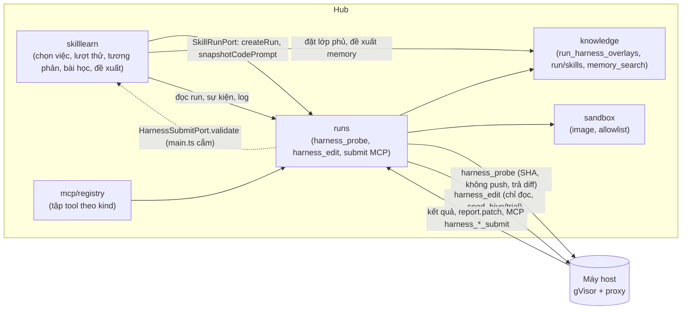
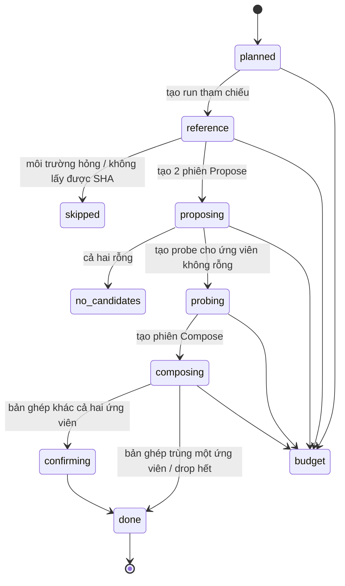

# Implementation Plan: Thử sửa harness trong sandbox trước khi đề xuất skill

**Branch**: `024-skill-harness-probe` · **Date**: 2026-10-18 · **Spec**: [spec.md](spec.md) · **Research**:
[research.md](research.md)

Plan viết theo các khuyến nghị của Q1–Q13. Chủ dự án chọn khác thì sửa mục tương ứng; mỗi mục ghi nó phụ thuộc câu
nào.

## Tóm tắt

Mở rộng module **`skilllearn`** của spec 014. Không có module mới.

**Phần mới ở hub:**
- **Lượt thử** (`skill_learning_trials` và ba bảng phụ): một máy trạng thái do job hẹn giờ đẩy. Đi qua: tham chiếu →
  Propose → Probe → Compose → chạy bản ghép (nếu cần) → đề xuất và bài học.
- **Hai run kind mới** trong `runs`, cả hai chạy trong sandbox trên máy `host`:
  - `harness_probe`: chạy lại việc ở đúng SHA, không push, trả diff về hub;
  - `harness_edit`: phiên editor chỉ đọc, đọc bằng chứng dạng file, nộp qua MCP.
- **Tập tool MCP riêng** cho hai kind trong `mcp/registry.ts`.
- **Lớp phủ harness cho từng run** trong `knowledge`: run probe nhận thêm skill và memory của ứng viên mà không đổi skill
  hay memory thật.
- **Thư viện bài học** (`skill_learning_lessons`), chỉ phiên editor đọc.
- **Đề xuất** đi vào luồng sẵn có:
  - `learned_skill_proposals` thêm `trial_id`, `batch_id` thành null được;
  - memory `pending`.

**Phần mới ở worker Go:**
- lấy code theo SHA cho cả hai kind;
- đường `harness_probe`: chạy như run code, luôn chạy lệnh kiểm, trả diff thay vì push;
- đường `harness_edit`: như `skill_proposal` cộng ghi `seed`;
- hai capability mới.

**Web:**
- khối "Đã thử trong sandbox" trong tab "Đề xuất từ agent";
- nút "Thử trong sandbox" trên trang run;
- phần "Thử trong sandbox" của chính sách;
- tab "Bài học".

**Không đổi:**
- đường chạy run code thường và lời nhắc của nó;
- lô ngày của 014 cho việc không được thử;
- đường duyệt skill (PR một file `SKILL.md`, hoặc `applySkillSave`);
- app desktop.

## Technical Context

| Mục | Giá trị |
|---|---|
| Ngôn ngữ | TypeScript strict (hub, web, contracts), Go (worker) |
| Hub | Hono + oRPC, Drizzle, pg-boss, `withTenant()`, role `hive_app` |
| Phụ thuộc mới | Không |
| Lưu trữ | PostgreSQL. Bảng mới: `skill_learning_trials`, `skill_learning_trial_runs`, `skill_learning_trial_candidates`, `skill_learning_trial_marks`, `skill_learning_lessons` (của `skilllearn`), `run_harness_overlays` (của `knowledge`). `learned_skill_proposals`: thêm `trial_id`, `batch_id` null được. Enum `run_kind` thêm hai giá trị |
| Test | Vitest; `*.db.test.ts` (Testcontainers); `go test` với repo Git tạm; Playwright với hub giả |
| Chi phí | Mỗi lượt ≤ `maxCostMultiple` × chi phí run gốc (Q11). Run code thường không thêm token (SC-006) |

## Constitution Check

| Nguyên tắc | Cách tuân |
|---|---|
| I. Contract first | `contracts/src/skill-learning.ts` (lượt thử, ứng viên, bài học, số liệu); `runs.ts` (hai kind); `policies.ts` (`skillLearning.probe`); `worker-protocol.ts` (`baseSha`, `probe`, `seed` cho `harness_edit`, `report.patch`). Chạy `pnpm openapi`, commit `openapi.json` |
| II. Tenant isolation | Mọi bảng mới có `org_id`, `ENABLE` + `FORCE ROW LEVEL SECURITY`, có trong `rls.db.test.ts`. Thư viện theo đội; lớp phủ theo run |
| III. Module boundaries | `skilllearn` gọi `runs`, `knowledge`, `governance`, `catalog`, `sandbox`, `scm` qua `index.ts`. `runs` gọi `knowledge` như hôm nay. `runs` **không** gọi `skilllearn`: kiểm bài nộp của editor đi qua port do `main.ts` cắm vào (như `SkillRunPort` của 014). `knowledge` không gọi `runs` |
| IV. Tested | Unit: kiểm ứng viên, tóm quỹ đạo, bảng tương phản, kiểm trích dẫn, ước lượng ngân sách. DB: chọn việc, máy trạng thái, loại trừ khỏi task, lớp phủ, RLS. Worker: SHA, không push, lệnh kiểm không cần commit, diff. Playwright: khối bằng chứng, nút, chính sách |
| V. Secure by default | Probe và editor luôn trong sandbox, không có quyền push, MCP chỉ đọc. Bằng chứng và bài học qua hàm che bí mật. Ứng viên có bí mật bị loại. Mặc định tắt |
| VI. Ngôn ngữ | Chữ giao diện, lỗi, lời nhắc cho editor viết tiếng Việt. ADR, code tiếng Anh. Spec tiếng Việt theo yêu cầu chủ dự án (**lệch** VI, ghi ở Complexity Tracking) |
| VII. Simple to self-host | Không thêm dịch vụ hay phụ thuộc. Cần máy `host` có sandbox như ADR 0007 |
| Giao diện | Navy Hive, shadcn/ui, token màu, 360 px, sáng/tối, bàn phím |

## Kiến trúc



### Máy trạng thái của lượt thử



Từ mọi trạng thái chưa kết thúc còn có thể sang:
- `cancelled`: task hoặc dự án mất, hoặc tổ chức tắt tính năng trước khi có probe;
- `failed`: run nằm chờ máy quá 6 giờ, hoặc lỗi không thuộc các nhánh trên.

### Cấu trúc file

```text
apps/hub/src/modules/skilllearn/
  trial-select.ts      # truy vấn chọn việc riêng (Q1), kiểm điều kiện, trần ngày, đánh dấu, trả run cho lô 014
  trial.ts             # máy trạng thái: advanceTrials(), từng bước, kiểm ngân sách trước mỗi bước
  trial-jobs.ts        # cron skill-learning-trial (*/5), nối ở main.ts
  trajectory.ts        # tóm quỹ đạo từ run_logs stream-json của Claude
  contrast.ts          # bảng tương phản, mã quan sát, kiểm trích dẫn
  workspace.ts         # dựng .hive/trial/ (seed) cho từng phiên editor
  candidate.ts         # kiểm ứng viên (FR-019), cắm vào runs qua HarnessSubmitPort
  prompts.ts           # lời nhắc ba vai: invariant, domain, compose
  lessons.ts           # thư viện: ghi, chỉ mục, ghim, ẩn, ghi kết quả duyệt
  trial-proposals.ts   # tạo learned_skill_proposals và memory pending từ bản được nhận
  select.ts            # thêm: bỏ run đã là nguồn lượt thử, nhận run được trả lại (FR-003)
  proposals.ts         # thêm: số liệu gồm đề xuất không có lô; recordReview vào bài học
  schema.ts, router.ts, *.test.ts, *.db.test.ts
apps/hub/src/modules/runs/engine.ts    # createHarnessRun, snapshotCodePrompt, buildSpec và verify cho hai kind
apps/hub/src/modules/runs/mcp.ts       # harness_candidate_submit, harness_compose_submit
apps/hub/src/modules/mcp/registry.ts   # tập tool của harness_probe và harness_edit
apps/hub/src/modules/knowledge/run-overlay.ts   # run_harness_overlays: đặt, đọc
apps/hub/src/modules/knowledge/run-skills.ts    # cộng skill của lớp phủ cho run probe
apps/hub/src/modules/knowledge/memory.ts        # searchMemory cộng memory của lớp phủ
apps/hub/src/modules/knowledge/skill-learning.ts  # cầu nối: đề xuất memory pending của lượt thử
apps/hub/db/migrations/*.sql           # hàm hive.skill_learning_orgs() gồm cả tổ chức có lượt thử chưa xong
packages/contracts/src/skill-learning.ts, runs.ts, policies.ts, worker-protocol.ts
worker/internal/runner/runner.go, probe.go (mới), sdlc.go (seed dùng chung), skills.go
apps/web/src/pages/knowledge/skill-learning-tab.tsx, trial-evidence.tsx (mới), lessons-tab.tsx (mới)
apps/web/src/pages/run-page.tsx, apps/web/src/pages/admin/policies-page.tsx
docs/adr/0032-probe-harness-edits-before-proposing.md
```

## Thiết kế từng phần

### 1. Mô hình dữ liệu (FR-035, Key Entities)

- **`skill_learning_trials`**:
  - định danh: `id`, `org_id`, `team_id`, `project_id`, `task_id`, `source_run_id` (duy nhất);
  - lúc lập: `day` (UTC), `reason` (`marked` | `retries` | `manual`), `base_sha`, `cli`, `model`, `effort`;
  - ảnh chụp (FR-007): `prompt` (jsonb: `taskText`, kế hoạch đã duyệt, ngữ cảnh SDLC), `brief` (jsonb: nội dung, SHA),
    `checks` (jsonb: lệnh, gồm lệnh của cổng workflow);
  - `status`, `end_reason`;
  - chi phí: `base_cost_usd`, `base_tokens` (Q11: lớn nhất trong các run code của task), `spent_usd`, `spent_tokens`;
  - kết quả: `contrast` (jsonb), `decisions` (jsonb);
  - thời điểm.
  - Ràng buộc: khoá duy nhất `(project_id, day)` cho lượt không ở `skipped`.
- **`skill_learning_trial_runs`**: `trial_id`, `run_id`, `role`, `skills_hash` (null được); duy nhất `(trial_id, role)`.
- **`skill_learning_trial_candidates`**:
  - `trial_id`, `scope` (`invariant` | `domain` | `composed`);
  - `edits` (jsonb): `[{id, kind: skill_new | skill_edit | memory, name?, description?, content, targets,
    evidence[]}]`;
  - `validation` (jsonb);
  - `probe_run_id`.
- **`skill_learning_trial_marks`**: `run_id`, `user_id`, `created_at`. Giống `skill_learning_marks` của 014.
- **`skill_learning_lessons`**:
  - `trial_id`, `team_id`, `project_id`;
  - nội dung: `situation`, `deficiency`, `experience` (Markdown, tối đa 8 000 ký tự), `harness` (jsonb: nội dung đã nhận);
  - kết quả duyệt: `review` (jsonb: `[{target, outcome, reason?}]`);
  - `pinned_at`, `hidden_at`.
- **`run_harness_overlays`** (của `knowledge`): `run_id`, `org_id`, `skills` (jsonb: `[{name, description, content}]`),
  `memories` (jsonb: `[{kind, content, files}]`).
- **`learned_skill_proposals`**: thêm `trial_id` (null được); `batch_id` thành null được; check `batch_id is not null or
  trial_id is not null`; trigger `probe`. Với đề xuất từ lượt thử, `run_id` là run Compose.
- **Enum `run_kind`** thêm `harness_probe`, `harness_edit`. Theo quy ước của repo (`runs/schema.ts`), SQL của migration
  **không** dùng hai giá trị mới (không chỉ mục từng phần, không check theo giá trị). [Inference] Bộ migrate của drizzle
  chạy mọi migration đang chờ trong một transaction, nên tách file riêng không tránh được lỗi 55P04; chỉ code ứng dụng
  dùng giá trị mới.

### 2. Chọn việc và lập lượt thử (US1; Q1, Q10, Q12, Q13; FR-001…FR-004)

`trial-select.ts` chạy trong tick của 014, **trước** `planProject`, với truy vấn riêng. Bước chọn của 014 không dùng
được nguyên: nó dừng khi dự án đã có lô hôm nay hay hết `maxPerDay`, và chỉ xét run sau `window_to`.

**Ứng viên:**
- run có dấu "Thử trong sandbox" chưa dùng (lý do `manual`), kể cả run đã vào một lô 014;
- run code cuối của task trong 7 ngày gần nhất có lý do `retries` hoặc `marked` theo tiêu chí của `select.ts`; chưa vào
  lô 014 nào.

Loại run đã là `source_run_id` của một lượt thử.

**Điều kiện, theo thứ tự rẻ trước:**
1. trần ngày của dự án và tổ chức (`maxTrialsPerDay`), và còn chỗ trong `maxPerDay` để giữ (Q13);
2. CLI thật là `claude`, đọc ở sự kiện `offer` của run (cột `cli` có thể rỗng);
3. `result.report.repo.baseSha` có;
4. `loadSandboxJobConfig` không lỗi `SANDBOX_IMAGE_REQUIRED`;
5. có máy `host` online của đội khai `harness_probe` và `harness_edit`;
6. `.hive/setup.sh` ở `baseSha` (đọc qua `scm`) có hash bằng `image.setupScriptHash`. Khác thì worker sẽ từ chối mọi
   probe vì cùng một lý do.

Việc có dấu đứng trước, rồi `retries` nhiều nhất, rồi mới nhất.

**Lập lượt thử:**
- Ảnh chụp lời nhắc (FR-007): gọi port mới `SkillRunPort.snapshotCodePrompt(tx, sourceRunId)`. `runs` dựng phần của task
  đúng như một lần giao mới, bằng `promptOf`, kế hoạch đã duyệt và `sdlc.specContextFor`, không có `instructions`. Port
  trả thêm brief hiện tại (nội dung, SHA) và lệnh kiểm (`check` loại `command` cộng lệnh của cổng workflow).
- Model và effort lấy ở `agent_policy_snapshot` của run gốc.
- `base_cost_usd` = lớn nhất của `cost_usd` các run code của task (Q11); CLI không báo USD thì dùng `base_tokens`
  (input + output).
- Giữ một chỗ trong `maxPerDay` (Q13), như lô 014 đang chạy giữ chỗ.
- Khoá: advisory lock theo dự án như 014, cộng khoá duy nhất `(project_id, day)`.

**Trả run về cho 014** (FR-003): `select.ts` nhận thêm danh sách run của lượt thử `skipped` trước khi có probe, đưa vào
lô kế tiếp dù nằm trước `window_to`. Run là nguồn của lượt thử khác bị bỏ khỏi lô 014.

### 3. Run `harness_probe` (US2; Q2, Q10, Q11; FR-005…FR-014)

**Hub (`runs/engine.ts`):**
- **Tạo run**: `createHarnessRun({kind, trialId, role, sourceRun, snapshot, baseSha, model, effort, cli, budget,
  seed?})`:
  - `skilllearn` gọi qua `SkillRunPort`;
  - `task_id = null`, `team_id` lấy theo dự án;
  - nhánh `skill-learning/trial-<id>-<role>`, không bao giờ push;
  - `owner_user_id = null`;
  - `max_attempts = 1` (FR-014);
  - tham số lưu trong sự kiện `harness_probe_prompt` hoặc `harness_edit_prompt`, theo cách các kind chỉ có lời nhắc
    đang làm (`promptEvent`).
- **Giao run**: thêm hai kind vào `PROMPT_KINDS`. Không có kind ở đó thì run không có task bị bỏ qua khi giao.
- **Sandbox**: `sandboxedRun` trả `true` cho cả hai kind bất kể cài đặt dự án. Máy phải là `host` và khai đúng capability
  (thêm hai kind vào `CAPABILITY_KINDS`).
- **Spec**:
  - `prompt` = khối brief dựng từ brief đã chụp (bỏ gợi ý `memory_write`) + lời nhắc đã chụp. Không có `instructions`;
  - `title` = "Lượt thử <task key>";
  - `taskText` = phần task của ảnh chụp, để context pack của worker giống run code;
  - `model`, `effort` đặt thẳng từ ảnh chụp, không qua định tuyến;
  - `baseSha` mới;
  - `checks.commands` = lệnh đã chụp;
  - `budget` theo FR-013, tính riêng. Không gọi `jobBudget`, vì hàm đó áp `perTaskUsd` của task;
  - `probe: true`.
- **Kết thúc run**: `verifyHarnessProbe` và `verifyHarnessEdit` riêng. Kind lạ hôm nay rơi vào `verifyLeader` và nằm mãi
  ở `verifying`. Hai hàm chỉ ghi kết quả và chuyển `succeeded` hoặc `failed`: không PR, không run review, không thông
  báo, không đổi task.
- **Brief**: `onRepoReport` bỏ qua hai kind, như đang bỏ `brief` và `skill_proposal`, để probe ở SHA cũ không ghi drift
  hay xếp brief làm mới (FR-008).
- **Loại trừ khỏi task** (FR-008, FR-009): `task_id = null` tự loại run khỏi:
  - `taskSpentUsd`, `assertTaskBudget`;
  - `runs_task_active`;
  - đếm thử lại của `select.ts`;
  - trang task.

  Chi phí vẫn vào `orgSpentTodayUsd`, vì hàm đó cộng mọi run của tổ chức.
- **MCP** (FR-011): `mcp/registry.ts` hôm nay cho mọi run không phải leader nhận `RUN_TOOLS` (có `task_update`,
  `artifact_create`, `artifact_update`). Thêm nhánh cho hai kind:
  - `harness_probe`: `memory_search` và tool đọc tài liệu, skill;
  - `harness_edit`: tool đọc như trên, cộng hai tool submit.
- **Lớp phủ** (FR-012):
  - `skilllearn` gọi `knowledge.setRunOverlay(runId, {skills, memories})` trong cùng transaction tạo run;
  - `handleRunSkills` cho `harness_probe` trả bộ skill như run code, cộng skill của lớp phủ (cùng tên thì lớp phủ thắng);
    hash của skill lớp phủ tính trên `SKILL.md` đã dựng, như skill hub;
  - hub ghi `skills_hash` (hash của danh sách tên và hash đã phát) vào `skill_learning_trial_runs`;
  - `searchMemory` của run probe cộng memory của lớp phủ;
  - lần tham chiếu có lớp phủ rỗng.

**Worker (`runner.go`, `probe.go`):**
- **Lấy code** cho cả hai kind:
  1. `git fetch origin <baseSha>`;
  2. `worktree add --detach <work> <baseSha>`.

  Lấy không được thì `failed` với lý do `base_unavailable`. Đường chỉ đọc hôm nay tách ở `origin/<baseBranch>`, nên
  `harness_edit` cũng cần đường SHA.
- **`harness_probe`**:
  - `setup.sh` của sandbox và skill như run code (`wantsSkills` thêm kind này);
  - CLI chạy với quyền workspace;
  - **luôn** chạy `checks.commands` trên worktree sau CLI. Run code hôm nay chỉ chạy khi agent đã commit;
  - trả về trước đường commit và push, như nhánh `sdlc`: `report.patch` (`git diff <baseSha>` gồm thay đổi chưa commit,
    cộng file mới chưa track; cắt ở 256 KB), `diffStats`, `checks`, `commands`;
  - `report.repo.baseSha` = SHA đã lấy.
- **`harness_edit`**: chỉ đọc như `skill_proposal`; ghi `seed` bằng hàm dùng chung với `writeSdlcSeed` (tối đa 100 file,
  mỗi file tối đa 200 000 ký tự), kèm `.hive/trial/.gitignore` có `*`. Repo không có sẵn `.gitignore` cho `.hive/`;
  `.hive/setup.sh` là file được track.
- **Không có quyền push**: hub không cấp, sandbox không có đường ra Git ngoài allowlist. [Inference] Allowlist của dự án
  có thể gồm máy Git để `fetch`; push vẫn bị chặn vì run không có thông tin xác thực ghi. Cần kiểm lại khi làm task.

### 4. Phiên `harness_edit` (US3, US4; Q5, Q6, Q9; FR-015…FR-021)

**Run:**
- kind chỉ đọc, trong sandbox trên máy `host` khai capability `harness_edit`;
- worktree tách ở `baseSha`, để editor đọc được code của dự án;
- model và effort theo `probe.editorModel` (mặc định Sonnet, effort high);
- 30 phút hết giờ.

**Ba vai** dùng chung kind, phân biệt bằng `role` trong sự kiện lời nhắc:
- `propose_invariant`;
- `propose_domain`;
- `compose`.

Principal của MCP chỉ mang `runKind`, nên handler của tool submit đọc `role` từ sự kiện lời nhắc và từ chối vai sai.

**Bằng chứng** (`seed` trong `.hive/trial/`):

```text
.hive/trial/
  README.md              # vai, phạm vi, cách nộp, danh sách file, giới hạn; báo khi memory bị tắt
  task.md                # đúng lời nhắc probe nhận
  history.md             # các lần thử của việc gốc: lý do hỏng, check hỏng, báo cáo agent, chỉ dẫn người review
  harness/skills.md      # tên và mô tả skill đang nạp cho dự án
  harness/memories.md    # memory đã duyệt và đang chờ của dự án, 100 mục mới nhất
  runs/reference/        # metrics.json, trajectory.md, checks.md, diffstat.txt, patch.diff
  runs/probe_invariant/  # chỉ phiên compose
  runs/probe_domain/     # chỉ phiên compose
  candidates/<scope>/    # chỉ phiên compose: edits.json, SKILL.md của từng skill, memories.md, diff.md
  contrast.md            # chỉ phiên compose: bảng tương phản có mã quan sát
  library/INDEX.md       # tối đa 50 dòng (US6)
  library/<lesson>.md    # mỗi mục trong chỉ mục một file
```

[Inference] Tổng số file nằm dưới 100: khoảng 20 file cố định cộng 50 mục thư viện. Lời nhắc chỉ có vai, phạm vi, cách
nộp, và "đọc `.hive/trial/README.md` trước" (FR-016).

**Nộp bài:**
- `harness_candidate_submit` cho `propose_*`, `harness_compose_submit` cho `compose`. Cả hai `readOnly: true`, như
  `skill_proposal_submit`.
- Tool gọi `HarnessSubmitPort.validate(tx, runId, draft)`, do `main.ts` cắm `skilllearn/candidate.ts`:
  - **lần đầu sai**: tool trả lỗi kèm danh sách lý do để editor sửa;
  - **lần hai sai**: tool trả "đã ghi nhận: phạm vi này không có ứng viên", và hub đánh dấu phạm vi rỗng;
  - **đúng**: lưu sự kiện `harness_candidate_report` hoặc `harness_compose_report`, rồi `skilllearn` kéo về như 014 kéo
    `skill_proposal_report`.

**Kiểm ứng viên** (FR-019):
- tên skill theo mẫu của worker (`skillNamePattern`);
- `description` không rỗng;
- skill chỉ có `SKILL.md`;
- cỡ: mỗi `SKILL.md` 64 KB, cả ứng viên 192 KB, mỗi memory 2000 ký tự;
- `secret-scan` không thấy gì;
- skill: `dedupe` của 014 (tên, Jaccard, skill mặc định, memory đã duyệt, đề xuất bị từ chối hoặc đang chờ);
- memory: tập từ nằm ≥ 80% trong một memory đã duyệt hay đang chờ của dự án thì bỏ (cùng cách đo của `dedupe.ts`);
- memory khi `agentMemory.mode = off`: bỏ;
- skill không nằm trong `.claude/skills` của repo dự án (đọc ở `baseSha` qua `scm`).

**Kiểm Compose** (FR-020):
- Mỗi quyết định trỏ tới `edit.id` có trong ứng viên.
- Mỗi trích dẫn là một mã quan sát của `contrast.ts`, có dạng `M:<role>:<metric>` hoặc `T:<role>:<step>`.
- Mỗi `keep` hoặc `revise` có ít nhất một trích dẫn thuộc lần chạy chứa sửa đó. Trích dẫn của lần tham chiếu chỉ được
  thêm để so.
- Sai thì hub đổi thành `drop` và ghi lý do.

### 5. Tóm quỹ đạo và bảng tương phản (FR-017, FR-020)

**`trajectory.ts`:**
- `run_logs` là một dòng byte trộn stdout, stderr và dòng của worker, chia đoạn 16 KB. Bộ tóm nối các đoạn rồi tách
  dòng, chỉ đọc dòng là JSON hợp lệ của stream-json; dòng khác bỏ qua;
- giữ:
  - mỗi `tool_use`: tên, tham số rút gọn 200 ký tự;
  - kết quả lỗi: `is_error`, 300 ký tự đầu;
  - các lệnh shell và exit code;
  - số lượt;
- bỏ văn bản của assistant và nội dung đọc file;
- đánh số bước `T:<role>:<n>`;
- qua hàm che bí mật trước khi ghi.

[Inference] Bản tóm cỡ vài KB cho một run vài chục lượt; chưa đo trên log thật.

**`contrast.ts`**: mỗi lần chạy một cột. Mỗi chỉ số có mã `M:<role>:<metric>`:

| Chỉ số | Nguồn |
|---|---|
| `commands` (lệnh kiểm đạt/tổng, tên lệnh hỏng) | `result.checks` loại `command` |
| `turns`, `tokens_in`, `tokens_out`, `cost_usd`, `duration_s` | cột của `runs` |
| `tool_calls`, `tool_errors` | `trajectory.ts` |
| `files_changed` | `diffStats` |
| `repeat_failure` | check hỏng hoặc chuỗi lỗi của các lần thử gốc có lặp lại không, so theo tên check và 80 ký tự đầu của lý do |
| `skills_changed` | `skills_hash` khác lần tham chiếu (Edge Cases) |
| `outcome` | `succeeded` / `failed` / `budget` |

Check loại `changes` và `agentReport` của chính sách không dùng: probe không commit và không có `task_update`.

**Hỏng vì môi trường** (Edge Cases): lần tham chiếu được coi là hỏng vì môi trường khi `setup.sh` lỗi, hoặc mọi lệnh kiểm
hỏng với một trong các dấu hiệu sau:
- exit 127;
- `command not found`;
- lỗi DNS hoặc kết nối bị proxy chặn.

### 6. Bản ghép, đề xuất và luồng duyệt (US4, US5; Q3, Q4, Q13; FR-021…FR-026)

**Bản ghép:**
- Bản ghép trùng một ứng viên khi tập sửa và nội dung giống hệt. Khi đó dùng lại probe của ứng viên đó.
- Khác cả hai ứng viên thì tạo run `harness_probe` vai `confirm`.

**Điều kiện tạo đề xuất** (FR-022): số lệnh kiểm đạt của bản được nhận ≥ của lần tham chiếu, và ít nhất một sửa được
giữ.

**Skill:**
- Mỗi sửa skill thành một `learned_skill_proposals`: `trigger = probe`, `trial_id`, `batch_id = null`, `run_id` = run
  Compose.
- Qua lọc trùng của 014 lúc tạo. Hạn mức theo Q13: không bỏ vì hết `maxPerDay`, vẫn đếm vào số đã dùng.
- Duyệt và từ chối theo đúng đường của 014: PR một file `SKILL.md` khi đã nối kho, `applySkillSave` khi chưa.
- Số liệu của `proposals.ts` hôm nay đếm theo lô; thêm phần đếm đề xuất có `trial_id`.

**Memory:** cầu nối `knowledge/skill-learning.ts` thêm `proposeTrialMemories(tx, composeRunId, items)`:
- ghi `pending` với `author_run_id` là run Compose;
- tối đa `min(5, agentMemory.maxPerRun)`;
- không ghi gì khi `agentMemory.mode = off`.

Hàm `writeMemory` của run thường không đổi.

**API khối bằng chứng** (FR-025): `skillLearning.trialEvidence({trialId})` trả:
- số liệu từng lần chạy, cảnh báo `skills_changed`;
- quyết định và trích dẫn;
- `runId` của từng vai.

### 7. Thư viện bài học (US6; Q7, Q8; FR-027…FR-030)

- Ghi một mục khi lượt thử có ít nhất một probe xong. `no_candidates`, `skipped` và lượt dừng trước probe không có mục.
- `experience` lấy từ nháp của Compose, hub thêm phần đầu cố định:
  - tình huống: dự án, ngôn ngữ chính (từ brief), lý do chọn;
  - mã lượt thử;
  - số liệu tóm tắt.
- `harness` là nội dung đã nhận, không tóm tắt (theo bài báo D.2).
- **Chỉ mục** cho editor, mỗi dòng: `<id> · <dự án> · <thiếu sót, ≤ 100 ký tự> · <kết quả: nhận/bỏ/duyệt/từ chối>`.
  Thứ tự: ghim, cùng dự án mới nhất, cùng đội mới nhất. Tối đa 50 dòng; mục ẩn không vào chỉ mục. Chỉ 50 mục này được
  ghi vào `seed`.
- **Ghi kết quả duyệt** (FR-029):
  - skill: `approve` và `reject` của 014 gọi `lessons.recordReview` trong cùng transaction;
  - memory: job lượt thử kiểm memory của lượt thử, chuyển `approved` thì ghi "đã duyệt", không còn thì ghi "đã bỏ".
- Hàm `hive.skill_learning_orgs()` (migration của 014) thêm tổ chức có lượt thử chưa kết thúc, để job vẫn đẩy chúng khi
  tổ chức vừa tắt tính năng.

### 8. Chính sách, ngân sách, máy (US7; Q11; FR-013, FR-031, FR-032)

- `policies.ts`: `skillLearning.probe = {enabled: false, maxTrialsPerDay: 2, maxCostMultiple: 4, editorModel:
  "sonnet" | "opus"}`. Cấu hình cũ chưa có khoá thì zod điền mặc định.
- Trước mỗi bước, `trial.ts` tính:
  - `spent` = tổng chi phí các run của lượt thử;
  - `next` = ước lượng bước tới (FR-032).

  Nếu `spent + next > maxCostMultiple × base_cost_usd` thì dừng `budget`. Bước đang chạy không bị huỷ.
- Trần mỗi probe (FR-013): `min(perRunUsd của dự án và tổ chức, 1,5 × base_cost_usd)`, `min(maxTurns, 1,5 × turns)`;
  đi vào `spec.budget`, worker dừng như hôm nay (`meter.go`).
- **Chia máy với run thật**: mỗi tổ chức tối đa 2 run của lượt thử đang chạy cùng lúc. Khi máy `host` có cả run thường và
  run của lượt thử đang chờ, run thường được giao trước. [Inference] Hôm nay chưa rõ thứ tự giao run chờ trên một máy;
  kiểm `pickMachine` và vòng giao khi làm task.
- Run của lượt thử nằm chờ máy quá 6 giờ thì job huỷ run và kết thúc lượt `failed` (FR-002).
- Tắt tính năng: job không mở bước mới. Lượt chưa có probe thì `cancelled`; lượt đã có probe thì ghi bài học với cái
  đã có, không tạo đề xuất.

### 9. Giao diện

**Tab "Đề xuất từ agent"** (`pages/knowledge/skill-learning-tab.tsx`):
- đề xuất có `trialId` có nhãn **"Đã thử"**;
- mở ra là khối **"Đã thử trong sandbox"**:
  - bảng tương phản, mỗi lần chạy một cột;
  - quyết định của Compose với trích dẫn, bấm vào thì cuộn tới dòng của bảng;
  - link run;
  - nhãn dao động, và cảnh báo khi bộ skill gốc đổi giữa các lần chạy;
- số liệu thêm lượt thử theo trạng thái và chi phí theo vai (FR-034).

**Tab "Bài học"** (trang Skills):
- danh sách theo đội, lọc theo dự án và kết quả;
- xem `EXPERIENCE.md` và nội dung harness đã nhận;
- ghim, ẩn cho quản trị đội.

**Trang run code** (`pages/run-page.tsx`): nút **"Thử trong sandbox"** cạnh "Nên thành skill". Nút tắt kèm lý do khi:
- tính năng tắt;
- dự án chưa có sandbox;
- CLI không phải Claude Code;
- hết lượt.

**Chính sách agent** (`pages/admin/policies-page.tsx`): phần "Thử trong sandbox" trong mục "Học skill từ việc khó"; ghi
ước lượng "mỗi lượt khoảng 3–4 lần chạy việc".

### 10. Kiểm thử

| Lớp | Nội dung |
|---|---|
| Unit hub | `trajectory.ts` trên log stream-json mẫu (có tool lỗi, có bí mật giả, dòng cắt ngang đoạn 16 KB, dòng của worker xen giữa); `contrast.ts` (`repeat_failure`, môi trường hỏng); kiểm ứng viên (từng ca hỏng của FR-019); kiểm trích dẫn (FR-020); ước lượng ngân sách |
| DB hub | Chọn việc (US1: không phụ thuộc lô 014, run có dấu đã vào lô, run được trả về lô sau); máy trạng thái với run giả hoàn tất từng bước; bản ghép trùng/khác ứng viên (FR-021); run probe được giao dù không có task, kết thúc `succeeded` không qua `verifyLeader`, không đổi task, không PR, không ghi drift, không cộng `taskSpentUsd`, không xếp lại khi mất lease; lớp phủ chỉ thấy ở đúng run; đề xuất không có lô qua check `batch_id`/`trial_id`; memory `pending` và `mode = off`; ghi kết quả duyệt vào bài học; RLS năm bảng mới và `run_harness_overlays` |
| MCP | Tập tool của hai kind trong `registry.ts`; hai tool submit từ chối vai sai; lần sai thứ nhất trả lỗi, lần hai ghi phạm vi rỗng; probe không có `memory_write`, `task_update`, `artifact_*` |
| Worker | Repo Git tạm hai commit: probe ở commit đầu; không có push; lệnh kiểm chạy khi agent không commit; `report.patch` có file mới chưa track; cắt ở 256 KB; `base_unavailable`; `harness_edit` ở SHA, ghi seed và `.gitignore`, không ghi được repo; capability |
| E2E | Playwright (hub giả): khối bằng chứng, nút "Thử trong sandbox" và các lý do tắt, chính sách, tab "Bài học" |
| Thật (tay) | Một lượt thử trên dự án có sandbox ở tổ chức thử, đối chiếu SC-001…SC-004 |

## Quyết định của người viết

Những điểm spec để người làm tự quyết, đã chọn khi viết plan và đổi được khi làm task:

- **`task_id = null` cho mọi run của lượt thử**, lời nhắc lấy từ ảnh chụp trong lượt thử. Cách này tự loại run khỏi ngân
  sách task, `runs_task_active`, trang task và đếm thử lại, thay vì thêm điều kiện `kind` ở từng chỗ. Ảnh chụp còn giữ
  ba lần chạy cùng lời nhắc khi task bị sửa giữa chừng.
- **Ảnh chụp do `runs` dựng** qua port: hàm dựng lời nhắc (`promptOf`, kế hoạch đã duyệt) là nội bộ của `runs`.
- **Editor cũng chạy trong sandbox trên máy `host`**: dự án của lượt thử luôn có sandbox (Q10), nên `sandboxedRun` vốn đã
  đưa run sang `host`; editor còn đọc log do agent khác sinh ra.
- **Lớp phủ nằm ở `knowledge`**, không ở `skilllearn`: `runs` đã gọi `knowledge` khi phát skill và memory, còn
  `knowledge` không được gọi `skilllearn` vì `skilllearn` phụ thuộc `knowledge`.
- **Kiểm bài nộp qua port do `main.ts` cắm vào**: editor nhận lỗi ngay trong phiên để sửa một lần (như bài báo D.2), mà
  `runs` không phải import `skilllearn`.
- **Job riêng `skill-learning-trial` mỗi 5 phút**, chỉ đọc lượt thử chưa kết thúc. Tick 15 phút của 014 làm mỗi bước chờ
  thêm tới 15 phút; hỏi theo lịch vẫn giữ hướng "kéo" của ADR 0025 thay vì `runs` gọi ngược.
- **Probe không có `memory_write`**, kể cả lần tham chiếu: đơn giản hơn ghi vào bằng chứng, và ba lần chạy vẫn khớp nhau.
- **`agentMemory.mode = off` nghĩa là lượt thử không đề xuất memory**: tôn trọng lựa chọn của tổ chức.
- **Không sửa skill của bộ mặc định**: giữ quy tắc của 014.
- **Run thường được giao trước run của lượt thử**, tối đa 2 run của lượt thử chạy cùng lúc mỗi tổ chức.
- **Thư viện trong `seed` chỉ có 50 mục của chỉ mục**: giới hạn 100 file của `seed`; không thêm tool MCP đọc mục ngoài
  chỉ mục.
- **Lời nhắc của editor viết tiếng Việt**, như lời nhắc của 014. Không chép lời nhắc từ repo Harness²; muốn chép thì giữ
  ghi chú Apache-2.0 (research mục 5).
- **Bản tóm quỹ đạo bỏ văn bản của assistant**: tiết kiệm token, và editor vẫn thấy mọi hành động cùng lỗi.

## Rủi ro

| # | Rủi ro | Cách giảm |
|---|---|---|
| R1 | Dao động giữa hai lần chạy lớn hơn hiệu ứng của sửa: giữ sửa vô dụng, bỏ sửa tốt | Nhãn "1 lần chạy mỗi bên" cho người duyệt; FR-022 chặn bản kém hơn tham chiếu; đo SC-005 trước khi mở rộng. Chạy lặp để đợt sau |
| R2 | Tốn token hơn dự kiến | Mặc định tắt; trần ngày; trần mỗi lượt và mỗi probe (Q11); kiểm trước mỗi bước; số liệu chi phí theo vai |
| R3 | Probe ghi ra ngoài: push, gọi API nội bộ, lộ bí mật | Sandbox gVisor và proxy (ADR 0007); không quyền push; MCP chỉ đọc; không bí mật ngoài image. SC-001 có test |
| R4 | Ứng viên chứa chỉ dẫn độc trong skill (bảo agent tải và chạy mã ngoài) | Chỉ chạy trong sandbox; người duyệt thấy toàn bộ `SKILL.md` trước khi vào kho; `secret-scan`. [Inference] Bộ kiểm không phát hiện được mọi chỉ dẫn nguy hiểm, nên người duyệt vẫn là chốt chặn |
| R5 | Tiêm lời nhắc từ log của run gốc vào editor | Editor chỉ đọc, trong sandbox, không push; quỹ đạo bỏ văn bản assistant, cắt tham số; đầu ra phải qua bộ kiểm và người duyệt |
| R6 | Nhiều việc không chạy lại được trong sandbox, tính năng ít khi chạy | Đo tỉ lệ `skipped` (FR-034); việc quay về lô 014 nên không mất gì |
| R7 | Skill viết riêng cho một việc (chép lời giải) | Không cho editor xem diff thành công (Q9); bộ kiểm trùng; người duyệt; bài học ghi lý do từ chối để lần sau tránh |
| R8 | Thư viện lớn dần, chỉ mục nhiễu | Chỉ mục 50 dòng, mục ẩn; gộp và sửa bài học để đợt sau (Out of Scope) |
| R9 | Log stream-json của Claude đổi định dạng | `trajectory.ts` bỏ qua dòng lạ, không làm hỏng lượt thử; test trên log mẫu theo phiên bản CLI |
| R10 | Lượt thử chiếm máy `host` của run sandbox thật | Run thường giao trước; tối đa 2 run của lượt thử cùng lúc; hết 6 giờ chờ thì huỷ |

## Phương án đã cân nhắc

| Phương án | Lý do không chọn |
|---|---|
| Dùng mã Python của Harness² | Thêm runtime Python và một đường chạy agent ngoài `runs`; executor của nó là OpenCode/Codex, không phải Claude Code; repo nói mạng của executor không bị chặn (research mục 5) |
| Probe là run `code` có cờ | Phải thêm điều kiện ở mọi chỗ run code đụng tới task, PR, ngân sách, thông báo. Kind riêng với `task_id = null` an toàn hơn |
| Chọn việc thử ngay trong bước chọn của lô 014 | Bước đó dừng khi có lô hôm nay hay hết hạn mức, và chỉ xét run sau `window_to`: nút "Thử trong sandbox" và việc trả run về lô không làm được |
| Thay lô ngày của 014 bằng lượt thử | Lượt thử tốn hơn nhiều lần; lô rẻ vẫn hợp cho phần lớn việc |
| Sửa skill thật rồi chạy | Làm đổi harness của mọi run khác trong lúc thử; lớp phủ theo run không đụng tới ai |
| Editor trên máy dùng chung như `skill_proposal` | Dự án có sandbox nên `sandboxedRun` đã đưa run sang `host`; muốn khác phải thêm ngoại lệ, và editor đọc dữ liệu không tin được |
| Editor đọc log thô | Tốn token, lộ bí mật dễ hơn; bản tóm quỹ đạo đủ cho tương phản |
| Đưa thư viện vào run code thường | Thêm token vào mọi run (ràng buộc chính của ADR 0025); bài báo cũng chỉ cho editor đọc thư viện |

## Complexity Tracking

| Lệch | Lý do | Phương án đơn giản hơn bị loại vì |
|---|---|---|
| Spec viết tiếng Việt (constitution VI nói spec tiếng Anh) | Chủ dự án yêu cầu, như spec 011–023 | — |
| Hai run kind mới | Probe và editor có quyền, máy, đường kết quả khác run code và `skill_proposal` | Dùng lại `code` hoặc `skill_proposal`: xem Phương án đã cân nhắc |
| Bảng `run_harness_overlays` | Run probe cần harness khác mà không đổi dữ liệu thật | Ghi skill ứng viên vào skill của dự án: đổi harness của run khác |

## SRS và ADR

- **ADR 0032** "Probe harness edits in a sandbox before proposing skills":
  - lượt thử, hai kind, lớp phủ;
  - trích dẫn bắt buộc;
  - thư viện chỉ editor đọc;
  - quan hệ với ADR 0025 (mở rộng, không thay).

  Số 0029–0031 đã dành cho spec 019 (Word import) và 020 (CI/CD).
- **SRS**: chưa có mục nào cho học skill (spec 014 chưa thêm). Thêm mục học skill gồm cả 014 và 024; số mục chọn khi gộp.
- **`docs/architecture.md`**: dòng `skilllearn` thêm lượt thử, bài học và bảng mới; dòng `runs` thêm hai kind.
- **`docs/self-hosting.md`**: lượt thử cần máy `host` có sandbox và worker mới khai `harness_probe`, `harness_edit`.

## Phân đợt và ước lượng

| Đợt | Nội dung | Ước lượng |
|---|---|---|
| 1 (P1, nền) | Mục 1, 3: contracts, migration, hai kind ở hub (giao, verify, spec, brief, `max_attempts`), tập tool MCP, lớp phủ ở `knowledge`; worker lấy theo SHA, đường probe (lệnh kiểm không cần commit, diff), đường edit với seed, capability | 9–11 ngày |
| 2 (P1, điều phối) | Mục 2, 4, 5, 6: truy vấn chọn việc và trả run cho 014, ảnh chụp lời nhắc, máy trạng thái, tóm quỹ đạo, tương phản, dựng `.hive/trial/`, bộ kiểm và port, lời nhắc ba vai, đề xuất skill không có lô và memory | 9–11 ngày |
| 3 (P1, duyệt) | Mục 6, 9: khối bằng chứng, số liệu đề xuất không có lô, nút trên trang run, chính sách | 3–4 ngày |
| 4 (P2) | Mục 7, 8, 9: thư viện, tab "Bài học", ghi kết quả duyệt, chia máy, số liệu | 4–5 ngày |

Tổng khoảng 25–31 ngày-agent [Inference], chưa gồm ADR, tài liệu, thiết kế màn và kiểm tổng. Đợt 1 làm trước vì mọi
đợt sau cần hai kind. Bước tiếp theo, sau khi chủ dự án trả lời Q1–Q13: viết `tasks.md`.
