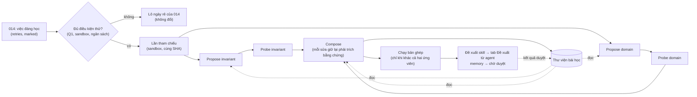

# Feature Specification: Thử sửa harness trong sandbox trước khi đề xuất skill (mở rộng spec 014)

**Feature Branch**: `024-skill-harness-probe`

**Created**: 2026-10-18

**Status**: Draft. Chờ chủ dự án trả lời Q1–Q13.

**Input**: Chủ dự án (2026-10-18): "áp cách Propose, Probe, Compose và thư viện bài học của Harness² vào học skill, chạy
thử trong sandbox, đề xuất qua luồng duyệt sẵn có. Chưa code."

**Mở rộng**: [spec 014](../014-skill-learning/spec.md) và [ADR 0025](../../docs/adr/0025-agent-skill-learning.md).

**Kế hoạch**: [plan.md](plan.md) · **Nghiên cứu**: [research.md](research.md). Research có tóm tắt Harness² và chỗ khác
với Hive.

## Ý tưởng trong một đoạn

**Hôm nay (spec 014)**: mỗi ngày, mỗi dự án có **một** run rẻ đọc *tóm tắt* các việc khó rồi viết tối đa 3 đề xuất skill.
Không đề xuất nào được thử. Người duyệt chỉ có lời văn của agent để tin.

**Spec này** thêm một tầng "thử thật" cho **rất ít** việc đáng học. Mỗi việc như vậy đi qua bốn bước:

1. **Chạy lại** việc đó trong sandbox, cùng commit, để lấy lần tham chiếu.
2. **Propose**: hai editor, mỗi editor một phạm vi, đề xuất hai bản sửa harness:
   - *invariant*: cách làm việc chung (kế hoạch, dùng tool, tự kiểm);
   - *domain*: kiến thức và quy trình riêng của dự án.
3. **Probe**: chạy cùng việc với từng bản sửa.
4. **Compose**: chỉ giữ những sửa có hành vi chạy thật đỡ lưng.

Kết quả đi vào **luồng duyệt sẵn có**:
- tab "Đề xuất từ agent" cho skill;
- memory chờ duyệt cho memory.

Mỗi đề xuất kèm bằng chứng. Mỗi lượt thử có probe chạy xong để lại một **bài học** trong thư viện, để lần thử sau đề
xuất tốt hơn. Run code thường **không** đọc thư viện, nên không tốn thêm token.

## Câu hỏi mở

Mỗi câu có khuyến nghị. Chủ dự án chọn khác thì sửa spec và plan theo câu trả lời.

| # | Câu hỏi | Khuyến nghị | Phương án khác |
|---|---|---|---|
| Q1 | Việc nào được thử? | Theo tiêu chí chọn của spec 014, **chỉ lý do `marked` hoặc `retries`**. `cost` đứng một mình chưa đủ, vì đắt chưa chắc do harness thiếu. Trần: **1 lượt thử mỗi dự án mỗi ngày** và `maxTrialsPerDay` của tổ chức, mặc định **2**. Quản trị đội có nút **"Thử trong sandbox"** trên trang run để xếp việc đó lên trước | Thử mọi việc 014 chọn; hoặc chỉ khi có người bấm |
| Q2 | Lần tham chiếu là gì? | **Chạy lại trong sandbox**, cùng commit gốc, cùng CLI, model, effort, brief và bộ skill **hiện tại**. Tốn thêm 1 run, đổi lại so được: ba lần chạy chỉ khác nhau ở harness | Dùng run gốc: rẻ hơn 1 run, nhưng run gốc khác môi trường (máy, mạng, brief và skill lúc đó, chỉ dẫn của người review) |
| Q3 | Ngân sách `k` và có chạy bản ghép không? | **`k = 1`**. Chạy bản ghép thêm một lần **chỉ khi** nó khác cả hai ứng viên đã chạy. Nhận nguyên một ứng viên thì dùng lại lần probe của ứng viên đó | Luôn chạy bản ghép, như bài báo; hoặc không bao giờ chạy |
| Q4 | Thành phần harness nào được sửa? | **Skill** (mới hoặc sửa, **chỉ `SKILL.md`**) và **memory** của dự án. Đây là hai thứ đã có luồng duyệt. Skill của hub hôm nay chỉ có một file `SKILL.md`; chỉ bộ skill mặc định có nhiều file | Skill nhiều file (script đi kèm): bài báo thấy script có ích, nhưng phải mở rộng cách lưu skill, đồng bộ kho và phát skill cho run, là một việc lớn riêng. Brief (chưa có luồng duyệt đề xuất); `AGENTS.md` (phải mở PR vào repo dự án); hooks (rủi ro an ninh); subagents (Hive chưa quản lý) |
| Q5 | Editor dùng model nào? | **Sonnet 5.5, effort high** cho Propose và Compose. Tổ chức đổi được sang Opus 5.5. Probe dùng **đúng CLI, model, effort của run gốc** | Mặc định Opus 5.5 (bài báo dùng Opus 4.8); hoặc Sonnet effort medium như 014 |
| Q6 | Hai phiên Propose riêng hay một? | **Hai phiên riêng, chạy song song**. Bài báo đo: bỏ việc chia phạm vi mất 2,9–3,7 điểm. Một giả định sai lan sang mọi ứng viên là một nguyên nhân hỏng | Một phiên ra cả hai ứng viên, rẻ hơn một phiên |
| Q7 | Thư viện bài học nằm đâu, phạm vi nào? | **Bảng trong hub** (bật RLS), **phạm vi đội**, mỗi mục gắn dự án. Chỉ editor đọc. Editor nhận chỉ mục dạng file và tự mở mục cần | File `EXPERIENCE.md` trong kho skill (Git, có review nhưng thêm PR); hoặc phạm vi tổ chức |
| Q8 | Bài học có cần người duyệt? | **Không**. Tự lưu khi có bằng chứng; quản trị đội xem, ghim, ẩn được. Kết quả duyệt và lý do từ chối đề xuất được ghi ngược vào mục | Duyệt từng mục như memory |
| Q9 | Editor có được xem diff cuối của việc gốc? | **Không**. Editor thấy những gì digest của 014 có: lý do thất bại, check hỏng, báo cáo của agent, cộng chỉ dẫn của người review. Lý do: tránh chép lời giải vào skill. Editor **vẫn thấy diff của chính các lần chạy trong lượt thử** (tham chiếu, probe), vì đó là bằng chứng hành vi; diff này có thể gần với lời giải | Cho xem diff đã merge; hoặc giấu cả diff của lần tham chiếu và probe, chỉ đưa `diffStats` |
| Q10 | Probe dùng bí mật và mạng thế nào? | **Theo sandbox của dự án** (ADR 0007): image và allowlist của dự án; không bí mật nào ngoài những gì image đã có; không có quyền push; MCP chỉ đọc. Dự án **chưa cấu hình sandbox thì không thử** | Cho probe dùng biến môi trường như run code thường |
| Q11 | Trần chi phí mỗi lượt thử | "Chi phí run gốc" là **chi phí lớn nhất trong các run code của task**, vì run cuối của việc thử lại nhiều lần thường rẻ. Cả lượt tối đa **4 lần** con số đó (USD, hoặc token khi CLI không báo USD). Mỗi probe tối đa **1,5 lần** con số đó và số lượt tương ứng. Tính vào trần ngày của tổ chức như run khác; **không** tính vào ngân sách của task | Lấy run cuối; hoặc trần USD cố định mỗi lượt |
| Q12 | CLI nào? | **Bản đầu chỉ Claude Code**: có log stream-json để dựng quỹ đạo, và skill nạp qua `.claude/skills`. Codex, Antigravity để đợt sau | Mọi CLI, chấp nhận quỹ đạo nghèo hơn |
| Q13 | Đề xuất của lượt thử có chịu hạn mức `maxPerDay` của 014? | **Có, nhưng giữ chỗ trước**: lượt thử giữ một chỗ khi lập, như lô 014 đang chạy giữ chỗ. Đề xuất của lượt thử **không bị bỏ vì hết hạn mức** (đã tốn 3–4 lần chạy), nhưng vẫn đếm vào số đã dùng trong ngày | Bỏ khi hết hạn mức như 014; hoặc hạn mức riêng cho lượt thử |

**Hệ quả nếu theo khuyến nghị:**
- Một lượt thử có 3–4 lần chạy code trong sandbox:
  - lần tham chiếu;
  - hai ứng viên;
  - bản ghép, nếu cần.

  Cộng 3 phiên editor (hai Propose, một Compose).
- [Inference] Với trần 2 lượt mỗi ngày, tổ chức tốn thêm tối đa khoảng 8 lần chạy code mỗi ngày. Q11 chặn mỗi lượt ở 4
  lần chi phí run gốc. Chưa đo trên dữ liệu thật.

## Thuật ngữ

| Từ | Nghĩa |
|---|---|
| **Harness** | Những gì Hive đặt quanh model trong một run: lời nhắc, brief, skill, memory, hooks, tool MCP |
| **Lượt thử** (trial) | Một lần Propose–Probe–Compose cho một việc |
| **Lần tham chiếu** | Chạy lại việc với harness hiện tại, trong sandbox |
| **Ứng viên** | Harness hiện tại cộng một bộ sửa: skill mới hoặc sửa, memory mới |
| **Probe** | Chạy cùng việc với một ứng viên |
| **Bản ghép** | Harness Compose tạo ra từ các sửa có bằng chứng |
| **Tương phản** | Khác biệt hành vi giữa hai lần chạy, ví dụ check, số lượt, tool lỗi, file đổi. **Không** phải đáp án đúng sai |
| **Bài học** | Một mục trong thư viện, tương đương `EXPERIENCE.md` của Harness²: tình huống, thiếu sót, sửa đã thử, tương phản, quyết định, kết quả duyệt |

## Hiện trạng: dùng lại, mở rộng, làm mới

Khảo sát code trên `main` tại `9d2bc66b`, ngày 2026-10-18.

| Phần | Ở đâu | Dùng thế nào |
|---|---|---|
| Chọn việc đáng học (`retries`, `cost`, `marked`), lô ngày, cron `skill-learning-tick` 15 phút. Bước chọn chỉ chạy bên trong việc lập lô 014: dừng khi dự án đã có lô hôm nay hay hết `maxPerDay`, và chỉ xét run sau `window_to` của lô trước | `skilllearn/select.ts`, `service.ts` (`planProject`), `jobs.ts` | **Dùng lại tiêu chí**, nhưng lượt thử có truy vấn chọn riêng (plan mục 2) |
| Run chỉ đọc nộp kết quả qua tool MCP (`skill_proposal`, `skill_proposal_submit`); `skilllearn` gọi `runs` qua port | `runs/engine.ts` (`createSkillProposalRun`), `runs/mcp.ts`, `skilllearn/service.ts` (`SkillRunPort`) | **Dùng cách làm** cho phiên editor |
| Tool MCP mà run thấy: mọi run không phải leader nhận `RUN_TOOLS` (có `task_update`, `artifact_create`, `artifact_update`); principal chỉ mang `runKind` | `mcp/registry.ts`, `mcp/principal.ts` | **Mở rộng**: tập tool riêng cho hai kind mới |
| Lọc trùng (chỉ cho skill), hạn mức `maxPerDay` | `skilllearn/dedupe.ts`, `service.ts` (`screen`) | **Dùng lại** cho skill. Memory chưa có lọc trùng: **làm mới** |
| Duyệt skill: tab "Đề xuất từ agent", PR `hive/learned-skill-<id>` hoặc lưu skill ở hub. `learned_skill_proposals` bắt buộc `batch_id` và `run_id` | `skilllearn/proposals.ts`, `schema.ts`, `jobs.ts`, web `pages/knowledge/skill-learning-tab.tsx` | **Mở rộng**: đề xuất không có lô, thêm khối bằng chứng |
| Duyệt memory: memory `pending`, đội duyệt hoặc từ chối (từ chối xoá hẳn dòng). Run ghi memory bị chặn khi `agentMemory.mode = off` và giới hạn `maxPerRun` | `knowledge/memory.ts` (`approveMemory`, `rejectMemory`, `agentWriteStatus`) | **Dùng lại** cho memory đề xuất |
| Skill vào run: worker gọi `POST /api/v1/run/skills` bằng run token; hub tính bộ skill theo danh tính run. Skill của hub chỉ có `SKILL.md`; chỉ bộ skill mặc định có nhiều file; đồng bộ kho chỉ nhập `SKILL.md` | `knowledge/run-skills.ts`, `skill-pack.ts`, `skills.ts`, `skill-repo.ts`, `worker/internal/runner/skills.go` | **Mở rộng**: run probe nhận thêm skill ứng viên |
| Memory vào run: `memory_search`, `memory_write` qua MCP | `knowledge/memory.ts`, `runs/mcp.ts` | **Mở rộng**: probe thấy memory ứng viên và không có `memory_write` |
| Sandbox: máy `host`, gVisor, mạng qua proxy theo allowlist, image và `setup.sh` của dự án | `sandbox/service.ts` (`loadSandboxJobConfig`, lỗi `SANDBOX_IMAGE_REQUIRED`), `runs/engine.ts` (`sandboxedRun`), `worker/internal/runner/sandbox.go` | **Dùng lại**. Hôm nay sandbox chỉ bật theo dự án hoặc chính sách, chưa ép theo từng run |
| Run ghi file mà không push: kind `sdlc` trả file về hub trong `report.artifacts` | `worker/internal/runner/runner.go`, đường `sdlc` | **Dùng cách làm**: probe trả diff thay vì push |
| Số liệu so được giữa hai run | `runs` (`result`: checks, reasons, changedFiles; token, `costUsd`, `turns`); `run_events` (`agent_report`, `result.report.commands`, `diffStats`); `run_logs` (stream-json của Claude, có `tool_use`) | **Dùng lại**, thêm bản tóm quỹ đạo |
| Trần chi phí: tổ chức (`limits.dailyUsd`, `perRunUsd`), dự án (`perTaskUsd`, `maxTurns`, `perRunTokens`); worker tự dừng khi vượt | `contracts/policies.ts`, `contracts/projects.ts`, `runs/cost.ts`, `worker/internal/runner/meter.go` | **Dùng lại**. Probe có trần riêng và không cộng vào `taskSpentUsd` |
| Chạy lại một việc | Không có API. `runs.start` chỉ nhận `taskId, cli, model, tier, machineId`. Worker lấy code theo tên nhánh `origin/<baseBranch>`; SHA gốc chỉ được báo lại trong `report.repo.baseSha`. Mỗi task chỉ một run code đang sống (`runs_task_active`). Run không có task bị bỏ qua khi giao, trừ kind trong `PROMPT_KINDS`. Hết lease thì mọi kind được xếp lại tới `max_attempts` | **Làm mới**: chạy ở đúng SHA, không chạm task |
| Check sau khi agent chạy: worker chỉ chạy `checks.commands` khi agent đã commit | `worker/internal/runner/runner.go` | **Mở rộng**: probe luôn chạy check trên worktree |
| CLI, model, effort thật của run gốc: CLI ở sự kiện `offer`, model và effort ở `agent_policy_snapshot`; cột của `runs` có thể rỗng | `runs/engine.ts` | **Dùng lại** khi lập lượt thử |
| Che bí mật | `contracts/src/secret-scan.ts` chỉ phát hiện. Hàm che dùng chung nằm trong kế hoạch của `specs/020-cicd-console` (`contracts/src/redact.ts`) | **Dùng hàm đó** nếu đã có, chưa có thì làm ở đây |
| Thư viện bài học | Chưa có. Gần nhất: báo cáo `lessons` của bước retro AI SDLC (`sdlc/release.ts`), và memory | **Làm mới** |

## User Scenarios & Testing *(mandatory)*

### User Story 1 - Chọn việc để thử và kiểm chạy lại được (Priority: P1)

Mỗi lần `skill-learning-tick` chạy, **trước** khi lập lô 014, hub tìm việc để thử bằng truy vấn riêng. Truy vấn dùng
tiêu chí của 014 nhưng không phụ thuộc lô 014 đã chạy hôm nay chưa. Một việc chỉ thành **lượt thử** khi đủ mọi điều kiện
sau:
- lý do là `marked` hoặc `retries` (Q1), hoặc quản trị đội đã bấm "Thử trong sandbox";
- run gốc chưa từng là nguồn của lượt thử nào, và chưa vào lô 014;
- dự án có sandbox (Q10), và `.hive/setup.sh` ở commit gốc khớp image hiện tại;
- run gốc chạy bằng Claude Code (Q12);
- có máy `host` online khai `harness_probe` và `harness_edit`;
- còn trần trong ngày.

Việc không đủ điều kiện vẫn đi vào lô rẻ của 014 như hôm nay.

**Why this priority**: mỗi lượt thử tốn vài lần chạy code. Chọn sai việc là đốt token vô ích.

**Independent Test**: seed bốn việc trong `skilllearn.db.test.ts`:
- một việc `retries`;
- một việc `cost` đứng riêng;
- một việc `marked` của dự án chưa có sandbox;
- một việc `marked` của dự án có sandbox.

Chỉ việc đầu và việc cuối thành lượt thử. Việc `cost` và việc thiếu sandbox vào lô 014.

**Acceptance Scenarios**:

1. **Given** chính sách bật `skillLearning.probe` và dự án có image sandbox, **When** tick chạy, **Then** việc `retries`
   tạo một lượt thử `planned` và không vào lô 014 hôm đó.
2. **Given** dự án đã có một lượt thử hôm nay (UTC), **When** tick chạy lại, **Then** không tạo lượt thứ hai cho dự án đó.
3. **Given** tổ chức đã dùng hết `maxTrialsPerDay`, **Then** việc đủ điều kiện đi vào lô 014 như cũ.
4. **Given** quản trị đội bấm **"Thử trong sandbox"** trên trang run, **When** tick sau chạy, **Then** việc đó được xếp
   trước, kể cả khi nó không có lý do `marked` hay `retries`, và kể cả khi run đã vào một lô 014 trước đó. Nút vẫn tôn
   trọng trần ngày và báo "Hết lượt thử hôm nay" nếu đã hết.
5. **Given** SHA gốc không lấy được (bị force-push, repo đổi), **When** lần tham chiếu chạy, **Then** lượt thử kết thúc
   `skipped` với lý do "Không lấy lại được commit gốc". Run gốc được trả về cho lô 014 kế tiếp.
6. **Given** `.hive/setup.sh` ở commit gốc khác bản image đang dùng, **When** tick xét việc, **Then** không lập lượt thử,
   lý do "setup.sh đã đổi sau commit gốc"; việc vào lô 014.
7. **Given** không có máy `host` nào online khai `harness_probe`, **Then** không lập lượt thử và không giữ chỗ trong ngày.

---

### User Story 2 - Chạy lại việc trong sandbox mà không chạm repo thật (Priority: P1)

Lần tham chiếu và mỗi probe là một run kind mới, `harness_probe`, với các tính chất sau:
- chạy trên máy `host` có sandbox;
- worktree ở đúng SHA gốc;
- dùng lời nhắc của việc như một lần giao mới, gồm tiêu đề, mô tả, kế hoạch đã duyệt, ngữ cảnh SDLC, chụp lại lúc lập
  lượt thử;
- **không** gồm chỉ dẫn của người review ở các lần thử lại;
- cùng CLI, model, effort, `checks.commands` với run gốc, và cùng brief đã chụp lúc lập lượt thử.

Run **không push, không mở PR, không đổi trạng thái task, không gửi thông báo**. Worker luôn chạy `checks.commands` trên
worktree, kể cả khi agent không commit. Diff được trả về hub như `sdlc` trả tài liệu.

**Why this priority**: là điều kiện an toàn của cả tính năng. Probe chạy code agent viết theo harness do agent khác viết.

**Independent Test**: test worker dựng repo Git tạm có hai commit, giao `harness_probe` ở commit đầu, rồi kiểm:
- worktree ở đúng SHA;
- không có lệnh push;
- `report.patch` có diff;
- `checks.commands` chạy và có kết quả.

Test hub kiểm run probe không đổi task, không tạo PR, không cộng vào `taskSpentUsd`.

**Acceptance Scenarios**:

1. **Given** run gốc có `baseSha = abc123`, **When** probe chạy, **Then** worktree ở `abc123` dù nhánh chính đã đi tiếp.
2. **Given** agent trong probe gọi `git push` hoặc muốn dùng tool MCP có tác dụng phụ (`task_update`,
   `artifact_create`, `artifact_update`, `memory_write`), **Then** push thất bại vì run không có quyền ghi Git, và các
   tool ghi không có trong danh sách tool của probe.
3. **Given** probe vượt trần riêng (Q11), **Then** worker dừng run như các trần sẵn có, và lần chạy ghi `budget`.
4. **Given** task gốc đang có run code đang sống, **When** probe của nó chạy, **Then** hai run không chặn nhau
   (`runs_task_active` chỉ áp cho kind `code`).
5. **Given** máy `host` không khai capability `harness_probe` (worker cũ), **Then** run chờ, không giao cho máy đó.
6. **Given** run của lượt thử nằm chờ máy quá 6 giờ, **Then** hub huỷ nó và lượt thử kết thúc `failed`, lý do "Không có
   máy chạy lượt thử".

---

### User Story 3 - Propose: hai editor, hai phạm vi, có thư viện (Priority: P1)

Sau lần tham chiếu, hub mở **hai phiên editor** song song, kind `harness_edit`, mỗi phiên một phạm vi:
- **invariant**: thiếu sót về cách làm việc chung (lập kế hoạch, dùng tool, tự kiểm lại, quản lý ngữ cảnh);
- **domain**: kiến thức, quy trình, ràng buộc riêng của dự án.

Mỗi phiên nhận bằng chứng **dạng file** trong thư mục làm việc, không nhét vào lời nhắc:
- việc;
- tóm tắt các lần thử của việc gốc (như digest 014) và chỉ dẫn của người review;
- quỹ đạo tóm tắt của lần tham chiếu;
- danh sách skill và memory hiện có;
- chỉ mục thư viện bài học.

Mỗi phiên nộp **một ứng viên** qua tool MCP `harness_candidate_submit`, gồm:
- danh sách sửa (skill mới hoặc sửa, memory mới);
- với mỗi sửa: thiếu sót nó nhắm tới, kèm trích dẫn bằng chứng.

**Why this priority**: tách phạm vi và cho editor đọc thư viện là hai phần bài báo đo được có ích (research mục 2).

**Independent Test**:
- Unit: bộ kiểm ứng viên với các ca hỏng.
- DB test: `harness_candidate_submit` chỉ có ở kind `harness_edit`; hub lưu ứng viên của đúng phạm vi.

**Acceptance Scenarios**:

1. **Given** ứng viên có skill thiếu `description`, có file ngoài `SKILL.md` (Q4), hay vượt giới hạn cỡ, **Then** hub trả
   lỗi kèm lý do để editor sửa **một lần**. Sai lần nữa thì phạm vi đó coi như **không có ứng viên**, và lượt thử ghi
   lại việc này.
2. **Given** ứng viên rỗng (editor không thấy gì đáng sửa), **Then** không probe phạm vi đó.
3. **Given** cả hai phạm vi không có ứng viên, **Then** lượt thử kết thúc `no_candidates`, không có bài học vì không có
   tương phản nào (như bài báo: thiếu bằng chứng thì không thêm mục).
4. **Given** sửa skill trùng skill đã có, skill mặc định, hay đề xuất đã bị từ chối (quy tắc `dedupe` của 014), hoặc
   memory nằm gần trọn trong một memory đã duyệt hay đang chờ của dự án, **Then** sửa đó bị loại trước khi probe, để
   không tốn một lần chạy.
5. **Given** ứng viên chứa chuỗi giống bí mật (`secret-scan`), **Then** bị loại, không probe.
6. **Given** tổ chức đặt `agentMemory.mode = off`, **Then** ứng viên không được có memory; editor được báo trước trong
   `README.md` của bằng chứng.

---

### User Story 4 - Compose: chỉ giữ sửa có bằng chứng (Priority: P1)

Sau hai probe, hub dựng bảng tương phản giữa lần tham chiếu và từng ứng viên, rồi mở một phiên Compose (`harness_edit`)
với:
- bảng tương phản;
- quỹ đạo tóm tắt của ba lần chạy;
- diff của từng ứng viên so với harness hiện tại;
- chỉ mục thư viện.

Bảng tương phản gồm:
- check đạt và hỏng;
- số lượt, token, chi phí, thời gian;
- số lần gọi tool và số lần tool lỗi;
- file đổi;
- lỗi của việc gốc có lặp lại không.

Compose nộp qua `harness_compose_submit`:
- **quyết định cho từng sửa**: `keep`, `drop` hoặc `revise`. Mỗi `keep` hoặc `revise` phải trích ít nhất một quan sát có
  thật, ví dụ một dòng của bảng tương phản hoặc một bước của quỹ đạo;
- **bản ghép**;
- **nháp bài học**.

**Why this priority**: đây là chỗ biến "agent nghĩ là tốt" thành "chạy thật thấy khác".

**Independent Test**: DB test với hai probe giả có số liệu khác nhau. Kiểm:
- trích dẫn trỏ tới quan sát không có thì hub bỏ sửa đó;
- bản ghép trùng một ứng viên thì không tạo run bản ghép;
- bản ghép khác cả hai thì tạo đúng một run.

**Acceptance Scenarios**:

1. **Given** Compose giữ một sửa mà không trích bằng chứng, hoặc trích một quan sát không có, **Then** hub đổi thành
   `drop` và ghi lý do.
2. **Given** bản ghép giống hệt ứng viên domain, **Then** hub dùng lần probe domain làm bằng chứng cho bản ghép, không
   chạy thêm (Q3).
3. **Given** bản ghép gộp sửa của cả hai ứng viên, **Then** hub chạy bản ghép một lần (`harness_probe`).
4. **Given** bản ghép (hoặc ứng viên được nhận) **đạt ít lệnh kiểm hơn** lần tham chiếu (chỉ đếm check loại `command`),
   **Then** không tạo đề xuất. Bài học ghi "bản ghép kém hơn tham chiếu" kèm số liệu.
5. **Given** Compose giữ nguyên harness (`drop` hết), **Then** không có đề xuất; bài học vẫn được lưu nếu có tương phản.

---

### User Story 5 - Người duyệt thấy bằng chứng trong luồng duyệt sẵn có (Priority: P1)

Đề xuất từ lượt thử đi vào đúng chỗ người duyệt đang dùng:
- **Skill mới hoặc sửa**: vào `learned_skill_proposals`, hiện ở tab **"Đề xuất từ agent"** với lý do `probe`. Qua lọc
  trùng của 014; hạn mức theo Q13. Duyệt thì mở PR hoặc lưu skill như 014.
- **Memory**: thành memory `pending` của dự án, tác giả là run Compose. Duyệt ở chỗ duyệt memory hiện có. Memory từ lượt
  thử luôn ở trạng thái chờ duyệt, kể cả khi `agentMemory.mode` cho agent ghi thẳng. Tổ chức đặt `agentMemory.mode = off`
  thì lượt thử không đề xuất memory.

Đề xuất có thêm khối **"Đã thử trong sandbox"**:
- bảng tham chiếu và ứng viên (check, lượt, token, chi phí, tool lỗi);
- quyết định của Compose với bằng chứng trích dẫn;
- link tới các run probe;
- nhãn "1 lần chạy mỗi bên, kết quả có thể dao động".

**Why this priority**: chủ dự án yêu cầu đề xuất qua luồng duyệt sẵn có. Bằng chứng là thứ duy nhất làm đề xuất này đáng
tin hơn đề xuất của 014.

**Independent Test**: Playwright (hub giả) mở tab "Đề xuất từ agent", thấy khối bằng chứng của một đề xuất có `trialId`.
Duyệt thì đi đúng đường của 014.

**Acceptance Scenarios**:

1. **Given** đề xuất có `trialId`, **When** quản trị đội mở tab, **Then** thấy khối "Đã thử trong sandbox" và link tới
   ba run.
2. **Given** người duyệt từ chối đề xuất skill kèm lý do, **Then** lý do được ghi vào bài học của lượt thử (US6). Memory
   bị bỏ thì bài học chỉ ghi "đã bỏ", vì luồng memory không có lý do.
3. **Given** hạn mức `maxPerDay` đã hết khi lượt thử nộp đề xuất, **Then** đề xuất vẫn hiện (Q13) và vẫn được đếm vào
   số đã dùng trong ngày.
4. **Given** đề xuất của lượt thử bị lọc trùng lúc tạo (một skill tương tự vừa được duyệt trong lúc lượt thử chạy),
   **Then** nó không hiện. Bài học ghi lý do bị lọc.

---

### User Story 6 - Thư viện bài học (Priority: P2)

Sau mỗi lượt thử có tương phản, hub lưu **một mục bài học**:
- tình huống: dự án, ngôn ngữ, loại việc, lý do chọn;
- thiếu sót thấy ở lần tham chiếu;
- sửa đã thử theo từng phạm vi;
- tương phản;
- quyết định của Compose;
- harness đã nhận, dạng file, không tóm tắt;
- sau này: kết quả duyệt.

Phiên Propose và Compose lần sau nhận:
- **chỉ mục**: một dòng mỗi mục, các mục cùng dự án trước, rồi cùng đội;
- các mục có trong chỉ mục, mỗi mục một file, để tự mở mục cần.

Quản trị đội xem thư viện ở trang Skills, tab **"Bài học"**. Ở đó có thể ghim (luôn đứng đầu chỉ mục) hoặc ẩn (không
vào chỉ mục nữa, không xoá).

**Why this priority**: bài báo đo bỏ thư viện mất 1,8–3,1 điểm. Nhưng tính năng vẫn chạy được khi thư viện rỗng, nên
xếp P2.

**Acceptance Scenarios**:

1. **Given** lượt thử kết thúc với tương phản, **Then** có đúng một mục, phạm vi đội của dự án.
2. **Given** lượt thử dừng trước khi có probe (`skipped`, `budget` ở lần tham chiếu), **Then** không có mục.
3. **Given** thư viện có hơn 50 mục, **Then** editor nhận 50 mục: mục ghim, rồi cùng dự án mới nhất, rồi cùng đội mới
   nhất. Mục ngoài 50 mục đó không có trong thư mục làm việc (giới hạn 100 file của `seed`).
4. **Given** đề xuất của lượt thử được duyệt hay bị từ chối, **Then** mục ghi kết quả và lý do.
5. **Given** thành viên thường hay viewer, **Then** xem được thư viện của đội mình nhưng không ghim hay ẩn được. Đội khác
   không thấy.
6. **Given** nội dung bài học có chuỗi giống bí mật, **Then** bị che trước khi lưu.

---

### User Story 7 - Bật, giới hạn và đo (Priority: P2)

Mục **Học skill từ việc khó** của chính sách agent thêm phần **"Thử trong sandbox"**:
- công tắc, mặc định tắt; chỉ có tác dụng khi `skillLearning.enabled` bật;
- số lượt thử tối đa mỗi ngày;
- bội số chi phí tối đa;
- model editor.

Tab "Đề xuất từ agent" thêm số liệu:
- số lượt thử theo trạng thái;
- chi phí và token của lượt thử, tách theo tham chiếu, probe, editor;
- tỉ lệ duyệt của đề xuất có thử, so với đề xuất không thử;
- số lượt dừng vì trần, vì không chạy lại được, vì không có ứng viên.

**Acceptance Scenarios**:

1. **Given** công tắc tắt, **Then** không có lượt thử nào; 014 chạy như cũ.
2. **Given** tắt công tắc khi lượt thử đang chạy, **Then** hub không mở bước mới. Run đang chạy được chạy hết; kết quả
   nộp muộn được giữ làm bằng chứng nhưng không tạo đề xuất.
3. **Given** quản trị tổ chức đổi model editor, **Then** lượt thử sau dùng model mới. Lượt đang chạy giữ model cũ.

### Edge Cases

- **Lần tham chiếu hỏng vì môi trường**, không phải vì agent: không cài được phụ thuộc, `setup.sh` lỗi, check cần dịch
  vụ không có trong sandbox. Lượt thử kết thúc `skipped` với lý do "Môi trường sandbox không chạy được việc này"; việc
  quay về lô 014. Tiêu chí: check của lần tham chiếu lỗi vì lệnh không tìm thấy, lỗi mạng, hay `setup.sh` hỏng.
- **Lần tham chiếu tốt hơn hẳn run gốc**, ví dụ đạt hết check ngay lần đầu: vẫn probe. Tương phản vẫn có ích về số lượt
  và chi phí; bài học ghi "tham chiếu đã đạt".
- **Probe treo hoặc máy `host` mất kết nối**: lease hết hạn thì run thất bại. **Không** thử lại tự động như run code
  (`max_attempts = 1`), vì sẽ đốt thêm một lần chạy. Phạm vi đó coi như không có probe.
- **Brief được làm mới giữa lượt thử**: không ảnh hưởng, vì ba lần chạy dùng brief đã chụp lúc lập lượt thử.
- **Bộ skill của dự án đổi giữa lượt thử** (một skill vừa được duyệt): hub ghi hash bộ skill của từng lần chạy. Khác
  nhau thì khối bằng chứng cảnh báo "harness gốc đã đổi giữa các lần chạy".
- **Task gốc bị xoá hoặc dự án bị lưu trữ giữa lượt thử**: lượt thử dừng `cancelled`, huỷ run còn lại.
- **Skill trong repo dự án trùng tên skill ứng viên**: worker giữ bản của repo (`skills.go`), nên ứng viên `edit` sẽ
  không có tác dụng. Hub loại sửa đó trước khi probe, lý do "Skill nằm trong repo dự án, sửa qua PR của repo".
- **Run gốc đã ghi memory** (`memory_write`) cùng nội dung với memory ứng viên: lọc trùng memory của FR-019 bắt.
- **Hai tick chạy chồng**: khoá advisory theo dự án như 014, cộng khoá duy nhất (dự án, ngày) cho lượt thử.
- **Run gốc chạy ở chế độ plan, hoặc có kế hoạch đã duyệt**: probe dùng kế hoạch đã duyệt như một lần giao mới, không
  chạy lại bước plan.
- **Việc thuộc luồng AI SDLC có cổng (gate)**: probe bỏ qua cổng, vì không push và không đổi trạng thái.

## Requirements *(mandatory)*

### Functional Requirements

**Chọn việc và lập lượt thử**

- **FR-001**: Hub MUST chọn việc để thử bằng truy vấn riêng, chạy trước khi lập lô 014 và không phụ thuộc lô 014 hôm nay.
  Việc được chọn khi:
  - lý do `marked` hoặc `retries` theo tiêu chí của `select.ts`, hoặc có dấu "Thử trong sandbox" (lý do `manual`);
  - run gốc kind `code`, CLI thật là `claude` (đọc ở sự kiện `offer`), có `report.repo.baseSha`;
  - dự án có image sandbox, và `.hive/setup.sh` ở `baseSha` khớp hash của image;
  - có máy `host` online khai `harness_probe` và `harness_edit`.

  Thiếu điều kiện nào thì việc đi vào lô 014 như cũ (Q1, Q10, Q12).
- **FR-002**: Hub MUST lập tối đa một lượt thử mỗi (dự án, ngày UTC) và tối đa `probe.maxTrialsPerDay` lượt thử mỗi tổ
  chức mỗi ngày. Lượt thử chiếm một chỗ từ lúc `planned`. Run của lượt thử nằm chờ máy quá 6 giờ MUST bị huỷ, và lượt
  thử kết thúc `failed`.
- **FR-003**: Run đã là nguồn của một lượt thử MUST NOT vào lô 014 nào. Lượt thử kết thúc `skipped` trước khi có probe
  thì run gốc MUST được đưa vào lô 014 kế tiếp của dự án, dù nó nằm trước `window_to` của lô trước.
- **FR-004**: Quản trị đội MUST đánh dấu được "Thử trong sandbox" trên trang run code, kể cả run đã vào một lô 014. Việc
  đánh dấu đứng trước trong hàng chọn; nút MUST báo khi tổ chức tắt tính năng, dự án chưa có sandbox, CLI không phải
  Claude Code, hoặc hết lượt hôm nay.

**Run probe (`harness_probe`)**

- **FR-005**: Run kind `harness_probe` MUST chạy trong sandbox trên máy `host` khai capability `harness_probe`, bất kể
  cài đặt sandbox của dự án và chính sách `requireSandbox`.
- **FR-006**: Worktree của probe MUST ở đúng `baseSha` của run gốc. Không lấy được SHA thì run MUST thất bại với lý do
  `base_unavailable`.
- **FR-007**: Lúc lập lượt thử, hub MUST chụp lại:
  - lời nhắc của việc: tiêu đề và mô tả task, ngữ cảnh SDLC, kế hoạch đã duyệt (nếu có), do `runs` dựng đúng như cho
    một lần giao mới;
  - brief (nội dung và SHA);
  - `checks.commands`, gồm cả lệnh của cổng workflow;
  - CLI, model và effort thật của run gốc (model và effort ở `agent_policy_snapshot`).

  Ba lần chạy của cùng lượt thử MUST dùng đúng ảnh chụp đó. Lời nhắc MUST NOT gồm chỉ dẫn của người review.
- **FR-008**: Run `harness_probe` MUST NOT push, mở PR, đổi trạng thái task, gửi thông báo, tạo run review, ghi drift
  hay xếp brief làm mới, hay tính là một lần thử lại của task.
- **FR-009**: Chi phí của run `harness_probe` MUST NOT cộng vào `taskSpentUsd` và ngân sách task. Chi phí MUST cộng vào
  trần ngày của tổ chức (`limits.dailyUsd`) và vào số liệu của học skill.
- **FR-010**: Worker MUST luôn chạy `checks.commands` trên worktree sau khi CLI xong, kể cả khi agent không commit, rồi
  trả về hub:
  - diff so với `baseSha`, gồm thay đổi chưa commit và file mới chưa track (`report.patch`, cắt ở 256 KB và ghi là đã
    cắt);
  - `diffStats`;
  - kết quả lệnh kiểm như run code.
- **FR-011**: Tool MCP của probe MUST là tập chỉ đọc, gồm `memory_search` (thấy cả memory ứng viên). Probe MUST NOT có
  `memory_write`, `task_update`, `artifact_create`, `artifact_update`, hay tool ghi nào khác. MCP server bên ngoài của dự
  án MUST NOT được nạp. Lần tham chiếu dùng cùng tập tool, nên ba lần chạy vẫn khớp nhau.
- **FR-012**: Run probe MUST nhận bộ skill bằng `POST /api/v1/run/skills` như run code, cộng skill của ứng viên. Skill
  ứng viên cùng tên MUST thay bản của hub trong run đó.
- **FR-013**: Trần của mỗi probe MUST là `min(trần dự án, 1,5 × chi phí run gốc)` và `min(maxTurns dự án, 1,5 × turns
  run gốc)`. Khi CLI không báo USD thì dùng token (Q11).
- **FR-014**: Mọi run của lượt thử MUST có `max_attempts = 1`: hỏng hay hết lease thì không được xếp lại.

**Phiên editor (`harness_edit`)**

- **FR-015**: Run kind `harness_edit` MUST chỉ đọc, như `skill_proposal`:
  - chạy trong sandbox trên máy `host` khai capability `harness_edit` (dự án của lượt thử luôn có sandbox, và editor đọc
    log do agent khác sinh ra);
  - worktree tách ở `baseSha`;
  - model và effort theo chính sách (Q5).
- **FR-016**: Hub MUST đưa bằng chứng cho editor dạng file trong `.hive/trial/` của worktree, không chép vào lời nhắc.
  Lời nhắc chỉ có vai trò, phạm vi, cách nộp, và danh sách file.
- **FR-017**: Bằng chứng đưa cho editor MUST:
  - qua hàm che bí mật;
  - không chứa diff hay nhánh của run gốc đã thành công (Q9). Diff của các lần chạy trong lượt thử được phép;
  - không chứa log thô;
  - chỉ chứa bản tóm quỹ đạo: chuỗi tool đã gọi, tham số rút gọn, lỗi, lệnh và exit code, đuôi 40 dòng của check hỏng.
- **FR-018**: Phiên Propose MUST nộp đúng một ứng viên qua `harness_candidate_submit`. Ứng viên gồm 0–3 sửa skill và 0–3
  memory (không memory nào khi `agentMemory.mode = off`). Với mỗi sửa: phạm vi, thiếu sót nhắm tới, trích dẫn bằng chứng.
  Tool MUST chỉ có ở phiên Propose của `harness_edit`.
- **FR-019**: Hub MUST kiểm ứng viên trước khi probe:
  - tên skill hợp lệ;
  - có `description`;
  - skill chỉ có `SKILL.md` (Q4);
  - giới hạn cỡ (mỗi `SKILL.md` 64 KB, cả ứng viên 192 KB; mỗi memory 2000 ký tự);
  - không có bí mật;
  - skill không trùng (quy tắc `dedupe` của 014, kể cả skill mặc định);
  - memory không nằm gần trọn trong một memory đã duyệt hay đang chờ của dự án (cùng ngưỡng 80% mà 014 dùng để so mô tả
    skill với memory);
  - không sửa skill nằm trong repo dự án.

  Sai thì trả lỗi cho editor sửa một lần; sai lần hai thì phạm vi đó không có ứng viên.
- **FR-020**: Phiên Compose MUST nộp qua `harness_compose_submit`:
  - quyết định cho từng sửa (`keep`, `drop`, `revise`), kèm trích dẫn;
  - bản ghép;
  - nháp bài học.

  Hub MUST đổi thành `drop` mọi `keep` hoặc `revise` không có trích dẫn hợp lệ. Mỗi `keep` hoặc `revise` MUST trích ít
  nhất một quan sát có thật (một dòng của bảng tương phản hoặc một bước của quỹ đạo) **của lần chạy có chứa sửa đó**.
  Quan sát của lần tham chiếu chỉ được trích thêm để so, không đứng một mình.
- **FR-021**: Hub MUST chạy bản ghép đúng một lần khi nó khác cả hai ứng viên đã probe. Bản ghép trùng một ứng viên thì
  MUST dùng lại lần probe của ứng viên đó (Q3).

**Đề xuất qua luồng duyệt sẵn có**

- **FR-022**: Hub MUST NOT tạo đề xuất khi bản được nhận đạt ít lệnh kiểm hơn lần tham chiếu (đếm check loại `command`
  đạt), hoặc khi mọi sửa bị `drop`.
- **FR-023**: Sửa skill được nhận MUST thành bản ghi `learned_skill_proposals` với trigger `probe`, `trialId`, không có lô,
  `run_id` là run Compose. Bản ghi qua lọc trùng của 014. Hạn mức theo Q13: lượt thử giữ một chỗ trong `maxPerDay` khi
  lập; đề xuất của nó không bị bỏ vì hết hạn mức nhưng vẫn được đếm. Duyệt và từ chối theo đúng đường của 014.
- **FR-024**: Memory được nhận MUST thành memory `pending` của dự án, tác giả là run Compose của lượt thử
  (`author_run_id`), dù `agentMemory.mode` cho ghi thẳng. Tối đa 5 memory mỗi lượt thử (bằng mặc định `maxPerRun`). Khi
  `agentMemory.mode = off`, lượt thử MUST NOT tạo memory.
- **FR-025**: API của đề xuất có `trialId` MUST trả khối bằng chứng: số liệu từng lần chạy, quyết định và trích dẫn, link
  run. Link run tuân quyền xem run hiện có.
- **FR-026**: Skill từ lượt thử MUST chỉ có `SKILL.md` (Q4), nên đường duyệt của 014 (PR một file, hoặc
  `applySkillSave`) dùng được nguyên như cũ.

**Thư viện bài học**

- **FR-027**: Hub MUST lưu một mục bài học cho mỗi lượt thử có ít nhất một probe hoàn tất. Mục có phạm vi đội và gắn dự
  án; nội dung qua hàm che bí mật.
- **FR-028**: Phiên editor MUST nhận `library/INDEX.md` (tối đa 50 dòng, thứ tự ở US6) và mỗi mục trong chỉ mục một
  file. Run code thường MUST NOT nhận thư viện.
- **FR-029**: Duyệt hoặc từ chối một đề xuất skill có `trialId` MUST ghi kết quả và lý do vào mục bài học của lượt thử
  đó. Với memory, hub MUST ghi "đã duyệt" khi memory chuyển `approved`, và ghi "đã bỏ" khi memory không còn. Từ chối
  memory hôm nay xoá hẳn dòng và không có lý do (`rejectMemory`).
- **FR-030**: Quản trị đội MUST ghim và ẩn được mục. Ẩn MUST NOT xoá dữ liệu.

**Chính sách, quyền, audit, số liệu**

- **FR-031**: Chính sách agent MUST có `skillLearning.probe = {enabled, maxTrialsPerDay, maxCostMultiple, editorModel}`.
  Mặc định `{false, 2, 4, "sonnet"}`. Giới hạn: `maxTrialsPerDay` 1–10, `maxCostMultiple` 2–10. Chỉ có tác dụng khi
  `skillLearning.enabled` bật.
- **FR-032**: Trước mỗi bước, hub MUST kiểm chi phí đã dùng cộng ước lượng bước tới không vượt `maxCostMultiple × chi
  phí run gốc`. Vượt thì dừng với trạng thái `budget`. Ước lượng bước tới: chi phí run gốc cho mỗi probe, chi phí phiên
  editor trung bình 7 ngày (chưa có thì 0,1 lần chi phí run gốc).
- **FR-033**: Hub MUST ghi audit `skill_learning.trial.plan`, `skill_learning.trial.step`, một hành động cho mỗi trạng
  thái kết thúc (`done`, `no_candidates`, `skipped`, `budget`, `cancelled`, `failed`), `skill_learning.trial.mark` và
  `skill_learning.lesson.{pin,hide}`.
- **FR-034**: Số liệu của tab MUST gồm:
  - lượt thử theo trạng thái;
  - chi phí và token theo vai (tham chiếu, probe, editor);
  - tỉ lệ duyệt có thử và không thử;
  - số lượt dừng theo lý do.
- **FR-035**: Bảng mới MUST có `org_id`, bật và ép RLS, và có trong `rls.db.test.ts`.

### Key Entities

- **HarnessTrial** (`skill_learning_trials`): lượt thử. Gồm:
  - tổ chức, đội, dự án, task, run gốc, `baseSha`;
  - CLI, model, effort;
  - ảnh chụp (FR-007): lời nhắc, brief, `checks.commands`;
  - lý do chọn (`marked`, `retries`, `manual`), ngày UTC;
  - trạng thái: `planned`, `reference`, `proposing`, `probing`, `composing`, `confirming`, `done`, `no_candidates`,
    `skipped`, `budget`, `cancelled`, `failed`;
  - lý do kết thúc;
  - chi phí và token đã dùng, trần;
  - bảng tương phản (jsonb), quyết định của Compose (jsonb).
- **TrialRun** (`skill_learning_trial_runs`): nối lượt thử với run. Vai: `reference`, `propose_invariant`,
  `propose_domain`, `probe_invariant`, `probe_domain`, `compose`, `confirm`. Với run probe: hash bộ skill đã phát.
- **TrialCandidate** (`skill_learning_trial_candidates`): một ứng viên. Gồm:
  - phạm vi: `invariant`, `domain`, `composed`;
  - danh sách sửa với file (jsonb);
  - kết quả kiểm;
  - run probe.
- **TrialMark** (`skill_learning_trial_marks`): đánh dấu "Thử trong sandbox" (run, người, lúc).
- **HarnessLesson** (`skill_learning_lessons`): mục bài học. Gồm:
  - tổ chức, đội, dự án, lượt thử;
  - tình huống, thiếu sót, nội dung `EXPERIENCE.md`, harness đã nhận (file, jsonb);
  - kết quả duyệt;
  - ghim, ẩn.
- **LearnedSkillProposal** (có sẵn): thêm `trial_id` (null được), trigger `probe`. `batch_id` thành null được, kèm ràng
  buộc phải có `batch_id` hoặc `trial_id`; `run_id` là run Compose với đề xuất từ lượt thử.
- **Memory** (có sẵn): không thêm cột. Memory từ lượt thử có `author_run_id` là run Compose; hub nối về lượt thử qua
  `skill_learning_trial_runs`.

## Success Criteria *(mandatory)*

### Measurable Outcomes

- **SC-001**: Run `harness_probe` không đẩy được nhánh, không tạo PR, không đổi task. Kiểm bằng test worker và DB test.
  Trong 30 ngày đầu bật ở tổ chức thử: **0** lần probe ghi ra repo thật.
- **SC-002**: Ba lần chạy của một lượt thử có cùng `baseSha`, CLI, model, effort, lời nhắc, brief và `checks.commands`,
  kiểm trong test. Bộ skill gốc khác nhau giữa các lần chạy thì được cảnh báo (Edge Cases). [Inference] Nếu lệch, tương
  phản không còn tách được hiệu ứng của harness.
- **SC-003**: Chi phí mỗi lượt thử ≤ `maxCostMultiple × chi phí run gốc` cộng một phiên editor. Kiểm trên số liệu
  30 ngày.
- **SC-004**: Mọi `keep` trong quyết định đã lưu có ít nhất một trích dẫn trỏ tới quan sát có thật. Kiểm bằng test và
  truy vấn trên dữ liệu thật.
- **SC-005**: Sau 30 ngày ở tổ chức thử, tỉ lệ duyệt của đề xuất có thử **cao hơn** đề xuất không thử. [Unverified] Đây là
  giả thuyết cần đo. Nếu không cao hơn, chủ dự án xem lại có giữ tính năng không.
- **SC-006**: Run code thường không tăng token vì tính năng này. So token trung bình 7 ngày trước và sau khi bật, cùng dự
  án; chênh lệch không vượt dao động bình thường của dự án.
- **SC-007**: Quản trị đội đọc được khối "Đã thử trong sandbox" và quyết định trong ≤ 2 phút mỗi đề xuất. Đo bằng thời
  gian từ lúc mở tới lúc duyệt hoặc từ chối, trung vị.

## Assumptions

- Run gốc chạy bằng Claude Code có `run_logs` stream-json đủ để dựng quỹ đạo, chưa bị xoá theo hạn giữ log. Hết hạn thì
  lượt thử vẫn chạy được vì lần tham chiếu là chạy mới; chỉ phần "các lần thử gốc" nghèo hơn.
- Việc của dự án chạy lại được trong sandbox với image và allowlist của dự án. Việc cần dịch vụ ngoài (database thật, API
  nội bộ) phần lớn sẽ `skipped`. [Inference] Chưa đo tỉ lệ này trên các dự án đang dùng Hive.
- Lấy commit theo SHA (`git fetch origin <sha>`) được GitLab và GitHub cho phép với commit còn tới được. [Unverified] Chưa
  thử trên GitLab nội bộ của eHospital.
- Hàm che bí mật của `specs/020-cicd-console` (`packages/contracts/src/redact.ts`) xong trước hoặc cùng lúc. Nếu chưa,
  spec này làm hàm đó theo đúng mô tả của spec ấy.
- `run_logs` là một dòng byte trộn stdout, stderr và dòng của worker, chia đoạn 16 KB. [Inference] Dòng `tool_result`
  rất dài có thể bị cắt ngang đoạn; bộ tóm quỹ đạo phải nối đoạn trước khi đọc dòng.
- Dao động giữa hai lần chạy cùng harness có thể lớn hơn hiệu ứng của sửa. Vì `k = 1`, mỗi bên chỉ một lần chạy. Spec
  ghi nhãn này cho người duyệt thay vì chạy lặp (bài báo E.6).
- Phương pháp lấy từ bài báo Harness², không dùng mã Python của Harness² (research mục 5).

## Out of Scope

- `k > 1`, recursion song song hay tuần tự, bộ chọn sản phẩm của Harness².
- Skill nhiều file (script đi kèm skill), vì phải mở rộng cách lưu, đồng bộ kho và phát skill của hub (Q4).
- Sửa skill của bộ mặc định: vẫn bị bỏ như quy tắc của 014.
- Sửa brief, `AGENTS.md`/`CLAUDE.md` của repo dự án, hooks và chính sách, subagents, MCP server (Q4).
- Codex, Antigravity, Gemini (Q12).
- Gộp, sửa hay tóm tắt lại bài học cũ; tìm bài học bằng embedding. Bài báo cũng để hướng này cho sau (phụ lục G).
- Đưa thư viện bài học vào lô rẻ của 014 hay vào run code thường.
- Tự đo "skill được duyệt có làm việc sau đỡ thử lại không". Cần gắn skill đã nạp vào từng run, việc này để đợt sau.
- Thông báo inbox khi có đề xuất mới. Vẫn là câu mở của 014.
