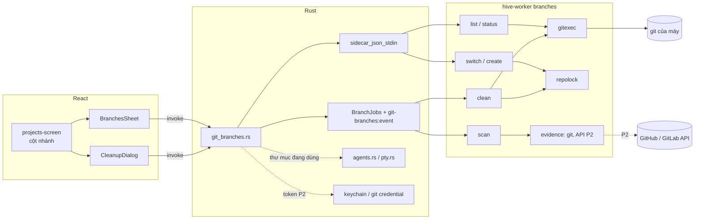

# Implementation Plan: Quản lý nhánh Git trong app desktop

**Branch**: `claude/spec-026-git-branches-0e58d1` · **Date**: 2026-10-19 · **Spec**: [spec.md](spec.md) ·
**Research**: [research.md](research.md)

Plan viết theo khuyến nghị của mọi câu hỏi mở (Q1–Q15). Chủ dự án chọn khác thì sửa mục liên quan.

## Tóm tắt

Thêm vào app desktop:
- **Sidecar Go**: lệnh mới `hive-worker branches` (package `worker/internal/branches`). Đọc nhánh, worktree, trạng thái;
  đổi nhánh; tạo nhánh; quét và dọn nhánh, worktree đã merge. In JSON như `gitgroups`.
- **Rust**: module `git_branches.rs`, chuyển tiếp lệnh tới sidecar. Gửi kèm danh sách thư mục đang dùng (agent từ
  `agents.rs`, terminal từ `pty.rs`) qua stdin, và token kết nối Git (P2) qua biến môi trường.
- **React**: cột nhánh/trạng thái ở màn Dự án trên máy; bảng "Nhánh" của một repo; hộp thoại "Dọn nhánh" có xem trước,
  xác nhận, tiến độ.

Hub, web, `packages/contracts`, giao thức worker **không đổi**. Không cần đăng nhập Hive.

Đổi nhỏ trong worker: tách khoá repo và bộ đọc `worktree list --porcelain` khỏi `runner`, tách cách chạy git khỏi
`gitgroups`, để `branches` khoá cùng một file với run và chạy git cùng một cách. Hành vi của run không đổi.

## Technical Context

| Mục | Giá trị |
|---|---|
| Ngôn ngữ | Go (worker, sidecar), Rust (Tauri), TypeScript strict (React) |
| Git | Git của máy qua `exec`. Đường nhanh cần git ≥ 2.41 (`%(ahead-behind:…)`) [Unverified: phiên bản có trường này]; máy dev có 2.56 |
| Lưu trữ | `branches.json` cạnh `worker.json` (mẫu dọn, danh sách thư mục dựng lại được); `branches-log.jsonl` (nhật ký dọn). Không có bảng hub |
| Test | Go: repo git thật trong thư mục tạm, bare remote cục bộ, CI ba hệ điều hành. Rust: tham số sidecar, capability audit. Vitest: bảng Nhánh, Dọn nhánh |
| Hiệu năng | SC-001: bảng nhánh ≤ 2 giây với 30 worktree, 200 nhánh [Unverified]; SC-002: quét 20 repo ≤ 10 giây |
| Mạng | Chỉ `git fetch`, `git ls-remote` tới remote của repo (bằng credential, khoá SSH của máy) và API GitHub/GitLab (P2). Không mở kết nối nào khác |

## Constitution Check

| Nguyên tắc | Cách tuân |
|---|---|
| I. Contract first | Không đổi API hub hay giao thức worker. JSON giữa sidecar và Rust là giao tiếp nội bộ của app desktop (như `gitgroups`), kiểu Go và TypeScript viết tay, có test đọc JSON mẫu ở cả hai phía |
| II. Tenant isolation | Không có dữ liệu tổ chức, không có bảng mới |
| III. Module boundaries | Không đụng module hub. Trong worker: `branches` dùng `gitexec` (mới, tách từ `gitgroups`), `repolock` (mới, tách từ `runner`), `gitgroups` (client API, P2). `runner` và `gitgroups` không import `branches` |
| IV. Tested | Go test với git thật cho mọi quy tắc chặn của US4 và ca đổi trạng thái giữa xem trước và dọn (SC-003). Chạy trên Linux, macOS, Windows ở CI. Rust test tham số, JSON stdin. Vitest cho luồng giao diện. Playwright: app desktop chưa có; dùng Vitest như spec 016, 021 (lệch, ghi ở Complexity Tracking) |
| V. Secure by default | Token chỉ qua biến môi trường của tiến trình con (`HIVE_GIT_TOKENS`, như spec 016). Lỗi git che token. Nhật ký không có secret. Không `--force` ở `switch` và `worktree remove`. `branch -D` (xoá không kiểm merge vào HEAD) chỉ chạy sau kiểm mã đỉnh và commit chưa đẩy (FR-021, FR-028) |
| VI. Ngôn ngữ | Chữ giao diện, lỗi tiếng Việt. Spec tiếng Việt theo yêu cầu chủ dự án (lệch VI, như spec 011–025) |
| VII. Simple to self-host | Không thêm dịch vụ, không thêm phụ thuộc Go/Rust/npm |
| Giao diện | Navy Hive, shadcn/ui, token màu, 360 px, sáng/tối, bàn phím, `ui-ux-pro-max` khi thiết kế |

## Kiến trúc



Luồng dọn:
1. React gọi `git_branches_scan` (job). Rust thu thư mục đang dùng, chạy `hive-worker branches scan`, ghi dòng đầu stdin
   là JSON đầu vào (mục 4).
2. Sidecar fetch từng remote, tính ứng viên, in sự kiện từng repo rồi `done`.
3. React hiện xem trước. Người dùng chọn, xác nhận hai lần.
4. React gọi `git_branches_clean` (job). Rust **thu lại** thư mục đang dùng, gửi cùng danh sách mục đã chọn
   `{folder, branch, tip, worktree?, evidence}` và tập remote fetch được của từng repo qua stdin. Trong lúc dọn, Rust gửi
   lại danh sách thư mục đang dùng mỗi 5 giây.
5. Sidecar, với từng mục: kiểm lại mọi điều kiện, gỡ worktree (không khoá), xoá nhánh (trong khoá), ghi nhật ký, in sự
   kiện.

## Cấu trúc file

```text
worker/
├── internal/gitexec/            # MỚI: tách Git, run, env, GitError, authFailed, redact, lastLine (git.go) và biến
│                                #   môi trường askpass, secretEnv, tokenUser (askpass.go) từ gitgroups
├── internal/repolock/           # MỚI: tách lockRepo, localLock, lockFile/tryLockFile/unlockFile (unix, windows),
│                                #   parseWorktrees, cleanAbs, samePath, insideDir từ runner; DataDir()
├── internal/gitgroups/          # SỬA: dùng gitexec; export ParsePorcelain; api.go thêm ListMergeRequests, ListPulls (P2)
├── internal/runner/             # SỬA: gọi repolock qua wrapper không export (giữ test hiện có)
├── internal/branches/           # MỚI
│   ├── list.go                  #   for-each-ref, worktree list, status → RepoBranches
│   ├── state.go                 #   thao tác dở (MERGE_HEAD…), sạch/bẩn, file bị bỏ qua từng worktree
│   ├── switch.go                #   switch, create (check-ref-format)
│   ├── scan.go                  #   ứng viên, quy tắc chặn
│   ├── evidence.go              #   bằng chứng git (first-parent), API (P2)
│   ├── clean.go                 #   kiểm lại, gỡ worktree, xoá nhánh, nhật ký
│   ├── input.go                 #   đọc stdin: dòng đầu JSON, dòng sau "cancel"
│   ├── settings.go              #   branches.json
│   └── *_test.go                #   repo git thật, bare remote
└── cmd/hive-worker/branches.go  # MỚI: lệnh con, JSON, sự kiện, --timeout

apps/desktop/src-tauri/
├── src/git_branches.rs          # MỚI: lệnh Tauri, job, thư mục đang dùng, token
├── src/pty.rs                   # SỬA: Session giữ thư mục lúc mở; hàm liệt kê thư mục của terminal đang mở
├── src/lib.rs                   # SỬA: sidecar_json_stdin, generate_handler!, .manage(BranchJobs)
├── build.rs                     # SỬA: thêm từng tên lệnh
└── capabilities/app.json        # SỬA: một allow-… cho mỗi lệnh, cập nhật mô tả

apps/desktop/src/
├── lib/git-branches.ts          # MỚI: kiểu, wrapper invoke, useBranchJob
├── components/branches-sheet.tsx       # MỚI
├── components/cleanup-dialog.tsx       # MỚI
├── components/branch-create-dialog.tsx # MỚI
├── screens/projects-screen.tsx  # SỬA: cột nhánh, nút Nhánh, nút Dọn nhánh
└── lib/i18n.ts                  # SỬA: chuỗi vi/en
```

## Thiết kế từng phần

### 1. Tách phần dùng chung trong worker (Q1, FR-025, FR-041)

**`internal/gitexec`** (từ `gitgroups/git.go`, `askpass.go`):
- Chuyển `Git`, `run` (export thành `Run`), `env`, `GitError`, `authFailed`, `redact`, `lastLine`, cùng `secretEnv`,
  `TokensEnv`, `TokenEnv`, `AskpassEnv`, các biến `askpass*Env`, `tokenUser` mà `env()` cần. Phần trả lời askpass (đọc
  token, so host) ở lại `gitgroups` hay chuyển theo, miễn `gitexec` không import `gitgroups` (tránh vòng import).
- Thêm `Timeout` (FR-041) và chế độ `MachineCredentials`: bỏ `-c credential.helper=` như `UseGitCredentials` hiện nay,
  để fetch như người dùng gõ `git fetch` (GCM, osxkeychain, khoá SSH). `branches` luôn dùng chế độ này.
- `UseGitCredentials` hiện thay **mọi** lỗi git bằng câu chung (`git.go:119-124`), vì helper có thể ghi secret ra stderr.
  Chế độ mới chỉ làm vậy với lệnh mạng (`fetch`, `ls-remote`); lệnh tại máy (`switch`, `branch`, `worktree remove`,
  `status`) giữ dòng cuối stderr đã che, để giao diện hiện đúng lỗi của git (US2, FR-042).
- Test của `gitgroups` gọi phương thức chưa export (`.run`, `.env`, `.redact`) và biến `askpass*Env`, `tokenUser`,
  `parsePorcelain` (`git_test.go`, `sync_test.go`, `config_test.go`). Các test này **phải sửa** hoặc chuyển sang
  `gitexec` cùng code; không giữ được nguyên.
- Windows: `Run` hiện giết git ngay khi huỷ (`git.go:101-104`). `branches` không huỷ lệnh ghi (mục 4).

**`internal/repolock`** (từ `runner`):
- Chuyển `lockRepo`, `repoLocks`, `filePollInterval`, `lockFile`/`tryLockFile`/`unlockFile` (`repolock_unix.go`,
  `repolock_windows.go`), `localLock`, `parseWorktrees`, `cleanAbs`, `samePath`, `insideDir`. Export những gì `runner`,
  `guard.go`, `guard_local.go` và `branches` cần.
- `runner` giữ wrapper không export cùng tên (`lockRepo`, `parseWorktrees`, `tryLockFile`…) gọi sang `repolock`, để test
  hiện có (`repolock_test.go:77-110`, `local_test.go:214`, `guard_local_test.go:373`) biên dịch không sửa. Test của phần
  đã chuyển thì chép sang `repolock`.
- `parseWorktrees` đọc thêm `locked`, `prunable`, `detached`, `bare`, `HEAD`.
- `DataDir()`: một hàm dùng chung cho `cmd/hive-worker` (`main.go:391,633`) và `branches`, trả
  `os.UserCacheDir()/xdev-hive/worker`. [Inference] Trên Linux, service systemd chỉ đặt `HOME`, `PATH`, nên
  `XDG_CACHE_HOME` của service có thể khác của app desktop; khi đó hai bên khoá hai file khác nhau. Ghi rõ trong tài liệu,
  kiểm khi làm.
- `repoLocks` (khoá trong tiến trình) vẫn chỉ có một bản. `gitWrite`, `gitRetryLocked` (dùng `procattr`) ở lại `runner`.

### 2. Đọc nhánh (US1, FR-001…FR-004)

Một repo, bốn lệnh đọc chạy song song:
1. `git status --porcelain=v2 --branch` (thư mục chính) → nhánh đang đứng, upstream, ahead/behind, bẩn.
2. `git worktree list --porcelain` → worktree.
3. `git for-each-ref --format=<f> refs/heads refs/remotes` với
   `%(refname)%00%(objectname)%00%(upstream)%00%(upstream:track,nobracket)%00%(committerdate:unix)%00%(worktreepath)%00%(ahead-behind:<mặc định>)`.
   Git cũ hơn 2.41 thì bỏ trường cuối, chạy `rev-list --left-right --count` cho nhánh khớp mẫu.
4. `git symbolic-ref --quiet refs/remotes/origin/HEAD` → nhánh mặc định (fallback theo Khái niệm của spec).

- Trạng thái từng worktree liên kết (`status --porcelain=v2 --untracked-files=normal --ignored=matching`) tính sau, song
  song tối đa 4, in thành sự kiện riêng để bảng hiện trước rồi điền dần (giữ SC-001 nếu 28 lần `status` chậm trên Windows).
- Worktree dưới `<DataDir>` không đọc trạng thái (FR-024).
- `unpushed` chỉ tính cho nhánh local khớp mẫu hoặc đang đứng.

Lệnh:
- `hive-worker branches list --folder=<thư mục>` → `RepoBranches`, rồi các dòng `worktree` khi đọc xong.
- `hive-worker branches status --folder=…` (nhiều lần `--folder`) → trạng thái gọn cho cột màn Dự án.

### 3. Đổi và tạo nhánh (US2, US3, FR-010…FR-014)

- `branches switch --folder=… --branch=… [--track=<ref remote>] [--carry]`:
  - kiểm thao tác dở (FR-012) bằng file trong `git rev-parse --git-dir`;
  - kiểm nhánh đích có mở ở worktree khác (từ `worktree list`);
  - thư mục bẩn mà không có `--carry` thì trả mã `dirty` kèm danh sách file (React hiện hộp thoại Q10);
  - chạy `git switch [--track] --end-of-options <nhánh>` trong khoá repo.
- `branches create --folder=… --name=… --base=… [--switch] [--fetch]`:
  - `git check-ref-format --branch <tên>`; `git show-ref --verify --quiet refs/heads/<tên>` có thì trả `exists`;
  - `--fetch`: `git fetch <remote> <nhánh gốc>` (gốc là nhánh remote), ngoài khoá;
  - `git switch --no-track -c <tên> <gốc>` hay `git branch --no-track <tên> <gốc>` trong khoá.
- Agent đang chạy trong thư mục (FR-014): Rust kiểm trước khi gọi, React hỏi lại.

### 4. Gọi sidecar, stdin, giới hạn thời gian

- **Đầu vào qua stdin**: mọi lệnh `branches` đọc dòng đầu stdin là một JSON
  `{"busy":[{"path","kind"}], "items":[…]?, "fetched":{"<thư mục>":["origin",…]}?, "settings":…?}`. Các dòng sau là
  `cancel` hoặc `{"busy":[…]}` (danh sách mới thay danh sách cũ). Một bộ đọc duy nhất (`input.go`) dùng `bufio.Reader`
  (không dùng `Scanner` vì giới hạn 64 KB một dòng).
  Bộ đọc của `gitgroups` (`cmd/hive-worker/gitgroups.go:367-375`) không đổi.
- **Rust**: `sidecar_json` hiện chạy `.output()` nên không ghi được stdin. Thêm `sidecar_json_stdin(app, args, env,
  input)`: `.spawn()`, ghi `input` + `\n`, đóng stdin, đọc stdout tới hết, đọc một JSON. Dùng cho `list`, `status`,
  `switch`, `create`.
- `scan`, `clean`, `fetch`, `pull` là job như `git_group_sync`: `.spawn()`, ghi dòng đầu stdin, giữ stdin mở để gửi
  `cancel`, đọc stdout từng dòng, phát `git-branches:event`. State `BranchJobs` riêng; chỉ một job `clean` cùng lúc.
- **Giới hạn thời gian**: Rust truyền `--timeout=<giây>`; sidecar tự huỷ context của lệnh đọc và fetch khi hết giờ (git con
  dừng cùng). Lệnh ghi (`switch`, `worktree remove`, `branch -D`) chạy với context riêng không bị huỷ; huỷ chỉ có hiệu lực
  từ lệnh sau. Rust chỉ giết sidecar khi quá `timeout + 30` giây mà chưa trả lời, và ghi lỗi "sidecar không phản hồi".
- **Lệnh Tauri** (mỗi lệnh một mục trong `generate_handler!`, `build.rs` và một `allow-…` trong `capabilities/app.json`,
  đúng yêu cầu của `capabilities_audit.rs`): `git_branches_status`, `git_branches_list`, `git_branches_switch`,
  `git_branches_create`, `git_branches_fetch`, `git_branches_pull`, `git_branches_scan`, `git_branches_clean`,
  `git_branches_cancel`, `git_branches_settings`, `git_branches_settings_set`.

### 5. Quét ứng viên (US4, FR-020…FR-027)

Với mỗi repo (song song tối đa 4):
1. `git fetch --prune --quiet <remote>` cho từng remote, giới hạn 120 giây mỗi remote, ngoài khoá. Ghi tập remote fetch
   được.
2. Đọc như mục 2.
3. Lọc nhánh local khớp mẫu. Bỏ nhánh mặc định và nhánh đang đứng ở thư mục chính (gợi ý "Về nhánh mặc định", Q13).
4. Bằng chứng:
   - **Git**: đọc `git rev-list --first-parent --max-count=5000 <origin/mặc định>` một lần vào tập hợp; gọi B là commit
     cuối của cửa sổ (cũ nhất). Với mỗi đỉnh T:
     - T không là tổ tiên của `origin/<mặc định>` → không có bằng chứng git;
     - T nằm trong tập first-parent → "chưa có commit riêng hoặc merge tiến nhanh", không có bằng chứng;
     - T là tổ tiên của B (`merge-base --is-ancestor T B`) → "không rõ" (cũ hơn cửa sổ), không có bằng chứng;
     - còn lại → "đã vào qua merge commit".
   - **API** (P2): mục 7.
5. Chặn, theo thứ tự (dừng ở lý do đầu tiên):
   1. worktree nằm dưới `<DataDir>` (FR-024);
   2. worktree đang dùng (FR-023);
   3. gốc ổ hay thư mục cha của worktree không truy cập được;
   4. worktree khoá, có submodule, có thay đổi, có file chưa theo dõi, có file bị bỏ qua ngoài danh sách dựng lại được
      (FR-022, Q15). Đọc file bị bỏ qua bằng `git status --porcelain=v2 --ignored=matching --untracked-files=normal`.
      Một mục bị bỏ qua được chấp nhận khi **một đoạn bất kỳ** của đường dẫn trùng tên trong danh sách (để
      `apps/web/node_modules/` cũng khớp `node_modules`);
   5. commit chưa đẩy (FR-021): `git rev-list --count <T> --not --remotes=<remote>…` với T là mã đỉnh (không phải tên),
      một `--remotes=` cho mỗi remote fetch được; repo fetch lỗi hết thì chỉ còn trường hợp T là tổ tiên của
      `refs/remotes/origin/<mặc định>` (FR-027);
   6. PR/MR đang mở (P2).
6. In sự kiện `repo` kèm ứng viên và mục bị chặn.

So đường dẫn bằng `repolock.samePath` / `insideDir` (Windows không phân biệt hoa thường). Worktree bị coi là đang dùng khi
thư mục của agent hay terminal nằm trong worktree. Thư mục chính chứa `.claude/worktrees/`, nên agent ở thư mục chính
không chặn worktree con, và agent ở worktree con không chặn thư mục chính.

### 6. Dọn (US4, FR-026, FR-028, FR-029, FR-032)

Input qua stdin: `{"busy":[…], "fetched":{…}, "items":[{"folder","branch","tip","worktree","evidence"}]}`. `fetched` là
tập remote fetch được của từng repo trong lượt quét; bước kiểm commit chưa đẩy chỉ dùng các remote này. Mỗi repo tuần tự,
tối đa 2 repo song song. Danh sách `busy` mới nhất (Rust gửi lại mỗi 5 giây) được dùng cho từng mục.

Với mỗi mục:
1. `git rev-parse --verify --quiet refs/heads/<nhánh>` bằng `tip`; không bằng → `skipped: "Nhánh đã đổi sau khi xem
   trước"`.
2. Kiểm lại các bước chặn 1–4 của mục 5 với danh sách `busy` mới nhất (không fetch lại).
3. Mục có bằng chứng đã đóng (FR-026): `git ls-remote <remote> refs/heads/<nhánh>`, giới hạn 30 giây. Chỉ nhận dòng có
   tên ref **đúng bằng** `refs/heads/<nhánh>` (ls-remote so mẫu theo đuôi tên ref [Unverified]). Mã trả về phải bằng
   `tip`, hoặc có trên máy và `merge-base --is-ancestor <tip> <mã>`. Không thì `skipped`.
4. Có worktree, **ngoài khoá**:
   - thư mục còn: đọc lại file bị bỏ qua (bước chặn 4) **ngay trước** `git worktree remove -- <đường dẫn>` (không
     `--force`), để khoảng hở chỉ còn thời gian chạy một lệnh. [Inference] File bị bỏ qua tạo ra đúng trong khoảng hở đó
     vẫn mất; chấp nhận được vì worktree không có agent hay terminal (bước chặn 2). Lỗi (file bị khoá…) → `partial`, giữ
     nhánh, sang mục sau;
   - `prunable` và gốc ổ, thư mục cha truy cập được: trong khoá, xoá đúng `<commonDir>/worktrees/<tên>` sau khi đọc
     `gitdir` trỏ về đúng đường dẫn (cùng cách `removeLocalWorktree`, `runner/local.go:132-148`). Bước này **chỉ gỡ đăng
     ký**, không xoá file nào. Trên Linux/macOS, điểm gắn ổ chưa gắn là thư mục rỗng có thật, nên kiểm "thư mục cha truy
     cập được" không phân biệt được; vì vậy mục `prunable` **không chọn sẵn** trong xem trước, và xem trước ghi "Thư mục
     không còn hoặc ổ chưa gắn; chỉ gỡ đăng ký worktree, không xoá file".
5. Trong khoá (`repolock.LocalLock(dataDir, commonDir)`, chờ tối đa 30 giây):
   - kiểm lại bước 1 và bước chặn 5 của mục 5 (commit chưa đẩy);
   - `git branch -D --end-of-options <nhánh>`. Git tự từ chối nếu nhánh vừa được checkout ở worktree nào đó.
6. Ghi một dòng nhật ký, in sự kiện `item`.

Huỷ: dừng trước mục kế tiếp; mục đang chạy chạy hết.

### 7. Bằng chứng từ GitHub/GitLab (P2, US6, FR-030)

- Rust tìm kết nối Git tại máy có host trùng origin của repo (cùng cách so host của spec 016), lấy token như
  `git_group_sync`, truyền `HIVE_GIT_TOKENS`. Kết nối `authMode=git` thì đọc `git credential fill` như spec 016.
- `gitgroups/api.go` thêm:
  - GitLab: `GET /projects/<đường dẫn mã hoá>/merge_requests?state=all&order_by=updated_at&per_page=100`;
  - GitHub: `GET /repos/<owner>/<repo>/pulls?state=all&sort=updated&direction=desc&per_page=100`.
  Tối đa 3 trang mỗi repo, chỉ khi repo có ít nhất một nhánh khớp mẫu chưa có bằng chứng git.
- So `source_branch` / `head.ref` với tên nhánh; lấy PR mới nhất. Bỏ PR từ fork (GitLab `source_project_id` khác project,
  GitHub `head.repo` khác repo).
- Lỗi 401/403 → nhãn trên repo, dùng bằng chứng git. Không thử lại trong lượt (GitLab khoá IP khi sai liên tiếp,
  `GitError.Auth`).

### 8. Giao diện

- **Màn Dự án trên máy**: mỗi dòng repo thêm `⎇ <nhánh>`, chấm trạng thái (sạch/có thay đổi), `↑N ↓M`. Gọi
  `git_branches_status` cho các repo đang hiện, một lần khi mở màn và sau mỗi thao tác.
- **BranchesSheet** (Sheet bên phải, rộng 640 px, toàn màn ở 360 px): ba tab Local, Remote, Worktree; ô lọc; nút Fetch,
  Pull (P2), Tạo nhánh, Dọn nhánh repo này; mỗi dòng nhánh có menu Đổi sang, Sao chép tên, Mở terminal ở worktree.
- **CleanupDialog**: Quét (tiến độ từng repo) → Xem trước (nhóm theo repo; nhóm "Không dọn" thu gọn, có danh sách file bị
  bỏ qua chặn mục) → Xác nhận (AlertDialog) → Đang dọn → Kết quả (mã đỉnh từng nhánh, nút sao chép lệnh khôi phục). Ô sửa
  mẫu dọn và danh sách thư mục dựng lại được ở đầu bước Xem trước.
- Thiết kế bằng `ui-ux-pro-max`, component shadcn/ui; có chữ tiếng Anh.

### 9. Kiểm thử

- Go (`branches/*_test.go`): repo thật với bare remote trong `t.TempDir()`:
  - danh sách: ahead/behind, upstream đã xoá, nhánh chỉ có trên remote, worktree khoá/mất/bẩn;
  - đổi nhánh: bẩn, `--carry`, nhánh đang mở chỗ khác, thao tác dở, tag trùng tên;
  - tạo nhánh: tên sai, trùng, `--no-track`;
  - quét: đủ các nhánh của US4 Independent Test; nhánh mới chưa có commit; nhánh từ commit cũ hơn cửa sổ; merge tiến nhanh;
    fetch lỗi một remote; worktree dưới `<DataDir>` (giả bằng biến `HIVE_TEST_DATA_DIR` hay tham số);
  - dọn: commit mới, file mới, agent mới giữa quét và dọn (SC-003); `.env` bị bỏ qua; `prunable` có và không có thư mục
    cha; remote xoá nhánh sau khi PR đóng (FR-026); khoá repo đang bị giữ.
  - API (P2): máy chủ HTTP giả như test phân trang của `gitgroups`.
- Go (`runner`): bộ test hiện có xanh, không sửa test (nhờ wrapper). Go (`gitgroups`): test dùng phần đã chuyển được sửa
  hoặc chuyển sang `gitexec`, cùng ca kiểm như cũ.
- Rust: tham số sidecar, JSON stdin, timeout, capability audit.
- Vitest: BranchesSheet, CleanupDialog với `window.__TAURI__` giả (như `git-groups.test.tsx`).
- Tay trên máy dev Windows: chạy quét trên `xdev-hive`, so với đo ở research mục 2, **không** bấm Dọn khi chưa được chủ dự
  án đồng ý.

## Quyết định của người viết

Các điểm spec để người làm tự chọn, đã chọn khi viết plan:
- **Một dòng JSON đầu stdin cho mọi lệnh**, không qua tham số: danh sách dài, tên nhánh có ký tự lạ, và cùng một bộ đọc với
  `cancel`.
- **Không fetch lại trước từng mục dọn**: dùng ref của lượt quét, kèm kiểm `tip`, commit chưa đẩy và `ls-remote` cho mục đã
  đóng. Fetch lại làm lượt dọn chậm và có thể đổi bằng chứng giữa chừng.
- **Cửa sổ first-parent 5.000 commit**, nhánh cũ hơn là "không rõ": đủ cho vài năm lịch sử của repo cỡ `xdev-hive`
  [Inference].
- **Khoá repo chỉ quanh lệnh ghi ngắn**: worker chờ khoá không giới hạn khi dọn run (`runner.go:316`), nên không giữ khoá
  suốt `worktree remove`.
- **Sheet thay vì màn riêng** cho bảng nhánh (Q12): giữ ngữ cảnh danh sách repo.
- **Không cache kết quả quét trên đĩa**: mỗi lần mở Dọn nhánh quét lại; huy hiệu P3 giữ số trong bộ nhớ.
- **Cấu hình trong `branches.json` riêng**, không chung `gitgroups.json`: hai tính năng độc lập.

## Rủi ro

| # | Rủi ro | Cách giảm |
|---|---|---|
| R1 | Xoá nhầm nhánh có việc chưa đẩy | FR-021 kiểm theo ref của remote fetch được, bằng mã đỉnh (không tên ngắn); FR-028 kiểm lại `tip` trong khoá ngay trước khi xoá; FR-026 `ls-remote` cho mục đã đóng; nhật ký có mã đỉnh để khôi phục; test SC-003 |
| R2 | Mất file tạo tay trong worktree (`.env`, ghi chú) | Không `--force`; file chưa theo dõi chặn; file bị bỏ qua ngoài danh sách dựng lại được chặn (Q15); xem trước liệt kê file |
| R3 | Gỡ worktree đang có người làm (phiên Claude Code mở nhưng agent đã thoát, IDE mở thư mục) | Chặn worktree có agent hay terminal; xem trước hiện đường dẫn. [Inference] IDE mở thư mục mà không sửa gì thì không chặn được; Windows báo file bị khoá nếu IDE giữ file → `partial`, giữ nhánh |
| R4 | Tách `repolock`, `gitexec` làm hỏng run hay nhóm Git | Chỉ di chuyển code; wrapper giữ tên cũ trong `runner`, test `runner` không sửa; test `gitgroups` sửa tối thiểu (đổi tên gọi), cùng ca kiểm; commit tách riêng để review |
| R5 | Nhận nhầm "đã merge" bằng git | Chỉ nhận đỉnh nằm ngoài first-parent và trong cửa sổ; nhánh chưa có commit riêng không bị nhận (đo trên máy dev: đúng 2/2 trường hợp). Merge "foxtrot" có thể nhận nhầm, nhưng commit đã nằm trong `main` |
| R6 | `fetch` treo vì SSH hỏi host key hay passphrase | `GIT_TERMINAL_PROMPT=0`; giới hạn 120 giây; [Unverified] thêm `GIT_SSH_COMMAND="ssh -o BatchMode=yes"` khi người dùng chưa đặt biến này |
| R7 | Ổ chưa gắn bị coi là worktree đã mất | Chỉ gỡ siêu dữ liệu khi gốc ổ và thư mục cha truy cập được; không `worktree prune` cả repo |
| R8 | Hai bên khoá hai file khác nhau (`XDG_CACHE_HOME` của service khác app trên Linux) | `repolock.DataDir()` dùng chung; [Inference] cần kiểm trên Linux khi làm |
| R9 | Gỡ thư mục lớn lâu, file bị khoá trên Windows | Job chạy nền, có tiến độ; lỗi → `partial`, giữ nhánh |
| R10 | Giới hạn API GitHub/GitLab | Một lần liệt kê mỗi repo, tối đa 3 trang; chỉ gọi khi có nhánh thiếu bằng chứng git |
| R11 | Claude Code desktop còn giữ phiên trỏ tới worktree đã gỡ | [Unverified] Hành vi khi worktree của phiên cũ mất. Xem trước ghi rõ đường dẫn `.claude/worktrees/…`; người dùng bỏ chọn được |

## Phương án đã cân nhắc

| Phương án | Lý do không chọn |
|---|---|
| Rust gọi git trực tiếp (Q1) | Phải viết lại khoá repo dùng chung với worker, che token, huỷ; Go đã có và có test ba hệ điều hành |
| Thư viện git thuần (go-git, gitoxide) | Khác hành vi git của máy (worktree, credential helper, cấu hình người dùng); thêm phụ thuộc lớn |
| Hỏi hub trạng thái PR (Q2) | Cần đăng nhập, cần API mới; chỉ biết nhánh run Hive; hub đang không chạy |
| `git branch --merged` làm bằng chứng duy nhất | Nhận cả nhánh mới chưa có commit (xoá nhầm worktree đang làm, như worktree của phiên viết spec này) |
| `git worktree prune` cho cả repo | Xoá worktree nằm trên ổ chưa gắn (lý do worker cũng không prune, `runner/local.go:130-131`) |
| `git worktree remove --force` khi chỉ có file chưa theo dõi (như `cleanup-merged.sh`) | Mất file tạo tay không lấy lại được |
| `git update-ref -d` để xoá nhánh | Không từ chối nhánh đang checkout ở worktree khác; `branch -D` có kiểm này và không nhầm tag |
| Giữ khoá repo suốt lượt dọn | Worker chờ khoá không giới hạn khi dọn run; gỡ `node_modules` có thể mất vài phút |
| Hỏi worker qua localipc danh sách run | `worker.status` chỉ trả số run; chặn mọi worktree dưới `<DataDir>` đủ và không đổi giao thức |

## Complexity Tracking

| Lệch | Lý do | Phương án đơn giản hơn bị loại vì |
|---|---|---|
| Spec viết tiếng Việt (constitution VI nói spec tiếng Anh) | Chủ dự án yêu cầu, như spec 011–025 | — |
| Không có Playwright cho màn desktop | App desktop chưa có Playwright; spec 016, 021, 023 dùng Vitest với Tauri giả | Thêm Playwright cho Tauri là việc riêng |
| Sửa `runner`, `gitgroups` (tách `repolock`, `gitexec`) | Cần cùng một khoá repo với run và cùng cách chạy git | Khoá riêng của `branches` sẽ đua với run khi worker chuẩn bị nhánh `ai/<key>` |

## Phân đợt và ước lượng

| Đợt | Nội dung | Ước lượng |
|---|---|---|
| 1 (P1) | Mục 1 (tách `gitexec`, `repolock`), mục 2, 3, 4: xem, Fetch, đổi, tạo nhánh; cột nhánh ở màn Dự án; BranchesSheet (US1–US3) | 6–7 ngày-agent |
| 2 (P1) | Mục 5, 6, 8 (CleanupDialog): quét, xem trước, dọn với bằng chứng git; danh sách thư mục dựng lại được; nhật ký; test SC-003 (US4) | 6–7 ngày-agent |
| 3 (P2) | Pull (US5); mục 7: bằng chứng API GitHub/GitLab, PR đã đóng (US6) | 3–4 ngày-agent |
| 4 (P3) | Huy hiệu số ứng viên (US7) | 1 ngày-agent |

Tổng khoảng 16–19 ngày-agent [Inference], chưa tính thiết kế màn bằng `ui-ux-pro-max` và kiểm tay trên Windows, macOS.
Tăng so với bản nháp đầu (14–17) vì thêm kiểm file bị bỏ qua, stdin chung, giới hạn thời gian trong sidecar, wrapper giữ
test cũ. Đợt 1 và 2 làm tuần tự (đợt 2 dùng mục 1, 2). Phần API của đợt 3 làm song song với đợt 2 được nếu tách file
`evidence.go`. Bước tiếp theo sau khi chủ dự án chốt câu hỏi mở: viết `tasks.md`.
