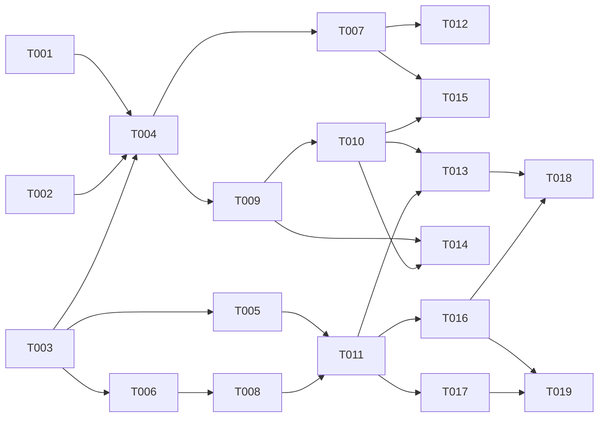

# Tasks: Quản lý nhánh Git trong app desktop

**Input**: [spec.md](spec.md), [plan.md](plan.md), [research.md](research.md)
**Trạng thái**: Q1–Q15 đã chốt (2026-10-20). Chưa code.

## Quy ước

- **Định dạng**: `[ID] [P?] [Story] [Tier] · ước lượng`.
  - **[P]**: chạy song song được với task khác cùng đợt. Bộ file không giao nhau và không chờ task chưa xong.
  - **Tier**: chọn model theo CLAUDE.md.
    - **nặng** = Opus `--effort high` (nhiều module, giao thức, khoá, an toàn dữ liệu);
    - **vừa** = Sonnet `--effort high` (một màn UI, một lệnh gọn);
    - **nhẹ** = Sonnet `--effort medium` (chữ, tài liệu, đo).
  - **Ước lượng**: ngày-agent (một agent làm liên tục, gồm test). **[Suy luận]** theo plan.md "Phân đợt và ước lượng".
- **Đợt và giai đoạn**: "Đợt N" ở file này là đợt chạy song song. "Giai đoạn" là cột "Đợt" ở plan.md (1, 2 là P1; 3 là
  P2; 4 là P3). Dòng đầu của Goal ghi giai đoạn.
- **Giả định**: Q1–Q15 theo spec.md "Câu hỏi đã chốt". Q7 = có merge và rebase (US8, FR-050…FR-056); cách làm của US8 là
  **[Suy luận]** của người điều phối, chủ dự án soát trước khi giao T015, T016.
- **PHẠM VI**: chỉ được sửa các file liệt kê. Hai task cùng đợt không có file chung. Cần sửa file ngoài phạm vi thì ghi
  vào ghi chú bàn giao, người điều phối xếp lại.
- **Worktree**: mỗi task một worktree, chặn push. Agent chỉ commit tại máy. Người điều phối xem lại, chạy test, rồi push
  và mở PR.
- **Hợp đồng trước**: T003 viết `contracts/branches-cli.md` (lệnh con, cờ, JSON stdin, kết quả, sự kiện, mã lỗi) cho
  mọi giai đoạn, kể cả P2. Go, Rust, React đều theo file này. Task sau thấy thiếu thì ghi bàn giao, không tự đổi hợp
  đồng.
- **Tách file so với plan.md "Cấu trúc file"**:
  - Pull nằm ở `branches/pull.go` (plan không ghi file riêng);
  - bằng chứng API nằm ở `branches/evidence_api.go`, tách khỏi `evidence.go`, để T014 không chung file với T009;
  - hộp thoại đổi nhánh (Q10) nằm ở `components/branch-switch-dialog.tsx`;
  - chữ `i18n.ts` của từng màn đi theo task của màn đó, khác đợt.
- **File chung có chủ**:
  - `specs/026-desktop-git-branches/contracts/**`, `apps/desktop/src/lib/git-branches.ts`: chỉ T003. Kiểu và wrapper
    `invoke` cho cả 15 lệnh Tauri, `useBranchJob`.
  - `worker/cmd/hive-worker/branches.go`, `worker/cmd/hive-worker/main.go` (`case "branches"`): T004 tạo đủ mọi lệnh
    con, đọc cờ theo hợp đồng, gọi hàm của gói `branches`. T004 tạo các file `switch.go`, `scan.go`, `clean.go`,
    `settings.go`, `evidence.go`, `pull.go`, `operation.go` ở dạng rỗng (trả lỗi `not_implemented`, chữ ký theo hợp
    đồng). Task sau chỉ sửa file của phần mình. `cmd/hive-worker/main.go` dòng `DataDir` (391, 633): chỉ T002, Đợt 0.
  - `worker/internal/branches/list.go`: T004, rồi T015 (trường `operation`, Đợt 4).
  - `worker/internal/branches/{scan.go,evidence.go}`: T009, rồi T014 (gọi `evidence_api.go`, PR đang mở, FR-026; Đợt
    4).
  - `worker/internal/gitgroups/**`: T001 (Đợt 0), rồi T014 (`api.go`, `api_test.go`; Đợt 4).
  - `worker/internal/runner/**`: chỉ T002.
  - `apps/desktop/src-tauri/{src/lib.rs,src/git_branches.rs,src/pty.rs,build.rs,capabilities/app.json}`: chỉ T005, cho
    mọi giai đoạn (đủ 15 lệnh, cả P2). Không đổi `Cargo.toml`. Task sau thấy cần sửa Rust thì ghi bàn giao.
  - `apps/desktop/src/screens/projects-screen.tsx`: T006, rồi T011 (nút Dọn nhánh), rồi T017 (huy hiệu). Khác đợt.
  - `apps/desktop/src/components/branches-sheet.tsx`: T006, rồi T008, rồi T011, rồi T016. Khác đợt.
  - `apps/desktop/src/components/cleanup-dialog.tsx`: T011, rồi T016 (nhãn bằng chứng API).
  - `apps/desktop/src/lib/i18n.ts`: T006, T008, T011, T016, T017, mỗi đợt một task.
- Mỗi task kèm test trong cùng commit.
- **Kiểm tra theo loại task**:
  - Go: trong `worker/` chạy `gofmt -l .`, `go vet ./...`, `go test ./...`. Test của `branches` dùng repo git thật và
    bare remote trong `t.TempDir()`, không mạng.
  - Rust: `cargo test`, `cargo clippy --all-targets -- -D warnings` trong `apps/desktop/src-tauri` (đặt
    `CARGO_TARGET_DIR` chung như agent-fleet).
  - Desktop React: `pnpm --filter @xdev-hive/desktop typecheck`, `pnpm --filter @xdev-hive/desktop test`. Vitest với
    Tauri giả như `git-groups.test.tsx`; desktop chưa có Playwright (plan.md "Complexity Tracking").
  - Mọi task: `pnpm biome check --write .`. Không chạy `pnpm ci:local` toàn bộ.
- **Windows**: CI chạy test Go trên Windows. Dùng `filepath.Join` cho đường dẫn mong đợi, không kiểm quyền file, so
  đường dẫn bằng `repolock.SamePath`. Không dùng `sh` trong test.
- **Không mạng thật**: không task agent nào gọi GitHub/GitLab hay remote thật. API test bằng máy chủ HTTP giả như test
  phân trang của `gitgroups`. Không commit token.
- **Không xoá gì ngoài `t.TempDir()`**: agent không chạy lệnh dọn của app trên repo thật của máy dev. Chỉ T018 đo
  SC-004 trên một bản sao repo (mục T018).
- **Thiết kế màn**: T006, T008, T011, T016 đọc `.claude/skills/agent-fleet/scripts/ui-rules.md`, dùng component
  shadcn/ui có sẵn trong `apps/desktop`, chữ tiếng Việt có bản tiếng Anh (FR-043).

---

## Đợt 0: tách phần dùng chung, hợp đồng

- [ ] **T001 [P] [Chung] [nặng] · 1,5 ngày — Tách `gitexec` từ `gitgroups`**
  - **Goal**: giai đoạn 1, plan.md mục 1. Gói `worker/internal/gitexec` có `Git`, `Run`, `env`, `GitError`,
    `authFailed`, `redact`, `lastLine`, biến askpass, `secretEnv`, `TokensEnv`, `TokenEnv`, `AskpassEnv`, `tokenUser`.
    Thêm `Timeout` (FR-041: `GIT_TERMINAL_PROMPT=0`, `GCM_INTERACTIVE=never`, `LC_ALL=C`) và chế độ
    `MachineCredentials`: không đặt `credential.helper=`, chỉ thay lỗi bằng câu chung cho lệnh mạng (`fetch`,
    `ls-remote`), lệnh tại máy giữ dòng cuối stderr đã che (FR-042). Export `ParsePorcelain` của `gitgroups`.
    `gitexec` không import `gitgroups`.
  - **PHẠM VI**: `worker/internal/gitexec/**` (mới); `worker/internal/gitgroups/*.go` (chỉ đổi lời gọi, chuyển code
    và sửa test tối thiểu: `git_test.go`, `sync_test.go`, `config_test.go`, `askpass_test.go`);
    `worker/cmd/hive-worker/gitgroups.go`, `gitgroups_test.go` (nếu đổi tên gọi).
  - **Kiểm**: test cũ của `gitgroups` xanh, cùng ca kiểm (chỉ đổi tên gọi). Test mới của `gitexec`: `Timeout` huỷ
    `git` con; `MachineCredentials` giữ stderr của `git switch` sai, che token trong URL; lệnh mạng thay bằng câu chung.
    Commit tách: một commit chỉ di chuyển code, một commit thêm tính năng (plan.md R4).
  - **Phụ thuộc**: không.

- [ ] **T002 [P] [Chung] [nặng] · 1 ngày — Tách `repolock` từ `runner`, thêm `DataDir()`**
  - **Goal**: giai đoạn 1, plan.md mục 1. Gói `worker/internal/repolock` có `LockRepo`, `LocalLock`, khoá file (unix,
    windows), `ParseWorktrees` (đọc thêm `locked`, `prunable`, `detached`, `bare`, `HEAD`), `CleanAbs`, `SamePath`,
    `InsideDir`, `DataDir()`. `runner` giữ wrapper không export cùng tên. `cmd/hive-worker/main.go` dùng `DataDir()`.
  - **PHẠM VI**: `worker/internal/repolock/**` (mới); `worker/internal/runner/{repolock.go,repolock_unix.go,
    repolock_windows.go,local.go,guard.go,guard_local.go}`; `worker/cmd/hive-worker/main.go` (chỉ chỗ tính thư mục dữ
    liệu).
  - **Kiểm**: `go test ./internal/runner/...` xanh mà **không sửa** `repolock_test.go`, `local_test.go`,
    `guard_local_test.go`. Test chép sang `repolock` cho phần đã chuyển; thêm ca `ParseWorktrees` có `locked`,
    `prunable`, `detached`. Ghi vào SUMMARY cách `DataDir()` chạy trên Linux service (plan.md R8, [Suy luận]).
  - **Phụ thuộc**: không.

- [ ] **T003 [P] [Chung] [nặng] · 1 ngày — Hợp đồng sidecar và lớp gọi TypeScript**
  - **Goal**: giai đoạn 1, plan.md mục 2–7 và 3b. `contracts/branches-cli.md` ghi cho mọi lệnh con (`list`, `status`,
    `fetch`, `pull`, `switch`, `create`, `scan`, `clean`, `settings`, `settings-set`, `merge`, `rebase`, `continue`,
    `abort`): cờ, JSON dòng đầu stdin (`busy`, `items`, `fetched`, `settings`), dòng `cancel`, JSON kết quả, sự kiện
    dòng (`repo`, `worktree`, `item`, `progress`, `done`), mã lỗi (`dirty`, `exists`, `in_progress`, `checked_out`,
    `needsConfirm`, `conflict`, `locked`, `timeout`, `not_implemented`…), kiểu `RepoBranches`, `Candidate`,
    `CleanResult`, `GitOperation`. Kèm ví dụ JSON. `git-branches.ts` có kiểu tương ứng, wrapper `invoke` cho 15 lệnh
    Tauri (plan.md mục 4), hook `useBranchJob` nghe `git-branches:event`.
  - **PHẠM VI**: `specs/026-desktop-git-branches/contracts/branches-cli.md` (mới);
    `apps/desktop/src/lib/git-branches.ts`, `git-branches.test.ts` (mới).
  - **Kiểm**: typecheck, test `useBranchJob` với Tauri giả (sự kiện đúng job, huỷ). Hợp đồng đủ cho FR-001…FR-056 (bảng
    đối chiếu ở cuối file hợp đồng).
  - **Phụ thuộc**: không.

## Đợt 1: đọc nhánh, Rust, màn xem

- [ ] **T004 [P] [US1] [nặng] · 2 ngày — Gói `branches`: đọc stdin, list, status, fetch; lệnh `hive-worker branches`**
  - **Goal**: giai đoạn 1, plan.md mục 2 và 4. `input.go` (bộ đọc `bufio.Reader`, `busy` mới thay cũ, `cancel`),
    `state.go` (thao tác dở theo `git rev-parse --git-dir`, sạch/bẩn, file bị bỏ qua), `list.go` (bốn lệnh đọc song
    song, `for-each-ref` có `ahead-behind`, fallback git < 2.41, trạng thái worktree song song tối đa 4 thành sự kiện
    riêng, bỏ qua worktree dưới `DataDir`), `fetch` (từng remote, `--prune`, ngoài khoá, giới hạn 120 giây, ghi remote
    nào thành công, FR-004). `cmd/hive-worker/branches.go` đọc cờ mọi lệnh con và `--timeout`; các file rỗng như mục
    "File chung có chủ".
  - **PHẠM VI**: `worker/internal/branches/{input.go,state.go,list.go,fetch.go,switch.go,scan.go,clean.go,settings.go,
    evidence.go,pull.go,operation.go}` và `*_test.go` của `input`, `state`, `list`, `fetch`;
    `worker/cmd/hive-worker/{branches.go,branches_test.go,main.go}` (chỉ `case "branches"`).
  - **Kiểm**: test plan.md mục 9 nhóm "danh sách" (ahead/behind, upstream đã xoá, nhánh chỉ có trên remote, worktree
    khoá/mất/bẩn, nhánh mặc định không có `origin/HEAD`). Đo SC-001 bằng benchmark: repo giả 30 worktree, 200 nhánh,
    ≤ 2 giây trên máy dev (ghi số vào SUMMARY).
  - **Phụ thuộc**: T001, T002, T003.

- [ ] **T005 [P] [Chung] [nặng] · 1,5 ngày — Rust: `git_branches.rs`, `sidecar_json_stdin`, 15 lệnh Tauri**
  - **Goal**: giai đoạn 1, plan.md mục 4, 7 và 3b. `sidecar_json_stdin` (spawn, ghi một dòng, đọc một JSON) cho
    `status`, `list`, `switch`, `create`, `settings`, `settings_set`, `merge`, `rebase`, `continue`, `abort`. Job cho
    `fetch`, `pull`, `scan`, `clean` (giữ stdin để gửi `cancel` và `busy` mỗi 5 giây; phát `git-branches:event`; state
    `BranchJobs`; một job `clean` cùng lúc). `--timeout`, giết sidecar sau `timeout + 30` giây. Danh sách `busy`: thư
    mục của agent (spec 021) và terminal đang mở (`pty.rs` giữ thư mục lúc mở). Token từ kết nối Git tại máy có host
    trùng origin (`HIVE_GIT_TOKENS`, như `git_group_sync`) cho `scan` (FR-030).
  - **PHẠM VI**: `apps/desktop/src-tauri/src/{git_branches.rs,lib.rs,pty.rs}`, `build.rs`, `capabilities/app.json`.
  - **Kiểm**: `cargo test` (đọc JSON, timeout với sidecar giả là script nhỏ, lọc host token), `cargo clippy`,
    `capabilities_audit.rs` xanh (mỗi lệnh một `allow-…`).
  - **Phụ thuộc**: T003.

- [ ] **T006 [P] [US1] [vừa] · 1,5 ngày — Cột nhánh ở màn Dự án, BranchesSheet (xem, lọc, Fetch)**
  - **Goal**: giai đoạn 1, plan.md mục 8. Mỗi dòng repo có `⎇ <nhánh>` hay "HEAD rời", chấm sạch/có thay đổi, `↑N ↓M`
    (FR-001). Nút Nhánh mở BranchesSheet: tab Local, Remote, Worktree; ô lọc; sắp như FR-003; nút Fetch và thời điểm
    fetch cuối (FR-004); worktree điền dần theo sự kiện. Menu dòng: Sao chép tên, Mở terminal ở worktree (Đổi sang để
    T008 nối vào, ẩn tới khi có).
  - **PHẠM VI**: `apps/desktop/src/screens/projects-screen.tsx`, `apps/desktop/src/components/branches-sheet.tsx`
    (mới), `branches-sheet.test.tsx` (mới), `apps/desktop/src/lib/i18n.ts`.
  - **Kiểm**: Vitest với Tauri giả: 200 nhánh và ô lọc, HEAD rời, worktree mất, Fetch lỗi một remote, rộng 360 px (Sheet
    toàn màn).
  - **Phụ thuộc**: T003.

## Đợt 2: đổi, tạo nhánh, quét

- [ ] **T007 [P] [US2, US3] [nặng] · 1,5 ngày — Go: `switch`, `create`**
  - **Goal**: giai đoạn 1, plan.md mục 3. FR-010…FR-013: `git switch [--track] --end-of-options`; `dirty` kèm danh
    sách file khi không có `--carry`; từ chối khi dở thao tác hay nhánh đang mở ở worktree khác; `check-ref-format
    --branch`; `exists`; `--no-track`; `--fetch` ngoài khoá; lệnh ghi trong `repolock.LocalLock`, context không huỷ.
  - **PHẠM VI**: `worker/internal/branches/{switch.go,switch_test.go}`.
  - **Kiểm**: nhóm "đổi nhánh", "tạo nhánh" của plan.md mục 9 (bẩn, `--carry`, nhánh mở chỗ khác, thao tác dở, tag
    trùng tên, tên sai, trùng, `--no-track`); khoá đang bị giữ thì chờ rồi `locked`.
  - **Phụ thuộc**: T004.

- [ ] **T008 [P] [US2, US3] [vừa] · 1,5 ngày — React: Đổi nhánh, hộp thoại Q10, Tạo nhánh**
  - **Goal**: giai đoạn 1. Menu Đổi sang; `dirty` thì hỏi theo Q10 (mang thay đổi theo hay huỷ); thư mục có agent đang
    chạy thì xác nhận lần nữa (FR-014); lỗi git hiện dòng cuối đã che (FR-042). BranchCreateDialog: tên, nhánh gốc,
    "Đổi sang sau khi tạo", "Fetch nhánh gốc trước". ≤ 3 lần bấm mỗi thao tác (SC-005). Nhánh đang đứng ở thư mục chính
    không phải nhánh mặc định thì gợi ý "Về nhánh mặc định" (Q13).
  - **PHẠM VI**: `apps/desktop/src/components/{branch-switch-dialog.tsx,branch-create-dialog.tsx}` và test (mới);
    `apps/desktop/src/components/branches-sheet.tsx`; `apps/desktop/src/lib/i18n.ts`.
  - **Kiểm**: Vitest: `dirty` → `--carry`, `exists`, `in_progress`, `checked_out`, agent đang chạy, đếm số lần bấm.
  - **Phụ thuộc**: T006.

- [ ] **T009 [P] [US4] [nặng] · 2 ngày — Go: quét ứng viên, bằng chứng git, cấu hình dọn**
  - **Goal**: giai đoạn 2, plan.md mục 5. `scan` song song tối đa 4 repo (FR-044): fetch, đọc, lọc theo mẫu (Q8: `ai/*`,
    `claude/*`), bằng chứng git first-parent với cửa sổ 5000, bước chặn 1–5 theo thứ tự (FR-020…FR-024, FR-027); file
    bị bỏ qua chấp nhận theo danh sách dựng lại được (Q15, khớp bất kỳ đoạn đường dẫn); sự kiện `repo`. `settings.go`:
    `branches.json` trong thư mục cấu hình (FR-033), mặc định theo Q8, Q15. Chỗ gọi API để trống cho T014.
  - **PHẠM VI**: `worker/internal/branches/{scan.go,evidence.go,settings.go}` và `*_test.go` của chúng.
  - **Kiểm**: đủ các nhánh của US4 Independent Test; nhánh mới chưa có commit; nhánh cũ hơn cửa sổ; merge tiến nhanh;
    fetch lỗi một remote; worktree dưới `DataDir` (tham số hay `HIVE_TEST_DATA_DIR`); `apps/web/node_modules` khớp
    `node_modules`; `.env` chặn. SC-002: 20 repo giả ≤ 10 giây (ghi số).
  - **Phụ thuộc**: T004.

## Đợt 3: dọn

- [ ] **T010 [P] [US4] [nặng] · 2 ngày — Go: dọn, kiểm lại, nhật ký, test SC-003**
  - **Goal**: giai đoạn 2, plan.md mục 6. FR-026, FR-028, FR-029, FR-031, FR-032: kiểm lại `tip`, bước chặn 1–4 với
    `busy` mới nhất, `ls-remote` cho bằng chứng đã đóng (chỉ nhận ref đúng tên), gỡ worktree không `--force` (đọc lại
    file bị bỏ qua ngay trước), `prunable` chỉ gỡ đăng ký, xoá nhánh trong khoá sau khi kiểm lại commit chưa đẩy,
    `branch -D --end-of-options`. Tuần tự trong repo, tối đa 2 repo. Huỷ dừng trước mục kế. Nhật ký
    `<UserConfigDir>/xdev-hive/branches-log.jsonl` có mã đỉnh và lệnh khôi phục.
  - **PHẠM VI**: `worker/internal/branches/{clean.go,clean_test.go,log.go,log_test.go}`.
  - **Kiểm**: SC-003: commit mới, file mới, file bị bỏ qua mới, agent mới giữa quét và dọn → 0 nhánh có commit chưa
    đẩy bị xoá, 0 worktree bẩn bị gỡ. `prunable` có và không có thư mục cha; remote xoá nhánh sau khi PR đóng; khoá
    repo đang bị giữ; nhánh vừa được checkout ở worktree khác. Không có lệnh nào đụng remote (FR-031).
  - **Phụ thuộc**: T009.

- [ ] **T011 [P] [US4] [vừa] · 2 ngày — React: CleanupDialog**
  - **Goal**: giai đoạn 2, plan.md mục 8. Quét (tiến độ từng repo) → Xem trước (nhóm theo repo; ứng viên mặc định không
    chọn theo Q11; nhóm "Không dọn" thu gọn kèm lý do và file bị bỏ qua; `prunable` ghi chú riêng; đường dẫn
    `.claude/worktrees/…` hiện rõ) → Xác nhận (AlertDialog) → Đang dọn (Huỷ) → Kết quả (mã đỉnh, nút sao chép lệnh khôi
    phục). Ô sửa mẫu dọn và danh sách thư mục dựng lại được. Nút "Dọn nhánh" ở màn Dự án (mọi repo) và "Dọn nhánh repo
    này" trong BranchesSheet.
  - **PHẠM VI**: `apps/desktop/src/components/{cleanup-dialog.tsx,cleanup-dialog.test.tsx}` (mới);
    `apps/desktop/src/screens/projects-screen.tsx`; `apps/desktop/src/components/branches-sheet.tsx`;
    `apps/desktop/src/lib/i18n.ts`.
  - **Kiểm**: Vitest với sự kiện giả: không chọn sẵn, `partial`, `skipped` "Nhánh đã đổi sau khi xem trước", huỷ giữa
    chừng, sửa mẫu dọn rồi quét lại.
  - **Phụ thuộc**: T005, T008 (cùng `branches-sheet.tsx`, khác đợt).

## Đợt 4: P2 (Pull, API, merge/rebase) và đo P1

- [ ] **T012 [P] [US5] [vừa] · 1 ngày — Go: Pull**
  - **Goal**: giai đoạn 3. US5: fetch rồi `merge --ff-only @{u}` trong khoá; ahead và behind cùng lúc hay thư mục bẩn
    thì không chạy, trả lý do (`diverged`, `dirty`). `diverged` kèm gợi ý cho US8 (hợp đồng).
  - **PHẠM VI**: `worker/internal/branches/{pull.go,pull_test.go}`.
  - **Kiểm**: behind sạch, diverged, bẩn, không có upstream, fetch lỗi.
  - **Phụ thuộc**: T007 (dùng chung cách khoá, khác file).

- [ ] **T013 [P] [Chung] [nhẹ] · 0,5 ngày — Đo và kiểm P1 trên máy dev**
  - **Goal**: giai đoạn 1–2. Chạy `hive-worker branches list`, `scan` (chỉ quét, **không** `clean`) trên các repo của
    máy dev; ghi SC-001, SC-002 vào `research.md`. SC-004 đo trên **bản sao** `xdev-hive` (`git clone --mirror` cộng
    worktree giả trong `t.TempDir()` hay thư mục tạm của scratchpad), không trên checkout thật. Ghi lệch so với spec
    vào bàn giao, không sửa code.
  - **PHẠM VI**: `specs/026-desktop-git-branches/research.md` (mục đo).
  - **Kiểm**: số liệu kèm lệnh đã chạy, phiên bản git, hệ điều hành.
  - **Phụ thuộc**: T010, T011.

- [ ] **T014 [P] [US6] [nặng] · 1,5 ngày — Go: bằng chứng GitHub/GitLab**
  - **Goal**: giai đoạn 3, plan.md mục 7. `gitgroups/api.go` thêm `ListMergeRequests`, `ListPulls` (tối đa 3 trang, bỏ
    PR từ fork). `branches/evidence_api.go` chọn PR mới nhất theo tên nhánh; `scan.go` chỉ gọi khi repo có nhánh khớp
    mẫu thiếu bằng chứng git; PR đang mở chặn (bước chặn 6); PR đóng không merge theo FR-026. 401/403 → nhãn trên repo,
    không thử lại trong lượt, không lộ token (US6 kịch bản 2).
  - **PHẠM VI**: `worker/internal/gitgroups/{api.go,api_test.go}`; `worker/internal/branches/{evidence_api.go,
    evidence_api_test.go,evidence.go,scan.go,scan_test.go}`.
  - **Kiểm**: máy chủ HTTP giả: squash-merge GitLab, nhiều PR một nhánh, PR mở, PR fork, 401, phân trang dừng ở 3.
  - **Phụ thuộc**: T009, T010.

- [ ] **T015 [P] [US8] [nặng] · 2 ngày — Go: merge, rebase, continue, abort**
  - **Goal**: giai đoạn 3, plan.md mục 3b. FR-050…FR-056. Kiểm sạch, đứng trên nhánh, không dở thao tác; rebase đếm
    commit đã đẩy → `needsConfirm` khi thiếu `--confirm-rewrite` (cách đếm ở contracts/branches-cli.md, T015 đã kiểm); ghi `headBefore`
    vào nhật ký; `GIT_EDITOR=true`, context không huỷ, 120 giây, hết giờ không tự abort. `conflict` kèm tối đa 200 file
    và bước rebase. `list` trả `operation` khi repo đang dở (cả khi người dùng tự chạy ngoài app). Không có `--skip`,
    `--quit`, `-i`, `--autostash`.
  - **PHẠM VI**: `worker/internal/branches/{operation.go,operation_test.go,list.go,list_test.go}`.
  - **Kiểm**: các ca merge/rebase ở plan.md mục 9 (không xung đột, `--no-ff` và `--ff`, xung đột → Tiếp tục, xung đột →
    Huỷ về đúng `headBefore`, xung đột ở commit thứ hai, bẩn, đã đẩy → `needsConfirm`, tag trùng tên, merge dở do người
    dùng).
  - **Phụ thuộc**: T007, T010 (nhật ký `log.go`). Chủ dự án soát US8 trước khi giao.

- [ ] **T016 [P] [US5, US6, US8] [vừa] · 2 ngày — React: Pull, nhãn bằng chứng API, merge/rebase**
  - **Goal**: giai đoạn 3. Nút Pull và lý do khi không chạy; `diverged` gợi ý "Merge upstream" hay "Rebase lên
    upstream". Menu nhánh: "Merge vào nhánh đang đứng", "Rebase nhánh đang đứng lên nhánh này"; dòng nhánh đang đứng có
    "Cập nhật từ <mặc định>"; xác nhận khi `needsConfirm` hay có agent. `git-operation-panel.tsx` ở đầu BranchesSheet:
    "Đang merge/rebase", bước n/m, file xung đột, Mở thư mục, Mở terminal (`pty_open`), Tiếp tục, Huỷ; hiện lệnh
    `git reset --keep <headBefore>` (FR-056). CleanupDialog: nhãn "MR !N đã merge", "Không đọc được PR/MR: <lý do>".
  - **PHẠM VI**: `apps/desktop/src/components/{git-operation-panel.tsx,git-operation-panel.test.tsx}` (mới);
    `apps/desktop/src/components/{branches-sheet.tsx,cleanup-dialog.tsx}`; `apps/desktop/src/lib/i18n.ts`.
  - **Kiểm**: Vitest: Pull diverged, merge xong, conflict → Tiếp tục còn file `U`, Huỷ, `needsConfirm`, HEAD rời tắt
    chức năng, nhãn API lỗi.
  - **Phụ thuộc**: T011. Chủ dự án soát US8 trước khi giao.

## Đợt 5: P3, tài liệu

- [ ] **T017 [P] [US7] [vừa] · 1 ngày — Huy hiệu số nhánh dọn được**
  - **Goal**: giai đoạn 4. Sau mỗi fetch (tay, hay tự fetch của nhóm Git), chạy `scan` không fetch cho repo đó, lưu số
    ứng viên; nút "Dọn nhánh" hiện số. Không tự xoá.
  - **PHẠM VI**: `apps/desktop/src/screens/projects-screen.tsx`, `apps/desktop/src/lib/i18n.ts`, test của màn.
  - **Kiểm**: Vitest: số cập nhật sau Fetch, sau dọn, không hiện khi 0.
  - **Phụ thuộc**: T011. Cần cờ "không fetch" của `scan` trong hợp đồng (T003).

- [ ] **T018 [P] [Chung] [nhẹ] · 0,5 ngày — Tài liệu**
  - **Goal**: hướng dẫn dùng (màn Dự án, Dọn nhánh, khôi phục từ nhật ký), mục SRS, cập nhật `docs/architecture.md`
    (gói `gitexec`, `repolock`, `branches`). Số mục SRS: `docs/srs.md` hiện tới mục 3 có các mục con; kiểm số lúc làm vì
    spec 019, 020 cũng thêm.
  - **PHẠM VI**: `docs/srs.md`, `docs/architecture.md`, `docs/` hướng dẫn desktop (file có sẵn hay mới),
    `specs/026-desktop-git-branches/spec.md` (Status).
  - **Kiểm**: `pnpm biome check`, link trong tài liệu đúng.
  - **Phụ thuộc**: T013, T016.

- [ ] **T019 [Chung] [chủ dự án] — Kiểm tay trên macOS và Windows**
  - Đổi, tạo nhánh; dọn trên repo thật sau khi xem trước; merge, rebase có xung đột; file bị khoá trên Windows (plan.md
    R3, R9); Claude Code desktop còn phiên trỏ tới worktree đã gỡ (R11).
  - **Phụ thuộc**: T016, T017.

---

## Đồ thị phụ thuộc

T016 làm với Tauri giả theo hợp đồng, không chờ T012, T014, T015; người điều phối merge T016 sau ba task Go đó. T019 là
việc của chủ dự án.

## Đợt chạy song song

Tối đa 5 phiên cùng lúc (bản giao việc), khoảng 6 agent build trên Mac mini (CLAUDE.md).

| Đợt | Task | Số agent | Tier | Ước lịch |
|---|---|---|---|---|
| 0 | T001, T002, T003 | 3 | nặng ×3 | 1,5 ngày (T001) |
| 1 | T004, T005, T006 | 3 | nặng ×2, vừa ×1 | 2 ngày (T004) |
| 2 | T007, T008, T009 | 3 | nặng ×2, vừa ×1 | 2 ngày (T009) |
| 3 | T010, T011 | 2 | nặng, vừa | 2 ngày |
| 4 | T012, T013, T014, T015, T016 | 5 | nặng ×2, vừa ×2, nhẹ ×1 | 2 ngày |
| 5 | T017, T018 (+ T019 chủ dự án) | 2 | vừa, nhẹ | 1 ngày |

Tổng: **18 task giao agent, 26 ngày-agent**, cộng T019 cho chủ dự án. Khoảng **10,5 ngày lịch** **[Suy luận]**.

So với plan.md "Phân đợt và ước lượng":

| Giai đoạn | Plan | Task | Ngày-agent |
|---|---|---|---|
| 1 (P1, US1–US3) | 6–7 | T001–T008 | 11,5 |
| 2 (P1, US4) | 6–7 | T009, T010, T011, T013 | 6,5 |
| 3 (P2, US5, US6, US8) | 6–7 | T012, T014, T015, T016 | 6,5 |
| 4 (P3, US7) | 1 | T017 | 1 |
| Chung | — | T018 | 0,5 |
| **Tổng** | **19–22** | | **26** |

Giai đoạn 1 cao hơn plan vì T003 viết hợp đồng cho mọi giai đoạn, T005 làm Rust cho cả P2, và T004 tạo khung cho mọi
lệnh con. Các giai đoạn sau ở cận dưới.

Đường tới bản dùng được sớm (xem, đổi, tạo nhánh; P1 US1–US3) **[Suy luận]**: xong Đợt 0–2 trừ T009, khoảng 5,5 ngày
lịch. Dọn nhánh (US4) thêm Đợt 3, khoảng 2 ngày.

## Theo user story

| Story | Task |
|---|---|
| US1 Xem nhánh | T004, T006 |
| US2 Đổi nhánh | T007, T008 |
| US3 Tạo nhánh | T007, T008 |
| US4 Dọn nhánh và worktree | T009, T010, T011, T013 |
| US5 Pull | T012, T016 |
| US6 Bằng chứng GitHub/GitLab | T005 (token), T014, T016 |
| US7 Huy hiệu | T017 |
| US8 Merge, rebase | T005 (lệnh Tauri), T015, T016 |
| Chung | T001, T002, T003, T005, T018, T019 |

## Theo yêu cầu

| Yêu cầu | Task |
|---|---|
| FR-001…FR-004 | T004, T006 |
| FR-010…FR-013 | T007, T008 |
| FR-014 | T005 (`busy`), T008 |
| FR-020…FR-024, FR-027 | T009 (quét), T010 (kiểm lại) |
| FR-025 | T002, T007, T010, T012, T015 |
| FR-026 | T010 (`ls-remote`), T014 (PR đã đóng) |
| FR-028, FR-029, FR-031, FR-032 | T010 |
| FR-030 | T005, T014 |
| FR-033 | T009, T011 |
| FR-040 | mọi task (không gọi hub) |
| FR-041, FR-042 | T001, T004, T005 |
| FR-043 | T006, T008, T011, T016, T017 |
| FR-044 | T009, T010 |
| FR-050…FR-056 | T015, T016 |
| SC-001 | T004, T013 |
| SC-002 | T009, T013 |
| SC-003 | T010 |
| SC-004 | T013 |
| SC-005 | T008 |
